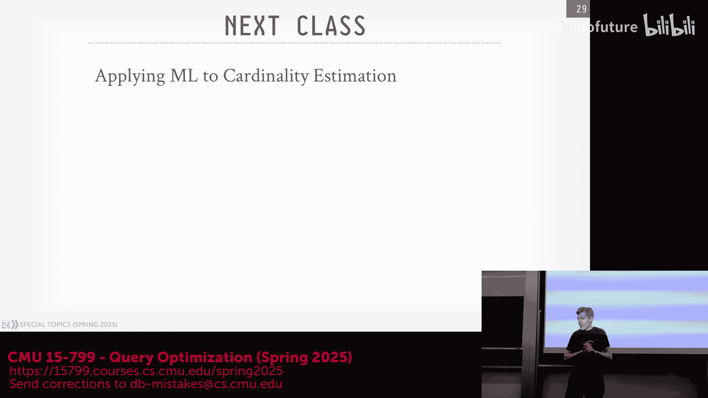
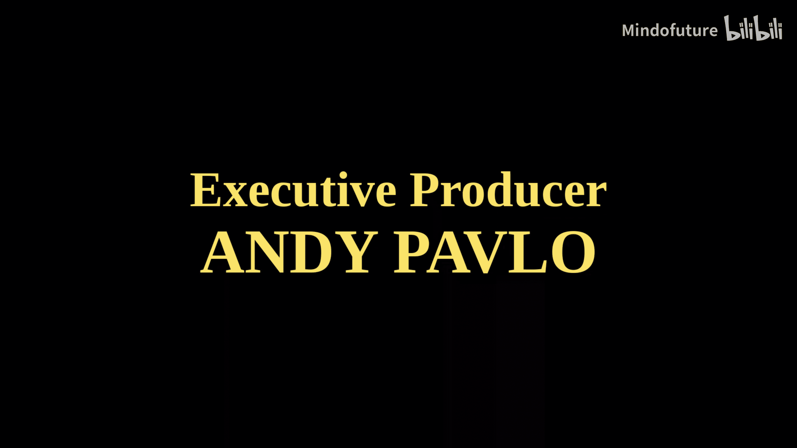

# 【卡内基梅隆---中英】数据库专题：查询优化-CMU-15-799--(2025-年春季)-p14-P14-#14---Query-Cost-Models---More-Cardinality-Estimation-(CMU-Optimize!)--BV1wDE9z9EfK_p14-

あ。🎼おって見せ。🎼A journey drove that Taas carry up the message。

This course is filmed on location at Carmicgie Mellon University in front of a life studio audiences。

So today we're picking up what he left off。Before spring break， talking about Carinality estimation。

 And so the paper guys read today was， I think， a fantastic one from Microsoft。

 where they go into more deeper into the query plans and try to understand， all right。

 when the Car estimation is wrong what happens， Not just like， yeah。

 the query plan get worse why in what way and is there a difference between how bad things can get in a row store versus a column store or some additional query execution optimizations that we'll see in a second。

😊，So that's a nice follow up from the German survey paper you guys read。So for in the class。

 I know I still owe every group an email with my feedback from Monday's project proposals and I owe some of you some data sets and some queries you could use in implementation。

 The status update will be on April 7 on a Monday So the idea is that on status update you come give another five minute presentation and say this is what we've done。

 this is what's working This is what's not working。

 So I encourage you to get started now rather than later and that way you're not like the day before the weekend before you have to give a status update。

 You're like oh， this shit doesn't work at all。 we got to figure out something else。

 So it's better to figure this out now okay。Aright any questions about Project 2。All right， cool。

 for the talks that are coming up， there's a talk to Mar that's in person over in Ne Simon。

 this is from QMDB， a company called Layer Zero， this is CMU alum building a blockchain database system。

I had strong opinions about blockchaining database systems。

 I think they're a terrible idea or unnecessary， other than the crypto and dealing drugs。

 but he's going to talk about the system that they've been building on Monday next week。

 the creator of Malloy， a query language that's sort of again built on top of SQL that guy he's at Facebook now。

 his company got bought by Google years ago。 So he's going to give a talk about his his kids query language and then after that will be the PRQO guys。

 again， same thing。 it's like another higher level query language on top of Postgres。

 company was just a new language no he had a company called Looker。

That was like it was like a BI tool like you know， they could automate a bunch of like know making dashboards。

 like Tableau kind of thing。 And then at the heart of it， they had a they had their own DSL。

 which I then pretty sure was part a Looker。 And then might become looker M I figured to exactly his card。

 But then I think it got carved off as Maloy as a separate thing。 And then he left Google。

 and he still works on this at Facebook。😊，走。Last week talk， I thought the， the Google talk he。

 he missed it on Monday was phenomenal。I mean， we talk a little bit in the semester about why I like that one more so than the German S sequel and the other ones。

That what。I'm holding Jesuit yet， say like， oh， which of these projects I think it should be the one that we go forward with。

 We meeting like sort the Davis community， but we can wait to see what these other ones look like。

Okay。As I said last class， we read the journal paper， a survey paper from the Germans in theODB。

 where they were trying to measure and understand the effects of cardinality estimation errors inside a query optimizeomizer and how that affects the quality of the query plan。

😡，And just as a refresher since it's been a few weeks。

 remember that the cardiac estimation is this the mechanism that query。

 the query optimizeomr is going to use to predict the number of tus that are going to come out of every single operator in your query plan。

And so it's really challenging to do， as we saw in a few weeks ago。

 because you basically have these statistics you derived from the underlying tables。

 like the histograms or the sketches you've extracted through the analyzed process or when you were blockloading things。

😡，So we have these sumizations or approximations of what the actual data looks like。

 Then you come along with bunch of these predicates or expressions。

 You then try to guessimate how many people are going to come out of that operator。

From estimating on top of the， the estimations already you have from the， from the。

 the summarizations。Right again， it's just sort of errors on top of the errors。

 And the the challenge again， reason why we want to be able to do this is because it's good to know we need to know how many tus an operator expects to spit out because that's gonna affect things。

 I join ordering。 It's gonna affect things like do we do an index scan or a sequential scan in our query plan And there'll be some other optimization that we see today from Microsoft they didn'tvent them。

 but they use them where again， having better cardioous missions can can certainly make a difference。

哎。Okay， the setup is like we spent the beginning of the semester talking about here's to actually build a query optimizer that the engine side of things。

 the actual the search process to do join inration to how you organize the transformation rules and so forth。

 And then we've always been handwavy about how are we actually going to cost things。

 And now we've described it at high level what a cost model looks like。

 And the core foundation of what the cost model is using to determine the estimated cost of a query plan is going to be these cardality estimates。

And so recall from the Germans paper that they had this nice pretty graph here where looking at five different database systems and they are just measuring how how off the cardinality estimates are for the different operators when you're doing joins when you increase the number of join operators in your query plan。

 and as we see， everybody is underestimated。Because when we talked about cardiacitis measuring。

 we said that there's bunch of assumptions we're going make to simplify the problem。

That all the preddiicates are basically probabilities that are independent of each other。

 So you take the probability that tu is going to get selected from one predicate。

 multiply the probability the tu is going to get selected in another predicate。

 And that's that's the total the total carbonate or total selectivity of a predicate。 Of course。

 that's wrong because oftentimes the attributes have correlations。RightSo you can see again。

 the trend where as you add more joins， everybody is underestimating from where you should be or where the actual ground truth is。

 Nobody's actually overestimating。Again， this is for the Jon order benchmark。

 which is a workload that the Germans still developed or created for this particular paper derived from the IMDB data。

 Yes， any particular reason by Microsoft is like's others。The对。Asumption the graph。His question is。

 why， why is Microsoft the balance tighter， Why is it closer to the a。

 Because they're doing a combination of， of the histograms， as well as some sampling as well。Right。

 Ura， or sorry， Hy I forget what the hyper is doing sampling。 I know Ura is doing some sampling。But。

 I mean， so think I think it's a combination a better。

Better statistics and better estimations upon those statistics。Right。So。

 and then theres this other graph showed here where they took Post Expresss and took， again。

 took the join on a benchmark and they。Actually implemented another cost model that was really simple。

 It was just like county member of twos coming out of an operator。

 and's essentially the logical cost of a query plan。

And then they compared against the sort of default cost model you get in Postgreass and one where you actually tune those parameters I talked about before。

 like what's the relative weight of a sequential scan versus a random IO？

Or what's the relative weight of processing a tu in memory versus processing Tal from disk， right。

And the main takeaway from this from the Germans analysis is that。

you don't actually need a fancy cost model to get better query plans。

 it really comes down to can you have better cardinal estimations？😡。

So if you're building a database system or building a query optimizer。

 you're better off spending your time making your estimations better rather than making a sophisticated more sophisticated query cost model。

So the paper you guys read。They looked at it， looked at the German's work。

 and they point out three deficiencies。 are they're not。

doesn't invalidate what the Germans had done because certainly Postgres is acting the way that they saw when they did their experiments。

 but they felt that the scope of the analysis was limited because they only looked at sort of one workload joining in a benchmark and they only ran on Postgres。

 which I said I think multiple times this semester。

 the query optimizer was terrible one of the worst ones open source systems despite his popularity。

And so they wanted to rectify this by doing a more thorough analysis similar to what the German paper did on more workloads and running on SQL server。

RightSo the first thing to point out is the join in a benchmark is pretty simplistic queries。

 that all this pattern called select project join SJ queries。

 And this is like query 10 A from the join end benchmark。 But you just see of at the top here。

 justt want to joins。 And then we just have our where clauses are just matching up when foreign keys and primary keys。

 We have a filter on like between clauses or a disjunction with a like there is some some additional filtering we're doing that isn't just doing the joins But at the high level I'm doing a select。

 I'm doing a projector the join And the top here， you see I'm doing bunch mins。

 that's just because they don't want to dump out all the results for benchmark。

 you just turn whatever the min dies are。😊，So pretty much all donor benchmarks queries look like this。

But as you know in the R worklas， it isn't always going to be so simple。Not to say it's not common。

 SBJs are super common， but it's missing a bunch of other things that people would write in queries。

😡，So that's the first limitation The next one is that they only injected the true cardinality in the query plans for all of the operators in the query plan again the idea is that you have bunch of operators in your query plan and the query optimizer as it traverse that tree or DAG is going to do look ups in the cost model and say okay what's the selectivity estimate for this operator for this filter。

😡，And so they hacked up Postgres that allow them to override whatever the estimates are coming out of the Postgres cost model and actually inject the true cardioiny。

😡，But in this case， in their analysis or their experiments。

 they're going to do it for all of the operators。And as we'll see in a second from the Microsoft paper。

 isnt you don't actually need to do that for all of them to get the benefits of having accurate cardinality estimations。

 There's actually a sort of subset call the essential set。

 that is like the bare minimum you need that you inject the cardinality estimation。

 And you get all the benefit as if you inject it to the cardinality estimates。

 the true cardinality estimates for all the operators。

And the last one that the Microsoft people complain about or bring up is that。Li。The paper， again。

 the German paper only evaluated Postgres in more detail because it's open source。

 they can get carinities in that， and there's a bunch of additional optimizations you can do in the actual implementation of your database system。

😡，Related to adaptivity， meaning as the query plan is running。

 the data system can make decisions actually how to change or permute your query plan on the fly based on the data that it's seen and we'll spend a whole lecture on this in I think two weeks discussing this that Microsoft one that I'll talk about today is pretty limited's just going to change what join operator or what join algorithm're using we'll see more sophisticated methods later on。

 but they're claiming that okay in some cases the data system can actually be implemented in such a way that it doesn't matter if you have bad cardity estimates because if you have runtime at addivity in your query execution engine。

 then you can overcome these limitations。So again， we'll see that in a second and Postgres doesn't actually do this。

BigQu is probably the most adaptive of all the Oep systems。

 the way they sort of organize their pipelines through this like always having this explicit shuffle phase that allows them to actually adapt the query plans on the fly more so than than other systems。

 But we'll see this in a second。 or'll see this in a few weeks。So again。

 we'll go through the background for the paper and then again the Microsoft guys。

 they broke up the evaluation between the row store and the column store I think is fantastic because postg as a row store to do all the findings actually carry over from the row store to assist where you have a column store where the physical design。

 remember choices you have in what indexes used is much less than in a row store。😡。

And then we'll talk about the two different optimizations they did to Bimap filtering and adapt joints。

R。So I think I already said a lot of this before。 But again， the。

 the paper you guys read is from 2023。 It's， it's a fantastic follow up from the Germans paper from a few years ago。

 or again looking at。😊，How cardioam estimation errors affect the query plan quality in in a system where you have a state of the art query optimizer。

 I said many times， the Microsoft SQl server1 is is a cascade implication。 It's It's very robust。

 It's very good。 And then they also have。I would argue maybe not a state of the art execution engine for some things。

 yes or other things。 no， would say the Germans umbr system is probably better。

 Duck DB is getting there as well。But it。い。I mean， Seler has has a bunch of enterprise stuff that。

Big companies who pay a lot of money care about that like D D B is not gonna have an U is not gonna have。

 But in terms of like the actual engine running queries， you know， I wouldn。

 I wouldn't say SQL server is is the state of the art。

But it's still very good and betterment Postgres。😡，RightSo again。

 they're going to pair they're going to take query plans in a bunch of different workloads and they're going to inject the true card estimates and operators for when the SQL server is using tables or organized tables as a row store。

 so therefore you have B plus3， traditional B plus3 indexes。

 and then when they have these caar indexes， actually ignore bitnapps。

 I'll explain it's basically dictionary encod and I'll clean what they're doing in a second。

And then they would have this additional experiment， which。

Unfortunately is a bit inconclusive in terms of saying anything direct。

 like here's how you could actually modify your query optimizer to exploit this。

 but they determine how they start looking at how to identify what's the minimal subset of operators you need to have an a query plan where you can inject the true cardized estimates or the super accurate estimates and still get the best plan without having an injected for all your operators。

😡，So as I said， SQL server is using a cascades optimizer。

 It's the one you guys read in the textbook from earlier in the semester。

 and one of the things they talk about what I think is fantastic is how they're actually going to inject。

The cardinality estimates。In in a cascades based system or top down based system， right。

So what they're gonna to do is they first generate all the logical expressions for the you know。

 for a query plan。 So you're of populating the memo table without doing further exploration or applying to additional transformation rules。

 It just， you just generate， here's all the logical things that that exist in my query plan。

And then for each logical expression that's in your memo table， they're going to do a recursive hash。

😡，On on， on that logical expression and all its children's expressions and all its children's children's expressions。

 do you get to the leaf nodes。 So now you have this， this。

 this hash that encompasses this sub treee rooted at each logical expression in your memo table。😊。

And that's going to allow you to uniquely identify it later on when you want to inject the card out。

Then what they're going to do is take all the logical expressions and you're going to basically do reverse parsing or reverse it back into SQL。

😡，And this seems kind of weird， right， because it isn't always a one in one correspondence between what's in a logical expression versus what SQL keywords are。

 but they claim it works。And again， you're going to recursively do this。The way about it says。

 now I have say。Say I have a select query with with with a join on two tables。

 I'm gonna have a logical expression that represents the root of that join with all its children going down。

 Then I'll have separate logical expressions for the the outer side and the inner side of the join。

 And for each of those logical expressions， I'm going to join it a SQL query。

 So the root would just be the original query we were given。

 But the the children will be like just select star from table food and select star from table bar without doing the join。

😊，And then now I can take all of the SQL queries I've generated。

 run them for real on the database system and get the true cardinity measurements for those different operators and then you store this in a catalog and basically the hash mapap where you're using the hash you generated from at the beginning。

 then at run time or during the optimization time as the cascades is traversing down and does a look up and say to the cost model what's the cost of this logical expression。

 it knows and go look up in the catalog and get the pre-computered one that you had before。😡，I mean。

s sort of obvious， but I think I like the way they sort of describe it。And it。admittedly。

 this is the hardest part， how to do this， and they claim that they didn't do for all the operators they did for the major ones in the workloads they had to consider。

But imagine this is going to be tricky。As you guys are finding out。Al right。

 so what are the workloads they're looking at。 So just like in the Germans。

 they're going to use the sort of standard Car analysis benchmarks， join the benchmark。

 the Car estimation benchmark， I think is the extension of TPC H or DSS Stats is from a data set from stack exchange。

 and then they're going to have the standard industry benchmarks。

 TPC D TPC H DSP is the data science benchmark。 This is actually also from Microsoft research。

 This is just a modified version of TPC DS that can allow you to sort of set。

Workload evolution so the parameter values can change for the queries over time so you can adjust s and other things。

And then they're going to have a bunch of workloads that they've collected from with internal applications running Microsoft and external customers。

 and then they're going to have a combination of the raw query traces collected from the database system。

 like literally， here's the SQL query that I've executed with the exact values of the parameters。

 and then they're also going to hack up the SQL string。

 strapped out the parameters and have these sort of templated versions of this。

And the key thing to point out， again， why they're doing this complete exhaustive evaluation。

 because again， the join out of benchmark from the Germans they're using is just all the select project join queries。

 whereas for TPC， DSS and H and DSB， you're going to have the group Is。

 the outer joins and NSqueries， CTEs and Union intersects that make up things you would see in real workloads。

😡，RightThe real workloads， some of them have some of these elements， not all them do。 But again。

 it's just it's more things than than you would see in the Jordan on benchmark。

So the first evaluation they're going to do is。Run all these different workloads on the row store system。

 Again， in in Microsoft SQL server by default， when you call create table。

 it'll make you all make you go to a row store system where the tuups are stored in in unorganized heaps。

 sort of the classic architecture we discuss in。In 445， 625。

 you can also do index organized tables where you say here's the B plus tree and I store all the data in the leaf nodes。

 but again when you call a Cate table you have to give it extra commands and do that and I don't think they're doing this for all them。

So， and they're also gonna create all the， the。The expected B plus3 indexes for all synthetic workloads and then for the customer workloads。

 they have this tool called DTA that's basically index advisor for SQL server that you get when you pay Microsoft money and so they're going basically examines the workload it figures out what attributes the queries are accessing all the time and then has some kind of cost model to figure out here's the best indexes for me to pick。

Orracle and DB2 have similar things， and there's more primitive ones for Postgres and other systems。

So the first graph here is going to be the percentage of the queries that' are going to change by 2 x or more。

 like this is a common thing you're seeing in all the experiments where they really mostly care about like am I ever getting2 x better？

😡，And the idea there is the 2 x is a rough high water mark to say this is actually worth doing or whatever we're doing to。

 to， to get the more accurate query estimates， it'll make a more of a difference for us if we get at least2 x better query performance。

And so the first thing to point out is that。In this graph here。

 the green lines are all the percentage of the queries in each workload that got 2 x more or better。

 The yellow ones where there is no change and the red ones is when there's a regression。Right。

 meaning like the you injected。You know， exact accurate Carary estimations into the query plan。

 and then you end up getting a you know query plan that's actually worse than you would have if you just use whatever the estimates were from the database system。

Right， so also， too， for this， this experiment， all the queries are running as single threaded and they're going to disable the adapter join and the bitnet filtering stuff we'll see you later on。

 So this is like bare bones SQL server without any additional enhancements。😊，Okay。

 the regressions are rare， they do occur， and again。

 it seems counterintuitive that your queries would actually get worse when you have better carbonary estimations。

 but then again， that's a reflection of the cost model。 In some way， the cost model is incorrect。😡。

And either through tuning those parameters or just maybe to form those themselves。

 and then you end up for some queries getting regression， but it is rare。

Next thing point out is that for this workload here， they actually don't get any， any benefit at all。

 right， And for this workload real 3， it's basically like。

 a database system for like a version control system。 It's not， it's not Github。

 It's probably SharePoin， whatever the the Microsoft 1vat for。Perfor。

 they has they have some other one that's not gi that has sort of been relegated。

 But think it' something like that， right， like， which's the Gitthub catalog。 And for this one。

 for whatever reason， queries don't are not getting any any major better。 Again。

 it doesn't mean that some queries aren't getting some improvement。 Like if you look over here。

 there is a minor bump。 But the percentage of queries that are getting too extra faster is actually low。

So again， then we have these guys here， where TCD S and the， the real workload for the。

 the templated version of it。 That's what the the instances is what the I IN S T means for these ones。

 you're getting a。Overall， a reduction in performance and the main takeaway from this one is that a majority of the queries are actually getting faster。

 but for the queries that are actually getting slower or having regressions。

 the absolute time of their regression is so significant that it negates any of the benefits are're getting from more accurate carbonized estimations。

😡，Right， so most of the queries are getting faster。

 I can see there's much queer here are getting2 x faster。 but the ones that are getting slower are。

 you know， the absolute numbers are are quite significant。And again。

 this is a row store running TPCDS。 TPDS is a lot of joins and a lot of CTEs， it's pretty nasty。

 It surprised me that you don't see the same effect in DSB because TPCDS or DSSB is derived from TPCDS。

 I think they simplified it a little bit， but。嗯。You to me， that was surprising。Alright。

 so now we see again。 So we're seeing some benefit and we're seeing some some reduction。

 The question is， all right， what's actually going on rather than looking at these core screen results。

 doesn't really tell us what the optimizer is actually doing That's with these better card analysis estimates to make things run faster。

So this is whether they are actually can do a drill down or do inspections of the query plans that are generated from the previous graphs and try to understand why the query plans are actually getting faster。

 like is what changes in the query plan itself from sort the original version to the newer version with the more accurate cardiac estimates that's causing them to get a better performance right？

😡，And as they point out， and the Germans also point out， too。

 it isn't just because now we have better carboninality estimates that we're going to generate better drone orderings in the case of Postgres。

 the Germans point out that when you have better cardary estimates。

 you end up doing less index scans or index seeks。😡。

And because basically if you're underestimating how much data you're gonna get out from the table。

 you're gonna get you know5 tuples instead of you get 5 million tuples。

 if you don't think you're gonna to get5 tus， then you're gonna to choose an index scan。

 But then it's only when you start scanning that index， you realize， oh。

 shoot I was wrong and you you're getting way way more you're waiting more tus than you expect。

 And the index scan is be always way more expensive than a special scan if you're reading a lot of data。

So what they're going to do is for all the queries where you got 2 x better。

 they're going to categorize them and based on which class of operators within the query plan are going to generate 50% or more of the improvement。

 the overall improvement that they're seeing。😡，So the first category is going to be C operators or index scans so these are if you're accessing a base table with an index you're doing basically random IO so index probes。

 index scans that would be the first category scan operators would be sequential scans if you're just scanning the blocks in a table from beginning to end nonle operators would be everything above the leaf nodes in the query plan so aggregations sorting limits。

 whatever else you have joins and then miscellaneous or catch all is their term to say for the operators they don't fit until all these other stuff。

 bunch more random things and they put them into this。

So this chart here is showing the percentage of the queries。😡。

For each of these benchmarks where you got a 2X improvement。😡。

And categorized based on which of those four categories and before。

 like which of the operators are are generating most benefit for the system for for the query when you inject it with the。

 the， the better statistics。And the first thing to point out is for the carbon estimation met。

Carna I estimation mentioned benchmarkmarks in so job， stats and CEB and for these workloads。

Determining whether you actually want to do index scan or not makes the biggest difference。

 That's a pretty sizable percentage of the queries over 60% are getting the benefit because of this because you're not doing。

 you're choosing not to do a index scan。 And instead you're doing a sequential scan。

For all the other ones， it's the combination of the other three。

 There isn't one that dominates like in this one here。

 it looks like the scan makes the most difference scan and the nonle ones are sort of about the same there。

 But for the real workloads， it's basically almost split even between these three things。Right。

So again， in this case here again， this is just saying that。In the Germans paper。

 they would have solve this。 They would have solve that if， if you just get the。

 if you figure out like you don't need to do index scans and get postgressed do scans。

Either because you identify that the access method that scanning that table is going to produce a lot more peoples than and you think it's going to produce。

 and therefore you don't want to use index or in some cases， if you reorder the joins。

 you end up not needing to do an index probe， you get a huge benefit。

 but for all the other workloads。You know， it'， it's actually all the above。Right？Al right。

 so let's go more detail and understand what SQL server is actually doing how it's actually modifying the query plans for two of those categories。

 when it has better card estimates。 So for this one。

 we're going to do the join on benchmark query 17 a And as I said it basically looks like this。

 a bunch of joins a bunch of predi to do join join the tables together。 There's a like。

 there's another keyword look up there。 and then we're just getting the min values so we don't get all the output of the query。

😊，So here's what the original query looks like when it comes out of SeQL server。

 when you let SQL server use the cardary estimates that it generates when it ran analyzed all on its own。

and the way to understand this is that the sort of the white guys here and then the pink ones here。

 these are all the cr plant operators， the gray boxes here are the cardana estimates with the the estimated selectivity or estimated cardinalityity of each of these operators generated from drive statistics and then actual that it solve when X ran。

And then the dot lines here just correspond to them shortening the query so they don't have the full query plan they're sort of cutting off saying there's something in between here but we don't need to show because it's not relevant to the example in this case here。

 there's one，2，3， four， there's four joins， but as I showed here。

 we're joining way more than four tables in the query。😡，All right， so。

If we inject now the true card estimates in the query plan。

 using that method where they're hashing it and injecting it into the system catalog and the query optimizer。

 this this is what changes for this particular query。

So the first thing to point out is that we had this C operator。

 so CI is cluster index on this table here， and this changed now to a cluster index scan。Right。

 because if you look up above， the， the cardinality estimate told us that we were to get one two out of this。

 in actuality， we got 300000。So now with those accurate statistics， it recognizes that well。

 I don't want to do an index probe because I'm not going to get one tuple Im going to get a bunch of tus。

 and then I actually want to put this on the outer side of the instead of the inner side。😡，Right。

And actually also case here， you can see that it switch from an index S loop join to Em join。

Because the index scan is going to give you the data in sort of order。So again。

 now you see again by injecting the true cardiac estimates。

 we have a better sense of what access method or what scan operator we actually want to do on this table and then where to put it in the joint。

😡，The next one we have is this one here where we're doing an index seek on the cast info table。

 and again， the cardinality estimator said， okay， you're going to get 15 tus in actuality you've got 2。

8 million。Al right， so that' pretty pretty off。 And so by switching to over here now。

 I actually don't know why this is like this， right， because it says estimated of 24。

 but you're getting back 1 million。 So I， I think that's a mistake on their side in the diagram。

 But the again， the main takeaway is that we。😊，It's still in index nextse， but we。

 we changed what it's joining against， right， So it was joining against what was coming out of this thing here and now it's joining against this what's coming of this hasht here。

And the last big chain to point out here is going from this indexness loop join into this hash join。

😡，The join order still stay the same right， we do keyword on the outer side and the movie keyword on the inner side。

 we see the same thing for updated query plan。😡，But the the main idea here is that the。

The on the on the probe side of the inner side of of the join， we thought we're to get 33 tuples。

 We actually got 41000。 And then when we switch now from an index scan to a just like I guess a cluster index scan scanning along the the leaf nodes。

 right Yeah， we're gonna， we're gonna scan the 4。5 million， all 4。5 million tus of this table。

 But we know that I don't know why they're actually doing a hash join。For for one tuple。

But an easy way to do that is just like if my key equals your key， admit it。

 you don't need to build a hash table for that for one tuple or whatever。😡，So anyway， so so like。

So they're scanning along and they're probing this thing。

 and then obviously this is can be way cheaper than having do multiple probes into the index。😡。

So like what's going on， so SQL server now with better statistics is able to switch what when it's doing an index seek into either a sequential scan doing an index probe or index seek to sequential scan or an index scan or a cluster index。

😡，And that's again， why this query is getting faster。

The next one they make a big deal about as well is to do aggregation pushdown。

And this is the one of the ones。 This is one of the optimizations that they say that Postgres can't do this。

I know Sva can do this， Bigque can do this。 a bunch of other systems can do this。

 The Postgres cannot。I don't know。 D probably can do this。 I haven't tested it。嗯。

And so here we see that we have a， we have a join， doing a hash join up above。

 And then we're gonna to take the output of this hash join。

 We're gonna sort it and then do a streaming aggregation， which is basically a sorted aggregation。😊。

Right。So with now true cardity estimations， what happens is that you end up moving down or breaking the stream aggregation at the top into a hash aggregation where you build a hash table and maintain the aggregation as you're going along。

 but then you still keep the streaming aggregation up a above because you still need to sort of finally clean things up at the end。

😡，To get the true carboninalityity or two aggregation out of it。

And so what you can see what' happening is that over here we thought we were going to get 96。

000 tuples coming out of this hash drawn， when actual reality， we got 5。8。😡，Right。

 so we we're way underestimating the weq way underestimating the number of tus that are going to get qualified for this joint predicate here。

But then now， if we with the true statistics， we would recognize， all right， Well， the。

 the number of twoples that I'm gonna condense this down into up above when I do my aggregation。

 I'm going to go from 5。8 million to what is that41000。So in that case here。

 I'm doing bunch of join join matches in my hash join here that for two% that is going to get coalesc。

 combined together aggregated together up above in the query plan。😡。

So what you're better off doing is actually computing the partial aggregation below the join。

 which we talked about before and we talked about transformations。And then I now when I do my join。

 a hash one here， I'm joining against my hash aggregation， which is 41。

000 tuples rather than the 5 million tus I would have if I didn't aggregate beforehand。😡，哎。

So that's why for this one here， you know， this is a huge win。 And basically， you。

 you can see how the。I don't I don't know why they still keep the stream aggregation because if you sort it。

 we had to look at this this is for the word work。 We dont have a real query。

 But maybe there's an order buy where you have to sort it at the end。 But in actuality。

 if you know that you're not doing any filtering or aggregation。Coming out of this， this hash join。

 you may not actually need the sort or the additional aggregation of above。

 there might be an order buy or limit or something else above in the query plan。 you have to do this。

 So they have to keep it。Actually， yeah， you can see the dot line here means there's something up above it we don't have here。

So snowflake can do this right， Snowflake basically puts they' talk add activity later。

 but look they put they put the hash aggregation in there in the query plan always when you have sort of pattern like this。

 And then at runtime， they can decide whether turn alone or not。

 based on many how much data is coming out， the leaf is b。In the case of SQL Ser， they can't do that。

 they always put it in there， but the idea is basically the same。后。So what's going on。

 why are there why are the Car re errors， we've seen how they manifest or how they affect the query plans。

 one of them are accurate， but why is this occurring？😡，And so in this paper。

 which corresponds with the or corroborateates what the German said， is that。

When you have when you have a skew data session when you're doing joins on skew data。

 then your cardinality estimations are just going to predict over predictdict the number twots are going to come out of that join。

RightAnd then again the errors of a joint estimation is multiplicative because it sort of rides up to the qua plan。

 and now I have bad estimates from this drone operatorator being fed into another drone operatorator that's going to generate more bad estimates。

 and then things get worse as we saw in that graph the Germans earlier， right。嗯。

The other challenge he also to talk about is that the when you're sw， you end up。

And you have filters， you end up。Incorrectly predicting the number two that are gonna going get filtered out by your predicates。

 And it's basically the same thing as as the。As the joint S。All right， so。

Before I talk about the columns for evaluation， I want to briefly mention what the。

 the sQL server columns store extension or or。It's not an extension， because it's built in。

 But what they're what is this capability。So if you， if you remember your your databases history。

 column stores became a big thing in the mid to late 200s，2008，2007， systems like Vertica。

 Greenpl sort of came around the time。 I think park sell， which then became red chip。

 but at the time， they originally a a row store， But it was a couple other column store systems that were around。

 And and it became clear that if you're doing analytics， you want to run on a column store system。

 vector wise is probably the other same as one as well。嗯。And so in 2010， early 2010s。

 Microsoft announced and released a new feature in SQL server that allowed them to do compressed column store indexes。

 So the original version of this was what's called a fractured mirror architecture。

 which was invented by Jnesh Patel's PC by back in Wisconsin， David Dewitt。

 The basic idea is that you have your row store， all your updates go the row store。

 and then there's like a background job that takes the updates to the row store。

 and then converts the tables into a column store。 you do this sort of incrementally。😊。

Oracle basically， their in memoryory column stories basically works the same way。

And then an a query shows up the system can then figure out。

 do I run on the column store or the roast store depending on what data you？But then later on， in。

 I think，2016， Seaor server then added the ability to。

Not have the row store at all and to say that this table is gonna be stored as in these column store indexes。

 so then they had to add support for insert update deletes and you basically add this Delta store thinking it like almost LSM where all all your modifications go into this the row store space and then its like before in the background there's a job that goes has and compacts it and then builds the columnar data。

嗯。they came out in 2014， and then。I think this came out in 2016。 whatever。

 So basically what they're doing is that assuming you have your your D table looks like this。

 They'll go break this up into row groups， similar to what we saw in parquet and or can un other things。

 I think it' it's a million tuples。And then for each of these the columns or attributes in the table that you care about within each row group。

 you're going to build basically a columnar data representation。

 so you're going to encode and compress it and you're going to store it as basically a bunch of contiguous data as columns that are all dictionary compressed。

😡，I think they can do also RLE and Dlta encoding like all the tricks and the and stuff that we talked about in the in class or' taking in 721。

 all the tricks they're doing here as well， and what's interesting about is that they didn't actually have to modify。

 make major changes in SQL server destroy all this， they're destroying this as blobs。

As a regular blob store of no use for tables， it's just that when you get back a chunk of data at a blob store。

You have an extension engine that knows how to interpret it as columns。That's that yes。

 So it's the Microsoft one table can be as as table can be as。This does that Iけれ。

And said you few joins in that wonder effort like。As that we make in gender that， you know。

 iss not happens much of like。Performance or et cetera， can carry change。

So the statement is that in Tel server， when you create a table。

 you can specify I want to be a row store or it can be a column store。Yes， also。

 you can have the row store and you can say， but also build me columns for indexes on it。

But the primary data， or the data of record is going to be in the row store。Right。

 so that so you can do that。 And your next question is， all right， Well。

 now if you have a bunch of mixed。Table types， where you have a bunch of row stores data and you join against McConlin store data。

 isn't that going to be slow？Yes， probably right， because at the end of the day。

 if if you have really wide tables in your roast store and you only need one column at it。

 who cares whether you're you you have a fast vectorized engine。

 you still have to read entire pages just to get one column。 Yes， so Microsoft said。等对的。Right or。

Keep keep your row store， but then still build the comm store indexes on them because then you can do joins on the comm store indexes。

Right。And they're happy to charge you money for it。O。So I think I've already said this。

 but as part of the changes of adding comm indexes the columnar storage in in SQL server。

 they modified the query optimizer in SQL server。 Do you now be aware that there's columnar indexes。

And they actually didn't make major changes to。Theirre cascades implementation because it's just another access method。

 It has a cost， like any other other access method。 It's no different than if add a new index type。

 like a hash table or you know， a try or something like that。 It's it' basically the same thing。

 And now you can within your cost model， you can account for the performance benefits you get。

 if you choose know，lum storage versus a row store。

The other thing I'll point out too which sort of related to his question is the original implementation of SeL server。

 which is based on sibase from the 1980s， even though they rerote a lot of it in the 1990s。

 is a roworiented system that's doing the volcano query processing model so they're calling get next and getting one two at a time。

 but then obviously that's going to be terrible for for your columnar storage because now you have able to clonear data and if you're still getting the data out as putting into a roast or engine like I said before you're gonna to get all the benefit。

I'm pretty sure Microsoft or Microsoft bought this this distributed version of Postgress called Citus out of Turkey。

 They had their own column store extension called C store I'm pretty sure in that system with that extension。

 you still got like even though it was a columnar data。

 you still got the data out as rows and you ran through Postgres's row query engine。

 which is gonna to be slow there's a bunch of other extensions to people I'm trying to work on to add column stores in Postgress the ones that are probably most interesting is where you circumvent the row store column or the rowbased executiontion engine Postgress and let it run like duckDB or clickhouse because then then you're getting all the benefit of of a columnar vectorized engine。

Al， so again， that that's the basic idea is that there's these。

The database the optimize is aware what the physical layout or design of every single table。

 it can now make decisions on the appropriate way to access that。So for their comms evaluation。

 they're going to store all the data within the columnar storage and SQL server。

 so they're not going to do the row store， they're going to do the fraction mirrors。

 and there's not going to be any NP plus street indexes。

 It's just going to be those compressed dictionary columns that we talked about before。

RightAnd so the overall improvement is roughly the same for most of the workload。

 There are some outliers that we'll go through。 but in general。

 the main takeaway that we found is that。Having better cardinity estimations for a column store system is equally as beneficial as you would have in a row store system。

Right？And again， in this environment， the index scans are rare。

 so you're not getting a lot of the benefit you saw in the row store system where you say， okay。

 this should be not index in， it should be a sequential scan。

 most of the times you're just doing a sequential scan but on the press columns。😡。

So the first thing to point out also， too， is that。TheThe speed up is roughly the same。

 although the CEBs is quite significant here， but there's。

There's a larger number of queries that have regressions in these different workloads and the overall regressions you see for the total elapsse runtime of all the queries is much greater。

And again， what they point out here is that。It's not that overall you're getting better。

 you're getting worse query plans in your column store than you would in the row store。

 It's just the ones that do go wrong。 The absolute numbers of the absolute degradation in their runtime is so significant that it negates any benefit you're getting from other stuff in the case of real1 right。

 there's a large percentage of over 20% of queries are getting at least2 x faster。

 but the overall one time is reduced because for the ones that got slower they're dominating the total run。

😡，Any particular reason for activity。Std， their question is， why is TCDS the worst one here？

I actually get a look。I mean， the general point is that the worst ques are really bad。

 so they're just making it look pretty bad。やっぱりロトにはますかな。Preces it to， so。

But this is all like percentage， right， so the row storage is definitely way low over TPCDS。😡。

Right and so like。Like does it mean now your  query is going from 10 hours to9 hours。

 whereas in this case here， it might be going from 10 minutes， to like 20 minutes？Right。

 so it's2 x worse。 But like the absolute time is is much， much less。All right， so the next。

Eximently they did， which I think is phenomenal， although it was very short and brief。

 They talk about additional things they want to do is。They asked the question。Okay， well。

 most of the time you're gonna get a benefit if you inject。True Car down estimates and geo plan。But。

In the case of the Germans and and the experiments we'veve seen so far from from Microsoft。

 they are injecting the true car estimates for all of the operators。In the query plan。

And so the question is， is there a minimal subset of those operators in each query plan where if you only inject the cardomic estimates for just those operators。

 you still end up with the best plan you would get if you injected the true card estimates for all the operators？

😡，Becauseuse again， getting the two carbon estimates is super expensive。Right， if you。

These data sets are are kind of small。 But think of like， if I have 10 petabytes of data。

And I have 1000 tables that I may be accessing in in my my query。

 I don't want to have to do a sequential scan on every single one of those tables just to get the true card on estimates and then to then inject it in the query plan and get the best result。

 So is there a way to identify what's the minimum subset that we actually need。

So they're going to identify that a。The groups within a query plan are considered the essential subset if you inject the true carbonomy estimates for those operators。

 you end up with the same query plan you get if you do it for all of them。

 and that if you remove any operator from this minimal set， then the query plan actually gets worse。

And what's fascinating they don't go too much detail about it is that there's different ways to explore like what the mineral set is because in some cases。

 if you remove one operator from the essential set first versus another one。

 you may end up making the query plan worse， but if you remove one versus another。

 we switch the order in which you remove them， you may end up with the correct results。

Or is it the best plan right So they're doing basically brute force source to calculate this。

 which is super expensive。 You wouldn't actually do this。 It's not practical in a real system。

 but it is interesting to see that， there is actually an easier way to do inject the better cardiac to get the better query plans。

😡，Without having to do for all of them。So this scatter plot here is where along the X axis is the total number of groups。

 they call memo groups， the total number are the logical groups in a memo table for each query plan。

 and then the Y axis is the number of groups that are in that essential set。😡。

And so the main takeaway is that for， for all the queries， the median set。

 median size of this central set is 5。There's one outlier where the， you know。

 if you have100 memo groups， the the essential set is like almost 100。

And think those accessing a base table。But five is actually practical。Right。And maybe again。

 you can think of now in in in your database system， you can then prioritize running。

 analyze or as you're inserting new data， you spend a little more work for those tables that maybe actually matter the most。

 Otherwise it's not based on tables based on the operator。

 So what table matters the most from one query to the next may change， but they can they haven't。

I think they said there is some overlap， but they haven't done a full evaluation of this。

So I think this is super fascinating。It shows that you don't have to do the exhaustive injection of the。

 the of the clearly accurate statistics that the Germans did。

 and you can still get some of the benefit。As they talk about in the paper。

 further studies needed to understand this。Yes， what for the city？So they were saying like。

They talk about how。Again， the way you calculate the essential set is very inefficient with what they're doing now And。

 and that the ordering in which you remove things because they're're just putting them all in and rubing them1 by one。

 They're doing prefor search。So is there a better way to do that whats doing that take that he there are some important ones and as as you get right those important ones。

 yes you fine yes。How do you identify the important ones？That they're saying that's super hard。

Furthermore， they're also doing exact Car eye injection injections in this。

And so if you have now the essential set， assuming you have a magic wand to calculate that。

 do you have to have， how off can your cardal estimates that you' injecting actually be and still be okay？

😡，so there's a bunch different questions about how to handle this。What kind with approaches。

 like I mean， what are they exporting anything like some great they would keep us on anything so that they can search。

Better than。You。Except for like good force， like what are the ways that taken？Get a。

So his question is， other than bru For search where they're doing now。

 what will be a better way to doing this again， if you can retain from one query pan to the next。

 what was that essential set and there's a way to categorize or classify why or understand why those operators are part of the central set。

😡，And therefore， you know， like， if there's something about them。

 like they're accessing our super wide table or a really big table or， you know。

 like if there's something about。Given operator that causes it to have a pronounced influence on the quality of the query plan。

If you can identify that。within a query， now when a new query shows up。

 you don't have to do the for search， you can rely on that history you have before fixedcycls。Okay。

 this thing like nobody knows。They are know。哎。Again， like。I gotta say it when I like。

 when I read the paper they're gonna do this。 I when I got to the section。

 it's only like 3 or4 paragraphs。 right， again， I'm not not diminishing the results。 It's just。

You know， it wasn't the main focus of this paper， but it shows again that like this is。

 this does make a difference。 And this is something we're pursuing。 And maybe they already are。诶。

The way to understand industry papers， although Google is certainly like this。

 Microsoft is pretty good about putting stuff out in a timely manner。 but oftentimes。

 like whatever the paper you may be reading from a company， like it's already out of date internally。

Like， they've already filed patents on it， you know， and it's already been like out for five years。

 Like when the Spanner keep paper came out like， was that 2011。

 Spanner didn't around for like4 or five years。 That's what Jeff Dean said， right， Like。

 but they not they wrote the paper the patents。 then it came out。Right。

And then they move on to the next thing for Microsoft。

 because this paper coming in Microsoft research。You， I like to think this is a pretty bleeding edge。

 They're still gonna file patent on because that's how to do promotions at Microsoft and a lot of companies。

 And it may be the case that they didn't actually there's nothing that they implemented in this paper we read。

 This's gonna be SQL server， but certainly it's going to provide guidance to the SQL Ser team about things they could potentially add on。

So， I'm trying to say like that this is， I don't know whether they've taken this paper and they have a better version of it。

 I think this paper is 2023。 It's still pretty up to date， but they haven't announced anything， hey。

 this new Visco server can take advantage of this。And again。

 who knows whether the Oracle and other companies is doing this， they just don't talk about it。

All right so。As I said beginning， the SQs server has two different optimizations they can do where。

The question is。For a comm store system。If you can do these additional runtime optimizations。

 is that going to mask the the problems you have when you have in inaccurate card estimations， right。

 So again， the， the idea is that。It's so expensive to get the true cardomy estimations。

 whether or not you're doing the， essential subset or not。

 Then do you actually even need need it if you can do these two additional optimizations。

And I will say these are not unique to SQL server。 This first one here， the B filter Dr off。

 that's pretty common。 Most Oaf systems do this。 The adaptive join 1， I think。

 is specific to Microsoft， but it's。Honestly it's weak。

 but it's pretty tame compared to the other additive that we'll see later on。

So this is just this is just a reminder of what we're talking about from 721 or45，625。

 But the idea of what they call Binet filtering is what we've called sideways information passing in in other lectures。

 the basic idea is that if I'm doing a hash join as I'm building the hash table on the probe side。

 Sorry the build side of the join。 I'm populating the hash table with all the keys， do my join。

 I'm also going build a bloom filter。 I populate that with the joint keys that I'm populating my hash table。

Then now on the probe side， I pass along the bloom filter so that the as I'm scanning along and generating tubbals to go up into the join。

😡，I first checked the bloom filter first。 If there's a match， then I check the hashable。

 If there's not a match， again， Bloom filters can have false positives， but not false negatives。

 So if there's no match， I know it can't be in the hashable。

 So then I don't have to do the more expensive probe in the hashable。

The Microsoft wanted a bit more complicated because they can generate all the hash。

 sorry all the balloon filters for all the joins ahead of time and then try to push that down into the leaf node and try to filter things super。

 super early， but the basic idea is the same。😡，So the question is going to be， okay， well。

 if we can do this now。For really selective joins where most of the things are gonna get thrown out。

 My bloom filter， does the carbonality estimations actually matter， Because now I can hide the。

 the the。The， the stupidity of my query plan I having the wrong joint order and doing wasteful things because the the balloon filterer stuff。

 is just filtering it all out。Right。So this only works on the。

this this is only going to work if you do a hash join。 if you're doing other other joins。

 you can't do this。 But most oh thatqueries， most of the times you're doing hash joints， right。

I think the vector wise guys probably invented this。But earlier in 2007。

 the vector wise guys say that they get， they got a two extra improvement when they do this。

 the Germans and umbr， they said they get it only helps sort like a small or a small number of use cases。

 whereas the vectorized guys say that this matters a lot but。That's a separate topic for this。

All right， so there's two graphs here。The first one's going to be when you have the estimated cardinalities generated from the data system itself。

 and then the other one's going to be when we have is cardinalities。So this one here。They're。

 they're enabling the。Bitmap filtering for both these cases。

 And then the baseline comparison is when you have the estimated cardinalities from the data system and without the the bitmap filtering turned on。

 So bitmap filtering turn on for both these graphs。 This is with the estimated cardinalities。

 the other ones with the exact cardinalities。And so by just enabling the。

The bitap filtering without any super accurate carinality estimates。

About 36% of the queries are to get 2 x or more improvement in performance。Right？

And there's almost no regressions for this because the cost of building the bloom filter is pretty cheap。

 certainly relative to the hash table， and probing it is super cheap。 again。

 relative to the hash table。 So there's kind of like there basically no downside of turning on the balloon filter stuff。

呃。Regardless of what your statistics look like。There is a minor improvement if you have two cardioary estimates。

And， and you're still doing bit math filtering。 And again， this is because now the。You。

 in some cases where you can get the joint order in the right way， you just end up doing。

 you end up filtering out things sooner than you would。When you have bushy plans。

 which I think is what's going on here。Am。But again， it'， it's not， it's not a major improvement。

 This is basically saying like the， the bit， the， the bit bit map filters， the balloon filter stuff。

 that's gonna get a pretty big win， even without。Good Car estimates。

But it does mask a little bit other the inaccuries。

The next optimization we're going to do is what they call adaptive joins。

 I think they added this in 2017 in SQL server and the basic idea is that you have a special physical operator called adaptive join that basically has a flag inside it that tells you what join algorithm you're going to use and it's either a nest loop join or a hash join you can't do merge join because you need to have the database in the right sort of order coming up。

So what happens is that any place you're going to do a join in your query plan。

 you just insert one of these adaptive joins。😡，And then there's a threshold you set as sort of the administrator that says if now on the。

 the outer side， if I see。More triples than above some watermark。

 I'm gonna switch from the nestle lip joint to a hash joint and you basically throw away your results that you've done so far right again。

 the threshold， I is like 1002 balls it's pretty small。

 And then you just stop probing on the inner side is go back and rebuild the hash table， right。

So the idea is， again， I have this predicate here， say I underestimate the number of tus that are going to come out of it。

 and I actually get way more than I have。 again， at runtime， I just flip this to be a hash drawing。

Go back， start my iterator over on the build side， build my hash table。

 and then do the join this before。😡，Yes， but isn't this， isn't it like you have to store what。

 what S I've been sending， you just saw while。没有。is do I need to sort of essence sending me， No。

 I haven't got there yet。You cant do it on the other side。So I call get next  or 100 times。

And then up too much， right， that you can easily buffer whatever， right。So reset the entire。

 I'm going to start from them。Would you like you stay say from the point like you start from the point where it has stop like the previous execution。

 This question is， at what how far down to that at the restart。Again， it's。呃。

The threshold is pretty low， right？ I， I don't know what the batch size is in SQel server。

 but like onduct D B is like 1024。 for each， each get next call， I'm getting 1000 tus。

So if I'm getting 1000 people from down below me， that's easily above my threshold of 100。

 So I don't don't even bother doing the or the the nest loop。 I just switch over to the nest loop1。

 But it's pretty， the watermark is， is by default， super low because you don't want to have to go back and rescan a bunch of stuff。

Yes， is the adaptive join a special operator or the just databases。Checking。第一。

Haash joined like or nest look going and the run have then swap into。

 because if it's a special operator that but because of。

Hush joint and nest look joint are widely different than how would the cost model like choose the。

Correct。🤧Yeah。So the statement is， this question is。😊，Before we actually run this。

 what does this actually look like in a query plan。

 I it an explicit adaptive join operator with a flag that says it's nest loop join versus hash join that gets toggd at runtime。

 or is it just a nestA loop operator join operator。

 which I could then cost as if it was any other operator My understanding is that it's a special operator and by default。

 it'll get costed like you only do this if you assume you're going to get not a lot of tus and therefore you're going to be a nestS loop join。

Obviously， if you know you're getting them good a lot， don't even bother business and do a hasht。😡。

So it'， it's like， it's for corner cases。So the default cost is going to be the nestute joint。

But at runtime， it may switch。 And again， all they're doing is changing the， the joint algorithm。

 They're not， They're not swapping R than as。 They're not doing any of that stuff。

 We'll see that later。Basically， the reason why it's quite limited because related to his question is if I make a major change in my query plan。

 I got to throw a bunch of results away。😡，And start recomputing it。

 And most people don't want to do that。In the adaptivity stuff we'll see later on。

They're basically going to have like triggers in the query plan they insert so that at runtime you see I'm getting basically the same I'm getting seen way more tuple than I actually expect。

 and in some cases they can change what the query plan looks like up above。

 you keep what you've computed down below but you change up above in other cases you say we're way off here。

 throw away everything， go back to the optimizer and generate a new query plan。😡，Well， again。

 we'll see that later on。Alright， so this graph is not。Not really surprising。 Basically。

 it says like for the。For the。Estimated cardinities just doing an adaptive join。

You you're not getting a huge， huge benefit， right， because again，s basically what his question was。

 I'm costing it on an S loop join。 And in some cases。

 I that's gonna have effects in the rest of my query plan where I may be choosing indexes that I shouldn't be choosing。

 I may be choosing join orders I shouldn't be choosing。

 So even though I can adaptly change what joint algorithm I'm using。

 I'm still gonna have a potentially inefficient query plan。Whereas if again。

 I have the exact car now estimates， I'm seeing more greens on this side here because， again。

 now the optimizer can make make better predictions。Right。Again， the， the。🤧じり。

It's only optimizing joins。 It's not optimizing if we do join orders。

 what access methods are're doing， aggregation pushdowns。

 So all the other optimizations we saw when you have exact card estimations。

 you can't do with this adaptive join thing。All right， to finish up。Again。

 the main takeaways of this paper is that the。Having true cardio estimates are going to have a similar benefit to calm stores。

 as does row stores， again， for all the reasons that we talked about today's lecture。

 there will be a small percentage of queries that are going to have regressions。And you think okay。

 well， maybe like they said1% or less。 maybe that's not a big of a deal。

 but certainly we saw in the total in in the columns store graphs。

 those regressions were pretty significant in terms of absolute time。

 And if you're at a company or organization that has a DbaA Dbas are super conservative and super paranoid because if you now upgrade your system or you add know you put you inject your cardinality estimates or something like that。

 And now you have999% of queries are running faster。 but the 1% of queries are running slower。

 Who do you think is gonna call you and complain that the queries are running slower。

 It's that 1% right And so oftentimes Dbas don't like upgrading don't like making major changes their systems。

 data systems because they don't these regressions are bad。Right。

Like maybe like the one query that gets slower is like the CEO CTO's query。

And they're calling you at midnight complaining why my data is running slow。

And there's ways to get around this。 we'll see this when we talk about parameterorized query optimization。

 but basically you can。And this is sort of how they did the Carinalality injection in the enterprise systems like SQL server and Oracle。

 you can extract out the query plan as like an XMl file or JSON or YamMl or whatever you want。

 And then now you can then load that back in。 And no matter how the query optimizer changes or what stats change。

 it's always going to use the exact same query plan where you know you're always going to have consistent performance。

 it may not be the best plan， but it doesn't make things even slower。 So nobody complains。

There there's sort of management ways to handle that。

 So those are the kind of things I keep bringing out like enterprise stuff versus like Postgress and duct B SQL light。

 like that's things enterprises need to have like plan management and prepared statements and wellQ sorry Postgres has prepared statements but this have a way to inject and query plans and maintain a catalog of these things this is what the enterprise guys do that the source guys don't。

And then as we saw in the for the essential essential set of of operators or logical expressions。

 it's only about 5% of them at most are going be the ones that we need to have super accurate statistics in order to get the best query plan。

Which is， I think， achievable。Okay。Any final questions about today's paper？So next class。

 we're going to bring up， we discuss， I think either one of you guys in the front brought up was like。

 hey， this seems like this be。A right for using machine learning because what are you doing you're trying to learn distributions on on data where you have a history of things and you can observe what happens。

 So this would be the first lecture we discuss or paper we discuss about using machine learning inside of crew optimizeizer I will say that there's a lot of papers in this space Carin now estimation is the prime target for this because again。

 histograms and sketches and things like that are errorprone。

It's used selectively in commercial systems。 they don't publicly talk about it。

🎼so Postgres is not doing in M stuff。 SQL server does a little bit。 Redshift does a little bit。

 but lot isn't public what they're doing， but no one's going to do like the full blown replace place your histograms entirely with with M models。

 Nobody does that。 And we'll see why， okay。

🎼This is like that wood grain touch。🎼My dogs get one together。🎼I慢的 one努。

No me rides as you suspect if you don't through your mind with this dis straight punch lines I can reverse the hands of time get to Captain the fade cr the bullsh。

 I keep the cailla quit for the long trip I got the remedy for beaches when the shit surround sound like a w。

🎼Its a big crown me fuck you don't。🎼多 some。