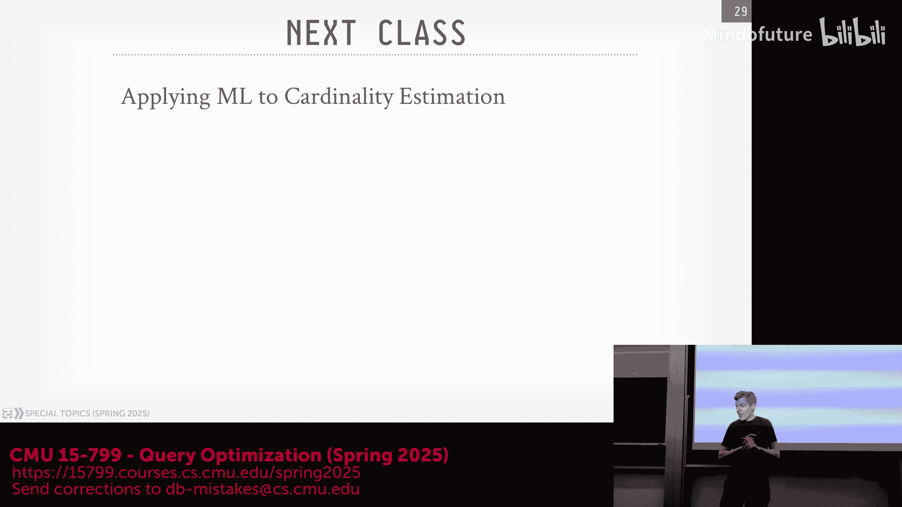

# 数据库专题：查询优化：14：查询成本模型与基数估计进阶

## 概述
在本节课中，我们将深入学习查询优化中的基数估计问题。我们将基于一篇来自微软的论文，探讨当基数估计出错时，查询计划会受到何种具体影响，并比较行存储与列存储系统在应对基数估计错误时的差异。我们还将了解一些运行时优化技术，如位图过滤和自适应连接，以及它们如何在一定程度上弥补基数估计的不足。

## 背景回顾
上一节我们介绍了德国研究团队关于基数估计误差对查询计划质量影响的综述论文。本节中，我们将深入探讨微软团队对此问题的进一步研究。

基数估计是查询优化器用来预测查询计划中每个操作符将输出多少元组的机制。这非常具有挑战性，因为优化器需要基于从底层表中推导出的统计信息（如直方图或草图）来进行估算。当查询包含多个谓词或表达式时，优化器需要在这些已有估算的基础上进行叠加估算，这可能导致误差累积。

基数估计之所以重要，是因为它直接影响连接顺序的选择、索引扫描与顺序扫描的决策，以及其他一些优化策略。

## 微软论文的研究动机
微软团队认为德国论文的分析存在三个局限性：
1.  **工作负载范围有限**：德国论文主要使用了连接顺序基准测试，该基准只包含简单的选择-投影-连接查询，而真实工作负载可能包含分组、外连接、CTE等更复杂的操作。
2.  **基数注入方式**：德国论文在实验中为查询计划中的所有操作符都注入了真实的基数。微软团队认为，可能只需要对一部分关键操作符注入真实基数，就能获得大部分收益。
3.  **系统评估范围**：德国论文只评估了PostgreSQL。微软团队希望在一个具有更先进优化器（如SQL Server的Cascades优化器）和更多运行时优化功能的系统上进行更全面的分析。

## 研究方法：在Cascades优化器中注入基数
SQL Server使用Cascades优化器。为了注入真实的基数估计，微软团队采用了一种巧妙的方法：
1.  首先，为查询生成所有逻辑表达式，并填充备忘录表。
2.  对备忘录表中的每个逻辑表达式及其子表达式递归计算哈希值，为每个子树生成唯一标识符。
3.  将这些逻辑表达式反向解析回SQL查询。
4.  在数据库上实际执行这些SQL查询，获取每个操作符的真实基数。
5.  将哈希值与真实基数存储在目录中。在优化期间，当成本模型需要某个逻辑表达式的基数时，便从目录中查找预先计算好的真实值。

## 行存储系统的评估结果
微软团队在多种工作负载上进行了测试，包括标准基准测试（如TPC-H、TPC-DS）和真实的客户工作负载。

以下是主要发现：
*   **性能提升与回归**：大多数查询在注入真实基数后性能得到提升（达到2倍或更多），但也存在少数查询性能下降（回归）的情况。回归表明成本模型本身可能存在缺陷。
*   **性能提升的来源**：对于性能提升的查询，他们分析了是哪些操作符的改进贡献了主要收益。分类如下：
    *   **索引操作符**：决定使用索引扫描还是顺序扫描。
    *   **扫描操作符**：顺序扫描。
    *   **非叶节点操作符**：连接、聚合、排序等。
    *   **其他操作符**。
*   在连接顺序基准等测试中，避免不必要的索引扫描是性能提升的主要原因。而在更复杂的工作负载中，收益则来自上述多个方面的综合改进。

### 查询计划变化示例
通过具体查询示例，可以看到注入真实基数后查询计划的变化：
1.  **访问方法改变**：当基数估计严重低估时，优化器可能将索引查找改为（聚集）索引扫描或顺序扫描，因为扫描大量数据时，顺序访问通常比随机I/O更高效。
2.  **连接算法与顺序改变**：可能将索引嵌套循环连接改为哈希连接或合并连接，并可能调整连接顺序。
3.  **聚合下推**：当连接输出远大于最终聚合结果时，优化器可能将部分聚合计算下推到连接操作之下，显著减少连接需要处理的数据量。这是一种PostgreSQL不具备的优化。

## 列存储系统的评估结果
接下来，我们来看看在列存储系统上的评估结果。SQL Server支持列存储索引，数据以字典编码压缩的列形式存储。

总体结论是：**在列存储系统中，获得更准确的基数估计同样能带来与行存储系统相似的性能收益。**

然而，也观察到一些差异：
*   在列存储中，索引扫描本身较少，因此从“避免错误索引扫描”中获得的收益不如行存储明显。
*   在某些工作负载中，虽然获得显著提速的查询比例很高，但少数严重回归的查询其绝对执行时间增长巨大，以至于拖累了整体工作负载的总执行时间。

## 关键操作符集分析
一个有趣的问题是：是否需要对所有操作符都注入真实基数？

微软团队定义了“关键操作符集”：只需对该集合中的操作符注入真实基数，就能获得与对所有操作符注入相同的最优查询计划；如果移除该集合中的任何操作符，查询计划就会变差。

通过实验发现：
*   对于大多数查询，关键操作符集的中位数大小约为5个，远小于查询计划中操作符的总数。
*   这意味着在实践中，可能只需要对少数关键位置进行更精确的统计，就能大幅改善查询计划质量。这为数据库系统指明了一个更实用的优化方向：优先保证关键表或关键操作的统计准确性。

## 运行时优化技术的影响
最后，我们探讨两种运行时优化技术是否能够掩盖基数估计不准确的问题。

### 位图过滤
位图过滤是一种侧向信息传递技术。在构建哈希连接时，同时构建一个布隆过滤器。在探测端扫描数据时，先用布隆过滤器快速过滤掉肯定不匹配的元组，避免不必要的哈希表探测。

实验表明：
*   启用位图过滤后，即使使用系统估计的基数，也有约36%的查询获得2倍以上性能提升，且几乎没有回归。
*   当同时使用真实基数和位图过滤时，性能有进一步小幅提升。
*   **结论**：位图过滤本身能带来显著收益，部分弥补了基数估计的误差，但准确的基数估计与之结合效果更佳。

### 自适应连接
自适应连接是SQL Server的一项功能，它允许运行时在嵌套循环连接和哈希连接之间切换。优化器初始选择一个计划（通常基于小数据量假设选择嵌套循环连接），运行时如果发现探测到的元组数量超过阈值，则切换为哈希连接。

实验表明：
*   仅使用自适应连接（基于估计基数）带来的收益有限。
*   结合真实基数估计后，收益更明显。
*   **结论**：自适应连接只能优化连接算法本身，无法纠正因基数估计错误导致的连接顺序、访问方法等更高层的决策错误。因此，它不能完全替代准确的基数估计。

## 总结
本节课我们一起深入学习了基数估计对查询计划质量的深远影响。通过微软的研究，我们了解到：
1.  准确的基数估计对行存储和列存储系统都至关重要，能通过改进访问方法选择、连接顺序和聚合下推等来提升性能。
2.  无需对所有操作符进行精确估计，只需关注一个较小的“关键操作符集”（约5个）即可获得大部分收益。
3.  运行时优化技术（如位图过滤和自适应连接）能有效提升性能并部分掩盖基数估计错误，但它们不能完全替代一个基于准确估计的、良好的初始查询计划。
4.  在实践中，数据库管理员需要权衡性能提升与潜在查询回归的风险，企业级数据库通常提供查询计划冻结等功能来管理此类风险。

这些发现为构建更健壮、高效的查询优化器提供了重要的指导和启示。