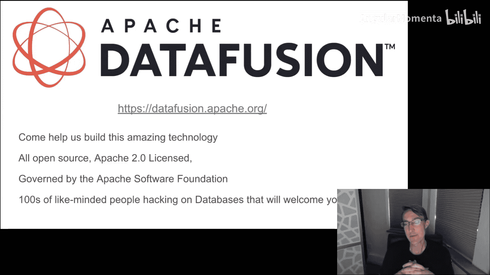

# 001：一个快速、可嵌入、模块化的分析查询引擎


## 概述

在本节课中，我们将学习 Apache Arrow DataFusion。DataFusion 是一个用 Rust 编写的分析查询引擎，其设计目标是成为数据库系统的“构建块”。我们将探讨它的设计理念、核心架构、关键特性以及性能表现。通过理解 DataFusion，你将了解如何利用一个模块化、高性能的组件来构建自己的数据处理系统，而无需从零开始。

## 什么是 DataFusion？

DataFusion 的核心定位是数据库领域的 LLVM。正如 LLVM 为编程语言创新提供了共享的底层编译器基础设施，DataFusion 旨在为构建在线分析处理（OLAP）数据库提供一个共享的查询引擎基础。这意味着，如果你想要构建一个新的数据处理系统，无需重复实现向量化查询引擎等复杂组件，可以直接使用 DataFusion，并将精力集中在你的应用所特有的功能上。

它的高层架构目标包括：
*   **开箱即用**：只需几行代码即可获得一个功能齐全的 SQL 查询引擎。
*   **高度可定制**：几乎系统的每个部分都可以被替换或扩展。
*   **遵循工业最佳实践**：其内部实现遵循经典的数据库系统设计模式，这使得代码易于理解和上手。

## 为什么需要 DataFusion？

构建一个成熟的、高性能的分析数据库需要投入巨大的工程资源和资金。DataFusion 允许开发者复用这个经过验证的、高性能的查询引擎核心，从而：
*   **聚焦差异化**：将工程精力集中在使你的项目与众不同的功能上。
*   **共享基础设施成本**：与开源社区共同维护和优化底层组件。
*   **加速创新**：可以更轻松地在接近生产的环境中原型化和测试新的想法。

DataFusion 社区活跃，拥有数百名贡献者，每月发布新版本，已被用于构建完整的数据库系统、作为其他计算框架（如 Apache Spark）的执行后端，甚至用于实现数据湖表格式（如 Delta Lake、Iceberg）的某些组件。

## 核心架构与设计决策

上一节我们介绍了 DataFusion 是什么以及为什么需要它，本节中我们来看看它的核心架构和几个关键的设计决策。

### 整体架构概览

DataFusion 的架构与经典的查询引擎类似，遵循标准的处理流程：
1.  **SQL 解析与逻辑计划**：将 SQL 文本解析为抽象语法树（AST），然后生成**逻辑计划**。逻辑计划是一个关系运算符树（如 Scan、Filter、Aggregate）。
2.  **逻辑优化**：对逻辑计划应用一系列重写规则（如谓词下推、常量折叠）以生成更高效的逻辑计划。
3.  **物理计划**：将优化后的逻辑计划转换为**物理计划**，其中包含了具体的算法实现（如使用哈希连接还是排序合并连接）。
4.  **执行**：物理计划被实例化为可执行的**流**，这些流在多个线程上并行运行，处理数据并产生结果。

整个流程中的数据表示和传递均使用 **Apache Arrow** 的 `RecordBatch`（记录批次）。

### 关键设计决策一：内部使用 Arrow

DataFusion 不仅在接口层面，而且在**内部算子之间传递数据时也使用 Arrow 格式**。这样做的好处是：
*   **零转换成本**：在系统边界无需进行昂贵的数据格式转换。
*   **复用 Arrow 生态**：可以直接利用 Arrow 社区优化的高性能内核函数（如向量化计算）。
*   **简化扩展**：用户自定义函数（UDF）可以直接操作 Arrow 数据结构。

当然，像哈希表这样的内部数据结构会根据需要进行特殊优化，但算子输出的接口是统一的 Arrow `RecordBatch`。

### 关键设计决策二：使用 Rust 语言

DataFusion 使用 Rust 编写，这带来了显著优势：
*   **内存与线程安全**：Rust 的所有权系统在编译期防止了数据竞争和内存错误，这对于大型开源项目的协作至关重要。
*   **现代工具链**：Cargo 包管理器使得依赖管理和项目构建非常简单。
*   **吸引开发者**：Rust 语言本身吸引了大量希望学习新技术的开发者参与贡献。

一个简单的示例展示了如何快速开始一个 DataFusion 项目：
```rust
// 创建一个新的 Rust 项目
cargo new my_project
cd my_project
// 添加 DataFusion 依赖
cargo add datafusion
```
只需这样，你就拥有了一个可以运行 SQL 的查询引擎框架。

## 深入核心组件

上一节我们概述了架构和关键决策，本节我们将深入几个核心组件：查询规划、函数系统、数据源和优化器。

### 查询规划流程

查询规划是查询引擎的核心。DataFusion 支持多种方式构建查询计划：
1.  **SQL**：通过 SQL 解析器将文本转换为逻辑计划。
2.  **DataFrame API**：提供类似 Spark 的流畅 API 来构建逻辑计划。
3.  **自定义语言**：你可以实现自己的查询语言前端，只要它能输出 DataFusion 的逻辑计划，后续的优化和执行流程就可以复用。这是 DataFusion 一个强大的扩展点。

逻辑计划中的数据类型表示为 **Arrow 数组** 或 **标量值**。整个类型系统基于 Arrow。

### 函数系统

DataFusion 的函数系统完全基于统一的 Trait（接口）实现，没有内置函数和用户自定义函数（UDF）的区别。以下是支持的函数类型：
*   标量函数（`ScalarUDF`）
*   聚合函数（`AggregateUDF`）
*   窗口函数（`WindowUDF`）
*   表函数（`TableUDF`）

系统内置了大量函数（兼容 PostgreSQL），社区也提供了许多扩展包。你甚至可以注册一个 PyTorch 模型作为 UDF。实现一个 UDF 主要涉及定义函数签名和实现一个接收 Arrow 数组、返回 Arrow 数组的计算逻辑。

### 数据源与目录

DataFusion 通过 **TableProvider** API 抽象数据源。内置支持包括：
*   文件格式：Parquet、CSV、JSON、Avro、Arrow。
*   目录服务：内存目录、基于文件系统的目录（支持 Hive 风格分区）。

TableProvider 的核心方法是 `scan`，它接收投影（需要哪些列）、过滤器（谓词下推）和限制（Limit 下推）等信息，并返回一个物理执行计划节点。这使得实现自定义数据源变得相对简单。

Parquet 读取器是其中的佼佼者，实现了众多优化，如基于统计信息的行组/数据页裁剪、延迟物化、IO 下推等。

### 优化器

DataFusion 的优化器分为逻辑优化和物理优化。
*   **逻辑优化器**：对逻辑计划进行重写，例如谓词下推、投影下推、常量折叠、表达式简化等。这些是基于规则的优化。
*   **物理优化器**：负责将逻辑计划转换为物理计划，包括选择连接算法（哈希连接、排序合并连接）、设置并行度、根据数据有序性避免不必要的排序等。

目前，DataFusion 的优化器主要是**基于规则的语义优化器**。它不包含复杂的、基于代价的连接顺序优化，因为这需要依赖难以精确估算的基数统计。设计哲学是提供“足够好”的默认优化，并将更复杂的优化留给用户通过 API 自行实现。

## 执行模型与性能

上一节我们探讨了规划与优化，本节我们聚焦于执行阶段，并讨论 DataFusion 的性能表现。

### 执行模型

DataFusion 采用经典的 **Volcano 拉取模型**。
*   **拉取模型**：每个算子通过调用其子算子的 `next()` 方法来主动拉取数据。这种模型使得大多数算子只需关注单线程逻辑，易于编写。
*   **并行性**：通过在计划中设置分区（Partition），运行时为每个分区创建独立的执行流，从而实现并行。跨分区的数据交换通过 `Repartition` 算子（即交换操作符）完成。
*   **调度**：使用 **Tokio** 异步运行时进行 CPU 密集型任务的调度。Tokio 提供了高质量的工作窃取线程调度器。利用 Rust 的 `async/await`，当算子需要等待 I/O（如从磁盘读取）时，可以自动让出控制权，由调度器执行其他任务，实现了类似协程的效果。
*   **内存管理**：采用协作式内存池管理，跟踪大的内存分配（如哈希表、排序缓冲区），而对算子间流动的小型 `RecordBatch` 则采用估算方式。

关于“拉取模型 vs. 推送模型（如 Morsel-Driven Parallelism）”的讨论，DataFusion 团队的实验表明，在 Tokio 的协作式调度加持下，拉取模型同样能实现出色的多核扩展性和性能，并未发现架构上的根本性瓶颈。

### 性能表现

根据与 DuckDB 的对比测试（论文发表于 SIGMOD 2024），DataFusion 展现出：
*   **可扩展性**：在多达 172 个核心上，其性能缩放曲线与 DuckDB 基本一致，表明其执行模型能够有效利用多核资源。
*   **单核效率**：在不同类型的查询上互有胜负。例如，在谓词选择性高的扫描和简单聚合上，DataFusion 更快；而在高基数分组聚合上，DuckDB 有优势（这与哈希聚合的具体实现优化有关）。
*   **TPC-H**：整体性能接近，个别查询因连接顺序选择不佳而较慢，但后续已得到改进。

结论是：**性能差异主要源于工程实现优化的投入程度，而非拉取或推送的架构本身**。DataFusion 已经具备了“足够好”的架构来支撑高性能，并且通过持续的社区优化，其性能仍在不断提升。

## 总结

本节课中我们一起学习了 Apache Arrow DataFusion。我们了解到，DataFusion 是一个旨在成为数据库“构建块”的模块化查询引擎。它通过内部使用 Arrow 格式、采用 Rust 语言实现、提供全面的扩展 API 等设计，使得开发者能够快速构建和定制自己的数据分析系统。



其核心流程包括 SQL/DataFrame 解析、逻辑/物理优化以及基于 Volcano 拉取模型的并行执行。尽管其优化器目前以规则为基础，但出色的执行性能和强大的可扩展性使其成为构建现代数据系统的有力候选。活跃的社区和清晰的模块化设计，为数据库领域的创新提供了一个共享且高效的基础平台。