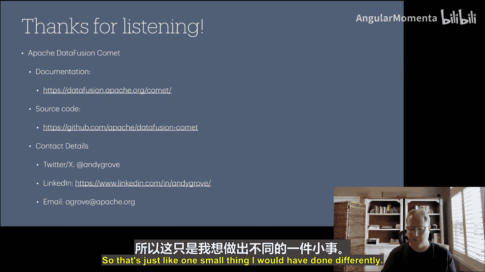

# 002：使用Apache DataFusion Comet加速Apache Spark工作负载


在本节课中，我们将要学习如何使用Apache DataFusion Comet来加速Apache Spark工作负载。我们将了解Comet的设计原理、工作原理、当前面临的挑战以及未来的发展方向。

## 概述

Apache Spark是一个成熟且广泛使用的分布式计算框架，但其基于JVM和行处理的架构在某些场景下存在性能瓶颈。Apache DataFusion Comet项目旨在通过将Spark的物理执行计划转换为基于Apache Arrow和Rust的DataFusion原生计划，来加速Spark查询的执行，同时保持与Spark的完全兼容性。

## Spark的架构与挑战

上一节我们介绍了课程的整体目标，本节中我们来看看Spark的基本架构及其面临的性能挑战。

Apache Spark起源于学术研究，至今已发展超过十年，是一个非常成熟的查询优化器和执行引擎。它支持多种文件系统和对象存储，用途广泛。其优势之一是易于本地测试和横向扩展。

然而，Spark也存在两个主要的性能缺点：
1.  **基于行的处理模型**：Spark采用火山模型，通过迭代器逐行处理数据，这会带来较大的开销。虽然Spark通过“全阶段代码生成”技术来缓解此问题，但其效果有限且存在代码大小限制。
2.  **基于JVM**：JVM通常比原生代码慢，并且可能存在内存开销和垃圾回收问题。

鉴于Spark庞大的生态系统，完全替换它并不现实。因此，行业趋势转向**加速Spark**而非替换它。例如，Databricks发布了Photon论文，他们构建了一个C++向量化查询引擎，并将其置于Spark API之后，声称平均获得了3倍的性能提升。

目前有三个主要的开源Spark加速器：
*   **Apache Gluten**：一个Apache孵化项目，支持以不同查询引擎（如Velox）作为后端来加速Spark。
*   **NVIDIA Spark RAPIDS**：使用RAPIDS库（如cuDF）在GPU上执行查询。
*   **Apache DataFusion Comet**：本次讨论的重点，它使用DataFusion作为原生执行引擎。

## Comet的设计与工作原理

了解了Spark的挑战后，本节我们深入探讨Comet是如何设计并工作的。

Comet是一个Spark加速器插件。其核心思想是：利用Spark进行SQL解析和查询规划，但当执行进行到**物理计划**阶段时，Comet插件会介入，将Spark的物理计划转换为等效的DataFusion物理计划。

Comet项目的一个重要目标是确保不仅加速查询，还要提供与Spark **100%的语义兼容性**，这包括与各个Spark版本的行为保持一致。

以下是Comet工作流程的高层示意图：

```
[Spark Driver/App]
    |
    | 1. 转换Spark物理计划为Comet计划（含Protocol Buffer IR）
    |
[Spark Scheduler]
    |
    | 2. 调度任务到Executor
    |
[Spark Executor (JVM)]
    |       |
    |       | 3. 通过JNI传递IR到Rust端
    |       |
    |  [Native Code (Rust)]
    |       |
    |       | 4. 将IR转换为DataFusion计划并执行
    |       |
    | 5. 结果写回Shuffle文件或返回JVM
```

具体步骤如下：
1.  在Driver端，Comet优化器运行，将Spark的物理计划（由Scala类组成的树结构）转换为等效的Comet Scala类，并生成一个协议缓冲区格式的中间表示。
2.  任务被调度到Executor后，通过JNI调用Rust代码。
3.  在Rust端，利用接收到的IR将其转换为DataFusion物理计划并执行。
4.  在理想情况下，整个计划都在原生端处理，输出数据直接写入Shuffle文件。
5.  如果部分操作符尚未实现，则会在原生代码和JVM代码之间进行切换，这种转换目前效率较低。

## 性能对比与当前挑战

上一节我们介绍了Comet的工作原理，本节中我们来看看它的性能表现以及为实现更好性能所面临的挑战。

根据基准测试，在不同场景下，基于DataFusion的引擎相比原生Spark有显著加速：
*   **DataFusion Python**（单进程）：**3.6倍**加速。
*   **Ballista / Arrow Data Fusion**（分布式）：约**2.5倍**加速。
*   **Comet**（当前阶段）：显示出加速，但尚未达到其他分布式DataFusion项目的水平。

分布式查询执行之所以比单进程慢，主要是因为**数据交换（Shuffle）** 的开销。在分布式系统中，一个查询阶段的结果需要物化到磁盘（如Shuffle文件），然后通过网络传输给下一个阶段，这比单进程中在线程间传递内存指针要昂贵得多。

目前Comet性能未达最佳的主要原因包括：
1.  **未完全原生执行**：部分Spark操作符（如Bloom过滤器聚合、某些Join条件）在DataFusion中尚未实现或优化，导致执行回退到Spark，引发昂贵的行列转换开销。
2.  **数据类型系统不匹配**：Spark的逻辑类型系统与Arrow/DataFusion的物理类型系统存在差异。例如，Spark的字符串类型需要对应到Arrow的UTF8、LargeUTF8或字典编码格式。目前Comet有时会过早解包字典数组以避免复杂性问题。
3.  **缺少物理优化规则**：由于直接使用DataFusion的物理计划，某些在Spark逻辑优化阶段完成的优化（如公共子表达式消除）可能缺失，需要DataFusion物理层实现相应规则。
4.  **行列转换效率**：当回退到Spark时，发生的列式数据到行式数据的转换（通过JNI逐个字段访问）效率很低，需要实现更高效的原生转换器。

## 确保语义兼容性

实现加速的同时，确保与Spark的语义完全兼容是一项重大挑战。以下是需要处理的一些兼容性问题领域：

*   **负零处理**：Rust和Java对IEEE 754标准中负零的处理可能不同，Spark有特定的逻辑来规范化负零，Comet必须复制此逻辑。
*   **溢出处理**：Spark有一个`ansiMode`配置。当启用时，数值溢出应抛出异常；禁用时，则产生NULL。DataFusion需要支持相同的模式。
*   **类型转换**：Spark的数据类型转换行为非常特殊，且常受多种配置选项影响，Comet必须精确匹配。
*   **日期时间解析**：Spark支持非常灵活的日期时间字符串格式（如`T2`表示凌晨2点），而DataFusion本身不支持，Comet需要自行实现这些转换逻辑。

为了测试兼容性，Comet项目采取了多种措施：
*   运行Spark的测试套件并确保通过。
*   使用随机数据生成进行单元和集成测试。
*   进行模糊测试：生成随机的Parquet文件和查询，分别用原生Spark和Comet执行并对比结果。

## 路线图与未来工作

最后，我们来看看Comet项目的未来发展方向和社区参与方式。

Comet是一个开源项目，未来发展路线包括：
1.  **扩展支持的数据类型和操作符**：目前主要支持基本数据类型，正在添加对Struct和Array的支持，未来需要支持Map等复杂类型。
2.  **实现更多Spark表达式**：Spark有超过200个表达式，Comet需要持续增加原生实现以覆盖更多查询。
3.  **优化PyArrow UDF支持**：Spark的Python UDF支持涉及昂贵的行列转换。由于Comet本身基于Arrow，未来可以避免这些转换，为PyArrow UDF提供显著的性能提升。
4.  **开发成本优化器**：建立一个简单的成本模型，用于判断是否应对某个查询阶段进行加速，避免在加速反而更慢的情况下进行转换。
5.  **性能优化**：持续受益于上游DataFusion和Arrow项目的性能优化工作。

对于希望贡献的开发者，有以下途径：
*   下载Comet JAR文件，在现有的Spark作业中尝试使用，并反馈性能问题或Bug。
*   参与解决GitHub仓库中标记为“good first issue”的问题。
*   帮助进行性能调优、改进监控指标等。

## 总结



本节课中我们一起学习了使用Apache DataFusion Comet加速Apache Spark工作负载的相关知识。我们了解了Spark的性能瓶颈，Comet如何通过将Spark物理计划转换为原生DataFusion计划来实现加速，以及当前在完全原生执行和语义兼容性方面面临的挑战。Comet作为一个新兴的开源项目，在提升Spark性能方面具有潜力，并且欢迎社区贡献以帮助其发展成熟。