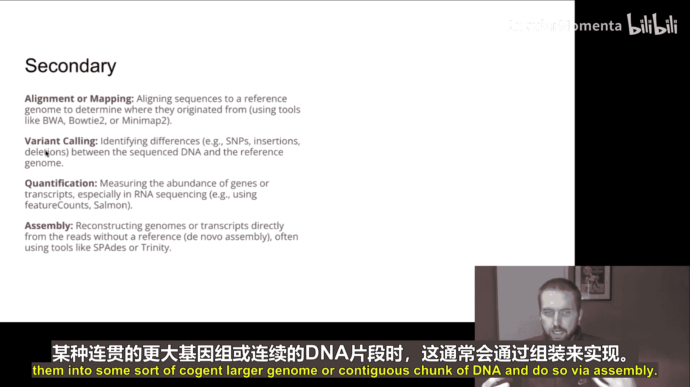
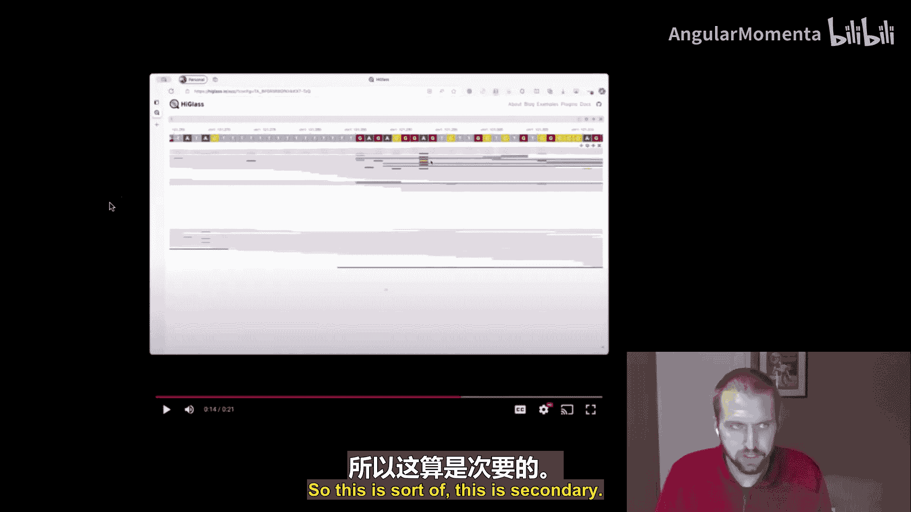

# 005：专为生物信息学设计的数据库


在本节课中，我们将学习 Exon 数据库系统。Exon 是一个专为生物信息学应用设计的数据库，它构建在 DataFusion 之上，旨在高效处理生物信息学中常见的复杂文件格式和数据操作。我们将了解生物信息学数据分析的基本流程、Exon 如何应对该领域的独特挑战，以及它如何利用现代数据库技术来简化和加速生物信息学工作流。

## 生物信息学数据分析概述

生物信息学数据分析通常分为三个阶段：初级、次级和三级分析。

初级分析涉及从生物仪器获取原始信号，例如对 DNA 进行碱基识别（Base Calling）并生成质量控制分数。次级分析则包括序列比对（Alignment）、变异检测（Variant Calling）和基因组组装（Assembly）等。三级分析是最高层，涉及数据的注释、比较和整合，通常需要连接多个数据集并进行过滤以获取生物学洞见。



上一节我们介绍了生物信息学数据分析的整体框架，本节中我们来看看这些分析阶段的具体数据表现形式和挑战。



## 生物信息学数据格式与挑战

生物信息学领域严重依赖文件格式来存储和交换数据，这带来了独特的挑战。

### 常见的文件格式

以下是生物信息学中几种核心文件格式及其特点：

*   **FASTA 格式**：用于存储核苷酸或氨基酸序列。其特点是序列行通常有80个字符的长度限制，一个序列可能被分割成多行。
    ```
    >序列ID 描述信息
    ATGCGATCGATCGATCGATCGATCGATCGATCGATCGATCGATCGATCGATCGATCGATCGA
    TCGATCGATCGATCGATCGATCGATCGATCGATCGATCGATCGATCGATCGATCGATCGAT
    ```
*   **VCF/BCF 格式**：用于存储基因变异信息。其模式（Schema）直接嵌入在文件头中，包含 `INFO`、`FORMAT` 等字段的定义，支持灵活但有时不一致的元数据标签。
*   **SAM/BAM 格式**：用于存储序列比对结果。包含需要按位解码的标志（Flag）字段和存储额外信息的标签（Tag）字段。

### 数据处理的挑战

处理这些格式时面临的主要挑战包括：
1.  **模式嵌入**：如 VCF 文件，其结构信息在文件内部，需要动态解析。
2.  **索引与压缩**：许多格式（如 BAM、VCF）使用块压缩（Block GZIP）并配有独立的索引文件，以实现对基因组特定区域的快速随机访问。索引文件将基因组坐标映射到压缩文件中的字节偏移量。
3.  **复杂编码**：例如 SAM 文件中的标志字段是位掩码，需要特殊函数来解读。
4.  **大规模数据**：单个基因组文件可达数百GB，数据集非常庞大。

了解了生物信息学数据的复杂性后，我们接下来看看 Exon 数据库是如何构建来处理这些特定格式的。

## Exon 的架构与核心机制

Exon 通过扩展 DataFusion 来原生支持生物信息学文件格式和操作。

### 文件格式集成

Exon 为每种支持的文件格式（如 FASTA、VCF、BAM）实现了相应的表提供器（Table Provider）。集成过程遵循标准流程：从磁盘或对象存储读取文件，将行式数据解析并转换为列式的 Arrow Record Batch，最终通过 DataFusion 进行查询。

以下是为 FASTA 格式实现表提供器的关键步骤代码框架：
```rust
// 1. 定义文件打开器（File Opener）
struct FastaOpener;

// 2. 实现将原始数据流转换为批处理的逻辑
impl StreamReader for FastaBatchReader {
    fn next_batch(&mut self) -> Result<RecordBatch> {
        // 读取记录，追加到数组构建器...
    }
}

// 3. 注册到 DataFusion 上下文
ctx.register_table_provider("fasta_table", Arc::new(FastaTableProvider));
```
完成集成后，用户可以直接使用 SQL 查询这些文件，例如：
```sql
SELECT id, sequence FROM fasta_file WHERE length(sequence) > 100;
```

### 索引支持与谓词下推

为了高效处理大型索引文件，Exon 利用了 DataFusion 的 `ListingTableProvider`。它将代表同一基因组不同部分（如不同染色体）的多个文件视为一个逻辑表。在查询时，Exon 解析用户指定的基因组区域谓词（如 `chromosome = ‘2‘ AND position BETWEEN 1000 AND 2000`），将其转换为对应文件的具体字节范围，并生成分区信息。这使得查询可以并行地只读取相关数据块，而非扫描整个文件，从而大幅提升性能。

### 模式解析与用户定义函数

对于嵌入模式的格式，Exon 在运行时进行“模式读取”。例如，解析 SAM 文件的标签字段时，它会遍历数据，根据类型标识符动态构建出相应的 Arrow Schema。

此外，Exon 广泛使用 DataFusion 的标量用户定义函数来封装领域逻辑。例如，提供 `is_paired(flag)`、`is_reverse_complemented(flag)` 等函数，让用户无需直接操作 SAM 标志位的位运算。同时也实现了序列比对等核心生物信息学算法的 UDF。

### 数据输出

除了读取，Exon 还扩展了 SQL 语法和查询计划，支持将查询结果写回为特定的生物信息学文件格式（如 FASTA）。这涉及到自定义 `COPY TO` 语句的解析器、逻辑计划节点和物理执行计划。

我们已经探讨了 Exon 处理生物信息学数据的核心机制，接下来看看用户如何实际使用它以及未来的发展方向。

## 使用方式与未来展望

### 多语言接口

虽然 Exon 核心用 Rust 编写，但主要通过高级语言接口被生物信息学家使用。
*   **BioBeam (Python)**：这是主要的客户端库。用户通过 `pip install biobeam` 安装，即可在 Python 中编写 SQL 查询，并将结果作为 Polars 或 Pandas DataFrame 进行处理，易于集成到现有工作流中。
*   **R 语言接口**：也为 R 用户提供了惯用的接口，使其能利用 Exon 的高性能。

### 未来发展方向

Exon 目前主要专注于三级分析。未来的增强可能包括：
1.  **向次级分析延伸**：集成更多的分析算法（如更复杂的序列搜索索引），而不仅仅是数据查询和连接。
2.  **支持空间转录组学**：整合如 Zarr 等多维数组格式，用于处理新兴的空间生物学数据。
3.  **更好地支持 AI/ML**：管理机器学习模型工件，并优化对整数编码序列等适用于模型训练的数据格式的处理。
4.  **提升可访问性**：降低使用门槛，让更多不具备深厚数据库和 SQL 知识的生物信息学家也能受益。

## 总结


本节课中我们一起学习了 Exon 数据库系统。我们回顾了生物信息学数据分析从初级到三级的流程，探讨了该领域特有的文件格式（如 FASTA、VCF、BAM）及其在模式嵌入、索引压缩等方面带来的挑战。我们深入了解了 Exon 如何基于 DataFusion 构建，通过实现自定义表提供器、支持索引谓词下推、动态模式解析和领域专用 UDF 来高效处理这些数据。最后，我们看到了用户如何通过 BioBeam 等接口使用 Exon，并展望了其向更深入分析、支持新数据模态和人工智能集成发展的未来。Exon 展示了如何利用现代可扩展数据库架构为特定领域（如生物信息学）构建强大而高效的数据处理工具。