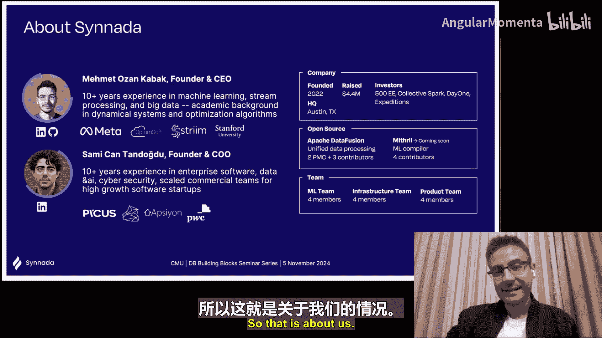
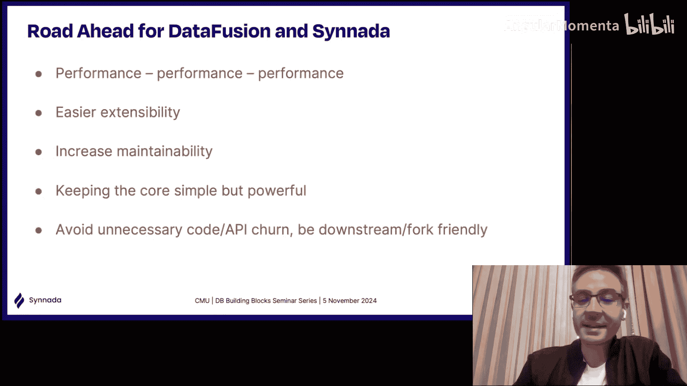
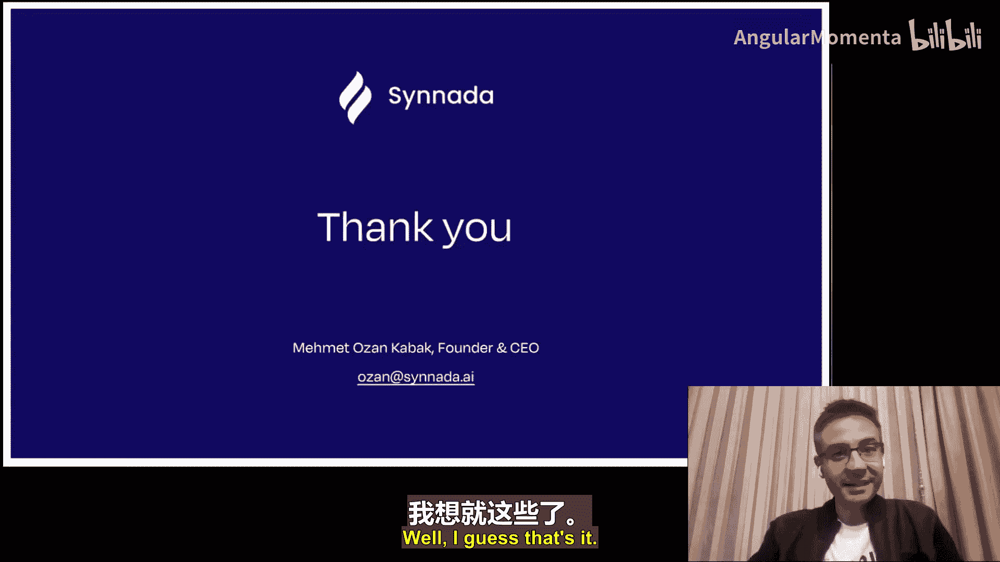

# 006：机遇与挑战 🚀

在本节课中，我们将探讨如何构建一个“统一”的计算引擎，以简化现代数据与AI应用的开发。我们将分析当前基础设施的复杂性，并介绍如何利用Apache DataFusion等现代技术栈来应对这些挑战。

## 概述

当前，构建和维护数据密集型应用变得异常复杂，常常需要集成数十种不同的工具。这种复杂性部分源于核心计算引擎（如Spark、Flink）设计于一个技术假设不同的时代。本次分享将论证，通过构建一个现代化的“统一”计算引擎，我们可以显著简化数据与AI基础设施。我们将深入探讨统一引擎所需的关键技术组件，包括流批一体、AI原生集成、灵活分布式部署和全面可观测性，并介绍Synnada公司基于Apache DataFusion在这一方向上的实践与探索。

## 关于演讲者与Synnada

我是Mehmet Ozan Kabak，Synnada公司的技术联合创始人兼CEO，同时也是Apache DataFusion项目的提交者。我的背景涉及流处理、机器学习和大数据领域超过十年。有趣的是，我的博士研究方向是求解非线性方程以解决电路问题，这与优化、机器学习乃至数据处理有着深刻的联系，这也是我进入数据与AI世界的原因。

Synnada公司成立于2022年初，目前已融资440万美元。我们团队规模不大，共有14人，分布在基础设施（主要是DataFusion）、机器学习以及产品开发等方向。我们深度参与开源项目，其中一翼是Apache DataFusion。我们加入该项目近两年，贡献了超过10万行代码，拥有两位PMC成员和三位贡献者。我们坚信DataFusion项目前景广阔，并建议大家在构建下一个项目时考虑将其作为基础。

## 为何需要统一计算引擎？

在深入技术细节之前，让我们先思考一个问题：为什么我们需要谈论“统一计算引擎”？这个概念已被提及多年，例如Spark官网就曾宣传“统一的流处理和批处理”。要理解其必要性，我们需要审视当前构建和维护数据密集型应用的现状。

这已成为一项相当复杂的任务。回顾2012年的数据与AI基础设施版图，其规模远小于2023年。如今，市场上充斥着大量工具和细分领域。当你试图为企业构建数据与AI基础设施时，往往需要集成众多不同的工具。这个问题对于既非非常小也非非常大的团队尤为突出。小型团队可以使用少数几个点解决方案，大型企业则拥有专门的平台工程团队来定制基础设施。但处于中间地带的团队，则不得不开始使用20多种不同的技术，这变得异常繁琐。

那么，这种复杂性从何而来？原因有很多。一部分是固有的复杂性：要构建一个功能强大的系统，必然伴随一定的复杂性，这是无法完全避免的。但另一个重要原因，在我们看来，是作为基础设施图中核心的计算引擎（如Spark和Flink）已经“老化”了。它们设计时的主流技术理念和假设与今天截然不同。

例如，Spark诞生时，容器化技术远未像今天这样普及；逻辑回归是机器学习的主流，而流式SQL的概念甚至可能还不存在。那个时代的假设反映在这些核心技术中。由于我们仍在沿用这些技术，就不得不为其添加大量的“补丁”和“螺栓”，以支持流批处理、可观测性或集成AI，最终导致需要集成20多种不同的工具。

如果这个理论成立，那么如果我们能拥有一个反映当今技术进步的计算引擎（比如Spark 2.0），我们的基础设施架构就可能得到简化。这就是我们押注的核心理念：我们想要构建这个Spark 2.0，简化数据与AI基础设施。相应地，Synnada则立志成为Databricks 2.0。

## 通过示例理解挑战与愿景

为了更具体地说明，让我们通过一个示例来展开论证。假设我们想要构建一个数据应用，用于预测微服务的流量。我们可能拥有一个微服务架构，各个服务流量不同，我们需要预测流量以便预留计算资源或控制扩缩容。

首先需要考虑的是架构：这是一个每隔几小时运行一次的批处理应用，还是一个流式应用，或者两者兼有？在现代应用中，答案很可能是“两者兼有”。例如，我们可能希望定期更新预测模型，但同时使用最新模型进行低延迟的流式评分，以便尽快获得预测结果。

于是，我们有了一个数据流的世界（蓝色部分），数据以流的形式进入，我们将预测模型部署到某个引擎上进行推理并发布预测。然而，预测模型可能会与用于预测的时间窗口不同步或失去关联，因此需要监控。这就需要引入一些日志或监控工具，这可能会驱动某个笔记本或内部应用来查看预测效果，进而可能在模型过时触发训练基础设施来更新模型。而模型训练又会依赖于作为训练集的某个数据集，该数据集是长期收集的实时数据流的集合。

这样，我们就有了流式部分和批处理部分的混合体，每一部分都有其技术考量。以批处理部分为例，用于更新和训练模型：是ML工程师手动进行的离线任务，还是通过AutoML方案自动化？模型有多大？如果想自动化，如何处理因训练超参数（与数据集或模型拓扑无关）导致的训练失败？如何部署和版本控制模型？如何监控模型并决定何时更新？

构建这样一个数据应用，远非其简单描述看起来那么容易。这就是我们面对的现实。那么，是否存在更好的方法？这种复杂性是否有一部分是可以避免的？我们的答案是肯定的，应该存在一种更简单的方式。

那么，这种更简单的方式可能是什么样子呢？请看这个SQL查询，它是标准SQL，包含一个用户定义的聚合函数 `FORECAST`。它的业务逻辑是：独立考虑每个微服务，查看每个服务最近4小时的流量数据，并以此为基础进行未来7分钟的短期预测。

这个查询描述了业务逻辑，但它没有回答之前提出的许多问题。例如，如果这是一个高吞吐量的流，4小时的数据量可能非常大，无法全部装入内存，该怎么办？这是典型的大数据批处理考量。如果这个任务在运行中失败并需要恢复，该怎么办？这是典型的流处理容错考量。如果有人提供了这个预测函数，那很好，但我如何创建自己的函数？没有人能把所有ML模型都封装成UDF提供给我，必须有一种非常简单的方式来创建这些东西。此外，查询没有说明LTM模型何时更新。如果它是静默更新的，那么引擎必须以非常健壮的方式来完成，引擎是如何做到的呢？还有训练超参数，查询中没有学习率等任何信息。

本幻灯片的要点是：让我们尝试想象一个世界，在那里我只需将这个查询交给引擎，引擎会尽力处理我们之前详细讨论的所有问题。这可能吗？我们将寻找这个问题的答案。我认为答案是肯定的，也许不能完全实现，现实世界会比这个示例更复杂，但我们可以做得比今天好得多。

## 统一流与批处理

首先，让我们聚焦于批处理和流处理的不同考量，以及如何比当前做法做得更好。这里涉及所谓的“Lambda架构”。它基本上描述了一个流和批处理完全分离的世界。那么，我们能否拥有一个统一流和批处理的单一计算引擎？

许多人都在谈论“统一”，但其真正含义是什么？我认为人们正开始就一个基本的共识定义达成一致。在本演讲中，我们将采用的工作定义是：一个统一的引擎应该能够接受标准SQL来处理两种类型的数据。数据可以作为一个整体（静态的）提供给你，也可以以零碎的方式（流式的）到达你这里。无论哪种情况，面向用户的API不应改变。如果你的API是SQL，用户不应在SQL中考虑特殊的流处理语法；如果你的用户界面是DataFrame，他们应该使用相同的DataFrame功能。

因此，如果一个查询在理论上可以在流数据上执行，那么它就应该能够执行。引擎不应该说：“哦，实际上，这个查询理论上没问题，应该能执行，但由于某些内部原因，我的引擎不接受它。”如果你的引擎这样做，那它就不是一个统一的引擎。不幸的是，Spark和Flink要求你修改查询以适应引擎的内部机制，它们不应该这样做。

如果查询在理论上无法执行，你应该抛出一个信息丰富的错误消息来解释原因。例如，如果你对一个无界流进行排序，这意味着在扫描完整个流之前你无法开始产生最终结果，你应该向用户解释这一点。

那么，什么是试金石测试呢？如果你在PostgreSQL中加载一个样本数据集，任何在PostgreSQL中能工作的、理论上可流化的查询，也应该在一个统一引擎中工作。这里我使用PostgreSQL作为标准SQL的代理。

这就是我所说的“统一”的核心。我最近看到Tecton的一篇博客也使用了非常类似的定义。我认为我们会越来越多地听到这种“应接受标准SQL”的定义。

让我们通过一个例子来理解这个定义的实际含义。假设我们有两个流：一个是各种货币的销售交易流（例如，我是一个全球零售连锁店，监控全球店铺的交易，有些是美元，有些是英镑，有些是欧元等）；另一个是我从某个API获取的汇率流。我想将所有交易“美元化”，即转换为美元。

我该如何做呢？有很多方法，有些需要特殊语法，比如“as-of join”。我喜欢下面这个查询，因为它实践了我们在上一张幻灯片中给出的定义。这个查询的意思是：对于每一笔唯一的交易，查看在此交易时间之前到达的所有汇率，取最后一个，并用它来进行美元化。这并不复杂。

但是，如果你尝试在今天可用的许多引擎上执行这个查询，它可能无法运行。然而，没有理论上的理由说明它不应该运行，因为你是按唯一键分组，并且时间戳是单调递增的（为了示例简单，暂不考虑乱序数据）。这个查询应该运行，并且如果你的计划器足够智能，它应该可以非常高效地运行。但在我们今天使用的许多引擎中，它无法运行。

那么，我们能否缩小这个差距？我们能否实际运行这样的查询？如果查询不可流化，我们能否让用户知道原因？要做到这一点，首先需要在计划期间充分利用数据排序信息。这意味着必须在整个计划的所有算子中跟踪数据排序，且不能丢失任何信息。这要求你了解函数的单调性，并需要做大量工作才能以简洁的方式实现。

其次，需要在可能的情况下，为所有基本算子提供保序变体。这包括重分区、连接等操作。第三，必须在计划时意识到无界流的存在，了解流水线中断的概念，在什么场景下、出于什么原因会中断流水线，知道什么是无界的、什么是有界的。并且，优化器中必须有规则来选择正确的算子变体，以避免导致查询无法执行的问题。连接排序时也需要考虑这些因素，而不仅仅是效率。

第四，必须使用严格的技术（如区间运算）来计算范围并修剪缓冲区。例如，如果你有一个连接条件复杂的连接（不仅仅是滑动窗口那种定义明确的连接），你需要一种通用的方法来计算任意连接条件的范围，这能为你提供范围保证，并据此修剪缓冲区。只有这样，你才能处理通用连接，并推断其是否可流化。

第五，必须避免在查询中显式使用水印。看看今天人们如何编写Spark查询，他们必须在连接中插入水印逻辑。这不应该需要，因为这与业务逻辑无关，而是工程考量泄露到了本应表达业务逻辑的地方。如何避免呢？算子需要处理并传递来自源的水印，并且应该自动生成水印以减少多分区计划中的延迟。例如，如果你有一个保序合并操作，正在合并32个分区，如果32个输入分区中有一个由于某种原因没有收到数据，那么合并操作就无法产生输出。如果没有正确实现水印机制，可能会引入可避免的延迟。

必须做好所有这些事情。如果你能以良好的方式做到这些，就可以执行此类查询，不仅仅是这种简单的不等式连接，还可以是任意连接条件。如果查看表达式，能从数学上判断它是可执行的，那么它就应该执行。所以，要回答Andy的问题，原因必然是上述一个或多个因素。对于Spark或其他特定引擎的确切原因，我无法立刻给出答案。

## 处理乱序数据

乱序数据是流处理基础设施存在的根源之一。当数据不按顺序到达时，你必须有一种方式来应对，因为这是现实情况。在我为物联网应用构建基础设施时，这种情况经常发生。必须有一种好的方式来处理它，这也是为什么我们最初将批处理与流处理分开的主要原因之一。

那么，如何处理乱序数据呢？有两种典型方法。第一种我称之为“纯数据流模型”。在这种模型中，你为你的用例设定一个最大可容忍延迟。例如，你说“我不希望数据晚于10分钟”。然后，你的源算子可以根据这个容忍度缓冲和重排数据，计划器使用水印周期来最小化非源算子的延迟。计划将正常工作，并且你能从我们提到的所有优化中受益。这种方法运行非常高效，但问题在于它无法弹性地处理所有乱序事件或数据点。如果你的延迟容忍度很高（比如一小时），而数据流吞吐量很大，那么让源算子缓冲数据可能会非常消耗内存或存储。你为获得的效率付出了很大的代价。在许多用例中，它非常高效且足够，但存在这种缺点。

第二种方法是“纯更新表模型”或“物化视图模型”。你处理的是更新，而不是结果。用户不必考虑最大可容忍延迟。算子是处理并输出更新，而不是数据本身。根据我的经验，这种方法不如数据流模型高效。如果你能让数据流模型工作，它在计算上更高效、更快，能处理更多数据。但这种方法在处理乱序数据时更为优雅。

那么，统一引擎应该使用哪一种呢？我认为这并非一个完全解决的问题，仍有许多有趣的想法在不断涌现。例如，Tecton（Faldera）团队就有他们自己的形式化方法DBSP。

我们正在积极考虑和实验的是本幻灯片上展示的方法。问题是：是否存在一个介于纯数据流方法和纯更新方法之间的最佳点？可能有一种方法，让每个算子拥有两个输出通道或两个输出：一个输出有序部分，另一个输出偶尔出现的乱序更新。这两个输入流共享相同的算子状态，以便重用已有信息。这看起来是一个非常有前景的方向。我们尚未完全实现它，但几乎已经实现了之前幻灯片上展示的所有其他内容。这是一种相对较新的方法，我们认为它很有希望，也许在未来的分享中我会报告其进展。

## 实现AI原生集成

现在，让我们关注统一性的另一个方面：如何实现AI原生？首先，我们需要有一种简单的方式将模型集成为有状态的函数。但问题是，我们思考模型开发的方式（使用Python、PyTorch、Jupyter笔记本）与数据处理的世界似乎并不相邻。那么，问题就变成了：我们能否真正解耦模型设计与编译？如果可以，也许我们就能弥合这一差距。

思路是：你以一种舒适的方式设计一次模型，在进行实验（调整模型拓扑、重新训练等）时，将其编译成Python可调用对象，这让你处于舒适区。当你对某个模型满意时，再将其编译成UDF，以便用于预测查询。这样的世界会是什么样子？

其次，这必须是高效的。模型可能很大，如果是生成式模型，可能相当庞大。因此，你的原生数据格式必须能很好地支持向量化，最好还能支持GPU。DataFusion在这方面很幸运，因为Arrow是向量化友好的，并且有基于Arrow构建的GPU支持。所以，DataFusion在数据格式方面有一个良好的起点。但这还不够，算子和执行计划必须能够利用部署环境中所有可用的设备，并且必须避免数据来回移动。如果你有很好的Arrow内核可以使用GPU，但执行计划不知道这一点，那么你会把数据加载到GPU，做一些操作，再加载回主内存，这将会很糟糕。因此，计划器必须知道这一点并进行相应规划。这与流批统一的情况类似，计划器必须知道并选择算子的变体。

第三，回到我们的问题：如何知道何时更新模型？什么是确定性的更新方式？如前所述，在每个数据点更新通常不现实，除非数据流速率很低。而且这必须是可自动化的。如今，更新或重新训练模型涉及许多超参数，如何处理？使用AutoML来隔离你吗？那会变得非常昂贵。如果只是硬编码或采用所有超参数的合理默认值，那在某些时候肯定会失败。那么，究竟该如何处理？

对于这三个重要问题，我们至少需要对如何解决有一些想法。我们在第三部分（确定性更新）取得了很大进展，但这需要另一次完整的分享来讨论。我们在第一点（模型集成）和高效推理方面也取得了进展，但这仍是进行中的工作，我们需要帮助。也许有人会加入DataFusion和Arrow社区来实现这些内核。

## 灵活分布式与全面可观测性

统一引擎还需要具备灵活的分布式能力，即跨平台、可嵌入的单节点引擎。这样，你就可以拥有一个由具有不同能力的异构设备组成的动态集群。DataFusion论文本身就提到了可嵌入引擎，它是一个非常好的基础。我们的任务是在此之上编写一个分布层，支持异构设备的动态集群。目前我们在这方面缺少一些工程人力。有一个名为DataFusion Ballista的项目曾沉寂很久，现在正重新焕发活力，还有DataFusion Ray。如果你对加入DataFusion浪潮感兴趣，这可能是一个有趣的贡献方向。有了这个，你就可以在本地开始原型设计数据应用，因为你的本地PC就是一个单节点集群。你可以用较低速率的数据在那里构建一切、尝试事物，然后逐步增加计算资源，而无需更改数据应用的业务逻辑。我认为这将非常有用，并能显著降低构建和维护数据的复杂性。

最后，任何计算引擎都知道，作业会失败，而找出失败原因可能很困难。统一引擎应该在这方面做得更好。它应该收集并暴露所有操作数据和指标，以提供全面的可观测性。一个好的结果是，利用引擎自身提供的这些操作数据，可观测性查询可以与其他查询在同一引擎中并行运行。此外，你还需要严谨性：需要分类、考虑并处理所有可能的错误情况。这又回到了流批统一：用户给你一个查询，你应该能够证明它可以运行并运行它，或者证明它不可能运行并清晰地解释原因。这需要编程纪律。诚然，无论是Synnada还是DataFusion社区，我们在这方面都还不够好。Rust语言迫使你处理错误，但有时你仍会得到一些内部错误而不知其所以然。我们需要做得更好。显然，还需要集成功能，以便轻松可视化、利用和跟踪这些可观测性考量。

## 为何选择DataFusion？

我谈到了很多内容，但我们只融资了440万美元，团队只有13人，不可能从头实现所有这一切。这正是我们加入DataFusion的原因。你无法煮沸整个海洋，这不可能。

我们加入DataFusion的原因是，我偶然看到了Andrew Lamb（DataFusion早期贡献者之一）的一次演讲。他做了一个类比：我们希望为数据系统带来LLVM对编译器所产生的那种影响。当时DataFusion离这个目标还很远，现在它正在变得相当不错。有些人可能不喜欢这个类比，但我很喜欢。我想，这正是我们构建所需引擎所需要的。我不可能从零开始构建，但如果我有一个数据系统的“LLVM”，我就可以做到。所以我们加入了DataFusion。当时它还没有很多功能，我们说我们会尽力贡献。这是一个很棒的社区。它功能丰富、Arrow原生（这对AI和高效处理很重要）、对Python友好（通过DataFrame和SQL接口），即使维护分支也不太难。它的性能正在变得非常出色，Andrew的目标是成为读取Parquet最快的查询引擎，我认为我们很快就能达到，甚至可能已经在主干上实现了。它非常模块化，使用Rust语言，社区活跃，周围有很多初创公司活动。我们热爱DataFusion，希望它比今天更加成功。它确实帮助我们沿着这个方向取得了进展。

那么，我们为DataFusion做了什么？还记得我提到的关于流批处理的那些要点吗？其中大部分是我们构建的，在我们加入时DataFusion还不具备这些功能。现在上游DataFusion已经包含了许多这样的功能。在开源项目中，你提交PR后常常得不到回应或不被喜欢，但DataFusion并非如此。当我们第一次加入时，我们提交的第一个PR是关于窗口函数的，当时DataFusion还没有完善的窗口函数实现。我们在一个公共分支上工作，并在相关issue中提到了它，Andrew看到了并说：“太好了，为什么不和我们合作，也许我们可以把它合并进来？”这太棒了。很多开源项目没有这样的氛围。这是一个很好的学习载体，也是一个很好的创新载体，因为它提供了所有这些API钩子。所以，真的欢迎大家来参与和贡献。

## Synnada的架构与未来展望

那么，这一切在Synnada中是如何结合起来的呢？在单节点部分，核心是DataFusion作为高效执行引擎。然后，我们有许多不属于上游DataFusion核心的功能，例如Chandy-Lamport checkpointing（容错需要，但数据库不一定需要）。还有我之前展示的ML库Mithril。所有这些结合在一起，提供了一个单节点体验，让你可以构建数据应用。

在此基础上，需要一个分布层，用于查询执行（可能是Ballista或Ray，或者我们内部构建的东西，我们仍在实验）以及扩展与训练相关的大型任务。此外，还需要企业级功能，如易用的可观测性、高级集成、访问控制、现成的高级模型、安全模型等，这些与开源部分无关。如果Synnada成功，我们将把所有这些东西整合起来，构建Databricks 2.0。而Spark 2.0基本上就是左侧部分（单节点及扩展部分）。我们想要构建的是可组合、可塑且精简的基础设施，在更基础的层面解决许多问题，而不是为核心引擎添加20个不同的“补丁”。

近期，我们将发布一个名为“Workbench”的工具。它将像一个Notion笔记本，你可以在其中原型化数据应用。它将内置DataFusion，你可以拥有多个组合在一起的查询，在笔记本电脑上轻松进行原型设计。下一步将是灵活的计算。你将能够说：“我对我的业务逻辑很满意，我想以容错、大规模等方式部署它。”如果你有自己的计算资源，可以自带云资源；如果你希望我们提供，我们也可以提供。你甚至应该能够在树莓派上运行。整个重点是：从本地开始，逐步增加计算资源，专注于你的业务逻辑，我们将尝试在尽可能低的层面解决尽可能多的基础问题，这样你就能将更多时间花在创造数据价值上。

社区版将支持单节点上的查询容错和低延迟。你应该能够真正地原型化，比如如果崩溃了会发生什么。我们希望能在2025年第一季度实现。对于DataFusion社区的人来说，如果你想让DataFusion运行起来，只需获取社区版，就能看到构建在DataFusion之上的查询引擎的强大功能。目前最大的挑战之一是，如果你不是数据系统构建者，尝试DataFusion并不容易。对于数据系统构建者，DataFusion很棒；但如果你只是想构建数据应用，它就不那么容易了。希望Workbench能在一定程度上弥合这一差距。

## 总结与展望

前方的道路是什么？对于DataFusion来说，性能、性能、还是性能！这非常重要。人们会看基准测试，这很重要。更易于扩展、提高DataFusion代码库的可维护性、保持DataFusion核心简洁而强大、避免不必要的API变动、对DataFusion用户更友好，这些都是我认为对DataFusion重要的事情。

对于Synnada，我已经和大家分享了：我们想要这个Workbench工具，我们即将推出Mithril项目，将数据系统文献中的最佳实践引入ML世界，并希望逐步构建这个统一的计算引擎。

本节课中，我们一起探讨了构建“统一”计算引擎的必要性、核心挑战与技术路径。我们分析了当前数据基础设施的复杂性根源，并论证了通过集成流批处理、AI原生支持、灵活分布式和全面可观测性等现代技术，可以显著简化应用开发。Synnada基于Apache DataFusion的实践为我们展示了这一方向的可能性。未来，随着性能提升、工具完善和社区壮大，我们有望迎来一个更简洁、高效的数据处理新时代。