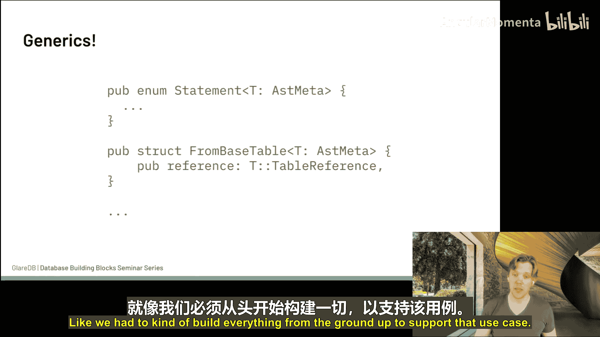

# 008：从零开始重构GlareDB

## 概述

在本节课中，我们将跟随GlareDB创始人肖恩·史密斯的分享，了解他们如何基于DataFusion构建产品，以及为何最终决定从零开始构建全新的执行引擎。我们将探讨GlareDB的产品目标、使用DataFusion时遇到的挑战，以及新引擎的设计理念与核心架构。

## GlareDB的现状与产品目标

GlareDB是一个能够跨多种数据源进行查询和连接的数据库系统。其核心目标是减少企业对ETL管道的依赖，降低管理和移动数据所需的基础设施与人力成本。

以下是GlareDB支持的部分数据源：
*   Postgres
*   Snowflake
*   BigQuery
*   存储在S3上的Parquet文件
*   各类数据湖格式，如Delta Lake、Iceberg等

为了快速实现产品概念，GlareDB早期选择基于现有的成熟组件进行构建。

## 早期技术选型：基于DataFusion

GlareDB团队选择Apache DataFusion作为其核心执行引擎，主要基于以下几点考虑：
*   **功能完备**：DataFusion提供了SQL规划器、优化器和执行引擎等全套功能。
*   **易于扩展**：通过实现简单的`TableProvider`接口，即可接入新的数据源。
*   **社区活跃**：拥有活跃的社区，持续获得改进和更新。
*   **开发效率**：作为一个小团队，使用成熟组件能快速构建出可验证概念的产品原型。

基于DataFusion，GlareDB成功构建并发布了云端产品和Python库，验证了其核心价值主张。

## 使用DataFusion面临的挑战

尽管DataFusion帮助团队快速起步，但在实际使用中也遇到了一系列问题，这些问题最终促使团队考虑重构。

### 1. 升级与回归问题
团队需要保持DataFusion的版本更新，但升级时常会引入非预期的破坏性变更，导致下游功能失效。有时甚至会出现查询返回错误结果的情况，这对数据库系统而言是严重问题。

### 2. 依赖管理困境
GlareDB的存储层依赖Delta RS，而Delta RS又依赖特定版本的DataFusion。这形成了一个依赖链，当Delta RS升级其DataFusion版本时，GlareDB也不得不随之升级，并可能因此引发兼容性问题。团队经常需要投入大量工程精力来解决这些由依赖升级引发的Bug。

### 3. 正确性问题
DataFusion要求查询中的每一列都具有唯一的列标识符。当团队实现自定义优化器规则时，如果产生的列名不符合上游优化器的预期，就可能导致查询计划错误，甚至产生不正确的结果。例如，曾有客户的一个跨数据源`COPY TO`查询，因优化器规则错误地剪裁了内部查询部分，最终生成了空的Parquet文件。

### 4. 扩展性的双刃剑
DataFusion的高度可扩展性允许团队添加自定义逻辑计划、优化规则和执行计划。然而，一旦偏离标准路径，就很容易遇到难以捕获的Bug，因为这些扩展点存在许多隐式约定和预期。

## 决策：构建全新执行引擎

鉴于上述挑战，GlareDB团队在2024年初决定进行彻底的重构，目标是完全移除DataFusion和Delta RS，从头开始构建一个全新的执行引擎，代号为“Ragzok/Bullet”，也即“GlareDB Next”。

新引擎的核心设计目标如下：
*   **查询健壮性**：支持更符合分析师习惯的SQL写法，例如允许查询中出现重复的列名。
*   **支持混合与分布式执行**：执行计划完全自包含，便于在异构集群中调度和运行。
*   **简化的依赖管理**：避免复杂的依赖链和升级冲突。
*   **有限的扩展点**：仅开放数据源、存储和用户定义函数作为扩展点，不提供通用的物理计划扩展，以降低复杂度和Bug风险。
*   **可移植性**：探索编译到WebAssembly的可能性，使用户能在浏览器中直接体验数据库功能。

## 新引擎架构详解

上一节我们介绍了构建新引擎的动机和目标，本节中我们来看看新引擎的核心架构设计，特别是它在查询规划与执行方面与DataFusion的不同之处。

### 查询规划流程概览
新引擎的查询处理流程遵循标准步骤，但每个环节都为实现其设计目标进行了定制：
1.  **解析**：将SQL字符串转换为抽象语法树。
2.  **解析与引用消解**：独立于逻辑规划，解析语法树中的所有引用（如表、函数），并将其替换为具体的目录条目。
3.  **逻辑规划**：将已解析的语句转换为逻辑操作符树。
4.  **优化**：应用启发式规则和基于动态规划的连接排序算法进行优化。
5.  **中间管道规划**：将逻辑操作符树转换为可由执行器处理的管道。
6.  **可执行管道规划**：为管道生成具体的并行执行状态。
7.  **执行**：在自定义的执行器上运行管道。

### 关键设计差异

#### 1. 独立的引用消解
与DataFusion将引用消解嵌入逻辑规划不同，新引擎将其分离为一个独立的异步步骤。这使得解析后的语句完全自包含，所有外部引用（如远程表模式）都已具体化，从而允许将规划工作负载发送到任何机器执行，无需访问原始目录或数据源，为分布式规划奠定了基础。

#### 2. 健壮的表与列标识
DataFusion要求全局唯一的列标识符，这在处理包含重复列名的合法查询（如`SELECT a.id, b.id FROM a JOIN b`）时会失败。新引擎为每个基表分配唯一标识符，并为每列分配序号索引。在整个查询计划中，通过`(table_id, column_index)`来引用列，避免了因列名重复导致的问题，也使得优化器可以更自由地重排操作符。

#### 3. 统一的优化阶段
DataFusion有逻辑优化和物理优化两个阶段。新引擎只进行逻辑优化，因为其目标是一个高度集成的系统，而非通用的、可插拔的执行引擎。优化器使用简单的代价函数（基于基表的基数信息）和动态规划算法（DPccp）进行连接排序。优化过程不决定并行度，并行度由后续阶段决定。

#### 4. 基于管道的Push执行模型
新引擎采用固定的操作符集合，并设计为基于管道的Push（推送）模型执行。每个操作符实现三个方法：`push`（接收数据）、`pull`（输出结果）和`finalize`（结束处理）。

在中间管道规划阶段，逻辑操作符树被转换为一个或多个管道。并行度并非在此阶段确定，而是通过为每个操作符生成特定数量的“状态”来实现。这产生了两种状态：
*   **分区状态**：绑定到特定执行线程。
*   **共享操作符状态**：在同一操作符的所有并行实例间共享。

这种设计最小化了同步开销，并使管道易于序列化，支持在异构集群上执行。

#### 5. 灵活的执行器
可执行管道最终由“管道执行器”运行。目前有两种实现：
*   **基于Rayon的工作窃取执行器**：利用所有CPU核心在本地高效执行。
*   **WebAssembly执行器**：将管道编译为Wasm模块，在浏览器环境中通过JavaScript Promise执行，实现了“在浏览器中运行数据库”的愿景。

执行器使用类似Rust异步的`poll_execute`接口来驱动管道执行，操作符在无法继续推进时（如哈希连接的探测端等待构建端完成）可以返回`Poll::Pending`并存储一个`Waker`，待条件满足时再被唤醒，这有效协调了管道间的依赖关系。

## 总结与展望

本节课中我们一起学习了GlareDB从使用DataFusion到决定自研全新执行引擎的技术旅程。我们分析了DataFusion在快速原型阶段的优势，以及在生产规模下遇到的升级、依赖、正确性和扩展性等挑战。接着，我们深入探讨了名为“Ragzok/Bullet”的新引擎的设计哲学与核心架构，包括其独立的引用消解、健壮的列标识系统、统一的优化器、基于管道的Push执行模型以及面向WebAssembly的可移植性设计。

目前，新引擎仍在开发中，目标是与现有GlareDB达到功能对等后完全替换旧代码。团队对其性能（已在TPC-H基准测试中与DataFusion和DuckDB竞争）和设计灵活性感到满意。这个案例生动地说明，选择数据库构建块是一项复杂的决策，需要权衡开发速度、长期可维护性和产品独特需求。有时，为了突破现有框架的限制并完全掌控自己的技术栈，从零开始重构是一条必要且充满挑战的道路。