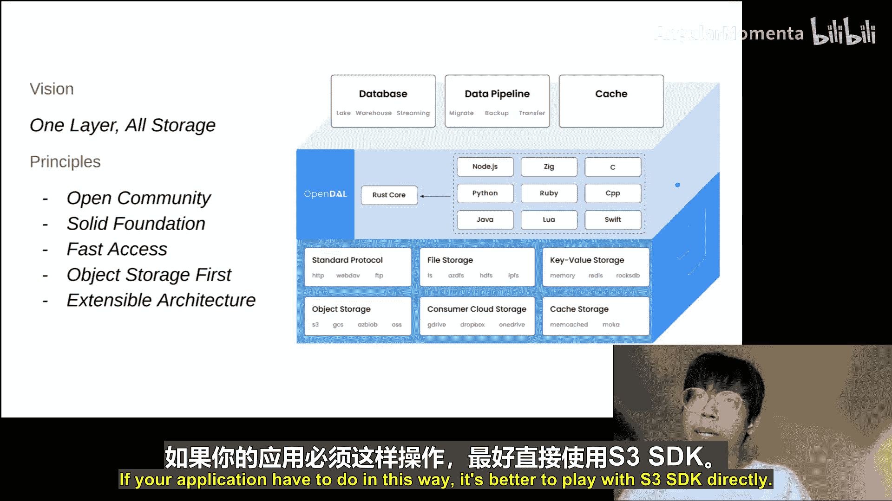

# 009：一层架构，覆盖所有存储

在本节课中，我们将要学习 Apache OpenDAL 项目。OpenDAL 是一个开源数据访问层，旨在为各种存储服务提供统一的抽象接口。我们将探讨它为何被创建、其核心设计哲学、架构实现，以及开发者如何利用它来构建数据库应用。课程最后，我们还将展望 OpenDAL 与未来数据库技术结合的可能性。

## 项目介绍与背景

OpenDAL 是一个开放的数据访问层，它使得与多样化存储服务的无缝交互成为可能。其愿景是“一层架构，覆盖所有存储”。项目的开发遵循以下核心原则：开放、坚实基础、存储优先和架构。

整个 OpenDAL 项目是一个大家族，由不同语言的绑定、与各种运行时环境的集成以及多个网关组成。今天，我们主要关注其核心部分，它构成了其他所有组件的基础。

OpenDAL 被设计为一层架构，可以暴露底层存储服务的不同功能，同时也为应用程序提供高级 API，例如用于构建数据处理管道。OpenDAL 支持几乎所有类型的存储服务，包括对象存储、文件存储、键值存储和缓存存储。

OpenDAL 通过“能力”的概念来抽象不同存储服务的差异。用户可以调用 API 来查询某个存储服务支持哪些能力，从而可以为特定功能（如对象版本控制）编写特殊逻辑。我们将在后续幻灯片中详细讨论这些细节。

接下来，我们看看 OpenDAL 的发展历史。它最初是 Databend 内部一个名为 `dl`（数据层）的组件。在我加入 Databend 后，开始致力于此组件的工作。OpenDAL 作为一个独立的新项目于 2022 年 2 月成立。经过近一年的开发，OpenDAL 在项目外部获得了一些贡献者，并被 GreptimeDB 等用户采用。2023 年，我们启动了将 OpenDAL 捐赠给 Apache 孵化器的流程。经过约一年的孵化，我们成功建立了社区，并最终于 2024 年毕业。此时，OpenDAL 的采用率持续增长，我们将在下一张幻灯片分享其使用案例。

## 用户群体与使用案例

根据我目前的观察，OpenDAL 主要有三类用户。最大的一类是数据库构建者，他们使用 OpenDAL 来开发数据库。我想这也是我被邀请至此演讲的原因。OpenDAL 被用于各种类型的数据库，例如云数据仓库、流数据库和时序数据库。像 Databend、GreptimeDB 和 RisingWave 这样的数据库都在使用 OpenDAL。OceanBase 过去是数据库，现在专注于 OLAP 领域。

此外，一些新的表格式如 Apache Iceberg、Apache Paimon 和 Apache Hudi 也在尝试使用 OpenDAL 来访问不同的存储服务。这些用户主要看重 OpenDAL 的坚实基础和快速访问原则。

大多数基础设施构建者将 OpenDAL 视为比 `fs`（文件系统）更健壮、更高级的替代方案。他们欣赏 OpenDAL 用户友好的 API，这更容易理解和使用。OpenDAL 还提供了跨各种存储服务的一致性。我们之前提到过，OpenDAL 覆盖所有存储。用户欣赏 OpenDAL 友好的 API，它易于理解，并且在不同存储服务上工作方式一致。像重试、指标、日志和追踪这样的有价值功能也是其优势。这些构建模块简化了他们的工作，使他们能够直接使用 OpenDAL 或在其内部构建功能，从而专注于更关键和有价值的任务。

第二类 OpenDAL 用户使用它来构建应用程序，例如缓存、向量数据库等。我不会深入讨论这些用户。第三类是平台开发者，他们使用 OpenDAL 构建更上层的框架，例如不同的 Web 框架，以便用户能更轻松地构建 Web 应用程序。

## 为什么需要 OpenDAL？

面对如此多不同的选项，为什么他们需要 OpenDAL？又为什么应该选择 OpenDAL 呢？可能有人会问，为什么不直接为所有语言使用 `fs`？我们不需要构建新的东西。有些人可能还会争辩说，他们只需要与 S3 交互，因为所有其他存储服务都只是 S3 兼容的。确实，大约 80% 的 OpenDAL 用户在与 S3 通信。但有几个原因说明，仅仅依赖 S3 API 可能并不足够。

首先，并非所有存储服务都兼容 S3。例如，第二大云提供商 Azure 就不提供 S3 兼容的 API。

其次，并非所有声称 S3 兼容的服务都完全兼容。例如，声称提供 S3 能力的 Google Cloud Storage，其 API 不支持删除对象。另一个例子是 Cloudflare 提供的 R2 S3 兼容服务，当用户尝试一次删除 1000 个对象时，它会返回内部错误。几乎每个 S3 兼容服务都有这样的边缘情况，需要用户进行特殊处理。

因此，仅靠 S3 兼容服务不足以满足生产应用程序的需求。例如，IAM（身份和访问管理）兼容性。S3 兼容服务不提供 IAM 兼容的 API，这使得用户无法使用角色或 Web 身份联合来让他们的应用程序在没有静态密钥的情况下进行身份验证。他们无法使用 IAM。这是不安全的，在生产环境中应避免。

最后，即使我们抛开所有这些问题，对于专注于存储访问的用户来说，OpenDAL 仍然是一个更好的选择。OpenDAL 提供了易于使用的 API，简化了数据操作，即使没有对象存储或文件存储背景的用户也能使用。他们只需要读写，就这么简单。此外，正如我之前提到的，OpenDAL 还包含一些健壮的功能，如重试、指标、日志和追踪，提供了更无缝和高效的体验。

## 为什么不使用官方 SDK？

第二个最常被问到的问题是，为什么不直接使用运行时 SDK？这很简单。我们有很好的工具链，只需要运行一个能工作的 SDK 即可。但在现实世界中，这并不总是可行的。

首先，并非每个存储服务都提供官方 SDK。即使提供，SDK 可能维护不善，无法跟上新功能或对错误响应缓慢。在生产环境中依赖这样的 SDK 是有风险的。

其次，并非所有 SDK 都维护良好或设计优良。它们可能拥有糟糕的 API、缺乏适当的文档、测试覆盖率不足或缺少稳定版本。用户可能会发现自己仅仅因为 SDK 依赖于此，就不得不使用某个依赖项的过时版本。

即使 SDK 本身很好，集成多个 SDK 仍然具有挑战性。不同的 SDK 可能有不同的设计模式，它们有不同的配置值。这使得用户难以实现统一的错误重试机制、日志记录或追踪。

此外，用户通常对底层 SDK 的行为缺乏足够的控制。因此，OpenDAL 尽可能从零开始手动实现所有功能，直接与存储 API 通信，而不依赖任何 SDK。这种方法使用户通过 OpenDAL 控制存储行为变得容易得多，而不是试图跨多个 SDK 配置相同的行为。

## 为什么不自己实现？

第三个问题是，为什么不自己构建这样的东西？S3 API 如此简单，我们只需要 `GET`、`PUT`、`DELETE`。从我的角度来看，有不同方式来解释这个问题。一方面，S3 API 仅在理想路径下是简单的。

要构建一个现实的生产应用程序，你需要考虑许多事情。例如，`PUT` 对象有 5GB 的最大大小限制。要上传大于 5GB 的文件，或要并发上传，你需要使用多部分上传。另一个例子是，S3 可能为一个失败的上传完成操作返回 200 OK 响应。因此，这些错误需要仔细处理。

另一方面，这不再是我们需要从头开始构建一切的领域。编写另一个 S3 SDK 没有额外的好处。雇佣从 CMU 数据库专业毕业的优秀人才来创建另一个 S3 SDK，对整个社区来说将是一个巨大的损失，对吧？为什么不直接利用现有的构建模块呢？想想这个研讨会系列。

另一个常见的问题是文件系统。文件系统是已被普遍支持的金标准，那么为什么不直接挂载呢？

在讨论挂载时，我们实际上在思考两个不同的概念。第一个是文件系统视图，其中存储中的数据正是写入的数据。第二个是分布式文件系统，它只是使用对象存储或其他存储作为后端，同时将所有其他数据分开存储。分布式文件系统中的数据通常与写入的数据不同，它可能被分割，或者用户只能读取数据，但不能直接访问底层存储。

## OpenDAL 的架构设计

我们已经讨论了许多关于 OpenDAL 项目本身的事情。现在是时候看一些代码了。让我们深入 OpenDAL 内部，看看它是什么样子，以及它如何帮助开发者构建数据库。

OpenDAL 的架构非常直接。在最底层是存储服务抽象，如 S3 和 `fs`，它们都实现了相同的特质。在这些服务之上，是应用通用功能（如错误处理、日志记录等）的层。最后，所有内容都被封装在一个操作符中。操作符是 OpenDAL 中供用户使用的入口点。

让我们从服务端开始演示。以下是 `Accessor` 特质，它定义了存储服务可以执行的所有操作。例如，`read`、`write`、`stat`、`metadata` 等。还有许多其他 API 遵循相同的模式。这里只讨论两个特殊之处。第一个是 `info` API。`info` API 用于返回服务名称和能力（该服务支持哪些操作）。用户可以调用 `info` 来处理这些，而不是到处处理错误。

第二部分是 `Accessor` 会有一些关联类型，例如 `Reader`、`Writer` 和 `Lister`。这允许服务在这些类型中存储内部状态，以便它们可以按需获取数据，而不是一次性读取所有内容或列出所有内容。这对于我们构建数据库非常重要。

我已经开发了一个 `CMU` 服务，它需要一个 `Accessor` 实现，但只支持 `stat` 操作。这是一个简单的服务，我们稍后会用到 `CMU` 服务。

接下来重要的概念是“层”。在这里，层类似于我们在 HTTP 框架或 gRPC 中看到的中间件或拦截器。我们可以将其集成到操作中并相应地执行操作。层的 API 很简单：用户可以提供一个实现 `Layer<A>` 的结构体，它返回另一个实现了 `Accessor` 的 `LayeredAccessor`。这允许我们同时应用不同的层。层最重要的方面是它可以独立于服务实现。例如，只要 `retry` 实现了 `Layer`，每个服务都将受益于此层，它们将具有相同的行为。

同时，相同的原则适用于所有层和所有存储服务。

我也开发了一个 `CMU` 层。使用 `CMU` 层的用户可以将它应用到任何他们想要的服务上。例如，用户可以通过应用此层，在每次调用时在控制台打印“Hello CMU”。

最后一个是操作符。操作符是 OpenDAL 提供给用户的最外层 API。我们可以使用 `CMU` 服务构建一个操作符。一旦操作符构建完成，用户就可以在任何地方使用它来执行操作。它允许我们写入数据、读取数据并有效地管理状态。

## 核心 API 演示

我们已经了解了关于 OpenDAL 的几乎所有内容。是时候进行一些展示了。我将演示 OpenDAL 提供的功能以及用户如何使用它们。我展示的所有示例也包含在我的 GitHub 仓库 `datafuselabs/opendal-examples` 中，欢迎随时查看。

以下是 OpenDAL 提供的主要 API 示例。

首先是简单的读写操作。例如，要一次性读取文件中的所有数据，只需调用 `read` 操作。对于需要额外参数的情况，OpenDAL 的 API 称为 `read_with`，用户可以指定诸如范围之类的详细信息来配置请求。

通过这种 API 设计，OpenDAL 还支持本机并发读取功能。例如，用户可以并发地分块读取文件，如本示例所示。用户可以将同一个文件分成 1MB 的块，并通过并发读取请求进行读取。

遵循相同的 API 模式，用户还可以指定文件版本或执行条件读取，使用 `if_match`、`if_none_match` 等参数。操作符直接暴露这些辅助 API，并执行一些转换，然后调用 `Accessor`，最终转发到存储服务的实现。

对于数据库开发者，我们经常涉及更动态的用例，无法通过简单的 `read` 处理。因此，OpenDAL 也为用户提供了 `Reader` API。通过此 API，用户可以创建一个携带所有读取操作上下文和配置的读取器。它的功能类似于本地文件系统的文件描述符，但会针对不同的存储服务利用不同的优化。通过读取器，用户可以执行范围读取、分块读取或同时读取多个部分。此外，用户可以将此转换为 `Future` 或 `Stream`，实现与系统其他部分的集成。

最有趣的一个是预读 API。众所周知，像 S3 这样的存储服务延迟较高，但与本地文件系统相比，带宽较高。对于用户来说，读取几个 4KB 的数据比读取几个 4KB 的数据要快得多。因此，合并操作是一种常见做法。例如，如果我们有足够接近的范围，我们可以一次性读取它们。这种方法允许我们更快地读取数据，即使我们最终读取的数据比最初请求的要多。OpenDAL 提供了这样的 API，用户可以指定不同的范围，OpenDAL 会合并这些范围并找出最佳范围，然后使用计算出的范围将请求发送到底层存储服务，然后将正确的数据直接返回给用户。此 API 对于从文件中读取数据非常有用，因为数据通常紧密排列。

这部分是关于读取的，下一个可能更有趣。我喜爱 OpenDAL 的主要原因是它努力使不同的 API 保持一致。API 以相同的方式设计，细节隐藏在后台。我希望每个人都已经知道如何写入数据应该超级简单：只需使用操作符写入路径和数据。要追加到同一个文件，只需将写入标志设置为 `true`。

如果我们想写入具有更复杂元数据（如内容类型、内容处置、缓存控制）的数据，或者使用多部分数据，我们只需要直接使用 `write_with`。

关于执行多部分上传，OpenDAL 支持，但我们不会自动进行。我们为用户提供选项。

这个示例演示了如何创建一个写入器并配置块大小和并发数。我这里展示的示例是 OpenDAL 将尝试以 8MB 的块大小写入数据，然后处理并发写入请求。OpenDAL 确保如果关闭操作返回 OK，所有已写入的数据都将被并发且按顺序写入。

与读取器类似，OpenDAL 也为写入器提供了转换功能。用户可以将写入器转换为 `AsyncWrite` 或 `Sink`，实现与系统其他部分的无缝集成。

关于自动合并或让用户显式配置，OpenDAL 不会为用户做任何决定，因为 OpenDAL 有许多用户，他们都有不同的方案，我们不了解他们的用例。因此，OpenDAL 只提供功能，用户需要根据自己的需求调整这些设置。

如下所示，如果用户没有在这里设置块大小，每次调用 `write` 时，我们将直接写入所有这些块，而不进行切片或任何其他操作。这也使得 OpenDAL 的行为更加可预测。

下一个我想介绍的 API 是列表 API。类似于我们为读取器和写入器提供的 API，我们也提供了 `Lister` API。用户可以递归地列出文件，并指定起始点，如 `start_after` 参数来进行偏移。

## 未来展望与合作

下一节介绍我们可以在 OpenDAL 内部开发的一些新的、令人兴奋的功能，这些功能也将使未来的数据库受益。如果您对这里列出的任何主题感兴趣，请直接与我联系。我非常愿意将它们变为现实。这可能是由数据库系统提供的新平台或工具。我希望 OpenDAL 成为您探索和测试数据库新想法的宝贵资源。

第一个是 WebAssembly。WebAssembly 是一种安全、可移植、低级的代码格式，专为高效执行和紧凑表示而设计。其主要目标是在网络上实现高性能应用程序，但现在也广泛用于其他环境。我们有各种 WebAssembly 运行时，使得 WebAssembly 成为运行可移植代码的良好选择。它的工作方式有点像 JVM。我们用不同的语言编写逻辑并将其编译成 WebAssembly。之后，WebAssembly 运行时可以加载并本地执行它。

最著名的 WebAssembly 运行时是 Web 浏览器。Databend 和 OpenDAL 现在可以在 WebAssembly 运行时内部运行，使得在浏览器内构建简单的查询引擎成为可能。这是 XGBoost 的一个相关工作，称为 `sqlite-viewer`。它完全用 Rust 编写并编译成 WebAssembly。该工具可以从文件或直接从 S3 加载数据。对于用户来说，这是一个探索文件和测试执行计划的有趣工具。

例如，我们只需要在这里配置 S3，就可以直接从 S3 浏览器读取数据。我们也可以在这里加载数据，并且可以查看执行计划或有关在 Databend 内部使用的一些详细信息。

目前 WebAssembly 仍有许多缺点，例如编译后体积太大，执行时间仍然比 JavaScript 慢。然而，已经有一些 WebAssembly 的使用案例，例如 1Password 在 WebAssembly 中实现其所有加密和启动逻辑，并在不同平台和语言之间共享它们。大量聪明人正在这个领域工作，WebAssembly 将成为构建新数据库的一个有趣空间。

以下也是关于 Web 浏览器的。我们都知道，今天的 Web 应用程序变得越来越复杂。传统的本地存储和 IndexedDB API 不再满足 Web 开发者的需求，因此我们有了新的 OPFS API，它提供了对网页私有的文件系统 API。我们可以想象每个网页都有自己的文件系统。Web 开发者可以在其上使用 SQLite，从而创建更复杂的 Web 应用程序，这些应用程序可以在用户自己的 SQLite 数据库上执行高级 SQL 操作，而不是手动实现这些逻辑。

OpenDAL 目前不支持 OPFS，但我非常有兴趣实现它。我个人相信，我们有可能创建一种专门为 Web 设计的新型数据库。

物联网是另一个领域，它虽然旧，但在当前时代仍然热门。我不确定这是否是数据库的一个非常热门的领域。对于物联网设备来说，拥有专门设计的数据库，或者也许它们可以直接与 S3 服务交互，可能会很有趣。我知道有些摄像头正尝试直接写入 S3 来上传视频。我不知道目前是否有这样的数据库。

下一个大主题是关于基于完成的 I/O，特别是 `io_uring`。`io_uring` 是 Linux 内核的另一项努力，旨在减少系统调用的开销。这里的绿色图表由 Donald Hunter 提供，说明了 `io_uring` 的工作原理。它由内存中的两个队列组成：应用程序将其 I/O 请求提交到提交队列，内核从同一队列处理请求，然后将响应推送到完成队列的尾部。然后，应用程序可以从完成队列的头部消费响应。

通过 `io_uring`，我们可以构建真正的异步 I/O 框架。与 AIO 不同，用户不需要设置 `O_DIRECT` 标志，使其对应用程序更友好。此外，用户不需要处理缓冲区管理。其性能可以与内核旁路技术（如 SPDK）相媲美。

`io_uring` 已经在一些产品中得到应用，然而，它在 Rust 中的使用存在一些问题需要解决，例如所有权和 Future 协调。整个社区正在积极努力解决这些不足。有一些来自 `monoio` 和 `tokio-uring` 的持续努力，但这需要进一步的测试和研究，我们也欢迎您加入我们。

我相信有很多数据库论文讨论基于完成的 I/O 风格，这应该是一个热门话题。

与 `io_uring` 相比，另一个流行但似乎不再流行的解决方案是内核旁路，例如 SPDK。在我加入这次演讲之前，我刚刚观看了 Andy 关于内核旁路和用户旁路的新演讲。

SPDK 不再流行，但可能仍然相关。我想在您的演讲中谈谈 SPDK。

SPDK 是存储性能开发套件的缩写，是一个完全在用户空间的存储解决方案。应用程序可以直接与底层存储设备通信，无需内核参与，从而实现低延迟和零拷贝 I/O，无需锁。

SPDK 已经开发了一个完整的存储栈，从块设备到文件系统，他们还尝试与 RocksDB 合作构建一个新的内存分配器，允许 RocksDB 直接与 SPDK 交互。

Tikv 曾尝试与 SPDK 和 RocksDB 一起进行实验。图表上的数字代表客户端线程的数量。结果显示了显著的改进，表明 SPDK 可以实现低延迟和高每秒操作数。

然而，SPDK 近年来没有太多发展。我怀疑部分原因是由于与 Linux 的竞争，以及英特尔和三星分配的资源减少。另一个问题可能是它在应用程序端引入的复杂性。

因此，在 OpenDAL 中添加原生支持可能会很有趣，因为它允许我们从更广泛的数据库系统中评估性能提升。请记住，一旦您的数据库系统利用 OpenDAL，您只需要添加几行代码即可支持新的存储服务。这使得 OpenDAL 成为测试新想法的绝佳平台。

下一个我个人超级兴奋的事情是 GPU 直接存储。传统上，当我们使用 GPU 辅助计算时，CPU 首先需要从设备读取数据到内存，然后从内存传输到 GPU。这个过程通常很慢，无法充分利用现代设备之间的高带宽。借助 GPU 直接存储，GPU 可以直接从设备读取数据，而无需通过系统内存进行中转或复制。如搜索结果所示，需要从设备读取大量数据的 Q4 查询性能提升了很多。GPU 直接存储对于构建基于 GPU 的查询引擎非常有益。

独立实验室 Rapid AI 正在开发一个新的 I/O 框架，称为 `io-uring`。将 GPU 直接存储集成到 OpenDAL 中可能会令人兴奋。这也可以降低现有数据库采用这些新技术的复杂性。由于我们已经有一些数据库系统在使用 OpenDAL，一旦 OpenDAL 支持像 GPU 直接存储这样的新技术，这些数据库就可以直接使用此功能，而无需更多开发。这也是重用构建模块的意义所在。

最后一件我想提的是 IPFS。IPFS 是一个点对点的内部文件系统，它提供了一个门户，允许客户端以这样的方式共享数据：所有数据都由内容寻址，它们可以分开运行数据并同时共享。OpenDAL 已经支持 IPFS，但尚未被广泛使用。所以我不确定这是否对构建区块链数据库有益。我知道 IPFS 有高效的工具，并且众所周知，也许大约 10 年后我们可以看到一些新趋势。

## 总结

本节课中，我们一起学习了 Apache OpenDAL 项目。我们从项目介绍、设计动机开始，探讨了为什么需要统一的存储抽象层，以及 OpenDAL 相比直接使用云厂商 SDK 或文件系统的优势。我们深入了解了 OpenDAL 的分层架构，包括服务、层和操作符，并通过代码示例演示了其核心 API 的使用。最后，我们展望了 OpenDAL 与 WebAssembly、OPFS、io_uring、SPDK、GPU 直接存储等前沿技术结合的可能性，这些结合点将为未来数据库的开发打开新的大门。OpenDAL 的目标是成为数据库开发者手中强大而灵活的构建块，简化存储接入的复杂性，让开发者能更专注于业务逻辑和创新。