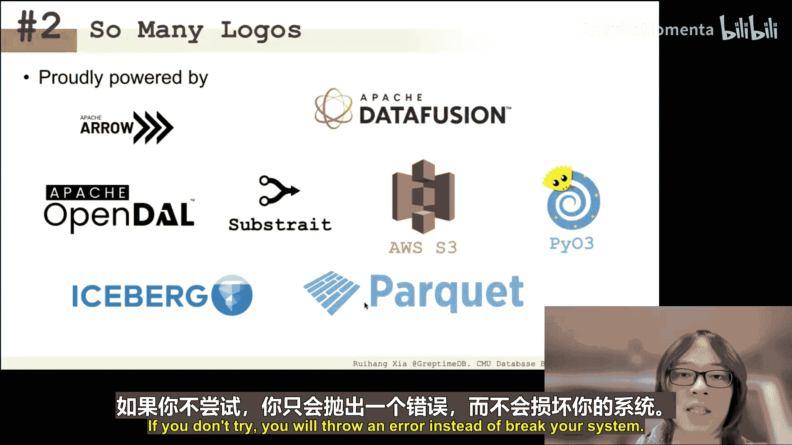

# 010：查询引擎的实现、集成与扩展


在本节课中，我们将学习 GreptimeDB 如何基于 DataFusion 构建其查询引擎。我们将探讨其实现与集成过程，并重点介绍如何扩展查询引擎以满足时序数据库的特定需求，例如支持多种查询语言、优化性能以及实现分布式执行。

---

## 概述

GreptimeDB 是一个时序数据库，旨在统一存储和分析各类时序数据，如指标、日志和追踪信息。为了实现高性能和丰富的功能，它选择集成并扩展了开源的查询引擎 DataFusion。本节课将详细介绍这一过程。

---

## 从自研引擎到 DataFusion

在 DataFusion 等现代数据库构建块出现之前，开发团队需要自研查询引擎。初期实现基础功能相对简单，但构建一个高性能、稳定且功能完整的引擎则充满挑战。团队需要应对性能波动、紧急功能需求、代码维护以及系统与业务逻辑的紧耦合等问题。

DataFusion 作为一个社区驱动的开源项目，改变了这一局面。它提供了一个功能丰富、性能优异的查询引擎框架，并拥有强大的生态系统（如 Apache Arrow、Parquet）。集成 DataFusion 只需少量代码，即可获得高性能和完整功能，使团队能专注于数据库的核心业务逻辑。

---

## GreptimeDB 架构与集成

GreptimeDB 采用典型的分布式架构，包含元数据服务器、前端节点和数据节点。其查询引擎本质上是扩展版的 DataFusion。

GreptimeDB 集成了多个优秀的数据库构建块：
*   **Apache Arrow**： 作为内存中的列式格式和高性能计算库。
*   **DataFusion**： 作为核心查询引擎。
*   **OpenDAL**： 提供对多种存储服务的统一对象访问接口。
*   **Substrait**： 用于在不同查询引擎间交换查询计划的代数逻辑。
*   **PyO3**： 用于在查询引擎中支持 Python 用户定义函数。
*   **Parquet**： 作为持久化存储的文件格式。
*   **Apache Iceberg**： 借鉴其索引格式用于二级索引。

通过复用这些通用组件，GreptimeDB 避免了从零开始的巨大开销，能够集中精力实现其核心目标：统一各类时序数据的存储与分析。

---

## 扩展查询引擎：场景与方法

DataFusion 作为一个库，具有高度的可扩展性，允许在规划、优化、执行等多个层面集成自定义逻辑。扩展主要围绕以下几个目标进行：

### 1. 扩展功能：支持多种查询语言

时序数据库领域存在多种特定的查询语言（如 PromQL、LogQL），传统上每种语言都需要独立的执行引擎。GreptimeDB 的目标是在一个数据库内支持多种语言。

**解决方案借鉴了现代编译器的设计**：将不同查询语言的前端（解析器）转换为统一的逻辑计划（中间表示，IR）。此后，无论原始查询是 SQL、PromQL 还是其他语言，都可以共享相同的优化器和后端执行逻辑。

以下是具体示例：

**示例一：PromQL 与 SQL 混合查询**
PromQL 在复杂分析上能力有限，而 SQL 更强大。GreptimeDB 允许在 SQL 中使用公共表表达式（CTE）来嵌入 PromQL 查询，从而实现混合分析。

```sql
WITH prom_query AS (
  SELECT * FROM promql(
    'sum(rate(http_requests_total[5m])) by (job)'
  )
)
SELECT * FROM prom_query ORDER BY value DESC LIMIT 10;
```
在此例中，`promql()` 函数将 PromQL 查询转换为逻辑计划节点，并嵌入到整个 SQL 逻辑计划树中，从而利用 SQL 强大的后处理能力。

**示例二：实现简易查询字符串语言**
GreptimeDB 支持类似搜索引擎的简易查询字符串语法（例如 `+error -fatal` 表示必须包含“error”且不包含“fatal”）。通过编写一个解析器将其转换为由 `AND`、`OR`、`MATCH` 等运算符组成的逻辑计划，仅用约 600 行代码即可实现该语言支持。

### 2. 扩展性能：时序数据优化

DataFusion 提供了高性能框架，但要满足特定场景（如时序查询）的极致性能，仍需进行针对性优化。

**优化案例一：PromQL `rate` 函数**
`rate` 函数要求输入数据在时间上连续且有序。通过向优化器声明这些**排序**和**数据分布**属性，可以避免不必要的全局排序操作，显著提升性能。

**优化案例二：利用数据局部性**
GreptimeDB 在数据写入时建立了三层物理分布：
1.  **按时间范围分区**：数据按时间窗口（如每小时）组织到不同文件。
2.  **按时间序列聚集**：同一时间序列的数据在物理文件内连续存储。
3.  **按时间排序**：单个时间序列内的数据按时间戳排序。

这种“时序数据分布”特性为查询优化提供了巨大空间。例如，一个需要按时间排序并取前 N 条的查询，传统方案需要全局排序（复杂度 O(N log N)）。利用数据分布信息，优化器可以将其下推为多个已排序数据段的**多路归并排序**，并在获得足够结果后提前终止，极大减少了计算和 I/O 开销。

这些优化通过实现自定义的 DataFusion **优化规则**来完成，无需修改 DataFusion 内核代码。

### 3. 扩展规模：实现分布式查询

作为云原生数据库，GreptimeDB 需要支持分布式查询执行。其前端节点和数据节点共享同一个查询引擎（扩展版 DataFusion）。

**实现原理**：
1.  将原始逻辑计划进行转换，在需要从远程数据节点读取数据的位置插入一个特殊的 `MergeScan` 节点。
2.  利用算子间的**交换律**，将 `MergeScan` 节点尽可能上推，从而将查询计划“切割”成多个子计划。
3.  子计划通过 Substrait 格式发送到数据节点执行，结果通过 Arrow Flight 协议流式传回前端节点进行汇总。

整个分布式查询的转换过程同样被实现为一个优化规则，对 DataFusion 引擎本身是透明的。

### 4. 扩展类型系统

为了支持新的数据类型（如几何类型、向量类型、JSONB 类型），GreptimeDB 扩展了 DataFusion 的类型系统。这是一项复杂的工程，因为类型系统涉及从查询协议到存储编码的整个栈。目前，团队通过“钩子”机制将自定义类型集成到 DataFusion 中，并在升级时进行适配。

---

## 关于复用构建块的思考

完全自研与复用通用构建块之间存在权衡。复用可能会引入抽象开销，并受上游项目变更的影响（尤其是像 DataFusion 这样深度集成的项目，其隐式约定变更可能导致下游系统行为异常）。

然而，优势是显而易见的：
*   **共享社区与进展**：可以借助社区的力量共同推进基础组件发展。
*   **专注核心价值**：使团队能专注于数据库独有的、高价值的创新。
*   **基础组件自身也在优化**：通用的构建块也在不断进化，其性能提升能惠及所有使用者。

对于 GreptimeDB 而言，复用成熟的数据库构建块是加速开发、保证质量、并融入更广阔生态系统的合理选择。

---

## 总结

本节课我们一起学习了 GreptimeDB 查询引擎的构建之路。我们了解到它如何从自研引擎的挑战中转向集成 DataFusion，并详细探讨了扩展查询引擎的四个主要方向：
1.  **扩展功能**：通过统一逻辑计划中间表示，支持 SQL、PromQL 等多种查询语言。
2.  **扩展性能**：利用时序数据分布特性，实现自定义优化规则，大幅提升特定查询性能。
3.  **扩展规模**：通过查询计划转换和分布式算子，实现透明的分布式查询执行。
4.  **扩展类型**：集成自定义数据类型以满足特定需求。



GreptimeDB 的实践表明，在成熟的数据库构建块之上进行扩展和集成，是构建现代数据库系统的一条高效路径。