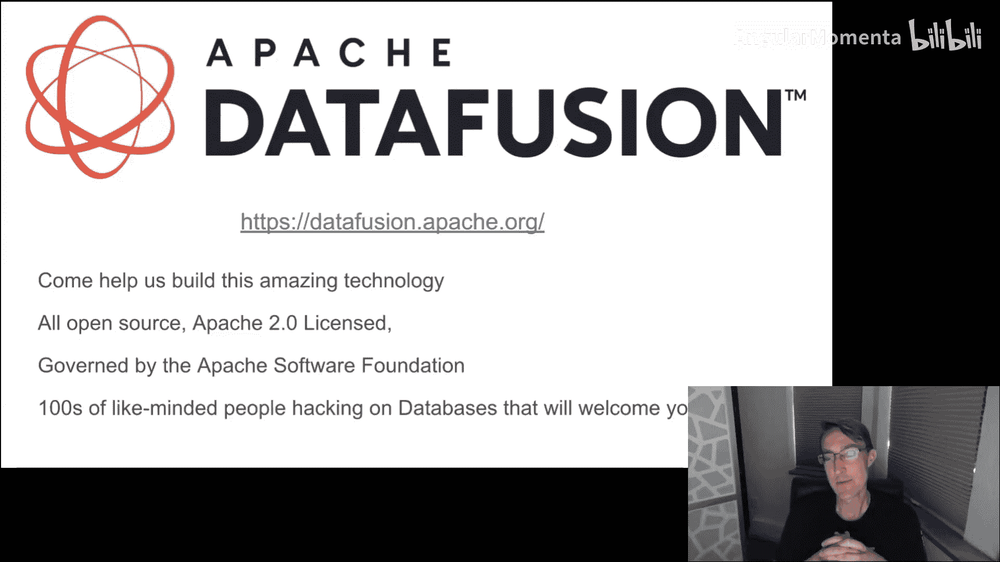

# 【卡内基梅隆大学】数据库构建块系列研讨会 ｜ Database Building Blocks Seminar Series (Fall 2024) p01 01 Apache Arrow DataFusion：一个快速、可嵌入、模块化的分析查询引擎（安德鲁·兰姆） -BV1dmipBLEYH_p1-

🎼Yeah， down。They ready for。And y'all at the speed of sound where we're now wax first top will gather around and witness something。

🎼The database Building Block seminar series is filmed in front of a live studio audience。

🎼This program is made possible by Google。

All right guys welcome thank you for joining us it's a new semester on databases so this semesters Data seminar series is on what we're calling the database building blocks。

 the ideas that there's these libraries that you can cobble together and build full pledge systems and so database fusion is one of mostly the hottest one the major most trending ones right now and so we have actually somebody who who's been working on it。

Andrew Lam， giving a talk with us， he's currently an engineer at an inflDb where they're based off。

The waste of data fusion but actually next week which I'll talk about the end we actually also have Annie Grove who is the creator of Data fusion。

 he's going to be giving us talk about Data fusion Comet which is something they've been building at Apple so with that before we get started keep everyone might muted mut the questions just unmute yourself and fire away at any time don't have to raise your hand don't have to wait till the end but please interrupt that way it's interactive for Andrew and he's not talking to himself in zoom for or an out so that Andrew thank you so much for kicking off the new we appreciate you being here。

I'm always like to be here。 Thank you for inviting me。 Yes。

 so here I'm going to talk aboutm hashi data Fuion。

 I'm going to talk very quickly because the universal feedback I've gotten from this De is that there's no way I'm going to get through it in time。

 so。😊，Challenge accepted， let's get started。I'm going to talk today about data fusion。

 this is some of my background， I'm currently a staff engineer influx as Andy Grove talked about。

 I've been working in the enterprise software world for 21 years'm forward to places like Oracle。

 Verertica， whatever， and I working at Influx for last four years on data， fusion and Ar and Apache。

InThe product we built on top of it I'm also the chair of the Apache Data fusion PMC project and I'm on the Apache Aero PMC as well and I once upon a time went to MIT and got an M engine Co 62 if that means anything to you and I actually study compilers so I didn't come directly to databases but I starting to buy this so with that I also wanted to point out a lot of stuff I'm going to talk about in this talk is' covered in the paper so I might just blow past it but we had a paper in sigma this past year that describes more formally the architecture and especially much to the performance results that I'm going to talk very briefly on。

So if you want more information go check the paper app so here's basically I'm going to talk about I'm going to talk about what state of fusion why you need it and then i'm going to cram as much as I possibly can into the architect about how it works internally and I'll touch on is this the performance。

What is data fusion here's my biggest pitch right so in my mind the best analogy is that it's the LVM for databases so what do I mean by that I mean LVM basically enable the whole raft of innovation and programming languages。

 so like the reason you can have languages like rust and Swift and Julia and a bunch of them is that they don't each of those people don't have to reimplement the same low level compiler optimizations。

 loop unrolling Reg allocation cogenerator for specialized architectures whatever like the debugger integration lots are very important but not specifically。

Very differentiating stuff and instead they can focus on their language and ecosystem libraries and stuff the same way。

 basically right the idea is data fusion lets you do the same thing specifically for OAP databases right so rather than you if for the next person wants to build the next you know。

Fancy data processing system rather than reimplementing like a fancy vectorized query engine yet again。

 instead you use data fusion， you customize it where it's necessary and instead you focus your time and effort mostly on the pieces that are important for your application。

AndSo that's a piece， it's supposed to basically be a shared foundation that then a lot of other data systems are built on top of。

That's the high level。So it's architecture the high low architectural goals I think are kind of cool is that the goal is that it works out of the box so you get up and run split like this is designed for people building database systems。

 it designed to get up and running out of the box as soon as possible so that means like I'll show you it's three lines you get running you get a full featured SQL query engine and then you can basically customize everything I mean everything I mean pretty much everything which I'm going to talk about that in quite a bit more detail the rest of the talk and I think the other thing that's important is that we purposely don't try to pick the latest and greatest research that comes out in offense to researchers here but the idea is we go reimplement。

Industrial best practice with well known patterns right that's part of why it's easy to read someone mentioned before we started is because it basically looks like you'd expect a grin to look because that's because it's following the classic design。

And so people start quickly and then they basically over time as they have engineering needs or resources rather in needs。

 they can customize and suit。Customize the thing for their their own needs。

 And so one of the things that makes it cool is you can actually try out new ideas and product like a real production system much more easily right you don't have to go figure out the guts of some tightly integrated system instead you can。

😊，Just test out so here's some interesting use cases that people have done I think this is you know giving you a preview frankly of what's going to be coming in the rest of the seminar series。

 but we have people who use it to build entire database systems which we'll talk about like some examples here including streaming as well as sort of more classic analyticsna systems and time series databases。

People also used it for its execution engine for various front ends， which I'll talk you know。

 Andy mentioned Apache Spark Comt forpache Spark， which we'll talk about later and there's several other ones。

Including like Postgres accelerators and visualization language accelerators， big effusion。

People have also actually used it for front end so they also interestingly it turns out when you implemented a table format。

 you need something that looks like a query engine typically often to implement like predicate-based elite tombstones right like if you wanted to delete stuff but's you actually use evaluatingu expression' basically you need an execution engine to do that likewise compaction so I think we've got it turns out all the rust implementations of Delta Lake iceberg Lance and Hooty all actually used data fusion which is kind of cool and then we've also seen increasing use for academic experiments So there's actually some know it was a cool recent example where someone implemented some specialized time series index it's basically like a modern version of like an OAP cube but then was able to implement a pretty straightforward rewrite data fusion to show that queries like and and ran much faster when unsurprising when you rewrite to use the index it goes super fast but it's kind of neat to see that it's able to be used in that sort of way。

I wanted to visually point out what this means like know I was talking about bla， bla。

la these use cases here's a bunch of boxes that kind of show at a high levell pieces I'm going go into this in much more detail。

 but I wanted to point out like visually right some people use everything。

 all these pieces some systems only use part of it right we're going talk about this I can just the column misconception like data fusions only the execution engine actually has a full on SQL planner function my rail that kind of stuff。

And you know so you can actually use the front end in addition to just the back end so interestingly we have people and users who do all all of those and of course the classic question when you talk about a modular system and it's reusable and all that sort of stuff is that performance is going to suck right because first of all all the traditional systems are all very tightly integrated integrated meaning that you basically have a tight integration between the storage system and the memory model and the query executedor like it's all very tightly integrated because the classic argument is that you need that tight integration in order to get reasonable performance because otherwise the interfaces slow down and I think that's we have very good performance and data in fusion I'll talk a lot about that later。

Practically speaking and this definitely mirrors my experience in industry。

 really what's typically you know as long as your architecture is not terrible。

 what's actually the limiting factor in performance is your available engineering resources。

 it's not， you know the needty degrees of whether or not you can optimize a particular code path it's how much engineering effort you can invest。

 And so I think by having。Well， understood module boundaries like  Ar， which we'll talk about。

And parquet and stuff， you can really the engineering effort you do have and that you can harness from these open source communities you can actually focus and really you know you get obsessed about making kernels really fast。

 even though they still have to conform to the arrow arrow format and that you can see like we've got very good Clickhouse benchmarks there's even better ones coming but but i'm quite pleased with how it works。

So why like that's kind of like the high level what data fusion is why would you use data fusion I've already touched on it it's basically like it's a lot of work like as Andy touched on I've done this before I did it at Vererica I've seen other people do it you can go look at how much money it takes to like build a new analyticslytic database by looking at how much money that similar companies raise right it's like hundreds of millions of dollars if not more and so。

Doing it again right you can do it but it's very expensive and so and oftentimes unless it's something that you're going to do something really different if you're just going to reinvent what people already know how works you might as well just use with what already exists and so especially when it's required but not really a differentiator and so obviously with this you can focus on what makes your project different and you share the cost of the underlying infrastructure i'm pointing out here share it's not like you just get it for free like you still have to do work to use data fusion。

But it's a lot less than you'd have to do if you did it yourself。

Obviously this is a pitch right if you hadn't picked this up already。

 like come do your next project with Data fusion and help us make it better by by building your next project slash startup with it。

Speaking of the community right here some metrics that show how big it is。

 by the way is's not founded by a company and they like donated to Apache on like a lot of sort of similar systems instead it was actually founded by And Grove who's going to talk next week I think basically because he was interested in how query engines worked donated to the Apachearrow project and at this point now has hundreds of distinct contributors crank releases every month we've done it for multiple years and it's just just getting going I think so anyway it's like the communitys big and it's and it's real and it keeps going I also think it's a very important technology we're kind of in the right time this don't please don't obsess about exactly where all these different pictures are whatever the idea here is that there's just more and more specialized database systems as time goes on and I don't see that slowing down in fact if anything that's accelerating so having something like data fusion is just going to help the trend go rather than each one have to have either a crappy handwritten query engine or invest a huge amount in building another really great one that can just reuse data fuion。

By the way， I thought it was kind of fun why data fusion called data fusion right I'm not going to read this to you you can read the blog。

 but basically And Grove's algorithm was well clearly has to have data because it had something to do with what's going on and then he just fires up a couple of words that sounds cool like fire infusion and whatever else and then picks whatever sounds good So he picked data fusion that's the meaning of the name and then tried to back justify it with like maybe it had something to do with data fusion or whatever but he also mentioned he was driving a For fusion car at the time so possibly that had something to do with that's where data fusion。

With that as aside side， here we go， let's talk about the architecture。

So i'm now going to cram as much as I possibly can at you mostly so that you have an understanding of how this thing works that if you want to go delve into it more deeply you can I don't expect you to understand all the details so here's the high level architecture this is the picture from the VLDb paper I mean the sigma paper i'm sorry the。

Aport of this picture is that one this should look like every other execution query engine you've ever seen right it's got a catalog and in various data sources。

 I'll talk about all this stuff in more detail later。

 it's got various front ends it's got a like a logical plan representation which represents a high- level relational operator tree。

 a bunch of rewrites on that execution plan low little physical thing the physical plan that has more details and then it's got all the optimized implementations which in the execution。

The point of these blue boxes here is to show that you can basically extend the system anywhere so yes you can stick you know new functions in。

 but you can also stick new relational operators in you can implement your own execution streams and basically everything else。

And i'll talk about that along the way warning but important of course is documented someone actually mentioned this before there's obviously user documentation I think there's plenty of systems that have that。

But I really want to emphasize there's actually quite a lot of documentation written designed for people building the system right so there's low level API。

rite ups for like if you want to go the system with this， not just use the SQL。

So that's just a plug so now I'm going to talk through some of the high level architectural deep dive。

Points and then we can talk through I'll go into more detail。

 So one of the high level choices is that it uses arrow internally right， not just at the interface。

 So you typically like when you're building one of these systems。

 you'll have the choice of do you use arrow。Or something similar like when you're building a column exor。

 do you use arrow internally like within the when you pass data between the operators or do you use something internal specialized for your system and then you convert the arrow at the interface。

 obviously the pros of using arrow internally right the first obvious one is that you don't have there's no cost to convert at the edge but I think the far more important one from in practice that I found is you actually then can reuse all the fact that there's an arrow library and you can take advantage of all that the effort that goes in there So in particular there's a lot of obsession that's occurred if you're into that kind of thing like make the low levelvel arrow kernels really fast like do lowleve operations And so by reusing the arrow and arrow plantation。

 you get access to that Now I drew this picture that's somewhat misleading arrow is actually used。

You know， within the aggregate， the internal memory structures of how the hash group by hash thing works absolutely is not directly arrow。

 like it's certainly inspired by arrow， but it's you know its own thing。

 but when the operator produces output like the interface between them is all arrow record badges。

Or I'll show that later and of course the upside of this design right which is the more classic one where you have your own internal implementation is that you can specialize and do whatever you want right and specifically if arrow doesn't have some feature you can add it right like selection vectors being an obvious one that arrow doesn't have that might be valuable but the downside is you have to convert it to arrow but I think the real downside is you actually have to not maintain all this code and if you want to like have people write extension functions you have to somehow bridge whatever they're writing to this internal stuff。

Another very I think difference about data fusion is its input in rust initially like I think realistically why it's written in rustst because Andy Grove thought Rus was going to be the hot thing back in the day and this was the hobby project so he just like basically took a flyer。

And at that point， if you were like doing this for real， you probably or for like a job。

 you probably would have like the Safe bet would have been C++ right because that was well understood all all the significant database systems were written in that possibly Java but people probably realize that was a fad but downside was like it's it's hard to write correct code in C++ I can tell you all sorts of horror stories about me personally spending lots of time tracking down multitrarated race condition crashes that happened like once you stressed the system for three days whatever it was terrible Also why the hell can't find the freaking symbol that I just wanted like I don't understand like I've also fought to build system far more than I want to explain。

So rust， the know the upside of rust， the pitch was it has memory and thread safety。

Which I'll talk about in just a moment， it's a hipster language right so that actually seems to attract more people。

I know it sounds silly， but actually it actually seems to work a lot of people are interested in learning Rus so they come come work on our project it has modern tooling which sounds stupid but it's just like you know I don't have to fu around with the dependencies it just works The downside was especially when this was being picked six years ago Ru was not at all the obvious choice for data dis implementationations I think now it would be fine like people wouldn't look at you weird but I think early on it it was not the obvious choice。

The lessons learned from my perspective has actually been great。

It basically lived up to the hype I thought I was you know I got hired Paul Dix the co-founderers of influx that like we're writing this thing Ru I said I don't care as long as I can write code like I just write whatever language you want but but yeah like I have you know depending on you kind of there's been one memory issue of four or four and a half years it's been been phenomenal and you definitely spent a lot of time fighting the compiler right don't get me wrong but once it compiled like it was it was it was money。

And I think another thing that I've come to only appreciate more recently is that。

By having the compiler enforce the memory safety constraints。

 right that sounds great in theory I obviously know what's going to be component about that。😊。

It actually helps a lot when what you're building is this big open source project because instead of relying on expert code reviewers to catch the weird race conditions you actually just let the compiler do it so I think that actually allows us to get a lot more people in hacking on this thing right and they can't cause the kind of damage that you could cause if they just went you know and you let some random person start writing C++ big complicated C+ code base。

嗯。At least that's my that's what I and also you know I kind of said the package manager is amazing and I said it was easy to start with data fusion here's my example right there's this three lines if you want to start a project with data fusion you're on cargo blah blah bla。

 my new project you go into the directory and then you can cargo add data fusion and you build it and like now you're ready to rock youve got a full featuredature SQL engine that you can start customizing right away。

So and that's it right you don't have anything else so that it worked pretty good。

So the threat the multi threaded bugs the lack of the lack of like multithtter bugs is not it's partly rust but also like there isn't a lot of maybe I'm wrong like concurrent data structure you're maintaining concurrent state because you're running analytics it's not like you're running transactions right that is true but there's nothing about rust that prevents you from doing concurrent transactions I think it's just like if you try to do in rusts it' just very very it's a。

It's an exercise and frustration with the compiler just like let me do the freaking thing I've been doing and see what's was for 10 years and' like no and you can't do it and eventually you understand why it's telling you that but it's definitely frustrating at first so I don't think there's any reason why Ru couldn't be implemented like used for transaction systems but but certainly wet we haven't done it and then maybe you'll get this in a second but like you just show an example of like a great mini project bringing in data fusion cargo can you briefly talk about like what other cargoes you're relying on in data fusion or is everything written from scratch no no it's like Python projects it ends up with a huge dependency tree I can't list them off but there's probably at least 100 transit dependencies would be are you rely on like Togao some of most common things people are using and I'll talk about Tokyo Tokyo later yeah like Rus because it's so easy to add new dependencies which is great one of the downs one of the implications is that。

You end up with a whole bunch of dependencies， data fusion is no exception to that we fought against adding like all sorts of crazy ones。

 but the dependency footprint is not trivial。All right so here's how planning works at a high level like I'm going to go through this a couple of times in various details。

 but when you know you get the SQL query it starts a text。

 this shouldn't be a surprise to anyone who knows how a SQL engine works。

 but I just want to talk through the data fusion language for this。

You start with SQL planning right so you get a text you plan it it turns into something called a logical plan right that is the high level query plan a relational operator treaties Postres calls that a query tree I believe it's been a while since I screwed on Postgres and that has you do high level planning on that which i'll talk about。

Then there's a step that goes physical planning you have a lower level execution plan so that would be called an access plan or an operator tree perhaps I think Postgre calls it a plan tree and then there's a subsequent phase called execute in data fusion which actually creates the streams or like what would be called operators so those things are the actual things that are touching the data calling the arrow kernels like doing like doing the low level vectorized operations so that' that's the high level planning flow and I'm going to talk through sort of each part of that in detail。

But again， like this is not like earth shattering， this is basically how every other system is implemented。

 but these are the terms that data fusion uses。And then I should point out that the output of these things is arrow record batches。

 so record batches are just sets of arrow rows， so they're like horizontal slices of a table that's flowing through。

All right， so let's talk about SQL planning， front endological planning。

Again you start with text right here is this pretty simple select project group and query it would go through a SQL parser。

 we use SQL parser a whole I could talk all sorts about the crazy set of。

What qualifies a SQL but that's a whole different talk maybe so you get a class you know you get AST parse tree and then that AST parry go through a planner you get a logical plan right this is how again basically a real system you would expect should work。

嗯。Datafusion also has other ways to build logical plans which I wanted to highlight the first is there's like a data frame looking kind of API this is definitely data frame API modeled on what Spark inted right you read the table then you filter it use some sort of like you know way to build up expressions that looks kind of fluent I think is the name for this and then you aggregate it right so you can build that but under the covers its literally building the same logical plan so after after it builds a logical plan all the rest of the execution is exactly the same。

And you can probably guess where I'm going here we hit our first like extension point if you want you people want to build your own fancy customized query language。

 what you do like what you do and we've done this in influx hopefully Paul will talk about it is you just build a logical plan like you have to write your own code to do implement whatever cementmantic things you want。

 but it just spits out of logical plan and once you've created that the whole rest of the planning flow is the same so this is the extension point that if you want to support your own custom language which is a bunch of examples like we have influxqL people have problem QL and big effusion and a bunch of other stuff。

Here's how you do it， you don't have to reim the whole rest of the database system to run。And so。

Again， people who if you've been around databases this should be like a review but I just wanted to talk this through in case you haven't seen this right these logical plans are basically data photographs where they' relational operators it's fancy name but like at the end of the day you read them from the bottom of the top I don't know why you do this but the laser at the bottom the root is at the top it's an upsidedown tree and so when you're thinking about logically what they represent they represent data flowing from sources down at the bottom floating up to the plan eventually to the root which is going back to the user so in this case you'd scan first then there'd be a filter applied and then you do some sort of aggregation so that's what a logical plan represents same thing for a physical plan。

I just thought I needed to talk about this， so here is a sampling of the types of logical plans that are included in data fusion you don't have to read all these。

However it basically has all the classic things you'd want right project filter window aggregate sorts all the stuff and I think another important one though you can see is there's actually extension node here。

 so that means if you want a logic you know like something in your logical plan that is not built in the data fusion you just stick a version of that in there。

And that seems to work brutal。Do you support creating indexes？

People would definitely implement indexes， yes， okay。

Using on top of data fusion although I don't think I talked too much about that in this talk right thanks definitely have people who've done that there's not there's not a lot like built in support in data fusion for indexes。

 but you can you can build in。The Lance guys might talk about that。

 I think they're pretty heavy uses of indexes I was wanted to show there's like you know what are these APIs actually look like。

 you don't have to remove this code or like what you're going to but like this is rust code and the point like this is just basically showing how you build this logical plan using rust code either with the logical plan builder or the data frame they're very similar My point of showing this is it's very straightforward you make this builder thing you say filter you build you got yourself a logical plan So it's not complicated to go build build this thing it's not some esoteric API and it's got a lot of the other APIs if you were ever building all of these things you have to write yourself if you use data you don't have to you can say APIs to walk them and rewrite them and to pretty print them and to serialize them to bytes so you can send them over the network and all that sort of stuff which again was like nuts and bolts's not super exciting but like if you had to build the system this are all pieces that you need probably to do it for real。

The way data is represented in data fuion actually I said that were record batches right so that they're。

A rage flowing through the system it's actually not quite that in during the execution。

They're one of two things they're either an array right it' an arrow array of values right so that's a column or arrow array or it's a scalar value。

 which is a special case single single constant right and that that single constant is important like critical to special case that in many places if you go into so so these are the two that we have。

And that seemed to have worked pretty well right now。

 we currently use the arrow type system for both the logical and the physical type system。

It's not ideal because the  aerotype system has like it encodes some of the physical encodings in the type system so you have like logical difference between like dictionary array or a normal array which is not ideal we're talking about making that a little bit more distinct but' that's how it currently is the upside is it just use aerotypes everywhere so that's pretty straightforward。

Can the scholar type be a computation of some other thing or it's already computed？

At this point it's already computed there's a bunch this optimizer for which y'allll talk about。

 which if you have an expressions that's a constant right the optimizer will rewrite it to a scalar value。

Yeah啊。Yeah so the next thing I want to talk about briefly was functions right so all the functions are actually implemented there's no distinction between built in or user defined functions they're all implemented using the same API Ru calls it a trait but it's like the equivalent of an interface since Java or a camera see what called the virtual virtual method or something anyway they're all implemented with the same API' go to show up very briefly you can implement scalar aggregate window functions table functions right they all different。

Interfaces you've got to implement but you can do it and they're all in terms of arrow repackaged what comes with data fusion right to make sure that out of the box that works well is it's basically got a big library of existing functions。

 mostly like Postgres compatible and then there's community maintained packages like if you want spark versions of functions or you want JSON functions or there's bunch of other ones since everything's just a user defined function if you don't like how a particular one operates you just overwride it and provide and there's no reason why it can't go as fast as the built in ones there's also actually kind of cool is built in hooks for create function syntax so if you want to for example build we have this's cool example for building pitorrch right like create user defined function model blah blah blah as pitorrch whatever data fusion is done that built in but it's got the hooks and people actually can build that on top。

So you should check out the example if you want if want to see how that works。

Here I just want to give like， you know， that's all kind of high level I could make slidewear all day long。

 but I'll show you the way the code looks， the point of this is not super complicated right。

What does a user defined function look like you have to。

Define some interfaceop sorry the point is you define what function types what argument types the function takes in this case it takes one in 32 32 bit integer argument data fusion if you try to call it with a 64 bit argument right we'll cast it automatically and make sure that it gets called as one of these appropriate signatures。

 you have to give us some information like what the name of the function is and what the return type is and some other stuff。

And then you act then here's an example of how you actually implement this function， right。

 so this is an example where。You get the thing get you get the arguments as the array of these columnar values right so those are either the arrays or the scalarrs you have to return a columnar value。

This is the arrow。This happens to turn the scalar， this is a very simple way to implement a function。

 but it works。It turns the scalar value into an array then it gets this thing as an array right if what came in was a scalar value there's no special case for scalar value or just downcast it to an array and then here's the arrow API to build a new arrow array that actually adds one to the number it handles nullles and so this is not the fastest way to write this function but it works and probably it's it'll still be pretty fast and if you want to you could then go implement all the special cases if it was important but a lot of people just like basically ahead so Paro has the question from BellOs how does data fusion handle scalar functions with complex types arrays maps rows etc。

Because it uses the arrowtype system， the columnar like the scalar values have a variant that is represented for lists orstructs or whatever。

 and so you can get。Arrowstruct arrays orarrow list arrays here and manipulate them。

 And I will be honest if you try to show the。Let's just say that the APIs from manilulating the structure types is not as nice as this one。

 but I'm not sure that is anything related， I'm not sure how much Greek can do。But yeah。

 you just get an arrowstruct array and do whatever you wanted to it。怎么事？

So it someone would look the same， you just call different APIs。

All right so the catalogs catalogs had a quick question before we move on where's the like selection information being column value is just a scalar or an array right so like is the scalar UDF applied to rows that are already filtered out but actually have our well。

So there's no selection vector that's what you're asking instead actually the arrays get copied right so only the values that pass the filter copied on so the subsequent like operations only see the rows that so you materialize after every predit。

After ref filter， yes， yes， filter， got it。You know， I meant to ask everyone to say who they are。

 but so that's Ryan Marcus， the premier David professor from Penn， sorry no。

No and I think you know we've actually found there's an aside sometimes it's actually faster to get everything all lined back up into a single you know contiguous memory block so the next time you go blast through it's much faster but on the other hand sometimes copy a bunch of data that you know over over again that it's not as necessary it's a design decision right I'm sure I can make up a case where not doing that is optimal right but。

Yeah， so there's no equivalent of selection vectors and data fusion right now。All right。

 so moving on a catalog API so the catalog API what actually comes prepackaged catalog is like what tables exist。

 what schemas exist that kind of stuff What comes with data fusionions two is memory based one that's like ephemeral goes away when you stop down and there's also one that's like a directory of files and then there's a catalog API for everything else The reason there's nothing else nothing more sophisticated for catalog is that'm in my belief the catalog format is super use case specific so anything more specific than like a directory of files is likely not to be super widely applicable So maybe that's just an excuse but that's why there's not any other we've gotten pretty far with just memory files and this API and again the API is like not complicated's like tell me all the tables that are in your schema right what are their names given a name give me the thing that provides me the data about it it's like the API is not complicated to implement of course implementing catalog is probably pretty complicated but。

The other thing I wanted to point out is this thing is a sync， right。

 so this actually means you can do network。Transfer here right if you have a remote a remote catalog for example are there are there like existing limitations that like speak to like each catalog or unity or oh yeah whatever yeah well or like iceberg right iceberg doesn't that that talks to the remote catalogs Okay awesome thanks。

And that way you don't have to have all the information for all the tables before you start planning do I mean you do have to know all the names but that's's another the detail。

 I don't know people are familiar with like what what a catalog like a directory catalog based file format is or like what the standard high based directory part was this is terrifying but this is what build in data fusion we didn't invent this we just kind of follow the same model So basically we treat a directory or files like in this case there's a directory called table one parquet files in it itll treat that as a single table you could just like that as a table and outcomes comes the values and data fusion will merge whatever the schemas are and pattern and nus whatever。

Craazier is if you have a table like this it actually has two subdirecties in this case the directory literally actually literally has an name and date equals whatever this you know June 1st。

Like this is the directory name and data fusion will effectively inject another column called date into your table right that has this value when it does when it combines all these files and also if you put a predicate on like I only want the tables and date you know June 2。

 you'll actually only take the files from this directory。

So this's not something data fusion event that this is like high style partitioning database purists think it's horrible。

 but it actually is super common in the real world so and it like it has problems but it seems to be good so anyway data fusion does do that。

 which is kind of cool。The prepack on that。In terms of table providers and table formats。

 a whole like it includes common file formats like CSV JSON， Parquet， Avro and Arero。

There's a whole bunch of community provided ones like that basically just use the API and then theyve implemented into faces for like SQL light or MySQL or whatever you can check those out and then again there's this table provider API table provider API has a bunch of things but mostly this is the main API for it when you when data you wants to read data it calls scan and it passes projection filter push down projections push down filters push down limits so which columns to read which expressions to apply if you have some limit of number of rows and it returns and execution plan which we'll talk about lot but like basically this is an example you want to do your own custom data format you don't now have to go all implement。

All the query processing。And optimization passes like push the predicates down into the scan right like that data fusion does that now of course you've got to go actually do something with the predicates and stuff that get pushed。

 but at least you get them right here and they're pretty straightforward。

And there's some reporting stuff that has to go on， but that's about it。

I think I'm very proud of the parquet Ex partly because a lot of the users of data fusion like care a lot about parquet and so conly a huge amount of investments gone into this particular one。

 but I think if you look at the parquet reader that's in data fusion it's about it has about as all the tricks that I know that you can play with parquet readers so it does like all the different row group and data page prunings based on statistics and predicate range analysis it does late materialization like actually read only some columns。

 apply the filters and then only materialize values from the subsequent columns that match the first and you can actually skip data pages if you prune out enough you can cache the metadata you can do IO pushdowns it only fetches the pages you need bla you can actually pass external index information and if you want to see how that works so I mean like this is just meant to be a high levell overview you can read more about this blog but if you want to see the level of sophistications you can get with this API I think it's pretty sophisticated。

But there's also a lot of code that does this。All right so moving on the next thing the effusion does is logical query optimization so what does logical query optimization mean it's basically you have a logical plan and there's a rewrite that goes on that tries to make the basically compute the same thing but does it faster right there's a bunch of these that are built in and then you still get a logical plan of the output。

😊，The classic ones that are prepackaged， the ones that you always need like to push down projections。

 limits and filters， simplify expressions that got asked earlier right like if you've got an expression that's like five times well maybe more practical ones like extract the year from some timest right you don't want to evaluate that in every row instead you evaluate it once at plan time so that' that's built in right that happens here there's some query decocorlations all that kind of stuff and then of course there's an API so if you don't like what's in there you need something new you can add your own and the API literally is you get the logical plan and you have to return a logical plan some signal whether or not you've rewritten it。

So like the point of'm showing you this is not that you need to like learn how to code it。

 it's just like APIs are not that complicated。In my opinion。

So another thing that might be interesting about the optimizer。

 so you know optimizer there's like a whole bunch of。

Basically I would classify optimizations as two categories One is like you always do them like you always simplify expressions you you know you practically always derelate subqueries and then there's joint ordering so joint ordering is like you know which order do you joins I would say what's in data fusion is basically a semantic optimizer thank you Andy for giving me that terminology so I can call us something good I believe don't thank me Larry Eison Larry Eison yes thank Larryson you don't here very often。

So hey Larry Elsson's company gave my first job I don't a a little towards him anyway so what Sammanantha godr means basically if you plan the joins in the orders like I appear in the query that you likew wrotete them and then if I'm honest there's like just enough to avoid tpC disasters which I'll talk about but that's it realistically there's not a sophisticated join ordering algorithm in here and I wouldn't claim that there is if you want to know why possibly it's an excuse but realistic it's also born off my PTSD from working on the vertical optimizer for four years which is Carinal estimation is really hard。

 it's basically unsolved people still write papers about its still unsolved and without that complex rejoin ordering is really hard and so rather than try to do it。

 the better story and data fusion is you could just use the API you write your own query if you want whatever optimizer you want to write you can write it yourself but we don't have something in there I think also it helped a lot that data fusionionss largely focus on lab workloads where if you don't want watch tables are more important more and more important these days so because probably。

Joins are so bad and you can get reasonable compression back with the decoized format。

 so you know a lot of people just say screw it we're not going to do joins。

 we don' do it once it load and then we don't have to worry about the query on time。

So that's what we do for joint order I'll talk about the implications of that later。All right。

 moving on to physical planning right this against kind of review， I've gone over this but。

W physical plan works you start with logical plan and eventually you get to this execution plan thing and the execution plan thing eventually executes and generates multiple streams of these record bads and those streams of the actual operators to do the work and then each those streams incrementally creates a record batchge as you go through the computation actually Andrew does someone answer a question pretty the optimizer I'm wondering if the sound correct So the results produced by the optimizer passes are insured how is it guaranteed the results the optimizer is the same as the unopimized plan which is a fair question there's a check that makes sure at least the schemas come out that are the same but otherwise I don't think there's no I'm not sure the theoretical way to validate that they compute the same same answer it's basically on you right if you make an optimizer pass that。

Changes the semantic meaning of the plan it's going to be a bug。

we do check the schema that is a does check， but。But because we had bugs related to that early on。嗯。

All right， so the Executer model overview， they have fuss of like it's classic volcano style pull based。

 I'll explain how this works， it works great。😊，Has exchange operators with the equivalent it's a streaming engine that means it doesn't buffer stuff internally unless it has to so like it typically operate on batches of rows。

 I believe there it's approximately 8000 by default fault obviously if you have to like sort the whole data set or you have to like do some big hash grouping it's gonna buffer data although it does have split into disk it definitely does multi cores keeps all your cores very busy uses something called Tokyo for thread scheduling I'll talk about that in a bit and then it's got a cooperative resource。

Tracking system just memory pools， which I'll also talk briefly about。

So in order to talk about these I need to talk a little bit about part like the terminology。

 the first thing is partitions I'm sure the volcano model has a term for this。

 but I can't remember what it's called basically in a plan if you saw like a filter ex like this right it would say maybe four partitions on it what actually happens at runtime is there's four distinct instances of the stream that correspond right so this case there's like literally four things。

Hopefully this fourth course that you can keep busy but they're all cranking through the filter all in parallel not talking to each other just doing doing great so the planning works on these single nodes right it's not like if you have 20 partition you have 20 filter you actually have one of them you do all the plans and then when you actually go to run them they expand out。

So that makes sense that these partitions are just these incremental streams。Um。

 something like why so why pool based why volcano given that。

Okay at least the latest research is showing push based model is that our DDB certainly did a major rewrite I'm glad you asked that question because I have slides just about that exact question let me let me let me get I'll get there in like two or three slides so yes in fact that's part of why I wrote the Sigma paper so people stopped asking me that question。

So okay so sort， I also want to just point out briefly that data fusion actually is a pre sophisticated order tracking system。

 so that means the execution plans themselves kind of know what order the output that they come out of right so in this case you might know that data sorted by B then A and what the optimizers can do is they then can get rid of like if you ask for the data sorted by B& A and your execution node can report that it's sorted by B&A the optimizer will skip actually trying to sort the data so I think analytics system that's very important typically because that's one of the only like types of indexes you have is the physical clustering of the data。

We do the same thing for window functions yeah so let me physical optimizer sorry I go do this and we'll get to the Tokyo stuff which I know everyone's excited about so the。

Physical optimizer does basically the same thing， it just rewrites these trees。

 but instead of working on logical plans， it works on physical plans。

 here's the types of optimizers that are included， including something that basically sets up the parallelism。

 the sorting ensures that stuff that if you need to have the data sorted or insert sorts。

It'll pick join algorithms， it'll do things like if you know the value of a scan based off just the statistics like count star right you can replace that with statistics that happens at this level。

Again， the API looks basically like you get un input and output you have to rewrite it All right。

 let's talk about yes， I want to talk here we're gonna get to talk I gotta get there So as I mentioned there's a whole bunch of prepackaged implementations in here like I don't think you need to rewrite filters or projections although you can if you want it's got the full range of sorting we've obsessed about merging for a lot of things there's like a special implementation for limit we've got fancy two phase vectorized hashing thing that you can read all about with a bunch of blogs we have all the joins that you need hash join merge join that's a join sort merge join and also spills and if you don't know what left semi and right and anti like it does they do all these two if you don't know what that means it's fine but like that's basically what you need to implement subquaries you guys have you thought about worst case optimal joins。

We have not， okay。It's just got these standard ones。

Although there's no reason you couldn't write your own and then the window functions we use sort based window calculations。

 we don't use like physical segmentaries， which I think is the hot new research paper。

 but you know the sort based one works just fine from what we can see it actually works very well with streaming implementations。

This is the API。I am going to get to the execution but just a second so the way execution plan works is you call execute and you get one of these record batch streams back and then there's also ways to report the properties like how I was describing the sort order before right this is the way that the execution plans report information about how they're sorted and partition the stuff they track it and there's a whole bunch more functions here so that's how the optimizes are written generically not in terms of the existing operator。

I have a question about this is there a reason that you guys decided to go with dynamic dispatch and trait to objects versus like Ru standard like enums。

 for example， it is the only reason to allow for other people to implement stuff like with this trait involved can you talk about that？

Yeah， I mean， basically， yes， right， if it's a trait。

 it's a dynamic trait that's the equivalent like a virtual like an object in something like Java so。

The fact that this is a trait， everything's implemented in terms of this means that you can implement all your own operators。

 extension operators using the exact same API。And like the overhead of calling this function once per execution is very small。

Do you see any overhead and I'm like basically having to do that dynamic dispatch for every single note Okay no I mean because it does it's once per plan right and then each node sit there and cranks through giant swaths of 8000 rows apiece right like over the course of the plan so it's not like this gets's called every row right this getss called once per。

Operator per partition right so the like filter it's going to be called 16 times and the 16 cores in your system is going to called 16 times。

Which is， we don't see that at all。Here isSo I're not going to start talking a little bit about how stuff does go cross Co。

The upside of a pole based model right is that actually most operators are just they look like their single core right they just have to worry about like their input stream and their output stream due the calculation they have to worry about the the shuffling across cores they don't to be multi threadread。

 they're easy to write is of course。There are operators that handle them。

 so there's one called coalesce partitions which like combines everything into a single stream that's if you want to do something like a global limit or you're trying to like return results as a single stream to the user and then there's the classic reppartition which is the equivalent of the exchange operator which will actually shuffle data around from a bunch of threads to other threads through some complicated thing which can do hash repartitioning。

This one's definitely complicated。And has had a bunch of tuning， but that's so that you know。

 there's the classic exchange operator right there。Memory disk management。Is done by。

Cooperatively reporting the giant allocations and ignoring the small ones and assuming they're accounted for in some slo right so like you count for the big allocations in the hash tables or the sort buffers or whatever。

 but you're not tracking all the individual like intermediate record batches that are flowing between the notess which makes you know this is ten you could probably do better but this actually works pretty well prepackaged memory of course is in trade so you can provide your own implementation and every pool but the basic one is just。

It'll give operators as much memory as they ask for until it runs out and then there's another one that tries to divide the memory fairly across operators that could spill neither one of those is particularly great for like a really high performance workload but work okay and you can implement your own more sophisticated ones。

All right， let's talk about scheduling and everyone's favorite topic。Data fusion uses。

Something something called Tokyo implement like it implements the CPU bound work on a Tokyo thread pool。

 which called a runtime Tokyo is this thing that came out of the rust ecosystem it was designed for networking I know。

 but it turns out it has very good high quality work stealing thread scheduler and even better because it uses the built-in features of rust specifically async you basically get built in continuations which I'll talk about in a second so basically if you have to do IO or something right in your middle of doing all these operations the Tokyo schedule handles that and can basically take off and do your IO and come back and rerun you when you're ready but if you're ready and like you're doing an aggregate and you need the next batch input you can immediately just ask your input filter and that will then effectively immediately call a scan do the work and the thing will get passed up all in the same core。

So it does， the stuff does get passed and you'd have the hook to do IO。

 but you don't have to worry about a bunch of the details。

So I think in a lot of ways it's the best of both worlds， in my opinion。

 I realize that not everyone's convinced， but I have I'm sad to say actually implemented in my own threadreadpo a couple of times and I'm super super happy not to have had to do it again because like you can get it it's very easy to get it working 99。

9% of the time and then you spend a huge amount of time getting it working all this stupid corner cases like when it shuts down or when there's something that's like hanging blah blah it's just a giant pain in the ass to get it working well and to make sure it works really well under high load and have it like steel work across threads and stuff。

Like it's not impossible， but it's if you don't want to do it and you can use someone else。

 it's great。嗯。So the way this is actually implemented and again I'm going to get to the how it works in a second is that you call stream right you don't to use streams and then this is the code that you would write basically like this is basically the inner loop of either filter or grouping or something right you'd effectively get you'd write it as though you could get the next batch of input。

 you do something to the next batch and then if you were done you could return it otherwise you just keep in this loop processing right。

So the thing is this magic8 weight this actually turns into a return like the compiler will generate a return back to the scheduler here through details I probably don't even understand myself enough to explain them but it's effectively generate like this generate multi like cooperative continuations here so if this next stream is not ready because like its reading data over the network what will actually happen is this will turn and control the scheduler which will go find something else to do。

And then when it's ready， the schedule will eventually call you back and so from your perspective as the programmer you just wrote this straight line code。

 what's actually happening is you had to return and then it's coming back when it's ready。

But if it's immediately ready it just sits here in the loop and does the next thing right so that's that's how you get the pull based when it's ready。

 but if you actually had to return control it already happens。

That's probably too much for this so you know you get you get record badges， okay。

 so how will this work in practice？I would totally do it again I'm obviously a fanboy right but like I have no regrets about this at all part of this because I've done a bunch of different versions of this right like like I've written my own schedule and like it's not fun I think a lot of people complain about the rest like stream ecosystem just haven't like yes it's bad but compared to everything else it's like the least bad of all the other options。

We actually interestingly， you go back we actually tried to implement a pushbased morsel scheduler right morsel driven scheduler based on Rayon。

 which is the other popular scheduler Ross it's actually a very interesting PR the conclusion is like one of the smart influx data guys tried this because he really didn't like Tokyo basically and Raphael he desperately wanted to show show that it was not like that he could do better and he just couldn't he spent a lot of time it was very complicated but basically he couldn't show there was no significant benefits over usinging Tokyo so we got rid of it and I don't think we've ever done it Now of course I hinting at before like basically every month people would show be like hey。

 we read this great paper called morsel driven perism and Duckdb used it and so did Vlock and therefore why doesn't data fusion use it really much better and so the conclusion is so part we ran a bunch of experiments which was all talk about the conclusion ist you can do very good works great with many core works great。

You don't need to use push base scheduler。Although you do， when you use the Tokyo system。

 it's very easy if you're not careful to run CPU and I in the same threat point。

 you do need to be careful at that but。But here's it， so let me talk about performance。

So basically my conclusion is yes， I know I know a lot about this paper。

 I know not only do I know the authors like I read this carefully and I understand that other systems have claim that they needed to go with the system。

 but。It was not our experience。I wonder how much because essentially Coertine does that。

Solve like 90% of the problem that they were trying to solve。

Yeah well well the rust compiler generate like it's not exactly a co routine because it doesn't have a whole stack it just like the compiler generates the continuation for you so it basically marshals all the local variables into some structure that then gets stored on the stack gets stored on the heat rather。

Rightt then returns control so like。The beauty is the compiler is doing all that work for you like I've worked on like my first compiler job was like we had to do that stuff manually。

 it was a giant pan the ass like it worked， but but it was it was it was not cool but the fact that the Ru compiler does it for you is like。

😊，But like with Tokyo like you can tell it to cancel like， you know a pending， yeah， yeah。

 so like that's like to do that without without I mean it's essentially coes without like that mechanism we we get to pass back k null say he they stop or to have like yeah like。

I'm saying like having the control larger control plane。Still now separated with the data plane。

 I think maybe gives you。Maybe's you know the key reasons and one of I think theductD guy brings up with two。

Yeah， yeah， I mean it's beautiful that like you don't want you want the schedule to be canceled and so actually we're creative you cancel data fusion like because it's all like it all you don't to handle all that canceling explicitly because it's all sort of automatically been generates all the cleanup happens all the equivalent of the structure is get called it's a really nice I'm again I'm a huge fan so like maybe I shouldn't be the one telling like like some of the downside of it。

 but like it's it's great questions to Andrew so how much of the heavy lifting do you think that Tokyo is doing then because it seems like because to add on to what Andy said like a lot of the like the benefits of Tokyo is like from that work ceiling right and generally when we're using like when we for push based。

Models， like it's because we have that finer grid control and we can implement elasticity。

 but with Tokyo like everything's worth dealing right so do you think？Yeah， so I mean。

 one of the downsides is it doesn't， you have to basically set the plan parallelism at plan time right so there's no dynamic like scaling up or down CPU resources during execution。

I happened to。In the sense of like， if I also sudden decide I want to not use 16 cores。

 I dont want to use three， you can't， I mean， yes are you saying that in Tokyo or。

I'm saying if you tried to do that in data fusion， the plans are still set up to have 16 copies of everything so if you actually scale the threads down everything would start thrashing it would be much less efficient than was perhaps we're talking about worse healing。

 but like。It。In my experience it's very like like the fact sorry in my experience needing to switch CPU down during execution is actually typically like the last resource。

 it's not the resource you run out of first you almost always run out of RAM first and that's you can't just steal away the same way you can steal with schedule and like over scheduling a CPU with a couple extra threads。

It's not the end of the world， especially if the other thread aren't doing massive computation。

In other words， I'm just kind of like handwaving away and saying， I don't think run time。

 dynamicism of CPU is all that important， which probably depends on your use case。

 but that's the ones that I've seen。嗯。Yeah， so now I just want to briefly talk in the last couple minutes。

 I want to like sort of summarize the some of the results from the paper we did and part of this was like we did we compared againstductDB my conclusion that TLDR is that the differences。

Performance is 100% engineering effort really than the architecture。

 but you know a shitty architecture but like as long as we get a good enough one which see fusion has I think you get just as great performance and I think part of like data fusion getting better we got a whole bunch of cool stuff in the pipeline probably another 2030% element。

By doing crazyier things that's not related so here I keep hinting at this here's my fancy I love this chart Maybe it's overwhelming overwhelming what this is is we ran the clickbench queries which are aggregate heavy queries right aggregate filtering there are no joins in here and these the X axis is number of cores and it goes from one to 172。

Or maybe 172。And and we just ran each of the queries individually in DDB and data fusion and the whole point of this chart is like basically if you look at the shapes of these curves。

 they're basically the same。 Yes， they're not all the same， sometimes data fusions faster。

 sometimes DDB is faster but like there's no fundamental like wall that data fusion hits or thatductDB doesn't have or the ductDB has their data fusion in that like they basically show the same scaling properties So my conclusion of that is that there's no fundamental difference in the scheduler right that precludes you from getting good performance scalability up to 172 cores any one of these individual queries I'm sure we can make faster can talk about why it goes up faster know if data fusion than then ductDb here or whatever but I don't think it's related to the scheduler。

I have another question。 Sorry， Last question about this。 So these benchmarks。

 if I remember correctly from the paper， these are like they're all within memory， right。

 they're like 14 gig and the machine you guys were running these experiments on were I like 300 something gigabys of Ram do do you know what the comparison looks like when you start approaching out of memory workloads or does data fusion handle that at all or do do spelling I don't think they've had anywhere near the amount of In fact。

 I'm sure they haven't anywhere near the amount of investment that theduct won't。

 So that's an area if anyone's interested in making like really fast spilling operators would' love to have love to have some smart people work on。

 I think I would would be untruthful。 I was like it works great out of court。

 there's definitely code that exists that works。😊，But I think there there's like several factors of performance there you。

 if anyone cares， thank you。But yeah， I know deduct of you guys。

 I think I've spent quite a lot of effort there and I think it shows。All right。

 the other experiment that we did that I want to touch on briefly is the single cores know there's like that's the scaling wall and then we also did the single core efficiency。

 I don't expect you to like read this table right at purpose of kind of shitty。

 but this is we just ran single core， we just ran different queries and we saw which system was faster and of course sometimes one system was faster sometimes the other system was faster This was run like a year ago so this probably doesn't reflect the latest things but basically we found at a high level highly selective predicates this is by the way on the the parquet datas notductds magic proprietary format it's the click just like the raw parquet queries So thinking that a highly selected predicates the infusion was faster probably because all the effort we put into the parquet scan。

Thing actually， it turns out for some reason if you have no group eye right。

 if it's just a single aggregate of all the data data fusion was faster for some reason。

 it's probably because it's better vectorized or something I don't fully understand why， but。嗯。问你。

Querries had more sort of medium select or medium grouping cardinality。

 the performance was pretty similar， sometimes data fusion is faster sometimesductDB is faster and thenduct view is quite a bit faster for high Carinality groups。

 which you can probably guess is part of why people in data fusion are the data fusion community somewhat obsessed about making high Carinality group by faster and you if you care I can say this is nothing to do with scaling it has everything to do with how you manage the intermediate group state as it passes through the multiface group by。

If anyone cares， I can you go at that at length， but I'm not going to do it here。

The other thing we did of course we ran TCH as one does basically the conclusion is the this is all the paper like you can read all this in the paper you want all the details。

 but basically conclusion is they're pretty similar there's a couple of real outliers where data fusions was terrible right these were actually joint order disasters as you can guess particularly subquery cardinality estimation was wrong and so it got the different orders blah。

 bh blah bla blah which we subsequently fixed enough of the paper but which is where the you know just enough to avoid joint order disasters comes from but know basically it's the same is my conclusion。

We also ran this AC2 grouping thing。It turns out this benchmark even though don't know it's called like some data scienceencegrouping benchmark。

 whatever from H2O。 AI， it's really a test of how fast CSv parser is from what I can tell because all the input data is all CSV so it turns out data fusion happens to have a pretty fast CSv parser at least still do here it wasn't100% clear what was going with DDV I'm sorry we filed some ticket it they actually might be faster because they use some different code path I can't remember basically we were fast it was nice and fast a couple of times when it was bad as because we had crappy implementation of media and correlation the aggregate functions we subsequently made media much better correlation is still crappy again if it would like to make that faster it's just simple matter of coding as one of my mentors once upon time said。

Yeah so。With that I think that's I made it through it's under an hour barely but come you know come was we're building this stuff it's great a bunch of people made made really cool systems on top of it I think you'll hear a bunch about them in the next couple weeks but yeah thank you awesome so I will yeah clap on behalf of everyone and for minute the simple matter of coding is a stone breakism。

😊，Favite lines all right， we have time for one or two questions that there's a lot。

 I think a lot of questions shared up in the chat but chat to care if you want to ask Andrew a question。

 please unmute yourself and go for it。So I had a question， this is Aman Dewadi from Maryland。

 so I was looking at the paper quickly and thinking about some of the things you said。

 so you are saying that you're not really maintaining any statistics inside your catalog。

 it's fairly bare bones not be。😊，Correct， so if you kind of built in optimizer then won't be able to do many sort of cost based optimization is that kind of the design decision for data fusion。

😊，That's right。Basically yes， like there is a statistics object that you can provide for the different data sources right that you can provide that information。

 but the only thing like the built-in data fusion optimizers are very simple。

 there's no cost-based optimizer in there is a bunch of like heuristic reorders replace the thing with like if you know count star you know count by the statistics you can replace that that kind of stuff if you can prove that the thing can not generate results because of the predicate like evaluations like that kind of stuff happens。

 but there's no like pick a couple of joy orders and try to cost them and figure out which one be lower or something like that。

That， thanks。Of course you can build question。You can build that stuff with the APIs that are in data fusion。

 but it doesn't come with them。对。So another question I had is that you know。

 so when you paralyze these operations on multiple cores like there's something like hydrogen that comes up。

 there's going to have to be a shuffle between these batches does that end up like causing issues with the concurrency and contention。

😊，Well I think we put a lot of effort to try to minimize the contention but but that operation to reshuffle data especially when does hash partitioning like that is a that shows up in the traces the compute the hash values and then shuffling all the data around is definitely a compute intensive operation but a lot of effort went into not having like thread contention or something in that operation you can go check out the code it's。

somewhatwhat hair， I would say， but I mean， pretty all。Thanks。

All right time one or two more questions。I guess I have a question， hi I'm Victor from Datadog。

 but I had a question about the optimizer I know that。

most telling is see the built it out measures is not doing cascades。

 but there's thing called this thing called OpD that I've seen mentioned in various places and I'm guess I'm kind of curious what that's about know I'm trying to drive I'm trying to drive it externally with CalalcI I'm kind of curious to hear。

If there might be something cool in cominging。Can I take that， Andrew？Yeah。

 it's not a question for me there's nothing called Opdi Yeah so Opdi is our new career at Pro project that is based on data fusion substrate it's a very。

 very early prototype we're in the process of deciding it is cascades based it is cost based it's very。

 very early so I。😊，はい。We'll hope you share about more about us soon， it we'll be open source。

 but yeah， I don't know say it's calcite for data fusion， but like that's what we're trying to do。

By the way， I would love to collaborate more like if you have questions， come on。

 we'd love to make make it easier for you to do whatever you're doing like sure， yes yeah。All right。

 one more questions。There's nobody else I'll be the guy who brings up the morsel driven parallelism paper again one of the one of the hypotheses in that paper is that the reason the pushbased morsel system works so well is because each thread basically holds the same morsel all the way through the entire pipeline I understand that data fusion you know materializes predicates and might occasionally make copies of data whereas you know their proposed system very much tries not to do that is that potentially where the Perf difference is coming from or I guess in a more open endeded way what do you think if their hypothesis that locking a morsel to a thread is good for performance。

I think the hypothesis is true， I think you basically implicitly happens the same like the same effect of the same data that's in the CPU cache right like the same data is operated on multiple like it's pulled through the pipeline and operate on subsequent stages of the same calculation that's exactly what happens during the execution of data fusion but you don't need to pushbased execute to do that you can do that with a pull base but doesn't each if you have to pull between each operator like surely there's at least like a cache access somewhere in the Tokyo code to grab your next chunk right like wouldn't that kind of float。

Potentially be a miss and potentially， well， I guess I mean， I miss if that local。I mean。

 like we're passing batches of like 8000 rows right So like yeah a couple of extra instructions to schedule the next thing。

 but like repair go spend to go like process to 8000 rows like it basically gets lost in the noise that makes sense my opinion again I'm biased like all the performance differences I saw induct has to do basically how great they are at high Carinality aggregates。

 The reason they're so great is because they had a PhD student basically spend the whole bunch of time from one of the best research university in the world and databases making it faster right I'm I'm trying to coalesce the same kind of like like excitement around data fuion and get the same level of investment like we're getting there but like it's not about the fun like that we can't make it faster。

 just someone's got to go like specialize and figure out how to make。Well， if you care。

 there's a whole， there's a whole。Exciting discussion in those forums。Okay， awesome， so again。

 I may I ask one question， how many Germans are working on data fusion？

MaybeMaybe that's a real test of how the code quality at least one of my coworkers is a German not from Tmdla he's。

Nely one right Okay awesome again of crazy things I don't actually know who's working on it or like I know who shows up and contributes PRs。

 but I don't know like often why they're doing it or what they're used like and sometimes the people like there's some pretty awesome PRs a show up that like I don't know where these people come from but they are clearly excellent database programs so it's made it fantastic。

😊。

