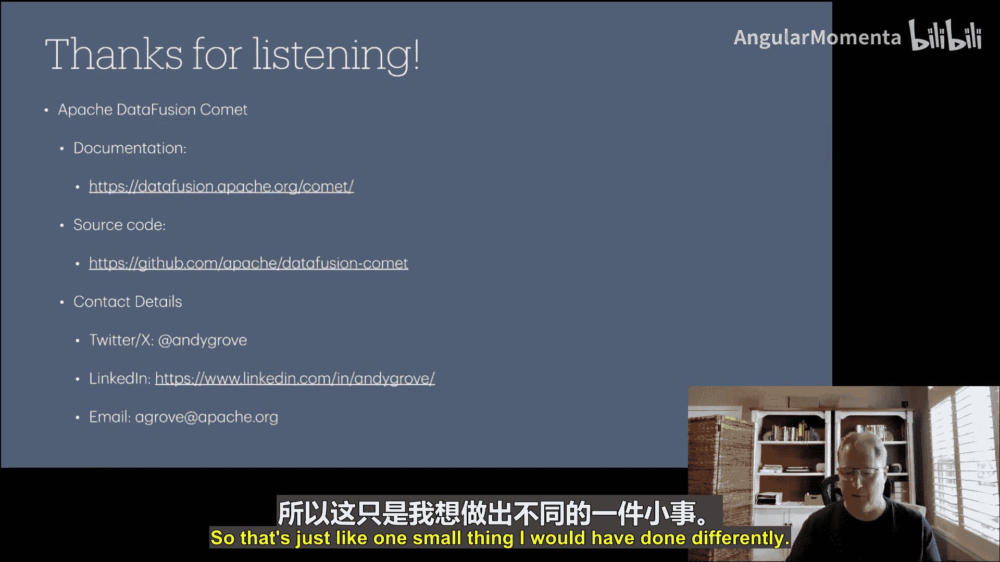

# 【卡内基梅隆大学】数据库构建块系列研讨会 ｜ Database Building Blocks Seminar Series (Fall 2024) p02 02 使用Apache DataFusion Comet加速Apache Spark工作负载（Andy Grove） -BV1dmipBLEYH_p2-

🎼Yeah， down。They ready for。And y'all at the speed of sound where we're now wax first top will gather around and witness something。

🎼The database Building Block seminar series is filmed in front of a live studio audience。

🎼This program is made possible by Google。

It' in grow， he's awesome。Thank you Sarah that okay it's a quick intro I won't get through of this so I've going to stopped engineer near for quite a long time so the first decade I was building enterprise apps with relational database backends the next almost decade I working with various data frameworks and then the last 16 years have been working with database infrastructure so starting out with a database shing product then building a custom super engine visual laser I had to integrate great with Spark started learning about Spark and this is where I kind of got interested and started attacking on Data fusion which I'll talk about more but the last five years of my career have been focused on the accelerating Apache sparkar previously within video with their sparkark Crs product and more recently with that or where where accelator with Spark using data fusion。

😊，So my kind of like career history Andrew did a great job last week talking about data fusion as one put in one slide talking about kind of my involvement。

 some of the history that might be interesting， so this started it out as a personal project back in 2017 and originally the goal was to build kind of like a more modern Apache Spark and I very quickly found out that that was like way too ambitious for a kind of weekend project so after all I pivoted to building an in processcess query engine and I took a lot of inspiration from the designing Calite really wanted something that was kind of modular with like clear layers between like the SQel Pass and the logical band and so on and I found it much easier to build a community up around that because it was just like compared to building something like Spark it is just you know is this way simple。

嗯。The project got donated to Apache Ar in 2019 and it's kind of grown from there and obviously has a lot of momentum though so once that happens I then had another building a distributed query engine。

 I figured we have data fusionno that's like a really good building block it's now what I have to do is the distributed but so I built the Baistta engine donated that to Apachearrow unfortunately that one's really kind of failed to gain traction and it's not very active now。

And then Data Fusion went on to become the top level of Apppache projects probably recently earlier on this year and yeah I've been working on the come project since that time。

So I'm not going to go into light of the core data fusion too much Andrew covered that really well last week so this is a quick quick kind of recap so the core of data fusion is a set of libraries that provide a complete query engine so pass planning execution support SQL data frames substrate the kind of front end。

ha support for various data sources and formats users have actually memory throughout so I think at this point data fusion is fairly well known for that use case of being a foundation for new systems I think what's maybe not so well known is that there are a bunch of sub projects that provide user facing kind of packages。

So there are the data fusion Python bindings to start with， so you know， from your Gipyter notebooks。

 you can just use data fusions run queries。And then there are three kind of distributed flavors。Coms。

 which we're talking about today， which is it's not so much a distributedive data fusion because developers are using the Spark APIs。

 data fusion is kind of in the backgrounds like accelerating Spark。

Data fusion is the newest sub project and here developers are interacting with data fusionionss APIs。

 but all of the distributed schedulings kind of taking care of my array and then there's the belister project that I mentioned which really isn't very active now。

I ran some quick benchmarks， this is TCH pretty small scale factor single node which is to kind of demonstrate so using Spark as the baseline comment right now is showing like some good acceleration but it's not as fast yet as the other data fusion subprojects and I'll be talking about you know why that is and the work that needs to happen to get it there but the lister and array which are very similar really architect we're seeing like know enter and a half times faster than sparkar and then data fusion Python which is just in process is not distributed so we're seeing3。

6X which is pretty good。So yeah I mean so there's an interesting question Id like why is the Python one so much faster than the distributed ones and it comes down to how parallel and distributeds query execution works so if we so this is a query plan based on TCH query1 and it's an aggregate query but to run this a query basically splits up into stages where within each stage of the query that query can be executed in parallel across politicians of data。

AndThen when partitioning changes you have a new query stage and between those query stages you have something called an exchange operator and that's basically responsible for repartitioning data and like transferring data where it needs to be for the next part of the query to be performed this is a diagram there it's going start it on the right- hand side here there's like a partial hash aggregate happens in all the partitions to get some intermediate results and then to do the final so there could be duplicate values like duplicate groups in keys because it's running against these independent groups of data。

So we do some repartitioning let we do like a final aggregate which collapses it down so we have like all the unique values that we need and then maybe another repartition to do a source at the end。

And comparing data vision Python， which is in process。

 all we're really doing there to transfer data around is that we're passing pointers between threads as we're kind of shuffling data。

 but when we're working in a distributed system typically the output of one query stage gets threepartitions and then rise to disk its typically in like some kind of index file as well and then when the next query stage needs that data it has to request to over the network so it's a pretty expensive process compared to a standalone system in some cases there's a more efficient way of exchanging dataable to broadcast but it's there a small data set often used with hash join if the build site is small。

 it can be kind of broadcast all the other executivecuts so you don't have that kind of shuffling overhead。

唔系衰。Just give a quick overview of Spark I'm sure people listening new SpRC it's tar T is an academic project in ALB and it's been around for more than 10 years now as a very mature query plan or an optimizeimr it supports all of the file systems and object stores it very general purpose so it's been used for all sorts of different use cases and one of its strengths is that it's really easy to test locally you spark on your laptop and then you can scale that to hundreds or even thousands of nodes to kind of scale up closes EL jobs or SQL pipelines。

The downsside of Sp relieved in my mind there are two。

 one it's row based so it's using like the volcano model road based you have all these iterators getting one rottor itemss a lot of overhead there and Sparks you know's done a good job mitigating against that by using whole stage codegen where Java code gets generated for multiple kind of operators like a section of the plan that gets compiled that helps I think Spark kind of got a twox performance when that was introduced but that does have some limitations and works up to a certain amount of code you can get into situations you can't rely on that。

And the other downside is that it's JVM based and JvM does tend to be slower than native code and there can also be issues with memory overhead and garbage collection。

So given all of that so Sparks big control system is not really practical just for anyone to come down and build it like a new sparkar replacement。

 so there's a trend node towards accelerating Spar rather than replacing it databri published their photon paper a couple years ago so they built a new vectorized query engine and C++ and they put that behind a Spark API and they stated that they saw on average like a 3X speed up over their previous sparkar runtime。

And right now there are three major open source Spark accelerators， there's comet。

 which I'm talking about today， there' Apache gluten， which is it was previously an Intel project。

 it's now incubating in Apache， and interestingly that actually spots different query engines as backends that sports Clhouse but when in the context of Ac Spar it's typically used with matters Verox query Engine。

 which is somewhat similar to data fusion， and then there's NVDdia sparkk Rapids which uses the rapids libraries like QDF to execute queries on GPU。

So come's the Spark accelerator and what that basically means is that we take so we're using Spark full of the you know SQL passing query planning。

 but when Spark gets to the physical plan， that's where the comet plugin kicks in and translates the Sp plan into effectively a data fusion physical plan。

One of the big goals of the Com project is to make sure not just that we're making queries run faster but we need to provide 100 same compatibility with Spark and that means compatibility with like all the individual versions of Spark so we often see that behavior will change between like spark33 and34 so we have to kind of keep up with all of that the project's pretty new so it was originally developed in turn the Apple and donated to thearrow project like earlier this February and currently it supports 11 operators and 111 expressions natively and Spark has like more than 200 expressions so there's definitely like some ways to go there。

So at the high level diagram， so on the left hand side we have like an application that is using Spark in Spk terminology that's known as the driver。

 so this is where you're using the data frame equalQL APIs and then when you go to execute your query basically the Sp scheduler will talk to the Sp workers which will spin up executs then within those executors that's where we're actually doing this the conversion to the native plan and executing the plan natively。

Ding into that in a bit more detail so again driver on the left so the first step of translation happens in the driver and Spar's physical plan is basically a bunch of Slar classes nested in a tree structure and in the driver are optimize the raw runs and we take the Slar classes and we translate them into an equivalent set of comet Slar classes and what we also do at the stage we build got an intermediate representation of the query plan and protocol buffer format and when these SA objects get transferred to the executor we kind pass that protocol buffer IR and we do the translation。

 this is what we we go through JN I into rust codes at this point and we take that and translate it into the data fusion plan and we execute it and in the ideal case the whole plan is nativeprocessing get these batches of ourada and the output goes directly。

We a shuffle file。In a less ideal case， there could be a mix of like native operators and spark operators and in that case there'll be a bit more kind of back and forth between。

The kind of the Java in the native。So Raz， do you want to unmute yourself and ask your question in the same exact way you go afterwards？

Yes， so。Does their battery come are trying as a side like in the different pot so it's all within the executivecutor process it's all busy in the excutor there JN I calls calling down into the Ru code。

嗯，那行，O。My question was do you plan to use substrate to like ship that IR to the excut at some point or look into that That's a good question so I wasn't involved in a project at the time they chose to have their own kind of IR but I think because currently come is very tightly coupled we were only trying to accelerate Spar so I think it's just for now there's like a lot of less engineering overhead and just having our own simple IR very specific to spark but yeah I mean architectly there's no reason why we couldn't replace that with substrates in the future I think as substrate and show us more that could be an option and that was you know possibly open the doors to having a wider scope and comes where you know the gluten project doesn't just accelerate spark they accelerate other systems to come could potentially do that in the future and if we were to do that substrate would be a good fit。

So contrasting this with like the photon stuff from Databrickselle glute gazeelle became gluten right numerical and then then the RA is won like in photon it's still the spark physical plan。

 but then they while it's running they sort of call out the JI for like like the the low level operator calls I don't know what rapids in gluten do but this is busy extent you hijack the entire spark plan and then that runs entirely in data fusion That's right and conclusion is very similar and least uses substrate to data so think the come and more similar in that regard。

 rapids is slightly different so it has the start classes for the physical plan and's like it's more crenular there's lots of kind of smaller Gen Is like within each operator there's a jaN I to kind of run that section and then if you get to this stop people like you know you support。

111 operators of Spark。Is there is there a challenge with the semantics of an operator in data fusion conflicts or is slightly different than what spark would expect and therefore you might get slightly different output I mean obviously string uppercase is an obvious one。

 but like are there other corner cases like just thinking about the ballot paper they talk about how。

Thepressos semantics were slightly different than spark semantics and that was a big challenge for them of getting Velx to handle everything Yeah absolutely and that that's where a lot of the work is in for all of these accelerator projects is trying to match Fox behavior which can be you know can be kind of quirky in some cases but data fusion in general is aiming for postgreed compatibility and yes there are differenceses there I will give one example of that later on particularly Australian things like casting between types like date times timet passing you know those kind of things。

Okay， thank you。And so from an end point of view， if you wanted to use Coms it's very simple。

 you download a J file from Maven and you add that to your configuration and you specify to use the sparkark plugin called Com plugin。

And yeah， just to work through an example of what this looks like in a bit a bit more detail at kind of the plan level。

 again using TvTH query one， which is a single table aggregate query。

So this at the top here is the Spark physical plan which you know I showed this earlier and at thebo is the comment plan after this has been translated so this is still this is like Slar classes this is happening in the driver and the only differences you see here really is that everything has a come prefix and fully exchanges in this example there's two different types of exchange。

 there's a comes columnary exchange and then a comment exchange。

 the reason for that is we have two implementations right now。

 come exchange is native one where it's like native aidators the shuffele file and that's our ideal use case but it doesn't spot all of the different types of partitioning yet so in some cases we fall back to one that has more on a JVM code running。

And that's something I'll see where to kind of improve over time。

So that's the Slar plan in the driver and then when we get to theecer where we now translate this into the daily fusion plans and this is happening not for the overall plan but for each of those individual query stages as they get scheduled so starting at the bottom here is the first native plan where we have the comet scan Exec and this is where it's reading from Parquet。

We'veGot filter projection partial aggregates， the output of this is going to a shuffle file and then moving up when the next query stage runs we see another scanning Zec and in this case we see the source in exchange so here we have likes and back and forth with the JVM so the native code now essentially it has to get data from the JVM that sparkar is retrieved from like the shuffle exchange that's happening and again the output of this one goes to another shuffle set of shuffle files and then the final like the final query stage runs。

If that makes sense。So as well so that's the general bank overview of how it all works in terms of the plan translation。

 how that all gets executed。ComIt also provides an accelerated parquet reader。

So the motivation for this， so normally in Spark Spark has two different like data source APIs and implementations。

 there's a V1 API which is all row based， there is a Vta which is columnar but it's really into like a spark columnar format because comments and data fusion we little arrow based we wanted a parque reader that would read like directly intoarrow format at the start rather than having to do like a translation and we also wanted to leverage native code to the decoding。

So yeah， it really that kind of overhead。And iceberg is actually working on integrating this into their product as well as like an optional feature to accelerate their parquet reads。

So just tying that into the overall execution， this is all within the executive now that's on the left we have the JVM code and on the right the native code so kind of starting at the top left。

 the Com parquet reader is handling like reading bytes from Sparks API for the file systems。

 it has you know all of this great supports of different file systems。

So the IOD compression is happening at that level and then calls them a into native code on the right hand side to decode those bytes directly into arrow record batches。

And then on the left， essentially this is the volcano model Spark is calling next on the Comet Excutator which is cool next on the Part A Read and as those batches are flowing through the Com executivecutator is calling execute plan on the native plan and that processes that record batch that is available and then produces an output record batch。

 which may goes for shuffle file maybe ends up coming back to JVM depending on the plan and that's kind of the process that happens until all of the batches are exhausted。

Yes Port are any questions at this point？Thank Phil like I' kind of flying through this a bit。

I think you're good， okay。So yeah so yeah so there are some challenges building a spark accelerator in general some are specific with data fusion。

 some are more general so in terms of like data fusions one thing we run into。

Spark's data type system represents logical types an arrow and their forta diffusion that type system represents physical types。

 so where Spark has a string type in arrow we have UTFA large UTFA we have the German style strings now we' UTFA view and then we also have like dictionary encoded strings so we run issues there。

With data fusion N to ends， all of the type coercion happens in the logical optimizer。

 but because we're working we're just going straight from a spark physical plan through a data fusion physical plan we we don't have those type coercion roles so let's make work we have to do kind of duplicating work that happens in data fusions like logical layer and that's something we can maybe kind of donate back to the project know there may be other other other people building things just using the physical layer that this could be useful。

But one consequence of this right now is that we're taking we're not taking full advantages of some of the optimizations around dictionary encoded arrayrose so we tend to kind of unpack things a bit earlier than we need to just to simplify things right now。

That's kind of just kind of the early stage of the project。

You mentioned spark compatibility so yeah we want to have the same behavior spark even for edge cases in some cases we have an implementation that isn't 100% cat compatible with Spar but pretty close we dis it by defaults and users can choose to opt in if they throw aware of the potential risks with that and we have a compatibility guide that goes into that in detail。

And some of the this just like some of the areas where we see differences， negative zero is one。

 so like rust and Java have different implications of YE754 and you know whether zero negative zero or equal or how they sort can vary and SparRC actually has specific logic for normalizing negative zero is not a number before certain like arithmetic expressions and we have to do the same thing in common to make sure we get the same results。

Sparark has what it calls an mode， which basically if you have expressions that could potentially cause a numericalmeric overflow with antimo labels。

 an exception should be thrown， if anti mode is disabled， then you expect to nu value instead。

So there's another area where we have to do the same thing。

 data fusion does have this concept for some expressions but not all and again again this is something that could potentially be contributed back to data fusion and have more options around this。

Casting was a big one initially just Spark has a lot of very specific behavior about how certain data types are cast and often the behavior is also impacted by like a bunch of different configuration options you can search some of it to support legacy behavior from all spark conversions so its something else we have to take into account and just dates and time stamp in general anytime those are being passed from string yeah there's like a lot of kind of very specific behavior we have to match。

So without going to details of Apple's workloads。Are these。

These various competitive issues you're facing is it like？

You know like99% of the program spark queries don't have this issue and just sort of clean up 1% are these pretty pretty common therefore like just to have a spark exc or you got to knock these out right away Yeah I mean honestly the difficult thing like course with my previous like every like we don't really know what users are using this for we don't get to see everything that people are running with this the we can be running a JavaF so we have to kind of on the site of just yeah we have not these early on and just try and make it as compatible as we can and where we run into things that require like a ton of engineering effort we can choose to have it it's like an optional feature that people can turn on and we explain what the differences are and you mentioned it like like strain up a case lowercase that's another thing that can vary like with UTFA and CoD data between Ru and Java and yes rescue data it's the same so we have that disabled right now you can turn it on and if you have ask data there's really no risk if you have UCF。

Asual it might being you might end up with a slightly different result。

 not necessarily a wrong result， just a different， you know different interpretation。Yeah it， okay。

How do you test the compatibility do you run the spark tests on with the accelerators？

We do and that's actually the next slide after this but yeah absolutely well cover that as a good question but before before I jump to that here's just one example so this is casting screen to so we've got the inputs on the left then sparks results and。

😊，Data fusions result so sparkark supports it's just very flexible it supports partial dates and times my favourite is the T2 at the bottom there big fan of the T2 movie but as a valid timet apparently is the t is the delimiter between the dates and the time and two represents the hour two so。

So Tele fusion its own doesn't support that， so what we have to do in comet is basically implemented our own version of that expression and we have to port the logic from Spar over to yeah and I mean Sparle also support that actually doesn't anymore but it used to support strings like now today tomorrow as well which doesn't make a lot of sense to store that in a parquet file but you never know。

So testing， yeah so we absolutely take sparkks test suites and we run it with come enabled and make sure those' test spas。

 we have our own unit integration tests which use random JE generations because we want to hit those edge cases and then we also do full fuzz testing it's actually pretty primitive right now and it's something I'm sure we're going to get more advanced with but we literally just generate random park A files with you know lots of columns。

 different data types then regenerate random queries against those files we run those queries against just regular spark against comet and compare the results and early on that found like a ton of like low hanging issues around casting and those kind of things。

And here's an example of an issue that is filed based on a first testing tool budget and the first testing tool is all part of the open source repo so at the top there is the SQL query its just selecting two columns and then a division by column that A divided by B is order by clause just to keep it hopefully deterministic。

We see the spark plan and the comic plan and then at the bottom they received a difference so this was dividing a negative floating point number by a negative floating point0 spark reduces null comet at the time was producing infinity。

It's either of those right or wrong， I don't know， but anyway。

 so that's a appropriate no and we come up with the same mindset so that Spark has。ai。

 so it's a number divided by negative zero， yeah。Should be invalid to her perception。

So inspired with antimod label would absolutely well I say absolutely， potentially yeah。

 that may be an exception I'd have to check that on yep。系れ。

So challenges let I know come back to performance so if we look at where come is today and look at the other that is not a fair comparison because this is in size Sp but we look at blister and rain but you know there's a difference in performance there so why is that why is come not as fast as these other things。

And before I dive into that also here's just a like twocS one terabyte running in a cloud which is like more of a realistic kind of enterprise benchmark so we are seeing acceleration of a lot of the queries the overall speed up in this case isn't like very exciting yet。

 but yeah we see the basic acceleration happening so we're kind of heading there。

But to get like to improve ourPCH results， the first part is that we're not actually running all of the queries fully native the yet and the reason why that is there are some features that we just haven't implemented so with the data fusion distributed systems we're using data fusionions query planner and obviously that produce things that data fusion supports as a physical plan but when we're using Sparks query planner we see things that are different so for example Spark uses a bloom filter agregation for some of these queries and data fusion doesn't have an equivalent of that yet so if those queries we kind of fall back to Sp at some point So mejo the joint condition is another one so actually is implemented in data fusion quite recently but we're still kind of working through some performance issues with that ones it's not enabled yet so in this case I actually opened a pull request today for the B filter aggregation thanks so yeah so the project pretty early so yeah we'。

We are onto these things but until we run all the queries like fully natively。

 we're just not going to see the same benefit and so yeah where we do have the situation where we fall back to Spk so we're going from native column to JVM rowbased and Spark will be inserting these transitions so there's like row column column to row those are in Spk in JVM and they're not they weren' designed to work well with what we're doing witharrow so what we really need to do is implement native versions of those so basically the issue is that Spark in the case where we're going column to row Spark has this interface it users from accessing individual values so becoming like get string one on this row get string2 on this row and each of those cores ends up being like a J and I called in some native code what we need to do instead is have native code that can build like a whole spark row in memory and kind of pass that back to make that process more efficient。

And obviously the idea he wants we support more things natively。

 we don't even have to do these transitions。I mentioned earlier about the data type kind of mismatch issues。

 so right now。When we readthink Bque we do have dictionary encoded data and things like fill to run against that。

 but we always unpack those dictionary array before joins right now and that's something that I'm sure we can avoid but it will require yeah it's going to require some engineering work to do that to get those kind of benefits。

Another issue because we're using data fu just the physical plan and we're not using its logical optimizer for TC we actually see some queries where there's one expression that features like multiple times in the same query and for some reason Spar hasn't。

You know there's an optimizer rule common sub expression elimination。

 which should recognize that and just evaluate it once for some reason that isn't happening in Sp because we are using data fusion at the physical level。

 we don't have a physical optimizer rule to do that so data fusion has a logical rule for this but not a physical one so we need to implement that rule to get a speed up on the top of those queries。

Are there any plans to use just some time compilation for the query like done in Sp？

So I missed probably but any plan to use。Spk， as you said， to speed up generate bytes code。

the query are there any plans to justgengen I mean not there aren't any like concrete plans right now I'm kind of curious about it at one point data diffusion had a jetitz module where they were doing cogeneration and they eventually removed it they found that they weren't getting a benefit from that。

Just firstly， I'm kind of curious about that I'd like to experiment with it say kind Chaman。

 I say the current research shows that a well implemented vectorized。

engine is will perform as good if not better than a than a cogent one Okay okay thanks yes yes so give me some research time there cool yeah so I mean I guess yeah because we're processing things in batches and you're factorized yeah I mean it kind of make sense。

any other questions？Okay， so so that's okay， do you have a question？Yes so so Andy。

 did you have to do anything special to support adaptive query execution in Sp No not at all I mean yes it sparksing all of the scheduling all of that breaking query down into query stages is just when when a query stage goes from executivecutor like is at the very last mile of the whole process where we jump in and translate its native so yeah。

Okay， thanks。So this is kind of mostly kind of TPCH something it's kind of generic but aside from trying to get better TPC benchmark numbers there are other things we want to look into so I' mentioned all these transitions that could be expensive I'd like to explore having a cost base optimizer kind of a simple one where we have a cost model for Spar and a cost model for come and we can just kind of tell upfront like if there's a bunch of transitions like I'll we actually going to accelerate this or is it going to be slower and then you know just avoid trying to accelerate in cases where we're not going to be helping。

Because right now so right now for each query stage we start native if we can and then if we fall back to Spk at some point we stay with spark for the rest of that query stage。

 it would be possible to have like more transition to go back forth more if the transitions were more efficient but it kind of depends what these other operators are like it be it wouldn't make sense to do a transition just do something like a projection and then another transition if it feels like an expensive operator and maybe it's worth it so like it cost space optimize it could potentially help there。

other than so TPCH is very， in my opinion， it's very much kind of about overlapAP like workloads。

You know there's ETbox used for a lot of ETL so you know redder expressions like mess stuff converting between different file formats like maybe JSO strings embedded in parquet files I think it's important to have some benchmarks around those use cases as well so we're not just like over optimizing for TCH I'm not aware of I don't know if there are any kind of industry standards benchmarks there are not but yeah something we need to look into。

And then， yeah so。There's also ongoing performance optimization work upstream and data fusion andarrow and you know we generally tend to benefit automatically from that work。

 so I know this and work happening at the moment to improve performance for groups aggregate queries for some specific use cases。

 so you know we should benefit from those two。So it related to performance。

 Spark has a UI where you can see like a visual representation of the plan has a bunch of nice metrics。

 we say as the data fusion has its own metric system。

 we take those once that native plan is executed we take those metrics and we feed it back into Sps metric system so here highlighted so we have a native scan that's happening and we can see the time span in the light Part A native decoding and the time creating ya vectors here。

So it's kind of used sort disriishage on a debug these like any any performance issues。

And then yeah moving on a roadmap so this is an open source project obviously there are things that like Apple and I want to like work on it's community driven as well。

 one area of focus right now with most focused on just like primitive data types which is all you need for things like TCH but we're starting to add support forstruct and arrays now at some point we need to get to maps and you know every combination ofstruct containing maps containing arrays so that's definitely like a good area for contributing I mentioned earlier Spark has a lot of expressions and we just need to keep you know keep implementing more and more of those we can run more things natively。

Then there's one really interesting kind of initiative like that came from the community around Pyarrow UDFs so Spar supports Python UDFs they can use the Pyarrow API for processing you know arrow columnar data that sparked robot so the way Spark handles this it will do it will insert this rose column they transition call the Python UDF which can process that column data produce columnar data then perform a column's a row transition to go back to Spar obviously that's like a lot of overhead I mean depending on how heavy the UDF is dog with comm it because we're already arrow native we could avoid those transitions and for。

Like the Python UDF use case that could be like a really， really valuable feature。Yeah。

 so obviously likes of pitch for people to get involved in the project， there's a lot of work to do。

There are a bunch of good first issues tagged in the repo。

 but the easiest way to really start contributing is to go download a J file。

 try out comments on some of your existing spark jobs and let us know you know if you run into performance issues or bugbs also let us know see good performance and yeah lots of areas to help around kind of performance tuning and improve metrics and yeah and there is kind of first issues。

So that's kind of everything I had yes， so thanks for listening and happy to take more questions。

Are you familiar with any company that used that？'s using comment right now Yeah yes except form but of course sure not specifically I mean that there are there are some contributors who have been finding bug reports and then like creating PRs to fix those bug so yeah people are trying it out you know think of GitHub often don't don't know where those people are working so yeah I don't have yeah no I don't have specific company names to give you So it's not but distribute。

It's not sorry not part of like Spark district。I it's not but a destiny， yes。

I'm sorry I still still missed that battle testing oh sorry tested no it's not no so if this is a new project so you know it was donated to February we just had there 0。

3。0 release just to give you an idea of where we're at so it is early on you know I would expect people to find bugs right now with this as they're testing and if you go to get that feedback of people trying and helping us get it yeah get it kind of production ready。

😊，All right， so I'll applaud on behalf of the audience。

 we have time for a couple questions for Andy if you want anyone wants toute yourself and go for it。

Hello， Andy， may I ask you whether you have considered Apache glten before， Like， how。

 How is this project compare with that。Its a good question because like architecturally there are a lot of similarities I think I don't know for sure just me just kind of speculating but when this project started Guten wasn't gluten it was like an Intel project it wasn't part of the Apache Foundation and that potentially was maybe a reason why that wasn't kind of chosen as a foundation for this I think it's just a lot of these big kind of enterprise companies thatre more comfortable with like Apache of the governance there。

But yeah， there's a lot of similarity architectly， I actually did hear the Apache Kayin。

 people I think a lot of them are ebay， I heard they're working on another accelerator which is using gluten。

 but with data fusion as the back end， but this is just like I haven't seen any bike code out there that yet。

 but that'd be kind of interesting， I guess people like building these spark accelerators。O。

 thank you。Andy I had a similar comment or question， have you did you consider VL。

 especially since there's some effort now to have VLs also work on GPUs。

 does that is it interesting for you having multi platform support like that or IntelMD processors are really what you're targeting here？

Sure， so I wasn't part of the project when they decided to use studyfuion basically and kind of there was a result of that decision so I think again although it may come down to the fact that all of this is part of like it's one project within a battery where like gluten plus Fox it's two projects controlled by or at a time controlled by two different companies that may have been part of the reasoning but I don't know that for sure and I think at this point yeah we're kind of kind of committed to this this kind of path for now。

Makes sense， thank you sure。Okay。So question God。So my question was does come rely on rust to generate the in instructions or is it？

啊。Is it00 and？Sure， so yeah so Comt is using data fusion of the library。

 data fusion is using the arrow library arrow provides like all of the compute kernels which leverage Cindy and we rely on rust's auto vectorization support list we're not like we're not handcoing CD instructions。

 we just rely on the rust compiler to make that happen。Okay。

It might be an annoying question because you might not know what photon code looks like because it's proprietary but what like from what you understand what are the like design differences between this and photon Sure yeah yeah of the hadnd' seen codes that again speculation but I think it's very similar I think if you can bring like VOox state diffusion and photons C plus plus code I imagine it's all vector as imagine there's a lot of similarities I don't know' I'm not aware that photons using arrow as its memory format I don't know I mean I't know for sure so that's one difference and like why does anybody care up using arrow well in the case of supporting piarrow UDs that's like really useful so in terms of being able to enable different integrations I think having something that's based on arrow is a good choice and though VOx is largelyarrowbased as well or very very similar。

Okay， my last question would be。Are there any like design decisions that you originally made in data fusion that have？

Cause problems when you try to then build comma and have like spark be a wrap around it。I mean。

 obviously data types are obvious， but any some more fundamental things are like the core architecture itself。

Like specifics of comment， I don't think so I mean。I can't think anything specific to comment really。

So going on no I can't think of any design decision I haven't been yeah I haven't had that experience with kind of regressing or what yeah。

 why hass it done this way？In terms of like。Because it comm is sort of this rapper thing that calls data fusion and it's doing the marshaing the data back and forth。

 but then again， maybe for the core of data fusion is there anything independent comment like， oh。

 that was a regret to make it work in Spark。Again， not specific to。

Really not specific yeah the kind of yeah the only regrets I've had there's been a few little design things here in there wish I can talk about but it's not specific to Sp that be great it's like a tiny thing but like with the logical plan so like one thing early on like I thought Fr Buff was important for like serializing plans for multi languagegu support but it would also be nice to just be able to use rusts built in survey capable serializing plans and like this is just oneel so logical plan generally should be very easily serializable you know it's referring to like column names and function names and so on logical plan we do have references to actual like extract implementations of things so like in terms of data sources we have like a thing called a table provider trait and different implementations and the logical plan contains pointers to those things I think one thing I would have done differently would be to have the logical plan just refer to things like by name and then when you。

As a kind of X that kind of translates that you go and look up in some context or just name maps to this like implementation thing。

 so that's just like one small thing I would have done differently。

