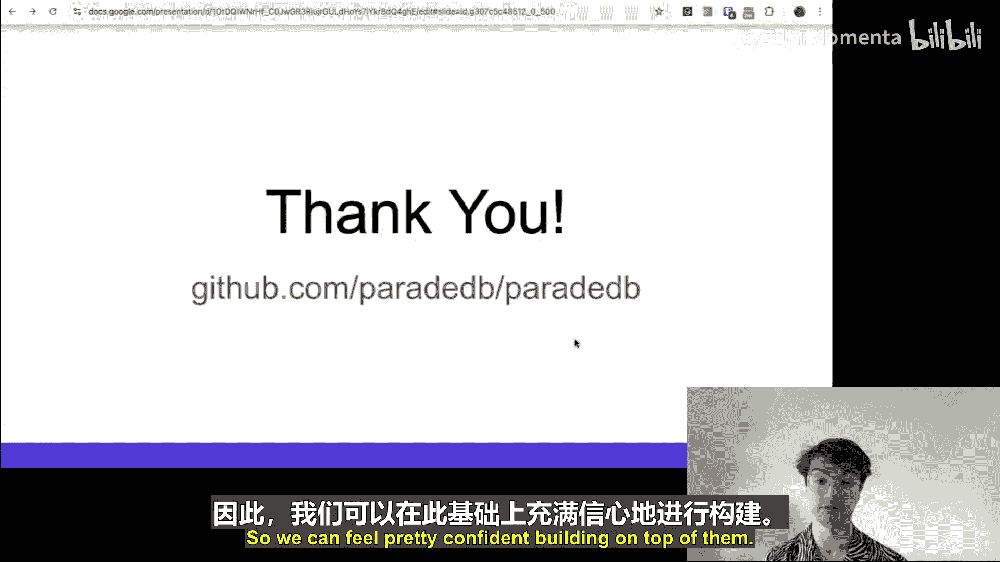

# 【卡内基梅隆大学】数据库构建块系列研讨会 ｜ Database Building Blocks Seminar Series (Fall 2024) p03 03 ParadeDB – 专为搜索与分析打造的Postgres（Philippe Noël） -BV1dmipBLEYH_p3-

🎼Yeah， down。They ready for。And y'all at the speed of sound where we're now wax first top will gather around and witness something。

🎼The database Building Block seminar series is filmed in front of a live studio audience。

🎼This program is made possible by Google。

H guys let's get started。 it's another day It's another time to talk about databases so we're excited today to have Philippe he is the coander of paradeBs about he's using Posts but putting bunch of crap inside of it building blockss inside of it to make it better So as always if you have questions for Philippe as he's given the talk unmute yourself and ask your question any time say who you are and where you're coming from it's always good to know everyone is and feel free to do this any time because we want to like he's talking bunch of people and not。

Talking to a blank screen on Zoom， okay， Phil， thanks so much for being here the floor is yours go for it。

Cool yeah thanks Andy thanks for having me and it's nice to having everyone listening so yeah as Andy said I'm one of the founders of ParaDB I'm honored to be here today we're speaking about full text search and analytics and Postgres ParaDB is a Postgres database built via Postgres extension that we're modifying with database building blocks to make better for specifically full text search and analytics we're trying to compete with workloads that are traditionally served by Elasticse so we're trying to bring the good that people love with Postgres and VCC as a compliance。

 high performance joins， more class reliability but solve the limitations around search and analytics that you know that Postgres is not not excelling at。

😊，Let's see okay perfect so the talk is going be spoken for four sections feel free to stop me at any time first we'll cover existing full text search functionalities in Postgress I understand a lot of folks in the CMU audience might be very familiar with this but if you're not it'll be a good refresher and' going to contextualize what will be speaking about after we'll talk about what's missing and why we can make it better specifically around two areas that we work with so PG search is the name of our Postgres extension that perB builds we use it to innovate around full text search and we use it to innovate around aggregates or facets。

😊，So before we get into it a couple of jargon to make sure everyone's on the same page I'm sure folks who are very familiar with databases。

 you may even be familiar with data fusion concepts as well after listening to Andrew and Andy's talks that I believe were the last two ones but perhaps not too much about full text search so first tokenization if the process of splitting words into searchable chunks you can tokenize by languages for example。

 words as defined in French where it's defined in Chinese stemming is the concept of reducing words to their root form so if you have the word running the ST would be the word run。

😊，Inverted index is what we use to accelerate full text search for a DB adds a new inverted index and Postgres that we'll talk about in a second。

 but there's many that are already supported。Aggregation， I guess， you know。

 I'll skip over that for this audience， but you know what it is crunching some number is to get count sum averages。

😊，Fassetets is specifically aggregations over fulltex search。

 so you know how many search results returned towardF， for example， and then the El DSL。

 you'll hear a little bit about Elasticse for those of you that are not familiar。

 Elasticse is the state of the art search engine that companies build on today and it has a powerful language that is used to the complex search logic and ParaDB offers similar capabilities and we can refer them by our own version of the Elastic DSL。

So before we get into this， who am I and who are the people behind ParaDB so as Andy said my name is Philippe I'm one of the founders of Paradib。

 I'm originally from Rivie to Lu Quebec which is a small French speakingak town in Canada。

 I studied CSA Harvard but I never took a database class I know it's a big mistake you know I'm not proud of it but we'll brush from it up today and then yeah if you're curious to learn more about me Postgres as this cool community where they do little interviews about the people behind Postgres Id encourage all of you to join the Postgres community if you're not a part of but you can read more about myself on that interview there。

😊，So what is Para DB and how do we make Postgres better it's an search alternative on Postgres PG search which is what we'll talk about today is our core work it's full text search and Postgres with B25 we'll cover what B25 is in you know shortly and then it's built in the Ru because you know who doesn't nowadays you have to be part of the core the Co kidss cr and we have some other work that we've done around an extension called Phia analytics that is going to be set aside from today but I'm happy to talk about them at the time。

😊，Why is this even worth doing I think that's something that's worth talking about as well when we tell people that we improve search and analytics in Progress a lot of them are wondering why so one thing that brings people from elastic to something like parade is data reliability transaction safety on your search engine is very important we have a lot of users that complain that elasticastic search is not reliable you also get to remove an ETL pipeline and delays that might be reasoning coming from that excuse me you don't have to denormalize your data that's a huge huge thing and you want to hear that lot of databases knows that know the SQL and structured data format is a big deal and in a search engine world it's not a part of it as all so we're trying to bring that back and then that also helps us do better on kind of the update heavy scenarios we started this about a year ago a little over a year ago。

And before we really dive into it I do want to talk about the people that are building this because I'm not the only one I only happen to be the one I guess the privilege to talk about it so Ming on the bottom left is our CTO my cofounder he's also the author of a good chunk of the slides on this presentation so he gets a lot of credit for it Neil in the middle is one of our lead search engineers and then Eric the third photo is the author of ZmboDB and PGRX which is the framework he used to build our product he's quite a famous person in the Postgress world and we're very fortunate to have all these folks。

Okay。Enough you know enough household housekeeping excuse me let's get started so what is full text search for those of you that are not familiar full text search is essentially simply the process of doing keyword based retrieval for documents within your database it can be very simple it can be very complex pretty much every database nowadays supports some version of full textex search and shape or form on the very simple layer you can say hey retrieve me all the documents that match a specific keyword like cheese but you can also have some very complex full text search you might want to rank your search results in various ways you might want to search for corpus of text in multiple languages you might want to do analytics or aggregates on those search results say you know retrieve me the top 10 but tell me how many results there would have been for on and so forth and it's broken down in two steps。

😊，The indexing step， which we'll talk a lot about today。

 one of the big database building blocks that we use at Para DB is around the indexing layer。

 which is a library called Ten。😊，That allows us to prepros the tag to make it searchable efficiently。

 and then the querying layer is simply running and running those queries to retrieve the data。

you know in the age of AI we need to do a point on vector search and what it is and isn't so vector search is similarity search And we have a you a seminar section on all the vector databases that exist today。

 ParaDb we don't think of ourselves as a vector database although we do support vectors the key difference is vectors match words based in their semantic meaning so you know similar synonyms and so on go very well together and can be retrieved by a vector search in Postgds is a very famous extension called PG vector that offers this what Para Db does is we focus on full text search so the keyword side of it and it's very very powerful and not at all obsolete from vector search is very powerful especially for words that don't have semantic meaning so if I searching for the name and Paablo in the database keyword search is going do a lot better if you're searching for medical code stock tickers。

 you product brand names things like that and that's what we cover we cover today but most of the people that use ParaDb。

Should we use both together using you know in a type of surgical hybrid search？

But that's beyond the scopeump of today's work。Okay， so full text Postgress。

There's three ways in which we do full text search Postgres before Para D came around。

 and then we'll cover what we do that's different。So one is the like operator。

 that's a very basic way to do search， it's essentially just string comparison。

The core fullex searches Postgres uses something called TS vector the vector is a standard way to do it it has real exclusivity。

 you can do reranking you can do misspelling that have pretty good performance as well and then lastly there's another extension that's part of core Postgres called PG trigram which allows putting words in trigrams we'll cover what that is and it allows you to do some sort of misspelling or basic auto completion on top of TS vector if you use a hosted Postgress anywhere in the world these are what you have access to today。

The like operator syntax looks something like you can see here so column name like pattern so if you take the example query select star from users where name like John this would match names like Johnny Johnson。

 Jonathan things like that the limitation that it has is it's quite slow and it's also very limited one of the key concepts in full textex search is be ability to write results based on which ones you think are going to be most relevant and the like operator has no concept of ranking so it will alter every result of the the same way。

But that's normal the way you can get started and many people use it in Postgres today。

When you want to go into a proper way to do full text switch Postgs， people will just TS factor。

 so it stores the tokenized STM representation of text so breaking down into sub the roots of the words。

 and then you can rank the results that you return using something called TS rank。

 which under the hood implements an algorithm called TF IDDF。

Perhaps some of you are familiar with TFIDF standss for term frequency in her document frequency。

In short， what this means is documents or rows in the case of Postgres where the keyword you're searching for。

 let's say cheese occurs more more frequently should be ranked higher。

 makes sense and if that document is less frequently found in the corpus then it should rank higher as well so if you're searching for cheese and you have one document with a lot of occurrences of cheese but none in the other documents it should probably ranked higher versus let's say a word like the which is going to be very。

 very frequently present across the entire corpus it doesn' going to have a lot of information it conveys as to whether this is a word that this is a document that should be ranked higher。

Moving on the search results that you can do with Ts vector doesn't have to use any index so we talked about an inverted index briefly you can do everything which is the TS vector data type if you do that though whenever you do a search post stresses in our case is going to need to scan the entire table row by row to find everything that's known as a sequential scan and that's very slow。

😊，Postgres has concepts of inverted indices which are data structure that's still representation between the word and where they can be found in the corpus and instead you can make it use that index to do much faster searching in practice pretty much every single full text search implementation uses an inverted index in some form otherwise the performance is very。

 very small。😊，Lastly， you can use something called PG trigram so as I was mentioning PG trigram is an extension that was built into the core Postgres code base it splits words into groups of three characters so if I keep the example of the word cheeses you can see the trigram would be C E H E E E ES and EE and it can be used to do basic auto completion so if I'm missing certain。

Certain letters， let's say in the word I'm searching for I can use PG Trigram to make sure that my users are still going to retrieve the information that they're looking for it's pretty limited and what it can do but it can get you part of the way。

😊，So what is Postg full text search missing I think this is where things start to get very interesting。

One thing that it's missing is something called Bm25 scoring or BM25 relevance Bm25 is an algorithm that is a an improvement upon the TF IDF algorithm。

😊，If any of you in the audience wanted the guitar experiment right now。

 you can think based on how we defined the TFIDF algorithm just one or two slides before。😊。

How can you think of gamifying that algorithm to make sure your results rank higher。

 what could be things that's key in a certain way and how can we fix those in a better algorithm？😊。

The second thing Postgre's Fex search is missing is powerful tokens and token filters。

 so if you're searching in a specific language for example。

 or especially in English it works pretty well， like you might want to search in multiple languages in the same query for example。

 or Postgres also doesn't have a good understanding of non-lat languages like Chinese for example。

 it would tokenize each character in its own word， but in reality in Chinese multiple characters can form a word and it would be better it would tokenize together this is something that's not super well supported in TS factor。

😊，It also doesn't have an elastic DSL complex search API so giving you the ability to say， okay。

 I want different words to be wearing differently doing this junction mags or weighing the scores in a specific way。

 those are quite difficult to do with Postgres today。And lastly。

 it doesn't have very strong facets or aggregation。

 so if any of you have used Postgres before and you've tried to do an count star over100 million rows or hundreds of millions of rows。

 you know that it can be very， very slow and that's a very common thing to do in full text search it's very common if you use an ecommerce-merce catalog for example to say hey。

 here's 10 results but there's 100 million results to give users an order of magnitude。

This is the core of what we do is fix these limitations。Well， let's cover that。First of all。

 what is VM25？So this is the formula for BM25， you can take a look， but we'll go over it in a sec。😊。

There's two mains that it improves upon the TFIDS algorithm。

The first thing that it improves on is it factors in the document like so if you remember TFIDF says the more often a keyword is present。

 the higher the document should be ranked， well naturally documents that are longer are going to have higher occurrences than the specific keyword and so obviously which is skewed towards longer documents which may not necessarily be the most relevant from the user's perspective。

😊，So what DM M25 does is the factors in the document like。

 as you can see on the formula in the lower right。😊，In that case， it says， okay。

 we'll keep into account the document length in order to calculate the score。

The second thing that it improves over is a consequ called term satation。

let's say I'm searching for cheese and I have a document with a thousand occurrences of the word cheese and another one with 950。

Well they're probably both pretty relevant to the user and the extra 50 might not make a very big difference。

 so what DMM25 does is it keeps in mind you know the number of occurrences of a specific keyword and as they get more and more present。

 their weighing is less and less impactful onto the score so that you don't have just extreme amounts of repetitions influencing the score than early as you can see on the tapering off in the curve at the bottom。

😊，This is a pretty simple algorithm actually， but it is nonetheless the state of the art used today by all the standard search engines like Elasticse like Para Db and many others。

😊，And unfortunately， Postgres doesn't support it。Pogres doesn't keep the full corpus doesn't keep the statistics。

 excuse me over the full corpus of information that it stores and so it doesn't have the ability to calculate all of that that it would require to do theM25 search。

 so instead they implement TFIDF and they have some small modifications to it like something called cover density which allows you to keep in mind like whether words are close to each other and so on and you can get some slight improvements upon TFIDF but it's not quite comparable。

😊，Okay， you know enough enough math and enough three and both for now， so what is what is preDB。

 what is P's research and how do we solve these four limitations that I mentioned here。

So we're a rust extension in Postgres， many of the companies innovating in Postgres doing a Postgres extension。

 Postgres is very very modular and the Postgres extension API allows you to do some serious work with it。

 you can book in at the query layer at the query planner layer excuse me at the executor and the storage layer you can do a lot and that's how we build we build it with a framework called PGX which conveniently was written by Eric who's one of the members of routine it allows you to write Postgres extensions in rust and the database building block that we integrate with the most is a search library called Ten2。

😊，So Tentui is essentially a Ross based search library， it's inspired by a library called Lucene。

 which is a Java based search library that is used by Elasticse and many others to very battle tested。

😊，Search engine and it supports Voltex search， it supports fast faceing， it supports BM25 scoring。

 it supports inverted indice that also supports columnar storage。

 which we'll cover again in the later part of the talk for how you can improve on analytics and facet。

And it's essentially the core solution to many of the issues that Postgres faces。

Thanks to the PGR for Acion framework， we can work with TenTV in a very clean way and start to bring in some of the good that it offers directly inside Postgres。

Maybe you'll get to this for the T of running in the same address space as Postgres。Yes， okay。Yes。😊。

Any other questions can you talk about what like I mean？

Did you at least consider Luc or just Java as a non starter for what you guys wanted to do？

Yeah great question so TenivV is a pretty mature project it's maybe eight or nine years old by now something along those lines it's used by a lot of companies but it's obviously not as mature and as trieddent tested as Lucine Lucine might be 15 or 20 years old by now we did not consider Luc for two reasons one and you'll see in the next slide the speed of1ivv is significantly faster thanks to removing the overhead from the Java virtual machine and it also makes some slightly different design decisions which I think actually more applicable to us but。

😊，It's essentially not possible at least as far as I know to work with Java instead of the Postgre extension so for up to us it was C or rust obviously Ru was ideal and tended be was the best search colbo in the rust and so that's kind of how we came to it again if you're going to talk about this copy me off like there's also like Zapian right the other one that that's that's in C++ did you guys consider consider of that as well。

Yeah i'm familiarmili with Zappiian we did not consider Zappiian at the time we wanted to work in raw specifically and Zapian is also quite old but I don't know if it's as active of a project as you know as ten is nowadays so we decided to go for kind of the true interest we actually never benchmark them but。

😊，Yeah， that would have been another viable option there's another one called Gungga in C in Pacy that also would have been an option awesome thank you。

😊，嗯哼。😊，So speaking of speed Zapian is not benchmark here， but that's another one that exists。

 but anyway so Tentay is super fast， it is super super fast。

 you can see here the average query latency compared to to Lucne which is sort of the state of the old one believe is another one that I believe is written in go if I remember correctly that's another popular one and then a piece I'm not familiar with。

 but that gives you a rough idea in our own benchmarking we've observed query performance compared to Lucne to be5ex on our own implementation of Tentay that's quite a big deal。

😊，The weight tend to be managed to be so fast is it uses an immutable segment based design is this similar to what luine does。

 but basically instead of mutating the index segments that store the tokenized data it simply creates new ones and merged down this compact them behind the scene to have faster rides。

 faster reads。😊，It also uses memory map files so that disk Ios it very very quickly， very quick。

 excuse me， it builds and rusts so you can remove the whole overhead of the Java virtual machines and then it uses CD。

 which is vectorized processing on the CPU to do parallel execution very quickly。😊。

All of these are the very very high level ways for light and TV fast。

 I'm not one of the authors of Tenivey， Paul and a lot of folks behind a company go Quick with or the authors of Tenivvie that would make for a wonderful talk but that's beyond the scope of today we're going to talk mostly about Postres and what we do with this rather than how it's built。

😊，So。Getting to the meat of the presentation and where Para DV really innovates so we have four things that we do in Postgres in order to build Para DD PG search。

The first is we introduce our own fullt search operator。

 this is the part that allows us to define and SQL fullt search queries with more syntax exclusivity that can be passed down to tentoy or fast search engine。

😊，On top of this， we put our own Postgress inverted index as we discussed before。

 inverted indices are very important to accelerate the speed at which you can process queries。

 full exc search queries， we introduce an index that we call the DM25 index。😊。

It's a standard Postgre index that you can use in all the same ways。

We then have a query builder API that allows us to replicate some of the really complex functionalities and a really complex logic that you might want out of a proper search engine into Postgres and lastly。

 and perhaps the most exciting part of all that we do is we create our custom scan that defines how we scan data in Postgres and feeds it into T and we'll cover that in the later half of the talk。

😊，So our custom full text search operator， this is how we define the search queries。

 it can be dropped in any Postgres query， that's one of the most powerful or the most slight features of ParaD from users。

😊，If you have joins， you have order buys， group buys。

 anything that you like to do with Postgres today， you can just drop in or@@ full text search operator。

 and it's going to give you the ability to reference full text search queries in that standard SQL query。

😊，So you can take the example here， select star from mock items where ID is less than 10 and description is keyboard。

 what this does behind the scenes with the app F add operator is it going to pass the value keyboard to the description field intently and then execute the full text search query on it。

 even though you might have other predicates as you have in the example here。😊。

This is built using the Postgres C operator API， that's a pretty well documented API you can take a look at。

 and that's sort of the bare minimum that you need in order to start bringing the full text search syntax of Ten2B in Postgres。

😊，So Steve Moy askeds， hey， Steve has gone， I was asking is the at at at。

 is that a sgelism or postchaism where a parade Dbism maybe？ItIt's a parade deviationism。

 but it's inspired by a Postgism， it's inspired by the TS vector at ad operator。Go， thanks。嗯哼。😊。

Once we have this a operator that allows us to feel our course atentively now we need a custom index to make them faster。

 we don't want to be doing sequential scans over our entire tables。😊。

So instead we want to index into what we call the Bm25 index the value of the content of a table。

 so it works the exact same way that any standard Postgres index works whether you have a B3 or g index or whatever you might be used to using in Postgress for index constructions updates vacuum scans everything works in the same way the key difference with our index is that it's a a BM25 index is a covering index so。

What this means is the pre DB index is designed to be created over multiple columns。

 all the ones that are relevant to the full text search queries that you might want to run this actually allows us to push down all sorts of predicates and sort into the search index directly and drastically speed up the way into retrieval and we'll cover that for in the custom scan part。

it's not a true I mean， covering index is something that dynamically is you know depends on the query depends on the index right so you're just saying that。

If someone wanted to， they could put all the columns in your BM 25 index and then that you could then use it as a covering index。

Correct， correct， correct， correct exactly。Exactly great question and maybe me get this in a second of like does does T to be does it provide its own Bm 25 index or you have to roll your own or are you just interfacing into it？

So we are interestinging into it the tent has the ability to do inverted it supports inverted index。

 but what where we interface is we use the index access method API of Postgres to make it a proper Postgres index and that's actually quite a serious amount of work I would say gluing the pieces between Postgres and teniv is a big deal I'll touch upon this a little bit more later but when you work with Postgres。

😊，You can regress on any of the Postgres feature right and Postgres is a very opinionated database that's one of the reason it's so good so we have to work in a Postgres way in order to sort of connect all of the layers together got it thanks。

嗯哼。😊，But yeah， anyways， so we use the index access method API for this。😊，Third。

 so now we have the ability to define search queries and we have the ability to execute them against our BM25 index so they can be very quick。

😊，However， now we want them to be very expressive。If you've used the Elastic storage API before。

 you know that the DSL can take the form of very complex subnesed JSO that might apply logic at different parts of the query。

The TentV is built in a similar way， and Para DV offers also the ability to accept JSONs on the right hand side of the syntax。

😊，We give you the ability to construct those functions in more of a Postgressy CQly way by our query builder API it looks something like this and it gives you the ability to do boosting fuzzy search。

 fuzzy phrasing bulloles anything that you might want to do with a complex full text search so if you look at the example query here is say okay in this full textex search query we're saying we're going a search essentially for the keywords description shoes or description running so we're searching for running shoes。

But we're going to boost the value of the shoes by 2 x what the value is going to be for standard word running So let's say you're building a search engine。

 you want people to search for an ecommercecommer catalog and be able to retrieve running shoes Well if there's shoes in the name it's probably a more indicative search than if it has running so let's ask for running shoes maybe after seeing running shoes and I want to see just shoes in general rather than running shorts。

This gives you the ability to bake this logic into the search query。In order to do this。

 we use our query builder API behind the scenes the way this is built is by our Postgres user defined functions so we abstract away the J syntax to make it easier for users to write standard SQL queries as they might expect。

I see that's a bubble poping question。Yeah， so I just wanted to clarify that when you talk about query Builder API and like the query itself。

 what you're referring to here is like the text search engine portion of it not the like Postress Postgres query engine portion of it right like there's there's basically like two layers of query engines here that you're talking about right？

Okay， correct， correct， yeah。Does any of the pre ADDB part that goes to the full text search。

 does that get exposed to the process query optimizer to do anything special with it。

 or anything with it， or no， it just sees it as a UDF。So these are just UDFs。

 but you will see very soon once we talk to the next part of the custom scan we integrate quite deeply with the planner to to optimize some of that stuff so we'll touch on that in a minute thanks。

Yeah， any other questions？Cool okay carrying on so now we have the ability to define full text search queries。

 we can execute them quickly over inverted indice called BM 25 index and Postgres。😊。

All of these use BM25 scoring and everything that T0Tv brings。

 and we have the ability to define some complex syntax and ranking logic around that a query builder。

Comes the sort of combination of all of this via what we call the custom scan。

So the PostgresCustoms scan API is one of the less known and harder to work with。

 I would say APIs and allows us to take control other parts of the query beyond the where at app clause。

 in our case it enables three interesting use cases that are very important for bridging the gap of full text Postgress one is predicate pushdown。

😊，Second1 is doing the BM25 scoring and then lastly the fast facets in aggregation and that's where we'll touch upon some of the work we're doing as well with data fusion。

 which I know were the topic of the first two talks in this seminar。😊。

So in the case of precate pushdown， consider the query here。

 select like star from mod item where the description is keyword and rating is less than five。😊。

If we didn't have a custom scan， Postgres with the index access method that we describe on our BM25 index is going to do separate scans over the description rating at the description in the rating。

 excuse me， even though because as we mentioned before， both are in the BM 25 index。😊。

We should be able to do it in a single scan。This is we know very bad for performance obviously and we want to combine them together the customs scan allows us to do this。

 it also allows us to push things like limits and offsets all the way down into 10Tv so that we can drastically improve performance in that way。

😊，Let's take an example at what it looks like here。

 so as you can see here we have an example created that we're running select description rating and category from mock items where the description is shoes or the rating is more than two。

😊，Here's an example of what the query plan actually looks like on Para DB so you can see it in action。

So in this case the preDB scan is done over that table， mock item。

 it's done over the index we've created， we're not doing being purified scoring head we'll do that in a second。

 but you can see in the ten to be query that we're passing down。

 we're actually combining it all into a single query for both the rating being greater than two and the description matching shoes that allows us to do a single index index scan excuse me and drastically speed up performance。

😊，This is all tied to the custom scan API。Another example of what this enables us to do is scoring projection。

 so as we mentioned Bm25 scoring is very important when you're building a proper state of the art search engine and we need to be able to return that information to the user so they can build logic on top of it on top of preDB。

Let's say we have the query here， consider select item with the description keyword。

 how can we return the score， while the custom scan API allows us to do this the scoring in tend0 to be and project it to the user into a new column。

😊，This is an example of what the query plan would look like here so it's very similar as the previous one。

 but you can see we have scores enabled as true and we now have the ability to say when we're going to execute that query against Postgres and fundamentally against ParaDV。

 we're going to be returning ParaDb do score as a new column in addition to the core columns that are in our mock itemss table。

😊，What this looks like is very standard Postgres SQL result set syntax you can see here we're returning descriptions。

 everything that matches shoes， for example， the rating。

 the category that it fits in and our mock data set and the BM25 score as available here。

 so you can see okay， these shoes are ranking higher than plastic keyboard which obviously is not relevant to description shoe。

😊，So is your implementation smart enough to recognize that you're calling them the score。

 it'ss in the select output， so instead of calling for every single item as you scan the UDF that you can push down the UDF so that it's generated as part as the scan operator and not Fire off has a part of objectionion。

Correct， correct。Correct and that has so that has a big impact on performance of course before before custom scan the if you were to do Bm 25 scoring on parade Db it would have a very serious impact on the speed at which we could return queries but now we can actually optimize this significantly Yeah awesome。

😊，对。Okay， any questions before we start talking about the analytics and faces？So I had a question。

So the rating that's a numerical column so how is that stored in 10 TV is that there's not a text or a column like description？

Yes， good question yeah so I brush over this a little bit quickly but tendiv be has support for a wide range of types you can store texts。

 you can store numeric， you can store datetime， you can store range types as well。

 so all of this gets stored in in the inverted index and get to be searchable in a standard way you can all I mean you wouldn't tokenize it the way you tokenize text but you can store it as well directly as the pipe that it represents and we do some mapping between the Postgres types and the tent types。

😊，How challenging is that mapping because like the data fusion guy I talked about last week。

 like comment mapping spark comment spark into the data fusion， how bad is it or how difficult is it？

Yeah that's a great question we'll talk more about that as well once we talk about the analytics for the the standard mapping I would say tent has quite a wide range of types in its support so it's not been too too difficult when we start talking about the way we do column storage and ten and the mapping there it's been a lot more challenging and I'll cover this in a minute。

😊，And then if someone shows up with UDT， do you just give up and can't support it or do you actually support that as well？

That is a great question so far I don't think we face the C case。

 so I wouldn't know exactly which answer tell you， but we can look into it and get back to you I mean if if it's like an alia。

 it's like it it's just like its two ins become the two well two ins become an own type that should be able a supportive but someone they most of them don't implement like the own C level UDT。

😊，Yeah， yeah， okay， our keep that， this is great。Any other questions before we talk into ongoing word columnar aggregations and things like that？

One more question， so say the rating column， it was better indexed by one of the other Postgres indexes and not a inverted index。

Would you support that？Great question as well yes you can still do everything that you do in Postgress whether you're using ParaDB or not。

 so it's also compatible with B3 indexes and G indexes and so on we actually recommend that users also use B3 indexes especially when they have update heavy scenarios for instance。

 but usually people don't also use a G index because the Bm25 index is sort of a superet of that but any other indexes is supported and common to operate alongside the BM25 index。

😊，So how do you deal with that in the planner， how deeply do you go into the cost model for the planner to have it decide which index do use first。

 for example， if it has multiple choices including using this inverted index and a B3 index。

Yeah good question so for the B25 index we only allow you to use a single index per table right now so that we don't have any confusing logic around whether you know which index to select from and then we do have some cost optimization that we do to prefer like index only scans and things like that over audio types of scans but that would say of the main way that we optimize it today。

 we have some further work integrating with the planet that's coming and I'll talk about that in a second as well。

😊，I other have a question about。The binding portion in terms of like。So。

I think in order to do the pre pushdown with rating， you basically have to be able to。Know that。

Rating and description are both in the index so is it really just like when you have that index like that information is available like。

If there's a predicate expression with these things， like just match it or is it actually like。

 you know， however you're interfacing with10 TV， like is there like a kind of more dynamic step there。

 I'm just kind of curious about that？Yeah good question it is mostly static today so if when you define your index you need to put every column that you want to us to be able to match with in the index as part of the index creation and if you have any other columns that you want to index over you will need to reinex as a result if you modify the schema that gets indexed。

😊，Cool， thanks。Yeah。Okay， moving on， and then we can come back to some more questions。So。

If you remember there were three use cases that we talked about for custom scan。

 one was DM25 scoring this is what we discovered， the other one was predicate pushdown to optimize performance。

 but the third one is fast assets and aggregations， which we haven't talked about yet。

This is part of our ongoing work right now， so you'll get a sneak peek at the inside of the factory of how things are being made and some decisions that we're currently wrestling with and deciding what to go forward。

😊，So the problem we have is facets are slow right so as we talked about before this query you can see here is a pretty good example of a faceted search query so we're searching on our table mark items where the description is shoe。

😊，Ring is more than two and we also want to do account ID we want to return the list of all the results that would actually have been returned were not for the limit 10。

😊，Give me the top10 results and the total number of results found that's a very canononicical use case for full text search。

😊，If we're doing this with Postgres， as you know， the count ID is going to be very slow。

 especially if we have millions of results tend to be has the concept of fast fields。

 what tend to be defined as a fast field is a columnar type storage。😊，So。

Let's say we index IDS fat field when we create our index。

 it's going to tell Postgres that this is stored in a columnar format within the index and ID could be returned to Postgres and columnar batches so the way Postgres is built。

 it uses something called pages a pages is 8 kilobyte and the Postgres visibility checker as part of the MVCC implementation can work on a per page basis for defining visibility or not visibility on specific rows。

😊，As a result， if you infer this a bit further you can think， okay。

 we could use something like this to essentially build our own vectorized fasting engine。

 we use TenivV to store fields let's say an ID field as fast in a columnar format and we have Postgres process it in batches。

 determine visibility and then return the results to the users。😊，Moreover。

 the custom scan API in Postggressres enables parallelization。

 this is quite rare Postggressres is single treaded。

 but in the custom scan the developer has the opportunity and the responsibility to implement paralleled execution on themselves so we could build some sort of fastening engine if you've attended the previous talks from NDG Grove and Andrew Land about data Fuin you know this is essentially at a very very high level the way know analytical query engines are built。

😊，That's quite exciting， this gives us the ability to start thinking， okay。

 we could perhaps improve upon the faceting performance。😊。

Here enters something like data fusion right so as I'm sure you know。

 if you attended previous stock data fusion is an embeddable query engine， it's built in a rust。

 it processes arrow batches and。😊，TentivV is currently exploring whether to modify its own column implementation with data fusion right now it's kind of a custom implementation so there's some worryiring that to be done behind the scenes。

 but if we start to do this we could say hey， we could actually use TentaV to accelerate to store data and column format。

 process it in a vectorized way and use data fusion to do very fast parallel vectorized execution on top of it via the Postgres custom scan API this would allow us to start to have a really fast highperform query engine to do faceting in Postgres specifically our search results。

😊，So we could let data fusion to the camp， for example， this would be a really big deal。😊。

But this is something that we're currently looking at and there's a lot of consideration to keep in mind。

😊，First， we're working with Postgres the last slide you said tend to be on its own is is。

Is going to replace internal column stuff with data fusion。

It's they're currently so they're currently exploring what they do it T doesn't use arrow they have their own columnar format and so in order to swap in something like the diffusion as their processing engine there's some wiring that needs to be done but yes。

 this is something that we're discussing as part to the project the choice is either。😊。

So independent of whether TT switches to data fusion。

 like you're talking about like can ParaD use data fusion as well？Yes， that's right that's right。

That's right， we've actually done some work with data fusion before in a different part of Postgres at the storage layer for like column tables that's a bit beyond the scope of the talk and it's less related to our fullex search。

 but where we would bring data fusion in here it would be to accelerate our face search。😊。

But in order for us to consider doing this in the first place。

 we need to remember that we're working within the confines of Postgres。😊。

Is it possible for us to make data fusion Postgres's MVCC compliant？So。

When when we use like a query here， for example， selling CA ID a description from mock item， yada。

 yada， yada， if we can push the entire query down for a column index with tenivv。

 we can push count the problem is the column index might not contain rows that we want to return and we'll cover MVCC in a second if we blindly do count over tenV it's not going to give us necessarily the correct results because the Postre visibility checker might not have played。

😊，This is a big problem and in fact we considered working with the 10 TV aggregates in the first place before rather than letting Postgres to them and we would have incorrect results and of course fast aggregates are great but they need to be accurate。

😊，So for those of you who are not familiar， andVCC is the multiversion concurrency control implementation in Postgress。

 it essentially says like when you update or delete a row。

 you don't actually update or delete a physical data on disk in Postgres。

 is' simply a pendaological record that says what has happened to the row。

 and then the Postgre vacuuming process will work on that to resolve the state of the database。😊。

This is all based on those like snapshots that it creates and when it guarantees essentially it's responsible for guaranteeing whether specific transactions are allowed to see specific grows。

 that's a core underlying of Postgres and we need to be able to work with that when we bring a separate query engine like something like data fusion in this case。

😊，This is an example of transaction isolation that， you know at a very。

 very high level for all of you that you know that are students at CMU。

 I'm sure this is essentially 101， but you know，😊，If I'm thinking， okay， which row， you know。

 whether its transaction strips C or row or not， then the question is like what rows are a transaction allowed to see。

 let's say I have connection A and B and you know transaction A inserts into a table but hasn't committed。

 can I can be read the transaction that would be a dirty read if a inserts and commits but B hasn't committed can you read the transaction that's called a phantom read。

😊，I'm going to skip over over the rest， but these are sort of the four ways in which people do transaction isolation in Postgres and you can see them in the table here。

 the default one that Postgres comes with is readcommitted so it's not possible to do a dirty read it's not possible for a transaction to read a transaction that hasn't committed from a different process。

😊，In order for us to start bringing something like beta fusion inside of Postgres to do those to crunch the aggregates。

 to do the faceted search， we would need to at least at the very least match the integration of NVCC to have recommitted support on the way we deal with aggregates and in fact it's possible in Postgres to also enable the other levels of isolation and so ideally our implementation would be fully MVCC compliant。

This is not easy。Can I ask you one quick clarification question please， please。

Let's see pre Db is is mostly like an extension in Postgres right so I guess you're then accepting inserts into the Postgres side are you then actually。

So like your interaction with T TVv is actually to index what you have inserted in Postgress。

 I was kind of impression that。There was some storage that T TVV has access to that you're loading into Postscripts。

 but that's still not the case， right？Correct Sur a5 cover this a bit briefly all of this happened in the index access method layer so you use Postgres in any standard way you can write the heat tables。

 insert update and so on， and then on the tables on which you define a BM 25 index we will index that by tend to be and store it in the index。

That's the storage that Ten has access to。This is the area that we would need yeah。

 this is the area that we would need to give MBCC compliance because in the case of。In the case of。

Of standard Postgres indexes， the visibility checker will act on return the results returned by the index。

 so you don't need to worry about this basically if uses the full standard Postgres way to do things。

 even if their're dead rows within the index the visibility checker will filter the bat。😊。

But in the case of our index， if we're actually using data fusion。

 it's not going to have access to the visibility checker。

 so we would need to come up with a solution on how to do that and make sure that our index remains NVCC compliant。

 even if it's using data fusion。😊，ok。Anyways， so I'll cover this also very briefly。

 but transaction isolation that relies on snapshots with states of the database at a at a specific point in time。

 excuse me， each transaction ID contains the know the transaction ID and the admitted transaction ID and Postgres is known as Xmin and XM XM excuse me and then Postgres uses the snapshots to meet the visibility requirement。

😊，What we could do is do something similar essentially right we could try to have data fusion。

 all the visibility Shaker functions to determine whether you know whether row is visible against a snapshot。

 that's something that we could do and that would be that would give us the ability to give MVCC compliance while using data fusion as a query engine for processing the column N storage fast fields of tend to be。

😊，The problem is data fusion is multi treaded， Postgres， isn't？As I mentioned before。

 the Customs Can API is one of the very rare areas in Postgres where you actually can have parallel execution so it would be possible for us to go and perhaps implement this。

 this is something we're currently investigating right now。😊，That's solution one， maybe。

Another solution is we could reimloment MVCC。This sounds pretty crazy。

 but it's actually been done before by other folks。

 so we could reimplement the Postgres visibility checker function within the1 index ourselves and then have data fusion D be aware of that so as I mentioned the X min and X max or X min is when the transaction gets you know committed and X max is when the row gets updated or deleted it's zero if it's never happened we could use Postgres triggers to do that。

😊，The problem in that case is that causes a lot of right amplification the Postgres standard index doesn't score anything around x X max because when the Postgres query planner fetches the data and applies the visibility checker on it it can actually filter the data out so it doesn't matter whether the standard Postgres index stores that information in our case if we went with it we wouldt need to do that and that can cause a decent amount of right amplification。

It's also you know a can of worms， obviously Eric on our team is the author of a project called Zmbo DB previously which was a Postgres extension to interoperate an elastic search cluster with Postgres and he wanted to do in an NVCC way so it actually has built storing MVCC related information and X an XMax directly into its ZboDb index that's something that our team has some experience spread around but we would prefer to avoid that as much as possible。

😊，That's option number two。Or you know maybe there are other options if any of you guys you know can think of of we'll be very curious to hear them。

 but in general， our Nord star as we are working today is an emptyCC safefe fast faceing engine in Postgres and a lot of ways it is essentially a column implementation in Postgres but done properly。

😊，If we do that， we might eventually be able to go beyond faceted search。

 which as a reminder is fulltex analytics over fulltex search results and actually accelerate any type of analytical query in Postgres。

 but that requires working in a lot of ways node by node to make sure that when the plan gets optimized。

 we can maintain full MVCC compliance along the way and that's not easy work it's been explored by a few people。

 as I mentioned， it's been explored by some folks at Postgres Pro in a project called VOs that you can look up online。

 it's been explored by know Eric and the folks at number U when they were working on it and there's a lot of attention that's being poured into the space right now for how to build a proper analytical engine in Postgres。

😊，But this is where we're at， and this is how we're thinking about it。

And that's it if any of you guys are interested in hearing more about what we do。

 you can look us up on GiHub， you can you know we're pretty responsive you can give the product a spin as well and yeah we're excited to to do what you do with it and I'm happy to take any other questions。

😊，Awesome， I will clap on behalf of the audience， we we have several minutes for questions to have any unmute yourself and go for it。

So there's there's PG， yeah， PG search that's data or that tend to be and data fusion。

 is that correct？Correct， and then the Pg Lakehouse， can you talk about what that was？

Yeah I'm happy to I'm happy to so this I wish I had added some of those slides from a different talk。

 but I removed them when we started our work， we started by doing ten in Postgres and people started requesting analytics support right that fastfacets that I was describing that got us interested into other ways in which we could potentially speed up analytics and Postgres the first point we did was with an extension called PG analytics that you heard initially where we actually integrated data fusion at the table layer so just like you can modify the index layer Postgres APIs exposed the table layer storage and we can create your own table。

 you can store data in your own way and we had use data fusion and Delta Rs to implement some sort of acid compliant column nurse storage and Postgres that is a whole can of worms that we ended up pausing the work on in order to focus on this and we had repurposed our PG analytics work into a new third extension that we made called PG Lakehouse where this time we used DD this is what。

ow called PG analytics and we essentially build a foreign data wrapper in Postgre。

 which is powered by DogDB to read data from remote object storage like AWSS3 and then do fast analytics over it。

Pogres is the concept of foreign tables， which are tables that are referencing external data。

 and that's what we use our PG Lacast extension for with DDD。

Got it but like so some but some of downloads pre D primary use case is going to be the fullt search stuff you talk about today' that's your bread and butter got it correct that's that's our bread and butter our PG Lakehouse or PG analyticss extension is essentially an ingestion API so the way people use it today is they read data from S3 create a Postgres table out of it and then do a BM25 index on it to search it。

That awesome。All right， we have time for more questions from the of the audience。😊。

So I have one question here， so could you have added the Bm25 ranking to the existing Gen index gene plus vector。

 would that what would have been the result？Or for not doing that。

 for not adding it to the Gin index。Yeah， I mean I'm assuming that you could have done the BM 25 ranking as part of existing。

 it could have extended Ts vector and gene index with BM25 ranking and that would have been a much smaller amount of work。

 but would that have worked。Yeah that's a great question that's a great question so there there's two things to that answer one is in order to do that we would need to work with Postgres corere instead of working as an extension so you know perhaps less overhead in that in the number of lines of codes written but working with Postgres corere is much harder it's also much slower there release cycle is slower intentionally to keep it to keep it very very stur so that would have been more difficult the other thing is as I was mentioning Postgres doesn't store term frequency statistics across the entire corpus and BM25 requires that so because the Gen index works in a way that you can create over a single column for example you can create multiple G indexes on the same table it would have been difficult for the BM25 algorithm to be implemented without some other serious modification inside of Postgres corere I've actually talked about this with many folks who are core committers but in our case it was much easier to keep things in a fully scoped way and work directly off of ten。

O。So Stephen Boy asks， the inter between Postgres pages， row based andarrow record batches。

 columnar row groups， how would the two square off don't use loose performance between the two wire formats？

Yes， yes， thank you。 I forgot to cover this。 This is a very good question。

 So when we were working with data fusion previously at the table layer， we encountered this。

 there are a bunch of。😊，Pogres type， for example v chart and text which we would represent。

 I believe as UTF8 in error and so we would need some way to be able to like map it back and forth and you lose some degree of precision what we would do is we would infer based on the schema of the table which we're working with which field to map it back to but in the case of user defined functions like overloaded UDS for example。

 we weren't able to do that and so that is something that we literally left as you as unimplemented as an edge case and that pre implementation in our case here today when we end up working with TV and data fusion。

 we will need to face some of those challenges again and decide how to resolve them。😊。

The good thing with working with Ar is compared to the like in ahouse columnar implementation that tend to be hasarrow has a much wider range of fields of type support excuse me so that would be a much smaller you know much less data loss basically a precision loss between the conversion but that is a difficult challenge it's actually quite a big deal when you're trying to work with the two of them and I wish I give I had like a perfect answer to give you。

😊，Maybe the best possible answer is having error support all the Postgre times that would be wonderful。

 but I don't know if that's something that's going to happen。😊，And was that happening either？

So the the last thing I'll say is it'd be interesting to see。

Going back to like how do you determine the visibility of tu bowls。

 I suspect I don't know if this's true， I suspect like the format of like the mid Max XMm values that Postgres maintains。

 I've bet that it hasn't changed since the 80s when they've originally designed the transaction scheme maybe there's some new fields that they've added but like it probably is one of the most like battle hardened and stable parts of Postgres I mean Postgres is pretty stable as it is。

 but like yeah you could implement on the outside knowing that like it's not going to get changed from underneath you you know a year from now so it might actually make sense to do it。

Yeah exactly exactly and this is why you know we call this this section of the talk ongoing work the truth is we don't know exactly which one is going to make sense for us to do and we're currently investigating it if we do another talk you know in the year I can tell you what we have but that's the thing that's good with working with Postgres the APIs don't change very much even between major versions so we can feel pretty confident building on top of them。

😊。

