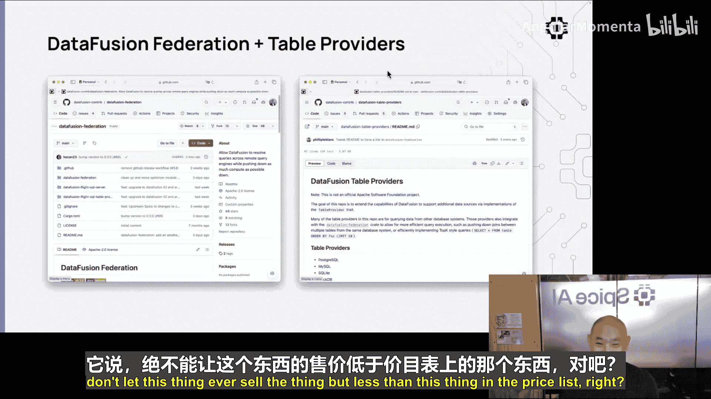

# 【卡内基梅隆大学】数据库构建块系列研讨会 ｜ Database Building Blocks Seminar Series (Fall 2024) p04 04 使用Spice.ai开源软件加速数据和人工智能发展（Luke Kim） -BV1dmipBLEYH_p4-

🎼Yeah， down。They ready for。And y'all at the speed of sound where we're now wax first top will gather around and witness something。

🎼The database Building Block seminar series is filmed in front of a live studio audience。

🎼This program is made possible by Google。

， let's get started we're excited today to have Luke Kim。

 he's the CEO and cofounder of Spice AI So he's going to be talking about what they've been building and how they used building blocks inside the system As always if you have any questions for Luke feel free to interrupt him at any time and that way it's a conversation for him and not him talking to the void of Zoom for an hour Again Luke。

 thank you much for being here I didn't do the Android This is Luke he's awesome go for it。

Thanks Nancy， Andy， it's awesome to be here， yeah really excited。So yeah。

 as And mentioned I'm Luke Kim founder and CEOo sp AI。

 I also wanted to call out my cofounder Philip Leblanc who's a very instrumental to the project and together we have over 25 years of experience working on a whole bunch of different platforms at Microsoft the last couple years I was in the CTO's office and Azure building incubated there called Azure Incubations。

 did a whole bunch of different projects including other open source projects that use building blocks。

 so DARPA for example there is a runtime for building distributed applications using a set of building blocks but when we also worked on GiHub and MPM and a whole bunch of other data platforms at Microsoft。

So。Given this series is about database building blocks。

 I imagine there's some interest in building your own database and so I thought it might be interesting to take you on a bit of a journey on how we actually decide to build one ourselves because we didn't actually initially set out to build one we thought we would be able to use other things that existed then I will talk through what is spice and what's it used for and give a demo on that and then dive pretty deeply into how it works with a focus on federation and acceleration features within the N platform and then how we connect that over to A。

And so if anything， for the first part， I want to hopefully encourage anyone who's actually thinking about building a database or building a data system and just encourage you that you can do it too。

So why build a database？Before I started S Sp， I was at Microsoft in the CTS office and we were working on a number of different projects and a couple of them had to do with the AI feedback loop essentially can you enable a virtuous cycle of improvement for intelligent applications by training in the cloud。

 building models， collecting more data， fine tuning them， AB testing and evaluating them。

 sending all that data back up and training a new model and doing the cycle over and over again。

 and so I saw this pattern when I was working with a number of customers there quite successfully。

 but it's hard and complex。In addition， we were quite interested in how this relates the tiered infrastructure。

 so not only is that complex， how do you actually make this work for us all the tiers of infrastructure from a laptop or a raspberryifier and an edge device through to an on-prem deployment。

 maybe a pop， maybe a 5G cell tower to a regional cloud all the way up to multicloud and so forth。

And then it becomes really complex， how do you optimize co locationation of compute data。

 how do you minimize data transit， and how do you do all of this with maintaining data privacy and sovereignty。

Here is a slide from one of our initial pitch decks which goes to prove that you can make an ugly slide and still raise money。

 but one of the side projects I was working on at the time was building a neurofeedback training system and this is where you essentially put an EG on your brain which collects a bunch of electrical signal which this time series data gigabytes at a time and you can use this to give feedback back to the brain and get yourself into certain brain states and by building a system we ran into a whole bunch of challenges but really what we wanted to do is make an autonomous decision-making agent which would make a decision on when to give feedback back to the brain and we found it really tough there were a lacking of tools out there to help us do this and I also saw this at the same time across the industry as I was working。

So。I left Microsoft in '21 and founded Sp based on this idea that can you help developers build autonomous decision making applications by essentially providing a whole bunch of building blocks within a sidecar that makes that much easier for them。

And this was 21 before ChattPT， and if you take it today。

 you would call this an agent application and you would probably call the sidecar a code。

So we set out to build this system and we quickly ran into a lot of hard problems the first one was we were no longer at Microsoft and so the data readiness of our design partners was significantly lower than what were used to and we found it very difficult to access the data we needed a couple of partners said hey。

 yes we can get you some data it'll be a CSV file on a SharePoint drive and we had to talk to a whole bunch of disproive systems and it didn't work forever。

So we accelerated our plans to build essentially a cloud data platform so that we could tell partners hey。

 just put your data in our cloud and we'll go do all of this for you。

 we built it using a whole bunch of existing technologies or a startup and so we wanted to move very fast but we also ran a problem that was very hard to build without a big test data set and what we did at the time was looked to find an open real-time time series data set that was continually updated and lots of different use cases and we ended up using blockchain data as that test data was very interesting。

 we figured out if we could do it for something like blockchain data at  tens of 100 terabytes that was continuously updated。

 we could do it for kind of any time series data set。And we got lots of experience on this。

 we build a whole bunch of systems including running DDB at massive scale。

 we had instances where we were doing 300 queries per month per customer and we had this minimum kind of deployment of 64 core terabyte of Ram for instance and we had all these huge operational challenges around that not because DDB is not good。

 it's just not designed to run at the scale in the cloud and so for example we were running DDB in memory mode because we wanted to have very fast query but in memory mode DD doesn't have a vacuum function and it only works in file mode with the wildlo and so we essentially implemented our own vacuum function which consisted of creating a newductDB a new instance of our service we call it Ducker at the time and then moving the workload across to the new instance and killing the old instance and that was our vacuum and we got a lot of experience running。

Very high quantities of query at scale through this system。

However actually its had a bigger problem that we had solve so look you were runningduct in memory mode because you you just didn't the data you didn't care about keeping around or like this was too slow or like what was that Yeah so this was our realtime query system we had all of the data permanently in data lakes that we could  query using other systems and so for this 300 million requests per month system we kept it all in memory just for high performance request serving back to front ends and applications so is it cash that exactly yeah。

嗯。But at the same time we didn't solve the other problem and the other problem was every time we went and talked to an organization they would have data all over the place。

 you would talk to an organization just the other data 350 data sources and they were requiring two to three companies every quarter and every time they acquired a company they got another 10 data sources and so you had all these data spreaderic for us both modern stores like Data Bricks and Snowflet but also legacy stores like the number of people I talked to have CSVs and FDP a lot and SQL server and these types of things and it's also structured data and unstructured data that we have to deal with and so there was this big chasm not to mention how do you actually get that data efficiently into models an A。

And if you kind of look from 21 till now， as GAI has really started to be using the enterprise。

 you see this rise ofra and it still has a lot of challenges right today I think you' would agree probably with Mark that it's still not at the accuracy that we need it to be and often this is because it doesn't have access to all the data it needs it's hard to give an accurate answer if it's not data back but as soon as you give access to all the data then you have the opposite problem which is you can spill data everywhere and so it not only needs to be full knowledge it has to be secure you have to have a samebox of data。

And to just illustrate this point， here is an example of us using our system using Open A in the back end where we're asking。

 hey， who were the top comms to this open source project called EngineGX and it gives you this very boost answer。

But once you connect the G4 over to data then you can ask the same question and you get a very suin exact data driven answer back right and this is basically rep and of course you can actually go and verify that the answer is correct so here we can just do the  query in the data we see it's actually correct。

So being data driven， being grounded in data is really。

 really important when it comes to serving real world use cases。

So the journey up until now through all of these AI feedback loop through neurofeedback through data platforms。

 all these working with customers， we cobbled together and have to maintain all of this crazy infrastructure using all these technologies that really just wasn't designed specifically for the use case that we wanted it for。

 which was how can you enable agent Genic applications across multiple infrastructure tiers in real time essentially。

 and we wanted it to be full knowledge to access across all these disparate data sources。

 modern legacy， multimodal， but also we want it to be very secure。

 so that you can actually deploy it in the enterprise。

 many of the large bulky systems you simply just not want to deploy for the AI use cases because the enterprises want to run it within their infrastructure。

 maybe on-prem， maybe at the edge， they don't want this data leaking into the club。

So we came to the conclusion that what we really needed is an AI native database and we looked around and we didn't see anything that meant specifically I especially around that tier optimized solution where you could run it all the way to the edge。

🤧嗯。😊，But now that a few years had come along and so much great work has been put into the community with building blocks like Arrow and Dataussion and iceberg。

 it's now feasible for a startup of less than 10 people， which we were to actually build on。

 which is super cool。😊，So what is Sp or， well， you can think of it as itself a set of building blocks。

 but instead of for databases for data driven applications。

It's a single node compute engine for data and EI， super lightweight weight。

 high performance written in rust and you can run it anywhere from laptop all the way to cloud and across multiple tiers platform agnostic。

And it really helps developers compose together components to use in a data and A application。

 which includes databases， models， LLMs， tools， and helps provide the feedback loop between them so that it can learn and。

And some of the data NAAI building blocks that we have are fedated SQLQ engine based on Apache diffusion。

which you saw at the first seminar in the series and acceleration and materialization using Data fusion。

 which is our in memory，ductDB， CL lighter Postgres。

 we're also considering adding a CHTB there as well。

 search vector search right now with hybrid search and graph search and others types of searches coming along the way。

 MR infant you can load a model and an AI gateway if you want to use a hostage model and a set of tools that you can use to make it better essentially。

So here's what it looks like visualized in the orange box in the middle is the runtime so think single binary container deployable set of four building blocks and these are presented over standard APIs so standard database API Apachearrow flight JDBC or WBC and a standard Open AI compatible API so you can use the Open SDK or the Veral AISDK and connect to it just looks like Open E and because all of these four building blocks are in the same runtime what you get is the ability to track all the data flows between them so we can start adding in hooks for monitoring and observability control and policy。

 which is all the things that you actually need when you're actually building this and putting into production especially in the enterprise。

And you can connect to structured data， unstructured data， and models。

 including filling down a model from Huface or loading it from file and into the runtime。

So here's an example of probably the simplest use case that you can use it for and you can essentially pair it with other data systems。

 so we work with Barracuda they had a ton of data and Databricks and was making their queries slow for their application。

 we were able to improve that by two orders of magnitude to 150 milliseconds at the P99 and we did this by simply dropping in spiceice with almost no changes to their application because they were talking to Databricks using ODBC and they can talk to Spice using ODBC and we essentially prefetched the last seven days of data which was 99% of their queries and stored it within DDB and served it up to the application。

 so think similar to what we were doing in the cloud example with cloudscale DDB but this case much more specialized and specific for the application itself。

And so basically what happening so that example it's just again space is just anorate cache for the Databricks is it actually of it you can think of it as a cache and I'll go into this in a little bit later slides but you can think of it more of a replica of a subset of data so if you had 100 billion rows in Databricks what they were doing essentially is taking a subset of that which was the last a window of seven days and sometimes down to the tenant and keeping that within DDB to serve directly to the email application and then spicee does all the work of keeping it up to date evicting all data refreshing it and so forth。

So it's a little bit different than just a fuel cash。

So at this point though there's nothing like this example here。

 there's nothing but the vector search or any of that it's just like correct。

 this is the simplest use the simplest use case and that data risk could be almost anything could be snowflake could be postgss could be Mycu oil and so forth and yeah just the simplest use case of using it for data acceleration picking a quick question if you don't mind。

😊，So you mentioned that they were using ODBC to talk to Databricks， so I'm just wondering。

Does thisDid this work particularly well because？The queries that they were sending to ODBC happened to overlap with。

 you know， DDB。I don't know if I'd say like kind of like the SQL dialect or is it actually just that。

You know。You know I guess I'm just asking like is it like a SQL dialect related thing or is it just at the level of ODBC。

ductDB， and whatever Databricks uses the actual query engine portion。

 like they just have really good alignment。Yeah I wouldn't say not specifically so Sp supports a whole bunch of protocols。

 JDBC， ODBC， ABC flightlight H2P the point I was making is that it was just drop in so there was really almost no changes the application you can talk to databricks on the number protocols as well including Sp Dta direct so a different bunch of different protocols and Sp supports all of those but the point was that you could just drop it in with really minimal changes now if you're asking about dialects on the frontend Sp supports Postgre or snaps or a Postgre dialect and you'll see later in the talk when I get into federation of how we translate that into different dialects in the back end so that you talk to a database in its native way。

Okay， thanks。So here's what's happening before Spice your application is just talking to this backend system and often that can be a big centralized bulky Cloud managed system and you're at the mercy of its concurrency system。

 round trips across the network it normally high latency you normally have low concurrency and so one way of deploying spiceice which is what they did here is deployed as a sideCO so you actually put it on the same machine or the same node as the application and what that allows is the application talk to that instance over a low latency highperformance IPC local loop back essentially and then Spice will do all of the work of managing the data refresh back into DDV or it could be SQL light for you essentially。

And I'll get into a little bit later how that refresh works。

Thought that might be the question and normally you have the question of at this point that was my question asked keep going。

😊，It's not the only way we can deploy you can deploy it as a set of microservices in between as a cluster and you can actually change these so you can point one spice to the other spice instance and if you do that you can really this really helps for tier optimization we can actually push data down as we get new data or as we know of new data closer to the source and you can start pushing down predates and filters in these types of things as well one other difference of spice is that I think I heard the Trso DBIC you should just give every customer to their own database well you can do that with spice as well and we often see that a lot so maybe you have a big customer custom A you give them one spice instance or a set of spice instances and maybe they're really big so you give them like 20 core and then customer spice B then you just give them 200 milli callss and so what allows you do is really optimize your environment for each customer and you don't have to worry about like RLs and all these types of complex things to actually do that。

You just give every customer their own database。So yeah。

 that was I'm going fairly fast because I've got a lot of content。

 but hopefully that gives you a quick overview of what spice is and so we can kind of get into some demos and how it actually works。

All right， so the first demo I'll give is a very basic demo here。

 and so here I have a you guys can see my BS code when' own。Yes。

 yes okay so I have an empty VS code project Now we really have a developer focus at Spice and so we wanted to make it super easy and so you can get the spice Ci by just one command and Spice we also wanted to be like building blocks and so something like NPpm you can get packages we wanted to make that where you can get data and model packages so we can do spice ad like you'll do say yarn or NPm a and I can do sp Ei quickstar here and that will pull down this spiceport ya which you can kind of think of as like a package do JM and it's got one dependency here and if they go into that dependency you'll see that it's quite simple it's got this datas node and it's got one data set which is a bucket pointing to S3 we're calling it taxi trips and it's in the file format parque and we have the acceleration thing here and I'm just going to turn the acceleration off for the purposes of this demo initially and I'm going。

Run the runtime， remember a single binary， you can run it in your laptop。

 you can run it kind of anywhere， and so we're going to start the runtime and it starts up a couple of different endpoints here。

I'm going to start one more console window here and we have another command spySQL which is just a little reple that we have and I'll run that and that will connect over to the runtime and allow me to run queries so now I can say show tables。

And you'll see I've got the tables here and I've got that taxi trips table that I've set up there and so now I can just run queries against this taxi trips table so I might do something like that and what it's doing is using the runtime to go to that parquet file on S3 run the query against it using data fusion and give them me the back results and so that comes back in about one almost two seconds so what happens if I go back over to the spicy aml and I can say accelerated and true here so it's going to do that and it'ms going to remove the so now。

And then I can use different mechanisms of acceleration。

 so if I just did this it would be arrow in memory， but I could also just do engineductDV。

This could also be simple light， it could also be postgre and I'm going to say mode。But and save it。

And so you'll see at the top here it's actually created a WTB files just it's just the standard WTB database and so if I come back across the MysqL repple here。

 I can rerun the same theory and you'll see that it's。

Two autos of magnitude faster instead of taking two seconds it's 0。

01 seconds and that's because it's running the query locally on the local DDB instance and in the backgrounds the runtime actually loaded the data automatically for it and the reason why this is a little bit different to a cache is that now I can do a whole bunch of compute on that so I could run complex queries and you don't have to worry about them just being purely materialized。

Now the next thing I might want to do is I might actually want to join this data with another type of data。

 right so if I。Bring this one in here。Then。呃。In addition to the S3 data set。

 I've got a Postgres data set and I'm going to call it PG taxi trips。

 and I'm just going to carry a view that unions the two。

And so one additional thing is that this post screen day sets pretty slow。

 so I can also do acceleration here。And I'm going to say enable equal true。

 but in this case I don't want all the data that's in postory and so I just want to take a subset of data and so I can actually say select star from taxi some PG taxi trips where fair amount is greater than 30。

And so now when I rerun that， I will。Be able to load and you'll see that it's loading the data in the back end and if I was to come across to my SQL Raple here and do show tables。

Then I've got PG taxi trips， all taxi trips， taxi trips， and I can say select。Ands actually quite。

One from PG taxi trips then it's going to run the actual query now did I not accelerate that oh wait sorry I did。

I forgot to put my arm。Sendending call on at the end， so let me re around that。

And you can see it's very very fast and so what I can actually do now is run cruises across both tables very fast so I might actually do something like select average fair amount。

It' was really comfortable。From all taxi trips。And I could say where a fair amount and someone give me a number between 10 and 30。

24。24 well actually because I filtered 30 before， why don't we do 34 and so wait did I not do that missing in amount Yeah。

 thank you。And at the end， yep。There go， so there I've been able to run the query extremely fast across both data sets because they were both stored in memory and remember one was actually aductDB on file so the S3 data was duct toB on file and the Postgress data was actuallyarrow records in memory and it was able to join it across them。

 do the calculation and return the result back incredibly fast。Andy。

 can you put explain to see actually what the plan looks like or no？

Yes we'll get into that Okay excellent question so let me come back across to my deck and let's see what's going on here so how does all of this work well spice is also built on a of database building blocks。

And some of the key design decisions that we've made and Beth was a pure open source foundation。

 so Arrow flightlight Dataussion Parquet iceberg， another decision that we made was from our learningers around running WTB at Cloud scale was sometimes you actually want a row-based OTP database and so we'll support both WB SQLI and we actually have key value on the reBa and of course we wanted to make it as developer firmly as possible so that's why you see things like these package registry of these data sets and models and really fast feedback loop to be able to build upon。

So let's look into some of the more questions， so how does federation acceleration work under the covers？

😊，So what were our goals for query fedederation again if you come back to what I said at the start was we had this problem how do you actually in the enterprise access data wherever it lives and this becomes a lot more important when it comes to AI because if you're just building an application before you talk to one or two data sources no problems if you actually want an accurate answer back from your chatT it needs access to all that data or wherever it lives and it could be in some old legacy store。

In addition， we wanted to ensure that we keep the compute next to the data。

 so can we push as much compute to the underlying database and do as little work in the runtime as possible。

So if you take a query like this， for example， you are selecting across two different tables， sorry。

 three different tables， two different databases。How does this actually work？

So we make use of dataussion and Dataussion will pass that query into a logical plan and this is the initial logical plan and it looks something like this where you have a rejection you're going to do a join we didn't actually have the join in the full career at the top and then a cross join down the bottom and we can implement this because Dataussion has itself a bunch of building blocks which are awesome and one of those is a tablerietor where you can actually implement your own ability to talk to a different data source and it just looks like a table in Dataussion。

The problem with the out of the box table provider is that it only supports a set of pushdown and by pushdown I mean the ability to take filters and limits and aggregations and push them down into the underlying data source so that you don't have to bring all of the data back into data fusion and join it within memory。

 which is what you would have to do otherwise， and what happens out of the box。So。

There is a package called Dataussion Federation and here's how it works it runs as essentially an optimizer rule after the analysis and it looks at all of the the logical plan and looks to find the largest subt tree of the plan and then it will replace those larger subtrees for each of the underlying databases with these federated nodes and these fedated nodes will then take everything within that subte convert it to SQL for the actual underlying database and send it to that underlying database。

And so。I'm going to walk through step by step how this happens。

 so imagine that you had a query that joins multiple tables in one database and unions it with a table from another database。

So it looks like something like this。You have the logical plan and it's going to go top to bottom until it finds a leafF and then it's going to go bottoms up as it finds essentially the subtes for the data source and so we've got two circles here the left one is is it federated and the right one is the data source that it belongs to and so it's going to walk down for each node and say hey is that what data sources are part of in this case it's WDB and we say oh this is WDB and we keep walking up and we say oh these are both WDB and then it walks across oh this is WDB it walks up WDB all the way up to the top and then it walks across and it's like oh this is actually a different data source it's Postgres and then it walks up oh this is still Postgres and then it gets to the union and so it's basically found the two larger subtes or where all the data sources are the same。

And then it takes those two sources and replaces them with federated notes。

Then it checks off on the union here， all the inputs to this to this is federated so we've already decided that this is all federated below and so it won't try and do that again and then it adds a state to this top and that way it's able to decide what it should actually federalerate。

And so then if you look at what happens between underneath the federated loads。

 the data fusion logical plan essentially becomes this intermediate representation that we can use to call other databases and so each one of these federated nodes。

 we will use what's called the unpaser in data fusion。

 and that simply takes the logical plan and convert that subter logical plan。

 takes the AST and converts that into the dialect for each database。

 and so we're able to call each database in its native dialect here。

But that comes with a whole bunch of challenges。Specifically type conversion。

 so sometimes this is easy so if it's say DDB DDB basically supports arrow typess out of the box and so it makes it very easy we can basically say here's aD DDB type it's now an arrowtype but if it's something like a Postgres row conversion with a whole bunch of other types we have to do essentially convert roast to columns and Postgres types to arrow typess and so we've done a huge amount of work in the table providers and the federation repositories within data fusion to actually make this work and then on the other side when we actually take arrow data and we put it into one of about acceleration databases likeductDB or SQL light we have to take a arrow record essentially and convert it into an insert statement and so but this is a lot more simpler because we don't have to do a whole bunch of conversion we just have to basically create the SQL statement。

So yeah， it's a whole bunch of work to do this， but once you've done it， once you've done it。

 you get essentially this way to use consistent postgres across anything in the back end and for the most part it works。

It does have some limitations， so one of the limitations is until you go and map all UDS。

 you currently limited to data fusion built in functions and so you can't really call back in UDS because you're simply using data fusion Postg SQL dialect in the front end。

And then it's mainly only implemented for SL based providers。

 but use you can do this for anything else and I'll show you how that's really interesting and what we actually do there as well on how we actually use this to convert from Postgres SQL to GraphQL。

So there you have two sub projectsjects of data fusion， which themselves are building blocks。

 data fusion Federation which enables that replacing of the subtrue to federated nodes and data fusion table providers which is a set of providers that does that conversion back into the backend data store。

 and by CI， we contributed the data fusion table providers Repo and wed do a lot of work in the federation。

 so would love if anyone wants to help contribute， thatll be awesome。All right。

 but you can do this not just SQL to SQL so what we actually do is we use this also for SQL to GraphQl and we do it for other types of query systems as well。

🤧嗯。I see a question， yeah， go for it， yes。Yeah， so I wanted to ask。

Like how does the interaction so I'll say this in the first example。

 you mentioned that like part of the。Speed up is like you're caching a bunch of data and quote unquote cache。

 but what I'm curious about is how does the view materialization essentially interact with like your federated nodes right like are you able to essentially materialize a query that actually spans two federated nodes？

Yes yes you are yes so the query will will span so let's say I take this query that in my example right then oh this one here so this is spanning across multiple tables and across multiple databases and so what we can do the way the materialization will work is it'll take the result of that query and store it in DDB or take the result of that query and store it in arrow records in memory and so then all of your subsequent queries are just going to be on that essentially embedded database in the runtime which was the result of that query。

Awesome， thank you。And then call up you a question if possible。Yes go ahead this is Joseph Kashko。

 by the way， so I'm just curious for that materialized query。

How and when does that get updated in your embedded database， if ever？Yes， great question。

 I've got a slide on that in about three slides。😊，And then Robert had a question in the chat。Yeah。

 so it was about the demo with the acceleration when you constrained the maintained data inductDB to a certain data set。

Yes， my question around that was like if you don't have that constraint and you have a large data set。

 like how is it able to like， you know， manage the back and forth of what's。

Being managed and what's not when when you're working a large so I'll get to a little bit this in the refresh as well。

 but we do we can do some tricks so for example， if you have time series data and you want to just say keep a window of data then you can use push down this query push down essentially into the backend database to only get for example the and we do things like handle like an overlap late arriving data and you know like an up and so forth around that so there are definitely some tricks you can do to minimize it but yes if you want to take the entire database and you want to bring it across every time then it would be depending on your data size it could be a lot of data to bring it across every time。

Any questions？All right so for GraphQL we can do something similar so here's the problem we also have a GitHub Connector and we use GraphQL to connect to GitHub and get a whole bunch of data and if you just go and query Github and we want to say hey take all of the PRs that emerged even for just eight rows of data it can be very slow and so in this case we went and talk eight rows of data and like filtered rows and it was like 68 seconds right and that's because it's similar to the problem that we described before where if you don't have push down you've got to pull all the data into data fusion and do filter and data fusion。

嗯m。However， what we can actually do is we can actually push these filters down to the GraphQL query and so what we do is we do a similar translation from SQL to in this case GraphQL search parameters and this works not all the time but it works for most of the cases and so you can get some really really big speed ups and so in this case we take a query on the left here which is select author entitled where the author is Psy and state equals merge with a time period and this converts to a GraphQL query and we get just those rowsback and it finishes subsecond and so to add to your previous question you can use things like this to just pull down the additional increments of data that you might need imagine doing this on like an updated at since you last refreshed or so forth where you're just pulling in the new pull request。

All right， so let's get into a little bit of how these two concepts of federation acceleration interact with each other so one problem that you have when you start doing this is okay I want to。

Create this sandboxer data from my application or from my AI agent and I'm using a bunch of different data sources but they're all different performance right so I'm talking to GiHub with GraphQLs super slow I'm talking to S3 getting Paque files and that it's reasonably medium fast I can do some really fast stuff with postg because it can push down the queries but I get this inconsistent performance。

And so what we can do is take this was kind of to your question before。

Replas or subsets of these data so in that meization in these embedded databases to make those queries consistently fast。

And here is how we can update that so we have three mechanisms one you can set up an interval so you can pull it so you can say hey every hour every day or you can there's an API which you can say just do it now so if you know hey I just dropped the parquet file into S3 go and pull that parquet file down pull the API and I'll pull it down and you can add filters to this as well so if you're doing it say every day you might or every refresh you might say hey I want to pull in all the new taxi trip since my last refresh and again we will do things like manage an overlap for you do we up and so forth。

So that we ensure that you have you know the data consistency there will support primary keys and indexes and these types of things in addition we support toBium as a connector and so you can connect tobiium to it and send essentially each change that happens to your database over a Kafka stream sort of over Kafka and we'll apply them within that accelerated table as we get them。

And then we actually made our own mechanism as well because we wanted to support this tier optimized way and it's essentially doing similar thing that Tubeium does over Kafka。

 we just do it over flight and we do it where they do exchange essentially and so this allows us to actually push these changes as they happen down into that accelerated table。

😊，So hopefully this gives you an idea of how that acceleration actually gets updated and then we do other things as well like evictions and so forth。

 if you want to keep like you know a time window data and so forth。

Any more questions on the acceleration， the refresh here？

Is there any sQL you can't support as a materialized view？

And do and do partial like incrementalal updates thinking of like like like materialized or like the。

Because it's hard to do it for any arbitrary sequel。Yeah。

 it's definitely harder to offer any arbitrary physical。

 especially like I mentioned when it comes to the UDFs。

 if there's like custom things within a dialect， if there's like some crazy like pipe that's just like not supported。

 for example today we don't do a good job with like JN B， things like that yet。

 and so where you get these mappings but what we find is like for majority of use cases it works pretty well。

Yeah， okay。All right so this comes back to is it a cache and I get asked this question all the time and so what we say is like we have two distinct concepts here we have both a cache which we actually support and this acceleration and so if you follow what a query happens when it comes in is we'll get a query and this can be over flightlight can be over would busy it can be over HtP of multiple protocols and then we'll check our LOU cash and the cache key that we use for that is the logical plan hash key and so the cool thing about that is it doesn't matter if you sent the query over flightlight or if it's over HtP or if it's slightly different if it maps down to the same logical plan we will provide the hashbackag。

😊，嗯。Sorry we'll provide the data directly on the logical plan hash key and then if it misses there we will go and hit the accelerated table and the accelerated table is updated as I mentioned the last slide and then each time it's updated it will invalid in cache for the LIU cache and then if it misses the acceleration then we have another mode which you can optionally fall back all the way back to the actual underlying database itself but there's caveats around that so we have it off by default but you internal turn。

So that's how it's kind of different from a cache and supports and even we call it kind of a materialization。

 but it's not 100% materialization because you still have， especially if you're using CDC。

 the ability to have very fresh real time data within that local replica of the data。All right。

 so that really go through a whole bunch of the kind of the data aspects of federation acceleration of the runtime。

 how does this all interact with AI？Coming back to kind of some of our original goals for the project and by the way I'll just say here that we have many。

 many customers that just use the data aspects of this。

 you don't need to use any of this AI stuff so some people are almost allergic to AI these days it's okay you can compile it out you don't even have to compile it in and you can run it all without any of this。

So if we refresh our memory， we have four building blocks and two of them were around AI kind of use cases so search ML inference and an AI G。

And so I'd like to demo a little bit of that for you right now。Here is another use case。

 we essentially created a GPT around the EngineGX Open source project and it's a little bit more complicated than the other one。

 we talked to a number of different data sources so we're taking tickets and CVEs from Databricks and Postgres commits from GitHub and GraphQL and documentation we put on FTP just for fun and we're calling OpenEI here。

So let me swap over to our cloud interface now。Everything I'm showing you here will work 100% open source on your command line。

 you can do all these commands on your command line， you don't need to use our cloud platform。

 but it's just easier for me to visualize if I use our cloud platform here。

So just like before we have a Spiceport。 yal and so I'm going to go into that this one's a little bit more expressive and so we have a datas here。

 we have a Databricks data set， we have some connection info， some instructions around metadata。

 we have this embedding thing which I'll come back to then we also have S3， which are CSV files。

 we have FDP which are markdown files， and we have GitHub which is GiHub Kims。

And then we have this section here， which is embeddings and we're saying for this one use Open eye API and here's our key and for this one。

 hey， just pull down this model from hugging face and use that as our embedding this model。

And then for models， we have the ability to wire up to any opening eye compatible。

 we're just adding support for anthropic as well， and we have a system prompt and so forth here。

And then the final thing is how you wire this up together is you have。This embeddings column here。

 let me see if I find this other one that's maybe more interesting， this one here。

And all we're saying is， hey on the column content of the docs for FDP。

 use the Huging face model that we pulled down and calculate embeddings and use some chunking him all right。

 so that's a whole lot， but in summary， four data sets。

 two embedding models and a couple of API models。Now we can come across to our playground here and this just looks like what you saw on the command line we can just runqueries against it。

 so here's CVV it's a very fast subsecon query and if you look at say the docs one。

 what you can actually see is that we have for unstructured data a location。

 the content of it and content embeddings around it as well。

So I didn't write any application code at all， the only thing I have is that Spice Po at Yaml nothing so if I come across to this AI chat here then and I use OpenEI without Spice。

 then I might ask a question， hey， what data sets do I have access to？

And it's going to reply back to me， hey， I generate answer， I don't have access to any data says。

 however I can help you。What if now we use opening hours slicelice， can ask the same question， hey。

 what data sets do you have access to and without any code on my behalf。

 it now knows that I have access to these four data sets that we had set up within the runtime。

And so and I've got kind of links back to it， these are actual the actual dataset sets here and so I can start asking questions here。

 for example， what were the top CVEs in the project related to quick or something like that and it's able to you've seen this before you a bunch of search across the data sets to find these CVEs related to Quick in the project and give me an answer back and this is all rooted in data。

Now the cool thing about this is it's very fast， it's rooted in data。

 and I didn't have to any work to actually make it to wire up the two。

I can actually ask other questions， for example， who are the top commits to the project？

Provide actual commute numbers。And it'll go off and do the query and it comes back and provides me the actual commit numbers here right。

 and so it can access the data systems that are wireed up within the runtime to give me back a much higher quality answer than I could otherwise get。

Now。Not only do we want the ability to connect data to AI and models and we want it to be accurate。

 we've got to make this secure and you can do that to some degree by just keeping the data that you want access to you want to give access to to model in that acceleration and nothing else。

And you want it to be secure monitorurable observable within the enterprise as well。

 so if I come across to this tab here everything that I was doing there you can see has been monitored so all the queries that happened all the completions that happened all the vector searches and beds and then if I come across to this tab here then we can actually find the queries that I did so we have a full distributed trace of everything I did here actually stopped it wrong but have all the inputs to the model I have all the outputs to the model which was in my exact commit numbers how long it took and so forth and then I can see all the tools that I use so。

It doesn't have to guess at what dataset sets it can just call this tool， hey。

 list the data sets I have access to and it can actually get that and put into the model and then it can run a SQL text SQL and you can see it here and because we can trace all the data flows we can see the actual data coming back and forth between others well if we wanted to debug that query I could just open that up in the query Explorr run it and debug the query and you can see kind of the whole flow here now if I go back to my other one then I can show I think for this one here it did a vector search so here is the text embed and here we're doing a very basic cosine distance similar search but you can see the full trace of everything that happened all the way up to the top。

And so the benefit of having both things in the same runtime is that you can start doing this very fast feed to back loop between and so sometimes I try and make it fail。

 but it doesn't always work till I get the query to fail like I might say， for example。

 who were the top。Who were the top Disney。Princesses or something。Kimuterus。

And sometimes it'll fail to actually get the answer and we can see everything that happened there or in this case it didn't work。

 it'll actually fail to do the query， but if you notice here actually if I come back to the other query。

😊，This one here， if you notice the query is very fast 33 milliseconds。

 the list data sets was very fast 0。05 milliseconds and so you'll get this very fast feedback loop。

 even if it fails to get the query right the first time。

 it can try four or five or10 times often within you know tens of milliseconds。All right。

 so let me go back to my deck and walk through a little bit more of how this works I know we're coming up on time so I'll continue to move forward。

嗯。😊，All right， so without spice， here's what's happened right， you have your client。

 it's calling the LLM， it gives you back a response， if there's a tool call。

 then it says go and run that query across your backend data source and you have this extra hop all the way to you backend data source。

 it gets the response back and then it can take that response from the tool back to the LLM the LM can take it and give you back your final response。

嗯。With spice， you can internalize all of this， so you can essentially say， okay。

 before any of this happens， okay， we're going to pre create a prefetched acceleration。

 store it with inductiveB and it's going to be within the run。

Now I can do a check completion request and it's going to call the tool which is all internal。

 it's not another hop， it's going to go do the SQL query again internal， return the response。

Straight back to the LLM and the LM in this case could be spice can load and host an LLM or it can be an AI gateway and then it can do all this internally and return the response and so what you essentially get is the ability and this can work for vector search as well and any other tool the ability to internalize all of these data and function calls within the runtime which makes it very fast and allow for a very fast set of feedback in addition it can do debugging on top of what it did so imagine it's doing something like hey this query is too slow okay I'm going to run and explain to actually figure out what the query is doing and try and use that to actually debug the query itself all within the runtime itself。

All right， so when to continue on， I know there's a little content here。

 so bear with me wherever're right at the end。So we have another concept within the platform remember I said that what you really want to be able to do is query across all these data sources wherever they are。

 so structured data source unstructured data source GraphqL if you want to。

 so how do we actually pull in some of these unstructured documents well。

Take this query at the top here with saying hey select staff from the tableableware location is food bar the cool thing is we can actually filter on it so we're not like scanning across all the documents and this might work for something like Google Docs or SharePoint or FTP or fail and so we can push that filter down as well to just read the documents within the query and then will go and pull that content into the platform into that acceleration and so we'll only do it if you actually have an acceleration here。

And。When we actually use that data to actually calculate embeddings what you can actually do is sp for when it calculates embeddings inject an addition column which is this content underscore embedding column within the platform within the table and compute that just in time so when you actually run the query hey select from content embedding it's going to calculate the embedding now as you can imagine that can be pretty slow and so if you pair this with acceleration then you can essentially use this to precompute and cache or the embeddings in the accelerated table and it's going to pass it through the embedding model of which you can choose it could be a hugging face model could be opening on and use that to store it back within the content embedding a column and if you want to use your own embedding embeddings you can do that if you want to use PG vector you can use that and if you want to point to say the database that's already got the embeddings there we can just use those。

Okay， so what this。Allows you to do is essentially have what we call an embedding table provider and the embedding table provider and really pull in data from any source in the back end right so now I can calculate a consistent set of embedding space across GitHub and Postgres and Onerove and some arbitrary we got asked for like or was it DB2 the other day and Oracle and so I can calculate this consistent search base across all of these different data sources specifically for the use case of MyGPT essentially ultimately and of course you can use the acceleration features to make that super fast across all of these different backend stores。

嗯。😊，So in summary， we're driving towards a data drivenven AI world and what we believe is for it really to be truly trusted and useful AI really must be grounded in full knowledge data you have to have access to essentially these virtualized sandbox data sets of data with consistent search base and if you don't have that you'll get what marks referring to basically clipping right。

 and then these things are going to learn and adapt and improve and you'll do that by enabling fast feedback loops within the system by making it really really easy and fast to internalize things like data access and search and rettririeval and function calling across all of these cycles through back and forth with the LI。

And I'll just note that while we do talk about a bunch of Ls。

 we can actually load traditional models as well and you can use accelerating data for inference into traditional models。

So in summary， if you really need to serve a fast set of virtualized views over a disparate set of data sources。

 you can use Spice to build these specialized highper small data warehouses。

 if you have service performance or reliability issues。

 you can essentially use it as a kind of like a database or AI CDN。

 we can essentially edge load data next to your application。

 and if you want to deploy secure AI driven applications with all of the monitoring observability and security and compliance that goes with it。

 then you can use spiceice as this intelligent AI driven copilot much closer to the original vision of the project。

So with that。Thank you you can try out Spice it's on GitHub super easy install Apache2 licensed very permissive get up with one command line。

 you can run the quick Start that I just did in about a minute and yeah if thanks for your interest and if there's any questions in the last minute how can you take it。

I'll blown about time now and you're like on the dot one hour， awesome and you give a demo as wild。

 all right， we have time for a few questions for Luke。😊，I had a follow up one of Andy's questions。

 I think I just missed the answer， but for the materializations when you do the refresh are you just refreshing the query from scratch or do you have some type of like incremental updates to the materializations Yeah it's up to you so you can actually put in so here at the top we're doing an incremental update so it's saying hey pulling in the taxi trips where they pick up is is greater than last refresh so you could imagine just pulling in and you can you kind of do any filter that will push down it could be a time filter it could be a customer filter it could be a state filter anything that you think would incrementally update if what you're asking is can we figure out the incremental di ourselves we don't we would expect you to know the incremental di yourself and or use these other mechanisms of providing streaming updates directly to the acceleration。

Where， everybody else。I was wondering if you。You know。

 so I guess I'm just generally interested in like substrate and that type of。You know。

 portable query plan representation， and I'm also curious like you know you mentioned。

You're looking at supporting KVs。I'm curious if there's also kind of a。You know。

 if there's something that you will or are interested in providing that like spans kind of data models right so like if you have a keyvalue data source in a relational data source like is there something in there that you think you can bridge or you know is that kind of just handled you think maybe that'd be handled like totally different level or later so the short answer is yeah we like substrates is essentially on a roadmap we love to support it we pretty small team we actually have been building versions of this for a while but we started the rust version its in January so we've really going been building this for about nine or 10 months but we know Jac over there at Sunde and we would love to support substrates do a whole bunch makes a whole bunch of this translation much easier be able to push down plans much easier into into backend supported databases as well for sure。

Awesome， thank you。不是。So my question would be。You're choosing data fusion as like the thing that actually does the federation piece。

 I mean I mean。Posgres foreign data rappers could also do that but then you'd get the slow query Exion so you don't do that。

 but I think DDV is something similar although I don't think they have the ability to do the federation did you guysD we started off when we did our cloud scale DDB we actually used their Postgre extension to query Postgres and it doesn't have they've actually improved it a lot since then but at the time it had almost no pushdown at all and so we basically couldn't use it since then I believe they've improved pushdown but focused very well and as they should be on making DDB A not on like hey can I support like 30 different providers and pushed it down to all of them and that's something that like we do for example you mentioned you guys provided the table provider for I think much of data sources can you share which one was the hardest to actually implement it get working well as we're almost the easiest。

And most's fun to implement which one the hardest。the easiest ones were things like WTB so because the data types are exactly the same and so you can really just like just use it directly。

 use the data data directly but on where is my I think you passed it yeah oh I asked it I meant to say。

Right today possiblys again。Yeah， okay， well we， here it is， yes。😊，So DDB。

 something like DDB where you're already using arrow through that's for sure the easiest harder ones are where you're doing like a nonsQL translation so I'm not sure about hard but like GraphQL was definitely a lot of work things like and then I think anything where you have like big type differences is also quite complex right especially when you start getting to like very large types we wanted to do things like decimal 256 stuff like that not always supported across different databases or even runtimes like language runtimes right so it become difficult and there's definitely a tradeoff for sure where you're not going to be able to support everything but for the most part you can and we're pretty excited I think to have something like a variant types supported in parkque and arrow where we can start pushing through you know different types just through that。

I mean so I mean federal database that was the dream of the 90s right and no one ever actually did at work Yeah I think that you don't necessarily want to just hey federate everything it's like hey can I get a specific stage or sandbox of data for my specific specialized use case and for that it works very well and I think as you have much more and more and more AI use cases you actually don't want to give your AI access to your database you want to put something in front of it just in case right you want everything that it touches to be monitored so like when it starts doing crazy things you can stop it and know what it's doing and so forth and at the same time you want it to be useful so you want to give access to data it can actually access and for it to be fast right think that was a case where they had the online chatbot where they sold a car for a dollar well you can imagine okay that should have something in it where it's like okay here's my price list here is。

Like the a floor I can ever sell the car floor and I have maybe a supervisory model on top of that that says don't let this thing ever sell a thing but less than this thing in the price list。

 right？😊。

