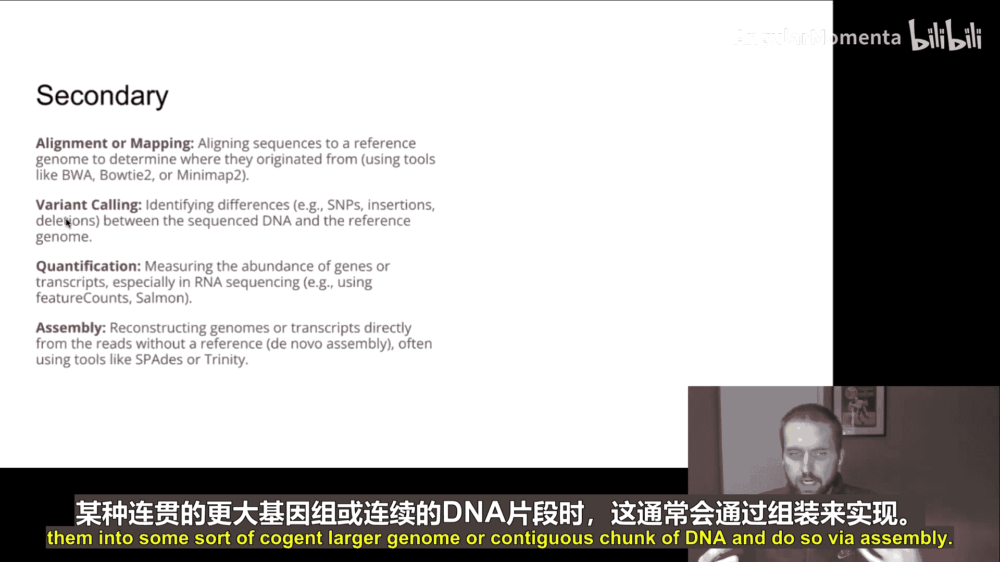
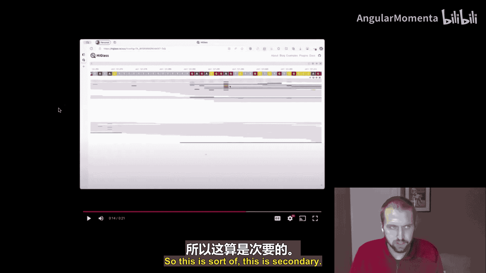

# 【卡内基梅隆大学】数据库构建块系列研讨会 ｜ Database Building Blocks Seminar Series (Fall 2024) p05 05 Exon：专为生物信息学设计的数据库（Trent Hauck） -BV1dmipBLEYH_p5-

🎼Yeah， down。They ready for。And y'all at the speed of sound where we're now wax worst top perhaps or gather around and witness something。

🎼The database Building Block seminar series is filmed in front of a live studio audience。😊。

🎼This program is made possible by Google。

All right， let's get started， we're excited to today have Trent is。

Formerly from where twoe technologies where he built this Xion Exxons to be Exxon Data system。

 but now he's also a software engineer at Meow so he's going to talk about what he was building at Exxon before So again as always if you have any questions for Trent。

 please introduce yourself interrupt in any time that way Trent talking to an audience and not to himself on Zoom for an hour and feel free to do this at any time So again Trent thank you so much for being here the floor is yours go for it。

😊，Awesome yeah， yeah thanks thanks so yeah super excited to be here。

 talk a little bit about Exxon so we'll talk a little bit more about Exxon here in a minute。

 I guess I'll just sort to do kind of a brief intro so I follow maybe like somewhat of like the traditional archetype of sort of self-taughtt and so sort of started out sort of like counter script kitty like very back in the day。

 and then when accounting and finance and analytics and so maybe much more like traditional background for somebody who is working on like analytics or databases or sort of the application of those to some problem but then I got really lucky and ended up sort of falling into bio and Exon is a database that is sort of purpose built for bioinformatic and sort of bioinformatic applications and so excited to talk a little bit about that and so that's been basically the last 10 years or so prior to me join Meadow。

This was in bio in some form by the working。A company called Zimergen doing sort of ex generationeration sequencing analytics or metaomic discovery which is basically a problem where you have a very big database of sequences and you have to search that database often something that as simply phrased as like find me all the sequences that kind of look like this other sequence because if it looks like this other sequence。

 it probably has a similar function to that other sequence and we'll talk a little bit more about sort of those problems how they play out the database perspective yeah and then I live and sort of a beautiful shoreline Washington which is just north of Seattle and the Pacific Northwest and load up here I also do quite a bit of contribution to the data fusion project so I helped from an administrative perspective adding scalar UDF supports for UTF8 view so folks who are familiar with the data fusion project know that sort of recently added and has been adding sort of improved support for UTF8 view。

 which is。That's also particularly exciting for bioinramatic applications where so much of the work is about comparing strings and working with strings and so if you can sort of use some of the nice cities of UTF8 view for say filtering strings and DNA sequences or protein sequences and the so forth that's really potentially exciting。

So sort of bound improvement streaming block j so I'll talk a little bit more about this later actually in the context of how bioinformatic file formats tend to be compressed and indexed but basically most people don't think or don't know that you can often take a GZ file and cancatenate them together into blocks and so you might have a single file with multiple blocks and that's how the indexing works in these bioinformatic file formats added lots of docs and then you obviously everyone heres probably they're familiar with DDB and they've done in lots to sort of push for what people think is okay with sort of SQL as a language and so I added support for basically count with no arguments and sort of negatives in split part and some of those other sort of smaller smaller utilities so。

Have added quite a bit or been involved in the project quite a bit， which has been exciting。

So before we get into my talk， I just want to give a little bit about sort of what Exxon is in this talk sort of in the context of the talks that have happened so far in this seminar series。

 so just briefly we had the first talk which was given by Andrew Lamb and amongst a lot of things he really focused on this or he talked quite a bit about sort of like trait and extension driven functionality。

 which is how data fusion allows people to add utility to it as a database and so we're going to see a number of examples in this talk today about how how I and via Exxon have taken some of that capabilities and added bioinformatic capabilities into a database then we had some really exciting sort of like the sparkcus I think is great data fusion comment and then the last two sort of preDB and Sp AI which were both interesting where he applications a lot of like tech search。

In the Pra Db use case and then some of this idea in sp that AI have also data federation for acceleration。

 and some of this idea sort of data federation is kind of tangentially related to Exxon in that a lot of bioinformatic data is stored as。

obically files， it's very file based science and so we're going to talk a little bit about how I have sort of adapted bioinformatic or like database file processing that you see you know all over in these sort of like embedded OLAP databases to bioinformatics and some of the sort of nuances and challenges there。

I want to just give a kind of brief overview into sort of bioinforramatics data and then we'll map it on to what it looks like as an actual database。

When you're doing like informmatics or bioinformatics。

 if you read the sort of textbooks around it you really break it out into three main phases。

 sort of primary secondary and tertiary， primary is really about getting the initial sort of biological signal and whatever that may be。

 so base calling for example which is literally given some strain of DNA。

 you calling the individual bases on that DNA， say an A， a T， a C or a G。

 also a lot of the instruments will then generate some QC scores which are useful for filtering or other sort of quality control analysis or it's becoming increasingly popular as a modality which is imaging。

 so this is like getting the initial signal， then you sort of move up into secondary which is really around sort of like alignment which I'll show an example of a second or sort of variant calling which is say okay like so and so has some some disease。

DoI there some sort of genetic motivation so to speak for that disease and really do they have some genetic variant relative to most people that could be causing causing that disease？

And then all the way on top of there is sort of tertiary analysis， which is sort of annotation。

 comparative analysis， which you know folks who write a lot of SQL will do a lot of this work in their sort of day to day where you have you know I have some data set that I need to join with another data set that I need to join with another data set ultimately filter that down and do some analysis and that's that's tertiary analysis and that's what I。

That's what a lot of sort of Exxon can help with today。

 although I hope to over time sort of push it down to these other two layers。

Not going to spend a lot of time on this， I just think it's kind of interesting just to give folks a little bit of a sense for what's happening when like primary the primary level is the primary part of say base calling is happening so this is what's called this is a nanopore sequencer and basically the sequences of DNA are running through this nanopore and there is the pores can then be attuned to the different electrical signals that the nucleotides or amino acids give off that's ultimately how the strands become sequenced and so it's sort of super fascinating it's way outside the scope of this talk in terms of how that actually takes place but I think it's useful to sort of like build up build up from there。

嗯。So then once we have secondary， again， we talked a little bit about alignment and mapping。

 so we'll talk more about this as we go on， variant calling again like I mentioned is just sort of understanding variants in people's genomes relative or any sort of sequence relative to say a reference quantification and then assembly which often happens if you have a lot of individual DNA reads and you need to somehow combine them into some sort of cogent。

 larger genome or contiguous chunk of DNA do so via assembly。

Um。So I just want to show kind of an example of what that looks like so this is alignment of what we have here and this is an awesome tool I was lucky enough to work with the creative highg glassss I was at a company called Zimergen basically what we have here is a reference genome that's the genome on top and then we have all of these individual horizontal lines are our sequences are reads and they are aligned back to the reference genome and what we'll see when we zoom in here in a second is the sort of differences or the sort of variance right so like this is sort of how can you imagine we have reads from the last slide that we saw running through that nanonopore what we have here is the sort of secondary analysis where we are then able to say or make some call and' there's some statistical analysis that goes into making this call that say in this position you know we see in a but it looks like a number of the reads。

R a G and so that might be an actual like variant which could be interesting or you know everybody has tons of variants all the time and there's you know there's something called sort a reference bias in terms of like is it reference the best one for an individual and this for lots of questions that come up but but suffice it to say this is the sort of next level after primary is okay can we get some sense of how a how a set of reads sort of aligns back to a genome right so this is sort of this is secondary。

Tertiary and we'll cover this a little bit more because it's kind of where databases can have the most immediate impact in bioinformatics is combining this data together。

 so you know in this case we might have sort of VCS data is like variant call data。

 we might have like demographic data and or sort of clinical data and know in a very simple case we're taking this data。

 joining it together and hoping to get some insight out of it to either understand what's wrong with an individual or for like for work that I did a lot of times it's trying to like either find improved proteins or find improved metabolites it's been saying like to the scientists you work with hey these 15 are interesting for whatever reason what's continued the experimentation process process with that。

Um。So one of the challenges in bioinformatics and sort of。

 I would say a lot of these fields that have progressed relative to sort of in parallel with。

With sort of software generally is they tend like bioinformatics especially tends to be a very like file based science and so a lot of the outputs of these tools are just files and some people do certainly work with databases you know traditional databases say you know like your LLTPs of the world。

 but。Due to the nature of the work where it's a lot of workflows which we'll cover a little bit。

 we're ended up dealing with a lot of different file types and so this the Exxon basically has an notion of a file type and we more or less map on and have the capabilities to parse and turn all of these file types into database tables or really using data fusions table providers such that we can parse these and run queries on them like anything else。

Crennt a quick question， I know you said you're going to focus on the the tertiary part。

 but do you also store references to the secondary and primary if someone needs to go back to the original images to go and verify or rerun a pipeline from there to get to the tertiary。

 is that outside the scope of the system or does it get linked in some way？

Yeah so that's a great question that is outside of the scope I would say of of like Exxon as a sort of like maintaining the data lineage so to speak it's if i'm sort of like kind of what you're referring to there are tools and I'll mention that in a second that。

Our sort of custom built for that。Maintain lineage like sort of as a workflow， but at least in Exon。

 there's not a notion of yeah sort of like data lineage or like workflow lineage， but yeah。

 it's a great question and definitely important for doing doing science in a reproducible way。Do。

 thank you。Yep a question are these files are they standardized across the industry or is like every instrument puts out its own file format or is everything like using HDGF5 how standardized are these things？

Yeah， that's a great question so they're like。Pretty standardized I would say it's like one of those things where like you know 9095% of all of these files that we're looking at look the same there's some sort of challenges on the margins。

😊，There are also， there's lots of bio formatats that are kicked out in other aspect of biology that it is somewhat very sort of aiosyncratic to the vendor that generated the file where they'll yeah just kick out some text file that that text file will follow whatever format the vendor ascribes。

 but at least these bio formats which are pretty widely used in sort of bioinformatics。

 most sort of academia and industry are。Relatively standardized so the format that be standardized but like are the semantics of what the values mean as those they reasonably standardized as well。

To a point so i'll mention a little bit with like DCF sort of like a variant call format so that's a file format that stores the schema in a header and so you can sort of parse that header and it has as a notion of basically like an info field and in this info field there are standardized tags that are defined in a spec so there is like a DCF spec which exists which is sort of like maintained by a group there's also the ability to sort of add extra tags or extra metadata like sort of based on if you need it in your experiment so yeah there's a sort of core spec which is defined and follow pretty well but there definitely is。

Wiggle room for for better or worse， thank you。Yeah， yeah， thanks for the question。嗯。Okay。

 so let's talk a little bit and I think yeah this is great。

The question seconded was great about data lineage so like here's what you often see from like a workflow perspective for tertiary analysis and some of these parts or many of these parts can be done inside Exxon or can be sort of extended with exons so this is a traditional RNAC pipeline and I don't want to get into all of it but but suffice it to say each one of these little stops in this subway chart are basically some CLI tool which comes out of academia which is applied sort of like in succession to carry out the workflow so you have like FASQ so FASQ is a data format which comes out of NGS can kind of together and sort of infer the strandedness you then do FASQC which is like quality control and so you have these pipelines which are fairly standardized and produce the outputs that the subsequent steps can use and process。

And so that's great and some of these like I mentioned can be done inside Exon and some of them it's like okay。

 it's great we have this workflow when we did it， but that workflow doesn't necessarily allow you to answer kind of like the ad hoc questions which may come about or do perform say analytics on top of this pipeline which is necessary for your tool so。

So like for example， say you wanted to so like BAM has this NH tag and know we'll talk a little bit a little bit more about the sort of schema on read here in a second。

 but you have this BAM file， which is basically an alignment file and a BAI which is like the associated index。

 so basically yeah。Like you see in databases in bioinforramatics lots of file formats have indexes along with them and it's basically two files that come together so if you were。

for example， wanted to do like analysis on the edge of this workflow。

 this is something like a query that you could run in Exxon where you are basically selecting the number of alignments that's the sort of this sort of an H tag which you kind of need to know and then from your BM file this would be the actual like file on the disk and then we'll talk a little about this here a little bit but yeah basically supporting sort of like predicate push down into the index so that you can only select the alignments on chromosome one between 1000 and 2000。

For your specific file。Yeah， a lot of the sort of bioinforumatic tertiary analysis and sort of tertiary workflow is very CLI driven。

 but you're somewhat constrained by that CLI and it's sort of inputs and outputs relative to say ad hoc analysis that you might want to do all the edges of that。

Okay。So I yeah want to talk a little bit about so that's kind of like the high level how we sort of get into tertiary and then let's talk a little bit more about some of the idiosyncrasies of the data and really like how that'll map on to how Exxon uses data fusion in particular to make it so we can take advantage or sort of natively understand these idiosyncrasies。

So just want to give like a a quick overview of a FASA file since is the fastSA and this I think is just a sort of a nice illustrative example of some of the challenges in bioinformatic data processing astute folks will know the sort of like constant discussion around or the sort of lowerre so to speak around why terminals tend to be 80 characters in width actually turns out that like fastA files also were sort of shaped by that smaller monitors of years gone by and so the typical format for a single sequence like this is basically 80 characters in length and so you look at these sequences and these files on disk and they're actually multiple or multiple lines for a given sequence where it's an 80 character length limit as like one lines this is one sequence that's broken up across many lines so you can imagine some of the challenges that come along let say parsing even something like simple。

like this where you have a header， which is basically this little carrot up to the first space anything after this first space is the description of the sequence and then everything else is the actual sequence itself and these are basically cancate together multiple times to。

To create a sequence file format in the FA， which is ubiquitous in bioinformatics。

The next file format which we'll talk a lot about is VCF files so I mentioned it a bit earlier。

 this is a file format that came out of the  thousandhou0 Gens project if the folks have sort of heard of that which is basically this like large scale of longitudinal study that has more or less followed individuals along for a very long time。

 trying to understand their health from like a clinical perspective and then also understand their genomics to try to then make connections between their genomics and。

And any sort of health outcomes that they could have。

So this I think Andy this gets to your sort of like question point a little bit earlier where this is what a BCF file looks like and up in this top part with the sort of double pounds。

 we have the header and so if we look at this we basically see like we have in this info field which is you can see like DP equals1 colon I16 equals100026 and so forth。

 we have the fields and we have the numbers so this could be so like this first one is an Indll which stands for insertion or deletion it's basically it's a flag type and it's got its description or you have QS which is yes。

 this sort of like auxiliary tag and it's a float and you could have many of them and so you can see or you have format where you have the essay like the genotype which is number one and it's a string type so really you have。

Like the schema of the file is sort of like embedded in the file。Yeah。

 and so it's not like super complicated， but you can imagine that if you want to make a user interface to be able to run SQL against that。

 you have to say， okay， like how can I turn these， say info fields into something that's like astruct or some other type that you could then run select star。

 you know， select info dot， whatever， whatever against。

And so this and then I wanted to mention briefly， I'll talk about this more fromin from the data fusion perspective here here a minute。

 but so indexing compression， which is something that yeah obviously happens in sort of ubiquitous from a data database perspective。

 but the way this works for BCF files and a lot of other biointramatic files is say I sort of startup and I want to query some specific region。

 say like chromosome B from one to 1000， the way that actually works is you have some block GZP file and an associated index file and that index file basically has a mapping from say the location in the genome。

 say chromosome1 from position zero to to 125 and then it has the byte offsets within the block GZip file format that you want to query so when you're going to run a query you basically look up in the index。

The buy offsets that are associated with what you want and then you sort of go back into the VCF file and select your particular blocks that you're that you're interested in and so。

So when folks don't do this from when they're using say like the command line tools。

 this is sort of hidden from them， but obviously if we're going to build a database on top of this which can run at or faster than the same speed as these tools。

 we have to sort of understand how this works， but this sort of indexing and compression is kind of common it's in VCF files。

 it's in BAM files， GF files， it's sort of in a number of file formats。

I guess just to sort of add some of the complexity and sort of diversity of the file types we're dealing with。

You know people when they sort of are developing these file formats sort of in parallel to databases。

 people end up throwing a lot of the tricks and that we see in other places。

 so a SA file format which is used store alignment information has a number of fields which are which are tricky。

 so we have like this flag field， which basically is it's sort of like bitwise flags to represent if they're paired if they're properly paired。

 if they're reverse strand or like the first read pair。

 they who get this flag which is an integer which actually has you know basically a bitwise representation。

 and then you have to use that representation to then say like okay。

 if I wanted to filter on all the alignments that are paired。

 what does that mean from going from the integer flag。To the bitwise flags。

 to the actual filtering and do that in a way that is sort of meaningful to users。

And then we also see another case and I'll touch on again briefly later of these tag fields which are again in somewhat like standardized nonstandardized ways of storing data。

 but have types and have values and have names and so can sort of parse those quote unquote schema schema unread if you will。

Yeah I I don't touch on this much， but just want to mention it just because yeah。

 we have I think potentially a number of students in here and so like if you're getting ready for interviews or whatever you might have to do like string alignments。

That's a ubiquitous problem in bioinformatics and it shows up in much more complicated ways too。

 especially for during searching where so much of sort of functional genomics is really based off of like I found this sequence that I know does something。

 let me find other sequences that do something similar and then nexton we have a sort of local alignment but we don't yet have like an indexbased search which is what you see in this figure right down below where it sort of goes through multiple prefilter steps of like of searching on cameras and then doing alignments。

So some work still to be done there， but again this I guess just an example of like a common workflow and bioinformatics sequence alignment that sequence search。

 which is somewhat supported and next one。嗯。Okay， so that that was maybe like a high level of like the files now I want to talk a little bit more about sort of like how exxon does some of the actual like data processing so。

Yeah， so to add a file format， we have like fastA， which I mentioned earlier and really it sort of happens in a couple different steps where we sort of get the raw file off the disk。

We're then sort of building up these arrays， we're building up these batches。

 then we're ultimately going to the streams record ofarrow record excuse batches and so。

Yeah so I think this is very similar to some of the stuff that like Andrew La would have talked about a little bit about in his his first talk this of this series so yeah so really sort of it starts building up and start and trying to handle the different like types of sequences you might deal with so what we're looking at here is basically the lowest level how we parse the sequence and so。

There's a couple of different ways that are built into Exxon to do this。

 so we support of course like strings like UTF8 large UTF8 like you end up meeting large our UTF8s to sort some of the large genomes and then also we actually have it built in and I'll talk a little bit more about it sort at the end which is integer and DNA encoding and so。

Yeah， as this wouldn't be a talk， we didn't talk a little bit about sort of ML and AI。

 but the same way that folks have started using say like language models in in all sorts of contexts。

 people are using language models for DNA and protein modeling now too really it is just these sort of tokens of strings so we're building up this the sequences。

We are then sort of building up these arrays and then this is kind of what this looks like。

 this is a very traditional like sort of row based to column based file parsing so we have this fastA array builder and more or less for all the file formats supported by Exxon we have something that looks very similar to this where we'll sort of create a create an array builder try to understand if we're say if we can push down any of the the projections down and then have stem mechanism by which we can append to that array and kind of build up the batch this is your very classic you know I'm sure folks have posting some something like this before where we're more or less just sort of transposing the data from the row based to the column based。

And then finally I know this goes it might be a little tiny。

 but then we have like ultimately have like a batch reader so what this is sort of responsible for and again this is sort of handled in multiple of the different types of a file format but we have this batch reader and we're we can basically read a batch。

And all it's doing is taking the record off of the disk and appending it to the array builder does that a number of times and then that's where you get your batch and so that's kind of the the standard somewhat you know uninteresting。

 I guess mechanism by which we're taking these row based file formats。

Turning them into sort of column based stores so then we can use the standard data fusion infrastructure。

And then finally and this gets a little bit to the sort of like traitbased extension of data fusion。

 so data fusion has this file opener mechanism is which is a trait and really so we basically just have like a fastA opener which knows how to get the fastA file so one of the I haven't talked a little bit too much about this。

 but object stores are used are ubiquitous in bioinformatics basically like there's so much data that nobody really could store this on a hard you know hard disk drive and so people will store these on3 or GCS or whatever whatever you're using。

And so yeah， so we get the result， convert that into a stream reader definitely support compression different compression types。

 I just wanted to make this a little bit shorter for the screenshot， turn this into a stream reader。

 a stream of batches and then。I mean， this is sort of it for like the table provider for a fast day。

 so as soon as like this is implemented and added into Exxon。

 you can do all sorts of queries as necessary to say yeah。

 select all from you just want the IDs you then get the sort of predicate pushdown I mentioned versus you can the projection pushdown I mentioned。

 and you get a lot obviously everything you could want well not everything。

 but the 99% of SQL that you need to do SQL stuff you can do with this。

And then so once you have that， you can then start doing like really cool analysis and this is this is sort of a real use case here where。

We are using that fastA table。In conjunction with the GF file so we have a GF which sort of CRISPR people probably over to like CRISPR like CaS9 and so the idea here is basically you have a GFF file you can then have then have a fastSA file you can join the CRISPR where you have a CRISPR annotation for the repeat unit so basically within CRISP without getting too much into it there are multiple parts of CRISPR system and so we can join that and we can join that to our FastSA and select only out the repeat unit so this is like a workflow that traditionally would have had to have been done by basically somebody cobbling together CI scripts but now something like Exxon you can do a lot of this very yeah again sort of like this tertiary analysis where you're joining data together and pushing it back out eventually to the fastSA that you have at the end so and print to the。

Users generate， write this query， or is it generated by a tool。

 a visual tool that lets them query this。 Is it like a dashboard or something else that drives the query。

So they they would write this query themselves yeah yeah yeah you definitely so it's one of like the the hopes and maybe an interesting discussion for like some。

啊Yeah。What's the best way to say this， I would love better interoperability。

 say with like BI tools or other tools which maybe like have a more like Gy based interface。

 I think one of the challenges right now， at least with what what I have found is those tools don't have great capability。

 for example， to read like ADBC。Or the other rounds maybe you like to sort of go over the Postgres wire。

 but that's kind of complicated for other perspectives I found so yeah this is somewhat like a user is writing this what they actually end up doing and I'll talk a little bit more about this later is on top of Exxon there's a tool called biobe and biobe is actually like a Python API which you can use these you can basically it's like kind of like data fusion Python but has all the exon capabilities into it so you would write this query or write some other query similar similar to this。

Get like a polaris or a panist data frame back out and do something you needed with that so i'm definitely writing the sQL here still。

 but I yeah I would love better interrupt with BI tools that are out there， but I haven't。Yeah。

 they don't seem to support that really well yet unfortunately thank you， yeah， yeah。

 thanks a question。Quick question。So so far， I think what you've talked about is kind of like how to do the data modeling for the files。

 you know that the scientists are using， I'm just curious。

Will you talk about or have you considered like you know how to kind of bring their their domain specific types to kind of be like first class citizens in the database right so you know do you when you have a FAFSA like do you do anything about like。

These， the sequence region is for these genes， right， or like， you know， like in this SQL query。

 even there's like。A scan from GF where type is CR or CRISPR， right， so like maybe there's。

Something that's somehow like， you know CRISPR specific that is maybe built into an interface or lower in the the actual system。

Yeah， no so that's that's a great great question and i'll talk a little bit more more about that at the end like。

😊，Yeah， so I'm talked a little bit about sort of like primary secondary and tertiary and sort of right now I would say Exxon exists very much at like the sort of tertiary level where we can do a lot of the tips or lot of the fancy stuff to read the files。

But there is not sort of like say moving up to more secondary analysis。

 which is kind of where you would say get this GFF from that then has like the specific type that say is CRISPR。

Outside of Exxon， you could potentially like index the GFF and then have fast predicate push down to only get the CRISPR types。

 but there's not sort of like if I'm sort of understanding kind of your question slash point better or well enough sort of like the higher level like。

 okay， I have a fastA， I want to say generate the annotations on that fastA or and specifically maybe。

Build run like certain types of tools or annotation generating tools led to say， yeah。

 give me the CRISPR。Annotations from the file so yeah so it's very much kind of like the the tertiary level of sort of joining' very much like to get it sort of pushed down to sort of the secondary layer of analysis at some point。

 but but yeah it's not it's not really。It's not like within Exon's capabilities yet。Okay， thanks。Mmm。

嗯。Yeah， and then I guess I wanted to talk a little bit so if we come back here， sorry。

 I'll just sort to speed up a little bit。If we come back here we sort of see at this very end where we can actually like copy CRISPR to CRISPR dot assay so actually like copying file back out into the file format that that turned out to be like a little bit trickier than than I had anticipated and really it involves kind of understanding and injecting some exon capabilities into。

Really sort of like three you know very rough three components of sort of like parsing the underlying SQL representing the logical plan and then actually like doing the physical execution。

 so what we're seeing on the right is basically just an Exon specific parser that has it's wrapped around the data fusion parse sources is very much sort of like the idea likey we have data fusion has a really good parser for 95% of SQL。

 but if we want to start doing some other interesting stuff。

 say like storing our file types as an exon capable file format we then need to sort of wrap this in a rap data fusionions parser in our own say like Exxon parser which can produce then two two types of statement。

 we have an exon statement which is an enum for a data fusion statement and an Exon copy2 statement and so we then sort of build off that where we have the copy2。

And then we actually turned that into。Sort of a logical plan where like there's an exon logical plan that has an exxon data sync logical plan node and then inside of that we' sort of extend to the data fusion query planner and the sort of physical planner to then know how to take that data sync logical plan node and turn that into actually like writing bytes to the disk and so really like this writing the file formats I think。

Yeah， was kind of involved， but really sort of was able to show some of the nice capabilities of data fusion where you can really extend more or less like。

All the parts of the query from the SQA itself to then the physical planning and ultimately the execution。

Was there like an existing implementation that did something similar that you use as as a reference point or is this youre just。

Winging it as you went along。It was a bit winging it and actually I wrote and I got some feedback from Andrew Lamb because I made the data fusion parser actually wasn't public when I first started working on this and so started of the part of it was。

Adding that， adding making that available to everybody from data fusion and then yeah kind of under like yeah。

 I guess wait winging it more or less。But yeah， so really yeah。

 I think that was I don't know that was particularly interesting。

So's yeah that's sort of custom file formats I then want to talk a little bit about sort of like the indexed IO so one of the really I think great things that data fusion has is something that's called like a listing table provider and so like I mentioned so much of bioinformatics is is a file based file format or a file based science if you will and really one of that ends up involving is especially in sort of the mechanism or the。

The way people tend to store data is often say like each chromosome might be different files so you might have like the entire human genome or somebody's genome that you want to to query but what it actually looks like in practice is say 23 different files each for like a different a different chromosome and so you really want to be able to treat those as one like contiguous table but you also want to be able to say do like predicate pushdowns to be able to search relative to like sort of indexing that I described earlier and so the way that we achieve that within data fusion is folks who work with data fusion there's this notion of sort of like a partition file which is sort of like a location in an object store but then you can sort of attach this additional metadata to them so when we during query planning get a query to table which is。

st of VF files that represent sort of like one underlying genome what we do is basically parse that with the predicates that they may want to search。

 say here chromosome two position one to three， chromosome two position four to five。

And generate partition files for the each region that we want to subsequently filter and so we can make these queries to say object stores both like local file local file and object stores like S3 and and do so in parallel so there's some users and there's some academic users who use this and get like a lot better query performance even relative to some of the sort of creational CLI tools because we're able to really like when I say we it's basically take advantage of the data fusion infrastructure to generate this data and query this data in parallel which is which is great and so yeah just sort of kind of an example where yeah we sort of take these again take these location generate sort of like the file with location and then ultimately look up the bytes and then do the sort of like。

Bite selection that I mentioned earlier。Just right here。

So then we're sort of like when we actually do the physical execution。

 we're looking at the byte ranges and then looking at the actual files。呃。Okay。Okay。

 now I want to talk a little bit about yeah schema schema on Reed so to speak kind of like tongue and cheek a little bit but this is for Sam and you know this is basically rust like in its in its glory。

 which is you know if you've worked in data fusion at all or sort of these other like database systems on top of or sort ofn rust you basically end up seeing these like gigantic match statements and that's a lot of what this is in。

Here and so like for example， we have this tags and data type from the data so this data is basically the tag that I mentioned earlier that's coming out of SA which is basically like a tag a file type and the actual value and and what we're doing is。

Basically looping through this data and more or less like lots of matches right so when we're constructing the schema here we're sort of matching okay say we we have a character a string or hex and what does that mean that an integer yeah and we then there's even like array types so this is the sort of schema generation so when you run a query it does like a quick basically sniffNF of the the SA file par this data for it generates astruct field at schema creation time and then on the right side is where you actually see a sort of like building up the tags in the very like similar process happening there where you get to sort of tag information is if it's none or if it's some and then you work through these g numberss right so you basically yeah I'm sure folks have seen these。

Massive itemsdoms before in lots of contexts， but especially database systems in rust。嗯。

The other thing I wanted to mention is we take a pretty big advantage of data fusion's UDFs。

 so I talked a little bit earlier about the sort of binary flags that show up in in the in the flag field and the way we do that in an Exon is we have the scalar functions where you can run the scalar function on that flag say is segmented is properly segmented is unmapped is made unmapped is reverse complemented and so forth and we have basically a whole slew of them that align to the different flags as they show up so on the left you basically see the sort of very generic FAM scalealar UDF which is again it' just like a UDF in data fusion and its kind of it basically just maps on a particular type of a flag or a particular sort of like setting of。

ever flag and makes that available， so it makes it pretty easy for folks to not have to sort of deal with some of the nuance and the sort of minutia。

 if you will， of these flagwas and can just sort of run them in kind of generic or human language。

 if you will。Another area where we take advantage of a sequence search or this is sort of like the local alignment I mentioned and you know nothing too exciting here。

 but basically it's it's kind of。When I was able to do this was kind of when I started getting like really excited in Exxon but more or less to build up the scale or UDF that allows folks to run alignments so so much of bioinformatics is saying like does the sequence look like this other sequence which is really like how does it align where does it align and some of the capabilities you can do with with Exxon allow you to do pretty easily I should say and this is actually gets the sort of history of Exxon。

 the first version of Exxon was actually aductDB extension and for various reasons sort of moved away from that。

 but one of the things that things kind of interesting is you I did see some of the sort of nuances betweenductDBsductDB sort of UTF paradigm if you will and data fusion。

 UDF paradigm in terms of a particular likeductDB has sort of set up and tear down mechanism that that data fusion。

 I think lacks to my knowledge。And this is sort of important due to sort of the aligner allocation。

 you basically build up this really big matrix that you use for scoring when you do aligning。嗯。Okay。

 going to just touch on a couple things here with respect to like。

Like this is like database stuff and kind of on the back end。They want to touch briefly on。

 you know since Exxon is。AR space built on data fusion。

 your typical bioinformatician like knows very zero rust and would not really be able to use it they would be able to like a CLI available but this is kind of what I was referring to earlier where it's actually really easy thankfully just to like lift this up into into other languages and so the majority of people who use Exxon they actually use it via this biobe package so you guys it's really nice Python you can do PP install biobe and you can then just run SQL get polaris data frames out and go to town and you can see you know from a performance standpoint。

I think this is actually quite old， so excuse me。I suspect that we're actually much faster than this at this point。

 but you can see you know people are working with multiple files where you're you know。

 we're kind of on the。With a one fifth ish the sort of time that it's been traditionally needed to work with some of these file formats in Python relative to the kind of tools that exist out there。

 and it's much easier you know for folks who have done some work with sort of making rust available via Python turns out to be a very。

 very nice experience。嗯。We also have one of our heavy users that uses Exon viaR。

 and so another area where you kind of use data fusion and rust and its sort of capabilities to be extended out into other languages。

And so yeah， so it becomes very idiomatic in R， but you get all the speed and niceness as a developer in rust。

嗯。So I just want to touch briefly is sort of like the last section on sort of making Exon better and kind of what that looks like in the future。

 yeah spatial transcriptomics is a huge area in biology and it's sort of only growing when I talked mostly about thus far as been really on sort of like NGS and NGS adjacent analysis。

 but there's sort of growing work to do to add yes again sort of spatial the spatial modality into biology and bioinformatics and so。

There's this really exciting packagearrowzar， which has some data fusion capabilities I actually added and Zar is a file format for ND arrays。

 for example you might want to select some area of like an orelle based on a bounding box。Yeah。

 so it's basically geospatial and sort of spatial transcriptomics are where we see the sort of arrows are format。

 but it does have the capabilities of being used with the data fusion， which I I think is exciting。

嗯m。Yes， this gets a little bit about how the sort of desire to sort of move up into from tertiary to secondary again sort of kind of being AI ready a little bit so many annotation methods。

Our。AI， AI or ML this has been going on since like the 70s and 80s so like ML wasn't as like really called that then。

 but so many of the statistical models in bioinformatics or based off HMs or really like the sequencebased analysis and so but that does introduce some complexities both with respect to hardware GPUs obviously and sort of artifact management where you have say you trained a model。

 you trained in HMM， you did some amount of like model training。

 then you need to get your artifact to work with and so we don't do much of that yet。

 but we do have some capabilities around just straight sort of integer encoding and so like for example。

 in Exon when you're parsing a fastSA file you can actually set an option to integer and code DNA and so rather than sequence being like a UTFP format it'll be be an array of integers。

Um。Yeah， and then sort of how this looks like a little bit in data fusion。

 data fusion actually has the capability of adding a sort of like function factory where you can add yeah sort of have functions very similar to what you might see in like like Postgres where you can do some sort of artifact management and this is sort of PSSM which is a scoring matrix so we've done some light work here。

 but hopefully to hopefully do more more in the future。

Yeah and then I guess finally just a little bit on sort of like better search and alignment so talk a little bit about sort of local alignment。

 but you know folks make indexes all the time and buy or in databases。

 but really that shows up all over the place in bioinformatics too and I would really like to add sort of capabilities where you have a set of fastA you can generate in Sees index for example。

 and then run queries on that index and I think that would be great from a user perspective where what you see and what you tend to have to do right now is very much in this lower lefthand part where you're again this very sort of like command line that CLI based based work。

Yeah， so that I just want to yeah kind of wrap up and touch on a couple of things real quickly。

 which is to say you know right now Exxon is very focused on the sort of tertiary analytics and sort of analysis。

 it does some of those things really quite well and better than the sort of like tools out there didn't really include any benchmarks so you can take my word for or not。

 but we've sort of seen from users and benchmarks I do have that it's on par faster than a of a lot of the existing tools。

One of the main challenges I would just mention， I think is maybe different than this gets a little bit to some of the questions。

 which I think are right on point， which is building a domain specific database is it's great。

One of the challenges that we've sort of come across in getting like user adoption is it definitely requires a sort of like。

It's like a sliver of the population in bioindramatics that can really make use of this right now like we have a couple folks who do really good work with it and like tend to use it quite a bit。

 but it does require some sort of specialized what requires the domain knowledge and in this talk is like bioindramatic but really if you want to apply databases to any other domain it would sort of require that knowledge and SQL and so like having those two skill sets in abundance is it certainly growing。

 but it's sort of not not all over the place and that's I think kind of a key learning that I've had over the past year and a half or so of really developing Exxon is the user base if they get it they get it and they're like very productive with it but。

It's not。Yeah， it's not a huge group of folks just because of those two specialized knowledge which some of the specialized knowledge which is why I think you had a question around making it more accessible is a really good and important one Yeah and with that I think I think I will leave it there。

Awesome，Clap on behalf everyone else Trent， thank you so much for doing this we have time for a few questions if you want to go for it unmute yourself in at far away。

😊，Yeah I've got a couple questions friendt， I think it also mirrors some things that we asked in the chat。

How big are some of these databases， how large do they get and do you ever have to worry about concurrent users or how do you update the database when you get a new set of information that comes in？

Yeah so great questions right now yeah you might look at so say like one genome might be in like the hundreds。

 hundreds of gigs or potentially more so they they end up being like quite quite big files yeah if you look at like the 100000 genomes project I don't know how the big that isn't in totality but yeah you might imagine that sort of times every genomes say you know a couple thousand genomes you up with like quite quite a big figure out of data the updated question I think it's really it's really an interesting one and one that has kind of skirted around due to the I guess I would say like tertiary and sort of like workflow nature of the database which is a lot of it sort of takes the output of those files is sort of like a given like there really isn't a notion of say like I want to insert a row into a VF file it's more like I had this VF file that was generated due to some workflow I't even。

And to query that down just some subset based on my specific question。

 and then I will output that to say some other file format to continue on or some， you know some。

Chunk of IDs， whatever may be the sort of germane to the task at hand so yeah the updating really doesn't come into play much because it is most of the time treated as like yeah kind of read only if you will where it's like the output of some file or some biotraumatic process。

You do some sort of like further selection on that and then work with that some set of data versus yeah。

 doing something and then wanting to say like insert data back into a specific file。

And what kind of end analysis are typically the users carrying out， obviously the genome alignment。

 whether it is denovo or something else is done outside。

 right you are basically storing things that are probably SNPps a lot of SNP analysis and stuff like that or what's the type of analysis people are doing from the user perspective and for the domain。

Yeah， yeah so I mean it depends a little bit on like what yeah like what the sort of like subar is is so to speak。

 so like one area quite a bit is like say searching for proteins where you really have like a protein database you have some set of annotations that you generated on that。

 say like protein families for example， and that is then where you have and if you go back to sort of file types where you have say like the FastSA file of the proteins and you might have like a GFF file or a TSV with the PFAs called on those sequences and then you want to sort of join join that data back together。

 a lot of it is just sort of simply using some of the the capabilities that Exxon has to work with indexes to filter data down like really quickly then to get it into Python and a panda's data frame or a Polis data。

So a lot of that is sort of saying like okay， I have this massive data set with you know tens。

 hundreds of files I know I need a specific region and just can I sort of like use Exon really in that case use biobere to sort of turn turn that off or run that very quickly and run those sort of scans but really again because we sort of take into consideration the index information not having to scan a lot of data so we can do it very quickly and so a lot of it is like I know I need this subset of data out of this very large data set how can I get that very quickly and so that's where like Exxon comes in comes into play and gets a lot of its uses。

How do I get this data in Tython basically？Yeah。I have one more question if no one else has。

 are you seeing a whole bunch of。New data coming in that is synthetically generated。

 whether it is from Al for for protein structure data that someone's trying to integrate or has the world changed with so much synthetic data generation in the bio world？

Yeah that's a great question so so I've done like a bit of work on sort of the alpha fold alpha fold right now it definitely becoming more more popular and folks are just like having programs where they're just like generating structures kind of to your point where ton of proteins it still is arguably a little bit too low throughput to do some of the sort of like initial screens so you sort of imagine where you might have like say you know a billion sequences or like 10 billion sequences。

Where sort of Exxon kind of fits in is how do you go from that to say like 1000 sequences or like 5000 sequences and then that's where like alpha fold might come in after that is where you want to enjoy the structures of those so you definitely see it more and more use in like you know five years from now like the answer to your question might be very different at least what I've seen so far is alpha fold is great but it's still slightly too low a throughput to just sort of turn it loose relative to sort of entire sequence data sense。

Cool， thank you。And thanks for your questions。One last question in the chat。

 do you think that data vision is well suited to ingesting。

 analyzing data represented as multidimensional arrays， data is typically stored as HDGF5？

I think that's still TBD I so yeah some of the work on sort of like Harzar definitely makes that that interesting and so i'm excited to see where it goes I have not done enough with it to maybe give my yeah give a complete answer but definitely seeing。

That is a very interesting opportunity， especially as you go from say like the tertiary analysis again just coming back to that briefly where you might want to subselect down your data based on a spatial query and then join that to other additional data so it's definitely an interesting avenue。

 I think it remains to be seen if data fusions and data fusion sort of right solution there。

 but certainly has the you can certainly extend it in very like in many ways so so it's certainly avenue worth pursuing just maybe a bit too early to say concretely yet。

