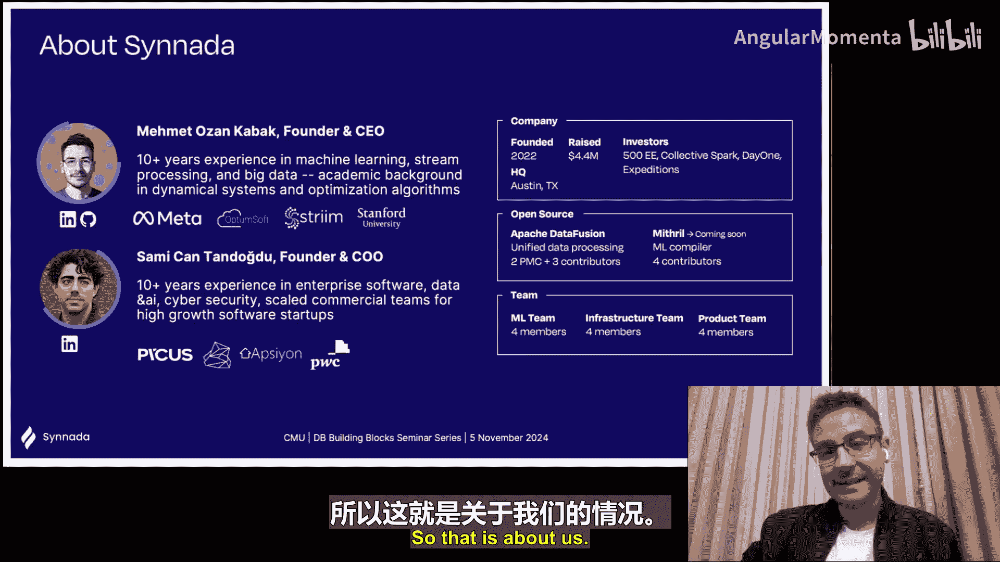
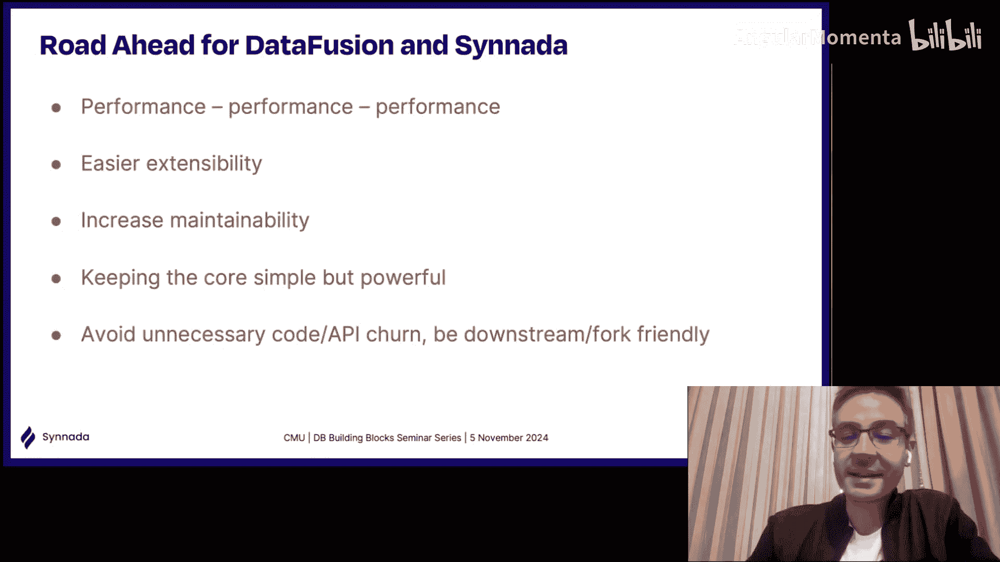
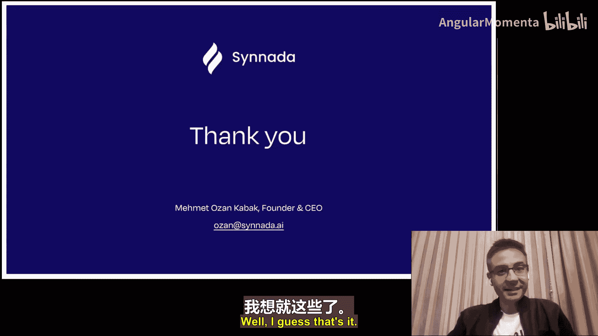

# 【卡内基梅隆大学】数据库构建块系列研讨会 ｜ Database Building Blocks Seminar Series (Fall 2024) p06 06 Synnada：迈向“统一”计算引擎：机遇与挑战（Mehmet Ozan Kabak） -BV1dmipBLEYH_p6-

🎼Yeah， down。They ready for。And y'all at the speed of sound where we're now wax worst top perhaps or gather around and witness something。

🎼The database Building Block seminar series is filmed in front of a live studio audience。😊。

🎼This program is made possible by Google。

🎼Let's get started。 We're excited today to have Memmo。 He's the CEO and Cora of Snata。

 and he's also a committer on Data fusion。 So here's today he's going talk about the stuff they've been on datafusion。

 may not mention this。 but I'll this。 has seen the light in the past he did a PhD at Stanford basically circuits and chips。

 and realized databases is where it's at he's come over our。 So we appreciate him joining us。

 thank so much doing mentioned He's calling in from Turkey So it's 1230 at night。

 It's not the record for us。 but we appreciate him staying up late。

 So as always if you have any question for as he's talk unmute yourself and feel free to ask it any time And way he's not talking himself for an hour 123 in the morning in Turkey。

 thank you so much for being here。 The floor is your go for it。😊，All right。

 thank you for having me here Andy， I'm excited to talk about what we have been working on at Snata for almost two years now and we are heavy users of data fusion so I'm also very happy to join this sequence of talks where like。

People talk about data vision from all different angles。

Today we are going to talk about how we use data fusion to build a unified computer engine。

So first of all， what is a unified compute engine， why do we need one and？

What does it take to build one and what we have done so far in Snara for this to achieve the goal and what kind of ideas do we have。

 so I'm going to talk about all of these things and if any of people in the audience have any questions feel free to ask so that as Andy says I'm not talking to myself for a long time。

All right。About us， who are we， I'm Mohammamed Oan Kaak， I'm the technical founder and my co founder。

 Sammy is my childhood friend。And we have been doing things together since the age of 10 and this is in my experience just another thing that we do to get together。

 so I'm super super happy to have him as my cofounder。

 so I've been working in the fields of stream processing and machine learning and big data。

For like for a long time now， more than 10 years。And interestingly， as Andy mentioned。

 my PhD was about。Something else， we were solving nonlinear equations for solving like circuit electric circuit problems。

 but as a lot of people in this audience probably knows。

 solving nonlinear equations is very intimately related to optimization， right。

 which is intimately related to machine learning， which is intimately related to how you process the data that feeds into machine learning。

So that's kind of how I got into this whole world of data and AI。All right。

 so about Sinaara we started the company in early 2022， we raised 4。4 million so far。

 I personally live in Austin， Texas， and I spend a lot of time in Turkey where our engineering office is located。

We heavily work on open source projects。One arm of our open source。Efforts is on Apache data fusion。

 we joined approximately two years ago a little。We have been spent yeah。

 I think a little less than two years and we have two PMC members。

 we have one alumni who is a PhD student now I think he in the audience who is also a PC member。

 we have three contributors so we have。Being investing in data fusion heavily。

Probably we contributed more than 100，000 lines of code over the last two years。

We really like data fusion， we think the project is going to go places。

 whatever you guys want to build， at least consider data fusion as a foundation for your next project。

All right， so what else on the open source side we have， as I said， we have two arms on open source。

 the other one is about ML， we are working on an ML library something like CAIS that is actually going to integrate to data fusion to create all sorts of ML functionality that will be usable in a compute engine。

How big is our team， we are a pretty small team， we are accepted to co-founders。

 we have 12 more people， it's roughly even distributed across the infrastructure side。

 which is mostly the data fusion side， the ML side and the actual product。So that is about us。

So as I said， I'm going to talk about unified compute engines。

where does this come from right like okay， you have probably been hearing about this like unified engine stuff for a while now。

 I think even I'm not sure but the last time I went to Sparks website。

 I think I saw like unified stream and batchge something so people have been talking about this for a while now。

And why are we going to talk about this in this talk if you actually。

Think about how we build and maintain data intensive apps today。

It has become somewhat of a complex undertaking if you look at how the data and AI infrastructure landscape was in 2012。

 this is the image from Matt Turk。It was pretty small compared to how it was in 2023。

 Now there's a lot of tooling with a lot of sub segments and。

When you want to actually build the data and AI infrastructure for your business or for your company。

You today these days integrate a lot of a lot of tooling a lot of logos this is this problem actually becomes verse that you're not very small and not very large。

 but you're like trying to grow because if you're a very small team， you use only。

 you know several tools，Point solutions are good enough for you， you know。

 like let's assume that we have the small gaming studio like I can do a lot of things on like BigQu and Firebase and you know that's it I don't need to do that much。

If I'm very large， I have my own platform engineering you know teams and then I can actually build the infrar that works for me Taylorormate so that's also okay。

 but if you're like in the middle you're not very small anymore and you're not a fang。

Then you have to suddenly like start using like20 different technologies and that becomes。Thus。

 especially if you want to build a lot of these very intensive apps。そう。Where does this come from。

 like why is this happening？That are a lot of。Ideas on this we actually my cofounder and Ivy actually wrote two blog posts on you know why we think this is happening some part of it is inherent complexity well if you want to build a system with high capability like it can do a lot of things。

Then it's going to have some complexity that you cannot really avoid， right？

But there's also this other part， the other reason。诶。And that other reason is， in our opinion。

 is that the centerpiece technologies that you play a large role in these like infrastructure diagrams like Spark and Flink the actual computer work courses。

 they're old。And they were designed in a world where the prevailing technical ideas and assumptions were different today。

What do I mean by this， you know， if you actually look at when spark was invented。

Was containerization the same as it was today that we have all this collaborative stuff？

How was ML models like I remember logistic regression was all the rage and Google had this side build project。

 you know， Spark was like a new project at the time and this stream and batchge。

 I think streaming SQL， the concept of that sort of a thing even didn't really exist because when was widen was the first tape for 2005。

So。Anyway， we were living in a somewhat different world and the assumptions of that world reflects in these centerpiece technologies。

And because we are still using those technologies， we have to add a lot of like addoms and bolts。

 you know， for steam and batch or for like observability or like for you know。

 getting AI into the picture and that's how you end up with like 20 different tools。

So if this theory is correct。Then。We could simplify our lives if we actually had a spark 2。

0 or like you know a compute engine that reflects today's technological and advancements and maybe my infrastructure architecture would be simpler so that's the thesis that you know we are。

Betting all， let's say。So we want to build this Spark 2。0。

 we want to simplify data and AI infrastructures， and SnaRA then aspies to be， I guess data Bricks 2。

0 right if you're building Spk 2。0。Okay， so let's so this was like a high level argument of like why we need these like unified compute engines that are more modern in many ways。

 so let's make the argument through an example now。

So let's assume that we want to create this data app。Or forecasting traffic from our microservices。

 maybe I have some microservice architecture， I have a lot of microservices。

 they have different traffic， and maybe I want to forecast that because I'm going to reserve some computational resources or I'm going to control the scaling。

 whatever。I mean， this is the imaginary scenario。All right。What are my considerations。

 what does you know this effort look like？Well， the first question is like， okay。

 how am I going to really architect this， is it going to be a badge on the application where I make these forecasts like every six hours and then do something at discrete intervals or is it going to be streaming or maybe it's going to be both？

If depending on the answer of that question， I'm going to choose an engine and then that will have some bearing on the interface I'm going to use to write my queries。

And probably in a modern you know application I'm going to say both you know because maybe I'm going update my forecast model you know not all the time。

 but every now and then， but I want to use the most recent model to make lower latency streaming scoring you know to make a forecasts available as soon as possible so then you know you have this blue world where data is flowing in streams and then you deploy your forecast model onto whatever engine you're using for that that's like making inference and issuing your forecasts。

Well， forecast model will probably go like out of sync or decorrelate with whatever the window you're using for the forecast so you have to monitor it。

Okay， so put in some logo for some monitoring and then that's probably going to drive some notebook or some internal application for you to see whether those forecast how the forecasts are doing that will probably kick off your training infrra to update your model when that internal application decides that the forecast model is out of date。

That model training thing is going to draw on some， you know。

 data set that you use as a training set that is some collection of that。

Real time data stream you have been collecting over time， okay。

We have this like amalgamation of two worlds， the streaming part and the batch part。

And both parts of their own technical considerations， if we think about the batchsh part。

 for example， in this example。Using it to update my models and train my models How are you going to do that is it like an offline thing that some ML engineer does or are you have you automated it with some automl solution how big what kind of model you want do you want to use if you have automated it what happens if training fails because you guys probably know training is a notoriously fragile process with a lot of like training related hyperparmeters which has nothing to do with the data set or the topology of of the model Okay so like then how do you actually deploy in version these things how do you monitor you know the model that you have and how do you decide when you update the model so this。

Building this data app。It's not as simple as it seems from a simple description of what you want to do。

 but I just wanted to forecast the traffic like why is it so complicated？Okay。

 so this is how the world is， I've built a lot of applications like this。And。

That's the reality that you know we face is there a better way like is some of this complexity avoidable like I said in the title slide。

 it is some of this self inflicted because the tools that we are using are not you know really modernized？

So our thes is the answer is yes， there should be a simpler way to do this。So。

What could that simpler way look like？So， here。I'm writing this SQL query， it's standard SQL。

 it has one user defined aggregation function， which is the forecast function。

What this basically says is。Consider each microserv separately independently。

 look at the last four hours of traffic data for every service and use that as a basis to make your forecast。

 your forecast in this example it's a short term seven minute forecast okay so this describes the business logic。

 but it doesn't answer a lot of the questions that I raise in the slide before。

 which I tried to highlight in here， for example。If this stream is a high height group high rate stream。

 four R of data could be a lot of data and maybe that's not enough to fit into memory what happens right like that's a typical know large big data badge kind of consideration。

Okay， so that's one question。Another question would be like what happens if this。

 whatever this thing is running and fails and you have to recover？So fault scenarios。

 that's a typical stream processing type of consideration。

So another consideration is if somebody gives this forecasting to you， okay， it's fine and dandy。

 but how do I make my own is you know。Nobody can give all that。

Functions to me nobody can give me spoon feed me old ML models nicely encapsulated in these like UDS。

 so there has to be a very easy way to create these things like how do I do that。

The other question that we talked about like updating the model。

 the query says nothing about when this LTM model will be updated， so if it is silent。

There should be like a very robust way I assume this is done in the engine so how does the engine do it and there are the training hyperparameters like there's no learning great no nothing in here so the point of this slide is。

Let's try to imagine a world where I can just give this to the engine and the engine does its best to take care of all these questions which we discussed in detail in the previous slide is it possible so we are going to search for answers to this is it possible to really do this I think the answer is yes maybe not in its entirety I mean this is a motivational example the real world is going to be more complicated than this but I think we can do much better than what we do today。

All right， so。Let's focus on these two things at first。

 so the batch and streaming and different considerations， how can we do better than。

Compared to how people do things today。So。There's this thing called the copper architecture。

 I probably don't need to explain what this is， but what it basically says is。

Orange world where stream and batch are like entirely separated can we actually。

A one compute that unifies stream and batch， and so people have been thinking about a for a while scenario inness。

A lot of people are talking about unification in the sense。

 but what does it really mean I think people are starting to converge into a。

Back consensus definition about this， so the working definition at least in this talk is going to be that a unified engine should accept standard SQL to process both kinds of data。

 the data can be available to you as a whole could be at rest and you can you know process it that way or maybe it's coming to you piecemeal。

Sot matter， the user facing API shouldn't change if your API is SQL。

The user shouldn't think about like having spatial streaming stuff in their SQL if your user interfaces you know data frames。

 they should be using the same data frame functionality。

So if a query is theoretically executable on streaming data， it should execute。

So it shouldn't be like， oh， actually， when I think about it。

There is nothing wrong in this query and it should execute。

 but for some reason my engine doesn't accept it if you do that。

Then your engine is not a unified engine。And spark and fllink。Unfortunately。

 require you to change your query to appease the internals of the engine， so it shouldn't do that。

If the query。Is theoretically not executable。You should throw an informative error message that explains why its cannot execute。

 so what do I mean by this？So maybe。You're sorting。This screen。And。It is unbounded。

Which means you cannot start producing a final result right until you have actually scanned the entire thing。

 so you should explain that to the user。Okay， so what is the litmus test？Well。

 if you load a sample data down in Postgrel SQL， any query。

 any theoretically streamable query that works in Postgrel SQL should also work in a unified engine。

 here I'm using Postgre SQL as a proxy or standard SQL， obviously。

So this is the crux of what I mean by Unified and I think I've seen just the other day a blog by Talderra。

 for example， I think they were using a definition very similar to this in their blog， so I think。

We will hear more and more。This kind of like should accept standard SQL definition。

So let's go through an example， what does this definition really mean？Imagine we have two streams。

One stream is sales transactions in various currencies， maybe like I'm a chain。

 a retail chain and I have shops all around the world and I'm like monitoring my transactions。

 some of them are in US dollars， some of them are in you know。UK palms， some of them are in euro。

 whatever。And then。I let's say I tap into some API from which I stream currency exchange rates and I want to。

Dollarize， converting into US dollar， all of these transactions。How would I do this？For example。

 I could do there are a lot of ways to do this， some of these require special syntaxes like you know as of join or whatever and。

The one that I like。Because it exercises the definition that we made in the other slide is the query that you see on this slide。

 so what does it say for every unique transaction？Look at the exchange rates。

That are in the past that came before this transaction， take the last one， dollarize using that。

Exchange rate， right， it's not complicated。But if you actually you know， try to execute this on。

A lot of the engines that are available today at won't run。

It should there is no theoretical reason why this shouldn't run because you know that。

You're grouping by a unique thing and you know that the timestamp。Is moreally increasing。

Ignoring out of order stuff for the purposes of this example。

 so this query should run and very efficient efficiently if your planner is smart enough。

 this should run very efficiently。but you know， it doesn't in a lot of the engines that we have in use today very you're saying this query won't run in like spark or snowflake or。

It will run on snowflake if if the data is like at rest available to you it will run on Postgres。

 but if you actually stream the data onto spark the last time I checked it doesn't run got okay thanks all right so and the interesting thing is there's no reason why it shouldn't run right like it should run but but is is it like is it an optimizer issue or is it like the engine itself fundamentally。

Like has no notion of like the window of function last value or something like that。

 right like like like what is the error or is what is the problem？

I can tell you like it's either that or the other one， I don't know， I have to look it up。

If I had one of my engineers here， they could tell you， but I can't。All right。

I guess what I'm trying to understand is like is it a like you're saying throw away throw away everything。

 let's build a new engine fantastic let's do it and then I'm trying to understand is the motivation something fundamental to the way I think it is it is fundamental。

So I'm going to give like five things that I think are very important to build this unified engine and I know for a fact that Spark doesn't do all five in the best way possible right but I don't know which one of those five really killed this example right you all right。

To answer your question， what do we like can we narrow this gap like can we actually run queries like this and if the query is not streamable。

 we can let the user know why it's not streamable。So the first thing you need to do is to fully leverage data ordering during planning。

 so you have to keep track of data ordering across all operators in your plan。

 you have to do that without any loss of information。

Wwhichch you requires you to know about monotonities or functions and you need to do a lot of things to really do this in a neat way。

What else so you need to have order preserving variants of all fundamental operators when possible。

 like if it is theoretically possible。So have an order preserving variant of a fundamental operator。

 you need to you know support that， what does this include。

 this includes things like repartations and joints and whatnot。啊。So what else so you have to plan。

with awareness of unbounded streams， so you need to know that have this notion of pipeline breaking and in what scenarios do you break the pipeline for what reason do you break the pipeline。

 you know what is unbounded and what is bounded。And you have to。

Have rules in your optimizer to choose the right variants to avoid these kinds of like problems that make you know。

 a query nonexecutable， you have to do join ordering with this awareness， not just efficiency。

 but also these things。What else？So you have to use rigorous technique like interval arithmetic to calculate ranges and pun your buffers。

 so let's say you have this join。My example didn't have a joint was a simple window query。

 but let's say you have a joint with some complicated。Join condition， so it's not like。

It's not a well defined only a sliding window kind of thing it's arbitrary joint condition。

 so you need to have an arbitrary a generalizable way to compute ranges for arbitrary joint conditions。

That gives you guarantee on what the ranges will be and you have to prune your buffers accordingly only if you do that。

 you can take a general join， not a specific joint， a general join。

 and then you can still deduce whether it is stream up or not。You have to avoid。Explit watermarks。

 accepted sources， like if you look at how people write sparkqueries today， you have to。

Like insert searchs。Water marking logic into joints like you shouldn't need to do that that has nothing to do with the business logic your。

And engineering consideration is like leaking into this thing that supposed to express business logic。

 so you have to have a way to avoid these things。How do you do that， you well。

 operators need to handle and pass along incoming watermarks from the sources。

And they should auto generate watermarks to reduce latency in multipartition plants。

 what do I mean by that？Let's say you have this four preserving merge and maybe you're like merging 32 partitions because your plan is highly parallellyzed。

Then， you know， if one of the 32 input partitions。Do not， for some reason， receive some data。

Because the merge cannot produce an output。If you don't have this watermark kind of。

Ting implemented properly， you can introduce avoidable delays。You have to do all of these things。😡。

And if you do all of these things in a nice way。You can execute queries like this。

not just this like the arbitrary queries that you know can have arbitrary joint conditions not just like here it's just a inequality right it could be what happens if it is like something squared plus whatever arbitrary expression and。

If I look at the expression， if I can mathematically tell that it is executable it should execute so if you want to do that you need to have all of these things so to answer Andy's question。

😊，It has to be， it is one or more of these things， like if you look at an engine that doesn't run these queries。

 it's one of these things probably the reason， but what is the exact reason for Spark or for some other engine for a specific engine。

 I do not know off the top of my head。I think we some do we have some questions in the chat？

They're asking about that you mentioned a test suite when I think he misheard what you were saying。O。

 all right。So I。Okay， so one other thing。Out of order data。

 the vein of spinning infrastructure's existence， right？

What happens when I don't know where data arrives you have to have some way to cater to this because it's a real thing I worked on like IoT kind of applications。

 build infrastructures for those that happens all the time that has to be like a nice way and to handle this this is one of the driving reasons why we have this like bad part is separate from the streaming part so that you know。

The first five things that I mentioned is very important。

 but this is also important for a practical application。Okay， so how do you deal with this？Oh。

 by the way， we have actually contributed a lot of code pertaining to interval arithmetic and all of these like ordering stuff theyre all in upstream data fusion。

So upstream data fusion is actually quite good。At dealing with these things。 So， you know。

 if you're interested in this like。啊。How powerful is it。

 it doesn't really leverage data ordering to the fullest。

Please feel free to check upstream data fusion， I think there's some real good stuff in there。Anyway。

How do you deal with all the order stuff， that's as I said， a practically very important point。

Well there are two typical ways to deal with this， one I will call the pure data flow model。

Veryre like， okay， so the。You're writing your query， you have for your use case。

 you have a maximum tolerable latency， okay？Then you say， okay， I need my data like。

At 10 minutes I don't want to be later than 10 minutes。

 so your source operators can you know buffer and reorder the data with that tolerance and your planner uses a watermark period to minimize non source operator delays。

And， you know。The plan will work and you will benefit from all of these things that I mentioned。

This runs very efficiently， but the problem with this is that it cannot really handle all of order events or data points elastically。

 what do I mean by this？诶。If you。Have a high tolerance。For latency， let's say。

 you know I don't really care， you know， I mean I want my results as soon as possible。

 but if it is like an hour late that's still okay if you're like that。

And your data streams are tight throughput。Ben it's like， okay。

 let the source operators buffer the data。Could be very memory or like storage， let's say， hungry。

 right？So it doesn't really， you pay a lot of bank。

You pay a lot of buck for the bank you get right it's very efficient it's very it makes things very easy in a lot of use cases it's quite sufficient。

But it has this kind of a drawback like it doesn't let you deal with out of order in a nice way。

The other method that is。What nice is the what I call the pure update table model or materialization model。

 so you process updates instead of results。User doesn't really have to think about。

Like a maximum and tolerable latency， You process updates in。 your operators spit updates out。

 They don't really spit the data itself。 but， you know， your work on updates。

It's not as efficient in my experience if you can make a data flow model work。

 it's computationally much more efficient， faster or whatever more you can process more data。

 but this handles a lot of things more graceful when it comes to data being out of order。So okay。

Which one should a unified engine？Use right I don't think this is a fully solved problem。

 I think there are a lot of interesting ideas。You know， there are still like new ideas being born。

 as I said， the Faldera people like have their own idea， they have their own you know， formalism。

 DBSP， I think it's called。For some reason， I cannot see the chat， why is that？

I see that people are writing。There's like a chat button and they're discussing you made the comment about themus litmus test。

Yes， and someone was asking whether like there was actual code for that and I think it was just a。

Yeah rhetorical device is say just the way to think about the problem。Yes， actually yes。

 you are right it's a rhetorical device， but ups data fusion repository has tests like that too like it actually runs stuff on Postgres it's calledQ it's and it's run the Sologicalist yes。

 yes， so it is implemented as well。😊，All right， so which one do you use for this you know ordering shenanigans one way。

That we are actively considering and experimenting on is this thing that I'm showing on this slide so the question is like is there a sweet spot in between like do I have to do like the pure data flow method or like the pure update method？

嗯。There could be a way to actually have。Sol channels or two outputs for every operator and two inputs。

 you know， you take in data that is。In order， you spit out like an in order part and then for the occasional out of order you also spit out out of order update and these two input streams share the same operator state so that you know you don't have。

You reuse the information that you have。So this seems like a very promising angle。

 we haven't fully implemented this， we have fully almost fully implemented everything else I showed you on the previous slides。

 we haven't fully implemented this this is a somewhat newish approach that we have been thinking about but I think it's very promising and maybe in some other talk I will report some updates on know how it。

Performs just to clarify so collection here for the first operator what should I think of that as like like like a parquet file or something or or no yeah I mean if it's yes a parquet file。

 but if it's a file it's probably like。There will be no order for it's either ordered or not ordered right sure but if it is like maybe you're you know collecting data from like Io devices and they're sent pushing data through you know mqTT or whatever then you have no control over right right it's a stream in that gets right like yes yes Okay。

 so so then you're saying。So that's a stream which may include updates to things you've already seen before。

 and then you're saying that there's another operator that explicitly has。You say in order data。

 but it's a basically a collection， which you're calling a collection that is guaranteed to always be in order。

 so you separate it out into a like ordered part and like a unordered out of order updates part。

Got it。 And then like。But how to say this but conceptually it could be this single stream right you just have different message types to say this is this is a new thing you right yes yes but I'm just logically separating them out yes okay okay awesome thank you。

Can I ask a quick question about sure。I don't know if you addressed it。

 but I kind of think of some of this ordering and like streams versus batches like kind of like liveness and safety properties and so I'm just wondering like。

You know。Have you talked or will you talk at all about like on the processing side。

 this all makes sense， but then as far as like what you kind of。

Publish or make viewable to the user like they like like how do you accommodate， for instance。

 an out of order update like maybe you can say like I gave you a result before。

 but actually here's a corrected result or is it kind of more like you know you can't。

But like you just have bounds in which like you have these guarantees。Yes so。The idea here。

 let's assume that this idea I'm describing in the slide works， in this world。

 what you would do is to use in order the top level operator in your plan。

 which produces the ultimate result。The in order output of that top level operator is your provisional result。

So like that's your best effort result that you computed very efficiently。

And then there's this side of three of。Out of order updates that you can choose to apply and like amend。

That provisional result， or you can choose to ignore it。 That's up to the。

Use case right so what I'm trying to do at the engine level is to give you a complete picture that ultimately converges to the final true result。

 like assuming that if I had infinite time and if I collected all the data and ordered the data there so that there's no out of order stuff anymore and then I you know process the data I want to converge to that true result。

 but I want to achieve that convergence。By。While still trying to maintain the efficiency and the all the niceities of the pure data flow approach。

 yet still maintaining the ultimate convergence property of the update table approach。Okay。

 that makes sense。All right。This is one of the challenges that anybody who claims to be a unified engine I think should address in some way or the other。

What else， so this I already mentioned when I was trying to answer Andy's question。

There is a lot of specialized。Stuff in the engines of today， like as I said， if you have a， you know。

 if you have two inequalities describing a sliding window。

 oh actually the engine can can do it because it actually special cases onto that。

 but you know if I have an expression that is。That doesn't really fit into that just like that nicely。

But it is it should still execute at cant because you know a lot of the approaches people use today as I said is like overfitting so you have to have these like generalizable approaches to finding ranges of expressions which you can use in your joint operators or elsewhere interestingly this happened to be something Ive worked on during my PhD thesis。

For solving nonlinear equations， you have to you calculate ranges of your expressions and then prune your search space and stuff and when I first got my first job。

In a company called Stream。We ran into this problem and I was like， hey， why are you overfitting。

 like there are actually very nice techniques to handle this problem。So。Another ingredient is。

Actually not you don't need inventory anything these are known techniques just like using them to generalize the sort of range calculations you make which enables you to prune your data buffer so here I have an example like okay you have an expression it's a you know x squared plus y kind of expression which you know is arbitrary thing it's not a sliding you know it's not nothing。

呃。You can actually， you know， hierarchically calculate the ranges if you know the ranges of your inputs。

And if you will know the ranges of your inputs， if your data is ordered。

 you will know the upper bound and based on your starting point you can know the lower bound as well。

And。The join as the condition， which is a constraint， and you can propagate it， top down。

 which will enable you to prune X and y， which means I can prune my data buffers。

So we actually wrote a blog post about this like how do you use this kind of a thing to implement this symmetric has join please check it out I think it's a。

It's a decent blog post if you like technical blog posts。

 so you need to incorporate techniques like this。And。

Once you have these like general techniques then you can start implementing。

These order preserving variants of the operators， which is if you remember one of the like key items that I said。

 like your engine has to have order preserving variance whenever theoretically possible of all fundamental operators。

An example here is like efficient joins with data printing。

So you have like this traditional hash showing all right now I have this interval arithmetic thing I can handle any arbitrary。

Arithmetic condition I can tack onto my equality condition。

 I can just calculate the you know viable sections and then prove my build buffer fantastic suddenly I have。

And if you do these things in the right way， you can still preserve the order of the right side。

 the prop side。So now you have a composable thing， you have something that comes in with order。

You actually compute to join with little memory only as much as you need， because， you know。

Theoretically that some parts of your data can be deleted。And you preserve the ordering。

 which means that subsequent operator we can also you know do the same thing。

 so we also have a blog post about this， feel free to check it out after the talk if you find this kind of thing interesting。

All right， so these are all the things about streaming versus batch。What is the theme here。

 none of these are like。😡，Oh mind blown， what a you know interesting novel technique。

 it's not like I mean， they're interesting， but it's not like remented them， no。You know。

 they well known， been theyre part of accumulated knowledge over the past 40，50 years。

 but you really have to bring them together in a very nice coherent way。呃。

If you do that this dream of this like unified engine is possible that's the argument and this is quite in line with the argument of data fusion which is you're not trying to invent new techniques。

 I mean we sometimes we do but。Before you get to that。

 there is a lot of progress to be made just by digesting what are the best practices。

 what are the techniques in the data systems literature。

 and what are the techniques that are outside of data systems literature that is useful in this context。

Let's bring them together in a foundational library which is Apache data fusion and let people build on it。

 so Snara is basically taking the same approach， but instead of building a foundational library we want to build Spark 2。

0 on top of that foundational library。😊，呃。So we have a bunch of like blog posts。

 have we have one on like how do you do window in queries you know with finite memory。

 so you know feel free to check these things out you weren't able to write new ones in the past。

or five months because we were busy with implementing other stuff。

 but you're going to go back to writing I like to produce this kind of content。嗯。All right。

 so this was all about。😡，Those two questions like batch and streaming， right。

 but then we had other questions。Like how do you create your own AI functions？

Like as this query runs。How often do you update the model， if this wasn't a model。

 if this was a sum function with the accumulator backing the function？

You would update the accumulator at every data point。

Is that really viable for this the query would be the slowest query on if like it' it would be terrible right but then if you try to update the model based on processing time it's not reproducible you're not。

😊，You you don't you're not you are violating the definition of unified  query engine。

 it has to be deterministic then how do you do it， it's not easy。Where are the hyperparameters？

In the second section of the talk， I want to focus on this part of unification。

 how do I go AI native right， all right， so what's the path？Well。The first thing we need to do。Is。

As I said， we need to have an easy pathway to integrate models as state functions。But the problem is。

The way we think about developing models is。It's a different world like I'm in Python and I use Ptorrch and you know。

 like I have my Jupyter， not whatever you're using， right？So these do not really seem like。

Very adjacent exercises。So then the question becomes。

 can we really decouple model design and compilation？Like is it possible because if I can。

 then maybe I can bridge the gap so the idea is you know design your model once in a very comfortable way and then when you're doing experimentation。

 say you know tweaking your model topology and retraining and blah， blah， blah。

 you compile that model into a Python thing， Python colable， you're in your comfort zone。okay。

 when you have something that you like， you compile it into a UDF so that you can deal this forecasting。

 like how would that world look like？That's one important consideration， the other thing is well。

 this thing has to be efficient， right like this is not a sum accumulator。

This is a model and it could be a large model if it is like a generator model could be quite large。

 so your native data format。It play well with vectorization and preferably GPUs。

Data visionsion is lucky in that regard like arrow is vectorization friendly and there's like GPU stuff。

Being built on top of arrow vol from data spent a lot of time on that。

 so at least you know the data fusion starts from a good starting point in regards to the data format。

That's not sufficient， operators and plan should utilize all the available devices wherever your engine is deployed and you should avoid data sloshing。

 like if you just have or have very good arrow kernels that use GPUs。

 but I don't the plan doesn't know about it。Then you're going to like load the data to GPU and then you do some stuff on GPU。

 load it back to main memory it's going to be terrible so the planner has to know about it and plan accordingly this is kind of similar to the situation streaming and batch like you know you have to select the variance of the operators the planner has to know。

All right， so that's the second pillar I would say of going AI native from the perspective of a unified engine。

And thirdly。We come back to our question， how do I know when to update the model？

What is a deterministic way doing this at every data point， as I said。

 is typically not realistic unless your data stream is very low rate。And it has to be automatattable。

Today， updating or retraining the model as a lot of hyper parameters， like how do you deal with that？

Do you have like auto Ml that insulates you from it， then it becomes a very expensive undertaking？No。

But if you just hard code or like take a reasonable default for like all these hyperparmeters。

 it's surely going to fail at some point， so like how how do you actually deal with that so these are the three important questions。

That， you know， one has two， at least have some idea of how to solve。

And we have made a lot of progress on the third part。

 like we went into the deep and the optimization algorithm level。

 I'm not going to talk about it in this talk， it's the point like it's going to take a whole other talk。

We have made progress on the first point。Like how you integrate models and on efficient inference。

It's work in progress we haven't spent that much time on it yet， we want to and we need help。

 maybe you know people will come into data fusion you anarrow and implement these kernels and whatnot。

 so call to action。All right。So I said easy integration， separating out the model design。

From an experimentation from making a UDF， right， how do you do that？啊。

There wasn't really a very good way to do this when we started Snata。

So we created this library called Mithro， so the idea is you can build machine learning models for like different frameworks。

 what I mean by framework is like jackX and torch or arrow， you haven't done arrow yet。

 but you're working on it。Different backends， different infrastructure formats。

 it acts as a compiler。And what it tries to do is to bring this logical versus physical distinction that we all all de right in query engines into the realm of machine learning。

So you actually。Create a model in a logical sense like on the top you have this like forecast model which I've been using as a working example okay。

 what does it do， Okay， it has like a 1D convolution to convolve over time and then it has some MP head on top of it Okay and then I want to compile it into arrow。

Function with 16 bits precision and it's going to run on CPU Okay， I could。

That it becomes available to me and my engine。If I'm you know， this is a deployment scenario。

 but if I'm still experimenting， I would say backend equals jack's backend and then I you know。

Optimize and see what happens with my dataset sets。So the ideas。

 have this as a compiler available to you， bring separation of concern into model design and experimentation and deployment。

 it should give you the ability to compose and mix and match different models。UDF generation。

Bridge the gap between models and data fusion。And this is entirely a scenarionata project。

 it is not a Apee project， maybe it will be in the future， I don't know。

It will be released open source very soon， actually I was trying to get my team to put the code on this link。

 maybe they did already。Anyway， if they havet， it's not there。

Okay it will be there then in a few days the goal was to have it there。

 but I promise it will be there very soon and guys if you are interested in this like this is a large project we need all the help that we can get it's going to be apche license so it's not like our commercial thing so if you're interested in。

😊，You know， bringing the best practices from query engines to the world of machine learning。

Come join Miri， I think you will like it。You know， before what I was doing was as a practitioner it was okay。

 I have this idea of a model， you know， if I'm going to try it out on Qudar， you know， okay。

 I maybe implemented it on torch and you know， if I have this TU stuff。

or I maybe need some JX functionality then I need to like have a lot of duplicated effort。

With meats will really like。You develop your monoologically。The compile。

And you know this compilation actually does a lot of optimization passes it's very similar to query engines literally like the aim is like those ideas work very well when planning a query。

 we believe they might work well when you are actually creating like a deployable model why don't we try it and it turns out yeah。

 you know it gives a very nice developer experience。😊。

So when it is there and I promise it's going to be there very soon， come join， like help us。

 I think it's going to be a fun project。😊，All right， so this is what you going AI needs。What else？

Do we need to have a unified engine？Well。A very good property to have would be flexible distribution like if he had a cross platform andbedable。

Or engine， a single noded engine。Then I I could actually have， okay。

 I know I have this like cluster on the cloud that gives me some workers and then I have。

You know some like other commodity hardware like a heterogeneous cluster that would be in my opinion very interesting and it would bring the costs down in many applications。

 maybe like you're pushing compute to the edge or some Io application or maybe you have some other you know。

Consideration。We are lucky here。The paper that we wrote on data fusion actually says embedable engine。

Data fusion is a very good foundation for us it's already this cross platform embedable single node engine。

 so the task here is to write a distribution layer supporting a dynamic cluster of heterogeneous devices that have different capabilities。

Here we are missing some。😡，You know， engineering man hours or person hours。

There is a project called Data fusion Baista， which was dormant for the longest time now it's kind of。

Picking up pace and there's data fussion ray now。So if you're interested in like joining this kind of the data fusion wave。

 this could be an interesting part to contribute to so the idea is if you have this in a unified engine。

You can start prototyping data apps locally right because you know one。

 your local PC is a single worker。Cl。So you can you know actually build everything there if your computer doesn't choke with some you know lower rate data and prototype and try or things and then add compute progressively you don't change the business logic of your data app so that's something that I think would be very nice to have and it would。

Pduce。The complexity of building and maintaining data significantly。Finallyly。

I think any computer engineer knows this like you have this job that fails and why does it fail。

 who knows？And then you look at the stack traces and okay terrible so a unified engine should be should do better than that。

 what do I mean by that it should collect and expose all operational data and metrics to offer full observability。

And。If I think a good。This the outcome here is if your observable queries can run alongside others。

In the same engine。Using this data， this operational data that the engine itself provides a screen。

Would be a very good thing to have。Another thing you need is discipline， like you need to categorize。

 consider and handle all error possibilities。Which goes back to like this stream and batch unification。

 user gives you a query。You should be able to prove that it runs and run it。

 or you should be able to prove that it's impossible to run and cleanly explain。Like。

In a very clear way。There is something wrong with what you're trying to do。

 you're giving me onbounded data source， you're giving me this query。I can't run， right。

 so this requires programming discipline。Admittedly were not very good here。

 neither as synnaada nor as data fusion the general community and we have errors rust forces you to deal with these things but okay you get some internal error and you don't really know what's going on you're going to get better thank God we have rust here it forces us to at least right to do you know you have to do better than this。

😊，And obviously you have integrations like all four easy pathways to visualize。

 utilize and track these observability considerations。Okay， I talked about a lot of things。

 we only raised $4。4 million and we are a team of 13。

 There is no way on earth we could have done all of it's impossible。I mean。

 if it was so easy to do databs would have done it already。

So this is the whole reason why we joined data fusion， like you can't boil the ocean。

 it's impossible。The reason why we joined data fusion。Is was I somehow come across。

Data Fusion Andrew Lams， one of very earliest talks。And he made this analogy of。We want to build。

We want to have the same effect of what LLVM had on compilers for data systems。

Data fusion was far from being there at the time， I think it's still kind of far。

 but it is getting quite good。诶。And he keeps saying oh some people don't like this analog and maybe some people don't but I loved it I was like this is exactly what we need to build what we want to build like there's no way I can build it you know from scratch but if I had an LvM for data systems and I could so we came to data fusion you know it didn't have a lot of stuff we said okay we're gonna to do our best and it's great like come join it's foundational it' rich in out of the box features it'sarrow native you know this native data formatting is important from many angle as I said from the AI or efficient processing and everything。

It's Python friendly because a data frame interface and SQL interface is very malleable。

It's not that hard to even maintain a fork。Even though it's a very active project。

 like we have a lot of features as you've seen， it doesn't really belong to core upstream data fusion。

 so we have to maintain our own fork for things that don't fit nicely to upstream and we are able to do it with such a small team。

It's performance。😊，I think。It's， well， Andrew has a goal of being the fastest query engine in terms of reading from Parquet。

I think we are going to get there soon， if not already on main， so it's very good， it's very modular。

 it's rust which helps， it is a very good community， there's a lot of startup activity around it。

So we love data fusion and I hope it becomes even more successful than it is today。

 and it really helped us make progress along this。So what have we done so far for data fusion。

 remember the items that I mentioned on like steam and Dutch？Most of it。

We built that it didn't exist in data fusion at the time and we joined so these are all like mes obscene data fusion now there's like many more these are the ones that I like which。

You know connects to the points I made in this talk。And。You know， it's interesting that。

In a lot of these open source projects， you open a PR and like people don't like it or like you don't even get the response。

 it's not like that at all like when we first joined the very first PR we made was about windowing。

 like but they didn't have proper windowwing window que is that we join。

And we forked it and we were working on a public fork and you saw RP on our public fork because we mentioned the issue and he was like oh you know great why don't you you know come and collaborate with us and maybe we can put it up seem like that's fantastic a lot of open source projects do not have this so it's a great vehicle to learn。

 it's a great vehicle to innovate because it gives you all these API hooks so really like come and later around。

Okay， how does it all？You know， come together and scenario。

 So we talked about data fusion and how great it is and how we use it。 So let's。

Let me give you a very like brief example of how we're going to put all of these things together。

As I said on the single node part。We have。The core is that they are efficient as the execution engine。

Then we have a lot of stuff that doesn't neatly belong to data visionion like checkpointing。

 for example， Chandy La or checkpointing。You have to have it， but it's not clear whether like。I mean。

 if you want to build a database， you don't need it。So there are stuff that you know we have。

That is not in obstne data fusion。And then this there's this like MLl library that I showed you。

 so all of those come together， it gives you a single load experience where you can you know build these data apps and then。

There has to be a distribution layer on top of it， both from the query execution standpoint。

 which is going to be either balllista or Ray or something we cook up internally。

 we haven't committed fully yet， we are still experimenting。And then you have to also scale。You。

 this。Side jobs that could be related to training。You know your model is very large。

And then you have to have enterprise features。Like。

All of these like ease of use when it comes observability， advanced integrations， access control。

 you know， ready made advanced models， security model， you know， they have nothing to do with。

The open source part， this is enterprise features。If another is successful。

We are going to put all of these together to build。Datarick 2。0 right and Sp 2。

0 would be the left side， basically a single more than the at scale part。

So what we want to build is composable， malleable and lean infrastructure。

Solving a lot of the problems at a fundamental lower level instead of having like 20 different bolttons。

To your centerpiece engine。嗯。So how about will you hear from us in the near future。

 we are going to release this thing called workbench。

So it's going to be like a notion notebook in which you can。Ptoty or data applications。

It's going to have。The data fusion thing embedded inside and you can like have multiple queries that compose together and you know prototype。

Within the leisure of your laptop and。The next step will be flexibleex compute。

 which is a point that I made。So you will be able to you say look about I'm happy with my business logic。

I want to deploy this run with fault tolerance， you know at scale， blah， blah， blah。

 if you have your compute， you can bring your own cloud stuff if you want us to give you a work。

 we can give you a work。You know， if you want to run this on rasppirberry pies， okay。

 go run this on rasppirberry pies， can you should be able to even do that。So the whole point is like。

Start locally。And progressively add more compute， focus on your business logic and we will try to solve。

As many fundamental problems as we can at the lowest level possible so that。

You have more of your time onto creating like you can spend on creating data。

So this community edition will support。You know， query like all tolerance to a single node and low latency。

All of that will be there， so you should be able to you really prototype。

Like what happens if this crashes and things like that？

Hopefully we'll have this in the first quarter of 2025 my hope would be like。

For data fusion people just if you want to sp something up at data fusion。

 just get the community edition and try see the power of a query range and built on top of data fusion right now one of the biggest。

Not challenges， but things that I don't like is like。

It's hard to kind of try data fusion if you're not like a data systems builder。

 if you're a data system builder， data fusion is great but if you're like。No。

 I don't want to build a database， but I， you know， I want to build data apps。It's not that easy。

 so hopefully this will bridge the gap somewhat。All right， what's the road ahead？

So a little over time， we'll wrap it up。Yes， final slide。What's the road ahead？

Performance performance performance I think it's very important I said this in the last data fusion meetup as well。

 people look at benchmarks it matters， especially if you're like hey。

 you should be able to try out a lot of things locally and then you know progressively more compute like for that performance is important easier extensibility。

 increasing maintainability of the data fusion code base， keeping the。

Data fusion core simple but powerful and avoiding like you know unnecessary API churn being a user friendly user in terms of。

You， people who use their efffuion。So these are the things that I think are important for data fussion for Snada I already shared with you guys like we want to have this workbench thing and then we have this mythal thing coming up for like bringing best practices from data systems literature to ML worldl。

And hopefully building this unified computer engine piece by piece， that's our roadna。

Well。I guess that's it。

