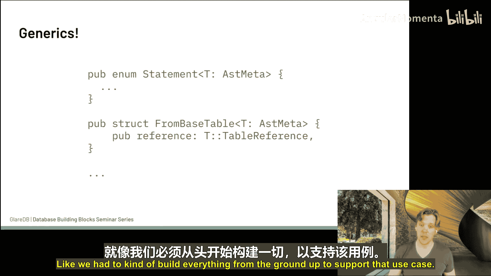

# 【卡内基梅隆大学】数据库构建块系列研讨会 ｜ Database Building Blocks Seminar Series (Fall 2024) p08 08 迎难而上：从零开始重构GlareDB（肖恩·史密斯） -BV1dmipBLEYH_p8-

🎼Yeah， down。They ready for。And y'all at the speed of sound where we're now wax worst top perhaps or gather around and witness something。

🎼The database Building Block seminar series is filmed in front of a live studio audience。😊。

🎼This program is made possible by Google。

Welcome back it's another talk today in our seminar series onBuild blocks of data System so we're excited today to have Sean Smith。

 he's the founder of Gdb and he's been running it since 2022 so he's been talk about you know his I guess。

😊，His journey through data fusion and back and so we're excited to hear set to have and join us if you have a question for Sean during his talk。

 please feel free to interrupt him and in time ask your question and you know。😊。

Don't wait till the very end because that way he's not talking to himself for an hour on zoom Sean thank you so much being here the floor is yours go for it All right thank you Andy yeah I'm excited to be here and yeah as Andy said like this talk is going to be really about like our usage of data fusion where Clity be is today and some of the product that we're going for but also what we're going be doing next with Clity be including the removal data fusion it's interesting because I think the CMU tweet that was going out said the talk was going to be about how we're rebuilding Clity be to use data fusion if you hear for that like that's not the right talk because we're actually going to be removing data fusion that was my thoughts are about that。

Yeah， I mean， no worries I just， I just thought it was interesting， but you know I you know。

 just kind of get everything straight there。Yeah before we dive in a bit about myself I founded Gerty Be in 2022 so we've been around for about two years at this point before Gerty Be I was actually working at coder which is another startup where we're developing software for deploying cloud development environments this allowed organizations to deploy consistent environments for all their engineers so that they'd have to worry about。

Configuration mismatch or different versions of tooling and I started there at 2017 so super early on in their lifetime like I was one of the earliest engineers there。

Working on really every part of the stack from kindm of scaling the back end to a little bit of the front end。

And I was there up until I actually started Clty B before Cor。

 I was actually doing studying neuroscience at Ohio State。As I was telling Andy。

Well in last year there like I didn't really feel like I wanted to do more school and so I just kind of decided to say hey I I going to go for a software development job and just go for it and see what happens and so I did end up at coder and it's all worked out thus far so I'm pretty happy about that。

As far as this talk goes， this is going to be。I just went up into two parts first part is going to be where G to be is today what are our product goals。

 how do we arrive at you know what it is we're trying to build and also our usage of data fusion at the end of that we're going to be kind of covering our challenges with data fusion so that that'll lead into the second part of this talk but we're actually going to be going over what we're actually going to be doing for the next iteration of G to be because we're building a new execution engine with the goal of replacing data fusion and with that part we're going to be。

Go through a high level overview of what that is and how it differs from data fusion in order to accomplish the goals that we set out for Gity Be。

All right so。To get started you know what is Ger Ger toby is something or it's a database system that can join across a bunch of different data sources early on we're actually talking with a bunch of organizations to kind of see what their challenges were and something that really bubbled up and was they have all these data you know all this data in different database systems。

 they had data in MySQL， they have data in Smake， Postgress， whatever it is。

And they're having to spend a bunch of time managing GL pipelines and managing infrastructure to move data around before they can actually run any type of analytics on that data。

And so what we set out to do is， can we build a database system？

That can essentially just be a select star from my Postgres database or my snowlinkake database or whatever and the value problem is pretty simple we just wanted to reduce the the reliance on E pipeline。

 we wanted to reduce the infrastructure and labor costs of having to manage that sort of infrastructure。

So that's what we're doing， that is what Ger is， GDB is a database system that can join across a bunch of different data sources。

Where Mudiby is today， you know you can go to our open source repo。

 we have a very quick walkthrough of actually getting started with。

A demo post press instance where you connect to。A Postgres database you can query from it and know we support a bunch of different data sources already。

 we support Postgres， snow Lake， BigQury， we support Arrquet files and S3。

 that you know various data lakes like Delta Lake， iceberg， etcter。

 we support a bunch of different systems right now。And how we got this far？

Was building on top of existing building blocks。For example， we're working with。

That effusion that's our core that you know we're using that for our core execution engine and you know as a transit dependency。

 we're actually building on tilt of arrow as well。For storage。

 we are using Delta RRS and so essentially what GDV is is a database system。

That does manage a data lake for you and so you know we chose that because。

You know it existed we chose data fusion because it existed we're a small team how can we get to a product quickly and it just felt like those were the right things to use it allowed us to build a product very quickly and build a you know build a perfect concept to。

To make sure this all works。Yeah and as far as like choosing data fusion data fusion has a ton of out of the box functionality it has a SQL planner has optimizer everything for execution and it has the right extension points for us again G B is a system that can query a bunch of different data sources it can query a postgress it can query a snowflake and what we had to do is just implement a very simple interface we just had to implement the table provider interface and data fusion would do the rest for us some of the intangibles are。

Daussion has a very active immunity， you know there's constant improvements going in you can go to the repo you can see the commits that are going in every day you can see the poll request like。

There's a lot of people working on this thing and given again， given that we were a small team。

 it just made sense for us too。To choose something that you know。

 was constantly receiving improvements， I was constantly getting better and better and better。

And so by choosing dataussion we were able to get to a perfect concept very quickly and we did end up with a working product。

 a working product that we're able to ship we have our cloud product which is essentially a host of Gty B version that you can use and then also our Python library again they can use inside your notebooks and so I'm very happy with。

Where are the practice today， because we're able to showcase value， you know。

 to showcase the value prop that that we're going for。However。

And now this is probably where the more interesting parts of this talk is going to be be coming in we did face a few。

Issues with that effusion， including， you know a couple regressions like we try to keep very up to date with that effusion。

Unfortunately， when we did do updates， there were sometimes things that。

Went in that we didn't have control over and it kind of broke some of our downstream stuff and。

You know sometimes I would end up with a query not working or an end user trying to run a query that actually produced incorrect results because we were very invested in that diffusion we were you know。

Implementing custom multiple plans， we're implementing custom optimizer rules。

And we're implementing custom execution plans for all this sort of stuff。

 and we would sometimes end up in a situation where a change in data fusion ended up producing correct results for a query that previously did work。

And alongside that， because we take Delta R for our storage。

Sorying to operate both those at the same time was oftentimes just a huge pain for us because。

You know， Delta RRS is depending on data fusion and for us like we're also depending on data fusion and so we had to keep our data fusion pinned to the data fusion that Delta RRS was on and sometimes when Delta RRS would upgrade their data fusion。

 it broke something end or our end because we're expecting a certain thing。So you know。

 it's just like。A mess at times。And it took a lot of engineering work to actually like kind of kind of work through those bugs。

 work through those sorts of regressions and， you know at some point it just starts to wear on you。

And you know， as I alluded to， sometimes there are correctness issues。

 u especially when it comes to custom optimizeizer rules。Because。You know， for example。

That affion actually requires unique。Follumn names for every column in the query。

And if your optimizer rule is actually producing column names up。

Are correct or don't match what the upstream optimizer is expecting。

You do end up in you know in a situation where you might actually have a plan that is not correct I was talking to Andy a little bit before this。

And we did have a customer。That was trying to run a copy2 query， you know， trying to copy to just。

 you know a very simple join between a Postgres database and a BigQu database into a parquet file and one of the optimizer rules actually completely cut out you know。

 that inner part of the query and just replaced it with empty。

And so the resulting parquet file was just an emptyparquet file and you know for us like that's very concerning we're a database like we can't be producing incorrect results like it' it's important that you know。

 if we're going to be producing incorrect result like at least do something there like worn air something and for us to suddenly sound like that like that wasn't very concern for us。

No， whether or not can you share like you said like， okay， when when Delta RRS would get upgraded。

 they would force you to upgrade your version of data fusion and then that would introduce bugs where the query is producing wrong results。

Can do you know whether those bugs are because the optimizer changed its behavior or because the engine itself changed and therefore certain quirks or certain behaviors that didn't match what they were in the past？

Yeah， I mean it's it's a bit of everything honestly like it could be。You know。

 maybe data fuion was handling timestamps slightly differently and an upgrade stains those and Delta arrest didn't change their behavior to match the upstream behavior and so there might have been like a mismatch between okay。

 like what does this timet actually mean and especially when you do things like calm pruning or like just predicate pushdown？

Sometimes just the rows that are returned back to us are different between versions。

And like there's example like that and it's very hard to catch everything right like you know。

 I'm not going to fault anyone here it's it's just software databases are hard it's very very difficult to。

To really keep on top of everything。And yeah， so it could be like a change of expectations of what data eff fusion is doing or how certain pipe are handled or like it can really be a variety of things for us and and since we actually had customers who are。

You know， writing data， we had existing data we had to。

Iing to keep track of all that we had to understand how those changes actually you know would affect our users because they had their data store on our system。

 we had to make sure our upgrades didn't break any of their existing queries and that was just a very taxing。

A process for us so just to summarize so as you're saying it wouldn't be enough to like be able to pin the optimizer to a given version it was。

The optimizeizer and the actual engine itself was like handling types in different ways and just simply producing query same query plan。

 but different results。Yeah， I mean I mean that effusion provides everything right it provides a sQL planner。

 it provides the optimizeizer and so。When you say hey， I want to import data fusion。

 you're importing an entire version， I think like there's there's probably the ability to import certain sub components of that。

Like I'm sure there is like they split everything up to separate crates。But again， for us。

 it's like we chose data fusion because it provided everything for us and we chose Delta RRS because again。

 it provided everything we needed for storage and Delta RRS is depending on data fusion or a lot their low level like predicate pushdown sorts of things。

And because we were depending on data fusion， we needed to make sure we were depending on the same version of data fusion as Delta RRS and when Delta RRS would upgrade that meant we would have to upgrade and sometimes we would end up in situations where that upgrade did break existing data that we had like you know that's that's kind of kind of the gist of it。

Okay， thanks。Yeah， and then， you know， kind of interesting。You know。

 and interesting thing about this as well is like the dependency hell all of bit because you know。

 Delta orRS is depending on data fusion， you can't use different versions of。

Da diffusion if you want to use the entirety of Delta RRS。

The PRR that I actually have linked here is。Delta RRS actually trying to upgrade to the latest version of data fusion and they can't because data fusion actually introduced。

A couple different regressions that are causing failures in D RRS and this PR has actually been open for。

A couple months now， I think it was open in September。And like that's kind of representative of。

Our situation where hey， like we're trying to upgrade a specific dependency and we can't actually upgrade data fusion because it breaks deelta Rs or it breaks like we're also depending on Lance for the Lfall format and Lance actually imports data fusion as well。

 and so just like trying to keep everything in sync was very difficult especially when one of those dependencies would actually break for us。

So yeah， like we， we definitely had a lot of challenges with that effusion and。Beginning of。

2024 so earlier this year January we actually ended up deciding say hey like you know what we're spending a lot of engineering time we're spending a lot of engineering effort to you know try to handle this to try to manage all these upgrades to try to you know fix all the breakages that that are being introduced and so we ended up deciding to say hey like let's just reimplement it right let's just let's just rewrite it right and so that's what where be next is where to be next is actually a complete reimplementation of。

The execution engine。So like what exactly are we building？

It is a roundup rewrite of clarity B we want to completely remove data fusion from。

Everything like we want to remove data di fusion， we want to remove。

Arrow orRS and kind of go for that complete ground up rewrite to build something that really fits in with the features we're trying to provide with the product that we're building。

Currently。It is very much work in progress， you can actually go to next。ard。

com to get like a very you know simple example of what what this is capable capable of。

Or you can do a Pip install rag Zuck I will get on to the naming a little bit later it's it's all the same thing naming's hard I'm an engineer so you knows that's kind of what happens。

To give you all a sense of where we're at。I do have a TPC performance graph here。Um，Right now。

We are very competitive with Data feedion andductTB， you know。

 there's one or two queries in here where you know we're doing worse in both。

 but overall like the numbers are looking good。You know I will say there's obviously caveats with this you know it's not scientific i'm just running this on my laptop I'm currently working through some of the click done stuff to。

To you know get all that stuff work， but you know again。

 like I'm very happy with the performance we're at and to get all the SQL features we need for PPCH like。

You know， we're hitting milestones， I'm pretty excited about it and we're pretty far along。As far as。

Goals aiming for this， you know， we want winning robustness。With data effusion， again。

 there's a lot of。Limitations in terms of how they actually resolve certain columns。

 how they resolve tables and how you reference those columns and so we just want to remove that we want to we want a very comprehensive and robust ban system so that when an analyst is writing a query。

And they're used to having that query run stove micro or Postgres we want it to just work for them and so that's really a goal for us for planning like we want those sorts of queries to just work we also want this to be amenable to hybrid and distributeded execution let me stop you there because let me like writing query it a massive undertaking。

Are you building a cost space query optimizer to replace the data fusion entirely？Yes。

So its it's not。Completely cost base。I'll get， you know， there's a slide on the optimizer in。

At some point it's it's very small but I can actually go over it right now it's it's very interesting days no if you have have slides keep going keep going Okay。

 for sure thank you。Yeah， so we we have， you know， again。

 like one of our goals ismen to hybrid distributed execution because we want this thing to be scalable。

 we want to be easily to scale from your laptop to a cloud environment and along with that。

We need our plans to be completely selfcontained we we need those to be independent units of execution for us with data diffussion again it's there is this implicit dependency on a session context for actually executing these execution plans for us we want to be able to just send those plans somewhere else to be executed independently and not have to worry about you know。

 hey， does this have a dependency on。Certain session variables or the number of cores that are on your machine。

That needs to be handled where it's being executed and so these plans must be self contained。

 they must be amenable to distributed execution。And then we also just won。

Easier dependency management， honestly again， like the Delta Rs data fusion upgrade path like it was always just it was a pain。

 it was taking up a lot lot of time and energy。And we just want to avoid that。And then， you know。

 we also really do want limited extension points here because。With data fusion again。

 like the extension is is is a blessing and a curse like we were able to write。

A lot of features for clarityity be because we're able to extend the logical plans or add in a custom alt as a rule or add in a custom execution plan。

But that also did introduce a lot of bugs for us because there are these implicit expectations that。

 you know， a logical plan produces this type of or these these sorts of columns with these sorts of names or the optimizer rule expects a certain ordering of you know。

 plan nodes or you know， whatever it may be， but as soon as you get off the beaten path like。

Youre you're very likely to just hit bugs that that are very hard to catch and and so for us with this system we're not aiming for extensibility our extension points are going to be data sources storage and user to find functions like that's it you know we're not going to be asking you to to write a custom physical plan so you know we're not we're not aiming to。

To replace data fusion as a general purpose execution engine that you can just plug into an existing system。

 we're writing a full flnch database here。And then lastly， like we do want portability。

One thing that I have found interesting has been web assembly and like what does it take to actually like？

Compilile the database down to Websely so they you can just point a browser and for that for us like that's a very interesting concept because。

If we can have a user just be able to try out a database without us having to actually spin out a server for them like you know that's that's pretty incredible they can start to see the value right away they don't have to worry about having the sign a form account or pay for the infrastructure。

 they can just try it out and so I think。Honestly， I think Web assemblymbly is a very cool technology and I think it's a very cool technology for databases。

嗯。😊，Yeah， as I alluded to previously， what's in a name so when I say。

Rg Zec bullet are going to be next like they're all the same thing again namings hard rag Zec and bullet are both internal names you know for the engine and as far as like the meaning of these names rag Zec was。

Originally the original name for this because I wanted be to build an execution engine on top of Rayon。

To have a push base scheduler for this。And this isn't a new idea， I think Andrew and。

The first dataussion talk actually went into this a little bit。

But dataussion did at one point have a push based scheduler for this， you know。

 is a work steal push based scheduler built built on top of Rayon。And。Yeah。

 so like this isn't a new idea。But I don't believe they went far enough to actually。

See if there's a viable alternative to what they're currently doing。

 which is just a you know acing streams on top of Tokyo and so with Ray Z it's just rayon or execution right so that's where the name comes from。

Up next is Blet， and this was actually going to be a recent rename and。

This one was mostly just a plan words you know by the bullet I didn't really want to write。

A new execution engine， everyone says that's kind of dumb if you know data fusion's gotten you this far or why not just continue to use it？

And， you know， there's even tweets up there from them saying。

 he likes the decision to just go on top of data fusion。

 like no one wants to to spend their life writing an execution engine。But we're doing it。

And then also like bullets are faster than arrows， so that's kind of something。

 but you know we can get into that a little bit later。And then lastly， you know。

 the name come to be next， this has honestly just been。

Because there's been a quite a bit of scopeery with all of this。

Originally rag that slash bullet was just supposed to be a replacement for data fusion for us we wanted to to just plug it into our existing code base and just remove data fusion unfortunately that's not been the case we're actually going to be。

Replacing the majority of our codeb with this new stuff。Because。

 you know when we when we got deeper into， okay， what would it take to actually？

Just kind of sh out the existing data fusion stuff there's going to be a lot of work involved because one of the challenges we had with data fusion was。

There are these implicit dependencies between。Optimization and the context or execution and the session context and I didn't really feel like spending the time to write a sh or try to log it in and and figure all that out and so hey like if we're going to be rewriting this thing like let's start from the ground up let's write everything from scratch let's figure out how this goes and just go with it right so that's where this name comes from because it's going to be a complete replacement of our existing code base on the right you'll see。

Two contributor graphs， the top is the Gity be repo and you'll see for 2024 it's kind of flatlined for myself like I've only had a couple of contributions to that repo and then the bottom is contributors graph for this currently closed source repo but we'll eventually be opensourcing it will eventually be putting it into the open source repo but you can see like you know I've been busy at work I've been doing stuff i've been writing this thing。

And so yeah， that's that's kind of like where all my works been going towards and again。

 it will replace the existing code base。All right。So yeah， I do want to go through a quick。

Overview of quarry planning。Because this is kind of going to get into the differentiated factors between what it is we're building and what data fusion actually provides。

So you know again a quick overview， you know， the input to the system is going to just going to be a very simple SQL query。

 we parse it， we resolve it， we do some logical planning， we optimize it。

 and then we go through this intermediate pipeline planner eventually leading to an executable pipeline planner eventually with the output being the executable pipeline these executable pipelines are what we will actually be exe。

And these are completely self contained We want things to be completely self contained to enable distribute execution we want to。

You know， run these on remote machines without having to worry about you know， who planned this。

 what machine planned this， and we're not going to be hard coding any sort of parallelism inside these pipelines。

All right， so first let's go through paring and resolving。

At the top is we have a very simple SQL query， select star from my table。

You know there's there's nothing special about this like we're just going to be parsing the syntax tree a reference is a very basic string。

 but what we do next is we'll go through that syntax tree again and independently resolve every reference that we find in that syntax tree and we're doing this outside of。

Any sort of logical planning， because we want these to be asynct。

 we want these to be independent of any sort of semantic analysis。Of the query， because。

Our goal again， is to have those those logical plans to be completely self contained we don't want。

We don't want you any sort of latencies to be commut with。

 especially when we're going to be joining across multiple different external data sources。

And so we're very much isolating the resolution step from the parsing step from the logical planning stuff。

And we're doing this through generics。We're actually。So yeah。

 one of the pipelines or one of the building blocks that we werere building on was SequL parsel Cr。

We ended up riding our own parser。It's very much based on SQL parser。

 but we added an extra generic to all this to enable you know。

To enable this generic for the reference。And so what we do， you know。

 every node in the tree will have this generic on it so that we can say， hey。

 is this a unresolved reference or is this a resolved reference？And this is what that generic is。

 right。A very straightforward generic， like we're just defining the type for what is the raw statement。

And for a lot of these it's just going to be a strain like who cares we don't we don't know if that table exists we don't know you know if that function exists。

 but then you know we had an alternative implementation which actually contains the completely resolved statements as well and so that sel or that syntax tree will be。

Annotated with。You know catalog entries， file locations or whatever we need to。

 and again that's completely independent of any sort of logical planning。

And so what we do is we have this resolver struck or this resolver type that has one responsibility。

 it just resolves that syntax tree it it's not going to be doing anything else。

 the semantics themselves are very minimal， we don't again like I've been saying this but we don't want that to be contingent on any sort of scoping rules or whatever。

 we're just going to be looking at the string and say hey。

 does this table exist if it does we'll look it up in the catalog and then we'll just pop that catalog entry directly onto the syntax tree。

And the output of the resolver is just going to be a fully resolved statement and what this enable enables us to do is just send this resolved statement to a remote machine to plan。

 do whatever we need to do without having to actually like look anything up in the catalog or reach out to external systems because a goal with this is we want to reduce the latency of。

We want to reduce the latency of you know trying to hit these external systems you know with data diffussion we ended up having to fork their stuff to try to make it async and for us。

 you know， for example， if we take this you know query where we're selecting from，A Postgres table。

 a snowflake table and a following a3 that diussion is very sequential in how it actually。You know。

 resolve these things it's going to be doing it all at the same time as the multiple planning。

And so we end up with cumulative latencies。And we just want to avoid that and we also want to avoid asyc rust this very much minimizes the amount of asyc rust for us because personally like i'm not a huge fan of as rust you know you can you can look at。

Our fork of Data fuian sQL planar optimizer or air drug。

Da effusions sQL planner where we introduce async and it is。

Not amazing right like there's there's a lot of recursive async function which just isn't fun to look at it's it's very disgusting and and so。

We just want to minimize that， we want to minimize the amount of async during planning and it's just isolated to just this resolving step。

So Hamid asked a question whether you guys considered using substrate as part of like inputs。嗯。

We considered it， I think。I think substrates an interesting thing or。

Systems that do want to be interoperable with other execution systems。

 I think for us because we're trying to build。A very integrated database system。

 I don't know if it actually makes sense to do substrate I think we'll end up exploring it。

 but internally I just don't know if it makes sense， right。嗯。I don't have anything in these slides。

 but for distributed execution。We're just using a custom verbuff definition for all of our plans and because we have a fixed set of operators for us like it's very easy for us to actually like write everything and。

Frying to。You know there just be some amount of impotence in mismatch between converting our physical operators to substrate or even our logical operators to substrate。

 but I think at some point we might explore that right now it's not really on our roadmap。Got it。

 thanks。Yeah so as question so you're you're doing resolution and you're saying you're doing it separately from logical planning and I think kind of like historically you know。

 in the planning step is where you might do some resolution if you're doing things like views or you know if what you resolve can affect the overall cost of the plan so I'm just as a small peak like do you like is that just like not an issue for your scenario or you know if you can just say a little bit about that that would be great Yeah。

 so when we resolve we already know the relative scope of everything that's in the plan you know there's there's minimal semantic analysis to determine if like a select star from reference is referencing a table or referencing an existing CTE for example and so for us we can very quickly determine hey if this is a CTE then okay we don't need to do。

Any if we don't have a CTE with that name， we'll just go to the catalog or we'll reach out to an external system to figure that out because。

 you know， you don't actually need to。Go through the entire logical planning step to figure out if something is a table or just a CT right so for us like we're able to just like very quickly walk through the plan all the tables。

 resolve those and put those you know those catalog entries back into the syntext tree。

Does that okay answer your question so I think just to summarize。

 so in your system you only have like base tables or tables that come directly from a catalog and CTs right like that's the regime in which like you might like those are your data access paths right？

So not necessarily， I'm saying table is like a， you know， to kind of， you know， simplify things， but。

This works for everything from functions， aggregates。

Fileles or whatever the only real thing that we need to differentiate when we resolve tables is whether or not that is referencing a CTE and so that's that's really the you know the amount of semantic analysis that we need to do on the syntax tree。

 everything else we can just assume is referencing something in the catalog and there's there's a subsystem that you know that we've written to say you know if this is not in the catalog then we'll actually just try to go out to the remote system because for example。

 if we want to select star from snowfl table。We'll be able to see， okay。

 this actually doesn't exist in our internal catalog。

 but we know that this is trying to reference something from an external system and so we'll call out to the external system to get everything we need from。

You know that that system and bring it back into syntax free so yeah like。

ThisThis works for everything this works for。Functions， it works for files， it works for tables。

 I'm just saying tables as like a， you know， just to just to simplify it if I go to。Yeah。

 that all makes sense to me， thanks。Yeah， and you know on this slide with the the a meto like this is kind of everything that this currently works for so it can be everything from a table reference to a table argument to。

Like a copy to destination so。You know， everything， right？All right， so logical。Yeah。

 so logical planning is， you know， we essentially just take that resolve statement converted into a logical operator tree。

 nothing super fancy here， but you know this logical。

 you know the result statement completely self-contained and so this logical planning can happen anywhere can happen on a laptop can happen on a remote machine and also we do implement un nesting arbitrary queries during logical planning and so we're able to handle。

Very various correlated queries in the select statement and the where clause， group buys， etc。

And one thing that we do differently from data fusion is。We give every base table in the query。

 a unique identifier and every column。Is given an ornal index and so throughout the plan。

 everything is consistent we know like。We know that a specific identifier is pointing to a specific column in a specific table。

 what data effusion does instead is it'll actually give every column or it'll attempt to give every column a unique column identifier。

 which we'll see shortly actually runs into a couple issues。

And one of our goals with that was to avoid the same situation that we're hitting with tan ofussion。

 where sometimes we would end up with a query that would error because。

You know a column name or a column identifier was duplicated in the query and it didn't you know it was actually semantically correct query we wanted to avoid that so every time we say we're referencing column zero。

 one we know exactly what table that's from and what that column index is pointing to。

And that's going to be consistent throughout the query this helps during multiple planning and also optimization because we're able to really freely reorder the plan and introduce new nodes into the plan as we optimize as we。

You know， as we optimize and as we kind of change the order of like how things are executed and we know we're not going to break the output right because we know。

 you know， hey， this call is going to be pointing to this specific table。

And as far as prairie robustness goes， this is actually a query that I think kind of identifies one of my main grips with that effusion where。

 again， they expect every column to actually have a unique column identifier。

And this is a query that I expect to work。In every database system。

 it works in Postgre it works inductT and it also works in our engine， right。

 but it fails in data fusion and this is。Very representative of the types of queries that an analyst would write。

 you know， they're not going to be writing， you know， this is frankly like a very simplified example。

But you can imagine a scenario where someone is trying to join two tables across two different systems that have overlapping column names and early on like data fusion would actually fail I'm just say you know the more recent versions actually。

You know really help to address this unfortunately we haven't been able to upgrade mostly because i've been focused on writing this new engine and then also。

You know with the Dlta R arrest stuff， like it it's actually kind of hard to upgrade for us。

 but again， this this query itself still fell in data fusion。

I don't know if there's a plan to address this or fix this or you know whatever。

 but you know this is something that I do expect to work in a production database system and it does work in our new system。

真的是。Another example of a query that actually fails intousion。

When an analyst is coming into to write SQL， they're going to be writing SQel in a way that。

 you know， just kind of。Tries to get their intent down onto paper they don't really care whether or not a subqui is correlated。

 they're just going to write what makes sense， what's going to get them the results that they're looking for。

And in our experience， like we would end up in a situation where you know an analyst would try to try to write a query with a correlated subquery in the select statement and it just wouldn't work Data diffusion。

 they have some amount of correlated subquery support， but it's very ad hoc。

 it's very specific to certain places in the query and given that we implement the un nesting arbitraryqueries paper。

You know we're able to more cohesively。Handle these sorts of queries and everything're not're not。

Prohibited with what sorts of queries we're able to work with or what correlated queries we're able to work with。

All right， and then as far as the optimizer， there's only going to be。One slide on this。

 it's it's a very straightforward like we have a bunch of heuristics， expression optimization and。

Filter， push down， predicate broing， that sort of stuff。

We do implement joint ordering from the dynamics programming Str back， the DP hype algorithm。

Which does utilize a very simple cost function where we're using underlying cardinalities。

 underlying noning values of the tables to produce a proper join order for us。

One thing that is very different from data fusion is data fusion does have optimizers for their logical plans and then optimizer and an optimizer for their physical plans。

 we opted to just do for a logical plan because again。

 like we' not we're not building something that is super extensible。

 we're building something that is a complete， you know， completely integrated database system。

And if we only have one optimizer step like that's great for us。

 we don't have to worry about you know hey like how do we optimize you know a completely different type of plan right so we just focus on optimizing the logical plan and importantly for us the optimization asked does not determine parallelism for us because again we want。

Where are you planning to be able to happen on a remote machine。

 even if it's on a separate machine that is not going to be executing that plan？All right， so I mean。

 we went through a lot right there and I know。I probably。

Went through a lot of that pretty quickly and so you know if anyone has any questions for the first part of that like you know please please chime up。

 please let me know otherwise we can get started on。

How does intermediate pipeline planning work and how does exable pipeline planning work and then finally end with how do we actually execute those？

I you can。Let's keep going because I mean how is this you make us sound like building the optimizers super easy there's like oh yeah you grab two of Thomas's papers and you bang through it right it's。

Now， this is impressive you guys did this because I don't think anybody outside of Ura or CDed to be your hyper does this。

I mean， like Dr toby does a little bit of this Sure yeah yeah， yeah yeah。

 but I think this is Thomas has like this is like older paper then he has a newer one where it's like the adapter join order or are you doing that one as well or now？

We're not that's something I'm looking at and you know I'm sure like the next couple of questions are going to be like。

 you know do you do like the worst case optimal joins like no we' we're focused on binary joins right now。

I've only looked at the TH paper and with the simple cost function and so far for the TPC stuff like that it's working well for us。

You know， I'm sure there's going to be scenarios where we're going to be needting to to look that's something that's a bit more comprehensive。

 but you know so far this。Yeah， you know， this is working。

I think the adaptive one is like if it goes over like some insane number of joins and you just fall back to heuristics yeah so that that's actually interesting because you know with cross feelingss like you can't actually do the dynamic or you can do the dynamic programming but what ends up happening is you have a fully connected query graph and you end up with just a ton of。

You know， a ton of possibilities and you end up。Or I believe if you have a query with， you know。

 10 plus joins， you end up doing。10，000。You know pair orderings for for the drawings。

 which can take a long time， you know， it can it can take seconds and so there's going to be。

A limit that you want to get to before you just drop back to heuristics right because you know。

 again， like cross joins， it's very easy to just completely blow that up and completely dwarf the rest of the query here。

And second time， I said， keep going。Can I just ask a quick clarification so you're what what you're executing clarity be right it's essentially going to be executing on whatevers like for instance。

 if you resolve something goes to snowflake and you resolve something that goes to Postgres those will kind of execute in parallel but ultimately you're going to be executing on like whatever you get back from them right so there's just kind of like two tier you're on top of whatever other databases。

You know， are in the federated system like that's the full。Picture， right？Yeah， yeah， I mean。

 it's it's very much like like hey， we're just trying to get the underlying data from these other systems and you know with Postgres。

Like we're not we're not trying to push down any sort of joins or any sort of like logic to to Postgres we're saying。

 hey， like we need this data from this table and so just give us like。

The binary copy representation of that data and we'll do everything on our end and it's very similar with with with snowflake like we're doing something similar where。

We actually just。reversed engineered one their clients so that we can get pretty much a data back from Sflake like we're not trying to push down so once to snowflake we want to do all the joints on our end。

Great， that helps a lot， thank you。😊，All right， so yeah before we get into intermediate pipeline planning。

 I do want to go over our operators， we do have a fixed set of operators， you know， again。

 this is not something that we plan on allowing users to extend other than you know maybe the sinker sources。

Right now we do have a pretty comprehensive set of operators。

 we don't currently implement window functions or nonunion set operators。

 but those are definitely on the roadmap we definitely need those at some point they're just not in yet but we do have a pretty good good number of operators at this point。

And then as far as intermediate pipeline planning， what we'll do is we'll just take that much cooperative tree and produce some number of intermediate pipelines an intermediate pipeline is just。

A list of operators that we're just going to be sending record batches through right like it's it's going to be a full pipeline。

 you know or a join you'll have a pipeline on the build side and then for the probe you'll have a pipeline on the probe less everything after the join and we'll also be using the bind context to determine the physical location of。

The column during execution because again， like we're not using names to reference columns and so we're going to have to take that you know table reference and column expression and map it back to where exactly that column exists in the underlying batch that we're going to be sending through these p。

And as far as。Operator execution。We're implementing the push-based execution system and so these operators need to be you know kind of be amenable to that and so every operator actually implements three methods for execution the first is kind of this push method where we push a batch in and that's going to be you know when the operator is actually do every you know all of its work whatever it needs to do we'll have a pull method which is hey you know give us back the results that you computed and then we'll have a finalized method。

Or indicating to the operator that you're not going to be receiving any additional data at this point。

 you know， whatever you need to do， just finalize it， finish it。

 and then we'll be just pulling the rest of your results back。And then importantly for this。

 like parallelism isn't determined during intermediate plan time。

 will'll actually be determining parallelism by the number of states that were passing to these operators。

 and this is important because we want the immediate intermediate pipeline to be completely sererizable and executable on you know any number of nodes even on clusters that have machines with different number of cores or if I want to execute part of that on my laptop。

 we need to enable those sorts of work。And as far as like generating those states again。

 this is the executable pipeline planner's job， we'll just be going through that intermediate pipeline calling this great states function with the number of desired partitions and it'll be producing the states that will' be using and we actually end up with two types of states will' end up with a partition state which is local to the partition this is essentially pinning that partition state to the thread and then we'll have a shared operator state that is shared between。

All partitions for that one operator。And this allows us to。To really。You know， really take care of。

ensuringuring that we're not doing you know any extraneous synchronization or anything like that because we're going to be passing。

A mutable version of the partition state to the operator。

And so they're not going to have to acquire these sort of locks and if they don't need to。

 they're not going to be looking at the global state。And as far as like an nextQ pipeline goes。

 this is kind of what it is， it's pretty much the intermediate pipeline just with those additional states and for those of you who have read the Mo driven parallelism paper。

This is what that is like an executive partition pipeline is imal for us。

 we're going to be pinning that pipeline to a thread and it's going to execute that all the way through。

Yes。And as far as how this plays into hybrid slash distributed execution。

What we want again is for the intermediate pipeline to be easily surerizable so that we can send to。

You know a heterogeneous cluster right like we might actually be planning this you know planning execution of a query on。

A machine with 64 cores， but we might actually， you know。

 we might be executing part of that on a laptop with only eight cores。

 and we need to be able to determine。You know， execution time。

What that parallelism is and so what we do is we'll just be returning back and forth like that intermediate pipeline。

And that enables us to kind of delay determine the parallelism for these plans until they're ready to be executed。

 and that's going to be the basis for distributed execution for us。All right， so we're at the end。

 we now have our XQ pipelines。What do we do with those？

So here we have a trait the pipeline executor and this accepts some number of executable pipelines we currently have two implementations。

 we have a work stealing rayon based executor which。

You know is kind of the basis for the name rag Zuck where it we'll just spin up a ray on threadpool with the number of cores on your system and we'll just be you know running through those pipelines and trying to execute them as quickly as you can and then we have an alternative implementation for。

The web assemblyly version where it'll actually just spawn。Executional pipelines。

Inside of JavaScript promises。And if you go to next。rdb。com。

 this is what's being used for that web assemblymbly version。And as far as executing a pipeline。

 if anyone's familiar with it。Asynch rust this method or this method signature is going to be very familiar because we're just building on top of the primitive provided by by asynch rust。

 including the context and poll and what this is saying is you know the partition or the pipeline excutor。

It's just going to be calling this poll execute method and when we get a poll ready okay。

 we know that that pipeline is done， we don't need to continue to execute it。

If we get a poll ready error， that pipeline errored， just return that back to the client。

If we get a pole pending。That pipeline won't be able to make progress and what happens internally is the operator will actually store a wker which will then signal back to the executor when it is ready to make progress。

So for example， if we try to。Execute the probe side of a hash joint before we finish the build side。

The the probe side is going to return pole pending and it's going to store a wakeker and then once the builtside actually finishes。

 that operator will then say， hey， like waker， wake up， begin executing。

 and then it'll signal to the partition or the pipeline excuter to then continue executing that side of the plan。

All right， so as far as where we're headed， we do need to reach feature parity with G to be。

Before we actually start to。You know start to ship this right like it's it's very much a work in progress right now it's it's still you know a bit。

And there's still a lot of work to be done for SQL features or functions or even storage and catalog like we just got to get through that before we we you know completely replace the existing blur to be stuff and then we do want to open source this。

 we're going to be again， completelyb replacing the existing open source code。

And as far as where our cloud appointments are， we're going to be continuing to use the datausion stuff。

Until you know this new stuff is ready to go and feature complete and you know we can actually start to to ship it we can say it's ready right so it's it's going to be。

I would say like a couple months before we can say that。

 but you know we're making progress I feel like with where we're at right now i'm pretty happy with。

With the progress that we've made so far， you know， honestly。

 the work on all this has mostly been happening the past six months and to say in six months time like。

 hey， we have an engine that。I running the TP SA benchmarks and is close to Data vision induct being like that's pretty exciting。

You know， just give us six more months like I'm very excited to see where the things want to be。

And then as far as the limitations， I think that Ephesian is a great project。

 we're just hitting hitting the limits of it， you know as as soon as we went off the beaten path like it was very difficult to actually。

Add in the features we wanted to in the timeframe that we needed， you know， we're startup。

 we need to move fast。And to try to wait for data fusion upgrades or error RRS upgrades like。

You know， it was tough for us。A new engine just， it just needed happen for us like we needed to get out of the dependency mess。

And we needed to be able to implement the features we wanted much more quickly。And lastly。

 choosing choosing building blocks for building a database is hard。

 you're never going to know until you try and for us like we try data fusion。

 we kind of understand its limitations and that's kind of shaping where we're headed with this next duration。

All right， and so that is everything for us。Open to any sort of questions all right so I will clap on behalf everyone I think we have a lot of questions so Rohi。

 you want to go first？😊，Yeah， thanks for the talk， quick question about。

Why are you using Tokyo and Async when the operators are primarily rayon based and synchronous。

 I'm a little confused by this pull execute function signature。Yeah， so we're not using Tokyo。

 we're using like this is completely executed on rail。But we're using the prim is provided by rust。

 rust doesn't provide and they think runtime。And so。

It's safe to say the scheduler that we've implemented on top of Rayon is essentially a very specialized version of an asynchron type like we're not using Tokyo for this。

Gotcha。Yeah， now I will say。You know， we are using Tokyo for some things。

 we're using Tokyo for a lot of our IO stuff when we're making network request class。U。

That's all happening inside Tokyo because I think Tokyo is a fantastic project for you know those sorts of workloads when you're going out to Alstore like it just makes sense right and then you know interestingly enough like I actually wanted to。

Completely removed Tokyo from our system， but unfortunately with how the rust ecosystem is。

Tokyo is very much a hard dependency on a lot of clients on a lot of database clients that we depend on and so we needed to design this in a way that。

End。A you know， enabled us to be able to utilize the Tokyo runtime in conjunction with our own custom execution runtime using Rayon。

Great， have a question really nice。U。I was wondering if you had thought about whether instead of building so much of this query execution optimization framework。

 if it made sense and maybe it doesn't， for you to have considered maybe using DDB as an abstraction and try to add these pipeline operators that you have to bring data into DDB and then use as much of it as possible for doing this type of federated query processing。

 so it's just curious whether that made sense sort of the reasons why it would not make sense at all。

Yeah， so。I mean， that's something we consider， I think DeeB again。You know。

 all these are fantastic projects。 I think Do Tb is fantastic at what it does。 And for us， you know。

 as a business， we just kind of had a look at the risks of。😊，Working with Tuckdb because。

You know it's very likely that we can be seen as a better to competitor to mother duck and we just didn't want to face that situation you know you can look at I believe it's like the PGductDB extension where。

You know originally it was going to be backed by neon and mother Duck and Hyda and then neon backed out because they're just competing interests right like I wanted to avoid that and then also with a lot of what we want to do we want this to be to have distributed execution like that is a core component of how we're designing the system andductDB is a fantastic single node system but I just don't know if。

Ryan to make the changes toductTB was worth the time versus investing in our own engine so I you know it's it's it would be a logical choice。

 but。You know， for our case， it's just like it made sense to go down this path with a custom dimension。

Great， thank you。😊，Any other questions？Oh， go for it。

Yeah hi thank you Sean for the talk in your talk you said that you know you talked about Gladiby's ability to sort of query across these multiple data sources like snowflake and Postre spread so with the upcoming engine that's bullet and。

Like I was sort of thinking about the things you said about addressing the limitations you encountered with data fusion。

 I was wondering that do you foresee automating esCOR like database operations like query optimization or schema management or data migrations within bullet。

 like if that is the case how would you plan to integrate such automation。

 because I think automation of a skill databases might be like a hot topic。

 maybe not now but look in the foreseeable future。Yeah， I mean that's that's interesting。

 I think for us like we're we're very much focused on just like the querying aspect， the automation。

 I don't think we。Really thought too much about we do have plans for our plan of stuff to have like automated。

 you know CDC pipelines or。Just like you know caching pipelines。

 but as far as pushing that down to the underlying system like you know we haven't really thought about it now you know on the other hand。

 there's there's definitely use cases for G to be that we've developed for inserting data into the upstream databases specifically for。

The reverse El for you know ensuring that you know those databases have that enriched data and again that that would be something that would be。

Automated on our end， where we would just be pushing that data back and not necessarily something that we would be automating on the underlying data sources end。

 if that makes sense。ButSorry， could you expand on the last sentence that you said？Yeah。

 so like one of our goals with data sources is both to read that data so that you can query it。

 but then also to push data back into those source systems。

 because there's a use case or reverse ETL which is taking that enriched data you know for example。

 if you have data from two different services and both services contain different sets of data。

 you can combine that data on the Clity B site， but you might want to actually push that combined s enriched data back into those source services and so that's very much like a reverse ETL。

workload that we can support。Yeah， all right， yeah， all right， thank you so much。😊，嗯。😊，All right。

 one last question for anybody else， otherwise I'll take it。Although if I say that。

 maybe scares everyone away so I get。You know， building coreey Ab from scratch。

 I get that building entry from scratch and you know I'm sensitive to。You know。

Competing against D Db or even polars would be the other one maybe could have considered what they had their own cloudap platform but I' actually be fascinated that like。

You wrote your own SQL parser and that is that is building an optimizer from scratch is rare。

 but building theL SQL parser itself is even more rare so what does your SQL parser do that like the SQL parse library didn't provide or what was you just you sort of said generics is that only is that the only thing that it has to written using generics so what are they doing that you're not doing so they what are they not doing that you're doing？

😡，Yeah， I mean it's it's essentially that like a lot of what we did with SQL parsing was based on SQL parser。

 but we did add in that generic and this was actually an idea taken from materialized because it really enabled us to again have that separate。

Resolving step without having to。You know， kind of copy those types into like a separate type and by having that generic we can say hey。

 you know we have this unresolved SQL statement， the reference is just a string we don't know anything about what that table is。

 where it's from whether or not exist， but then you know after resolving we can you know using that generic we can then plug in you know the actual like。

Catalog entry of that table and so we'll have everything there for us we'll have you know the fully resolved entry for that we'll have the schema of that table we'll have everything we need and again's that's like trying to go after this goal of having every step of our query planning to be completely self-contained and the resulting step is the only step in our system that is actually going to be reaching out to those external data sources everything else completely self-contained and so you know we can send that all to a remote system that doesn't have access to the catalog or you know even access to these external data sources and be able to generate those executable pipelines that we can then get back and execute those locally。

So you're saying it's like late resolving of the schema and SQL par doesn't support that。Yeah。

 I mean， SQel parser is it's just。Parsing SQL you know you're not going to get anything back from that other than hey you have an object identifier and that's it what we're saying is okay we need we need more we want to be able to add back in like the fully resolved catalog of entries or functions back into the syntax tree because we don't want to do that during many。

Okay， okay， okay， so I mean， so you could do， you can do that with sL par to just you you have to modify the tree that they spit out。

You you're saying that like and generics allows you to again do the late injection。Yeah。

 I mean the generics are essentially what allows us to do that because we have two different implementations of this estimate we have the unresolved。

 which is just the reference is a string， but then we also have the result type。

 which is the reference is a catalog entry and SQL parser is just。You know。

 focused on parsing and so you're just going to be getting strings back， nothing else。All。

 so do you didn't like like write your own tokenizer and like grammar follow？I mean。

 we took a lot of inspiration from SQL parser， but okay we did。

 but a lot of it is based on SL parser， okay， okay。All right it's a bold move。

 very people to do this。😊，It's a gross generalization， but you basically have built。A system。

Inspired by Thomas Noman's hyper orumbbra， like DDB， but in rust， and then with a lot of。

 and in similar to the same way as DDB， you rolled your own everything。

Like rather than taking off the shelf parts， yeah， I mean this this talk was definitely u it was interesting because like there's there's definitely a lot of stuff to cover。

 but yes， yes， right like。as I say by email this is contra to the theme of the seminar so this is fantastic this is like okay like we try to do it the way you know the seminar is trying to prescribe but it doesn't work so you we we took your own took your own path I love this is awesome。

Yeah， I mean and you know， I guess to like add some context on that。

 one of the core components or one of the core things that we're going with this new engine was I wanted to build a compiler to Webassembly and you're not going to be able to do that with that effusion because of the Tokyo dependency and for a lot of you know Ru the libraries there is that hard dependency on Tokyo and so there's a lot of things that just won't be able to compile to web assemblymbly and sure Tokyo technically supports Webassembly but you know not in a way that is actually usable because as soon as you run something that blocks。

 web assemblymbly is going to panic and so we had to there's a lot of care taken to ensure that nothing on our end actually blocked and you know that's kind of all this came about we had to kind of build everything from the ground up to support that use case。

