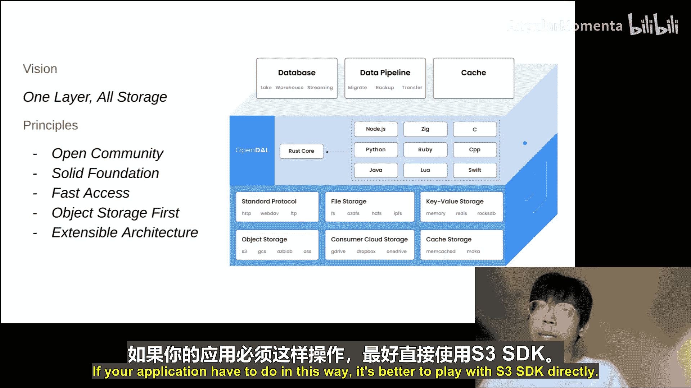

# 【卡内基梅隆大学】数据库构建块系列研讨会 ｜ Database Building Blocks Seminar Series (Fall 2024) p09 09 Apache OpenDAL：一层架构，覆盖所有存储（Xuanwo） -BV1dmipBLEYH_p9-

🎼Yeah， down。They ready for。And y'all at the speed of sound where we're now wax first top will gather around and witness something。

🎼The database Building Block seminar series is filmed in front of a live studio audience。

🎼This program is made possible by Google。

🎼guess welcome it's another seminar series talk。 So we're excited today to have Shinu。

 He's an engineer at Datab Labs where he's been working on their data system for a while。

 but he's he is most famous for being the chief creator and project chair for the open doll project which is an abstraction layer for story that started building a data and they since spun it off as an Apache project he's here to tell us all about this one building block that no one else has seemed to work on but he's built it for us which is super awesome。

 So we want to thank Shinu for getting up early it's 530 a in China where he's calling in So we appreciate him being up very。

 very early for this and as always you have any questions for shbu as he gives us the talk unmute yourself and say who you are an question at time and that way he's talking himself he's not talking himself for an hour at 530 in the morning。

 So Shin， thank you so much for getting up early。 we really appreciate this。Okay， thank you。

 thank you And for inviting me and hello everyone。 I'm and I've been watching many lectures and I'm thrilled to be invited here to give talk about introduce myself and my name is called the across the internet so you can find Tele my andm member have been actively involved in open source for about10 years since high schoolm the original creator of Open andm currently the chair of the Open PM as introduced bym currently working are working on building an open source alternative to。

😊，No my personal version is to achieve data freedom to enable everyone to access data to access data from any surface in any ways。

 my currently focus on we focus on big data by contributing to projects like either related projects So okay there are some facts about me before IMS I don't have a how and I don't have I don't even have a now all of three things have become incredibly important in my life So thank you database the only thing left to me is that I still don't have a car so that's the work need to need to work hard to figure it up and。

Are you trying to say the databases got you a house， two dogs and a wife？yeah， that's cool。 rats。

 yes， fantastic， love it， yes。😊，Today I will introduce the blocks of my planning Openll discuss what Open is and why it is necessary and then we will dive deeper into Open design to explore its implementation and finally we will demonstrate how user can utilize Opende to build their own database。

 I also build a next section to find collaboration here to explore the future of Open and database。😊。

Okay the first thing is was open open is an open open data access layer that enable seamless interaction with diverse storage surface its version is one layer or storage development is guided by the following principle like open solid foundation fast of storage first and architecture。

😊，The the entire open project is a large family is composed by different binding to languages integration to different rights and also we have like3 gateway and today we are only only core whichs most of other subject and I believe is to all you as I showed in the future。

 Open is designed as a layer that can expose underlying for different to and it also provide a high level API for the the application to like pipeline or just Open also provides nearly all surface like3 and。

😊，It also provides integration to other storage surface， like file storage。

 key value storage and catch storage。Okay open there outlines the difference in story surface by capabilities there is a concept called capability in open that user can call this API to fetch out which capabilities that these story support so they can have some special logic for the features that like object version not in a story service。

 We will those details in the following slide。😊，Okay， so here is a history about about Bnda。😊。

It used to be an interpret called DL data layer inside data after after I joined the data I started working on this this and beganing open established new project in February 2022 after year nearly a year of working open is gained some new contributor outside the project and was adopted by several users such as and time in 2023 we initiated the of donating open to the incubator and after incubating for about a year we successfully built a and finally graduated in 2024 at this point。

 open adoption continue to grow and we share the use case of of open in next slide。😊，Okay。

Okay so is using open based on my current on my current observation open has three main types of user and the largest of consists of build of whom use open to develop database I suppose thats also the reason why are various types of open example is cloud warehouse and stream and time and time database is database ocean used to be database is now focusing on the or as。

😊，Additionally， some new table format like iceberg Primeer and Huy are also trying to use opend to access different story surface。

 These users mainly rely on opend for its solid foundation and fast access principle。😊。

Most infrastructure builders use open as more robust and advanced alternative toK。

 They appreciate open user friendly API which is easier to understand and work with also provides across various we have talked about that open is over users appreciate open its friendly API which is easy to understand and work over across different surface is also some valuable future such ascurcurren and logging this building blocks simplify their work enable them to either use open directly or build functional within it allow them to focus on more critical and valuable tasks。

😊，And the second time of open users always use open to build application such as cash vector and I will not go deep about those users the third time is platform developers those users use open to build more frameworks such like different web framework So user can build their web web application more easily let's just go bypa。

😊，嗯。Okay，The next one is a why do they need open and with so many different with so many different options available Why should they choose open instead The question might be why not just use have for all languages don't need to build something new of some might also argued that they only need to play with S3 as all other surface are simply3 compatible this is true8 of open users are communicating with A3 are several reasons why relying on solely on3 API not be sufficient the first one is not all are compatible example。

 the second largest cloud。😊，Provider Aure doesn't does not offer S3 compatible API。

And the second one is not all S3 compatible surface are fully comp。 For instance。

 the API of Google cloud storage， which claims to provide S capabilities doesnt support delete objects another example is R true。

 The3 compatible surface provided by cloudfl， which fail to delete one00 object at once when users attempting is result an internal error。

 nearly every every3 compatible surface has such edge case and they need user to handling them special。

😊，Okay the solar line is three compatible not only sorry me S three compatible surface only not enough for production application for example。

😊，IM A identity and management compatible doesn't provide the IM compatible API that makes users makes users cant use can use rules or one Web identity to make their own applications can authentic without the static key they cannot use IM。

😊，AndThis is unsafe and should be avoid in production environments。 Finally。

 even if we set aside all of those issues， Opende remains a better decade for users focused on solely on storage access open there provides easy to use API that simplify data。

 make it accessible even In to users without a background in object storage or file storage。

 they just need to read right less simple additionally。😊，As I mentioned before。

 open there also include some robot features such as re， metrics， logging and tracing。

 offer a more seamless and efficient experience。😊，Maybe you'll talk about this。

 but like are you is open doll relying on like the the SDK that Amazon provides for communicating to S3 or did you write everything from scratch I will invite everything from scratch and I discuss about this in the next one。

Okay。Okay， cool。嗯。The section， the second， the second most question being asked is about why not just use the run decay。

 right， It simple。 we are using， we have good we have great tooluring and we just need to run ads that works。

 but its not always practical in the real world。 First of all。

 not every surface offers an official decay。 Even if they do the SD might be un maintained to keep up with two features or respond slowly to bug rely on such a in a production environment can be risky。

Secondly not all SDK are well maintained or well。 They might have poorly API they may like a proper documentation they may have insufficient test carry or lack of stable release users might find themselves depending on an out stated version of dependencies simply because the SDK on that。

😊，嗯。😊，soだね。Even if the IK itself is good。Integrating multiple SD can still be challenging。

Different landscape may have important design patterns。 They have different configuration values。

 This makes it difficult for user to implement to implement unified re mechanism， logging or tracing。

😊，Additionally， users often lack sufficient control over the underlying behavior of those SDKs。

 So Opendell implements all those manually from scratch。

 we are talking with the storage API directly start relying on any SD whenever possible。

 This approach makes it much easier for user to control storage behavior through Bdell rather than trying to configure the same across multiple SD case。

😊，So two questions like I remember the yellow brick guys talk about how。

They I don't remember the exact percentage of improvement。

 they saw a pretty significant warrant improvement by rolling their own you know SDK to talk to S3 versus relying on Amazons did you see the same kind of performance boost as well？

I didn't do some strict performance so far， but all users of there are happy with its performance。

 and from my view the performance should be okay if they are performing just the same API。

 The course should be ignored their performance again maybe they have some concurrent internally so that they can just split large guest request into several so that they can be be performed concurrently。

And open Doll will do that for you automatically like given a large class cut oh okay nice and then my next question is since you have to support Azure GCP and and Amazon do you support I guess I just say keep the question simple of the of those three the major cloud vendors which one has the sort of the most。

I mean， say worse API to work with which one has caused the most problems for you guys maintaining and working。

 getting work correctly。呃。Are they all about the same？nearly the same。

 but Im more familiar with that three so I can find more case about S three API to it up as you may know we since we have so many S three compatible surface。

 So there are magic edge case we need to work around even if its not the problem of S three API in itself。

😊，Got it， thanks。嗯，系。😊，I have a bonus slide for this part， and we can at the end to share about it。😊。

Okay， the third question is why not build such thing by ourselves three is so simple are3 API is so simple we just need to get put right okay from my side of view there are there are different ways to interpret only one hand the three API in is only simple for happy pass。

😊，AndTo build a realistic production application， you need。

 you need to take many things into consideration。 For instance。

 put object as a maximum size limit of5 GB to upload5 as large than 5 GB or to upload that concurrently you need to use multiple to use multiple part upload。

 Another example is that3 might return a 200 okay response for a field complete upload。

 So those errors need to be handled carefully。😊，On the other hand。

 that's no longer the area where we need to build everything from scratch。

 There is no extra benefit to writing another3 SDK。

 hiring a talented individuals who graduated from CM MU D B to create a another N3 SD DK would be a great loss for the entire community。

 right， Why not just leveraging existing building blocks。😊，Think about this seminarminer。嗯对。No， okay。

Another common question asked five system is the golden standard that has been universally supported so why not mount。

😊，When discussing posting， we have actually thinking about two different concepts。

 The first one is the views which everything directly in storage data stone is exactly the data was written The second one is D to system which is just use of their storage or other storage as backend while st all other data separately the data stone in D is usually not the same as the data are right It not be split or user can read data can only read the data。

😊，But can not accept the underlying story directly。Okay， if you have question。

 just raise up directly。对。Okay。let me continue like so somebody asked S3 recently introduced consistency as opposed to metric consistency and APIs。

 did that result in a lot of changes or simplification in the open doll implementation？呃No。

 no big difference of their fine。这谢。嗯。Okay。Keep going you're good。🤧Okay。

From the of database developers building a system on either fields or D comes with jobback fields is known to be slow and to work with performance bottlenecks often constrained by the system the Ds more widely adopted are many thought tools like orlu as well as various in how D developed by major tech companies like Alibaba and Google each their own D and many database are on that However to make D enough to meet the needs of database often become highly and and on low detailed developers often find that they are with but they often end with new need to use。

😊，Develop need to have a deep understanding of their specific DFS to ensure the database runs fasterly the more optimization require the further they move away from the the simple post F NI。

😊，Beyond beyond the limitation of itself， there are also some new challenges， for example。

 cannot be used within web assembly browser making making it difficult to build a database that can run in a browser or web assembly run time another example is popularity of data lake and cloud computing database often the direct to3 in such case relying on a is not visible in other tools like open there to meet the emerging。

Yeah。Yes。Okay， do I have some questions about the white part。

I think the audience is quite receptive to this。Okay。ok。

So let's we have discussed many things about O project itself。 time to read some code。

 Let's deep dive inside Open to show what it does look like and how help developers to build database。

😊，Overdll the size very straightforward at the lowest level is abstraction surface such as S3 and F。

 all of which implement the same charge in on the top of those surface there are layers that can apply common functionalities like the handling logging and more。

 Finally， everything is incapsule incapized within an operator The operator served as the entry point for in open for users。

😊，Okay， let's have our chemistry。😊，Let's demonstrate it from service side here is the access the defined everything a storage surface can do。

 for example， thats files metada reader that can be used later to fetch more data There are many other API or following the same pattern only discuss two special things here The first is the in API the in API is used to return the service name and capability which operation the surface support Use can call in to handle those instead of errors everywhere。

😊，The second part is access will have some association types such as reader， writer and listen。

 This allows survey to store internal state within those types so that they can fetch data on demand instead of just reading all or link at once。

 This is very important for us to build database。😊，嗯。这样你个可以 demo。

I have I have developed a c mU surface that requires a DJ implement。

 but only support state operation is a simple surface and we will meet c m service later。😊，嗯。Yes。

 the most simple surface we can implement that we can read only surface。Okay。

 the next important concept is called layer here， a layer is similar to midware or that we have seen in HTTP frameworks or GRPC we can integrated into operations and execute action accordingly the API of layer is straightforward user can provide a strength that implement access which returns another layer layer access layer ensures that the return also implement access。

 This allowed us to apply different layer at the same time。

 the most important aspect of the layer is that just to be surface independently for example。

 as long as of there implement layer every surface will will benefit from this layer they will have the same behavior。

😊，At the same time， the same principle applies to all layers and allal surface。😊。

Okay time in to c I also developed c layer that users c time layer can apply to all three surface you desire for example。

 user are by applying layer every time call c to users in the console。😊，The final one is operator。

 operator is the automost API of provides for users。

 We can use CM survey to build an operator once the operator is build users can utilize it everywhere to perform operation。

 It allows us to write data with the data and manages state effectively。😊，嗯。Okay。

 we have know almost everything about good Its time to move on some showcase。

 I will demonstrate the features open their offers and how users can utilize them。

 All the all the examples I present are also included in my Github Ra beauty blocks open their example。

 feel are free to check it out。😊，I sorry， can you go back to like the the service layer operator thing So like the service would be something like S3 so you would have to implement the。

The API to call to do stat read against S3。And then then the layer above that that is sort of abstraction against a service。

 what is the layer providing？layerer used to change the behavior of surface， for example。

 like a CMU layer here is it perform a hello CMU and forward all request to the access directly。😊。

Well， I think， again。I appreciate this toy example。

 but I'm been trying to map this like something like S3 so I think you're saying service would be S3。

 but then a layer could be S3 by default does not have a retry operation so you would build a layer above the S3 service to say when you do a put if it fails。

It can automatically retry so instead of embedding that retry mechanism in the service you're putting into the layer。

 is that correct？Yeah。😊，Okay， maybe another example would be like I do a large put and the layer would be is responsible for breaking up to smaller puts against the service。

 is that correct？Oh no， not。Okay later want to do this。The lair does that or no。呃。

Opener has its own functionality to perform concurrent right。 So it's not the job layers need to do。

 Well users can still still do something similar in the layer， but we don't provide it。

So the S3 service im would say you're doing a large put and that's what's responsible for dividing it up to smaller puts。

operator expose a dedicated API for users to do such thing。

 Once once all request has been sent to layer or surface， they won't change anything。

 They just perform this， this request directly。O，那我 the前期 use是 behavior色。

What's another example of something you would implement in S3 at the layer level other than retry？

There are many things like tracing。啊Tcing metrics呃 logging concurrent limit and。呃反迎 similar。

Do you say locking or logging？Im liing， liing。Okay， like debu logging。Yeah， the logging got， okay。

 okay， and then an operator the。Again， using S3 an example would be。Like like a。Actually， yeah。

 what would be an example of an S3 operator？If its because like put and get。

 that sounds like that's at the service level， the layer you could do wraps of like again tracing or the automatic retry。

 so what would be an operator above a layer？operator we exposed the APIR read the right directly。

 and we will showing in the next slide。😊，Okay。Okay thank you。

 the in the entire show time is talking about operator。

 and guess they they can answer most of your question directly。😊，All right， yeah， keep going。

 keep going。Okay， like the。Okay， the first thing for there is the battery， for example。

 to read all data from a file at once， you simply call read operation for case requiring an additional parameter of there of the API called readways where user can can specify details like range to configure the request。

😊，呃。With this API design video also enables native concurrent reading features， for example。

 users can read in tracks concurrently as demonstrated in this example。

 users can the same file in in one mega in one me tracks and with concurrent read request following the same API pattern users can also specify the file version or perform conditional readers or perform conditional read use the parameters like if if not match and more operator expose those hellphone APIs to use directly and perform some translation about those APIs and to call the access and and finally forward to the surface implementation。

😊，Yes。OkayFor database developers we often involved in more dynamic use case that cannot be handling a simple read。

 Therefore also provides API for users with this API user can create reader that carry all context of the read operation and configuration it function seemingly like a file descriptor for local file system。

 but it will utilize different optimizations for various surface through the reader user can perform range read or read or read money at the same time。

 Additionally， user can convert this into a future or stream enabling integration with other parts of the system。

😊，Okay the most interesting one is the flash API。 as we all know。

ing service like3 has a high laency but offers high batteries compared to local file systems。

 its much faster for users to read than several4 kilobys。

 Therefore it is a common to of operations example。

 if we have that are close enough we can read them all at and data this approach allow us to read data much even if we end up reading more data than initially requested Open provides such a API that users can specify different range and will those range and figure out which range is the best and then send the request with the range we calculated to the underlyinging surface and then we。

And the correct data to user directly this APII is very useful for reading data from files where data often appear to be closely arranged。

Okay， this part is about reading and the next one is any any may be more interesting the main reason I love is that is try very to make consistent different API are designed in the same way with details hidden in the background I hope everyone that already know how of their data should be super easy just use operator to write into a and data to on the same file simply write with flag said to be true。

If we want to write the data with more complex that content type content disposition。

 cache control or use amount data， we just need to writeways directly。Okay。

 people are going to talk about perform multi uploads I think upload like asking if I have a large chunk to upload while over there automatically to split them in。

😊，Yes over their support， but we will not do it automatically。 We perform option to user to big。😊。

And this example demonstrate how to create a writer and configure track side and concur。

 The example I showed here is open there will time to write data in8 Mac channelss and then hand up and head up to a concurrent writing request opener ensures that if the closed operations returned okay。

 all data that have been written will be written concurrently and in order。😊。

Like with this gone before， if we have large fire。😊。

Can the user provide a way for customer handlingling or custom concurrency like to not be able to send more than I don't know？

🤢，1 thousand0 requests across the system on all threads or customer handling， is that an option？

呃I talking about limit the concurrency or something。Yes。

 I'm talking about either limit on the concurrency for across all writers and about custom error handling。

O嗯。😊，For the first， the concurren limit can be implementing a layer。 So at the layer side。

 we can we have a global global concur limit applied to this operator。

 so it can make make sure that this operator won send more concurren request than expected。

But I'm talking as the user， I'm talking as the user of that that of that layer。

 like does every user need to implement a layer and operator and and the first one I don' remember what it was？

よし。呃Concur limit layer has implemented for now user need user want to limit the concur they just need to enable this layer directly。

Ok。嗯嗯。嗯。Okay the the implementation may vary for example。

 the local F will use write to write data and answering will use money part and actual storage will use put block user don't need to worry about details like offset upload I or block I D just need to call right。

That's， that's open there similar to what we have done with readers Open there also provide transformation for writers users can users can convert a writer into using and write or think enabling a seamless integration with other part of the system。

😊，Okay， here comes an interesting part about about automatically or let users to configure it explicitly。

 Opener will try to won't make any decision for users since open is a。😊。

O have many users and they all have different schememers and we don't know about their use case。

 so Op just provide the features and user and user need to tune those settings based on their own needs。

Like the show here， If users didn't set up the trunk here。 Every time it called right。

 we will write all these trucks directly without slicing or any other things。

This also makes Open education more predictable。Okay。

Okay the next API I want to introduce is the list API similar to what we provide for reader and write we also provide lease and API users can list files recursively and specify study point like start after parameters to offset。

嗯。Yes。Okay， do you see ever have questions about split large files in trunks？不。No。

 I guess I'm still trying to like wrap my head around the layer， so the operator。

LikeSo someone writing against an operator。Doesn't know。

 it potentially potentially doesn't care whether're talking to Azure。GCP or S3。

 but I feel like you showed one example where you were putting in like metadata that looked very specific to one of the cloud providerss。

U。You had one example where maybe not， yeah， this one。

RightI this all is that all generic enough where it'll work across all the different cloud providers。

 I guess user met is just JSson right who cares about that but everything else this is this is just is generic enough that you this is not S3 specific or GCP specific is that correct。

It's not entry specific。 and in fact， nearly also also providers support user met data。Okay。

 use mentioned is sure， but like content disposition right like that seems。I mean。

 it's additional metadata， but I guess that's universal across all the different cloud providers for this。

嗯 yeah。Okay。Okay。I keep going， thiss great。Yeah。Okay。Yesish。Yeah。Okay。

All the all the main API are discussed here and assume all of you all of you already know how to use open and I want waste time to discuss one by one or go through the code line line feel free to check out my example and the code contribution from everyone I also welcome over is new project and we are far from achieving the goal aim to。

 So just welcome。😊，Okay， I'm going to talk about the next section。😊。

The next session introduce some new and exciting features we can develop within of them benefits also benefit the database in future。

 Please contact me directly。 If you are interested in any of those topics listed here。

 and I'm more than willing to bring them to life this could be a new platform or tools provided by system。

 I hope open become a valuable resource for you to explore and test new ideas in database。😊，Okay。😊。

And the first one， who have a family。Web is a safe portable low level called format designed for efficient execution and compassion representation。

 It primary goal is to enable high performance application on the on the web but it now widely use in other environment as well。

 We have various web run time that make Web a good option to run portable code different wrong It works somewhat like the JM We write logic in different languages and compare it into Web After that Web summary run time can load it and natively。

😊，The most famous web summary run time is the Web browser data fusion and over there can now run inside can now run inside in WSM run time。

 making it possible to build a simple query engine within a browser。

 Here is Xg's li work calledque viewer It written entirely in and compile into Web the tools can load data from file or directly from3。

 Its an interesting tool for users to explore file and test execution plans。😊，For example。

 we just need to configure S here and we can read from S browser directly。

 and we can load the data here。 and also we can we can view the execution plan or some details about using inside the data functionsion。

😊，So there are many there are many shortcom for Web summary for now。

 such as the compile compile side has been too large and the execution time still being slower compared to javascript。

 However， there are already some use of web such as one password implementing all its encrypt and launch in and share them across different platforms and languages a great number of smart people and working in this area。

 Web summary will become an interesting space for building new database。😊，一唔。

The following is also about web browsers。 We all know that today's web web applications are becoming increasingly complex。

 The traditional local storage and index D API and no longer satisfied the needs of web developers entering the so we have the new O F API which provide file systems APIs that are private to a web page we can imagine we can imagine that。

😊，Each web page their own file system web web developers can use circle light on on top of this。

 enabling the creation of more complex web web applications that can ins advanced circle operations on users own circle light database rather than implement those logic manually。

😊，Open I doesn't support O O I so far， but I'm very interested in making it happen Personal I believe we could potentially create a new type of database designed specifically for the web。

😊，呃， don that thinking怕 is呃 em。We which is old， but still hot platforms in the in the current time。

 I'm not sure if it is a very search area of database on the I O T sign。

 It could be interesting for I O T device to have specially design database or maybe they can inter directly with S service directly。

I know there are some camera cameras are trying to write， essay directly to upload videos。

 I don't know if we have such a database so far。Yes。Good。ok。

The next big topic is about completion based I specifically。😊，呃IU。

IOU is another effort by leading kernel to reduce the overhead of IOC's core here is a green diagram joined by Donald Hunter that illustrates how IOU works it consists of two queens in memory the application submits its IO required to the submission queen and the kernel process request from the same queen and then push the response to the ti of completion queen the application can then consume the response from the head of the completion queen。

So my I U we can use it to build truly a I O frameworks unlike unlike A I O users don't need to set the direct flag。

 make it more friendly for a pitch usage。😊，And additionally。

 use dong are not required to handle buffer buffer management。

 It performance its performance can be compared to kernel bypass technologies like S B DK。I will。

Has already been utilized in some product， but however。

 its usage within rest has some issues to address such as ownership and future reconciliation。

 the community the entire community is actively working only to resolve those short。

 There are some ongoing efforts from model I O and Co I O。O there both of them。

 but it requires further testing and research， we also welcome you to join us。😊。

I believe there are many database papers talking about completion based style。

 it should be a hot topic。😊，Okay。Okay compared to I another popular but seems not popular anymore solution is by pass such as I K before I join this talk I just watched any new talk about about kernel by pass and user by pass。

😊，So right， the FBDK is not popular anymore， but maybe still relevant。😊，你好都系。Okay。

OkayK I want give I want give a shot in in your about SK。😊。

So short for St perform development kit is a fully user space story solution。

 applications can communicate directly with underlying storage devices with kernel enabling low laency and narrow copy IO without logs。

 SBDK has developed a complete state writing F B to block by fast and also they tried to hack with RoDB to build a new new me that allow RoDB to play with SPDK directly。

😊，T has experimented with SP DK alongside rock D B the numbers on the graph represent the numbers of client threats。

 The results demonstrate significant improvements showing that SP DK can achieve low license with express information per second。

However SBDK has not has not seen much development in recent years I suspect is partly due to competition for Linux and the result allocated by internet and Samsung Another issue could be the complexity is introduced on the application side。

😊，So it might be interesting to add native support in open as it allow us to evaluate performance gains from a broader range of database systems。

 Keep in mind that once your database systems leverage open there。

 you only need to add a few lines of code to support new surfaces。😊。

This makes Opdia a great platform to test your new ideas。Yesish。O呃的。😊。

The next thing Im personally super excited about is GPU direct storage as as G traditionally when we use the GP to assist with data with calculation the CPU first need to read data from device to memory and then retrieve from memory this process is often slow and cannot fully utilize high bandwidth available between modern devices and with the GP can read data directly from device without the need to run into or copy from system memory as demonstrating the search result the performance of Q4 which requires reading a large amount of data from devices improve a lot G can extremely beneficial for building GPU based or engine has。

😊，Independent lab rapid AI working， and they have also developed a new IO framework called IO integrating medium TDS into O could be exciting。

 This can also mix reduce the complexity for existing database to increase those new tech open。

Since we already have some a big number of database systems are using open。

 one open and new technology like GPU direct storage。

 those database can use this feature directly without more development。😊。

This is also the point of reuse beauty blocks。嗯O，那 one thing lot is about IPF。😊。

So it's used to B internal file system that which a portal that make allow clients to share data in ways so that all data are addressed by and they can run the data separately and share and at the same time are already support B but not been used widely so Im not sure if this beneficial for building blockchain database I know any has them in efficient tools and good knows right maybe about 10 years later can see some new trends。

Okay， that's most of my sharing。😊，Okay， awesome I will clap and half the audience we have time for a few questions for Shinhu you want to go for it。

😊，I think that was a really nice can you hear me？Yes， go you。That is a really ambitious project。

 so a quick question I had is do you two parts to the question is do you have a way in which you could dry Opendell on a local machine and essentially get a simulation for what happens with the different cloud storage devices especially probably useful for developers？

I don't know if that made sense。嗯。Are you asking about using over there for local I or something。

Yeah， for just on a local file system。Oh yeah， yeah yeah。

 over there has native support for local fire system。 It also has native support for IU。😊。

Got it and then the second question is， do you have tools that might allow someone to transfer files from one P object system to the other。

 like from S3 to GCP because sounds like you have underneath a lot of the tooling to allow for things like that in more efficient ways or is that tooling system not something that you see within the scope of what you building？

哎。Yes notイデオ rush core but we do trying to build some tools to make it more more easily。I mean。

 we won't provide such an API in our rest call directly， but we may to build some tools。Got it， okay。

 thank you。When you go back to almost the first or second slide or you had the original architecture diagram of like the layers of and where open doll fit into it。

 like it's like the very， very beginning。はいね no no no before that before that I Okay yeah。B。

 so you sort of you keep bring them S3 as an example of object stores and you might have mentioned like local fossils at some point。

 but like can you talk about how。Like something like a key value storage or cash storage would come into play and would it be something they would that you would put in front of。

They would do it would。If I want to access S3， could I automatically seamlessly put in a cache storage layer in front of that so that like if I do my request。

 you check meC， it doesn't have it， then if it's there you use it otherwise go to S3。

 like is that how openDoll could be used where you sort of compose these layers on top of each other or should I treat these as sort of separate endpoints where I could read write data to and they don't intermix？

Okay， there are two questions。 The first one is key value storage and catch storage。 Yes。

 open has those surface directly open can talk with and talk with catch but just in the open ways for example。

 they just use key value right dont dont use complex like like or or something we just do key value So so that user can read it like system like to data this way So they are just a new like3 and for yes。

 that's possible we already have some user to build a cache layer that they just compose to different operators directly in this。

😊，lay once a new request comes in user can read read from ra or read from local or e B directly and under layer could the under storage could be S three they can compose it in inside layer。

Got it， Okay， and then。How would you compare this against like the MinIO project。

 I it sort of complementary you both having sort of the same goals or they I guess maybe they're not trying to be flexible they're trying to say here's our store since that's pretty compatible and in theory OpenDoll could talk to MinIO but you're also trying to support all these other other service areas is that is that the way to think about them。

嗯Yeah嗯。I don't know。 but I think of is at the different layer like minimum do minimum just provide entry compatible API is a a new binary to deploy but there is but but there is a that user need to integrate it into your data into your code base directly。

Got it okay， and my last question is like on S3 and I think Azure can do this as well and we actually discuss this in class today。

 like they S3 has S3 select where you can basically do predicate and projection push down。

Of a query into the average store and then Amazon processes it for you does that。

But I mean obviously GCP or GCS doesn't support that so is that an example where that's a feature that you don't expose or you don't allow someone to use for S3 because the commonality like not all blob stores can support that is how would you introduce something like S3 select？

No the first is there won't introduce features like S3 select because it's hard to build a common API to build a common API around it。

 and the second interesting thing is that S3 is going to deprecate select API。 Yeah。

 that's interesting。Okay， so like if if there's not。

 the way thing about it is like for object storage for example。

 if there's some feature that a cloud vendor has that nobody else has。

 there's no way to actually to get still get to that。

 even though like I'm using Open Doll and I know I'm talking S3。I couldn't use an additional feature。

 you guys just wouldn't have not way to bypass the abstraction layers from it。你也。

Because Opener has its own vision like one year or storage and Opener will Chinese best to provide a consistent view for all storage。

 we won't provide some high home features across like I3 if your application。😊。

Have to do in this way it's better to play with S3 SDK directly。

