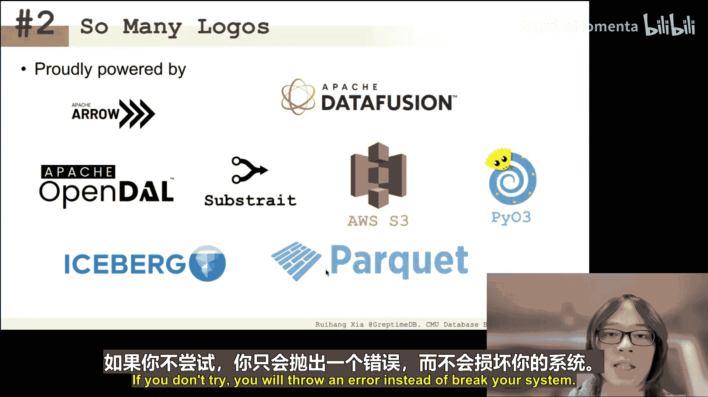

# 【卡内基梅隆大学】数据库构建块系列研讨会 ｜ Database Building Blocks Seminar Series (Fall 2024) p10 10 GreptimeDB：实现、集成与扩展查询引擎（夏睿航） -BV1dmipBLEYH_p10-

🎼Yeah， down。They ready for。And y'all at the speed of sound where we're now wax first top will gather around and witness something。

🎼The database Building Block seminar series is filmed in front of a live studio audience。

🎼This program is made possible by Google。

welcome to the last talk of the semester。 We're excited today to have Wayne Shia from Grptime Db。

 We appreciate Wayne doing this because he's currently in China it is 530 in the morning where he is right now so we appreciate him winning up and you might have told that we had to reschedulule this talk because last time he overlept we felt really bad about that obviously to give a talk so he graciously agreed to allow us to reschedule it and give this talk today So as always if you have any questions for Wayne was giving a talk unmute yourself and asked question any time say who you are where you coming from and that way Wayne's not talking himself for an hour in his office at 530 in the morning in China So Wayne thank you so much for getting up early thank you so much for rescheding with us we appreciate you coming back。

Okay， thank you for inviting me and reschedule this talk。😊，Hello， hellello， I'm Wayne。

 and today I will be discussing the implementation integration and extension for a query engine for a group D B。

Yes。To to begin， let's share a little about myself。

I have been with Gr DB since 2022 and before that I worked at An Group where I was involved in developing their internal monitoring system and additionally I'm a PMC member of Dataussion distribution Fuion a project that plays a significant role into today this topic。

 it is a crucial dependence and component in our database。ok。

And here is the outline of what we will cover today and as the title suggests I will be discussing how we implemented a homemade execution engine in that group and after integration the discussion will focus on extending the career engine to meet future requirements。

 performance goal and more， I will be primarily concentrate on the extension part and while the implementation and integration part will be covered briefly。

嗯。😊，Okay， and let's get a step back and recall the days before theusion and other beauty blocks。

 This project was called series D B which serves as an internal temperature search database at Ed group。

 supporting the entire monitoring system。And we called it a database because it was capable for storing and query data。

 and naturally the to facilitate the data queries， we need a query engine。

ThisThis was a scenario around 2018， and at that time。

 we didn't have tools like dataffusion or something else。So we had to develop our own query engine。

 it can be quite fulfilling initially， but once you need to address an entire feature set。

 performance issues and wealth problems from users， it becomes challenging and frustrating。

And I recall a tweet from Paul Post， the CEO of In data。

While he shared a similar experience when developing in Fast D B1 and2。

 they wrote this version in gold。 and where basically features like mean Maxs and sort， etc cetera。

 are relatively simple to implement， delivering a high performance query engine involves overcoming many obstacles。

And maintaining such projects with a small team is especially tough。

And user often have random requirements like specific query capabilities。

 which can disrupt the schedule when demands are urgent and this emergency will fill your calendar leaving the little leaving little room to develop features you are interested in or anticipate problems like data growth issues and addressing this issue。

 this not yet existing problems become impossible due to the time constraint and initially be。

Internally to implement basic functionalities may seem straightforward but achieving stable performance is another story our homeg query engineing for example。

 had inconsistence licenses very fluctuas and affecting overall performance on top of implementation project management also has its own challenges。

 especially when rapid features development accumulates。

Making making the code base difficult to maintain user by but user don't care about your code se。

 but they only want the their features delivered。And additional。

 the close integration of the implementation with storage layer while beneficial made the system increasingly tied to some specific business needs for special purpose software。

 this isn't problem but if you aim to develop a versatile tools like gravityB MyQL or post careful consideration of necessary abstraction and offered features is crucial。

And moreover， to provide a comprehensive set of operators。

 developing and maintaining them requirements requires significant tags。

And those were our experience before adopting the fusion。

 And now let's talk about the situation with that fusion。 It's also a query engine。

 And we can compare the two。 that fusion is a。😊，ACom driven project and open source。

 providing a difficult， different landscape when compared to our previous experience。And。

The opening talk of this seminar is by Andrew about diusion is an exceptional talk。

 And if you haven't heard think or read it before。I highly you recommended it is definitely worth checking out。

And。😊，嗯。呃。嗯。😊，Like this on what。K。As a community driven projected。

 Fusion naturally avoids several problems and it boasts a larger group user base and robot developed committee that ensure everything is well maintained。

Your feature and pull requests are not rush or subject to T deadline。

 There is no pressure like this must be merge today。 The fusion is a query engine。

 make meaning it has access to。The surgery layer， but fundamentally remains a query engine without any business logic tattoo it。

嗯。And we can consider it as a general tool because it is widely developed and utilized by many people。

 the most important thing is the operator and plans you implement in that fuion can be reviewed and reused by others。

And。When we begin use data fusion， we observe a significant transformation。

It offers a range of highly useful and efficient out of the box tools you can integrate that fusion into your own project with just  10 or 20 lines of code。

 offering your high performance and full featured capabilities and moreover using that fuion means you are not just engaging with the query engine it comes with a strong ecosystem that can be easily accessed through di fusion。

The functionion itself is built on top of Apache arrow。

 a column in memory representation and Paque a column data persistence format among others with just 10 additional lines of code。

 you can also use Paque arrow or other related tools the。

Easy of integration is remarkable and its implementation is ir。

 these allow us to focus on what truly matters without duplicating the effort of building a query engine and basic operators repeatedly。

And。And we have successfully integrated diffusion into Gr Db and of course。

 with many length of course， not just 10 or 20。And we focusing on extensible solution that serves as a query engine for your database needs。

For our database needs， we can treat diffusion like black box like this。

You provide it with data and query request and it returns the result it's that simple。

 it offers a very straightforward interface and the SQL and we primarily use the select part but it also support clause like insert into and certain details and but how will we focus solely on the select part the query part and I will expand the questionnaire later。

And we have bypas the pass pass shape with that fuion。 It use S pass。It' use thick Pass project。

 but we build another par on top of it and you tell that' the thick pass as a library。

 not a pass itself。This allow us to extend our grammar and include specific features we need。

And the taxism is also customized which requires significant effort。 This。

 There is an ongoing debate on internally about whether this is was worthwhile to replacement the。

Tap system as types data types are fundamental to the entire system beyond just the query aspect。

Which is why we extend it， but I have to say it has taken a lot of time and effort and we have rewrite the typeism internally the taism of Gr Db several times。

We byss the data type system big。So okay， maybe talk about like， so what， what？

What data types did you add that weren't in data fusion and then presumably you then had to have extensions added the data fusion to be aware of these types。

 is that correct？Yes， we have introduced our several new types like geometric type， Victor type。

 and Jason type。Da fusion supports some of the in a different way。

 like Jason type in data fusion is based on string， and we have we are based on Jason B。

A's that difference。Yes， and those types are hooked somewhere as an integration into data fusion。

So every time your data fusion comes up with the new version。

 you can it's just taking your data type extensions and importing them over to the new version。

 it's not like rewriting， it's not like you're maintaining a hard fork of data fusion。

 is that correct？Yes， specifically for the like Jason type indent fusion is treated as the binary type。

 so we only need to shift the logic of processing JB when upgrading data fusion。Okay， okay。

 thanks and our yeah， our capability contributing back to the transfusion。😊。

Why not contribute back those types， I believe that geometric types can be really useful is because it's only based on the error。

Yes，呃 the。Speaking for the Jason type di implements as another extension。

 it is mostly focused on a set of Jason functions。Like Jason gate function。

 and the type the type is you can enable it in， like install a extension。

 This is maintaining another。Project another report。

And we don't contribute back to dataffusion because the decent type in our database was introduced like two months ago and it is still very experimental and we are finding some concrete user case for this type and datausion has its own implementation as a string so。

We may we may find refine objectstyping implementation after a few。Like real use case。

 And then maybe we will propose another JB integration。

But distribution has a extension tag interface。And the type system of data fuion is basically derived from error so。

This change， if we want add the JB tab into that fu， we will first add to the arrow。But。

Extend a custom type for error is not that easy because error is well well documented with its spec。

 so。The first type， the first step， if you want to add a official support into error。

 you will need to you may need to change the spec at first。So it is very long time。

 and we prefer to demonstrate and experimental of the new type。Before it is natural enough。Okay。

 thanks。K。And。So our capability in T doesn't fully align with what the fu provides。

 so we need to manage this difference。And I believe this is a common issue in integrated system like diffusion。

 I recall Andy another Andy from diffusion Com project face a similar problem and trying to bridge the type system between diffusion and Sp。

Like， Sp is a Java based and for。The for all system that from Java， it has a。

Chaactistic that it doesn't provide onsite integers。So嗯。Nevertheless。

 we have accomplished this albeit with a great deal of time and efforts spent on tap exercise。Okay。

Now let's discuss how the integrating distribution is very common and simple。And in this section。

 I will provide a brief introduction to the system， the graph DB。 And yes。

 it's it's another time series database。 And four weeks ago。

 Paul introduced the newest version In fact D B3。 So you might be very familiar with what time series is。

 And today， we are focusing on the query engine part。 And I won dive deeply into time series concept。

 and I will introduce them later only as next as needed。 So。😊。

So that you can consider this as a straightforward database with a query engine for the duration of this discussion。

Okay， regarding the Gr hand D B， it integrate Man open source project I will list later。Essentially。

 you can consider the database build on database building blocks and aligning perfectly with our similar topic。

The database supports a range of features including multiple query language beyond SQL。

 we also have a Proch and E search query string and offer various storage engine suitable for different scenarios and some for generic for magic and some for external file。

 etc。And moreover， it can scale from edge to cloud seamlessly like car， L T device， home lab。

 net or something like them。The most cool part I want to mention is all of these forms are supported by the same code base and even the same binary。

Yes， you can use the same Gr D binary as standal alone or as distributed database。

And Gr 10 D B compromise three main components， the management met server。

 the protocol and query front end， and stored this node。

It follows a typical distributed architecture。嗯。Well， yes。

 the meta server act as the the the graph is a bit ugly。The me ex has out。

Head and control group of the graph1 D B cluster and the front end at its name suggests is its user facing component responsible for implementing several protocols。

These include access protocols like Mexico， Postgs， promes， in flash line protocol。

 open telemetry in an elastic search and so on， and almost every popular data protocol we have in implement a。

O call for them。 and the front hand also handles query operations。Both。

 both the front end and the digital share the same current engine。And can invoke each other。

 I will explain how we achieve this later。And for now。

 it is essential to know that the current engine is basically an extended diffusion。

And concerning the data node， the storage engine is primarily a log structured metric LSM tree designed for a high injectiongeesttion rate。

And further more， we have implemented a sector index as an external separated sector index for a quick access。

 utilize the puff format from iceberg。Okay， and。呃Soorrry， I miss。 W page， yeah。And here is a。

All the logos we have used these logos displayed here represent some of the brilliant database building blocks you might consider for your future project。

 I will introduce them briefly。 And firstarrow as an in memoryory column format doubles as a high performance computing library。

It provides viized operations like addition， binary operators。

 sorting and filtering and so on and usually we don't use those operators directly but through the updated fusion。

And third one， Opendale X introduced it last week and short for open data access layer is a unified objection of various data storage services。

 including memory file system persist file system and Amazon is3 leg object store services the。🤧嗯嗯。

As a database， we naturally support and require opend to manage a storage storage system effortly。

 It eliminates the complexity of deciding which API to use for a remote or local access。

 You only need to focus on which object to read from and where to write your data。And next。

 the merge arrow is。substrateub， it aims to offer a broad definition of algebrabriologic plans。

 We use it to communicate between。Different query engines specifically is communicate and send stop query plan from data node from front end to data node。

And a3， which many of you might already be familiar with and the tiny snake P PY O3。

 rust banding for a pethon run time。And by the way， this is not supported by this as well。😊。

There is a fresh blog on Data Fuions website for this passing UTF。

We intend to write Python user defined aggregation function and user defined function within the current engine。

 so this allows you to incorporate the custom data processing function within SQL。And。

Pque serve as a file format for our store sorted string table。 S T。

 the primary repository of persistent data and。Asberg， we don't use iceberg directly。

 but we leverage its index format per thing to。Sve our separated sector index。诶。Yes。

 this common project， including diussion， saves extensive development and integration time and eliminating the need to start from the ground up and without those resources managing everything ourselves would be challenging and we have tried before。

And possibly leaving us folks still focused on the fundamental concern。Even years later。And our goal。

 G B goal is to unify storage for all types of data， all types of time series data， particularly。

The metrics， log entries and so on。 So we need to focus on this and leverage common。

Common and perfect building blocks for common requests， like storing data。

 organize data or something。And before proceeding， I want you to consider like two types of types data you have encountered or used before。

And I think most of them will， most of you will mention metric and logs。

Almost everyone has printed logs and searched your logs to debug your program。

And trace is another type essential for system utilization。

 especially in distributed environment and profile as also common for turning performance per yeah。

Given the diverse of temperature types， you might be wondering that。

 do we need multiple display for each。And for now， the answer might seem， yes。A necessary metrics。

 necessary database for metrics and another for log like elastic search and trays like Y and profiles。

 and such a requirement becomes cusome the more data source and data you wish to utilize the more database you need and you need to deploy and maintain。

This is very interesting， but。TheThis is a situation Now。

 some system even market themselves on having multiple database using one product。

But our over is to revolutionize this approach with gravity B by consolidating all all types of temperature data into a single solution。

 into a single database。 This not only streamize deployment and architecture。

 but also enhance data query across different format， we question that。Weather。

 log and trees are so different enough， so。Useer have to。

Dloy two dedicated separated database for each。Yes。

 and our vision is to empower users to store and analyze all time series related data and efficiently and cost effectively。

Okay， that transition。To the crucial path， extending the current engine to achieve our goal。

 to unify them all。And I， at least a several questions to get this section。 The where to start。

 where to extend。 And I have four case for where to extend and will focus on the first two。

And how to extend and performance optimization。K。At start。

 the point to start extending could be anywhere from the planning phase。

 art phase execution phase and even the storage layer and as a library diffusion is flexible allowing extension as every level is essentially you can integrate your own logic at any point with this framework diffusion framework。

 you might naturally compare these with other system systems that re themselves for extensibil like Pro and darkDB while both are extensionible。

Dist think difference still exist， particularly on the implementation side。

In that Fuion extensions are treated as libraries， but within Postgres and darkDB extensions are incorporated as a shared object loaded via a deal opens code。

I'd also like to mention another temperature base timescale Db。

 It is implemented as a plugging of Postg SQl。And when adopting existing projects for substantial operations like becoming another robots database。

 I think we need to consider the variation in fundamental structures that posted being psychocentric and is challenging to offer attentive query languages。

嗯。😊，And diusion as the library does have this problem。

 you can extend it and you can easily cut off a part of the code if you don't want it， for example。

 we only use the selectged part and discard the insert， delete。

 create and other part that we don't need。嗯。😊，呃。And one of the reason I love this fuion is is it truly highly cosmetic。

And okay， the first case of what's to extend is。Exend for features。诶。We have。

 We want to develop our own features like。Ts and query languages。

 And the first feature involved in is user facing query languages。So I want to introduce Prom Q。

 and some of you might heard this before。 it is originally from Pros and a chemistry database to。呃。

As a DSL to let you query matrix data。嗯。😊，And even T3 database is a sub kind of database。

Sel here is not as famous as。Compared to other database like O lab or transactional database。

They have they have extend their own current language as well。

 but those languages are basically still sL。And however， in chemistry domain。

 we use language that are quite different from So like pro， lock and loxq and traceq。

 and so and almost。EveryB T database tries to invent its own query languages for its specific use case。

And and I have to admit that in some case， this is simple， whereas other might require。

Interaction through。HTV API with Jason to describe your request。Like呃。Is thatastic third DSL。

The basic interface is not even sical。This can be keepsome and not optimal for use。 You can't。

Accumulates the best practice from one system to another system。So。

The first part we want to unify is to provide several well known query languages in one place。

 and currently we have support basic SQL with our own gra candies。It is extend from。呃，Poographical。

And Promchel， we have become one of the most compatible implementations， except the premises itself。

long said elastic search query string for searching logs and similar functional will also have supported them。

And in the past， providing support for multiple query languages was challenging because it was associated with a different execution engine。

 It is clear that we don't have to we don't have the resource to maintain multiple unrelated query engines ourselves。

 So the solution is to leverageerate distribution from work I keen to LBM as Andrew mentioned。

To accomplish this， we have separated the query implementation into the front end intermediate representation and the backend。

 just like the Dr book explains。Here。And。And I don't know if you are still using this book for compilers。

 but I struggled with it in compiler course about five years ago。

It suggests the modern compiler should it to transcribe the frontend languages into machine code using an intermediate representation。

 which allows share and reuse back components。Like the famous is the LVN project and to share the optimizations。

This is precisely what we do in graph D B to support many many query languages。嗯是。😊，诶。

Regarding the query front end that we support to add a new query language。

 we simply write a passer for it and translate the AS T abstract syntax tree from the passer into logic plan。

诶。We use the logic plan I as intermediate representation I R。 And after that， it is irrelevant。

 whether the logic plan is from Pro or SQL or another languages。 they can。

They can be treated as the same and the advantage is that all query languages benefit from shared optimization。

 well basic logic optimization and storage optimization as well。

And allowing the backend to optimize uniformly。 And firstmore。

 you can even combine two different languages。Consider our implementation。 This is very simple。

For example， you can do this。You can write a pro with SQL in C。

 Promcur can be limited in analytical capacity， So sometimes you might want to perform additional operations using another query languages on top of the SQL。

Yes this case， we use a c TE to include the procur here this two line。And this line is we wrap the。

APaer to let it recognize the pro part。 And the following line sum rate is a an original pro query。

 It queries the per per job。Her job request for every five minutes。

And then we can feed these query results from Procur into SQL to do some post analysis。

Here demonstrate a very simple post analyze on by limit， but this is a very common。呃，combo in circle。

And but， it is hard to write in promcur。Yeah， you can。呃。You can。

 you can't simply limit top 10 of some value in procurre。嗯。😊，嗯。

The S T of the of this city is like the red side。 We integrated some pro specific operators into。

The whole cycle tree， like the tables scan throat and limit are common cycle。

Plan notes and aggregate and read are pro care operations。嗯。😊，是。Okay。

 this is the first example of extending features， this might seem complex and involves many additional background。

I have another simpler example that is creating a。Real。Real minimal languages in this framework。

This is very simple in Grand D。As we describe the language first。

 it is to user to search by query string， much like what you type in Google search bar。

 you can type8 the plus and minuss before a word to。Show you must include this in the result。

 or you don't want it to show up in the result。Plus， you can use pars to for priorities。And。

This is a simple example of these current languages like this match the every logs or every string with over。

 but without fogs or jumps。🤧嗯，咳。Okay， we can transform this into a binary tree composed of just a few operators like like。

And呃。And or yeah。The layout would look at this。The red side。

And that is all you can implement a new languages using diffusion as and the logic plan as AR within just like this。

 we have used around 600 code。 You can check out the source code here。嗯。😊。

呃This is very attractive for modular components。Similar to how LVM operates。

But I'm not suggesting you need to develop a fully compatible programming languages within that fu。

 but rather， you can focus on the query part， it is very straightforward and the source code。

U usually very simple like the pro pro the first example pro span around less than。20，2000， Yes。

 only。Not， not， not very。Accuse。Okay， this is， these are two examples for teachers and then。

We need to optimize our features that we want to accelerate the Procur query。

I have to mention that diffusion， as well as any other project doesn't guarantee a naturally high performance out of the box under any condition。

They are just a framework to make your work easier。 You still need to take care of your own part。

And take UDF from Ch like， as an example， the rate UDF。

The rest function is designed to smooth and compute different differences of a continuous time series。

It requires that the input data must be ordered over time Sam。

Me it should be sorted in dissenting order by time within the same value set。

 The value set is like group by in the same group。 This is a fundamental requirement of the of this U DF。

 It is an。If this requirement is not clearly specified， for instance。

 without an optimized rule to rev the plan， you might need to manually sort the data yourself within the function。

Even if the your input data is already sorted。The optimizer can automatically use this information to eliminate unnecessary sorting operation if you don't say it。

And further more， the risk function imposes requirement on the distribution of input data。

 insist that everything aligned along a timeline in the group group by。The嗯。

Word distribution here means the physical relation among data。

 like has distribution is widely used in other places。

And it is crucial to provide this information to the optimizer to prevent incorrect input assumptions。

Sometimes they will slow down， and sometimes they will produce incorrect results。And the the pro。

 on the other hand， often needs to slice back and forth over continuous time series rather than simply computing aggregate function once per input polling。

You can compute some pro rate like amin or max， you only need to observe one and observe E next。

You will need to keep the entire input data and finding them that back and forward。嗯。😊，And。😊，呃。

The original implementation of pros is very naive to。

Lage is underlying TV storage to find one key and one time1。And when it meets the timean again。

 it will try to read it from storage again。This lead to a very poor performance。🤧嗯。

To as optimizations。We have a。嗯。Abuse the dictionary array。Next please。

We modified thearrows dictionary array。 the dictionary is a special kind of like nest array。

 not nest， a special kind of array for。S that the thing in a is highly duplicated。So。

 you can use the。Dictionary to only store the distinct value and the offset of each。

So it has a two buffer， two array， to internal array and one for the distinct value and one for the index。

 the slice。🤧嗯。😊，Okay， so we modified the a dictionary to。

Change the value type to the of the diction array stores the complete original data。

 the original array。Or by T10。And the key， another， another internal array。

 which is use used to for used for。Sing the indexes in error。

 and we change it to store the offset and length we can both。 we can these two use32 into a U。164。

 yeah。It advice。嗯。😊，And so。With this， you， we feed a array into the operator as diffusion framework requires。

But the actually things we feed into them is a matrix。A array of array。Like this嗯 like the。

Right corner illustrate。The grade points are value array。 The time series point order by 10。

 And this is another。 You can get this like the first value。 The first array in this matrix is。

A sub with length four， and another value is a sub with length 5 so。

This can suit pro computing requirement。 You can set back and forth。

 as well as you want within the summary。So。😊，When are you import data we。

Don't need to input repeated data once and once again。We can import the whole matrix。

 and the operator can use it for the whole computation。嗯。😊。

So this optimization provides some significant performance enhancement enhancement compared to the original naE premises implementation。

可以。And。On the point of optimization， it is essential that the optimizer can refine your plan and meet a specific requirements like ordering。

 additionaling and distribution。And beyond building rules。

 you can also implement your own optimization rule。And insert into data fusion。

 These customer roles play a crucial role in the data fusion system， in extending the data fusion。

 and in our case， where we have executed several role。Specialize optimization rules。

There will be an example later， but before that。A on those three or four example。

I want to mention that。 LVM again。For those cases， you can see diffusion is not L VM or in its position。

嗯。It provides the primitive it provides is not low level enough。

You will still have to write your own processing logic like rates， like other pro framework。

 like the matrix。On your own。And to my perspective。

 it is closer to a shared framework with a splendid extensibility。

 and it lay between user interface and the underlying system like storage system。And moreover。

 it doesn't make sense to require distribution fuion to handle every competition。

 but it provides good utilities to help you perform your own competition when necessary。Like。

 I draw a line。And this is my perspective to that fusion。 The middle part is the fusion switch point。

嗯，O。Next， I will talk about how we use optimize rule to accelerate more cases。

Here are we need to introduce the first concept about time series and the only one。By time series。

 the World time series。We usually refer into a combination of several columns， for example。

 you can write group by the Slect group by AB C， and each group can be referenced as a time series that is。

Okay， on top of this， we'd like to introduce another concept， temperature distribution。

The world is special in graph D B， and which correspond to a harsh distribution or unknown unknown partition distribution in distribution or。

嗯。😊，The distribution， as I said before， it describes the relation among the physical relation among data points。

嗯。😊，The time series distribution describes the。Another physical character of data。And like the。Oder我。

The classroom。Upon data writing， we will。Perform a local sort。

In flash and compact the operation in L SM tree。Dividing it into ranges like ten window a and ten window B and so。

We'll separate it in  time0。And。Each each time window contains its own data segment。

 This constitutes the first layer of partitioning by time range， or we will have three in total。

 This is the first layer， and within each strand data is organized by time series。

The data local locality is maintained physically。 and this is the second layer。

 and within a time series。We will嗯 order the data in time0 on time。Either descending or ascing。

And all of three achieving what we call time series distribution data from one key are continuous in a file physically and in within time range。

 time series and are ordered。This distribution becomes extremely useful for operations like sorting and primary filtering because it maintains data locality。

By conducting sorting， partitioning and ta segmentation during the right phase。

 we can significantly reduce the redundant calculation if we need to do this in or read。

And for example， if we want to query time series 1 and time series 3。

 we can use method like Mi Max Zoo map or previously mentioned partition in index。

To filter out unnecessary data directly。So the data we need we need to read is fiscal continuous in two segments。

 and we only need need to sequential read。Your fenced Tim。And when querying by Taran。

 we typically don't seek data from the earliest to the latest。

 but look for a recent period like a past day month or a past hour。 this timeran predictedcate。

Aligns with the time range of storing files， the time window。

 and we can filter out most irrelevant data files within the time window as well。

Comparing to some systemstem like tele， it provides a table sorting key。 It allows you to。嗯。

Spified order you want。You want clickhouse to all your data when creating table。

 but you can only have one column in the first position。

 meaning if you sort your data order by10 timescent。

 you your data on time series is not continuous in physically or you stored by some primary key time the data is not continuous on time。

 So you can only pick one， but these are three layer distribution。Mitiggate this， and you can。嗯Fing。

Efficiently， either on time Sam or time series。嗯。And another case。

 temperature query often requests the data to order by 10 for illustrating or something。

Like in promises， we want the input data is out by 10。 And in SL。

 we can write the clause like this old by10end and some other order key and。Finally， with limit eggs。

And traditionally， we need a global third is to get the old data on  time0。

But considering the data underlying are already partial ordered。

 if we can tell the current engine this information， we can simplify the thought process by a lot。

From a global thought to reduce the global thought to several small surrounds。呃。Yes。

 the global thought has a complexity of O N loggan and the segmented had。

 if we segment it into key part and which one with M record the complexity becomes。

K plus K times O M login Yes well K。K times n equals n。嗯。😊，And。Also， with the limit of after all bag。

 we can cut the execution stream as soon as possible。 if the thought is not global。嗯。😊。

Like the traditional O operation will prevent the limit。

 the upper limit from an early stop this entire execution stream because it has to get all information It is pipeline break。

 It has to get all input data before it can use the first。And。In this example， we call it Windows3。

We can perform sorting。Like filter filtered files， for example， file for。

We can sorting directly on it without reading other files because the T distribution already ensures that all the data in file for are newer。

Then file 3 and file 2。 And in theory， we can optimize the complexity。And this is。嗯。😊。

So the optimize or the transformer thought you using。

Using the temperature distribution is no longer a。Fly pipeline break， we can。

Cut it once we get enough data。And I have to mention that for for crime like this。

 at least in Gr D B， the major cause。It's not the thought algorithm itself。

Because you withdraw data in cloud storage like a3。 So to sort something。

 we will need to first pull it from a 3 so。If we can just fill out some files， we can。Reduce。

A lot time by skipping French them from a 3。This is another part， contribute to the performance。嗯。😊。

Okay， this is a second for extend for performance。And the remaining cases is extend for scale and and extend for type I will introduce them briefly this is a topic this extend for scale is a topic I have shared on a distribution meet up and there is a more detailed size dedicated for this topic I will post the link later and the basic idea is making the execution engine distributed。

As a cloud database， we are distributed naturally。 recall that I show the both that node and front end show the same current。

This means we can theoretically run a query plan on any any node within the cluster。

 This seems this means we can。Run a plan like this illustration。嗯。

The blue part is executed in the front end the first no， and it leaves the。

2 leaves leaves is pulling the。Data， the sub result from data node。 and within the data node， it is。

 it exclude a substrate of the entire plan， and it doesn't know it is on a substrate。

Because they after before we sending the sub to data node， we have made all necessary transformation。

 So the execution engine in data node can execute this sub。As a normal query。

So to achieve this an important thing is to transform an original logic plan into such a distributed form。

Specifically， we need to split the plan into several parts。

 and some of them are executed on remote and。This is done by this transformation is done by introducing a special plan node。

 the lymph node in the blue。 Its simply pull data， fresh data from remote data source。

The rule we use to transform is， we call it commly。呃The competitive。Describe the。

Properties between two plans that whether two plants can exchange their order and remain the same result。

 For example， projection and filter are commutative。So。We will。 the process is like this。

 We will first add the comm the。S。The special scan that pull data from data node。

 special scan as the live most node。To replace the real tape scan。

 And then we inspect the competitive between these。Merch scan from other node。

Corspondly and exchange it upper and upper。And then， cut as a。Cut as a merge scan。

 So the nose an under merge scan can be sended to dead node and。Not an upper before or after date。

 the me scan can be used in front end to exclude。是。And。Here is a default abstract。

Sending intermediate data in A flight。It's a fat buffer flat。

And the plan subquaary plan is encoded in substrate mentioned before。嗯嗯。

The last thing of this is diusion， don't need to know or care about which plan is being executing and whether the plan is distributed or not。

It has no difference with other。Whether it is reading from a file or another remote node。

 another remote query engine。The entire transformation is also implemented as the optimize rule。

 hence， we don't need to change any co log inside that fusion to make it is distributed。Okay。

 and this is a how we made is a distributed query engineing。

 And the final part is about type you have discussed before。 this is a。Let's hack one， in my opinion。

诶。We always need another new type。To meet our new requirements。

 the di is working on supporting customized types。 It is still not enough yet。

Because the type system is not about the current engine itself。

It is about the entire system from red query protocol to storage and encoding。So to be honest。

 we haven't find an elegant way to maintain these differences。Okay， this is all for today。

 And before finishing， I'd like to。I'd like to discuss a few myth things。

Database as an important part of infrastructure software。

ItDoes it make sense to reusing common beauty blockss or to to build a database like will。

 will reusing them。Prevent us from making suitable organizations or new things。😊。

I wrote a tiny storage engine in school called Hex D B。 It is based on the file system。

 I tried some interesting stuff in this like airru to bypass the kernel some Cisco for better performance。

And I was thinking the world that time， I was thinking that time the world would become worse as people are shifting from file system to object store。

 programmegramrs are not based on the kernel， but another abstraction pass。😊。

But now I change my mind。 One reason， thankfully， I advanced the Hx D B。And it cant outperform。

With comparing to those system doesn't use air。铁定。😊。

And reus common beauty blocks give you a shared community。

 And so there will be many people are working with you on the same thing。

 and you can benefit from each other with shared develop progress。😊。

And the common building blocks itself has itself optimization to do。So。

We can only focus on the important task at this level of system。And。But， of course。

 introducing another objection will bring overhead because the。Obstruction and generic。

 But to my perspective， this overhead is acceptable。Plus嗯。

All of these library can in keep in involving themselves。

each each component have their own new things。And all of these new things can push the。

Intertel access system for。 So this is not saying that using building blocks is discussing discarding performance。

 It it is just a trade off and is a good trade off in my perspective。

 because in the real world software development， the。Underly other stuff really matters。

They are the ice under the sea， and you can see them， but you can't avoid avoid them。Okay。

 Michelle it's over， Thanks for listening。😊，All right thank you I' applaud on behalf of the audience。

 we have just time for maybe one question for the audience if em must go for it。😊，All right。

 so my question would be， you showed a slide that had all of these logos of all the like iceberg。

 substrate， all these dependencies you're integrating with。And know， one of our previous speakers。

 that I think the guy from Gre Db， he specifically talked about how using data fusion and then having all these dependencies。

Turn out to be a nightmare for him because every time I guess he had to update the interviewion to break up competitive buddy things。

 have you guys sort of faced the same challenges and you're just a larger team and you can manage that or there's things you guys done so that since you're relying on these building blocks like that like every time the new version gets upgraded like you know it isn't called you don't waste weeks fixing things。

that's a good question。 And the after the topic of G D B。

 Andrew start a thread discussion in diusion that。Talking about how to make di fuion specifically to make data fuion easier to use。

And。For our experience， and I have compared my my experience with other other contributor and other users。

 we conclude that。诶 for some。Very common building blocks， like， for example， a 3 andarrow。

 It is very stable and won't。Evolves the。A PI very frequently or the you you even needt to like。

We don't have the thing of upgrade a 3。 So for this kind of building blocks， it is very stable。

 and we can use it for a very at a very low effort。And for systems like diffusion。

 we have to integrate it very closely because we are not using the interface it provides。

The uppermost interface， but we are。Most of the users of data fuion are using the internal interface。

 like they manipulate the logic plan， the expression， the node， the type directly。

 So every time that fuion wants to change or。Or simply speaking， every。

 every change in that future are breaking chain， almost every change are breaking chain so。

The experience is。The same with us。 we have， we have to spend a lot of time when up updating the fu to a newer version。

But呃。As that discussion thread， we conclude that the。

The source of this nightmare is because of in place in。Because。

Like diff fuion change hair can be cut into two kinds。Either explicit or in explicitic。

The explicit part lead for API change。 This will result in a hard， hard。

Car error when you don't treat it right。So this part is relatively easy to resolve。

But the the real headache part is the implicit part。Because the diff fuion has some。嗯，Assumption for。

Many places like the optimizer will as you your extension plan。You will。Provide data in some order。

 or in some distribution。And so the optimizer will use this assumption to do optimize and rewrite your plan。

You write your logic plan and Fi plan tree。So when upgrading that fusion， you。

 if you don't treat this part， right， it will it won't result in a hard error。

 but it will break your system sly。So嗯。This is where the nightmare comes from in our experience。

 And for the solution， we。We have propose a few， like。We can。When。

 when releasing new version of data function， we can try to upgrade some。

Close integrated projects first， like the diffussion Python like commit。That are maintained for嗯。

People with。who are familiar with di and recent change。And when do this。

 we can find and try to avoid those implic breaking change。

And then we can add more some like text or assertion or ch programming。Programly to check the。

Ilicit change to make sure if you don't to convert this implicit part into a。Explicit part。

 if you don't choose， you will throw an error instead of break your system。

