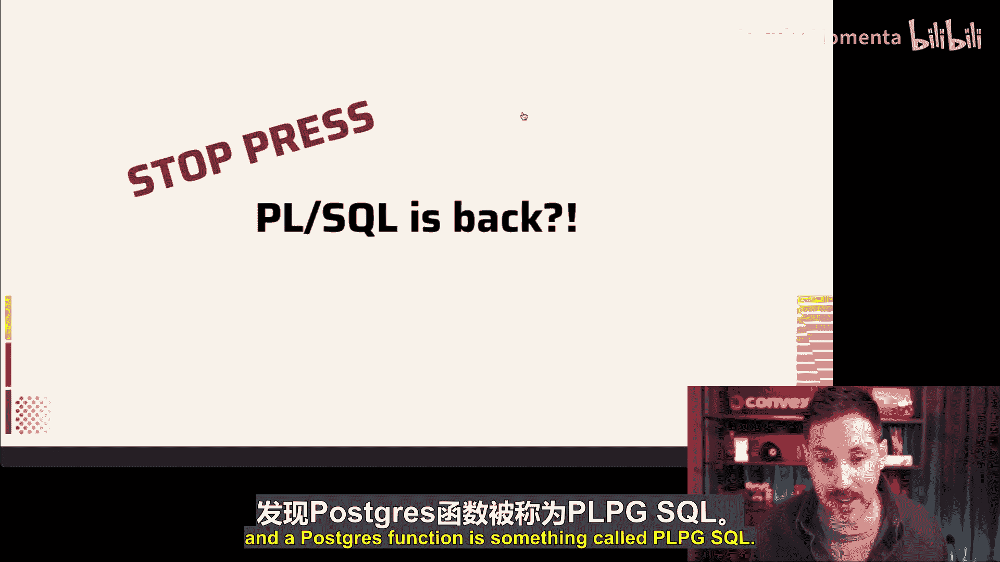
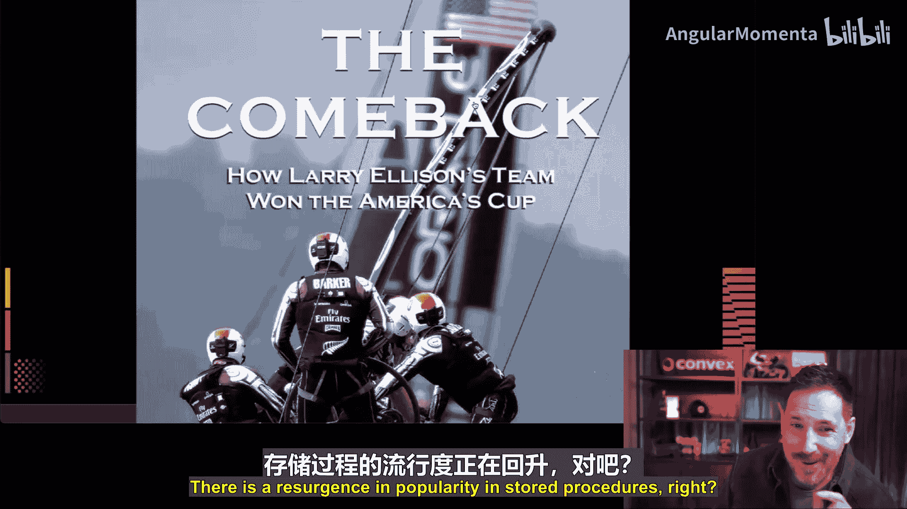
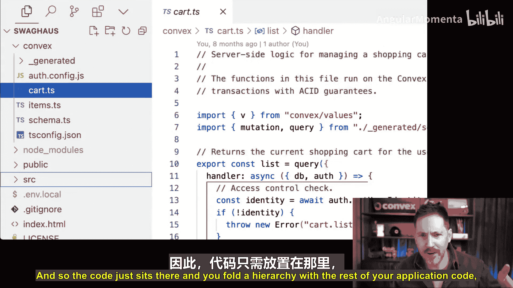
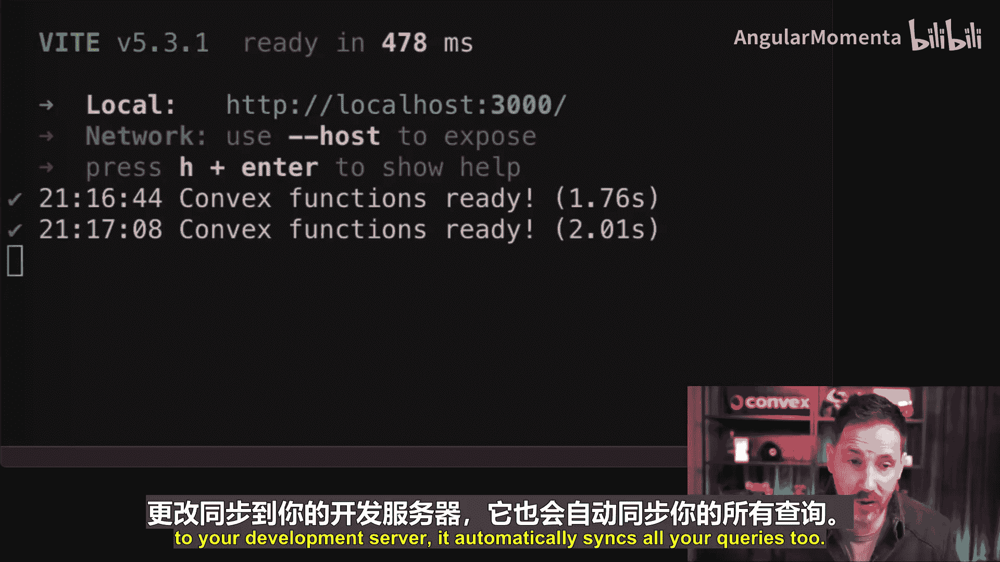
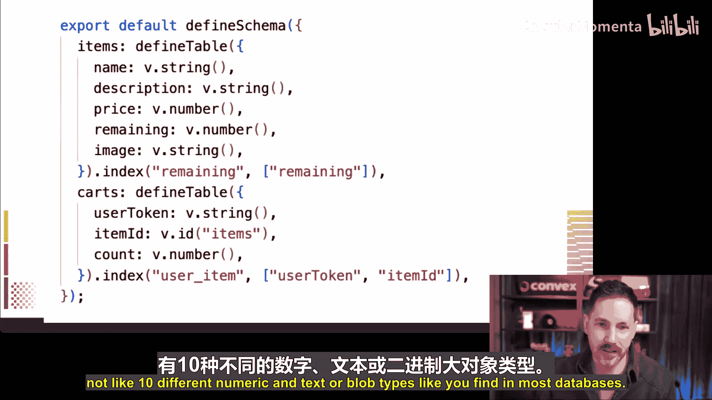
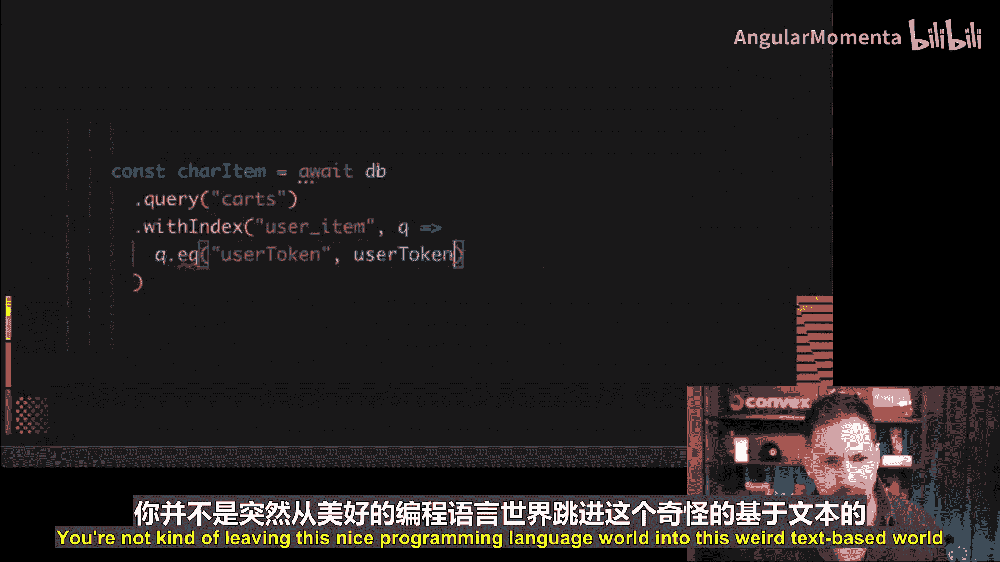
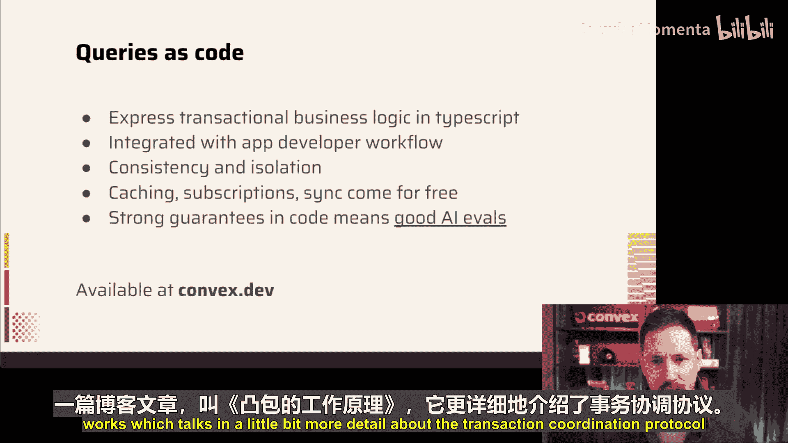

# 【卡内基梅隆大学】SQL 或死亡？系列研讨会 ｜ SQL or Death？ Seminar Series (Spring 2025) p01 01 拉里·埃里森是对的（某种程度上）！面向现代时代的 TypeScript 存储过程（詹姆斯·考林） -BV1FkisBtE97_p1-

有的。

🎼why I hate it。🎼口play。SequL or death Yo son， What are you going to choose yo check it。

 This seminar is filmed at Carnegie Mellon University Thanks a lot Google it's a new semester we're super excited today to kick off the new seminar series of SQL or death And in the goal of this is for to discuss attempts to replace SQL and then attempts to make SQL better through different court Advrs。

 So today were kicking off with attempt to replace SQL we're super excited today to have James Coling。

 is the cofounder of convex， which is the the system with a framework you's going to talk about today。

Prior to that he was in charge of all databases at Dropbox for several years and then prior to that yeah he got his PhD in computer science working with Barbara this call So if you don't know James made point this way there's Brendan Greg Steve Iwin James cowowling those are the three most important people that biggest contributions from Australia to computer systems that's why it's a big deal for us to have James today James the floor is here go for you if you have any question James interrupt as go along as he goes along that way he's not talking to himself for an hour please jump in and if I don't if I don't notice your chat pop up because I'm like looking forward just unmute and yell out I won't mind so cooly everyone and today I'm gonna talk about this idea called database stored procedures and this is the ability to run real code within a transaction and I'm gonna argue that these are actually a pretty good idea even though a lot of people hate them and I think that we should revisit these but not in some weird。

Esoteric language but just in typepescript right so Andy gave me the bio gave my bio already my backgrounds in distributed databases designed the storage system at Dropbox which stores multiple exabytes of data and design the database which runs。

 I don't know several million transactions per second， but not just。😊，A database builder。

 a lot of my my time has be spent managing teams that have the misfortune of using databases and I have a company now called Convex。

 All our customers are application developers have to build on top of databases。

 And so I want to really talk today about addressing some。

Reason why databases aren't meeting the needs of application developers。

 So this a talk about databases。 Hopefully with this audience。 I don't need to explain this。

 but there's this annoying trend right now to conflate these terms SQL database with RDBm right。

 relational database。 So My SQL Postgrel is a relational databases They have structured data and a storage engine and transactions in some way of querying them And it just so happens that way of querying them is is SQL。

But they're great databases otherwise right And so this is not an argument against relational databases。

 this is not a pro NosQL talk in the in the sense that NosQL means no relational databases。

 This is just an argument that we're argument we're interacting with our databases。

 I think in the wrong way。😊，So I'm going start off with some basics and we'll get more advanced as we go。

 So the real core building block in most databases is the transaction right This is the ability to execute stuff Atomically。

 It's the A in acid。 I means you can do multiple things and during the transaction you don't have to think about the world changing underneath you right So databases without transactions is like know writing multithread programs with shared memory and no locks that don't really work。

 So transaction reads some stuff write some stuff and makes some decisions in the process。😊。

So let's start with what I think the most basic transaction， kind of everyone knows。 is is not the。

 the classic transaction people talk about in textbooks。 It's the bank transfer example， right。

 So this is an example where you have a sender and a recipient and you want to move some money from the senders's account to the recipient's account。

Provided the sufficient funds。Am I challenge to you？

Is to write this query in SQL write this query in actual SQL， in pure SQL。

 not in another programming language talking to SQL。

 go write this query in real SQL and if you're watching this on on video。

 you can pause this and go and try and do this challenge right because it's not so easy because you're going to want to use an if statement in there and you can't do an if statement in pure SQL。

😡，So you're probably gonna to look up various SQL extensions， but you can do this in SQL， right。

 So here's an answer in My SQL， at least this is a this is a I don't think this works in Postgres because I don't think you can do two table updates at once in Postgres。

 but you can in My SQL。 So this is an example of， you know。

 a short but relatively convoluted join that will do this thing。😊。

And here's an answer how you could do this in Postgres。 And I believe this works in Postgres。

 There's a， there's a case statement in SQL。 There's no if statement。 This looks。Kd of simple。

 But then if you scared it a bit longer。 It's not that simple。

 And I don't think you would have just written this out by yourself。

 if I just asked you and gave you a minute to do so。 And this is a really simple example。

 this is a very simple bank transfer。 a real life bank transfer involves all sorts of checks and logging and fraud detection And so you'd never be able to write this in SQL。

 and you're probably going say this is stupid。 James。

 like why you asking me to implement business logic in a query language。

 This is not how people use SQL。 And I would say， exactly right。

 SQL is not a language for business logic。 applicationsplication are made up of business logic and SQL is a query language。

So the reason that was hard is because you want to use control structures。

 What you want to use a procedural language and SQL is a declarative query language， right。

 And I gave you the most simple example in the world of a bank transfer。

 Most things are much harder than this， right And of course， no one would ever try to do this in SQL。

 And no one would assume that people do this in SQL， except a few database researchers， right。

 So this is this is this is， you know， a bit of an opus。 This is a classic paper by Andy Pavlo。

 you might know him。 and there's two points made in this paper， right， you know。

 it's a bit of an irreverent paper， obviously， But one is that is that。

The database research assumes serializability and also database research assumes that people use stored procedures。

 run everything in a single atomic block of SQL code。 But in the real world。

 no one actually does this。 right， So what do people do in the real world。

 So they've got kind of two options in the real world。1。😊，And these are both real options。

 by the way。 right， One is the one you'd probably expect。

 You write API services in some other language on the server that talks to the database。Or two。

 which is a very popular and very common model， is to just give up on transactions and leak your entire database to the client。

😡，So I'll talk about the service that API stuff first。

 This is probably how you think a database normally works or how you normally interact with databases。

 If you're at a larger company， this is how you would interact with the database。

 you have a front end and a back end and the front end can't talk to the database right。

 The front end talks to an API service and that API service talks to the database and runs all the business logic。

 right， So this is pretty hard dividing line between the front end and the back end here and only the back end can talk to the D。

And here's an example of how you would implement this bank transfer in Python is probably what you think about when you think of a SQL transaction。

 it's not that complicated， I mean you have select for update in here。

 which is a little bit of a gotcha you'd have to use because you're probably running this in read committedmit。

 but the really important line here is you have an if sender balance is less than a amount right you get to do an if statement。

😊，So this runs in a transaction and the transaction stays open for the duration of that with Con cursor block。

 otherwise you're happy。😊，So this seems like the normal way of writing database code what's wrong with it So it's easy to do the wrong thing。

 It's quite hard to test SQL code right because it's a text based language with weak type safety。

 small typos can easily destroy a company I've seen people make small typos in SQL and destroy databases before in practice it's really easy to blow away your whole company。

😡，So we easy to leave it a where clause and typically in practice。

 no one's really writing SQL queries like this in any larger company you have all these layers of abstraction and OMs which kind of hide the database calls to protect you from them。

😊，It's very easy to leak uncommitted state this is a big problem that you might not think about right when you're in having pretty deep core stacks so you call a function which calls a function which calls a function which talks to a database。

😡，It's very easy to externalize uncommitted database state。

 So it's very easy to go and send an email to a customer before the transaction is committed。

 and this happens all the time。 if people get， you welcome to you know whatever emails and they haven't actually been added to the database yet。

😊，Also， it can have long execution times which block database resources。

 So there's latency between the application server and the database。 Oftentimes。

 you'll be keeping locks open for the duration of this transaction It's very easy to add arbitrary compute in there and take a long time。

 And so you've got snapshots or locks around or undo logs or vacuuming that's not happening。😊。

And as a result， typically， you have to ask someone to write this API for you if you're an application developer because it's quite easy to break the database。

 And this is a real key problem here， I think， and this is not like a trivial problem。

 This is a real real problem that's affecting the industry。 It's this frontend and backend divide。

 So typically there's a team that writes the applications on the database like the team that writes the app code the frontend。

 and a team that writes Apis to talk to the database。

 And every company has a bunch of frontend developers that are annoyed because they can't move fast because it takes too long to convince someone to add Apis And so you end up with stuff like Graphql。

 but even with Graphql need a team there to write resolvers for you。

 there's no kind of silver bullet there。😊，So all these things culminate in this model being inconvenient to use and you don't have to trust me on this because developers have tried to move away from this model。

 at least twice I can think of probably more times。😡，The one was the nosequel movement。

Which despite all the talk about web scale at the time， was really about developer ergonomics。 right。

 So you had this new wave of this web 2。0 app developers were building interactive websites all of a sudden。

 and they're writing the full stack now and they just want to stick some Json in a table and Mongo comes along and they give you the ability to do that。

 And so you if you'， you know， on the younger side， you might not remember this。

 But if you've been around for a while。😊，You'd remember a time when Mongo was。

 was real hot and no one was talking about Postgres。 right。

 So everyone can I move to this NosQL model。And I'm actually a fan of Mongo in this modern incarnation。

 But these databases， these Nosql databases didn't just get rid of SQL。

 They got rid of transactions and relations。 and in large cases， type safety， right。

 And then this happened。 right Then everyone decided they didn't like NosQL。

 right It became all of a sudden， it was really uncool to use Postgres and then it became uncool to use NosQL databases。

 because people wanted transactions and relations and schemas。😊。

And only after this point did we enter this new modern era of like Postgreors cool back then。

 there was like web developers weren't talking excitedly about Postgreors if Postgres was this exciting thing。

😊，So people went back to the old way。Or if API servers talking to databases， but not for long。

 because then the serverless movement came along。 And this is a movement that's that's happening right now。

 We're in this movement。 and， and as I don't think it's going away。

 And I hope that it doesn't go away。This is a movement driven by the needs of app developers or what I' would describe is the new serverless way of building stuff。

 So how are modern apps developed they're started by front end developers thats they call themselves full stack app developers that's who starts the company these days right The apps are typically web apps and they're typically written in Typescript。

😊，And more and more business logic is moving to client code。

 So a lot of these apps are getting written in Typescript on clients in a repo。In JavaScriptscript。

 typepescript repo is getting deployed directly to hosted back end services like Versel or Netlify or Cloudflare。

 et ceter。 So we had this old way。And we've moved to this new way And this new way。

 I think pioneer by Firebase， But I'm not sure who， you know， who， who really drove。

 I think Firebase really became the popular proponents of this model right。

 and had a lot in common with the NosQl movement。 But people are doing this with Postgres now， right。

 It's where you expose the database directly to code running on client applications。😊。

Seems a bit strange， but it's a natural shift towards allowing developers to write their own code in Tpescript and be able to iterate as fast as they want on the app code and deploy their backend code at the same time as they deploy their front end。

😡，And in many ways， this is a rejection of this old front end back end divide。 and in respect。

 I think it's a good thing。Right。I think the lack of a divide is a good thing。

 I don't necessarily this model is a good thing， right？

So what is wrong with just exposing the database to the client。 Well， you know。

 you had all these nice attributes of API services like abstracting a database away But now we're leaking our data model to the client。

 We've got no abstraction。 Now we're just letting the client code see our implementation inside our database and we need to have now row level security。

 you need to have figure out ways of mapping authorization domains to rows in tables。

 which is very complicated it's fine on demo app and a preview app when an application gets large。

 It's quite hard to express all the abstraction and authorization rules in in a couple of RLs configurations。

😊，It leads to thick clients and also it leads to inconsistency because we've largely given up on transactions in this model。

 right， You can't have a client on a website start a transaction and then just go away right you can't trust the client to keep those resources open。

Um， so。😊，What do we do if we want to run a real transaction， What if you want to do a bank transfer。

 Well， I don't think you can， really， I mean， you have to go back to the API model。

 You have to go back to having some code， some on a trusted demon running next to your database。

 which is running the running the bank transaction for you， or you could use stored procedures。

 which we'll get to。But you can't have a client starting a transaction then just going away。

 So in some respects， this movement towards this new model is a movement away from transactions。

 which is， which is not a great thing。So I would argue that the people。

 what the people want is functions， right， They want the ability to express their business logic as actual functions。

 and it wouldn't it be great if we could as that business logic directly to the database and have it run in a transaction。

So this brings us to my boy， Larry， right， the OG database CEO， found of Oracle。

 owner of Big Boats and other things。😡，Third person in the world。

Yeah and and newly married newly married yeah second richest person in the world Andy you said third he's third third rich person in the world you bounce it back between second and third he's third right now so people in the database world love to hate on Larry right perhaps they're jealous of his boats。

 perhaps some other things right but I want to restore on and little Larry right obviously Larry didn't do all the work here okay lots of lots of database designers did the work for P SQel right。

😡，The people have known for a long time。 It's very hard to express business logic in declarative ways。

 right， So in the 80s， Oracle came out with something called Pl SQL。 and it stands for programming。

 not programming。 It stands for procedural language for SQL。

 So procedural language for structured query language， not the best acronym， right。

 but it's the ability to do procedural things like if statements and control flow inside a database query that looks like SQL。

And you might hear these referred to as stored procedures。

 They' restore procedure when you store the PL SQL on on the database like an API that you can call right。

 So this is what it looks like。 This is the bank transfer example in PL SQL。

It's its own programming language， right， It's got its own syntax for exceptions。

 And I don't think I added any logging here。 I guess there's exceptions here。 You can。

 there's logging。 You can call log statements and you can do all sorts of things。 It's a。

 it's a real programming language。 And you can write real business logic and run it directly within the database。

😊，So why were these invented right it was an attempt to make SQL queries into a real programming language Yes's a real programming language right and moves business logic。

😡，To the database， it supports loops。And conditional logic。It minimizes round trips to the database。

 which is quite important if you want good performance right instead of having an API server sitting somewhere maybe even on the edge quite far from your database and your database you know in a different location with all this round trip times between your application code in Python perhaps and your database。

 it's sitting right there inside the database without these round trips。😊。

It gives you error handling， it gives you modularity， right， sick， sounds awesome， right。

 solves all our problems。We can just run programs in the database。

But I want to go back to this paper， right this paper keeps bugging me right because it says no one uses stored procedures。

 right， Why is that， Why does no one use stored procedures？I think you can guess the answer。

I think you can guess the answer， because I would ask you。

 do you want to use this language to write your application？

Because no one wants to use the weirded esoteric language to write their business logic， right？嗯。

Andy， were you going to jump in there， I saw you lean in。

It's based on Ada which is the successor to Pascal。Right， so it's it's it's from the 80s。

 It's only yes。 Yes。 and and this is a bank transfer that does。 No bank does a transfer like this。

 right， but you don't bank doesn't do like -1 and plus one， right。

 There's all sorts of stuff going on in there， right。

 So fraud detection and computing exchange rates and all sorts of things like that。 right。

 So real applications， implement business logic with real libraries。

 And you want to build an entire stack in this programming language that doesn't fit at all within your developer workflow You probably don't want to use it。

 right， So people don't use it。 now。Stop press。😡，I realized I got something wrong。

 So as I was making these slides。I Googled。😡，How do you implement the bank transfer example in Superbase。

 Because I was quite quite curious if anyone had done this。

 right And I found a video that actually suggests that you should do this using Postgres functions。

 And I looked into what a Postgres function was。 And a Postgres function is something called PLPG SQL。

 it's P SQL， right。😊。

So our boy Larry's back right， there is a resurgence in popularity in stored procedures。 right。

 It's not the oracle version of this。 It's the Postgres version， which is called PLPGSQL。

 which again， fairly terrible acronym。😊。

But this is still， this is not， this is not how you build your application。

 People aren't building real business logic in PLPG SQL， right。

 It's just as hard to use as the Oracle version， right。So what's wrong with stored procedures。

 Sometimes you have like a really good idea。 I think stored procedures are a really good idea。

 But you're going about it the wrong way。 And it reminds you this article。

 I just found this article just before this talk。 Not wanting to pollute the ocean。

 Larry Eson employs a man who follows his super yacht in the speedboat。

 His sole job is retrieve basketball was to go overboard。 Now， I don't know if this is true。

 I hope it is。 It's， it's a funny article， right， I felt this is amusing。

 This is some good intentions， but not quite right in the execution。 I think stored procedures。😊。

There's a lot of good ideas there， Not quite right。 What was wrong with stored procedures。 One。

 it doesn't solve your software engineering challenges， right。

 you want testing and types and libraries and get integration and standard logging and to use century or whatever。

 right You want to be in the same language that you always use。

 That's the whole software engineering thing right。

 so it doesn't solve the software engineering challenges。😡。

And also you want some isolation from the database。

 So if you work at a bigger company that has Dbas right， you should go to your DbaAs and ask them。

 hey， can I can you install this P SQL store procedure for me and they will say no right。

 they will say no because they don't trust you to run some code inside the database right unless。

Your finance， you know， or using oracle might might be different， right。

 but for any application code。Daatabases aren't designed to have huge amounts of general purpose to compute running inside of them。

 right， And if the P SQl goes wrong， it can do bad things to the database， right。

 So typically they you don't have very good isolation between the execution and the storage。So。

Good idea， But it kind of solved none of our problems， right。

 It was inconvenient to write API services， but store procedures are， I think， more inconvenient。

 and it doesn't make life any better for application developers because they now have to write everything in this weird new language and duplicate all their business logic into it。

 right， And that makes Larry Ellison sad， Everyone critiquing P SQL and store procedures。

 and I can't stand by and watch that happen。 So what are we going do about that。😊。

So what if we rethink store procedures a little bit， right， if we go back to this code back here。

 Where is it， Here we go， right。What if this code was just in typepescript。

 What is it in a regular old programming language that we use all the time， right in the most。

 what if it was in the most popular programming language in the world， right。

It would solve a lot of our software engineering problems right if we just integrate it directly into our workflow。

 the same people writing the application would write the queries in the database， right。😡。

But then we have to make it safe。 We have to make it sure that it someone said isn't SQL the most popular。

 I don't know， SQLel the most popular language。I don't know let's say let's say close enough SQLs made the most popular query language it was there was a survey last year where from Ihe where SQL is the number one programminging language that students want to know Python is number two。

Want to know。 Yeah， I think if you need it for the careers。

 I think if you look at lines of code getting written these days， I， I believe it's Typescript Smo。

 but hey， maybe I'm wrong。 It's close enough， right？ I think if you。

 if you go build a web app these days， it's gonna be， it's gonna be jascript and Tscript， by the way。

 yes。They're the same thing effectively， right？All this stuff I'm gonna to say applies fairly well to Java as well。

 So we need to make this。 yes， we get all the software and engineering benefits。

 We have to make it safe， right， It feels weird to run Typescript in our database。

 And so we'll get to that。 So we can move the business logic back to where the database is as server functions。

 And we just let the application developer write it in the language that we're already using right。😊。

So let's talk about the software engineering experience of building a basic app。

 that talks for database using Tpescript。 So here's a basic little shopping cart demonstration I've used a few times。

 I guess the source codes online there， it's obviously a trivial little app right And so you can add items to the cart and the stock available goes down and the amount in your cart goes up and the prices increment。

 etcter。 And this is a multiplayer application。 So if someone else puts the hovercraft in their cart。

 it should disappear for sale from you And there's lots of different components on the screen here that have to stay in sync。

So how do we write the que is， well， we just write them as regular typescript functions that execute atomically as a transaction。

 Here's a very， very simple function that just fetches， fetches the items available for purchase。

 It just looks up all the items table where remaining is greater than0。😊。

But you can do something more interesting right So here's here's the mutation that adds something to to your car。

 And it does just the obvious things。 It first checks if you're authorized to do so that's that's out of screen here。

 I crop that out then it looks up the items and sees it as remaining stock and then it adds adds it to the card and then it deducts it from from available in stock。

 and it just does the basic stuff in procedural language And in practice。

 you'd call out to a bunch of libraries to do stuff。

 So in practice when you're checking if someone's authorized to do something。

 you're not going manually look up the off table， there's a library that you're written called check off and you just call that So we have folks using convex who have really huge cobas running in these functions。

 it's just general purpose type cry or jascript。😊，And so the code just sits there and you folder hierarchy with the rest of your application code just like you're building a regular web app right and then you know if you're running you know a web app and you're running MPM run dev to automatically sync changes to your development server。

 it automatically syncs all or your queries too， it's just this interactive developer experience that developers have come to expect and experience。

😊。

And then you can run tests on them right so here's a simple test for an app I wrote is using VT Vt Vt so it does a lot of things。

 it mocks out the user identity， it mocks out time， it advances timer， so's obviously a short test。

 but you can write this just like a real test right which is really。

 really hard to do for something like a SQL query。😊，and by the way。

 it uses the same types as the rest of your application， not like you know。

 10 different numerical American and textile blob types like you find in most databases。😊。

And then with all that， you get， you get type safety and you get autocomp like you've come to expect from you know。

 a first class app development experience， you're not kind of leaving this nice programming language world into this weird text based world all of a sudden。

😡。

Just to be clear the Tpescript function is not running you're not like converting to something that runs in Postgres or whatever the business it iss's there's a javascript engine server side sitting in front of the data system absolutely I'll explain that in a second but it's running real real code in V8 got and and then you can run RPcs you know you can call your client code directly you to call these functions like RPcs or you even bind them to to a react component and have your client update automatically so is this is the query this is the client side code to render all the items available for stock and it just binds the results of the query called get items and just refreshes the component anytime data changes。

So this feels like programming because it is it's just programming right It's about as ergonomic。

 I think， as you can get as an application developer。

 I think it's kind of the holy grail of interaction patterns。

 And so you might ask why did this not exist already right one people don't like changing things in the database world right and this is not written in SQL So Ill give you that But the other is this has to be implemented correctly or it doesn't solve a lot of the safety issues I mentioned before。

 a lot of the isolation issues。😊，So what would we have to do to kind of convince the DBA that this is okay。

Well， we have to make sure that these Typecr functions don't have side effects that don't leak any state out of the transaction。

 and we have to make sure that we have pretty good isolation from database compute and memory and transaction protocol。

So let's talk about the convex runtime so the convex runtime is implementation of typescript store procedures。

 We have these two concepts of queries and mutations， queries of pure functions。

 they just read data and mutations can read and write right。The type system matches jascript。

 typepescript。 We run。 I'm putting arbitrary in quotes， arbitrary typescript。

 There's a couple of catches， right， It's side effect effect free。 So we don't let you call fetch。

 We don't let you talk to the file system。 That's， that's pretty common and pretty easy to do in V 8。

 Also， we happen to make these these functions deterministic。 So we mock out time and random。

 It's a bit of an implementation detail that helps without caching。

 I think you wouldn't necessarily have to do then。And we run these all in a jascript environment they can call into the database。

 So here's a conceptual model。 right， So you have the database。 Yeah。

 you can spin up V8 context these days in hundreds of microseconds。😊。

And V 8 enforces side effects free and determinism。

 And they'll we expose the assist calls thatll let you call into the database。

 So D B dot get DB dot with index， for example， And they kind of let you call into the database。

 And I'll talk more about that in a second。 It's V8， So actually supports Wm。 we have some。

 some some customers running go code in this queries。

 So it's not specifically Typescript But obviously， it's more ergonomic。When written with Tscript。U。

😊，But you can't you can't actually run V8 inside a database or maybe you could。

 but you wouldn't want to right because databases aren't designed for being highly efficient compute engines。

 right？😡，In in the case of convex， we do this kind of separating storage from execution thing， right。

 where all the concurrency control logic is is performed in our backend engine。

 but all the index state and storage is stored in a big distributed My SQl cluster。

 and convex actually works on My SQql and Postgres and SQL light， It doesn't really matter。

 the difference is that from my perspective， relatively esoteric。😊。

So the database can focus on doing reliable database things and we just run it on RDS and then all the kind of logic around transaction coordination and executing code in V8 runs on this high performance scale art execution cluster。

😊，RightSo you might ask， well， how do you get transactionality if the code isn't running on the database machine。

 It looks a little bit like the API server model。 is it not the same thing as an API service。

 Not quite， right。So。I agree real code needs real transactions right and so this is even more important when you're doing like arbitrary code because this code can do a lot of complicated things and run lots of different called libraries。

 you don't know what that library is doing inside of it sometimes as libraries talk to the database too it's really nice if that can execute as a transaction extra nice if it supports serializability。

 you don't have the reason about interactions between this different functions。😊，U。

And so how do we do it？Ive deleted a slide about why we don't use two phase locking。

 I can talk about that afterwards if you'd like， two phase locking gets a little bit complicated with deadlock detection and locks being held open for too long。

😊，But we use a type of optimistic concurrency control called multiviin concurrency control and you might not be familiar。

 you might be familiar， but I'll explain what these are。 we use fairly standard techniques。

 So we store the data in such a way in the database in my SQL， for example。

 that is very efficient to read a snapshot of the database at a given point in time so so it's basically log structured data we can say as of this timetamp。

 give me a snapshot and for every query we run that query on a snapshot and at the end we try to commit if that snapshots valid So I'll give you a bit more detail here。

😡，I think we do something relatively similar to databases like Foundation DB， maybe Fauna DB。😊。

It's more of a kind of a timestamp oracle kind of model here， right。

 so you have this execution machine sitting there and it gets a request to run a query。😊。

And so it picks a timestamp ask that oracle for a timestamp， timestamp T。😡。

And then it goes up and runs， it runs the entire transaction as of timestamp T。

And it records and remembers all the read ranges， all the data ranges it reads。

 and then it buffers up all the rights so it wants to write back to the database and then you get to the end of the transaction you have to decide。

 is it safe to commit。😊，So we have a relatively efficient structure that can can see if any changes have happened between two timestamps。

 So at the end of the transaction， the latest timestamps， timestamp N。

 we see if any rights have come in that conflict with any of our reads。If they are。

 that's an optimistic concurrency control conflict。 We retry the transaction。 Otherwise。

 we just give the transaction the latest timet and we commit it。 right。

 This might seem a little bit complicated if you're new to this， but it's a。

 it's a pretty standard technique。 You know， I think oftentimes， you know。

 there's these two ways of going down the path of distributed databases。

 There's like two phase commit star models。 And there's like timestamp oracle kind of models。

 And this is more the foundation Db way of doing things。All right。

I'm going to talk about the query language briefly。

 but I think the query language is not the most interesting part。 quick question on that。

 is super interesting Do you have other transaction models too。

 like this is not going to get you full serializability， but maybe that's not the goal。

 Your applications you're targeting may not need that。 for example。

 you have whatever you read earlier to get that components targeting a certain class of applications。

 The banking example probably needs a little bit more right Yeah。

 so this really is serializable because we keep read ranges。

 Everything is like we don't we don't have like phantoms， for example。

 like we are keeping real read ranges， but at the end。

 I'm going talk about about serializability because there are situations where you don't want serializability and so we'll put that in hold and we'll come back to that towards the end because I want to talk about situations where you want to。

Relinquish serializability。SoThank you and yeah， yeah。And like aless。

 where are we cool so I'll talk about the query model again can I can I ask one question here so you obviously decided to implement transactions in the V8 containers rather than Z user transactions that exist in MysQl or Postgres。

😊，You could have you could have done that you could have inserted a big big in transaction and transaction and you could have used the back in transactions not to Yes。

 so the way we actually use the database is not how to describe it we use My SQL basically as a as a right ahead log。

So it's a version writerhead log， so basically we store all the timestamps and the states as of that timestamp and obviously the indexes as well。

 all the transaction coordination logic is done in user space I guess or in our rust code base。

 so we really use the database when it comes down to it for a durable writerhead log and the ability to perform queries on a timestamp snapshots。

😊，And this gives us the ability to。Well， it gives us the ability to。

 to have our own kind of custom schema。 like like the， the users schema， for example， is not。

In the database， right， everything is done application level， right。

 we can do our own concurrency control and then really we're using the database as a storage engine。

😊，And I can talk in more detail about that towards the end if if there's more questions。

 So the back end could have been a regular key value story didnt have to be It could be a key value store that allowed range reads right because we do we do treat it somewhat like like a be tree。

 So so we our query actually， I'll talk about the query model right now query model is just ranges of a B trace really。

😊，And so we don't have a query planner， and that was a choice we made。

 It was a choice we made based on our experience running large databases。

 because in in large organizations， you don't really want a query planner。 In fact。

 in any large installation， I've seen you typically force indexes and use pretty limited subsets of SQL and you're not doing know random joins in production。

 So our our kind of postulate is that it's sufficiently ergonomic。To just。

 just describe your queries in a declarative way in in an imperative way。

 rather than having to have a query planner in there that slows things down and can make things as non deterministic and also could lead to unexpected a performance degradation。

 We could have supported a SQL in this model。 And I'll talk about that a little bit later as well。

 right So our query model literally is either get。From an I D。 and internally。

 that gets translated from get from an Id in our query language to underneath get from an I D and a timestamp。

Or it's range scan over a table or range scan over an index and then internally that's translated down to range scan over an index as of a timestamp。

 And so that's all we require from the database So this is this is how this is how reads happen。

 you know queried up with index and then you can range over that index。You can insert now。

 everything else in convex is in user space， right， And this is。Maybe maybe a contentious thing。

 so if you want to do a join in convex， you just do it in the application level。😊，Now。

 what is a joint。 I think people have this perception。

 A lot of people who use SQL think joins are somehow magical that somehow the database can do some magic query planning thing that doesn't look like walking over a table and looking up another table typicallyy that that's not happening right So so if you want to do a join in convex。

 we do that at the application level in parallel just like this using a parallel map。😊。

I think in practice this is maybe a little bit inconvenient right and so we have a helper for joins and we're going to have a new version of a new version of Comvex that will have better support for joins just as a concession towards user ergonomics but you know basically a core part of Comvex as API is to make expensive things look expensive and make cheap things look cheap so we want we want to joins to look like what a joins doing。

😊，Now that said， SQL could compile down to this too， We could take a SQL statement。 Obviously。

 wed want the typescript there， but the actual queries that do like Db dot get or whatever。

 you could write them in SQL right and we could run a static query planner and compile them down to range scans on the database And we actually used to have this The very earlier version of convex had this in there。

 We stripped it out。 It was getting a bit clunky because it's not type safe。 It's left expressive。

 but hey，' there's a possibility we add this back sometimestime。

 If people really want to run a SQL query instead of calling dot with index， whatever。

 there's nothing stopping us doing that， right all we have to do is translate this down into range scans as of a timestamp。

😊，And that's what's going on underneath the system。Com。嗯。

So how does the world look different now that we can run code in the database， right？

 So we've kind of we' I'm gonna， I'm going to claim that we've solved the ergonomics and the isolation problems。

 But what else can we get， What other benefits can we get， Well， one is that caching comes for free。

 And when I say caching， I don't mean row caching， I mean， query caching。😊。

So caching validations classically one of the hardest problems in computer science。

 query caching is when you cache the result of a function。 So you run some complicated thing。

 read a whole bunch of data， do some computation， and then you cache the result of that right query caching is really powerful。

 It's a very efficient way to cache， you don't have to run use code over and over again。

 but it's very hard to do Man managing a query cache is quite tricky But in Comvex caching comes for free。

😊，Because we know the read set for every query and we know the right set for every mutation。

 and we have an efficient intersection mechanism for determining whether a mutation intersects with a read set。

😊，So we just cache a query until it's invalidd about mutation。 right， You get that for free， right。

 And so you might say， well， caching is hard， right， There's a lot of gotchas when it comes to caing。

 and， and， and you're right。 There are a lot of gotchas。😊。

I'll give you an example of the gotcha with caching。

 just say we cache a result of a query with a certain version of the source code and then you go and change the source code。

 you go and know change the thought procedure to do something slightly different。

 you have to go and invalidate all those previous cache values And so typically when people are writing caching code partly why they consider it so hard iss all the corner cases and gotchas you have to deal with but in convex。

 these problems just go away automatically， for example， in the source code example。

 every query depends on its source code every query has to read its source code before it runs So the source code is in the read set for the query。

😊，And if you upload a new version of that source code。

 that's a mutation that invalidates the previous reset。

 and so that is conflicts and invalidates the cache。😊，But also， if you have caching。

 if you have query caching， subscriptions come for free。

 because if you know whenever data is whenever the result of a query changes。

 you can just subscribe to that query， you can say give me the latest version of that query whenever the data changes underneath and you can do that very efficiently。

 You don't have to do this kind of spin looping or polling， you get this for free。

 So what can you do with subscriptions while you can build a sync protocol right This is kind of the end of polling。

 you don't have to know you're pushing the interface with the database right out to the application level Well you can just say bind the results。

😊，Of this query to this component。And refresh whenever the data changes。 So this was the query to。

 this was the react code to render the items list。And as you see here in the left。

 every time the data changes on the back end， that component just refreshes automatically。

 there's no need for no need for manual polling logic or manual consistency logic。

 So if you're familiar with react and functional paradigms that update components whenever data changes。

 this will be very familiar with you， it's just react。

 but as react all the way to the database And again， there's there's always gotchas right。

 And so you've got to kind of pressure test is to see if if thiss designed correctly right。😊。

Do we get true end to end consistency？😡，Because there's at least two queries here。

 There's a query that gives you the list of items for sale and the query that gives you all the items in your cart and it would be pretty unfortunate if these got out of sync。

 if you had something in your cart but it wasn't in your if it was still in the available for sale and a lot of complex logic and a lot of modern applications。

 deals with state management how to keep all the stuff in sync with each other but in convex this problem is done automatically for you because we know what queries have subscribed to and all this stuff is serialized over a web socket So we just send you all the changes in lockstep。

 you get the changes in a serial order and if two queries are invalidated at the same time。

 those components will refresh on the browser atically。😊，All right， awesome。

 we have real store procedures they're expressive and they' ergonomic to use Larry is happy。

 he was right all along， This is a real book， by the way。😊，Yeah。

It's the difference in God and Larry Ellison， God doesn't think he's Larry Ellison。

 so that's the updated cover， but yes。😊，Oh you've got this book， Andy， I give it out。

 I used to give it out to the students。Well， okay， maybe I should read it。

It anybody I read it I'll tell you where after you go Okay， and by the way。

 I'm just talking about Larry Allson because there's lots of funny pictures of Larry Allson obviously props to the engineers and database researchers who designed all this stuff originally right cool。

 So we have store procedures and Andy， someone I care about can go back to having a happy fulfilling life except。

😊，There was two claims in that paper， right， It's a long paper。 you might have missed that。

 The two claims where no one uses store procedures and no one uses serializability。

And why don't people use serializability because there's a belief that serializability doesn't scale And it's not a dumb belief。

 like there's reasons for this belief。 So what is serializability。

 probably most people on this call note serializability is serializability in some extent is the strongest version of consistency。

 slightly less than linearizability the serializability means that if you have a serializable database and you interact with it。

 multiple people interacting with it at the same time it looks as if to the users。

 everyone's running it one at a time in a serial order you don't have to have to think about what anyone is doing。

 you don't need stuff like select for update and all all these gotes the serializability does have scaling limitations because if you have queries that touch each other's data in every query。

 they can only happen one at a time and if they can only happen one at a time。

 you can only get as much throughput as the latency it takes to run a single single query Now in practice welldes apps。

Try to design them in such try to be application developers。

 try to design their their query in such a way that they don't conflict with each other， right。

 but sometimes。You don't need serializability。 Sometimes what you want is asynchrony。

 So asynchrony is a very important property of of a system with strong guarantees。 right。

 your database gives you serializability， if you want it。

But you can also opt out to just doing things later right So because we control the runtime in convex。

 we just added a scheduler to it。Right， so there's also a function called C T X dot schedule dot run after this。

 this is actually saying dot run after0。 And what this is saying is once this mutation commits。😊。

Just just run this other function later on。😡，You know， immediately after whenever you get a chance。

 it looks。 So you can， you've also run after one second。

 there's various things you can do with a scheduler。 But the ability to run scheduling。 And by。

 this is， this is scheduling state that's committed to the database and is transactional， right。

 So the the ability to do scheduling allows you to chain together the， you know， these。

 these transaction into workflows that resemble something like temporal， you know。

 but have them be transactionally consistent with the database。😊，All right。

I've talked about queries this code， right， They allow you to express business logic in Typescript。

They're deeply integrated with application developer workflows。

 so app developers can can use them happily。 They provide you consistency and isolation so you can build correct apps that don't get overcomplicated。

 and you get catchching and subscriptions and sync for free。

 So you don't need to do stuff like polling and cash and validation and something I didn't have time to talk about。

 but it's kind of real new research we're doing。 We're finding that Lms really love writing queries as code for a variety of reasons。

 one strong type safety and good highle building blocks。

 But also you can build good evals very easily。 So if you're writing queries as code that have strong guarantees that commit atomically that have sterizability it's very easy for Lm to attempt to build something and then run tests to see if it works。

 So we've got some more information coming out soon， but we're getting very， very promising results。

😊，usingsing LLM to write convex code in particular。 And so you know it kind of furths my belief that。

 you know what's good for the humans is good for the robot and vice versa。 So that's it。

 that's' that's that's my argument towards queriess code。

 And I try to keep this pretty general and not about convex。

 I just think this is this is a good idea in general。 All the stuff does exist。

 It's available at convex。 Dave。 you can use it today。😊，Thanks。

Cl on behalf of everyone here James fantastic we have about 10 minutes or so for questions so if you have a question for James go ahead and unmute yourself and fire away。

James， this was an excellent talk。So Oracle and Snowflake has JavaScript as a stored procedure as a UDF language。

Yeah。Does that get you a back door to doing this without having to do all the other set up in the database or you still？

Need all the other additional server side stuff that you're doing。 That's a good question now。

 I mean， snowflake quite different， right， So snowflake could be all up， all up， right， I mean。

 presumably offering in the O up product。 I'm not familiar with with。

 I'm not familiar with UDFs in Oracle。But I imagine， I mean。

 if they're doing something like this similar to this， that's great。

 but I think what makes this powerful is is really putting it in the developer workflow of the customers of this web developers and application developers。

 the customers aren't。😊，Dbas， you know， and so I， I'd be quite curious as to the ergonomics of that and。

 and and how well that that fits into the platform。 But， you know， in terms of how this is built。

 So Comx is open source。On Thursday， so in three days from now。

 we're open sourcing a version that right now， the open source convex runs on SQL light or open sourcing the version that runs on distributed My SQL and on Postgres and so for us it's advantageous to have this pretty clear separation between the storage layer and the rest of convex。

 and I have built storage engines before， I I'm particularly want to build a storage engine again。

 so for us， it's nice being able to use an off the shelf storage engine。😊，Good。

 I have a second question that see anyone else wants to go。I saw a question come through here。

Why isn't the PL SQl something like WSm where you could easily implement compiles in different languages throughout the need for extra V context。

 Perhaps why not even implement a Db that uses WASM as a stored procedure language？ Yeah。

 that's interesting。😡，So， yes， this this is。 this does support WasSm， right。

 So so V 8 will execute Wasm code for you。 We very occasionally do that。

We haven't had tremendous demand from folks wanting languages other than Typescript。

 although this could be selection bias。 but， I think the ability。

Supporting Typescript and having like nice Typescript types and having a really ergonomic interface for using Typecr has been what people have been happy with so far。

 but yeah I mean I' totally be down to support other languages。

 but I do think you know you have this question about is V8 the right run time？😡。

Because V8 is not as expressive as node， for example， right， So， so you can't run necessarily。

 depending on what what what run time you're running。

 you can't necessarily run all library functions。In V8。

 but the nice thing with V8 is makes it very easier for us to kind of intercept calls for the database。

 etc cea， but yeah I think，😊，Pretty key to this is this separation of storage and execution I'm not really going to advocate for someone running real code in a database unless let's we design a database from the ground up and yes。

 we could do that。 but databases are complicated enough as they are they have enough and most of them have 30 years of baggage about you know managing state and memory。

 etc。 And I don't think throwing like general purpose compute in them is the right move。

convex handle ordering in the client side forget getting the events and everything？Yeah。

 so there is a there is a sync protocol。 and so my。

2 cofoers Jamie and Suji actually wrote the Dropbox sync protocols for the desktop client at Dropbox and so they've got a little experience building syncnc protocols。

 And so we actually have a web socket protocol when you're writing a convex app typically there's a single web socket that're sitting there and all requests and responses go over that web socket。

 there are kind of out of band ways of sending requests out of band to avoid head ofline blocking。😊。

But we order all updates serially over the web so so there's no reordering it's required locally。

 but yeah， so there's there's like a client side library which does all this ordering going up to the back end and on the way back。

😡，This is for the sync side of Comvex。 You can also just use convex like an RP PCC server。

 You could just call。An H to endpoint and talk to the database like that。

 but without any of that and the sync and then you wouldn't get end to end consistency。

 you'd only get consistency in the database。嗯。James。

 if I may i'll first ask a question and then provide a bit of an interesting context for it so just as a confirmation as I imagine convicts convictx is designed for mostly transactional OTp。

Loads and not， not for all app like analytical queries and whatnot。 Yeah。

 I have a lot to talk about that。 But yes， the short answer is yes， it's OTP。

 but theres it's an interesting discussion there because fun fact。

 I work at the company which writes all of it business logic in SQ We have a very difficult networking algorithms completely encoded in SQ。

 which frequently have like 15 joints。😊，And。And in the process of working with it。

 I come came to the appreciation of how extremely complex SQ query optimization engines are and how much they。

😊，Fter out unnecessary computation and it came to my mind when I saw your example of like everything being in user space where you sort of queried over one table and then joined it with another and you loaded everything into the memory and you sort of join them manually and I can't imagine that would be very very slow when you have like sort of an analytical workload or or a query which like simply does a join over two big tables so do you have you have plans for adding sort of I would imagine a library that would。

hide the complexity of doing a proper join。 like， let's say。

 like all the join algorithms that Postgre has。 I don know Mer join has join ce。

 that hides this behind and hide hides this behind the scenes。

 And sort of allows you to rate efficient and workloads。 Yeah， this is a great question。

 So so firstly， yes， convex is designed for live site O TP workloads where you want your  query to be relatively fast because it a user in the critical path。

 And I should have made this more clear。 But almost everything I'm saying today is really about O TP。

 I think all apps quite different because I think the difference is typically with O TP， you know。

 what you want and you know how to achieve it。 generally it's relatively simple things like you know。

 add this person to this thing。 Look up the state whereas O app is is。Obviously， by definition。

 more analytical， right， you kind of want some kind of answers。

 you don't necessarily know how to fetch them and you and you don't care about tight latency guarantees with OAP typically right。

 So OAP quite different。 The planning is really important because there's huge amounts of data getting queried and you have to come with a complex query plan。

 And so I'm pretty like down with like with with declarative query models for OAP。

I think it makes a lot of sense。 I think OTP typically， almost everything you're doing is indexed。

 right， If you're doing any kind of complex like query planning in an OTP query is probably something going wrong。

 right So so so there's two things you said there。 one about joins。

 one about what about if you want to analytics， So joins。 Yeah， there's a few things we could do。

 We could do pushdown。 So so right now you're right， like we do read our statement into memory。

 right， now there's， there's optimizations。 We do prefetching。 We do various things under the covers。

 we could also do pushdown where we we static analyze the code and and implement more of it on the data。

😊，We don't do that right now to a very extensive degree。

 And also I think I think we probably should add a joint helper to be on it。

 I think you're right But the other thing you touched on is is analytics So I have no ambition to compete with snowflake and data bricks but every now and then in in a website in a live app。

 you want to do something I call baby O app you want to like read overall your users and complete the high score compute the high score or something and it's not easy to do that efficiently And so even if sometimes a query takes 30 seconds So don' we don't allow you to run like a 30 second query we keep everything very tight。

 So so it's high performance。 I think there's room for allowing people to run less efficient queries and we're exploring two things currently one is keeping these snapshots around a lot longer。

 So right now it's with retention， it's a little bit hard for us to keep snapshots around for a long time at a timestamp And if we can keep them around longer。

 you could just run。😊，Really long query， a stale query the other is we have a prototype of rank duct Db on convex where we just dump all our data inductDb now assuming it's tractable data sizes to be queried by DDb anyway。

I guess the short answer is after a long answer is that you're， you're right。

 This is really targeted OTP， but there is a demand， I think for for baby all up， right。

 for little analytics。 And I think we need to add some more features for that。😊，And thanks a lot。

 thanks a lot and a very short like sort of upcoming question。As a developer base of convex。

 do you think it is possible at all to sort of do a complex analytical join in a language like Tcrri without encoing your queries farther in like I and sending them to the database and getting the results back like does it would it be ever possible to fit？

That logic into like an imperative language Yeah and you would know the answer better than me。

 but there are people doing this right people are using imperative languages for analytics queries people did that shit with Hadoop that's dead right there's so many different choices you have to make an unlock the Macquaium plan you do not want your program of writing this。

This is the classic SequL debate from the 1970s。Because any assumption you bake in your code about what should be the right join node or how to push down in certain operators。

 if the data evolves and changes， you don't want it to go back and rewrite all your code。

So for baby things sure or like again， the you know gogan the last 10 things， but like。

Anything very complicated is me a bad idea。Okay。Yes and there's there's that paper yes from I just saw a comment about status quo I'm not familiar with with work。

 but I do know both Alvin Alvin and Sam so I should check out status quo Alvin's Ph thesis was on basically pushing down like hibernate code like if it detects you doing a join in Java it then pushes that down to the Davis。

 but it can't actually move it back and forth based on the load of the system other thing I'll say is I'm not I'm not particularly like。

Anti query planning right， I think I I prefer for all to static query planning at least so you know what's going to happen in production right。

 but I think。this paradigm is is is compatible with query planning where that makes sense， right。

 like I said， like we've chosen to use a very imperative style of querying where you're traversing over B trees space with Bea ranges but but I think the key point here is the queriess code and and you could you could run it with with some kind of assistance via even know LLM based assistance。

 you know， you're in programming language territory then so so。There' there's lots you can do。

My last question was more clarification， like you have this middleware that sits in front of the Davis server and then the textscript piece that's trying to determine the serial ordering of transactions。

Is that assuming that the database server is like a like a primary replica set up so that you would then do the right to the primary and let the database server replicate it to the replica or is that middleware potentially sending it out to different nodes or you know instances and doing like a multi primary write up multiho write up right yeah so so there's not multi primary right so so so there's there's a few。

Points of。Non scale in the system。 right， One is you have to have a timestamp oracle。 right Now。

 it turns out you can scale this。Pretty widely。 if you， all you're doing is picking times stamps。

 you， you can run a lot of transactions I can through that And the sec and then you need to install your rights into a primary。

 right， But but once you have a times stampamp。You were able to go and read that snapshot wherever that snapshot's available。

 you could even， we don't do this， but you could read that snapshot from S3 if you needed to。

 you know， but but basically。😡，When you commit a transaction at the end。

 you're just installing rights， it just taking a bulk set of data updates and you're putting them into the database as of a timestamp。

😡，Got it， okay， awesome， all right， let's get help。Bver James fantastic talk。

 thank you for kick this off it was very。A lot of you us so stuck around in the very end they Tony it's a good top Okay because go ahead sorry I'll I saw those I saw think Chris had a question if people have more questions reach out feel free to hit me up on X Twitter it's just James A Cowlling and or try it out We also have a blog post called how convex works which talks in a little bit more detail about the transaction coordination protocol。

😡。

