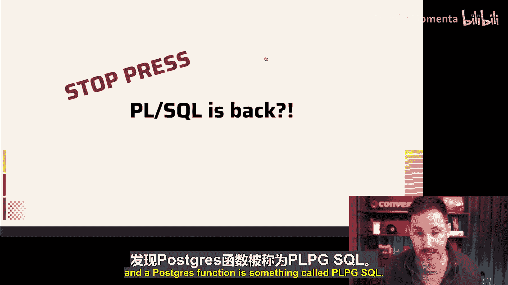
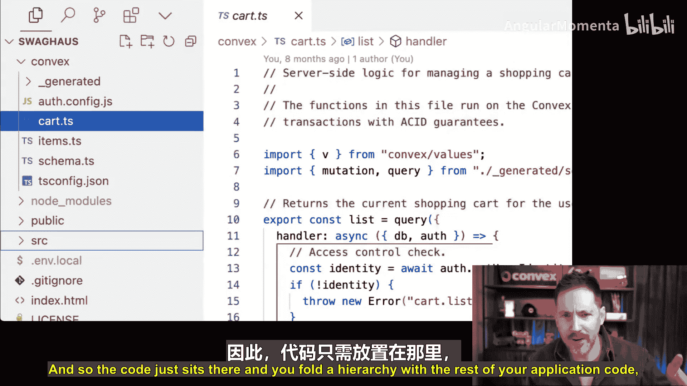
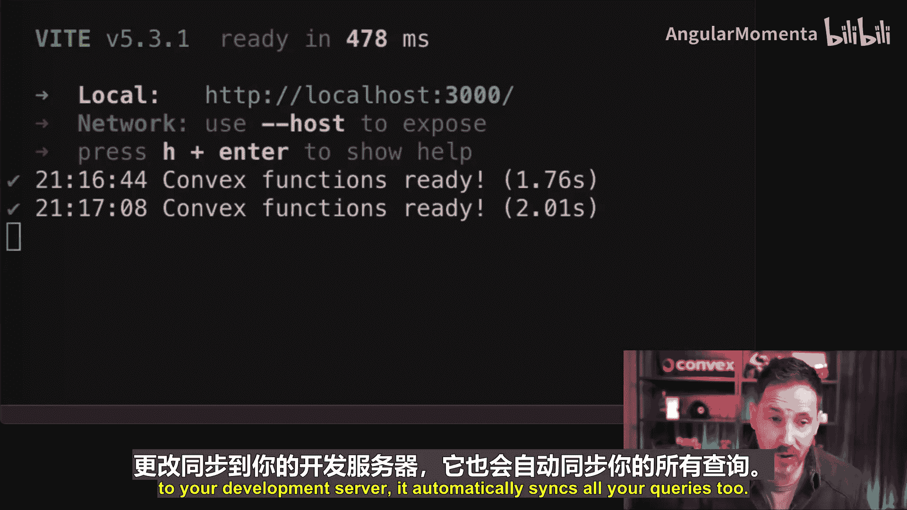
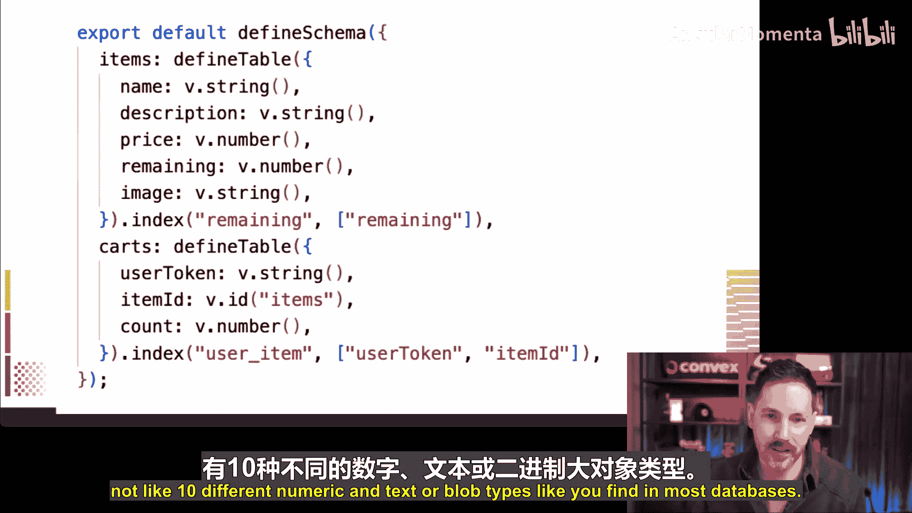
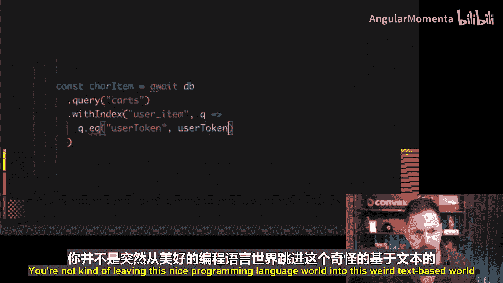
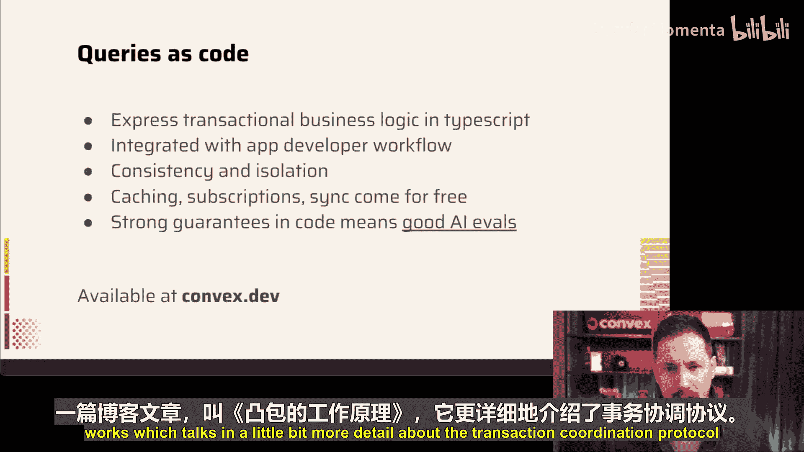

# SQL 或死亡？系列研讨会：p01：拉里·埃里森是对的（某种程度上）！面向现代时代的 TypeScript 存储过程


在本节课中，我们将探讨一个核心问题：如何更好地在数据库中执行业务逻辑。我们将回顾传统方法的局限性，并介绍一种现代解决方案：使用 TypeScript 编写存储过程。我们将看到，这种方法结合了事务的可靠性与现代开发流程的便捷性。

## 概述：数据库交互的困境

数据库是现代应用的基石，其核心构建模块是**事务**。事务确保一系列操作要么全部成功，要么全部失败，这是构建可靠应用的基础。

然而，在事务中表达业务逻辑却面临挑战。以经典的银行转账为例，我们需要从一个账户扣款并添加到另一个账户，前提是资金充足。

用纯 SQL 实现这个逻辑非常困难，因为 SQL 是声明式查询语言，缺乏 `if` 语句等控制结构。虽然可以通过复杂的 `JOIN` 或 `CASE` 语句实现，但这对于实际业务逻辑来说既不直观也不可维护。

这引出了一个关键观点：**SQL 是查询语言，而非业务逻辑语言**。应用程序由业务逻辑构成，而 SQL 并非为此设计。

## 现实世界中的两种方案

既然难以在 SQL 中直接编写业务逻辑，现实世界中开发者通常采用以下两种方案：

**方案一：API 服务层**
这是最常见的方式。前端通过 API 服务与后端通信，后端服务（如用 Python 编写）负责执行业务逻辑并与数据库交互。这种方式虽然常见，但存在一些问题：
*   **容易出错**：SQL 是弱类型、基于文本的语言，小错误可能导致严重后果。
*   **测试困难**：SQL 代码不易进行单元测试。
*   **状态泄露风险**：容易在事务提交前就将未提交的状态（如发送邮件）泄露到外部。
*   **性能问题**：应用服务器与数据库之间的网络延迟可能导致事务持有锁的时间过长。
*   **开发效率**：通常需要专门的团队（后端/API团队）来编写和维护这些接口，导致前端开发者迭代速度慢。

**方案二：将数据库直接暴露给客户端**
随着现代应用（尤其是由前端开发者主导的全栈应用）的发展，出现了另一种模式：将数据库直接暴露给客户端代码（如浏览器中的 TypeScript）。这种模式由 Firebase 等平台推广，旨在消除前后端隔阂，让开发者能快速迭代。

然而，这种方法也带来了新问题：
*   **缺乏抽象与安全**：数据模型直接暴露，需要复杂的行级安全策略。
*   **放弃事务**：客户端环境不可靠，难以维持长时间的事务。
*   **一致性挑战**：难以保证不同客户端视图的数据一致性。




## 存储过程：一个被忽视的好主意？

上述两种方案各有优劣。那么，有没有一种方法能将业务逻辑放在离数据最近的地方（数据库），同时又能用现代、易用的语言来编写呢？

这让我们想起了**存储过程**。数据库巨头 Oracle 的创始人拉里·埃里森及其团队很早就意识到了在数据库中执行业务逻辑的需求，因此发明了 **PL/SQL**（Procedural Language for SQL）。

存储过程允许你在数据库事务内运行包含控制流（如 `if`、循环）的代码。以上述银行转账为例，用 PL/SQL 编写就直观得多：







```sql
CREATE PROCEDURE transfer_funds(
    sender_id INT,
    recipient_id INT,
    amount DECIMAL
) LANGUAGE plpgsql
AS $$
BEGIN
    -- 检查发送方余额
    IF (SELECT balance FROM accounts WHERE id = sender_id) >= amount THEN
        -- 执行转账
        UPDATE accounts SET balance = balance - amount WHERE id = sender_id;
        UPDATE accounts SET balance = balance + amount WHERE id = recipient_id;
        -- 记录日志等...
    ELSE
        RAISE EXCEPTION 'Insufficient funds';
    END IF;
END;
$$;
```



存储过程的优点很明显：
*   **业务逻辑靠近数据**。
*   **减少网络往返**，提升性能。
*   **在事务内运行**，保证原子性。
*   **内置错误处理**。

## 为何存储过程不受欢迎？

既然存储过程有这么多优点，为什么在实际开发中并不流行呢？核心原因在于**开发者体验**。

PL/SQL 或 PostgreSQL 的 PL/pgSQL 是一种专门为数据库设计的、相对小众的语言。对于应用开发者而言，这意味着：
*   **脱离主流开发流程**：无法使用熟悉的 TypeScript/JavaScript 生态系统、工具链（测试框架、类型检查、包管理）。
*   **难以集成**：与应用程序其他部分的代码库分离，部署和版本管理复杂。
*   **数据库管理员的顾虑**：DBA 通常不信任在数据库核心中运行任意的一般性计算代码，担心影响数据库稳定性和性能。

因此，存储过程成了一个“好主意，但错误执行”的典型。它解决了技术问题，但没有解决软件开发中的工程效率和协作问题。

## 现代解决方案：TypeScript 作为存储过程

如果我们重新思考存储过程，保留其核心优势（事务内执行、靠近数据），但改变其实现方式呢？

**设想：用 TypeScript 编写存储过程。**
TypeScript/JavaScript 是现代 Web 开发中最流行的语言。如果能在数据库事务中安全地运行 TypeScript 函数，我们就能：
1.  解决软件工程挑战：使用相同的语言、工具链、测试框架和库。
2.  让应用开发者（而不仅仅是 DBA）能够直接编写安全的数据库逻辑。
3.  保持事务的所有优势。

这就是 **Convex** 等现代系统所采用的思路。它允许你像编写普通 TypeScript 函数一样编写查询和变更（Mutation），这些函数会在后端的受控环境中（如 V8 引擎）自动以事务形式执行。

以下是一个简单的购物车应用示例，展示了如何用 TypeScript 函数实现“添加商品到购物车”这个业务逻辑：

```typescript
// 这是一个 Convex 变更函数，会在事务中执行
export const addToCart = mutation({
  args: { itemId: v.id("items") },
  handler: async (ctx, args) => {
    // 1. 鉴权（调用现有库函数）
    const user = await getCurrentUser(ctx);
    if (!user) throw new Error("Not authenticated");

    // 2. 查询商品库存（在事务快照中读取）
    const item = await ctx.db.get(args.itemId);
    if (!item || item.remaining <= 0) {
      throw new Error("Item out of stock");
    }

    // 3. 执行业务逻辑：更新购物车和库存
    await ctx.db.insert("cart_items", {
      userId: user._id,
      itemId: args.itemId,
    });
    await ctx.db.patch(args.itemId, { remaining: item.remaining - 1 });

    // 可以轻松调用其他 TypeScript 库函数...
  },
});
```

这种模式带来了革命性的开发者体验：
*   **与前端代码共置**：数据库函数与 React 组件等在同一个项目、使用相同的工具链。
*   **完整的类型安全**：从数据库到前端的全链路类型提示。
*   **易于测试**：可以像测试普通 TypeScript 函数一样编写单元测试。
*   **自动缓存与实时同步**：系统知道每个查询的读取集和每个变更的写入集，可以自动、高效地实现查询结果缓存和无效化。当前端绑定一个查询时，数据变化会自动推送到 UI 更新。

## 实现细节：安全与隔离

在数据库中运行任意 TypeScript 代码，安全是关键。现代实现（如 Convex）通常采用以下架构：
1.  **执行与存储分离**：TypeScript 代码不在数据库进程内运行，而是在一个独立的、可扩展的执行环境（如 V8 引擎集群）中运行。
2.  **无副作用与确定性**：运行时环境会限制函数，禁止进行网络请求（`fetch`）、文件系统访问等副作用操作，并模拟 `Date`、`Math.random` 等以保持确定性，这有利于缓存。
3.  **基于快照的乐观并发控制**：系统使用多版本并发控制（MVCC）。每个事务在一个特定的数据库快照时间戳上执行，记录所有读取的数据范围。提交时，检查是否有冲突的写入发生。如果没有冲突，则成功提交；否则，自动重试事务。这提供了可序列化（Serializable）的隔离级别。
4.  **将数据库用作持久化日志**：底层可以使用 MySQL、PostgreSQL 或 SQLite 作为可靠的、版本化的预写日志（WAL）和存储引擎，而事务协调、冲突检测等逻辑在应用层实现。

## 超越可序列化：调度与工作流

强一致性（如可序列化）并非所有场景都需要，有时我们还需要**异步处理**的能力。

通过在运行时中添加**事务性调度器**，我们可以创建复杂的工作流。例如，在提交一个订单后，可以安排一个函数在 1 小时后检查是否支付，或者立即异步执行一个发送确认邮件的任务。这些调度任务本身的状态是事务性保存的，确保了可靠性。

```typescript
ctx.scheduler.runAfter(0, async () => {
  // 此函数会在主变更提交后立即异步执行
  await sendOrderConfirmationEmail(orderId);
});
```

## 总结与展望

本节课我们一起探讨了数据库业务逻辑编写的演进：

1.  **认识到 SQL 的局限性**：它不适合编写复杂的业务逻辑。
2.  **分析了传统方案**：API 服务层存在工程效率问题，直接暴露客户端则牺牲了安全与事务。
3.  **重新审视了存储过程**：其核心思想（事务内执行、靠近数据）是优秀的，但传统实现（PL/SQL）因开发者体验差而失败。
4.  **提出了现代解决方案**：使用 **TypeScript 作为存储过程**语言。这结合了事务的可靠性、数据库的性能优势以及现代 TypeScript 开发流的卓越体验。
5.  **看到了额外优势**：这种架构天然支持自动查询缓存、实时数据同步，并且由于其清晰的语义和类型安全，也非常适合与大型语言模型（LLM）结合，辅助生成正确的数据库操作代码。

拉里·埃里森关于在数据库中运行业务逻辑的愿景是正确的。如今，通过 TypeScript 和新的系统架构，我们终于可以以一种开发者喜爱的方式实现这一愿景，构建出既正确又高效的应用。



**核心公式/概念总结：**
*   **理想模式**：`业务逻辑 = TypeScript 函数 + 数据库事务`
*   **关键架构**：`执行（TypeScript/V8）` ←→ `事务协调层` ←→ `存储（SQL 数据库）`
*   **并发控制**：`快照隔离（MVCC）` + `乐观冲突检测` = `可序列化`
*   **开发者体验**：`类型安全` + `同构代码库` + `自动缓存/同步`