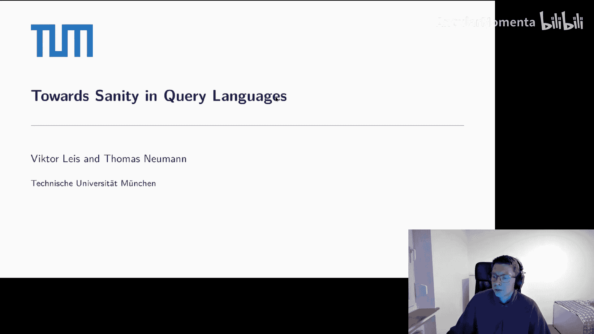

# 【卡内基梅隆大学】SQL 或死亡？系列研讨会 ｜ SQL or Death？ Seminar Series (Spring 2025) p02 02 迈向合理的查询语言（Viktor Leis + Thomas Neumann） -BV1FkisBtE97_p2-

有的。

🎼why I hate it。Sequel or death Yo son， what are you going to choose？Yo check it。

 this seminar is filmed at Carnegie Mellon University thanks a lot， Google。

Hi guys welcome back to another seminar series we're extremely excited today to have both Victor Leese and Thomas Neyman presenting about the replacement for SQL I don' even know where to begin with these guys they're both professors in TU Munich which is basically the database capital of Europe if not the world but let me go through quickly all the awards because they have many and it's worth discussing so for Victor he won the 2024 early the toB Early Career Award the 2014 ICD best Pa Award the 2018。

Sigma Best dissertation Award， and then 2019， most valued rookie Data professor and database War year leads faculty rankings。

For Thomas it's even more prophetic， he won the 2014 DOWB Earl Career Award。

 the 2021 DOWB Tests of Time Award， the 2021 ICE10 year Influential paper Award。

 the 2020 Gotfried Wilhelm Leness award which is what the top award in Germany and then he was ranked number one in the 2024 Davis Judges Power rankings so you know these guys are the best if not Europe the world so we appreciate being them being with us and its 1030 in Europe。

 so we thank them for staying up late Thomas the floor is yours thank you for being here。

Thanks for the introduction， so today sorry to so today I want to talk about towards sanity and cur languages because why we like cur languages in general。

 of course they were very fond of say have many advantages。

 they also have problems at least the way they are equipped today。😊，And so the first in general。

 I should clarify the relational model that we all use for relational derivative is this， of course。

 is a great idea。 So relational model is absolutely great。 has many great properties。 And here。

 you know， perhaps knows this papers here by Mike Stonebro and and the Palo what goes around comes around So this talks about that we should all use SQL。

 I would agree on the part that we should all use relational model because this has many。

 many great properties。 I'm not the0 percent convinced of SQL。 And in the following。

 I will talk about why。😊，So now first I should say of course they are good and bad parts in SQel。

 now first we start with a good what is extremely good in a SQel of course is a declarative query language Yes so we absolutely want us。

 this is a great feature other parts of sQel are a bit more difficult but still okay， for example。

 we have mighty set semantic so we have bags instead of just mathematical sets we can have duplicates this of course require for reality makes everything more difficult but we accept us also three very logic as obviously pain difficult but this we need this so this is our all parts that are fine。

😊，Now what is not fine is a part below here。😊，Yeah， first。

 the syntax of s this is really strange Now this was imagined in the beginnings to be something like readable English or nearly readable English so you can just read s to know what's doing but as if we show you later absolutely not true and also this is just gives you an illusion for very simple cases and then this the extreme syn construct makes it very difficult to add new features and also the decent abstractions and as all are very unpleasant and perhaps in most damning is the last part。

😊，Even though we know more or less what the syntax of secret should be。

 but the semantic of sequence is often completely unclear and we don't know what it does。

 and also if you compare different systems， you see that they behave differently this is also extremely unpleasant because it shows is basically clear it with a failure of the system so we cannot use it the way it was so meant to be。

😊，So and so in therefore in the following， we will first start and give you a critique So show what does not work well in SQL or what are problems of SQL。

 then we will come talk about fixes later。 So， but we will first start with the problems。

So one of course the syntax of SQl is always a bit as very arbitrary looking roots for example if you look at this common table expression example here's we have six common table expression construct and only one of them is correct and even if you know the roots you have to look very carefully and check each different line and see okay which one is correct and why is this wrong and why doesn't this work and so yeah and by the way if you want to check yourself I don't want to delays in the vector I would ask my students to check but here you see only version number four is correct everything else is wrong。

😊，And it's not so totally obvious why this is the case。 of course， you can look it up。

 but it's as humans it's done， it's not so clear why。

And then other problems we have everything is done in this so do English。

 which means we have tons of keywords for everything。

 So every construct that you have in the query language is expressed with keywords and in the beginning。

 so SQl 92 we had 227 keywords is already a problem and now in S 23， we have 409 keywords。

 which is an insane number compared to the active vocabulary that most people use in the daily life Now with more or less you can say if you have an English word there's a pretty high chance that this is a keyword。

😊，On the other side， of course not everything is a keyboardword。

 yes has only some of them this is a huge pane because then we don't know what we can safely use and what we cannot use like here this is a quote from the SQL light documentation that says basically that's a list of keywords or so long that nobody knows anything anyway and therefore you should simply never use an English word as a name is as a column or as a table of because this is not good either or you could do other things you could quote everything that works of course。

 but also the pain for you to use。😊，Then some database systems like Postgres go out of their way and try to allow you to use keywords。

 even though the Z channel would say must not use this。

 but in many places it accepts keywords if the grammar gives this but again this leads to different behavior。

 some systems accept the keywords some don't are terrible。😊。

then the index in general is unfortunate like here's a classic joint query really traditional joint query like we are joining for tables here with some filter conditions and joints and now this looks perfectly humbles this query the problem is of course it's query is wrong and this is wrong in a subtle way it's not very subtle actually if you look carefully but in the first glance is not obvious what's wrong and aative what's wrong。

 it's missing a joint condition。😊，And so what we should do is we should have a drawn co between customer orders。

 but we didn't so we forgot this make an easily， but you don't get an error message and in for this particular query even worse。

 you get an answer it looks plausible， but it's wrong。😊，So and this， of course， is very。

 very unpleasant。 In fact what we have decided to do in our systems。

 if you do this and we see is you create a very large cross product， basically。

 if you give an error message and say， either you write a cross join or you can have a setting to these images but otherwise I review a query because probably it was a mistake but this is not in theque language itself。

 because theque language allows you to do this also not not very nice So we we want aque language to be intuitive and to be robust。

 it should not be easy to make mistakes， it's completely completely wrong results。

 this is simply not a good good behavior。😊，So and in general， if you look at this syntax。

 it's as many， many unpleasant constructs。Some things you have to repeat for no obvious reasons。

 for instance look at a query on top here， this is a group I query。 So we are basically we are。

 we are first joining regional nation。 and then we are a grouping。

And so you see that we have to repeat the groupi columns twice Yes we have to put them in the groupi and you must put them in the select if you want to output them as we have to write them twice。

 and this is， of course not nice。 now then some people try to fix this for exampleductB so they try to fix this and they say hey。

 let's just introduce this syntax that says groupi oil so we don't have to write everything in the groupi。

 but we put it in the select problem is this is a super super dangerous construct because now you can accidentally writing something in your select accidentally groupi something they didn't really want to groupi Yeah then you get wrong resultss or unexpected results in the output。

 So groupi oil is dangerous， really dangerous。 and this here has redundancy。😊。

This is not great or the other other part because everything's done is English style thing。

 you see the syntax to compute as a media value basically so you see per center continuous query。😊。

And usually if you like just look at this this is from a pure synax perspective。

 super long construct， many construct that you have in SQL are extremely verbals and so a lot of things to write and and all of them have special suittax。

 I mean， writing a PA for SuQ is really a pain because of this really strange thing that you can write in some parts of your query。

 this is also not not a good feature。😊，And then finally。

 it means the original argument in favor of Ser was it's so easy to read Yeah。

 you just read and then you know what's going on。 but if you if you think about this not true at all。

 like here you see an example queries that contains usual contracts so we have select from where group by having order by and you of course you as human you read it from top to bottom Yeah you start on top and then you just read it and this is your query but if you think about how is the query evaluated and not only evaluated also concerning visibility like which part of the available where Yeah。

 you see that the syntax order has very little resemblance to what's actually going on。😊。

Because here you see the corresponding semantic order yeah， so we decide we start with from clause。

 which is somewhere the millennium So then we do the where now is perhaps also joint conditions first that's the filter conditions and then we do group I and at this this point we evaluate both the group I and now the aggregate get from the select but only is aggregate of course so the aggregate get from the select。

😊，And then we have an additional filter having clause， additional filter。

 Then we do the window query。 We cannot filter after this window。 Why not is this where it is， Okay。

 and then we do solarlo mode。 And then we project so， but you see this this。Not intuitive at all。

 and also not something you can easily ignore yeah。

 because sometimes it hurts you if you don't understand what's going on。😊，Okay。

 so these are all very unpleasant properties here of SQL。Now， what can we do better？

And so we have we have looked at ways to make it better。

 and I will tell you some things now next that we already talked about it cider。

 I think two years ago， but I should tell you already that why this is an improvement over Se。

 This is not an ultimate fix。 so this what I talk about next fixes some of this problem in particular this very strange syntax and but it does not fix all of the problems。

 about the other parts will be covered by Victor。 so I will only only talk about the syntax problems that we have。

😊，So one thing that we said， okay， we want to have a queer language that is both a simple and expressive because therefore Vika came up with his name a simple and expressive queer language。

 thank you。😊，And this at a first glance looks a bit like a data frame APIs that you might know。

 but as there are some differences。 here first， it's a requeer language。

 It's not tied to a programming language。 you can send it as text2 database and you can get answers and order it has other differences I will talk about is a bit in a moment。

 But first now what is what is different what is common with compared to SQL first like SQl。

 this is a declarative query language and it has multi set sematic3 radio logic。

 everything is before now because in a way it is like talking about relational algebra。

 That this is in a way text representation for relation algebra Now what is very different from SQL is that we have totally regular syntax no keywords in there at all everything is regular。

 you can easily pass you have explicit sematic ordering and actually we ought have more highly level construct in SQL but even if you ignore this just as a much more straightforward query language much easier to process in all dimensions。

😊，And we will process we also have a prototype implementation that you can play with this if you want and what our prototype does is it allows you to transpire to Sanque to SQ so you can just use it with any databases out there here because youre in the end construct S so the secret sounds a bit long but it does matter for us user so if we just as the back end。

😊，Okay now how does this aqua which work in abstract way we are evaluating functions over relations like so here you would see way like we could join two tables but usually you will not want to use this syntax instead we want to use a nice syntactic short end for this namely you say we take a relation and then we apply a method which is implicitly a function called then we apply a method on this we say we have a table R and then we join this with a table S and then we have a joint condition and that's it so here you see explicit or its joins and also with this construct you cannot forget a drone condition here because you explicitly write it next to this。

😊，A bit like a explicit drone index SQel， but in this case much shorter and also notes that there's no fixed evaluation order。

 you can write them any order that you want like you can have a contract like this。

 here we have nations and reverse to the joins and we then we filters and we do group。

 and we could do window filter， whatever， you can apply them any order that you want。😊。

Or do we have other constructs here that to make your life nicer。

 like this function that you have can have keyboard arguments， for example。

 if you look at this join here， you see that this has an optional arguments that you can provide namely a join type in this case you say we want to left auto join。

😊，And also you have not only single values， but also lists of pages like here have in group I。

 you give a list of a columns that we want to group I and you can also assign a name to attribute in a list you see the aggregate function here is the result is called CT。

 So this is a name that you assigned to this。 But again a very regular synax and you can express everything with this without having to invent synax for everything。

😊，And in fact， the query language is more powerful than this as are not only can you do what we do between secret。

 you can do even more high level constructs， for example here some you might not do every day but this is basically a higher order functions So a function that takes another functions as argument because what we are doing here is we are implementing left semi join just to show off here that this is possible so we define the functions that given two arbitrary tables in the drone condition。

 we evaluate left semi join and you see this has to do some construct here like we have to invent a new column names that is guaranteed to be unique we use this scan functions then we apply number of operations and in the end we get out the result of a left semi join and now you can use this function just like a regular join that you had before inside your query and this allows you really to decompose your query and have reusable。

😊，Part， which you never have in s。 because in SQ， the only thing you can reuse is a view。

 but it' is not a lot。 in know， the U has no arguments。

In particular no arguments that are not just simple values。

 so therefore everybody codes everything at talk， but I think it would be much better to do a composable part and reuse parts。

😊，Okay， so thisque construct So this data frame style has many advantages compared to the classic SQl。

 Yeah so its first it much easier to learn because you you don't have to remember evaluation order。

 you just it looks as if it would be an interpretative program。

 note that in reality it's not it looks imperative， but it's not you can still reorder everything。

 it's a declarative query language， but it's easier for you as a human to understand and alsos easier to debu because you can ask for every it emit result。

 what result， you can get decent error messages And also if you think about using this。

 it's much easier to implement compared to a SQel。 if you would start writing a new SQl in front end from scratch。

 you probably needs several month from for this。 Yeah a sameque interface。

 you can probably write in a week。 So its much much， much simpler。😊。

Or do we have a demo for this online Yes you can play with this， you can give it thinkque  query。

 and it will execute this actually， but it will do internally， it will use a transpier。

 which is available on Github to translate it everything to SQL and then runs the secret statement then you you get back answer。

 Okay， but as I said in the beginning。 So this here but said so far fixes syntax problems SQL has。

 but it does not fix the other problems that SQL Okay， for the other problems now。

 Victor will take over。 and he will tell you what to do about it。 Okay， so yeah。

 as as Thomas said right mean all these things might be。😊。

Maybe you agree with them right but maybe some of you have been wondering， okay。

 maybe that's all true or maybe it's not true， but。It doesn't matter because SQL is the。

 I think Snowbreaker was calling the intergalactic standards so there's nothing we can do but frankly after we did all this SanQL work this analysis of SQL we kind of came to realization that it didn't even touch kind of the biggest problem that SQL has right and so this is kind of what the second part of the talk will be about as toma said this second part is more work in progress or there's no paper on yet so hopefully we'll have we can have a discussion on on that。

So the main problem of SQL and this is what I'll be arguing is that nothing is compatible with anything so SQL claims to be a standard but it's not really a standard so this is really a very strange kind of standard and because if you look at any particular implementation you will see that it doesn't implement the full standard that's the first point。

Every implementation also intentionally deviates from the standard。

 so the extent to which it deviates from the standard depends on the systems， so for example。

 Postgres， which we'll be talking about more， follows the standard more closely。

 but even Postgres deviates at some places whereas the old school traditional vendors they deviate like crazy。

AndAnd。The systems also not just have like deviations in where they behave differently。

 but they just come up with completely new stuff， so they have non standard extensions。

And as if that's not enough， then the standard， even though it's huge， nobody implements it。

 it actually also doesn't specify many really important things that you would really expect from any programming language to be in the standard。

 so for example， type implicit tab casting rules。And other things。

 so we'll see some examples of that as well。So graphically right you could basically summarize situations like that in particular if you compare the SQL standard with the commercial vendors。

 really the overlap between the standard and any particular commercial system is not that huge and then also all the major commercial and vendors differ from each other to a huge extent。

 so trying to write a query that like really works in several systems is like really。

 really difficult。嗯。And we actually have a couple of examples here that are really just not meant to be kind of the biggest problems or the most interesting ones。

 but just a couple ones we came up in recent times。

 and they show some of the simply bizarre things that you will encounter if you try to run the same queries in different systems。

So for example， let's look at this very simple query。

 the first one so what's wrong with it okay now the answer is according to the SQL center。

 nothings wrong with it so well you have some some subquery in the front clause so what everything should work but if you run this in Max SQL server it will tell you the following error messages so you're not allowed to put an order by in the sub query and there is some logic to this error actually you could say well because the order by is kind of not really doesn't have any meaning there but SQL server is really the only system that insists on that so if you imagine if you have some kind of query generator then it might generate something like that but the SQL server would just refuse to run this query so it's very patnalistic in a way so it doesnt it thinks it knows better。

And by the way， it has many similar situations， similar behavior in other places as well。

 where it will really tell you this is not， you don't really mean this， right。

Even though you maybe do and by the way， this would be a very useful warning。

 but server for Se server this is an error okay let's see what else we got what's wrong with this query。

Select star from re joining here to the tables R and S and we use a full out join and some join condition and the answer again is there's nothing wrong with this query except that。

Posgres doesn't support it and more generally more specifically Postgres does support full outer joins。

 but it doesn't support them only with basicallyequjo conditions and here we have a less than instead of an equal and then it just doesn't support that and this is one of these exceptions right generally I said that Postgres is actually very standards compliant and also very orthogonal system as far as SQL systems go but this is one of the exceptions where even Postgres kind of fails。

And then the third example is a little more complicated and indeed very。

 very bizarre and Thomas learned about it， I guess pretty recently and changed UMRA this query actually works in all the systems we tested。

 but in some systems such as BigFry， it produced completely different results from than what the standard says。

And so specifically actually BigQury breaks the standard， but computes what what you would expect。

 So if you look at the select at and at the end， it's scanning an S and S as you see is a common table expression with two rows。

 so what you would expect the query to return on two rows。

 but actually the SQL standard for some very bizarre reason about the aggregate scoping will tell you that this query is supposed to return on only one row okay。

Yeah， so you have all these kind of very bizarre cases and every the point of this slide is that every system has them okay it's not picking on these specific systems but every system has that and they are only some of them are documented many are not so how can you write complex sphere that you can make sure that they work in many different systems。

 basically the answer is it's impossible it's always a matter of luck。嗯。Now。

 what you could say is that who cares about these other systems okay that hasn't like PostgAs become basically the new standard okay and indeed PostgS is kind of as I said it's very orthogonal。

 implement it mostly follows the standard and for that reason many systems nowadays try to emulate the Postg dialect and to some extent they the semantics。

the trouble is， well again， right you can very easily find examples where systems such as DDB and Ubra that claim to be or try to be Postgs compatible deviate from what Postgs does so for example。

 in this first example and the average ofductTB in contrast to Postgs and Ubra will always make the type a double rather than numeric。

The second example with this round is kind of interesting because Postgs has this very strange numeric data type where where the number of digits after the comma basically is not static but dynamic and so each value basically encodes how many digits comma has and that's very different from virtually all systems and this has implications as you see here that URA the Ura type of the round call is kind of has more digits than the Postgs one。

I mean， there's a good reason why I Wora does it that way， but it's clearly a deviation。

Then Posts has this strange construct where you can have basically a relation without any role and without any attribute。

 so just select and this just works and that doesn't do it。

The Postcu also has this interesting concept of an infinite time step。

 so plus infinity in time and also minus infinity in time。

And which you can imagine sometimes may be useful， but it's actually non trivial to implement。

 so Ura， for instance， right now doesn't implement it right now。Pogs also has these again。

 these strange numerics， and so you can indeed arbitrary precision numerics。

 so you can create very large numbers which most systems do not support。And we now， by the way。

 I'm not only comparing systems that claim to be compatible with Postcards。

So if we kind of graphically summarize the situation here。

 it looks a little bit better than what we had with the commercial vendors。

 but still right even Paulski is not fully standards compliant and even these systems like DTB and UMra that try or claim to be compatible are not fully compatible。

And indeed DDB is kind of infamous here right so this is why we have this little mouth of the duck here because they've been adding all kinds of crazy syntext extension which might be kind of useful in some situations。

 but can fragment the space more and more so it's not clear if that's a good trend。嗯。Okay。

 so yeah but you could say come on， you just came up with like very obscure cases who cares about all this these kind of obscure cases incompatibility mostqueries will do similar things maybe but first of all。

 I mean I could you could one could produce a presentation with hundreds of these cases so it's not like this is an exhaustive list of anything。

 but this list will never never end basically'。And what I would also like to argue is that these differences really matter right so you get different results and because obviously let's say depending on the numeric type you have。

 you might do other calculations based on that and then you convert to a string or whatever so you really get different results in first you so one anecdote。

 by the way is that the TPCH standard because of all these numeric problems that SQL has and lack of a clear and type semantic they just tell you that the results that you have to produce have to be close enough by 1% so this is all you can basically say in SQL which is very bizarre if you think about a programming language perspective。

so these problems really matter right because SQL queries are also not just written by humans right。

 who can deal with these kinds of bizarre error messages that we saw。

 but they are nowadays most commonly generated by machines or by code generators。

And so basically SQL is a programming in language and you would expect it to have some kind of semantics that you can understand。

And so after all， I mean database systems they are foundational technology。

 right all kinds of high level things are built on top of that。

 and so I think we should really think hard how to improve the situation。

 this is not a good world we're living in。And， and specifically。

If you think about the kind of things that are very。

 very hard because of this lack of standardized semantics and yeah you can come up with a very long list of great stuff right so here's a couple of things that we came up with so for example federated databases right very old idea that you have several different databases and then you just write one query that queries the mall right。

This is extremely hard that's extremely hard， many people have tried and typically it's kind of a best effort solution and it doesn't never quite guarantees that it's both efficient and correct you kind of have to pick properly and another thing that never really took off is things like hardware acceleration for database systems and I believe one reason is that nobody knows right for which kind of semantics you want to put into hardware which dialect do you want to implement so the market is like super fragmented because everybody has their own semantics and the semantics is also not very clear it's encoded in million lines of code so what you implement as a hardware vendor it's not clear。

Maybe one of the saddest thing for me personally is also this is that there's this great trend of these composable data systems like parquet data fusion calcite。

And on paper it's amazing， right， you just take these components plug them together and then you have a database system。

The trouble is if you look carefully again， you run into all of these minor semantical deviations so specifically they have different types systems so let's say you want to support these infinite plus infinity timestamp and you implement that in calcite well then you also have to implement all these extension is data fusion that or all these operations on these strange times step and then you will also need to change parquet because maybe parquet doesn't it cannot store these strange timests and so right now this is like a huge huge hassle and each of these projects then tries to be extendable to some extent。

 but I think this will in the end never work the complexities you will just kill you if you don't standardize on some whatever semantics you want。

And a similar point is Microsoft Exr was presenting this career optimization as a service idea or project。

 again， this is an amazing idea， but how can you do that if you don't quite know the semantics？

And howend this run work across different systems。So at MIT there's a project like that where you somehow declaratively decide or specify kind of workloads and then this project system will decide which database systems you work best for your workload and again。

 right this somehow assumes similar to federated databases that you can somehow move  careers around different systems which is like very。

 very difficult。And maybe one of the biggest thing that and clear semantics could have or maybe one of the biggest effects that clear semantics could have is that you could get real competition between vendors because right now you have these islands where once a customer adopt some certain product。

 they can never get out of that and they are trapped。

And so I still recall a senior manager at one of the big commercial vendors saying that kind of the most valuable asset that this database company has is its test suite。

Because if somebody else had that test suite， you could just with all the bizarre semantics。

 whatever they implement， then they could implement that as well and then they could actually steal the customers。

 but as long as nobody has that and as long as the semantic islands are as they are and you don't really have a lot of the competition is severely hindered。

And yeah， and you could also write once you have a clear semantics。

 you could use like formal methods， you could prove stuff about query optimization and transformations and so on。

 this is will help tremendously specifically right not just at the relational algebra level。

 but also about really the full semantics including Nlls。

 including type propagation all these things。And these are things that often lead to a lot of bugs。

So there's all these amazing things that we can't have right now。

 so how do we get to a world where these things would be possible or at least much easier okay？

And so one superficially very nice idea is basically what the substrate project is doing so some of you may be familiar with it and this comes exactly out of this composable data systems spread because I guess it's kind of natural once they build all these components at some point you realize well you need somehow to ship relational algebra around and so they came up with this cross language serialization for relational algebra。

And it seems very promising on first look， but the trouble again is somehow they try to be kind of very generic and they support or they want to support at least many different systems with different dialects。

 and so subset itself needs to be to handle all these different cases。

 a superet of all possible semantics。And then they define kind of the syntax but they don't actually tell okay well which specific semantics should anyone support and so you have this blow up of complexity in a way and I mean there's other things you you could discuss so for example somehow they also couldn't decide because for different use cases and they have different requirements kind of should this be a logical plan or a format for logical query plans or physical query plans。

And so yeah， somehow somehow this is not quite what we want， although it seems like a good idea。

 of course， grants。RightSo maybe some of you are familiar with LVMIR and of them some of you may even be aware with MLIR and so essentiallyture is something like MLIR and not LVMIR。

And so yeah substrate is not the solution so what do we need so our idea here is that what we need is is something like saying IR okay and by that we mean a well definedfined semantics for relational operators but this is not enough but also for all the expression stuff so scalar expressions building functions。

 data types， how theit implicit casting rules work how errors behave I mean overflows that kind of things runtime errors。

And ideally， this would initially be kind of a really formal specification。And it would of course。

 be extremely useful to have a reference implementation。 and then you have。

kindind of a standardized several standardized formats of how you move this thing around right so maybe there might be some inmemory representation and maybe some Jays representation right and to such focuses more kind of on the last point。

 but we kind of argue that the main point is actually to coming up with the former points or the specification in particular。

嗯。Okay， so how do we get there okay， so maybe you agree， okay， would be great to have that。

 but isn't that kind of wishful thinking， how do we get to this island of sanity right？😊。

And so I think initially。Really， the core， of course， is you need interoperability with Paulki。

 as we discussed， this has become kind of the lingua Franranca and nowadays， the most common dialect。

And so our idea is that if we after or once we have defined kind of this SeIR。

 we need to build this little bridge right and towards the sanity by building a transpir from a subset of PostgresQL style SQL to the S IR and then once you are in this CIR you can then also transple to different systems so initially you may start with a couple of these Postgres compatible systems like Postgres itself maybeductTB and URA and the nice thing about this is that it gives you kind of a smoother path into this route。

 but of course the longer term vision is that people implement CIR directly and don't have to deal with with SQL anymore so they can use then our SQL front end and and then other systems like queryier engines they only need to think about CIR。

Don't have to think about any of the other fronted languages at all。I mean。

 another benefit actually is that it could also lead to more innovation in the kind of service level query language part。

 right so saying you El and other query languages that I guess you'll hear more about in this seminar in later weeks。

 they can just hopefully plug in kind of in this seminar that will make it much easier to implement new query languages。

And so this is kind of obviously we don't know if this will work。

 but this is kind of one way we kind of envision that such a project could have a real world impact and so would be kind of these three steps right and the first step it's kind of only a transpiler and so in the second part then these composable data systems which I think really are really in need of something like say and IR they could adopt it and once then theseos data systems become kind of widespread and hopefully the commercial vendors will be forced to adopt that as well and this could be an analogous to what happened with data lakes and parquet and so on which is pretty amazing that basically now all commercial column stores have been basically forced by customer to implement that stuff even though let's say 10 years ago people would not have believed that people that these commercial vendors would do that。

呃。Okay， so as I said kind of earlier， this is kind of still work in progress。

 we're still pretty early so there's many open questions we don't know if this will actually work out and how exactly the scenario scenario will look like。

So here's a couple of questions that we've been thinking about but we don't really have full answers here。

 so how similar should the semantics be to PostgresQL and so initially is will probably pretty important to be relatively close so that many things are kind it's easy to transpire to SQL and to Postgres SQL another question is okay can we support other systems that are not Postgres compatible and how efficient is that trans and which system do we want to support because you can of course through this trans。

 introduce many new or rerites that will solve many or allow many constructs and so yeah how far can we push that how big can we make this island of sanity？

Yeah， how large can we make this okay， and then finally a big issue is how do you define error behavior without kind of preventing very important optimizations that we kind of query optimization opportunities that we have in SQL。

So yeah， these are some of the questions that we're thinking about。

So let me kind of conclude right so I think one important point is that the relation model is great so we don't want to kind of destroy that and historically let's say in the last 40 years or so the relation model and successive relation model was very tightly linked with the success of SQL that I think this is the successful relation model is really despite SQL as language terrible language in hindsight with all we knew today and so the syntax is really terrible mix to learn the bug generate to implement。

 and notice two systems are compatible。this lack of compatibility。

 I think this is not just kind of minor convenience。

 but it really hinders innovation in the data world， many great ideas。

 many great startups don't quite work because of this。

 even though conceptually they should work but they don't and if we have this well definedfin relational IR。

 I think we would be in a much better world。Yeah， thank you。Awesome， I will。

Clap on behalf of everyone， we have you know a lot of time for questions。

 so if anybody has a question， feel free to unmute yourself and fly away。

You you want to unmute yourself instead of doing a chat。Yeah Thomas， Victor awesome talk as always。

 obviously the work that you presented at Sder two years ago with the initial CIR was very influential。

 Google did the pipes syntax which they disclosed last year there are lots of proposals you mentioned PRQL for folks trying to come up with a new type of SQL。

And this sort of feels like the early days when there was SQL andquell and then later on QbeE。

 the community never got together to say at least even on the academic side as to let's group together to make one so I was wondering if there is any thinking from your side to see whether you could band together because ultimately the problem with SQL you guys mentioned very articulately all the key issues with SQL。

 but many of these overtime people have tried to fix like parameterized views， you know。

 systems support that， but SQL does not have that in the standard。

 and some of these are fights in the standards because you know vendor A doesn't want that because their product doesn't have it so for this to stand any chance。

 which is obviously a great idea I was wondering if there is broader thinking of lessons to be learned from past attempts to do this to make this feasible because it would obviously be awesome if we lived in a samener query language world。

Yeah so maybe I'll start and maybe Thomas can add something that I'miss orso in my mind and this is how we've been thinking initially right with the original aside of paper how do we make a better  query language but in some respects you run into this risk of saying well there's 50 incompatible languages and the solution is to propose the 501st right and then everybody has slightly different opinions about that stuff and so somehow I think this is almost impossible to get consensus right and I guess you'll see that also in the seminar right people have all kinds of very strong different opinions on what？

How the language should look like and so somehow we got to the second phase to saying well。

 maybe we shouldn't focus on that initially so all these criticism that we have in the beginning。

 I think they are true， but maybe the much bigger problem is actually the semantic issue that was talking about in the second part and if we address that then that would also enable new innovation at the surface level part so this is why we kind of shifted because yeah you absolutely derived many people have tried somehow it never went anywhere I think that's why my idea is to focus more on the semantic part。

I think。YeahIf I can add something itself first， I agree。

 of course with Victor and I think we I also think this is a harder thing agreeing on synax is or of course people have different opinions。

 but perhaps you can find something。 but agreeing and what should the behavior of a numeric data type is this is much more difficult actually but we have to do this because if you don't even know how the basic types behave。

 how can we define what a query is supposed to do and I therefore I think we needs this and we need this in a way that is not just in reads the codes this is my reference implementation。

 we need a specifications in something that is really really like a formal description if you look at what programming languages do usually say what the result should be precisely and we have to do something like this all query language too。

 I believe。😊，Yeah， that makes sense， thank you。Hi， everybody asked a question。

 I'mute yourself and go for it。系呃 can你开始咩。Y， no。of all thanks for the opportunity to give me to get a chat chat long just questions I have a couple of questions my first question is so which I mentioned about IRs so SQL it does internally have a bytecode engine and it does like it does essentially an IR form so what do you guys think about that？

I'm not sure if I got the first one who has a SQL which uses a Yes uses a bytecode engine to execute the query so it does have its problem because it's not paraizzable so what do you guys think about their approach？

😊，But， you know， many systems have an internal representation of a cure not only s light。

 like even if you look at a Mo or something like they also have。

 as they all have their own texture representation for virtual machine。 So this is a common approach。

 The problem is that everybody has a different behaviour。

So like the a query in one query engine gives a different result from another engine。And I。

 I think what we have to do is we have to say this is the correct behavior。AndBecause otherwise。

 he will always have you cannot implemented a non trivia application that runs on multiple databases。

 basically without a heroic effort to port every single query to every single system。😊。

Kl okay so it's more about which should be used as a standard so along the same lines SQLite has a very good chest to so it just a lot I think it's just all of the operations on Post stressres masssQL and SQLites so it compares the resultss for all of them so why don't so why don't you just use sQLite standard as a correct one because it already is comparing I guess mostque massqL。

SQL light is also strange。 Yeah， so they have what was problem I thinkQLite as problemQite is everything isduct type。

 So they have no static typing the type is associate with each individual value which means each value can be different even if you have a case statement different branches if a case can produce a different data type this is insane and also nont compliant。

 by the way so standard doesn't allows us but this basically means you cannot say sQlite is the right thing。

 I mean we we usually say post guys is the right thing because most of the times they do the right thing。

 but sometimes alls they don't so they are pretty good。

 but sometimes also do stupid things and I believe in the end。

 you cannot simply say this systems is right， you must look carefully and then decide this should be behavior。

 of course you will try to choose something that most systems do anyway。

 but probably all systems have to change at least in some aspect。😊，Got， thank you。Chris。

 we want' to go for it？So you mentioned parquet as like the common format for a lot of like OAP systems and like Aurora Socrates polar DB also like make a cut of like the logging and storage layer are there advantages to building the IR at the query layer instead of building it like down at the data or storage layer like instead of like for federated queries like it's important to like break that query across like have it like spread to different databases instead of then be able to read a common format Well think about push down maybe even if you don't want to execute the full query somewhere in the storage layer。

 maybe you want to push down some where condition and there again you're in this in this world of what exactly is the semantics of your where condition。

And so I don't think you can kind of separate the storage layer from the from the rest right well other than you saying okay。

 storage layer is just a bitete array， but then you can't even push down wear condition。

Does that make sense？I don't find that argument。I could see a world where。The semantics， if。

 if you have standardized on the storage layer， then I could see a world where you opt into the semantics of the query layer based on the。

System that you're having， having run it。 There's no need for pushdown if。

The semantics of the query layer and everything's got access to it。Obviously。

 it's like not going to work all the time。But it's not crazy。unfortunately。

 this will not work even if you think about Paque like Paque has this concept of min Max filters here you can for every block。

 you can say what is the smallest and largest value which is important for pruning of course。

 problem is system disagree like for example， how do you order if you think a postcard orders and not a number value in double it's behind larger behind plus infinity so larger than everything else but not all systems do like this so even at the very basic level people disagrees they don't even agree what's the minimum the maximum of a set of values is but this is important for us So storagech layer because you need it for pruning blocks。

😊，And therefore I think you what you want and everybody wants is you have to define data types and their correct sematics。

 their correct behavior， and the end you can use this in the whole stack so in the storage layerque layer everywhere。

 but so far people don't agree on even on these basic things。😊。

Ist that a binding between like Postgres and parquet？I'm sorry。

 I'm still not understanding why if I have this common format， like don't I still have to？

each the thing is when you build a P file， use the program who writes a p file has to remember what is the largest and until the smallest value in each row group has so in each block of values。

 you materialize it the p file。😊，And but the problem is， does this agree with a cur seman？😊。

Yeah because if thematic of the one who wrote a file and one who reads it agrees then everything' is great。

 of course， but if they don't， then you cannot use this pointsun or pruning as you have to read everything。

😊，So basically， sometimes your career are just wrong' why。Yes。

Or it can't use the the storage file properly because it's。

It was trying to use some different semantics for the type it sounds like getting the type semantics right is really。

 really very important。Yeah。Yep。Well， I guess do。Do you still have a problem lurking in the how the data are stored underneath like do you sell problems reading parquet filess even if everyone adopts saying QL？

So you mean our  query language now I was saying as I said so saying I saying you I so if if we would have a common IR。

 which basically means we define what the correct behavior for every data type should be then everybody should or this would affect everything from a storage layer to a  query layer so this would help everybody。

😊，I seeSo they to figure it out once。 And then it's in the I。 so， so just as example。

 Cal said has a look at Cal documentation have a different type system than your data fu a different one than than Paque。

 I mean， how can this work just just on a。Fundamental level， right， This is like。Yeah。

 it cannot work。 I It can only work mostly。But not always。Is it？A smaller。

 more tractable problem if you try to only solve this at the type and storage layer， or is that just。

Sort of a waste of time。 Like， I get that your I， your language is good and wonderful， but。

Would it help is it a step forward to even just get the standard type system right the fact that like Postgres has different types from MySQL has different types for oracle has different types from the calcite is different types from all these stuff。

 this is just crazy to me like like maybe only like like how much you get if you only standardize the types as this is not only this is the hottest part because if you look at people so different systems。

All of them agree what the inner drone is， and most of them also agree what the auto drone is。

 as to the differences do occur exactly in the type system and the functions on defined on types。

 as to the relation algebra， theres more or less consensus not100 but more or less consensus on how systems should behave。

 The types are the heart problem。😊，Thank you。All right， any other questions？I have one。

Arian plumj Victor， thanks a lot for your talk， I'm currently implementing your old paper un nesting arbitrary correlated subqueries。

And firstly， you've got me thinking that like SQO is claims to be an imperative language。

 but frequently allows very declarative logic to be expressed by developers。

 often contrary to their own interest， like leading to like very slow。😊，Correated subqueries。

 I was wondering if you are。Also doing the same thing or planning to do the same thing in the IR。

 like basically rewriting let's say， a lateral correlated join to a more like a traditional join that is supported by like standard relation algebra and by all other databases。

 for which I'm sure not all support this kind of join。In fact。

 the existing same queryl transpir supports parameterized functions。

 which immediately gives you the same as a correlated subcurry because if you think about this。

 this is like a correlated subkury and then this will be uned afterwards as that it goes away and then you have。

 So this is not different from the。 there still different。

 but the problems are the same you still need un nesting logic。

 But if you're implementing my old paper， I can warmly recommend you a new un nesting paper that will appear in two weeks。

 I believe it's a germ database conference。 this fixes some of the some limitations of the original paper。

😊，Great， what was the name of the conference BTW this is a drum database conference Okay'll I'll post a link in chat a signed reading in my course for Wednesday。

😊，Here it's in the chat。对。All right， somebody had a question before they left。

 I guess this is mostly for Thomas and the same QL stuff。

 they wanted to know your opinion about the other sequQL replacements they're having speaking this semester in particular like EQL。

 but there's PRQL this other ones like how do you guys？

We understand though that you want to have all go to St and IR and that's the common interface but like are there other aspects of things like EQL that you like or dislike and you think StQL does better？

To to be honest， I'm not sure if I know where precisely what this one is。

 because some some mess ups and names。 but in I've looked at several of alternative proposals。

 and but I mean this is now might say my personal opinion no Victor doesn't think exactly like me。

 but I think they are not ambitious enough because if you write develop a new query language。

 you should not just have a nicer syntax， you should have really more function idea in particular。

 I want to have higher order functions So I want to be able to really write reusable components of query that I can perise with with comparisons expressions and this kind of stuff。

 It's not just that we want to improve at least I think so we should not just improve the synax of SQL。

 We should really bring it into the word of a programming language It really programming language this reusable modules and things。

😊，Okay， awesome。All right， I think answer one more question， if it's a quick question。

 it's late for them， it's almost midnight。I wanted to ask if there were possible issues that you were anticipating with trans。

 so you were talking about how you could unify the Postgres SQL and other SQL dialects to all become same QL。

 but what I'm thinking is with all the discussion with type systems varying between different systems if there might be some differences that could be irreconcilable or I guess only reconcilable with some loss of information。

Oh yes， unfortunately， we also thought about this。 some things are really， really difficult to lower。

 V we talked about I mean， nothing' implemented。 Yeah。

 but we talked about that we might eventually even have to if you want to transpire to postcards provide a custom module for postcards that adds this in some cases。

 semantic that we want and so that you can get theba， but indeed it really difficult。 Yeah first。

 defining hazard bever should be is hard， but then getting systems to agree on this is even harder So then yes。

 won't be easy。😊，Yeah， it could be that for some systems。

 we can do that reasonably efficiently and for some systems inefficiently。

 both crazy rewrites and for other systems not at all， and that's possible。

