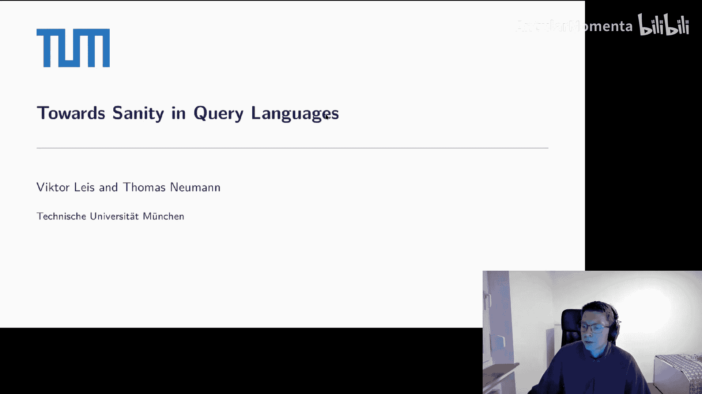

# SQL 或死亡？系列研讨会：02：迈向合理的查询语言


在本节课中，我们将探讨 SQL 语言的现状、其存在的问题，以及如何构建一个更合理、更标准化的查询语言未来。我们将首先分析 SQL 的缺陷，然后介绍一种改进语法的方法，最后深入探讨解决 SQL 语义不统一这一核心问题的构想。

## 概述：SQL 的功与过

关系模型是一个伟大的构想，具有许多优良特性。然而，作为其实现语言的 SQL，虽然取得了巨大成功，但在今天看来却存在诸多问题。它并非一个设计完美的语言。

上一节我们概述了课程内容，本节中我们来看看 SQL 语言具体包含哪些优点和缺点。

### SQL 的优点

首先，SQL 有其非常优秀的部分：
*   **声明式查询语言**：这是 SQL 极佳的特性，我们绝对需要它。
*   **多重集语义**：即允许重复项的“包”（bag）语义，这虽然增加了复杂性，但为了实用性我们可以接受。
*   **三值逻辑**：处理 `NULL` 值虽然痛苦，但这是必要的。

### SQL 的缺点

然而，SQL 也存在许多不尽如人意的部分。

以下是 SQL 语法层面的一些问题：

*   **奇怪的语法**：SQL 语法设计初衷是像可读的英语，但这仅适用于极简单的案例。复杂的语法结构使得添加新功能和进行优雅的抽象变得非常困难。
*   **过多的关键字**：SQL-92 有 227 个关键字，而 SQL-23 已增长到 409 个。这导致用户几乎不能安全地使用任何英文单词作为列名或表名。
*   **容易出错**：例如，在多表 `JOIN` 查询中，如果遗漏连接条件，SQL 不会报错，而是生成一个巨大的笛卡尔积，并可能返回看似合理实则错误的结果。
*   **冗余与冗长**：在 `GROUP BY` 查询中，分组列必须在 `SELECT` 和 `GROUP BY` 子句中重复书写。而像 `GROUP BY ALL` 这样的“解决方案”又非常危险，容易导致意外的分组。
*   **语法顺序与语义顺序不符**：SQL 的书写顺序（`SELECT` -> `FROM` -> `WHERE` ...）与实际的逻辑执行顺序（`FROM` -> `WHERE` -> `GROUP BY` ...）完全不同，这非常不直观，容易导致误解。

## 改进方案：更优的语法设计

既然 SQL 的语法存在诸多问题，我们能否设计出更好的方案呢？本节中，我们将介绍一种旨在解决语法问题的查询语言设计思路。

我们追求一种**简单而富有表达力**的查询语言。它看起来可能类似于数据帧 API，但关键区别在于它是一种独立的查询语言，可以作为文本发送给数据库。

与 SQL 相比，这种设计具有以下异同：
*   **相同点**：它同样是声明式查询语言，支持多重集语义和三值逻辑。
*   **不同点**：它拥有完全规则、无关键字的语法，明确的语义顺序，并且支持更高层次的构造。

其核心思想是**对关系应用函数进行求值**。以下是一个查询示例，它连接两个表 `R` 和 `S`：
```python
R.join(S, condition)
```
这种设计使得连接条件必须显式写出，避免了遗忘连接条件的问题。并且，操作符的应用没有固定顺序，可以按任何逻辑顺序书写。

此外，该语言还支持更强大的功能：

*   **关键字参数**：例如，可以指定连接类型 `R.join(S, condition, type="left")`。
*   **列表参数与命名**：在聚合函数中可以直接为结果列命名，如 `R.groupby(["col"]).agg(total=sum("value"))`。
*   **高阶函数**：可以定义接收其他函数作为参数的函数，从而实现查询逻辑的模块化和复用。例如，可以定义一个通用的 `left_semi_join` 函数，并在查询中像内置操作一样使用它。这解决了 SQL 中只能通过无参数视图进行有限复用的问题。

这种类数据帧风格的语法相比传统 SQL 具有显著优势：
1.  **更易学习**：无需记忆执行顺序，写法更符合直觉。
2.  **更易调试**：可以轻松获取中间结果，也更容易提供清晰的错误信息。
3.  **更易实现**：实现这样一个前端所需的工作量远小于实现一个完整的 SQL 解析器。

## 核心挑战：语义的“巴别塔”

上一节我们介绍了一种改进语法的方法，但正如 Thomas 所言，这并未触及 SQL 最根本的问题。本节中，我们将深入探讨 SQL 在语义层面面临的巨大挑战。

SQL 最主要的问题是**缺乏真正的兼容性**。它自称标准，实则不然：
1.  **无完整实现**：没有一个数据库系统完整实现了 SQL 标准。
2.  **有意偏离**：所有实现都有意偏离标准，且偏离程度各异。
3.  **非标准扩展**：各系统引入了大量独有的非标准功能。
4.  **标准缺失**：即使庞大的 SQL 标准，也未能明确规定许多重要行为（如隐式类型转换规则）。

这种状况导致了一个分裂的世界：SQL 标准与任何商业系统之间重叠有限，且各大系统之间也差异巨大。编写一个能在多个系统上运行的查询极其困难。

以下是一些体现这种混乱的例子：
*   在子查询中使用 `ORDER BY`，SQL Server 会报错，而其他系统可能允许。
*   `FULL OUTER JOIN` 使用非等值连接条件，PostgreSQL 不支持。
*   一个涉及公共表表达式和聚合的查询，在 BigQuery 中产生的结果与 SQL 标准定义不同。

即使近年来被视为“事实标准”的 PostgreSQL，其兼容性追随者（如 DuckDB, Umbra）也无法做到完全一致，在数据类型处理、特殊值支持等方面存在偏差。

这些差异并非无关紧要的边角案例，它们会导致**结果不同**，对依赖机器生成查询的现代应用构成严重障碍。这种碎片化严重阻碍了技术创新：
*   **联邦数据库**：难以实现高效且正确的跨库查询。
*   **硬件加速**：市场碎片化使得为哪种语义设计硬件变得不明朗。
*   **可组合数据系统**：如 Calcite、DataFusion 等项目，因底层语义（尤其是类型系统）的细微差异而难以无缝集成。
*   **查询优化即服务**：缺乏统一语义，无法在不同系统间自由迁移和优化查询计划。
*   **抑制竞争**：客户被锁定在特定的“语义孤岛”中，难以切换供应商。

## 愿景：定义统一的语义中间表示

面对语义分裂的困境，我们该如何构建一个更合理的未来？本节将提出我们的构想。

我们需要一个类似 **LLVM IR** 的中间层，即一个**定义明确的语义中间表示**。它不仅要定义关系操作符的语义，还必须包括：
*   标量表达式和内置函数
*   数据类型及其行为
*   隐式类型转换规则
*   错误处理行为（如溢出）

理想情况下，这首先是一份**形式化规范**，并配有一个**参考实现**。然后，可以定义标准化的序列化格式（内存表示、JSON 表示等）。

那么，如何实现这个愿景呢？我们认为路径需要务实：
1.  **初期**：构建一个桥梁，将 **PostgreSQL 风格 SQL 的一个子集** 转换到这个中间表示。鉴于 PostgreSQL 已成为实际上的通用方言，从此处着手最平滑。
2.  **中期**：推动可组合数据系统等新兴项目采纳这个中间表示作为其通用基础。
3.  **长期**：希望商业厂商也直接实现或支持这个中间表示，最终使人们可以摆脱 SQL 方言的困扰，直接使用更优雅的前端语言，而引擎只需关注统一的中间表示。

当然，这仍是进行中的工作，面临许多开放问题：
*   语义应与 PostgreSQL 多接近？
*   如何高效地支持非 PostgreSQL 兼容的系统？
*   如何在定义明确错误行为的同时，不妨碍重要的查询优化？

## 总结

本节课我们一起探讨了 SQL 语言的现状与未来。我们认识到，关系模型是伟大的，但 SQL 作为一个语言却存在严重缺陷：语法糟糕、难以学习、难以实现，最关键的是，各系统间缺乏兼容性。

这种语义上的分裂并非小事，它严重阻碍了数据领域的创新，如联邦查询、硬件加速、可组合系统等伟大构想都因此举步维艰。我们认为，解决之道在于定义一个**统一、形式化、明确的语义中间表示**。



这项工作旨在为数据世界建立一个“理智之岛”，虽然前路挑战重重，但它对于打破藩篱、激发真正的竞争与创新至关重要。最终，我们希望看到一个不再被糟糕语法和矛盾语义所束缚的、更美好的数据处理世界。