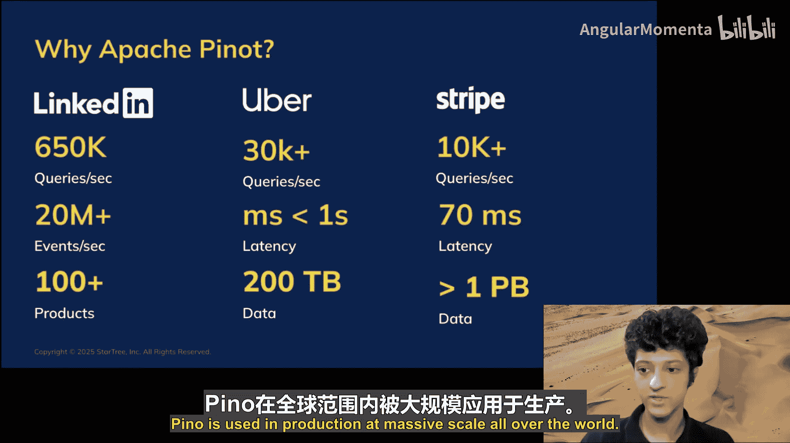
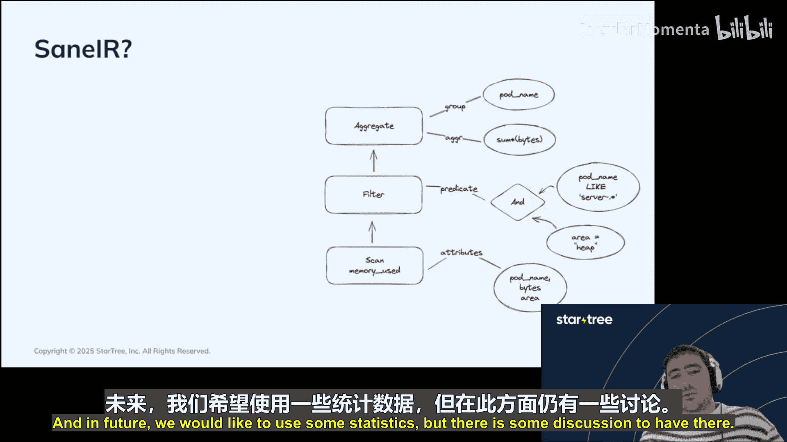
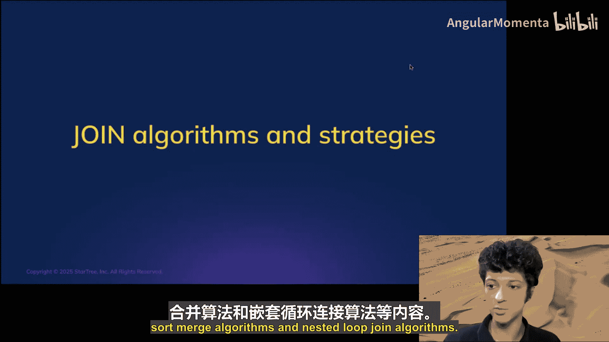
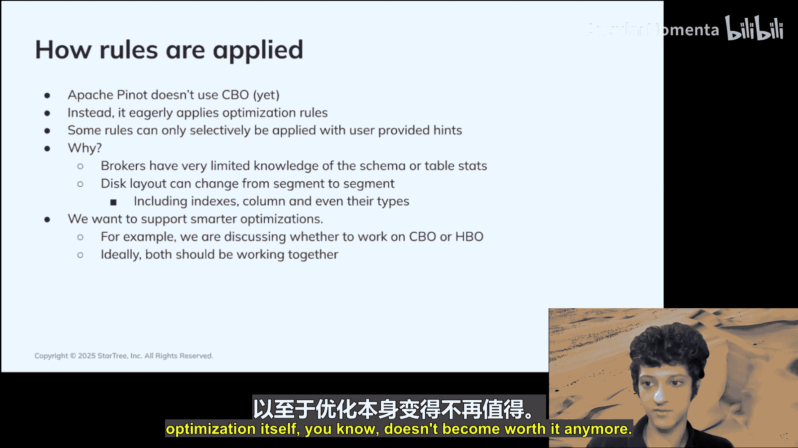
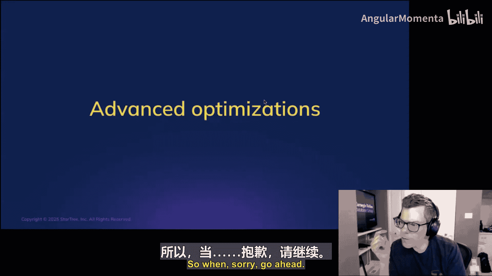
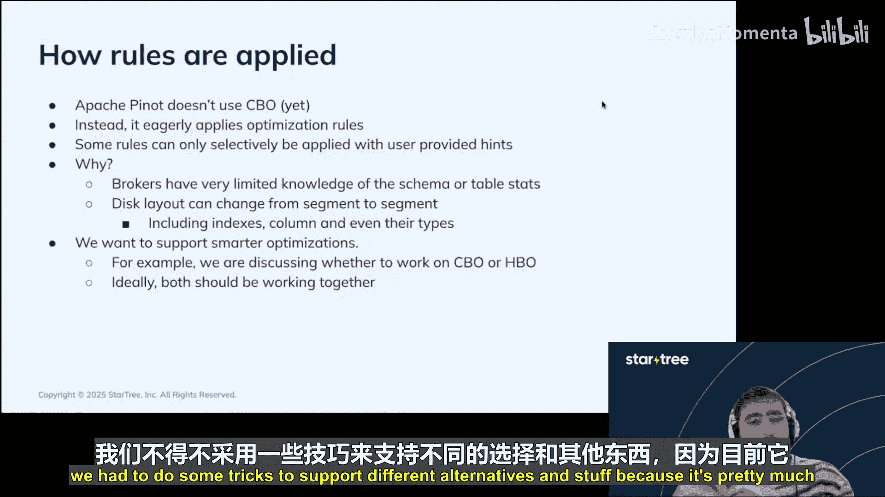
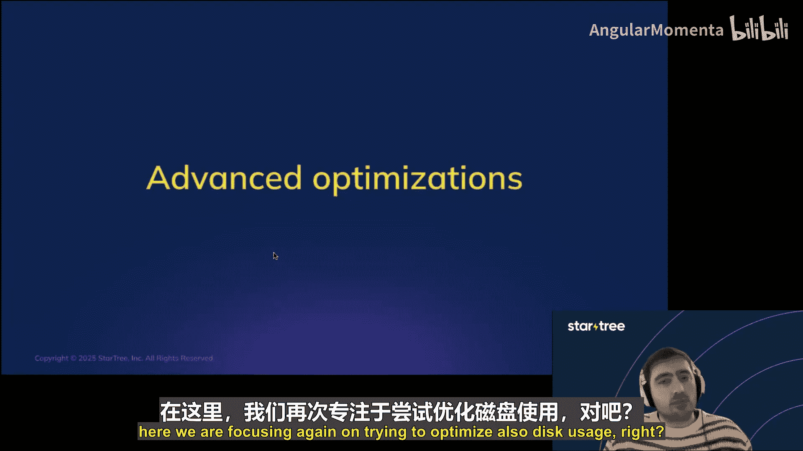
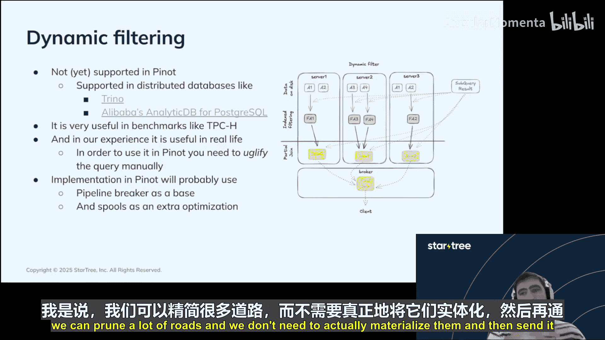
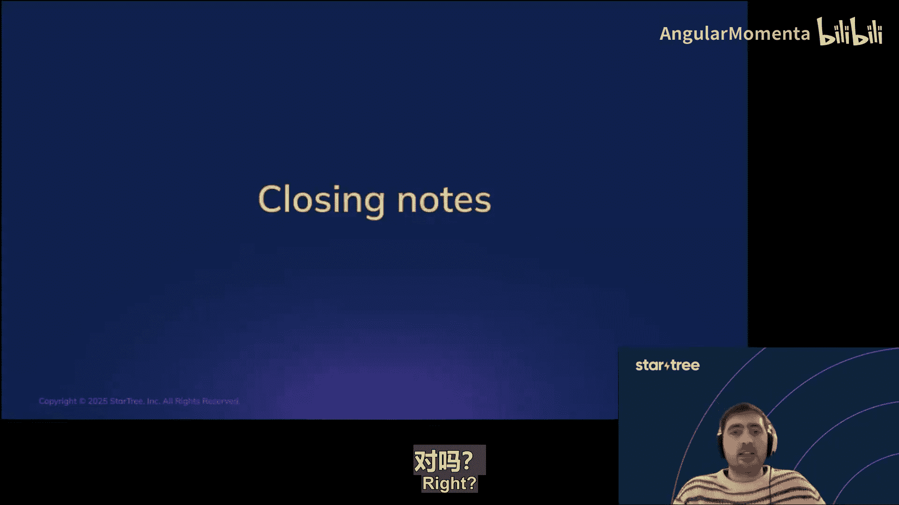

# 【卡内基梅隆大学】SQL 或死亡？系列研讨会 ｜ SQL or Death？ Seminar Series (Spring 2025) p03 03 Apache Pinot 查询优化器（Yash Mayya + Gonzalo Ortiz） -BV1FkisBtE97_p3-

有的。🎼why I hate it。Sequel or death Yo son， what are you going to choose？Yo check it。

 this seminar is filmed at Carnegie Mellon University thanks a lot， Google。

Hi let's let's get started we're excited today to have Yash and Gonzalo。

 both engineers at Star Treet to talk about the query ams have've been working on as part of Apache Piino we have to give a special thanks for both Yash and Gzalo for being here Gonzaallo is in Madrid in Spain so it's currently but six hours ahead of me so it's 030 pm where he is but yash is down in India。

 where's currently 3 am it's not the record for us 4 am is the earliest but still it's super early so we appreciate Yash getting up staying up for talking about about the database so as always if you have questions for the speakers as they're getting a talk don't be damn yourself and Esh question at the time and that way engaged in a conversation and not talking themselves in middle night on Zoom for an hour Yash and Gonzalo thank you so much for being here the floor is yours。

Thanks， And， thanks for having us。Hello， good evening。

 welcome to today's session in the SQL Oette seminar series where my colleague Gonzalo and I will be talking about Apache Ps queryry Opr and the various optimization techniques that we apply under the hoodd of PO's distributed query engine in order to make it super fast。

Just a sneak peek we like Soia， we have no intentions of killing it off。

 but we do believe that certain use cases could be better served by specific kinds of query languages and we'll touch upon that briefly in our talk later on。

So my name is Yash and currently working as a software engineer at Starre for a little under a year now。

 I work mostly on PO's query engine and I'm also a comm on the open source Apache Pino project。

And prior to this I was working on the Kafka Connectect ecosystem at Confluent。

 Im also comm on the open source Appaache Kafka project。

 and as you probably guessed I'm quite passionate about contributing to these large open source projects being part of these open source communities。

 particularly in the domains of distributed systems and data infrastructure。

I'll just let my colleague Gonzalo go ahead and introduce some now。My name is Bothalello。

 I'm working here from Adda and working Sta for almost three years now and I've been mainly focused on working on a Baip Piote。

 I'm a BMC member。Ofypinot and I've been working on distributed databases on model to model transformation。

 which is a funny name to say that transforming languages to other languages for almost 15 years and yeah I amm super happy to be here sharing all these cool tricks we are doing with you。

都也是。Awesome， so with that out of the way， let's take a look at the agenda that we have for you all today。

 we'll be covering a brief intro to Apache Pino focusing on the query engine aspects so that you know we set a foundation for us to be able to talk about the more interesting stuff and optimizations that we apply primarily in the area of joins and semijos after which we talk about some more advanced optimizations including stuff like dynamic filters and schools that aren't very common techniques across databases before finally closing off with a bit of a recap as well as a brief look into the future of Pot。

So yeah， without further ado， let's get started， let's dive into the introduction to Pino。Firstly。

 what is PO sure it's a database right， but there's a million databases out there today where exactly does PO sit in this fast landscape of database options that are available today？

We call Pot a real time distributed OLAP database， it's a relatively new category but a fast row segment and this is defined by ultra low latency analytics so think millisecond latencies at extremely high que throughput so again think tens of thousands of queries per second on petabytes of data。

At the heart of all this is Pino's columnlumar Data Store。

 which has several smart indexing and pre aggregation techniques。

Another interesting characteristic of Pot is that it scales really well。

 so you can simply add servers to your Pot cluster， scale it out horizontally。

 both throughput and capacity， and Pot will employ some smart techniques to make sure that the tail latency for queries doesn't get out of hand even as your cluster size increases。

So the primary use case for Pot has been user facing realtime analytics。

 which is quite different from traditional analytics that you've probably heard about internally in organizations spaing business use cases so in this user facing realtime analytics world。

 we put analytics into the hand of end users through applications。

 which is also why we need to scale to these crazy numbers of tens of thousands of queries per second。

 so that use cases on PO can scale linearly with growth in users of your applications。

Peno can also be used for other analytical use cases， though， including internal dashboards。

 anomaly detection， adopt data exploration， and various other use cases。So why Pot。

 to convince you all that all the optimizations here that we're going to be talking about in the rest of the talk are not just theoretical or unjust something from some esoteric database that nobody uses or cares about。

 let's take a look at some of these numbers， right？

Some of the biggest companies are using Pot at massive scale to power various use cases that most of us probably interact with on a day to day basis。

 so LinkedIn is where PO was originally created they're serving a massive 650。

000 plus queries per second today from their Pot clustersters powering 100 plus products。

Including things like who's viewed my profile， post analytics， hiring analytics。

 and various other use cases。Uber is also using PO at massive scale for a very diverse set of use cases。

 including system log analytics using the compressed log processor framework。

 they're using it for the Uber East restaurantest manager app。

 putting analytics right into the hands of restaurant and business owners to keep track of the health of their delivery business。

And Stripe is also using Pot for a bunch of interesting use cases。

 you can see the numbers here to speak for themselves。

 Pot is used in production at massive scale all over the world。

All right， now that youre all hopefully comments that you know PO is database widely used in real world。

 let's take a look at how PO stores and queries the data。So like most of the databases。

 Pinotro tables and these tables are divided into distinctnc segments that are the atomic storage unit in Pot。

These segments are formed by columns again remember Pot is a columnar data store and these columns themselves are formed by various indexes。

 so various single column indexes， we have a dozen indexes。

 something for every use case so we have an inverted index a range index， we have geopatial indexes。

 we have JON indexes， we have text indexes for text based search and various others。

And talking about the compute part of the equation， Pot has controllers， brokers servers。

 which are all distinct kinds of nodes in the cluster controllers are sort of the brain of the cluster managing metadata and cluster coordination。

 but then very involved in the query execution part in the query engine itself so we won't be talking too much about the controller。

Serverers are the ones that are actually storing segments on disk locally and also doing the bulk of the query processing work。

So these segments are actually stored typically in more than one server through replication for both high availability as well as for scaling throughput。

AndBkers are the ones that actually receive SQL queries from clients。

 they compute an optimal query plan from the SQL queries from the client and dispatches them to the servers。

 so it typically as part of computing the most optimal query plan also includes the set of servers that the query needs to be dispatched to as well as the set of segments that each server needs to processed for that query。

So the single stage query engine， this is Pino's original query engine。

 the first query engine that supports projections， transformations， aggregations， groupeyes， UDFs。

 and a bunch of other stuff。But it does not support more advanced SQL constructs like joins。

 subqueries， window functions。And a bunch of other things and the reason for that is that it uses a simple scatter gather execution model for the queries wherein the broker receives a query。

Scatters request after to the servers that computes as part of its query plan。

 the servers to the actual processing of the request by running bunch of compute on the segments assigned to it returns the response back to the broker which gathers all the responses from the servers that it's scattered the request to before sending back a final response to the client。

So as you all might be familiar， the Portck in a lot of databases is typically IO。

 so a lot of our optimizations are focused on reducing the amount of IO done to serve each query in the single stage query engine one form of doing so is using various pners on brokers and servers。

So for instance， on the broker side you'll use pruns to reduce the number of servers that you need to fan out a query to using metadata like partitioning info using other metadata like time boundaries and stuff like that so that's going to reduce the number of servers that the broker scatters the request to and on the server side we again use more pruns to reduce number of segments being processed to reduce the amount of IOone to reduce the amount of compute done via more segment level metadata like column value information column statistics。

 bloom filters and other techniques。So one thing I forgot to mention earlier is that tables in Pot can be partitioned on columns so physically partition and this will be important to remember later on so just keep that in mind so we can have partitioning in Pot tables。

Coming to the most interesting optimization that we actually apply in the single stage query engine that's going to be indexes。

 these can massively reduce the amount of discrete needed to you know so a query so again these are going to be indexes like inverted indexes range indexes。

 all of these are single column indexes， the most interesting one is actually the star three index which is Apache Ps USB and in fact so this index actually does bunch of preagggregations that can speed up aggregation and group by queries by orders of magnitude。

It's a super interesting topic and can have an entire talk dedicated to it and in fact does have an entire talk dedicated to it in CMUDB's 2021 seminar series so I'd highly encourage you to go check that out if you're interested quick you said Star T indexes's the system is USB or would phrase USB like okay yeah one of the most popular features of P USB okay awesome thank you。

I think there was another question on chat。Yeah， the indexes are indeed segment level， that's right。

Yeah， yeah。Yes， I've been talking about the single stage query engine and as he mentioned。

 one of the limitations we have there is that we don't support。

Some very interesting sQL sQL features like especially joins window the functions。

 we also don't support in single states we don't support the union things like that that's why。

Given a half ago more or less， we introduced the multi stage query Indian。

 we released that in aacipino 10 and this multi stage query Indian is。

An iteration on top of the the other one， the idea here is that we instead of having an expression tree and evaluating that in a scatter scatter from gather fashion。

 the thing we do is to create several stages， which is one is actually a scatterther gather。Face。

Then the query is divided in these stages and then these stages are。

We assign up parallelism to each state。Usually in the way that we create virtual partition from the data we are going to analyze。

 so we from from the operate normal operators we have we go to stages and from stages we go to what we call workers workers are different instances of the states that are going to see it。

パーティシン の 手デいタ。嗯。By doing that we are able to execute things like joins in a distributed way without having to use all the resources in a single machine and that's a key feature in the smootht query engine so important that we actually name the engine that way right in this model the broker still does a lot of work here when we receive query in the broker that in the first thing we do is to optimize that applying some normal SQL traits in the pre or algebra and then we the most simple of at least for the context of this conversation is to decide how to split this operators or how to bring these operators into stages and how to assign。

Workers to these stages and also how the information is going to be shled between different workers Okay that's the most important part usually when we have to I mean in general when when we are distributing that information we use some exchanges which is a logical entity in this diagramm here it doesn't mean that we are going to move all the data to some place and then dising that that's a logical view but in implementation the thing we actually do is to send information from server to server on specific to worker to worker and。

This information can be either sent to a different。Process。

 which is done using yourBC channels or in case we are able to send that information from the same mean inside the same process to workers running in the same process then we just share memory with in the same GBM because we know this GBbM based system and that's super efficient and one of the things we try to do all the time right apart from that。

Just slide parenthses and probably more focus on what this seminar is about for us SQL is just a front an interface right we do not apply optimizations at SQL level we always transform that into theyre really in algebra in some specific nodes we have we are using a particular side to do that and we are reusing most of the things in a particular side to skip some of the work and also apply some of the rules they already have and the reason why we decided to use SQL is not because I mean we like SQL but the actual reason why we choose SQL is because it's thelinginga fca in the lab world right and when I say thelinga franca I mean in the same way we are now all of us we are talking and discussing things in English even if my English may not be the best in the world we are able to understand me and the same thing happen when you have different SQL dialects right。

We are not going to be able to run the same SQL that is being executed in Post or in other databases。

 but a person writing a SQL expression in one of these databases is probably going to understand one of our a different expression written in the SQL dialect we are using。

 right？That's what is great from SQL there are tons of problems。

 but the important part here is that for us SQL is not something that we are bound to and we could be using other languages and in fact we are right now there are people in the Pnot and the community working on the ability to support different languages。

 especially we are focused on time series because we understand that in the same way that SQL is an inofranca in the OA world when people is used to write use graphfaana to monize some application usually the thing they used it to write proQl。

 so that's something that for example it will be super useful to support。嗯。

When I say that I mean imagine this simple query where we are reading from a memory use table and there we are applying some filters and grouping by the port name and then producing some output in number gate right the thing we actually have is something like the one half in the right this is super simple。

 but the idea that we have。We are this scanningning the table。

 then applying a filter and then apply okay， this is the logical view。

Then this is what they usually the brokerry produce and then this is optimized。

On each server based on the segments we have and these indexes we have on in segment because they may change in in time right so this。

 for example， maybe this filter where we are applying in an and and blah。

 blah it can be optimized for example， to say okay I'm not going to use just an filter that applies this hand but I am going to use a filter that actually reads using this specific index or whatever super classical in the。

Dataase1， nothing super， the point is。The same model could be generated by some link you query we don't support that in P。

 but it shouldn't be super difficult to add it's a matter of creating the grammar once you have that generated the node you have at the right side right？

We could be using N3QL， which is a language created in Ba Uver and created specifically designed for time series。

 or we could create we could be using PronQl and in future we will like to have something like that and I hope this is not going to be I mean I hope it's going to be soon right？

Or we it could be same year higher， rights it's the same thing。

 You could be generating anything to that intermediate model。

 and then you can move from there to our own。P note a specific model， right。

 sometimes there going they are going to be some operators that are just specific for your language。

Probably they could be also represented in the religion algebra。

 but sometimes it's going to be easier to just move to some specific code and we know that for example。

 for some operations in the time cities we may want to add some externals apart from our own drawings and stuff but in general they are going to be pretty pretty pretty similar okay right just just so I so like this say whatever query shows up。

It gets parsed and then the broker generates which is roughly a logical plan here yes and then you ship that that logical plan to every single server who then runs around optimize the curological plan into a fiscal plan in fact the servers the thing they run well depending on the stage is leaf station in our tree or the graph we be allowed double the workers but in the leaf stages we run the same SQL engine the same single stage query engine so there we apply。

All these physical optimizations based on the indexes we have， the main reason is because。

And sometimestime for historical reason but also because we are st so much data we in case you want to use the same table you were using and then you add a new index。

 you don't want to rein everything right so there are going to be some segments that are going to be using newer indexes and sometimes segments that are not going to be using them so we are not able to store all the information of which indexes which are which segments contain which indexes in the broker because there may be tons of segments and we don't want to spend that memory there so it's。

Given that the optimization we are going to do， they are not super based on the indexes， we can just。

Ete the latest optimization to transform these logical nodes into physical nodes。

 it can be done pretty fast in the lift station and we do that for every segment and we do that in parallel or whatever。

 but it's super fast because we have eager optimization and we are not doing some kind of like ghost based optimization that because it's not super interesting because if you can use I don't know you can use an inver of the indexes that's gonna to be the fastest test you gonna use you don't have that but you can use a range index maybe that's going to be better percus like so it sounds like basically doing a greedy search preforr to say here's the best index I have from my choices available me just pick that and not try to do anything fancy and I think you said the multistage thing you' released in Pot1 that is doing joins correct then so is the broker deciding the join order up above。

Yeah， we are going to talk about that， Okay， but spoilers。

Thinking here is that we don't have we want to add some cost by optimization in the brokers just mainly to decide things like that。

 right now we don't have that so we are using a very fixed order where for example。

 we always use apply hash indexes and hash indexes the right hand side is the one that is always being hash。

Is not super smart， but it's a good compromise right now and in future we would like to use some statistics。

 but there is some discussion to have there。

So yeah， yes giving to the。This spotlight。All right。

 so it's time to get into the meat of this session and we're going to start talking about join algorithms and join strategies。

So these are two distinct things and join algorithms are referring to the actual algorithms that are executed on data that's already in one place to emit our join output and this is stuff you've all read about in classical database literature so this is going to be stuff like has join algorithms。

 sort merge algorithms and nested loop join algorithms。

So in Pino we primarilyly use has join algorithms， so where there's a build side。

 there's a probe side， you build up a hash table on the build side using the join keys as the lookup key into the hash table。

 the probe side is。I am。Is it not visible？It looks correct to me。Okay， cool， thank you for it。

Allright so the probe side is implemented as streaming input in Pot where you have rows coming in one by one for each row you do a lookup on the build side。

 you see if there are matches create the join output and keep doing that and depending on the kind of SQL join that is we might also need to keep track of unmatched rows so for instance outer joins left joint right joins full joins stuff like that and this is typically used for equi joins or none joins we do have to fall back to the nested loop algorithm where we trade over all the rows for one side for each of those rows you would trade over all the rows from the other side super inefficient quadratic time complexity horrible we don't usually want to do that but that's also an option in terms of the join algorithms。

But that's actually not the interesting part the interesting part is the join strategies which is what we're referring to for the various strategies we use to actually get all the data into the right place in order to execute the join so for a distributed join the challenge is to get all the data to the right place and make sure that we are respecting the join semantics for classical databases like Postgres and most single node databases this isn't really a problem because all the data is already on a single node even if there are multiple servers each server is going to have an entire copy of the data right the servers are just going to be there for say high availability whereas in a distributed database like PO where the data from tables is inherently spread out across multiple servers。

We need to make sure that all the data that needs to be joined is in the right place。

And this is going to involve data shuffle over the network across servers。And this is expensive IO。

 this is typically going to be a bottleneck for joint perries and it is going to be our goal to optimize this data shuffle this network IO overhead and minimize it as much as possible and that's what we're going to talk about through all these joint strategies。

So the most simple way， the absolute most simple way。

 the most straightforward way to execute a distributed join would be to move all the data from both sides of the join into a single server。

 execute a join algorithm locally on all that data and well emit the final result right so in this case you have three servers and a couple of table Z and B that need to be join with segments spread out across the servers and in this case suppose we want to move all the data into server2 that would involve some data shuffle for segments that are on other servers it would involve some inmemory movement of data that's already on that server similarly for segments of table B。

 some data shuffle over the network， some in memorymory data movement once we have all the data on a single server we can execute our join algorithm locally on that server and emit the final join result before to the broker before sending it back to the client。

The number of flows shuffled here would be bounded by the total number of flows across all segments of you both sides of the joint。

While this works， it is not scalable， so remember PO can have dozens of servers。

 hundreds of servers and petabytes of data and joining two large tables by sending all this data over to a single server and executing this massive join。

It's just not going to work very well so we don't actually use this strategy in Pot this is just to illustrate the problem of data shopping and join where we need to get all the data into the right place before we can make our join executions happen。

So instead， what we actually do is we create virtual partitions at query time and we'll see what that looks like through a bunch of strategies。

So the first one is the query time partitioning strategy which can be used for equi joins so join conditions like a do sum column equal to B do some other column so in this case we can do something called partitioning again at query time we're going to use a partition function that guarantees that if a do sum column is equal to B do sum column the join condition if that condition is true then the partition value emitted by the partition function which is typically going to be a hash function is going to be the same。

So let's take a look at this example to see what I'm talking about right we have again similar setup three servers two tables that need to be joined few segments scattered across these servers for both sides of the join。

We're going to create virtual partitions， so lets say p0 p1 p2 and these partitions are going to be the same for both sides of the join and these partitions are going to be in the same server。

 so p0 and server 1， p1 and server2， p2 and silver3。

And now what we're going to do is for each row in each segment we' are going to compute the virtual partition and send the data over to that virtual partition so for instance for every row in every segment that computes to partition zero。

 we're going to send it over to server1 in the virtual partition p0 and that's going to involve some data shuffle over the network it's again going to involve some in memory transfer depending on where the actual data is the physical data is similarly we're going to move our data for the other two partitions。

And now we can simply execute our local joins on each of these servers。

And because of the property of the partition function that we choose。

We can guarantee that rows that end up in different partitions didn't need to be joined in the first place。

 so we are maintaining the join semantics while also being able to distribute the join across multiple servers so once we have these three local joins that are executed you can simply combine the results。

 get the final join output and send it to the client。So again。

 the number of rows shuffle there is bounded by the total number of rows across both sides of the joint。

 and the worst case would be when each row in each segment needs to be shuffled over the network to be sent to virtual partition another server。

That strategy while good doesn't always work， so think about non equijo conditions right like a。

 sum column greater than B do sum column or a do column not equal to B do sum column。In this case。

 we can't partition both sides of the join because some rows would never be joined in that case。

Let's just take the same example to see why， so here we have again， similar setup。

And here we are going to create partitions for a， but the other side of the join is actually going to be broadcast to all servers。

And if we don't do that， if we were going to partition both sides similar to what we did earlier。

What's going to happen is that the rows that are sent to one partition are never going to be joined or matched with the rows that are sent to another partition and the join condition is such that that's going to break the join semantics and we can't do that so what we do instead is distribute one side of the join partition it doesn't really matter what the partitioning strategy here is is here in this case it could be random it could again be hashb doesn't matter so we're going to partition a and similarly send rows that computer partition zero over to partition zero and server1 and similarly for partition1 and two some data shuffle is going to be involved some in memory data movement is going to be involved and for table B。

 the other side of the join we're going to broadcast the rows to all the partitions and this is going to ensure that the join semantics are retained and this strategy is typically good when one side of the join is much smaller than the other side of the。

And we can ensure that we broadcast the smaller side of the joint and the largest side is the one that's going to be partitioned。

So the number of rows shuffled here in this case is going to be bounded by the number of rows in the partition side。

 plus the number of rows in the broadcast site， multiplied by the number of servers that we want to execute the join in。

So note that we can also control the number of servers that are actually executing the join or the join parallelism and again that's going to have a few tradeoffs we could execute the joins in more servers that's going to involve probably more data shuffle but you're also increasing the parallelism of our join compute so that's another tradeoff that needs to be considered can you share how you how you collecting the statistics to decide whether you which these purchases to do is it because on interest you're maintaining the stats or you want to analyze like how does that work？

We'll cover that briefly after we talk about each of these strategies。

 but spoiler is that we currently don't do too much smart stuff there and we rely on。

Various heuristics and user provider hints to choose the best strategy based on the data layout and the query pattern。

 but yeah I will cover that a bit more。Yeah so a variation of the previous strategy is the broadcast plus local join strategy so again this is similar to the previous strategy can be used for nonequq joins and various others cases but here we are going to broadcast one side the other side is not going to be distributed at all so the broadcast side is going to shuffle over all the data to the servers that already contain the data for the other side of the join again this is going to be super efficient for joins involving tables of skewed sizes so one super large table one super small table and we're going to shuffle over the data from the small table to all the servers that already contain data from the larger table in this case so let's say a is the large table that's going to be the local side of the join and B is the small table that's going to be the broadcast side of the join we's simply going to move over the data from B to all the servers that have the segments for a execute our local join algorithms on each of these servers and。

Combine them to get the final join output right so the advantager is obvious one side does not need to be shuffled。

 this can be great again for when tables are swed in size。

The disadvantage compared to the previous strategy is that can't scale to more servers than the ones that are actually hosting the data from the local side of the join and this is usually not going to be an issue but it could be an issue in certain edge cases so think certain joins like cross joins or caraceian products where the join is actually going to create an explosion the amount of data and we might want to spread that load out across multiple servers but usually this strategy turns out to be more efficient and the number of rows shuffle here is simply the number of rows in the broadcast side。

 multiplied by the number of servers that are actually executing the join。So moving on。

 we have something called a co located join that completely eliminates data shuffle。

So this requires a number of conditions to hold so this is going to be useful only for equi joins so again two columns being equal as the join condition and the two tables need to be physically partition on the join columns and the partitions need to be colocated so what that means is that the partition function used for partitioning each side of the join each table in the join needs to be the same the number of partitions needs to be the same so the assignment of partitions to servers needs to be the same and we need to have servers that hold all segments for each partition each of the tables in the join so that's a whole laundry list of conditions right but when all these stars align we can actually execute a colocated join which completely eliminate data shuffle and this is going to speed up queries by like an order of magnitude or two so it's usually worth it to architect your data layout to match a query patterns to you know be useful for the。

In join cases and Pot does support a bunch of table configurations to make sure that the partitioning is you know going to support this sort of strategy so again taking a sort of similar example three servers two tables that need to be joined both these tables are partition on a certain column that is the going to be the join column in this query and we have let's say two partitions0 and one we have server three that's hosting all the segments of partition zero server two hosting all segments of partition one again across both sides of the join。

So here we already have our partitions are labeled right on the same server。

 so our virtual partitions are simply going to correspond1 is1 to the physical partitions where we have p0 and server 3 p1 and server2 and since we already have the data partition we can simply execute local joins by doing inmemory data movements without any network overhead。

 no data shuffle required， simple local joins here combine the join results get the final join output and return it to the client so again since we are eliminating all the data shuffle overhead。

 these joins are much much faster options than the other strategies and interestingly many other distributed real- time Oab databases only support this strategy whereas in PO it's just one of the many options but of course the most efficient and we'd always try to aim for this sort of join strategy whenever possible。

so these are the I mean the gamma joined algorithms from the 1990s as far as understand。

 like is there anything novel specific about to Pino。

 the environment you're working in where like you can't take the classical joint algorithms or distribute visual algorithms and make this work or is it just as soon as a textbook implementation。

 and it's okay if it is I'm just curious。So yeah， in terms of broadcast and shuffle and the logic involved there it is pretty much all the same。

 we do have a lot of low level optimizations， but from a high level the actual strategies to you know get all the data into the right place。

 I think yeah that's the pretty classic strategies that we' are using。Okay， thanks。

So we have a variation of the colocated join strategy as well called lookup join which is very penenospec。

 so we have these dimension tables that are sort of replicated across all servers and materialized in memorymory in each server as a lookup table。

 so these are typically for like small tables that contain dimensional data like product information gushma information time ranges and we can execute joins with no data shuffle even in this case using these in memoryory lookup tables for one side of the joint。

And yeah moving on we want to talk a bit about how rules are applied。

 we briefly touched upon that earlier， but Pot does not use costbased optimization at least not yet instead we eagerly apply optimization rules so Gonzalo briefly mentioned this earlier but we also do a bunch of stuff of this stuff like you know pushing down filters into joins pushing down aggregates into joins we have some rules that can convert joins into semijos whenever possible and bunch of other stuff we also need to choose strategies for join the data shuffle and stuff like that so right now since we only eagerly apply these optimization rules based on simple heuristics。

Some rules can only selectively be applied with user provided hints so right now that that's not optimal。

 we rely on users to know their data layout and their query pattern and know sort of choose the best strategy for their data layout and that's going to be a bit of trial and error but the reason for this is that brokers currently have very limited knowledge of the table statistics and also the this level layout for segments and it's going to be prohibitively expensive for brokers to maintain metadata for millions of segments potentially all centralized and make decisions on that so we do want to support smarter optimizations in fact we have been discussing about potentially supporting either costbased optimizations or historybased optimizations where we could optimize queries based on historical que stats for similar queries。

But one thing we need to be super careful about is the optimization overhead so right now our optimization process is super simple right we just apply these rules eagerly and compute a query plan that may not be globally optimal but is definitely more optimal than the obvious thing。

So we need to be very careful that the latency overhead introduced by this sort of optimization is actually worth it because P remember is typically used in a lot of low latency environments and low latency use cases。

 so we need to be sure that the overhead introduced from the optimization isn't so high that the optimization itself you know doesn't become worth it anymore。

Yeah。

So it ahead so when equationqua shows up on the broker that runs calcci to do the conversion to the logical plan and then when it lands on the server and you convert it to the physical plan is that calcite again or is that all P code that's not calc so calcite does purely at the broker level at this point we compute Sw use calcite to parse the SQL as well we get the abstract andax3 we use a calcite query planner to compute convert the abstract and taxax3 of SQL nodes to relational nodes and relational logic and then we use a bunch of rules both from calcite and Pot custom rules to actually convert these trees of relational nodes into semantically equivalent but more optimized forms and once we send all these logical plans over to the server it's all P optimizations from there on。

And then then on the server， like is it？Is it a bunch of Java code that you're firing off in a specific order to apply the rewrite rules or is there is there like a DSL or something you're compiling into Java like how you how are you defining those rules that happen on the server side it's just plain old Java apply in some specific order In fact we had to do some tricks to support different thermomat and stuff because it's pretty much static right now Another thing I wanted to say is that even we have some rules that has to be enabled by using some hints and stuff some of the distributions we just was talking about before can be automatically in by the broker for example colated part joins can be infer by the broker because it now whole segments are whole segments are distributed between between servers segments are distributed between servers so。

It's able to decide automatically whether it has to use this technique or the other there are some some cases where for example he was saying if we have a very very small table in one side and maybe we just want to broadcast that side to all the places where we already have the larger one。

That's the kind of things we cannot do because we don't know the broker don't know doesn't know the whole lot are the tables。

 So that's the one of the things we want to introduce in the future holiday year。

 But it's something we need to do carefully and to without actually modifying too much our。

Making our optimization process too as slow， right？

So question I had when you're doing these joins with these different strategies。

 what happens if in a single server， you don't have enough memory because you may not have the perfect partitioning function or when you're broadcasting。

 you may have， do you do something else to react to that？In that case。

 we have two options you can either make your query fail or you can return partial data right now we don't have the ability to spill out of this or something like that that's something we could be thinking about but again our use cases are not queries that run for 10 seconds or 60 seconds super our use cases run queries that finish in less than one second So if we end up having to go to disk probably we are not going to we are going to be out of the actual timet we what we have writing so that's not I mean in case you want to do that kind of things you can for example use train on top of top of peanutnot and it's something that our customers have been doing for a while。

The point here is okay you have you want to have super fast queries for your panels for that that makes sense and sounds like in your workload you're not going to have like 10 joins or 20 joins sounds like you're going to have absolutely so that's what you're optimizing these things for and you really want to go fast Okay got it thank you。

Let me okay over to you Gza yeah let me Im sharing cool here we are calling this advanced sub session。

 but probably it not the bank but given the the peer sub we focus on reducing data sample here we are focusing again on。

We're trying to optimize also disk usage， right？

The first organization I'm going to talk about is the pylon breaker we go back。

To some specific optimizations for semi joints， consider for example。

 this query where we have a very large table that is joined with another wall in this case a semijo with a sub query which in fact is just reading from another table let's assume that table two is super small in a normal case this will need I mean we will need to scan the whole large table and the whole small table and then。

Apply for it row load that time memory right and then apply the filter for it row that's not super efficient and the thing we do is about to execute this algorithm small algorithm right where we are。

Breaking our optimized plus execute pipeline into different stages， different parts。

 not the stages in the sense that we were talking before。

 the thing we do is to first evaluate this this one in purple the sub query once we have that value then we can say okay cool this is not super large so the thing we are going to do is to substitute this value and instead of using the scan the thing were going to use here is the actual threshold in a let's say literal way is not actually literals we are writing in SQL it's。

Different it's important in a different way。 So we don't actually have to have these huge sQL synthesis。

 But if these values are in the order of hundreds or maybe few thousands。

 we can execute this kind of query where we are actually the thing we are gonna be executing later is just filter our normal filter like if the user was actually be executing the first query。

 then going back to the application and then create a new query using the value in in the in plus right So by doing that。

 we can compile this when we when the query reach the servers， servers can optimize that and say ay。

 but I have an index on large stable dot code2 So an invert index for example。

 So I can use that to evaluate this filter right So by doing that we don't need to load all these all these rows。

 but only the ones that are actually going to be to be used right This is a super cool technique。

The improvements in performance are massive massive but you can use that and we are also able to use that in other cases not just semijos because as you may know some inner joints can also be performed or semantically equivalent to a semijo right in this for example in this case is's pretty similar to the one before but in this case instead of using a semijo in the select in synint or were in syntax。

 we are using semantically the same thing but using an inner joint right？

Whi is again key do this thing the point is that not all joints can be transformed to that。

 for example we need it can only be used in inner joints one of the sides has to one of the sites has to not be used in the projection phase and also which is very important in our case。

That side of the joint。Has to be unique by these case。

 that's super important and it's something people usually forget about。

In a standard database like Postlation MySQL or whatever。

 you have some indexes say okay this is every key so it's unique don't worry too much the database about that you can apply that the kind of optimization but here we don't have that because in the O world it doesn't usually make sense to have that unique component right so there is nothing in the schema say in that and therefore the database doesn't know anything about that so again this is one of the places where。

Usually pin on itself from the user and you can specify or you could use a hint to say hey。

 assume that this site is going to be unique by the。Column we are using。 or instead of that。

 you can do something like。Actually， write a distinct sentence in that sub query， right in this。

 for example， in this case， the right the right  queryries。

Far more efficient opinion than the left the one we have in the left side， right？

Even if we are doing in theory more things because we have to actually apply called naulate this this thing。

 but even for example， Pnot usually use dictionaries。

 this distinct sentence is super fast to develop right。In this case。

 you should have to write the right hand expression because it's semantically in SQL is different than the one in the one on the left and it's different because in the left expression。

 if there is a row that is repeated， value of call3 that is repeated。

Any value that must that is going to be produced you need a new value， a new row in the result。

 right， and there is something that is usually。Super complex to explain users because they assume or they no for the domain because maybe this is not super simple query。

 but they know that by applying some extra work conditions， they know that in their domain。

That column is going to be unique but the engine doesn't know that right so that's something we need to help the engine with and it's again one of the places where SQL gets a little bit tricky and one of the things that really could we improve that some next level language but that's what we have right now。

Now I want to talk a little bit about a different thing which is schools， which means。

The is the ability we have to do not evaluate things several times in all our goal。

 and especially now that a lot of qua has been automatically generated either by OMs or B Apps or UNI。

It's important to， to。To know that in this queries， like the one we have in the right hand side some。

Relations and with expression are used several times in the same quality we we need to think that queries that we are executing usually are like 400 lines of code right and they are repeating not of structures and therefore we don't want to evaluate that code several times andpos are。

A tool we have。To try to run these expressions only one， for example， here。

lets assume that this diagram here is equivalent to the one we have in the right side。

 here we are materializing this dining relation twice right one in the filter and one as part of the joint。

 right？嗯。The point here is that we school and we are able to evaluate that states only once and then send information using the same exchanges we are using。

 say that information to two different states here here we have a states running this part and here we have another states the joint expression。

And this is also a tool we can use to support to improve normal joints。

 even if applying this pilot breaker technique without having all the requirements right this is what we call dynamic filtering this is。

Funny feature because the idea is to make your query faster but making it more complex the idea here is to support again this the same p breaker feature that is super useful to improve your queries。

But being able to use that in cases where they are not just semi joints right the idea here is that let's see imagine that we have this this query here right this query here is an inner joint。

 but in this inner join we cannot apply the same technique we were talking before because we are first let's assume that obviously tiny table is the tiny one and we would like to apply this semijo technique into this。

Ting table so we cannot do that because first we have we are projecting column4 from P and also we have this expression here and again the database doesn't know whether B dot call3 is unique or not so we cannot apply this this the semijo optimization。

But the thing we can do here is to write this expression and users could do that manually but we don't want that and they could alify their query by saying okay cool instead of having this thing let's make it more complex and this is pretty similar to the thing I was showing before with this pool right let's make it more complex let's keep the join the join we had before but at a note of another filter and in this filter we are going to read again from timing from timing table right？

Then oh sorry then spoilers then we can use that and the semi and the pipeline breaker feature to compile this right hand side from the join right and compile that to use actually use the index the inver for example the inverted index that we can use in this condition right so that's the idea of dynamic filtering right？

This is a feature that is not supported yet in Put。

 but is supporting on the databases like Reno or Alibaba Ana DB from for Prospers and it's something that has been proven very useful in some cases。

 for example， TPCH， there are some queries that are。Optimize and I don't know。

 one or maybe two orders of magnitude by using this technique in trainingno， for example。

 and also in Alibabas this something we want to add into opinionion。

I don't know exactly when but it's something that we want to add and we are going to be working on that an the idea of the implementation here is I talk you about pipeline breakers and I talked to about suppose the idea is to combine both right so we can combine both to have the same functionality provided by all this other databases in fact we expect that it going to be even better because in freedom for example there are like more data that has to be more and things like that things have to go to the broker and stuff in the our case that's not going to be the case So I think this is going to be a superistic this that we are eager to have。

So it's basically a style of like sideways information passing that like you're computing something like a blueprint or whatever on the side。

 and then using that to filter the large table as you're going into the joint。Yes。

 so we don't need to I mean we can putrun in a lot of ropes and we need to actually materialize them and then send it through the next and right so just a closing notes pretty fast。

We are talking， we already talk about that， but pinnottiesia distributed real time on our database。

We choose to use SQL as language and right now we are working on supporting other languages。

 but under the hood they are going to be working in the same way。

 we are going to transform everything into this relational algebra and our model different models we have to support that。

Then we are going to be used to we are using our。Test。

 we are actually able to use the same optimizations that we have been using in a multistate gradient for other languages without how to deal with SQL because an SQL is just。

Syntxis right for us， at least。And with that， I think that's most of it， our software is open source。

That you have a beautiful QR you can use to。To check for our beginner tasks if you want to contribute usually all these large features are this fair design and then we start with implementations and you can discuss about that for example I think the slides where we ever talking about the schools the link is there and with that that's all I would also like to share this latest slide with you which is Raphale we are having parole members of this event you can join any if you want and we are raffling this super funny to share with the logo of Feity which is super cute。

All awesome， I will clap on behalf of everyone thank you so much for the talk Gzalo and yes we have time for a few of our questions if you have any questions for the star two guys to unmute yourself and fire away go for it。

😊，So a quick question in your workload what tends to be the bottomne is it aggregation or joins it seems like a lot of your queries are likely lots of heavy filtering on the base tables even though they might be big joints and then tons of aggregation so is the bottlene often aggregation or joints or it depends it depends a lot on the query the having greater right with sQL you can show yourself with the food and you can do tons of incorrect things so it's very easy for example to reach the max number of rows we have configure in both aggregations and alls and joints。

But usually with call form queries， I mean if you are just exploring the system。

 it's pretty easy to mess up and generate very largequeries and these queries are going to be kill and time out and whatever。

 but usually when you are running that you know。Let's say material maturity material queries that has been running for a while and you know them and they are fine。

 usually the bottleneck is actually IO in most of the cases unless you are actually doing some heavy work especially joints joints are usually problematic if you want to do to deal with a lot of data right so the good thing here is that you can scale horizontal if you need。

In most of the distribution models we are using and yeah usually that's the main issue and also as we were discussing before the system is between Java so you don't want to allocate alloc Java super cheap the program is that once you end up reaching your maximum amount of you are going to start the system is not going to blow up but instead it's going to be slowly trying to collect memory so your latencies are going to get worse right that's the most common case but the good thing is that that has。

Usually good solutions， right to one last quick question is do you work in cloud storage like S3 or do you have to do and if you do do you do some special stuff in that setting？

And I know we are running out of times maybe quite first of all in these I think you are going to be able to join ourla community we have an open source community and also one focus on star3 feel free to ask any question you may have after these doctor but answering your question we have in open source particular we have some techniques to deal with use features like S3 for example。

 all the segments are can be stored in deepstore so you can distribute that them easily or some new new system without having to share segments from one server to the other they can be automatically download the further in star3 we essentially in our proprietary software where we have some extensions and one of them is the ability to to actually store all the segments your segments in S3 and then just download them download the columns as you need them in your colleagues so that's obviously going ahead。

Latency， but not that much and useful is very useful what you have to store for for example。

 for legal research， you have to store information for several years and you are not used you are not consuming that or quite that super often it's good to have that feature in case you are not going be you don't want to pay for all the these in Ebs then you can use S3 to run your queries as well that's great no interesting talk and definitely this workload is super interesting and not something that traditional OAP systems cover so that's very cool Thank you。

All right， have the last question real quick。Can you just talk about any problems or limitations you guys have faced with calcite and then did you guys end up hard forking it and sort of maintaining your own branch or are you just following along one of the main line releases？

We have some discussion about that in the community because there are people that love calcide。

 there are people that hate it calcate is super complex sorry super complex。

Is touching so many different places and introducing so something that from one version on the other something great and its it's sometimes it's a pain。

 but at the same time it provides tons of tons of nationalities we are not for in ccci I think we work in somehow somehow it's like we actually have our own。

Call for the person using the same person they are using， but adding some features by yourself。

But we are not forking the code there are some discussions in the community between different committees。

 whether we should be using our own SQL or relational logic model with their own s and stuff。

dependss who you ask again， sometimes it's super difficult to defend calcide because you want to do some pretty simple thing and then calside is very very difficult。

 but at the same time it gives you so many things。There were tons of things where we were saying why this query is so fast。

 what is going on here and suddenly we saw that we were applying some rule from Calcite that we didn't have to write and it was already there and it's doing okay cool this checking so many things and suddenly okay cool your  query is super fast and you didn't have to do anything the case where we were talking about that before in inhouse for example there are tons of things we can do for free super fast。

So yeah， it's this interesting discussion。

