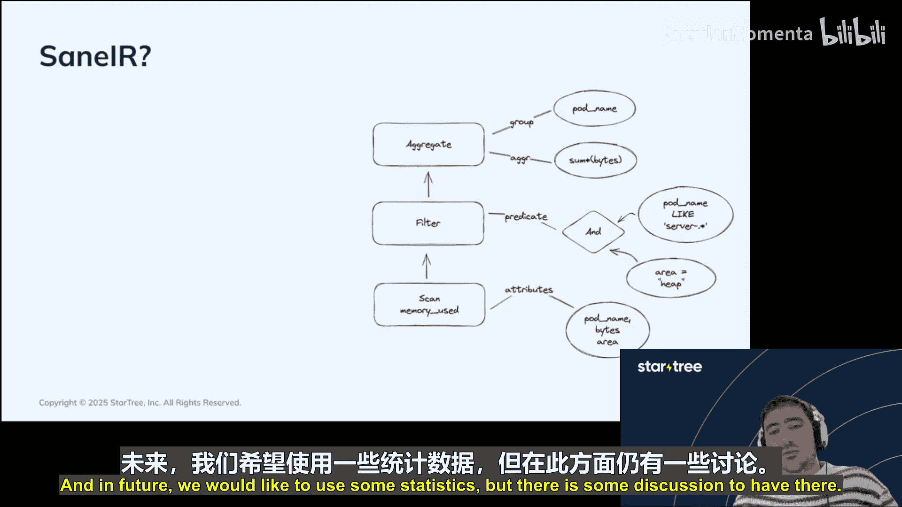
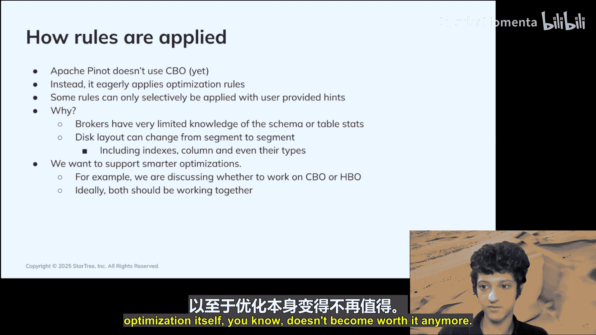
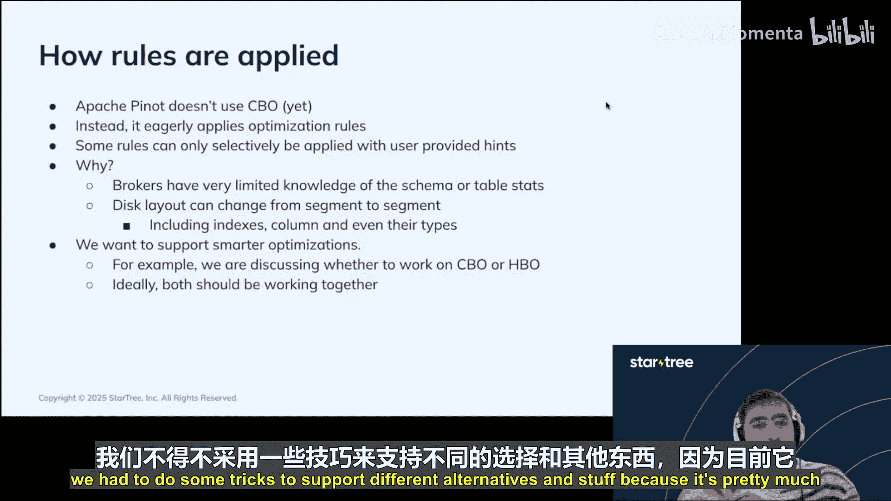
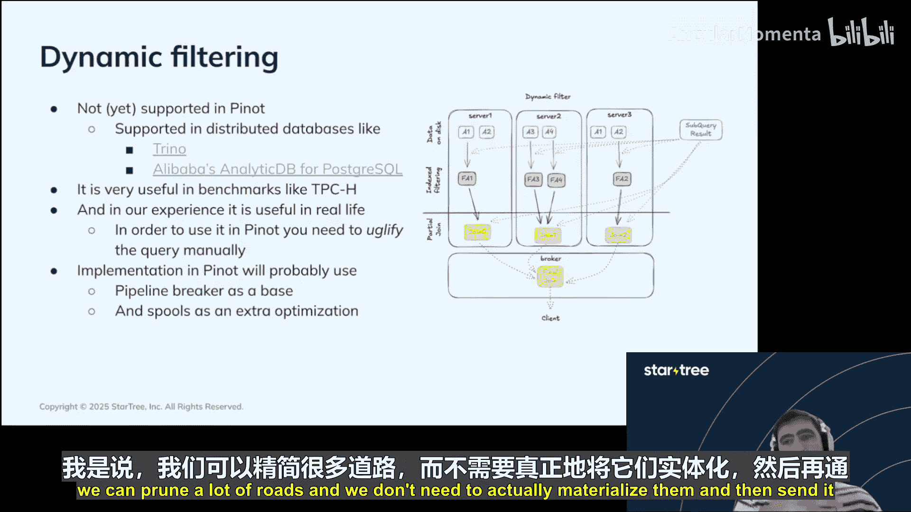

# Apache Pinot 查询优化器：03：Apache Pinot 查询优化器

在本节课中，我们将要学习 Apache Pinot 分布式查询引擎的核心优化技术。我们将从 Pinot 的基础架构和查询引擎模型开始，深入探讨其针对连接（Join）和半连接（Semi-Join）的多种优化策略，并介绍一些更高级的优化技术，如动态过滤和公共子表达式消除。课程内容力求简单直白，适合初学者理解。

## 概述

Apache Pinot 是一个实时分布式 OLAP 数据库，专为超低延迟分析设计，能够在毫秒级延迟下处理每秒数万次查询。其核心是一个列式数据存储，并采用了多种智能索引和预聚合技术。本节课将重点介绍其查询引擎如何通过各种优化策略来达成高性能。

## Pinot 简介

首先，我们来了解一下 Apache Pinot 是什么，以及它在数据库生态中的定位。

Pinot 被称为实时分布式 OLAP 数据库，这是一个相对较新但快速发展的类别。它的特点是支持在 PB 级数据上进行超低延迟（毫秒级）和高吞吐量（每秒数万次查询）的分析。

Pinot 的核心是其列式数据存储，它采用了多种智能索引和预聚合技术。另一个显著特点是其出色的可扩展性，你可以通过简单地添加服务器来水平扩展集群的吞吐量和容量，同时 Pinot 会采用智能技术确保查询的尾部延迟不会失控。

Pinot 的主要用例是面向用户的实时分析，这与传统企业内部业务分析不同。它将分析能力通过应用程序直接交付给终端用户，因此需要能够扩展到每秒数万次查询的规模，以支持应用程序用户数量的线性增长。

当然，Pinot 也可用于其他分析场景，包括内部仪表盘、异常检测、即席数据探索等。

为了让大家相信我们接下来要讨论的优化技术并非纸上谈兵，让我们看看一些实际应用数据。许多大型公司都在大规模使用 Pinot。例如，LinkedIn（Pinot 的诞生地）的集群每秒处理超过 65 万次查询，支持 100 多个产品功能。Uber 也将其用于多种用例，包括系统日志分析和餐厅经理应用。Stripe 同样使用 Pinot 处理大量查询。这些数字表明，Pinot 是一个在全球范围内大规模使用的生产级数据库。

## 数据存储与查询

上一节我们介绍了 Pinot 的基本定位，本节中我们来看看 Pinot 如何存储和查询数据。

和大多数数据库一样，Pinot 将数据组织成表。这些表被划分为不同的段（Segment），段是 Pinot 中的原子存储单元。这些段由列构成（记住 Pinot 是列式存储），而列本身又由各种索引构成。Pinot 支持多种单列索引，如倒排索引、范围索引、地理空间索引、JSON 索引、文本索引等，以适应不同的用例。

在计算方面，Pinot 集群包含控制器（Controller）、代理（Broker）和服务器（Server）三种节点。控制器是集群的“大脑”，负责管理元数据和集群协调，但不直接参与查询执行。服务器负责在本地磁盘存储段，并承担主要的查询处理工作。为了提高可用性和扩展吞吐量，段通常会在多个服务器上存储副本。代理负责接收来自客户端的 SQL 查询，计算最优查询计划，并将查询分派到相应的服务器。计算查询计划时，代理会确定需要查询哪些服务器，以及每个服务器需要处理哪些段。

## 单阶段查询引擎

了解了数据存储后，我们来看看 Pinot 最初的查询执行模型。

单阶段查询引擎是 Pinot 最初的查询引擎，它支持投影、转换、聚合、分组和用户定义函数等操作。但它不支持更高级的 SQL 结构，如连接、子查询和窗口函数。原因在于它采用了简单的“分散-收集”执行模型：代理接收查询，根据查询计划将请求分散到各个服务器；服务器对分配给它的段执行计算，然后将响应返回给代理；代理收集所有服务器的响应后，将最终结果返回给客户端。

在大多数数据库中，瓶颈通常是 I/O。因此，Pinot 的许多优化都集中在减少服务每个查询所需的 I/O 上。在单阶段查询引擎中，一种方法是在代理和服务器上使用剪枝（Pruning）技术。

例如，在代理端，可以利用分区信息、时间边界等元数据进行剪枝，以减少需要分发查询的服务器数量。在服务器端，则利用列值信息、列统计信息、布隆过滤器等段级元数据进行剪枝，以减少需要处理的段数量，从而降低 I/O 和计算量。

这里需要补充一点，Pinot 中的表可以按列进行物理分区，这一点在后面讨论优化时会很重要。

单阶段查询引擎中最有趣的优化是索引的使用，它们可以极大地减少服务查询所需的 I/O。这些单列索引中，最有趣的是 **星树索引**，它是 Apache Pinot 的“杀手锏”之一。这个索引实际上执行了预聚合，可以将聚合和分组查询的速度提升数个数量级。这是一个非常有趣的话题，CMU DB 2021 年的研讨会系列中有专门讲座介绍，如果你感兴趣，强烈建议去观看。

## 多阶段查询引擎

上一节我们介绍了单阶段查询引擎的局限性，本节中我们来看看 Pinot 如何通过新的引擎来支持更复杂的查询。

大约一年半前，我们在 Apache Pinot 1.0 中引入了多阶段查询引擎。这是对原有引擎的一次迭代。其核心思想是将查询划分为多个阶段，而不仅仅是“分散-收集”。查询被分解成这些阶段后，我们会为每个阶段分配并行度。通常，我们会根据要分析的数据创建虚拟分区。

我们从逻辑操作符转换到阶段，再从阶段转换到我们称之为“工作者”的实例。工作者是阶段的不同实例，它们将处理数据的分区。通过这种方式，我们能够以分布式方式执行连接等操作，而无需使用单台机器上的所有资源，这也是多阶段查询引擎命名的关键原因。

在这个模型中，代理仍然承担大量工作。当代理收到查询时，首先会进行优化，应用一些标准的 SQL 转换规则到关系代数上。然后，一个核心任务是决定如何将这些操作符拆分到不同阶段，如何为这些阶段分配工作者，以及信息如何在不同的工作者之间交换。

信息交换可以通过 RPC 通道在不同进程间进行，或者，如果工作者运行在同一进程内，则可以直接在 JVM 内共享内存，后者效率极高，是我们一直努力实现的方式。

需要强调的是，对我们而言，SQL 只是一个前端接口。我们不在 SQL 层面进行优化，而是始终将其转换为关系代数节点。我们重用了 Calcite 的许多组件来跳过一些工作，并应用其已有的规则。我们选择 SQL 作为查询语言，主要是因为它是 OLAP 世界的通用语，就像我们现在用英语交流一样。但这并不意味着我们被 SQL 束缚，事实上，Pinot 社区正在努力支持其他查询语言，特别是在时间序列领域，例如支持 PromQL。

## 连接算法与策略

现在，让我们进入本次课程的核心部分，开始讨论连接算法和连接策略。

连接算法和连接策略是两个不同的概念。连接算法指的是数据已经位于同一位置后，用于生成连接输出的实际算法，这是经典数据库文献中常见的内容，例如哈希连接算法、排序合并算法和嵌套循环连接算法。

在 Pinot 中，我们主要使用哈希连接算法。在这种算法中，有一个构建侧和一个探测侧。我们使用连接键作为查找键，在构建侧构建哈希表。探测侧在 Pinot 中实现为流式输入，行数据逐一进入，对每一行在构建侧的哈希表中进行查找，如果找到匹配项，则创建连接输出。根据 SQL 连接的类型（如外连接、左连接、右连接、全连接），可能还需要跟踪未匹配的行。哈希连接通常用于等值连接。对于非等值连接，我们有时不得不回退到嵌套循环算法，即遍历一侧的所有行，并对每一行遍历另一侧的所有行，其时间复杂度是二次方的，效率很低，通常应避免使用。

但更有趣的部分是连接策略，它指的是我们用来将所有数据移动到正确位置以执行连接的各种策略。对于像 PostgreSQL 这样的经典单节点数据库，这不是问题，因为所有数据都已经在单个节点上。但在像 Pinot 这样的分布式数据库中，表的数据天然分布在多个服务器上，我们需要确保所有需要连接的数据都在正确的位置。

这通常涉及服务器之间的网络数据洗牌（Shuffle），这是一种昂贵的 I/O 操作，通常是连接查询的瓶颈。我们的目标就是优化这种数据洗牌，尽可能减少网络 I/O 开销。接下来，我们将通过几种连接策略来探讨如何实现这一点。

## 连接策略详解

以下是 Pinot 中使用的几种主要连接策略。

### 查询时分区策略

这种策略可用于等值连接（连接条件如 `A.某列 = B.某列`）。我们可以在查询时使用一个分区函数（通常是哈希函数），该函数保证如果连接条件成立，那么由该函数计算出的分区值将是相同的。

具体操作是：为连接的两侧创建相同的虚拟分区，并确保相同编号的分区位于同一台服务器上。然后，对于每个段中的每一行，计算其虚拟分区，并将数据发送到该分区所在的服务器。这可能会涉及网络数据洗牌和内存数据传输。由于分区函数的特性，我们可以保证最终位于不同分区的行原本就不需要连接。这样，我们就能在多个服务器上并行执行本地连接，同时保持连接语义。最后，合并各服务器的结果即可得到最终输出。

此策略洗牌的行数受连接两侧总行数的限制。在最坏情况下，每个段中的每一行都需要通过网络洗牌到另一个服务器的虚拟分区。

### 广播连接策略

查询时分区策略并不总是适用，例如对于非等值连接条件（如 `A.某列 > B.某列`）。此时，我们不能对两侧都进行分区，因为某些行可能永远不会被连接，从而破坏连接语义。

取而代之的策略是：对连接的一侧进行分区（分区策略可以是随机的或哈希的），而将另一侧广播到所有分区所在的服务器。这确保了连接语义得以保留。这种策略通常在连接的一侧远小于另一侧时效果很好，我们可以广播较小的一侧，而对较大的一侧进行分区。

此策略洗牌的行数受分区侧的行数加上广播侧的行数乘以执行连接的服务器数量的限制。我们可以控制执行连接的服务器数量（即连接并行度），这需要在数据洗牌开销和计算并行度之间进行权衡。

### 广播加本地连接策略

这是前一种策略的变体，也可用于非等值连接等情况。不同之处在于，广播侧的数据被洗牌到所有已经包含另一侧（本地侧）数据的服务器上。这对于大小严重倾斜的表连接非常高效：我们只需将小表的数据洗牌到所有存放大表数据的服务器上，然后在每个服务器上执行本地连接算法。

这种策略的优势是有一侧完全不需要洗牌。缺点是连接的规模不能超过存放本地侧数据的服务器数量，但这通常不是问题。此策略洗牌的行数仅仅是广播侧的行数乘以实际执行连接的服务器数量。

### 共置连接策略

这是一种可以完全消除数据洗牌的策略，但需要满足一系列条件：仅适用于等值连接；连接的两张表必须在连接列上进行物理分区；分区函数、分区数量以及分区到服务器的映射必须完全相同；并且服务器必须持有连接中每个表的所有对应分区段。

当所有这些条件都满足时，我们可以执行共置连接。由于数据已经根据连接键共置在相同的服务器上，我们只需在内存中移动数据，无需任何网络开销，即可执行本地连接。这种策略的速度通常比其他策略快一两个数量级。虽然条件苛刻，但 Pinot 支持多种表配置来促成这种策略。许多其他分布式实时 OLAP 数据库只支持这种策略，而在 Pinot 中，它只是众多选项之一，当然也是最有效的，我们会尽可能采用。

### 查找连接策略

这是共置连接的一种变体，非常具有 Pinot 特色。我们有一种称为“维度表”的小表，它们被复制到所有服务器上，并作为查找表物化在内存中。当与这类表进行连接时，即使不满足严格的共置条件，我们也可以利用这些内存查找表来执行无数据洗牌的连接。

## 优化规则与应用

上一节我们介绍了各种连接策略，本节中我们来看看 Pinot 如何应用优化规则来选择这些策略。

Pinot 目前不使用基于成本的优化（至少尚未使用），而是急切地应用优化规则。我们执行许多规则转换，例如将过滤器下推到连接中、将聚合下推到连接中，以及在可能时将连接转换为半连接等。我们还需要为数据洗牌选择连接策略。

由于目前只基于简单的启发式方法急切地应用这些规则，某些规则只能通过用户提供的提示（Hint）有选择地应用。这意味着我们依赖用户了解其数据布局和查询模式，并通过试错来选择最佳策略。这样做的原因是，代理目前对表统计信息和段级数据布局的了解非常有限，让代理维护数百万个段的元数据并据此做出决策成本过高。

我们确实希望支持更智能的优化，社区也一直在讨论支持基于成本的优化或基于历史的优化（根据类似查询的历史统计信息进行优化）。但我们必须非常小心优化本身的开销。目前我们的优化过程非常简单，只是急切地应用规则并计算一个查询计划，这个计划可能不是全局最优的，但肯定比显而易见的方案更优。我们需要确保引入的延迟开销是值得的，因为 Pinot 通常用于低延迟环境，优化本身不应成为新的瓶颈。

## 高级优化技术

除了针对连接的优化，Pinot 还采用了一些更高级的优化技术来进一步提升查询性能。

### 流水线断路器与半连接优化

考虑这样一个查询：一个大表与另一个小表进行半连接（使用 `IN` 或 `EXISTS` 子查询）。在正常情况下，这需要扫描整个大表和小表，然后为每一行应用过滤，效率不高。

我们采用的优化算法是“流水线断路器”。首先，单独评估子查询（紫色部分）。一旦获得其值，如果结果集不大，我们可以用这些实际值替换子查询。这样，后续执行时，服务器就可以利用大表连接列上的索引（如倒排索引）来高效地过滤行，而无需加载所有行。这种技术带来的性能提升是巨大的。

这种优化也可以应用于某些内连接，只要该连接在语义上等价于半连接。但并非所有连接都能这样转换，它通常只适用于内连接，且连接的一侧不能用于投影，并且**该侧的连接键必须是唯一的**。在 OLAP 世界中，通常没有唯一键约束，因此数据库无法自动知晓这一点。这时，用户可以通过提示告知系统假设该侧是唯一的，或者在子查询中显式使用 `DISTINCT`。

### 公共子表达式消除

随着许多查询由 ORM、BI 工具或 LLM 自动生成，查询变得非常冗长，经常重复相同的结构和表达式。我们不想多次计算相同的代码。

公共子表达式消除（CSE）就是我们用来解决这个问题的工具。它确保相同的表达式只计算一次。例如，如果一个派生关系在过滤器和连接中被使用了两次，我们可以通过 CSE 只计算该状态一次，然后通过交换（Exchange）将信息发送到两个不同的下游阶段。这也是我们用来改进普通连接（即使不满足半连接优化所有要求）的一种工具。

### 动态过滤

这是一个有趣的功能，它旨在通过使查询计划更复杂来使其更快。其思想是支持类似“流水线断路器”的特性，但应用于更广泛的场景，而不仅仅是半连接。

假设我们有一个内连接查询，由于需要投影小表的列，或者数据库不知道小表连接键是否唯一，我们无法直接应用半连接优化。动态过滤的思路是，在保持原有连接的同时，额外添加一个过滤器，该过滤器再次读取小表。然后，我们可以利用“流水线断路器”特性来编译这个过滤器，使其能够使用大表上的索引（如倒排索引）。这样，我们就能在连接之前有效地过滤大表。

这是一种“横向信息传递”的风格，即在一侧计算出一个过滤集合并用它来过滤另一侧的大表，而无需实际物化所有行并通过网络发送。这个功能在 Trino 或 Alibaba AnalyticDB 等数据库中已被证明非常有用，Pinot 社区也正在计划实现它。

## 总结与展望

本节课中我们一起学习了 Apache Pinot 查询引擎的核心优化技术。

我们了解到 Pinot 是一个分布式实时 OLAP 数据库。我们选择 SQL 作为查询语言，并且正在努力支持其他语言（如 PromQL）。但在底层，无论使用何种语言，最终都会被转换为我们内部的关系代数模型，从而能够应用相同的优化技术。

我们深入探讨了多种分布式连接策略，包括查询时分区、广播、共置连接等，目标是减少昂贵的数据洗牌。我们还介绍了一些高级优化，如针对半连接的“流水线断路器”优化、公共子表达式消除以及未来的动态过滤功能。

目前，Pinot 主要依赖启发式规则和用户提示进行优化，未来可能会引入基于成本或历史的更智能优化，但必须谨慎权衡优化开销与收益。

Pinot 是开源项目，拥有活跃的社区。如果你对贡献代码感兴趣，欢迎参与其中，许多大型功能都是先经过设计讨论再开始实现的。

希望本教程能帮助你理解 Apache Pinot 如何通过一系列巧妙的优化，在分布式环境下实现高速查询处理。