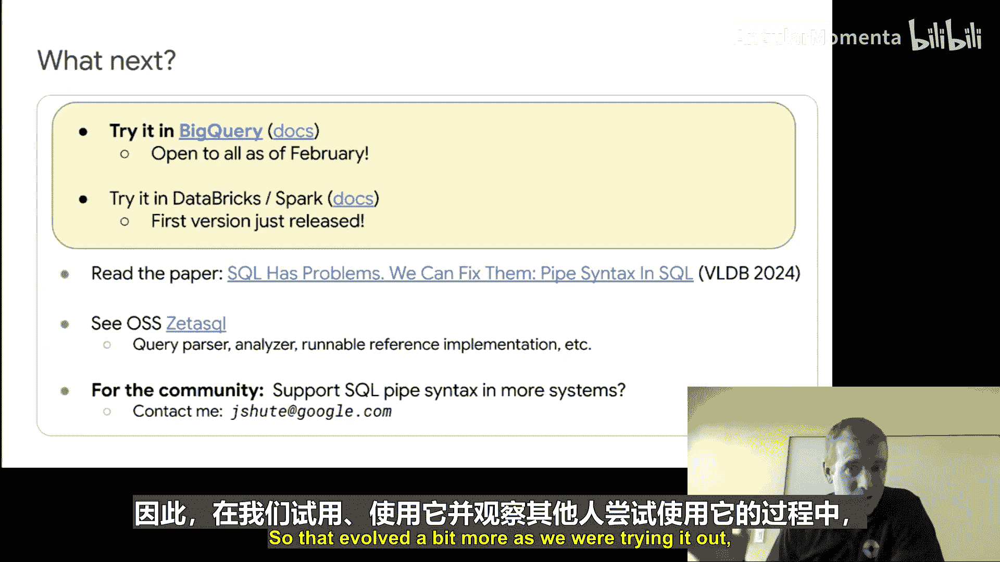

# 【卡内基梅隆大学】SQL 或死亡？系列研讨会 ｜ SQL or Death？ Seminar Series (Spring 2025) p04 04 Google的SQL管道语法：面向21世纪的SQL（Jeff Shute） -BV1FkisBtE97_p4-

有的。

🎼why I hate it。Sequel or death Yo son， what are you going to choose？Yo check it。

 this seminar is filmed at Carnegie Mellon University thanks a lot， Google。

All right sorry this is Jack， he's been a Google for 20 years。

 he's talked to every single database you know about at Google， he's phenomenal， he's super smart。

 he went to Waterloo as the best student school in Canada for computer science。

Talk about PipeSQL Jeff four sure go for thank you yeah thanks for the do over on the intro I'm happy to be here happy to share some of what we've been doing at Google to try to make SQL better for everyone。

😊，嗯。So and then。Start with this idea that SQL has some problems and then I don't think that this is a new idea or particularly controversial I like this stonebreaker quote from a couple of years ago he's talking about sequL and talking about it as a very old language a lot of annoying things that nobody's ever。

Gone back and cleaned up and kind of。Assumed that we can't。

Here's another one from this talk Don Chamberlain' one of the original inventors of SQL did a couple of years ago it's like a very interesting talk on the whole history and evolution of SQL Cherry picked a few things here that I found interesting and he sort of contrasts SQLs English style syntax with what you might expect more as a programmer he describes it as functional language where you've got operators as functions that are orthogonal that don't have side effects and like interestingly SQLs not like that one of the things he says that had they known all those decades ago how things might have evolved and that we'd be using them for this long。

Maybe he would have made some different choices。So the problem from my perspective is just SQL is way too hard to use and this affects everyone for beginners SQL can be hard to learn and even for expert users who know it really well。

 it's still much more awkward and difficult to use both when you're writing it and when you're reading it。

I think fundamentally， this stems from the syntax where you write a query in SQL。

 you've got this list of clauses， select fromware， et cetera。

 you can only write them in that order and it's very rigid and very arbitrary in doing anything else or anything nontravial。

requiresquires you to use subqueries or some other workaround。

This structure creates this strange inside out data flow where the query starts in the middle with the from clauses or with nested subqueries and flows out from there logic both above and below the starting point there's also a lot of roossity and repetition where you end up listing the same columns over and over again。

 select group by， etc， just the general complexity in the language like the interaction of select and group by which are written far apart in the query。

So。After 50 years， I think it's time that we fix this in SQL。

And I don't think the fix needs to be replacing SQL， we can actually fix it。

So there are a lot of things that are really good in SQL that we don't want to lose the declarative semantics。

The very fundamental level works really well， the relational operators are nice like it's sort of the right set of operators and the right set of operations and the table level composability things with like views and subqueries that works really well。

Maybe even more importantly is the ecosystem around SQL。

 there's so many databases and query engines and other tools that all speak SQL。

It's a very familiar language with a huge user base who knows it well。

 there's a ton of existing SQL code and we don't want to give up any of that doing migrations is always really painful both to learn and then to rewrite and new tools。

So。😊，Meanwhile， we've seen this pattern in many other languages and in APIs that have designed more recently that they use this pipes。

 dataflow， syntax and structure， it works very much like UniX pipes。

 or you have a collection of operators， you chain them together with some kind of pipe connector。

Output from one flows to the input of the next。I see this in many query languages that were designed more recently。

 you see it in APIs like data frames or Fme。And users working in these systems generally find these fairly easy to understand and easy to use。

So。😊，Our solution is that we can do the same thing in SQL。We take all the。

Operators that you can do in SQL， we make a pipe operator equivalentent of them。

 like using the same syntax as much as possible is to allow chaining them together in any order arbitrarily。

 any number of times。So you get query logic that flows from the top of the query to the bottom。

It's very simple to understand what's going on it's important to note here it's still declarative so they still expect optimizers to go in and reorder it to an optimal execution path。

There's this。Detail like we use this two character pipe symbol which is slightly unfortunate。

 it's a bit of a compromise because the single pipe character which we would have liked to use but it's used for bitweisor in our dialect and many others it's not so bad once you get used to it and they've seen the same exact same symbol actually showing up in many other languages for similar purposes。

sorry maybe you'll get into this going back to last slide like you have the the two wear clauses can you still put an an clause to combine them yeah yeah yeah you can do that this is just for illustration that you can do wear multiple times so okay awesome thanks。

So here's an example from one of the queries from the TPCH benchmark。

 in this case it's one that's doing aggregation in two steps。

 if you look at that query on the left kind of shows this weird inside out data flow pattern you get in standard SQlery。

 start in the very middle of that with the inner from clause， you've got logic above it。

 logic blow it and to trace through what's going on， you have to start in the middle， walk up。

 walk down， match up a lot of things。If you look at the pipe syntax on the right it。

Bas it just expresses exactly what you want to do in the order you want to do it and like start scanning a table。

 do a join， aggregate it， aggregate it again， sort and you're done that ends up being very straightforward and easy to understand。

So here's a list of。Most of the operators we've got and you can start a query with anything that any normal from clause including doing joins in the from clause if you want to many of the standard SQL clauses just get a pipe version of that clause with exactly the same syntax that includes doing a selectlist as an operator also to have some shorthands for。

Adding， updating， changing columns in the selectlist without having to list out every other column you're keeping。

We've made aggregation a separate operator separating it from projection and making it a distinct thing in the flow。

 which we've found to be convenient for several reasons including readability a bunch of。

Other operators。嗯。So。😊，You gonna seen this picture， this comes from the。

Paper from cider last year and from the speakers from a couple of weeks ago。

 its just a very clear illustration of the strangeness of standards SQL where。

Order you write the operators in the syntax is very disconnected from the semantic order of what's happening when you run that query。

And if you compare that， we write this in pipe syntax， basically we go in and oncro all those lines。

 it's very clean and simple because the。Syntax exactly matches the semantics of what you're doing there's sort of。

Match between the。Relational algebra， the set of operators you're applying and the syntax you go back and forth and translate in either direction。

 yes。It's still important to note like both of these syntaxes are declarative。

 so it's not specifying execution order， it's just semantics and you'd expect that get the same performance and the same results writing queries either way。

So interoperabilityities， an important point and one of the nice things about doing this inside SQL。

 we allow adding pipe syntax anywhere that a normal query would work。

 you can mix and match inside the same query across views。

Commenttable expressions in a with clause and any query， including a query in standard syntax。

 you can add pipe operators on the end to do additional computation and you can do this using all the same tools。

So that example on the right is just showing mixing。Some operators in both syntaxes。So。

brieflyriefly about our implementation， we've implemented in Google SQL。

 which is our shared component for SQL parsing SQL analysis。

 it's used in all of our SQL related tools inside Google and in our cloud products， BigQu Banner。

 F1 and others。And doing it in that query front end。Analyzer。

Place like we are able to generate the same intermediate representation for a query written in pipe syntax as we would in standard syntax。

 so for a query engine they receive the same thing feed it through their optimizer execution and are able to basically get support for pipe syntax for free just by enabling a flag without having to implement any new execution support so that's great and that's enabled us to support this in several tools。

So we had this paper last year in the LDB， it has a lot more details on the。

Language and some of the choices we made and some of the。Analysis。

I'll talk a bit more here about like what we've been seeing from。Actual usage。

So here's a graph showing usage in F1 users doing pipequeries F1 is one of the main query engines users inside Google are using the query data and important thing is to see the shape of the graph that's just。

Growing fairly quickly and accelerating what we're seeing is that。

Users see this syntax once they see it， they're able to learn it pretty quickly and want to use it。

 and it tends to be pretty sticky and to spread virally like showing that the users are quite happy with it。

Do you have numbers that could maybe say like？Would you know whether something the pipe syntax is being generated by like a tool or I guess at the very beginning there are no tools。

 everything's handwritten？Yeah， so this would mostly be。Queers that people have written。

There are a lot various tools that generate queries。

I'm not aware of any that are yet generating a lot of queries and pipes syntax。

 I think that is one of the advantages that as a。Generating queries in code。

 generating them this form is a lot easier or should be easier。So yeah。

 I think this represents actual usage by people for the most part。

So we get the question of who's this for or who uses it my answer is really I think it's for everyone who's writing SQL or at least everybody doing nontravial queries in SQL for experts of people who know SQL well already it's really easy to learn this it just takes a few minutes to show a few of the details out of how it works and a few examples and it's a big benefit that it's the。

Same operators you can do with mostly the same syntax and it's just a better and more flexible structure for applying them and these users find themselves immediately more productive writing and editing SQL。

For the more beginner users and also that the set of users who have been exposed to SQL and don't like it。

 this fixes many of the more difficult and more annoying parts that cause a lot of users to not want to use SQL。

系子意思。Few samples of the kind of feedback we're seeing from users。

So I'm going go through all of it generally experience yeah， it's overwhelmingly positive and like。

I see I've seen these comments like this like multiple times that this is maybe the most useful change they've ever seen in SQL and the level of excitement is kind of amazing。

You might， might look at that and think that it seems a bit overblown like is it really that big a difference？

I thinkas I can show you examples side by side and its like yeah。

 this looks like a nicer way to write that query， it doesn't really capture the full。

Benefit here it's more than just a nicer syntax to look at and like being able to work in this syntax actually changes the way you think and the way you can use SQL it's very like freeing that whatever you want to do in a query pretty much can just do it and not feel like you're fighting against the language so like beyond hearing that it's faster it's definitely easier and even like see users saying that it's been more fun working in SQL this way。

When you go back to regular SQL after using this， you can really feel the awkwardness in standard SQL where there's so many things that feel like workarounds are more difficult than necessary。

We're think about how exactly it helps to have queries written in this structure when you're building editing queries。

 it's very nice that you can build them incrementally and you're generally like start with a from clause and just add more operators on the end as you're building queries at any point the queries executable and you can run it and see what you've got so far just add another operator on the end and generally you're adding operators that they're independent of most of what's going on in the query and you don't have to do these kind of global edits about keeping selects and group buys and subqueries all in sync with each other。

Things like autocomplete and suggestion。Generally work better because the context comes from above where you're writing which you don't really have that property in standard SQL I think it's a good area for future exploration but lot that AI co-piloots for SQL I think you could really take advantage of this and do something really smart and like really helpful when you're reading and debugging queries you trying to understand performance there's also a lot of benefits these queries have this really nice prefixed property where the query up to a pipe operator is also a valid query so you can grab that prefix of a query and run it and see the intermediate results or see the results before and after applying some operator like aggregation。

At any point in one of those immediate queries， you can stick in another operator like an aggregation to see the count or the breakdown of values in a query。

 which tends to be quite helpful when trying to debug。I haven't done it yet。

 but I think there's an opportunity here to build an amazing IDE for working with SQL where you could think of doing things like a debugger that single steps through a query。

 you can't even really think about doing that in Standard SQL because just the syntax doesn't make sense to step through。

We've also seen a lot of advantages of doing this like in a query engine that in the SQL language and in a query engine that people are already using because it's not some new product。

 some new language people have to learn or make a big decision to start using send a feature that's just there and it's really easy to try it with no commitment and no setup and also let's like one user just go try it first。

 maybe just try it through their ad hoc queries and then as they see value in it。

 they can spread it across the rest of their team and sort of enables this。

Fire or spread where you can get somebody to try it and like it and it goes from there。Versus like。

Other approaches that might require bigger decision or some kind of migration where there's like you give up a lot if your existing queries don't work in a new syntax so it's kind of all or nothing versus here it's much more incremental and continue doing what you were doing before and using the new syntax only where it helps well and keep full interoperability with everything you had before。

There's also you avoid some of the downsides that would come with extra systems and proxies or translation layers。

 so add some challenges with debugging where can't tell what's really running when your que is in a translated other language。

 you don't have to worry about any issues of cost or latency when going through an extra proxy layer。

So now I'm going to focus a bit on extensibility， which I think is a very interesting area。

I break this talk here about three categories of extensibility when we're doing it。

When the query engines are doing it when users are doing it or doing it in language design。So。

I'll start with talking about table valued functions。

If you think about a table value function that's basically a generic relational operator just takes one or more cables as input and produce Yeah Jack you must to ask you a question real quick before we get into this。

 I was just curious if you seen more use in sort of like OLB style read only queries like you know in Bigque for example。

 or if you're also seeing like you know same viral growth in like you know OLTP style sort of like readrite ops and like bannerners Yeah I think this is definitely much more interesting in the read only cases like when it comes to doing updates there's not nearly as much value in the syntax is more about the read side of it。

We don't really have an update or delete syntax to do this we could do an insert where you can produce rows this way and like pipe them into an insert operator。

 but not really using it for transaction processing and it's also like。

Use a kind of like orM style readmodify write transactions there's not as much value there。

 it's more when you're exploring or analyzing。Thanks。Yeah， so I was saying like。

TVFs are basically generic relational operators and might。You can add。TVfs in a query engine。

 you can call them in standard syntax。 the problem is that the syntax is really bad really painful to use because。

So it forces you into this nested subquery pattern of feedingating the input into the TVF as an argument。

 it's especially bad if you're trying to chain multiple TVs together。

We've made a pipe operator form of calling a Tf where based just it's just a top level pipe operator to do this transformation。

 which is like the this argument in an object oriented call so the input table gets passed as the first argument to the。

TVF， and then that allows calling them in a natural way， very much like a built in pipe operator。

So here's an example。BigQuery has a bunch of functions for machine learnings operations。

 several of them are implemented as TVFs。The example on the left that see comes from their documentation showing an example of calling。

Two ML model lookups like calling an embedding model and then a classifier model sequentially really shows this inside out pattern or like bottom to top thing that you get particularly with TVFs in Standard SQL you look at the pipe syntax on the right it's obviously much more straightforward where you'd actually just call these operators。

Call those GvFs basically with。Close to first class syntax except we didn't have to add any language or support in the grammararies allowed the engine to plug in more things just as functions。

So I don't talk about extensibility by users with SQL。嗯。So here's an example has been。

Discussion going on about adding streaming operators in SQL paper from a couple years ago and there has been discussion on this it's kind of stalled a bit in terms of figuring out。

 I haven't reached agreement on how to do streaming how to do these operations in SQL so these three fundamental operators here are sliding windows hopping windows and sessionization this paper was talking about how to do them as TVFs which is a really nice approach semantically because it makes them work like a relational operator you can plug in but the call syntax using them as TVs is quite awkward the pipe call syntax would be nice for that other ways of doing it have been pretty messy。

But this hasn't been added in SQL yet， so if you want to do it in SQL。Here's an example。

 computing sliding Windows in SQL， say see a query。

 computing active users over seven day sliding windows。

 so it takes records with dates and spreads them across seven consecutive days。啊。

This block of logic in the middle here is the part that。

Smears like duplicates row across seven days with seven consecutive dates and then you can aggregate and get that sort of sliding window behavior。

I won't walk through the query， but I think if you read it。

 it's fairly easy in this form and pipe syntax to kind of figure out what it does。

The point here though is like if I end up doing this a bunch of times in a bunch of queries。

 there this block in the middle or something similar might be repeated。

You could copy paste that in every query， but it's actually much better to make it a reusable function。

So I'll just grab that。Llock of。Sequence of operators out of a query， and I'll make a。

Table valued function out of it like this， taking basically the same set of operators just encapsulating it into a function。

And then when I go to call it， it's like have a one line call to。

Do the logic that was in line in the query previously effectively it's a user built extension to do sliding windows that then becomes very easy to plug into many queries in a way that looks basically like a first class operator。

So like this kind of encapsulation makes it possible to build libraries of extensions and write them in SQL。

 but make reusable operators。No。Technically， you could do this in standard syntax with TS too the。

Syntax is so bad to call them that users don't really do it。

Also like you don't really in standard syntax， you wouldn't really even have this property of like。

 okay， here's a thing in the middle of the query that I could just snip out and run as a self contained thing。

But in this example， you have an explicitlicit schema inside the extended send dates function。Yeah。

 so the function I I wrote it this way， like assuming that there's a column called date。

 which is why I renamed a column to be called dateate when I called it。

So a few like sort of unrelated features， but some sort of reflection features where you could pass in a column name and resolve it would be really nice and a little bit more powerful templating functionality would make this like。

Even more powerful。And I have to join and nest。That's our join to an array so like this is generating an array of zero through six and then the un nest join is basically a cross product with that array that makes seven rows so my question is can you do that in a nested way like if you're in the from world with joins and sequL land can you also where you have like。

Maybe you have an array of objects or records with arrays inside of that and you want to join across hierarchy。

Can you do that in the pipeline world or do you have to go back to the equal world？

I think I' mind to Mr like you could write this join in the F clause too so that you could do this query in standards syntax。

It'd be a little bit different， but it's not doing anything new that's not possible。Actually。

 I'm asking about the other way I could let this go。

 but if you could scope inside of the join a nest to deal with nested hierarchies。

Inside of the pipe context。Rather than the SequL from world。Oh， like rather than flattening it out。

Yeah just if you have like that complex example array object array kind of thing yeah it definitely could build the array and yeah there's lots of other things you could do like not even saying that this is the optimal way to compute that operation is you could figure out a way to do it with window functions it's。

A way that。Its actually it was one I used when making the dashboards for the graph I showed earlier。

It's the easy enough way to understand and the example is more like once I do something。

 I can sniip it out as a TF。Okay， cool， thanks。So I' get into the language design aspect of extensibility。

If we talk about extending the SQL language， it's actually really difficult to add new operators to standard SQL。

 which is maybe why it doesn't happen very quickly。There's a lot of syntax challenges， firstly。

 like where do you even put something into that select where from structure like？

So often it's difficult to even figure out where you would put something to make sense and once you figure out。

What you're going to do to fit something into a query to figure out how to get it to work in the parser and parsing standards equals very dependent on reserve keywords。

 which makes everything really difficult because adding new reserve keywords is always a breaking change on some query。

 there often a lot of compromises of trying to figure out some way to reuse something that you already have as a reserve keyword to avoid having to add new ones。

I was also。Challenges in the semantics about how a new operator would interact with everything else that might be happening in the flow of a query。

 like whether there's aggregation or window functions， correlated subqueries that everything adds。

Complexity and it sort of creates this quadratic complexity of all of the interactions of other features of the language。

And then like because of the syntax compromises， you have you end up something with。

Poor usability and often the new extensions require using even more subqueries to get something to work。

I if we contrast。Adding something in pipe syntax， the operators are independent orthogonal to each other parsing is generally really easy because。

So one of the advantages of having the pipe symbol is that it makes a natural separator between operations so that they can all parse independently and generally they don't need reserve keywords and at least they don't interact with each other or cause conflicts。

The semantics are also simple and local to each individual operator and there's no global interactions or state across operators other than an input table and an output table。

 so it's much more like linear complexity when you're adding features。

 you just add the feature you don't have to think about interactions。And for users。

Features added this way are great because you can just use the new operator anywhere。

And it's fully flexible。啊。So here's。Example of a feature that has been added to standard SQL a long time ago that the idea of recursive queries like when you've got a pre structured。

Tree structured data and want to do a tree traversal or graph traversal。

It's really nice to be able to do recursive queries the way they work in Standard SQL is fairly bizarre it's quite difficult to explain or understand how that query works like it uses this with recursive syntax it's not really recursion in a normal sense it's written as a union but it's not really a union a lot of complicated requirements on exact query shape that's supported and execution rules where it's like grabbing one half of the union running it and grabbing the other half of the union and running it。

Multiple times。It also requires to actually use it。

 you have to structure your query around this with recursive clause。

 which means once you want to put something recursive into a query， you have to often rewrite it。走。

Here's our take on how to do recursive queries in a pipe operator。This is new。

 we haven't put it out to users yet， but we've got an implementation。

So it starts just with a base query producing your input data and then recursive union as an operator takes the input query and he runs this subquery repeatedly adding more rows into the union until it doesn't get any more rows。

It returns the output of that union and then the rest of the query continues。So you get both。

Nicer syntax that clearly separates the base query from the reachcursive query it's really easy to explain the behavior with simple pseudocode and you get something that's composable you can use it anywhere in the query like in a sequence of end joins if you want your third join to be a recursive traversal down a tree you can just mix that into the middle of a query without having to restructure the whole query around with recursive clause so I think it's an example of with more flexibility in what we can do in the language we can provide much nicer syntax for users。

So。Why does language extensibility like this matter？As lots of people have probably seen this paper。

It shows this describes this recurring pattern of new things being created， often new languages。

 new data processing systems。To solve problems in a new domain。And the argument is like。Eventually。

 we always find that we want to add those things back into SQL and back into their relational model。

And we find in the end， we didn't need other systems。

 but it takes a long time we end up creating those other things first。I think there's some。

The way is like this pattern shows up when there's these new ideas they're always getting developed in new systems in new languages。

 if if they're proven useful over time， then much， much later they get folded back into SQL it's a very。

Indirect path， I think a big part of the reason this happens is that Standard SL is such a bad platform for innovation。

 where it's just very hard to experiment or add things into SQL。

 for these quadratic complexity issues I have described earlier。So。😊，Pippe syntax。

 I think can change this because it becomes easy to add a new operator and you can do it independently of everything else without breaking anything about existing queries。

I think this is。Potential way to unlock a lot of innovation like we can look at。

What are the good ideas that have come up in other places in other systems？

We can add those operators into SQL and we can do it fairly easily。

And then the more forward looking piece of like innovations for the future。

What's the next big thing we should be able to do like I don't think we need to invent language for it and convince people to use a new language we can just add operators and features in SQL。

So I got。A case study here or example of I think this happening and showing it working well problem area I'm talking about here。

 I'm calling it operational analytics sort of the production monitoring。

 production alerting where like production services are generating a lot of metrics。

 system collecting those metrics， time series as lot as streaming systems that are capturing those metrics from production services。

 SRs and engineering managed services do alerting and etca。And generally。

 SQL isn't used in this space。I just assess the current state of the art in this space。

 there are a bunch of languages and tools out there but。Compared to SQL。

 they're fairly primitive when it comes to query and understanding data。

This is the problem we've got at Google too， like obviously we've got a lot of。Cloud services。

 production services， a lot of monitoring reliability issues and you've got a lot of tools that have been built up over the whole history of Google and generally like our SREs or engineers aren't very happy with the state of those tools and I've been studying our options in the space for what we should do。

The first option is like try again， invent another language for this。

I strongly argue against that for lots of reasons inventing new languages isn't a great idea。

 it's not really a lot of reason to think that our third try at this will be better than previous attempts。

So the next。Branchches is there anything out there in industry or open source that we like and would want to use？

We haven't found anything that seems compelling。So what about SQL is actually quite interesting because this has been a recurring discussion that I've had with teams in this space every couple of years over the last 10 years。

 it's always seemed like yeah we could do this with SQL。

 but like would it really work and would anybody really want to use it with pipe syntax now I see something is flipped and it's actually like now it makes sense now now it seems like something people would actually want to use and it seems appealing so what we need to do just add a few more time series operators for the kinds of things people do with a style data aligning interpolating time series and then we can make this whole space like fold it together into the same ecosystem as SQL analysis and we get a lot of benefits from that so that's a active area fairly early but active area of work that we're。

Trying to do next。So。I think there's a whole lot of other areas where the same thing applies。

 I'm not going to go through the list chair just some of some areas that。

I'm aware of and thought some about and things I'd like to add was to SQL so everybody else probably has their own list of things they'd like to be able to do in SQL or some other system。

I think there's a lot of opportunity for the future。

So we'll start wrapping this up here a little bit。This is something I saw recently in some headlines。

It's talkingalking about C++ and。Asking the same kind of question that C++ is another language that's been around for almost 50 years and asking if it's going to stay relevant in the future。

 this case like is it going to be displaced by language is like rust。

 I think C++ is more a challenge and a more difficult starting point because the problems it needs to solve are about like safety and security issues which are much more require much more fundamental changes to the language。

If we ask the。Same question about SQL what does SQL need for the future。

 I think our starting point is actually great and like first 50 years have been a great success and there's not a lot in SQL we actually need to remove or change it's not a lot that's broken。

Most users aren't going anywhere else so far， like maybe the most competitive thing would be people using Python。

 but it's not really quite the same thing。I'd say SQL syntax is holding us back。

 it's a burden for users and it's an obstruction to future growth and innovation。So why take on？

SQL for the next this century， next 50 years， first we need to fix this syntax and。

Pype syntax is a really helpful way to do that and we don't need to replace SQL。

 We don't need to give up all of the good things or give up the ecosystem we just fix the syntax like this for users Everything is still sQL it's just a better version of SQL with the syntax change alone it's already a great win for users and they love using it and it's a。

Great change for the future evolution of the language right I'm quite optimistic here about the set of things that we could do or it's a lot of promise for the future of SQL if we take some of these steps。

😊，嗯。So that's sort of the end here。We've got yeah I think the best way to really get a feel for this like you can read our paper it's got a lot more details I think the best way to get a feel for this is actually to try it just as of February it's open to everybody to use in BigQuery it's been implemented in Databricks and Spark their first release of this has just come out recently so like places you can try it on real data real workloads。

We've got some of our code available as open source people can play with that。

Really I think the thing that's interesting for the community is like how do we go forward where do we support SQL pipe syntax in more systems or eventually as a standard thing I would hope so that's why I've got。

Thanks for listening and do some questions。All right so I will clap on behalf of everyone Jeff that was fantastic we have time for questions so if you have any questions for Jeffs I'mute yourself and fire away。

😊，Hey Jeff， this is Jgnesh， good to see you after a long time。嗯。This is fantastic。

 the pipe sex is awesome。One of the things that you often see with SQL in practice is some of these SQL queries are 500 thousands of lines long and besides the syntactical ease of use which you get from what you describe the other complementary component is this cognitive overload right there might be 50 CTs that are defined before you get to the main query in front to figure out like which which CT is this part referring to do you see problems like that。

 which I said are complementary to the pipe syntax and are you think about how you might be able to solve that cognitive overload component。

Yeah and there's a bunch of things connected there。

 like obviously at some point when you get to thousands of lines of logic。

 it gets overwhelming people are going like break something up with CTEs that helps a little bit。

 there's one of the like some of the things that you can remove subqueries by using CTs。

 but I still consider a CTE to be a subquery you still have to like chase the names and follow the links and get like out of line logic。

 So like maybe be able to write the logic linearly is helpful it' still at some point it's still useful to break things up into multiple statements you can still use。

C thes give things names I think that example I showed with TVfs of like pulling things out as encapsulated blocks of logic can be really helpful and I think that's something we can do more of it's another parallel direction where we as more like modularization of sQL so we have more reusable building blocks like。

More like code sharing， more code reuse， I call it like making SQL more like a real programming language where you can actually have libraries and share them。

The variety。Of techniques and it starts with fixing the syntax but then you do more about Mike。

Managing the complexity of some of the logic that people do。That's great one one follow up question。

 do you think text to SQL gets easier if you had， of course enough training data。

 but if that was in PSQL as opposed to the ugly SQL syntax that we have right now。😊，Yeah。

 I think like。Generating SQL from any representation in this form I think is easier like if you're doing it in code you generally have some data structure expression of what you want to do like basically as a sequence of operators and here you can basically translate your operators one to one into syntax which is much easier than having to figure out like how to wrap things up into subqueries or CTEs how to like what can combine into one query versus being a subquery like a lot of that。

Goes away and you can directly。Translate。Into operators you don't have to have like cross referencing nearly as much so and I think this applies both to humans generating queries and also if it at some point is AI generating queries so think the same benefits apply I think a particular benefit beyond that with AI generating queries that。

Depending how much you trust what would come out of an AI model the I think human validation of the query is still really important like if you've looked at generated code that come out of other systems。

 it's usually a nightmare。The fact that you can generate something that is much more concise and much more readable in this form。

 like if you're generating something that you expect a human to validate。

It's really nice to have it in a nice readable syntax。Great， thank you。

Other questions from the audience？Yeah you mentioned standardization how do you see that unfolding as is ansy or an industry standard what the that a sQL repo says how is going to work yeah I think like ultimately doing this in this SQL standard would be great and be the best way to get this into。

As many engines as possible and night。If we started yeah。

 soon might be the time to start that discussion is we're going to have this picked up in more engines。

 the more consistently we could do it。Would be great And I mean the standards committee is going to take at least five years Yeah。

 and it's probably like we could have tried to start that way。

 I think like I don't think it would have worked to start that way because just like writing this idea on paper without having tried it or demonstrated。

 I think it's like a bit sounds like too much and sounds like crazy And also like I actually。😊。

Doing it。We learned a lot and like what we have now is informed a lot by like trying to build it。

 trying to use it and like figuring out。How it worked and also they。

It sort of a speculative that like this seems like it would work。

 but actually trying it and finding out how compelling it is once it exists it's like it's been useful but figuring out the next step of getting。

Interest acrosss the industry and with standard boards and figuring out that process I that that is somewhere in the future I mean if you can get it into like the SQL parts libraries in like rust Python I don't know what the equivalent of C++ is right but there's a I mean basic every new data system bitten in rustss is using SL parts So if you can get it in that that's like gets you least of the newer generation like Oracle is not going to put the shit in right。

Yeah， and seen this in some other like。SQel Li or Postgs or some others have said， yeah。

 this looks cool， but like， are we willing to be that aggressive on。😊。

Strange innovative new features like if it's in the standard or like used more more widely。

 then it gets like more permission for more places to do it。And I'd like we did it in。

In our implementation， like directly in our tools is just like。

 I think the ideal way to get it as a user， like the proxy approach of something that you can put in front that would receive a query in this way and translate it into something that you could run on multiple engines that so may make sense as an approach to get it working usable in much more broadly across other existing systems。

But do you even want to try to get into a standard this is a layer above SQL right we don't have standards for assembly language so does SQL become like an assembly language and this just sits above it or do you think that's not a good way to think about it。

Yeah， if you think of it as the like this rewrites into SQL。

 then you could take that view of it's a it's another language in front like it。

I think give it much more as a feature of SQL and much better as integrated into the language。

 like both because it should share syntax with。Like something you can do in standard syntax。

 or you can do it in this syntax and。Exactly the same syntax。

But I think the interoperability where if you make a view in one syntax。

 so you can use it in the other or you can incrementally add things into queries this way。

Really useful to support that incremental adoption and that interoperability。

 which is it works best if it's a feature of the language rather than another language in front。

All right，Dick from the chat asks， can you talk more about what's coming next to PipeSQL。

 maybe by showing the slide again， what do you see are the priorities。

 domain specific time series streaming， code fragment reuse， semantic model， prejoin measures。

 fan outware？嗯。I mean， or is the answer all the above？Yes，😊。

All all of they've done like some of these have more complexity than other things and some of them are like。

Somewhat parallel tracks that。Happened at different speeds like the。

Time series and streaming that's very connected to the sort of monitoring use case。

 which we definitely like we're kind of early in like figuring out the operators we need。

 but that's one we're definitely working on。Graph query is more to me like。

Hypothetical like we've been working on GQL and this SQL PGQ is the embedded graph language inside SQL kind of some thoughts like if you could just do the graph matching operator so if just a kind of shorthand for recursive queries inside SQL like that would be neat that's more。

Exploratory。Semantic data modeling in O opP query areas。

That's another the area of a lot of active work and we're trying to figure out like what a。

SQL integrated solution where you can just do SQL queries over things that are semantic data models are。

It's a bit like more like a research project figuring this out。

 but I think that will be really neat if we get it working。Working with structured data。

I think there's a talk a couple weeks of Maloi， I think one of the things that's really nice that Maloy does is how it works with structured data and returns to structured output。

We've had in Google SQL working with structured data and protocol buffers forever。

 but all the SQL operators basically flat take a structured thing and flatten it out as a relational table。

SQL++ works primarily on JSON， it's kind of the same approach。

 is that very very similar to how protocol buffers or JSON work in Google SQL。

Yeah this of these SQL approaches basically turn things into flat tables as you query them and I would like to be able to do more queries that build structure and preserve the structure as you query so that might be one you do more work on soon。

对。SQL has a real programming language modularity code reviews testability like that's'd say that's another track and we're doing a lot of work at Google in that area and probably you should at some point publish some of what we've got we've got several pieces there that are。

Quite interesting， I think， maybe another。Six months or a year something will have enough of a complete picture that it's worth doing like a overall paper on what we've got in that area。

But yeah， here's my so question to the audience， what are the next 10 things you'd like to fold into SQL？

I a lot to do other questions from the audience。Yeah。

 I have a follow on to the standardization stuff。Try let me lay out this vision。

No offense to people who like Old SequL， but if your vision of this is like the new way for the next 50 years pans out and you really nail。

Like the clean semantics of the pipe syntax。Is there a way to prevent the backward compatibility of some of the crafty SQL stuff seeping into the pipeline or could you keep those worlds like very deliberately？

Maybe you have some backward compatibility， but there's like the canonical way you should write your pipe queries one example is。

Jason arrays in many SQLs are zero based and SQL arrays are one based and so the same index operator works two ways and so is there a way to like head toward the right outcome？

By writing your vision of this pipe syntax is the way to go。Yeah。

 I think there's a bunch of things there。There's a few， so I have more。

Exotic operators that we've so I've experimented with a bit and some of them probably come out as operators that only work in pipe syntax just because they don't fit anywhere into a standard SQL query without like a lot of difficulty and compromise。

 So it may get to the point of that there's certain things that sort of require pipe syntax to do some of the newer features if we get to a point of like。

You really want this to be the future and want us to sort of consider old syntax。

Deprecateated in some way like that's kind of just an option that we could put in warning or just like at parsing time or whenever make it an error to do something in the old syntax actually like。

There's a particular tool inside Google that was going to start using SQL and actually ask for the feature of could we put an option in so that only pipe syntax is allowed when we hadn't thought of doing that so far but like that's the kind of thing we could do I guess another area of work I didn't mention is like。

We want to do a we're working on a translation tool to take queries in existing syntax and convert them to pipe syntax。

 not just as a like yeah， we've got something that can convert for consumption of。Query engines。

 but we want something to convert in a way that produces。

Iio idiomatic output that is like similar to what a human would have done as。

Translation and like produce something that's actually nice to look at preserves comments and preserves all the aliases and so。

If you were if you wanted to migrate your code to the new syntax。

 I think we can make tools that will do that translation for you something we're working on it's basically like a series of refactoring steps to my。

's fairly algorithmic and we just have to implement it basically like take a upgradegrade and pull it out and put it in front of a pipe and like take the this just explode the。

Standard query into pipe operators and then start simplifying it with a set of rules。Go thanks。

Good question。 Jack， does BigQury use Ze as equalqL or does it have its own parsel implementation。

It's the same implementation like we have Google SQL as a component underneath all of our systems and the SQLs the same code as that。

Thank you。All right， any last question？My last question be。What was the sort of the？The lineage。

 the progression of building this out， meaning did you just sit down at once say hey。

 let's try this and you generated the pipesql sort of the first go or was there sort of like an earlier prototype where you tried some things out that didn't quite work or make sense or didn't match exactly maybe the semantics you wanted to achieve because was there anything was it a predecessor to pipeSQl？

嗯。Yes， it's interesting because it was kind of like。

The idea originally came is I think like five years ago there's some docs sitting around that I wrote that long ago kind of like a brainstorming exercise at that point and we was sort talking about some of these other languages like KQL and Splunk that like people use that have these。

sortrt of pipe behavior or pipe pipe structure and the users really like them in certain domains it wass just kind of this thought exercise of like what would it look like in SQL to do that I was like at that point it was like yeah this seems。

Kind of cool kind of。Radical， like do we want to？Do that much really it really。

Would would we really want to launch it if we built this。

 we kind of just satAT on it for several years and it's more like a year or two ago kind of coming back to it again。

 part of it was like talking about this monitoring use case that I mentioned。

 And so try to figure out the future。Of monitoring and that was one of the motivations to like really do pipes syntax because you could see like。

Well， there are people who。Do those kind of things in Custo or Splunk and really like it and I would like to do the same but there's a lot of things in that space it's like once you get past the first few time series operators basically you do aggregation queries to make your dashboards and like being able to query that data like do the do the time series stuff and then do regular SQL after join to all the other data that you've got would be。

Really interesting because I was one of the。Motivationations is like， okay。

 look let's actually try this and then it was big。We started implementing it。Adding more operators。

TheMore further we got into it， the more compelling it seemed and right。

So I think I say exceeded our expectations and realized like more benefits than we even thought of。

Thought of ahead of time， I also would like realized。

Some of the things to like tweak or figure out of what operators we needed or we'd want to have inquiry。

 So that evolved a bit more as we were。Trying it out。

 trying to use it and seeing others try to use it。

