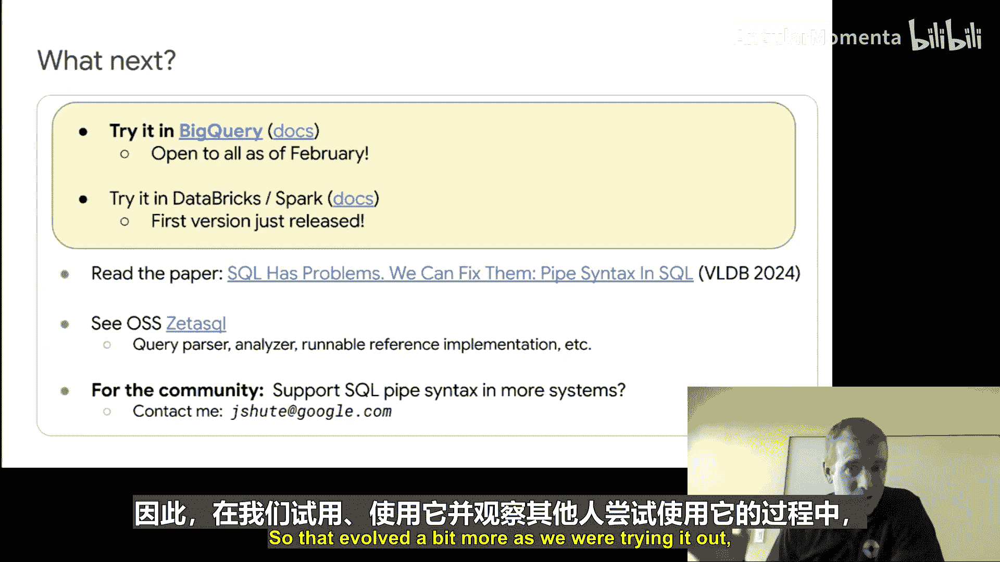

# SQL 或死亡？系列研讨会：04：Google的SQL管道语法：面向21世纪的SQL


在本节课中，我们将要学习Google提出的SQL管道语法（PipeSQL），这是一种旨在解决传统SQL语法问题、提升开发体验和促进语言未来发展的新语法结构。

## 概述：SQL的挑战与机遇

SQL作为一种已有50年历史的语言，虽然取得了巨大成功，但其语法结构也存在一些问题。这些问题使得SQL对于初学者难以学习，对于专家用户也显得笨拙和低效。与此同时，近年来许多新设计的查询语言和API（如数据框架）都采用了类似Unix管道的**数据流语法**，用户普遍认为这种结构更易于理解和使用。

我们的解决方案不是替换SQL，而是在SQL内部引入管道语法。它保留了SQL所有优秀的特性（如声明式语义、关系运算符、表级组合性），同时通过一种更直观、更灵活的语法结构来提升开发体验。

## SQL语法的问题

上一节我们概述了SQL面临的挑战，本节中我们来看看具体是哪些语法特性导致了这些问题。

SQL查询的编写顺序非常固定和武断，必须按照 `SELECT`、`FROM`、`WHERE` 等子句的特定顺序书写。进行任何非平凡操作通常都需要使用子查询或其他变通方法。

这种结构导致了奇怪的“由内向外”的数据流。查询从中间的 `FROM` 子句（或嵌套子查询）开始，逻辑同时向上下两个方向展开。此外，还存在大量的冗余和重复，例如需要在 `SELECT`、`GROUP BY` 等子句中反复列出相同的列名。`SELECT` 和 `GROUP BY` 虽然语义紧密相关，但在查询文本中却相隔甚远，这增加了复杂性。

## 管道语法：一种现代的解决方案

既然我们看到了传统SQL语法的问题，本节将介绍管道语法如何作为一种解决方案。

管道语法借鉴了Unix管道、数据框架API等现代设计模式。其核心思想是：将SQL中的所有操作符转化为对应的管道操作符，并使用管道符号（`||`）将它们以任意顺序、任意次数地连接起来。这样，查询逻辑就从查询的顶部流向底部，非常易于理解。

重要的是，这仍然是**声明式**的。查询优化器仍然可以介入并重新排序操作符，以找到最优的执行路径。

我们使用双竖线符号（`||`）作为管道操作符。这是一个折衷方案，因为单竖线（`|`）在许多SQL方言（包括我们的）中已被用作位或运算符。一旦习惯，这并不算太糟，并且我们看到相同的符号也出现在许多其他语言中用于类似目的。

以下是管道语法支持的主要操作符列表：
*   **起始操作**：查询可以从任何标准的 `FROM` 子句开始，包括在 `FROM` 中进行连接操作。
*   **标准子句**：许多标准SQL子句都有对应的管道版本，语法完全相同。
*   **选择列表操作符**：`SELECT` 列表本身可以作为一个操作符。同时提供了一些快捷方式，用于添加、更新、更改列，而无需列出要保留的所有其他列。
*   **独立的聚合操作符**：将聚合操作与投影分离，使其在数据流中成为一个独立的部分。这出于多种原因（包括可读性）被证明非常方便。
*   **其他操作符**：还包括一系列其他操作符。

## 示例对比：传统SQL vs. 管道SQL

理解了管道语法的概念后，我们通过一个具体例子来直观感受两者的差异。

这个例子来自TPC-H基准测试中的一个查询，它需要进行两步聚合操作。

**传统SQL写法**：
```sql
SELECT ... FROM (
    SELECT ... FROM lineitem
    JOIN part ON ... GROUP BY ...
) AS intermediate
GROUP BY ... ORDER BY ...
```
这种写法展示了标准SQL中奇怪的“由内向外”数据流模式。你必须从最中间的内部 `FROM` 子句开始，向上追踪逻辑，再向下追踪逻辑，并匹配许多内容。

**管道SQL写法**：
```sql
FROM lineitem
|| JOIN part ON ...
|| AGGREGATE BY ...   -- 第一步聚合
|| AGGREGATE BY ...   -- 第二步聚合
|| ORDER BY ...
```
管道语法直接按照你想要执行的顺序来表达操作：扫描表、连接、聚合、再次聚合、排序。整个过程非常直接且易于理解。

有一张来自CIDR 2023年论文的图片清晰地说明了标准SQL的奇特之处：语法书写顺序与查询执行时的语义顺序严重脱节。相比之下，用管道语法书写时，这些线条被拉直了，语法与语义完全匹配，非常清晰简洁。

需要再次强调，两种语法都是声明式的，并不指定执行顺序。因此，无论用哪种方式编写查询，你都应该获得相同的性能和结果。

## 互操作性与实现

看到管道语法的优势后，你可能会担心它与现有生态的兼容性。本节将说明其出色的互操作性。

互操作性是一个重要优点。由于这是在SQL内部进行的改进，我们允许在**任何**正常查询可以工作的地方添加管道语法。你可以在同一个查询、跨视图、公共表表达式（WITH子句）中混合使用两种语法。甚至可以在一个标准语法的查询末尾添加管道操作符来进行额外的计算，并且可以使用所有相同的工具。

例如，你可以在一个查询中混合使用两种语法的操作符。

关于实现，我们已在Google SQL中完成了这项工作。Google SQL是我们用于SQL解析和SQL分析的共享组件，用于Google内部所有SQL相关工具以及我们的云产品（如BigQuery、F1等）。在查询前端分析器中实现，使我们能够为管道语法查询生成与标准语法查询相同的中间表示。因此，对于查询引擎来说，它们接收到的是相同的东西，只需启用一个标志即可免费获得管道语法支持，而无需实现任何新的执行逻辑。这使我们能够在多个工具中支持此功能。

我们在去年的VLDB会议上发表了相关论文，其中包含了关于语言设计、所做选择以及分析的更多细节。

## 实际使用与用户反馈

理论上的优势需要实践检验，本节我们将看看管道语法在实际应用中的表现。

我们观察了Google内部主要查询引擎F1中管道查询的使用情况。使用量增长相当迅速，并且还在加速。我们看到的现象是：用户一旦看到这种语法，就能很快学会并希望使用它。它具有良好的粘性，并像病毒一样传播开来，这表明用户对其非常满意。

这些数据主要代表用户手写的查询。目前我们不知道有大量生成管道语法查询的工具。但这也正是优势之一：在代码中生成查询时，以这种形式生成应该会更容易。

那么，管道语法适合谁用？我们的答案是：**所有编写SQL的人**，至少是所有编写非平凡SQL查询的人。
*   对于已经精通SQL的专家用户，学习它非常容易，只需几分钟了解其工作原理和几个例子即可。它的好处在于，你可以使用相同的操作符和基本相同的语法，只是应用它们的结构更好、更灵活。这些用户会立即发现自己在编写和编辑SQL时效率更高。
*   对于初学者用户，以及那些接触过SQL但不喜欢它的用户，管道语法修复了许多导致用户不愿使用SQL的困难和烦人之处。

我们收到的用户反馈 overwhelmingly 是积极的。一些评论称这可能是他们在SQL中见过的最有用的变化，兴奋程度令人惊讶。这不仅仅是看起来更漂亮的语法，能够在这种语法下工作实际上改变了你思考和使用SQL的方式，让人感到非常自由。用户甚至表示，以这种方式使用SQL更有趣。当你使用过管道语法再回到标准SQL时，你会真切地感受到标准SQL中的许多笨拙之处，感觉像是变通方法或不必要的困难。

## 管道语法如何提升开发体验

用户反馈证实了管道语法的价值，本节我们深入探讨它是如何具体提升编写、编辑、阅读和调试SQL的体验的。

**编写和编辑查询**：
*   **增量构建**：你可以从 `FROM` 子句开始，然后在构建查询时不断在末尾添加操作符。在任何时间点，查询都是可执行的，你可以运行它查看当前结果，然后只需在末尾添加另一个操作符。
*   **操作独立性**：通常，你添加的操作符独立于查询中的大部分内容，无需进行那些保持 `SELECT`、`GROUP BY` 和子查询同步的全局编辑。
*   **更好的工具支持**：自动完成和建议通常效果更好，因为上下文来自你正在编写的上方位置，而标准SQL不具备这个特性。这对于未来的AI编程助手（如SQL Copilot）也是一个很好的探索领域，可以充分利用这一点做出更智能、更有帮助的功能。

**阅读和调试查询**：
*   **前缀属性**：管道查询有一个非常好的前缀属性：截止到任何一个管道操作符的查询前缀，本身也是一个有效的查询。你可以抓取这个查询前缀并运行它，查看中间结果，或者查看在应用某个操作符（如聚合）之前和之后的结果。
*   **即时分析**：在任何中间查询中，你都可以插入另一个操作符（如聚合）来查看计数或值的分布，这在调试时非常有帮助。
*   **IDE潜力**：我认为有机会构建一个用于处理SQL的出色IDE，例如可以设想一个能够单步调试查询的调试器。在标准SQL中，你甚至无法考虑这样做，因为其语法不支持逐步执行。

此外，在现有查询引擎和SQL语言中实现此功能也有很大优势。因为它不是一个需要学习的新产品或新语言，用户无需做出重大决策即可开始使用。它只是一个现成的功能，非常容易尝试，无需承诺或设置。这允许单个用户先进行尝试，也许只是通过他们的即席查询，然后当他们看到价值时，可以将其推广到团队的其余部分。这实现了“病毒式”传播。相比之下，其他方法可能需要更大的决策或某种迁移，而在这里，它是渐进式的，你可以继续之前的工作，只在有帮助的地方使用新语法，并与之前的所有内容保持完全的互操作性。同时，你也避免了额外系统、代理或转换层可能带来的缺点，例如调试时无法确定实际运行内容的问题，或者通过额外代理层带来的成本或延迟问题。

## 可扩展性：为SQL注入新活力

管道语法不仅改善了现有体验，更重要的是它为SQL的未来扩展打开了大门。本节我们将探讨其在可扩展性方面的巨大潜力。

我将可扩展性分为三类：查询引擎进行的扩展、用户进行的扩展以及语言设计层面的扩展。

**1. 表值函数（TVFs）**
TVF本质上是通用的关系运算符。你可以在查询引擎中添加TVF，并在标准语法中调用它们，但语法非常糟糕且难以使用，因为它迫使你使用嵌套子查询的模式将输入作为参数传递给TVF。当你尝试链接多个TVF时尤其糟糕。

我们为调用TVF创建了管道操作符形式。输入表作为第一个参数传递给TVF，这允许以非常自然的方式调用它们，就像内置的管道操作符一样。

例如，BigQuery有许多用于机器学习操作的函数，其中一些是作为TVF实现的。标准SQL中调用两个ML模型（如嵌入模型和分类器模型）的示例，展示了TVF在标准SQL中典型的“由内向外”或“自底向上”的模式。而在管道语法中，调用这些操作符显然直接得多。

**2. 用户扩展（以滑动窗口为例）**
关于在SQL中添加流处理操作符（如滑动窗口、跳跃窗口、会话化）的讨论已有一段时间。将其作为TVF实现是一种很好的语义方法，但调用语法很笨拙。管道调用语法对此会很友好。

如果你想在SQL中计算滑动窗口（例如计算7天滑动窗口内的活跃用户），你可能会在多个查询中重复一段逻辑。更好的方法是将其制作成可重用的函数。

在管道语法中，你可以轻松地将这一系列操作符提取出来，封装成一个表值函数。然后，在调用时，只需一行代码即可完成之前查询中的逻辑。这实际上是一个用户构建的扩展，可以非常容易地插入到许多查询中，看起来基本上像是一等操作符。这种封装使得构建扩展库并用SQL编写它们成为可能。

在标准语法中，技术上你也可以用TVF做到这一点，但调用语法太差，用户通常不会这么做。而且，在标准语法中，你甚至不具备“可以剪切出查询中间的一部分作为自包含内容运行”的特性。

**3. 语言设计扩展（以递归查询为例）**
在标准SQL中扩展语言实际上非常困难。存在许多语法挑战（如放在哪里、保留关键字冲突）、语义挑战（新操作符如何与聚合、窗口函数、相关子查询等交互），这造成了二次复杂度。由于语法折衷，最终往往导致可用性差，并且通常需要使用更多子查询才能让新功能工作。

相比之下，在管道语法中添加新功能要容易得多。操作符之间是独立、正交的。解析通常很容易，因为管道符号是操作之间的自然分隔符，它们可以独立解析，通常不需要保留关键字，至少不会相互冲突或引起冲突。语义也简单且局限于每个单独的操作符，除了输入表和输出表之外，操作符之间没有全局交互或状态。因此，在添加功能时，复杂度更像是线性的，你只需添加功能，而无需考虑交互。对于用户来说，以这种方式添加的功能非常棒，因为你可以在任何地方使用新操作符，并且完全灵活。

以递归查询为例。在标准SQL中，递归查询的工作方式相当奇特，难以解释或理解。它使用 `WITH RECURSIVE` 语法，并非通常意义上的递归，对查询形状有复杂的支持要求，并且需要围绕 `WITH RECURSIVE` 子句构建查询。

我们的管道操作符递归查询实现方式不同。它从一个生成输入数据的基础查询开始，然后 `RECURSIVE UNION` 操作符接收输入查询并重复运行子查询，直到没有新行添加为止。它返回该联合的输出，然后查询的其余部分继续。这提供了更清晰的语法，明确区分了基础查询和递归查询，可以用简单的伪代码轻松解释其行为，并且是可组合的——你可以在查询的任何地方使用它。例如，如果你想在第三次连接中进行递归树遍历，你可以直接将其混合到查询中间，而无需围绕 `WITH RECURSIVE` 子句重构整个查询。

## 管道语法对未来SQL发展的意义

我们探讨了管道语法在可扩展性上的优势，本节将展望这对SQL生态系统的长远意义。

为什么语言可扩展性很重要？许多人可能见过描述一种重复模式的论文：为了解决新领域的问题，经常会创建新事物（通常是新语言、新的数据处理系统）。最终，我们总是发现希望将这些功能添加回SQL和关系模型中。但这个过程需要很长时间，我们总是先创建那些其他系统。

我认为，这种模式出现的一个重要原因是，标准SQL是一个非常糟糕的创新平台，由于我之前描述的二次复杂度问题，很难在SQL中进行实验或添加新东西。

**管道语法可以改变这一点**，因为添加新操作符变得容易，你可以独立于其他所有内容进行添加，而不会破坏现有查询。这有可能释放大量创新。我们可以审视其他系统、其他地方出现的好想法，将它们作为操作符添加到SQL中，并且可以相当容易地做到。对于未来的创新，我们不需要为其发明新语言并说服人们使用，我们可以直接在SQL中添加操作符和功能。

**案例研究：运维分析**
运维分析（生产监控、告警）领域通常不使用SQL。该领域有许多语言和工具，但与SQL相比，在查询和理解数据方面相当原始。在Google，我们的SRE或工程师对现有工具的状态并不满意。

选项一是尝试再次发明一种新语言，我强烈反对这样做。选项二是寻找行业或开源中喜欢并想使用的东西，但我们没有找到令人信服的选择。那么SQL呢？实际上，过去10年里，我每隔几年就会与这个领域的团队讨论这个问题。以前总觉得“我们可以用SQL做这个，但真的可行吗？真的有人想用吗？”现在，有了管道语法，情况发生了转变。现在它看起来是可行的，并且似乎有吸引力。我们需要做的就是添加一些更多的时间序列操作符（用于对齐、插值等），然后我们就可以将整个领域整合到SQL分析和生态系统中，从中获得很多好处。这是一个相当早期但活跃的工作领域。

我认为还有许多其他领域同样适用。每个人可能都有自己的清单，列出他们希望在SQL或其他系统中实现的功能。未来存在大量机会。

## 总结与展望

在本节课中，我们一起学习了Google提出的SQL管道语法（PipeSQL）。我们探讨了传统SQL语法存在的问题，介绍了管道语法如何通过类似Unix管道的直观数据流结构来解决这些问题。我们看到了它在提升开发体验、增强可读性、简化调试方面的优势，更重要的是，它极大地降低了为SQL添加新功能的门槛，为SQL未来的创新和发展铺平了道路。

SQL已经成功运行了50年，其基本面和生态系统非常强大。它最需要改进的不是核心语义，而是**语法**。语法是用户的负担，也是未来增长和创新的障碍。

为了迎接SQL的下一个50年，我们首先需要修复语法。管道语法是一种非常有帮助的方法。我们不需要替换SQL，不需要放弃所有优点或生态系统，我们只需要修复语法。仅语法改变本身对用户来说就是一个巨大的胜利，他们喜欢使用它，并且这对语言的未来演进也是一个巨大的改变。

我对未来可以做的事情以及SQL的未来充满乐观。

最好的感受方式是亲自尝试。自2024年2月起，任何人都可以在BigQuery中使用它。它也在Databricks和Spark中实现，他们的首个版本最近刚刚发布。我们的一些代码也已作为开源提供，供大家试用。



对于社区来说，有趣的是我们如何向前发展：如何在更多系统中支持SQL管道语法，或者最终使其成为标准。我希望如此。