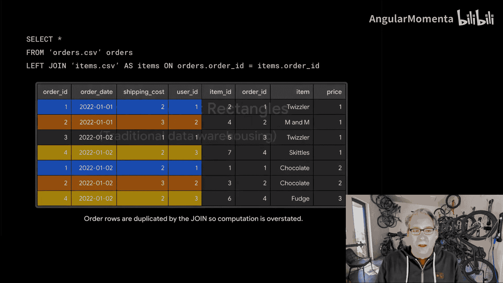
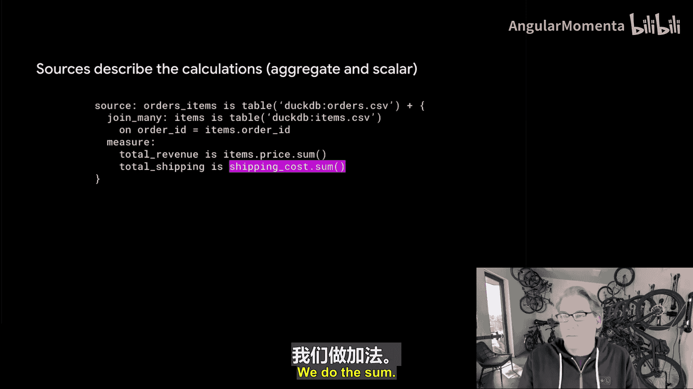
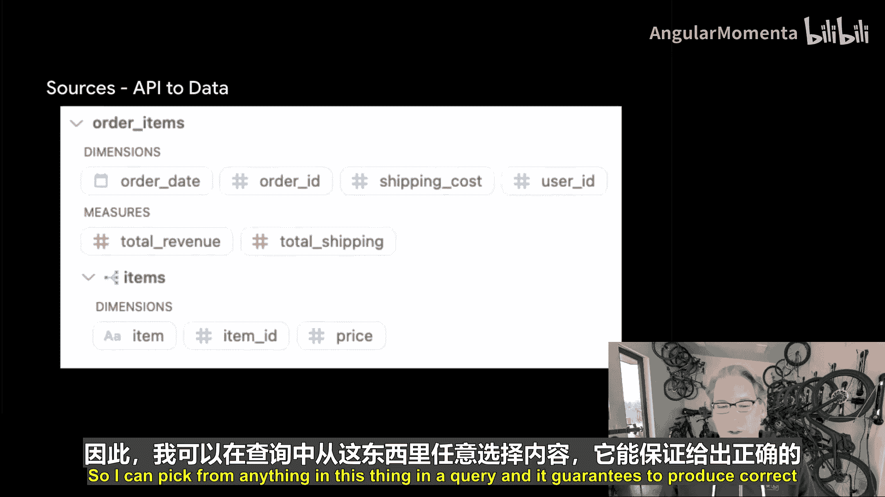
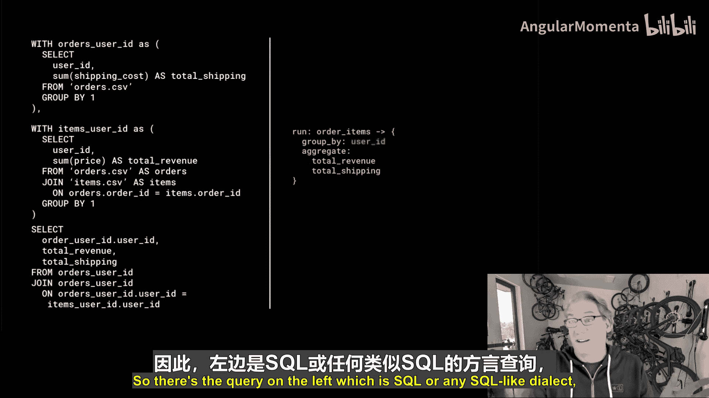
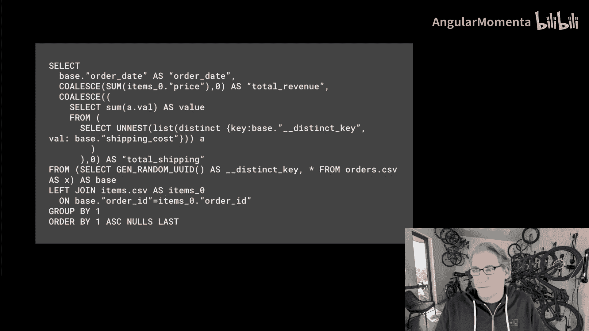
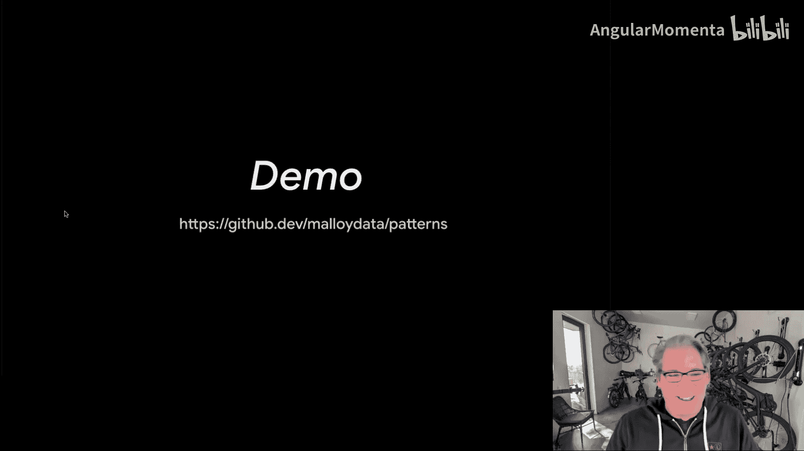
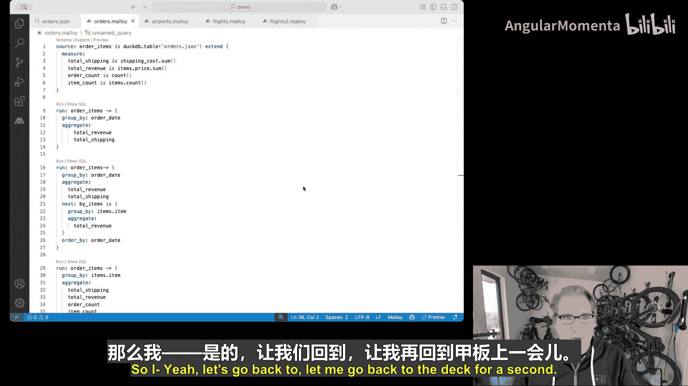
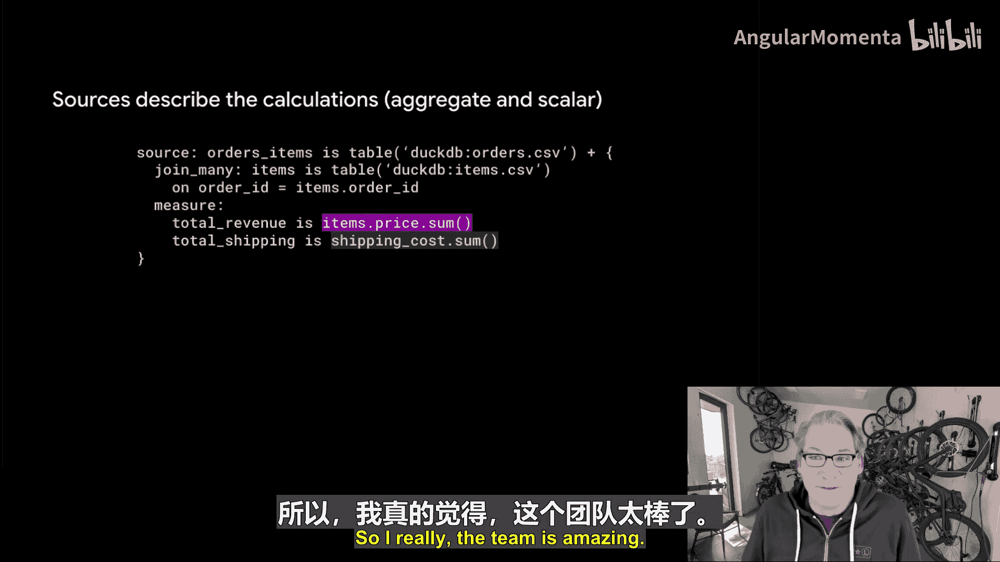

# 【卡内基梅隆大学】SQL 或死亡？系列研讨会 ｜ SQL or Death？ Seminar Series (Spring 2025) p05 05 Malloy：用于分析、转换和建模数据的现代开源语言（劳埃德·塔布） -BV1FkisBtE97_p5-

有的。🎼why I hate it。Sequel or death， Yo son， what are you going to choose？Yo check it。

 this seminar is filmed at Carnegie Mellon University thanks a lot， Google。

Hi guys let's get started， we're super excited today to have Lloyd Tab。

 the Llo Tab he's going to go through a long list of everything he's done in his career it's pretty amazing now he's at Facebook or Me working on the Llo language itself。

He worked on Dbase for Windows back in 1992 that's old school database for anybody who knows of these things and it's very impressive and so again we're super happy Lloyd spend time with us talk about the new language he's been building to replace SQL at Facebook Lloyd。

 the floor is yours， thank you for being here。Great well thanks for having me I'm excited what we're going to get to present today。

First take you through a little bit of the background of how we got here Picasso used to when he was painting a picture he painted it over and over again in some of his masterpieces he painted over 140 times I seem to be building the same thing over and over again hopefully I'm getting a little bit better back in the early 90s I was building an application building environment called Dbase I wrote a native code compiler for it in 87 and eventually I wrote the first application server for the web which was a database in a language in a web server hooked together later on in my career I was CTO of a bunch of different companies and as a CTO my job was to make sure that everybody who was in the company could understand what was happening in the data。

 they were internetbased companies the only way you can understand what's happening is you can't see your customer you actually have to understand it through data and and the tools that I built allowed everybody to kind of do an investigation into that built。

After building it the third time in 2012 I realized that there was a company in that and so I started working on a company called Looker。

 me and I a co-founder Ben Porterfield， sort of building it and by 2019 we were  a00 people were in use and most of the Fortune 500 it was a semantic modelingbased language but basically it presented data data interface to everybody in the organization so they could understand what was going on the same kinds of things that I was building earlier once we got a acquired at Google。

 I started working on the next generation of those things Maloy and recently that team moved over to Me where we're doing it all in the open source and so I'm to show you I'm going to talk today about Maloy。

嗯。So I'm going to challenge some of your ways of thinking about data today when we work in data we're almost always working in a rectangle。

 you start with Excel， it's rectangular， you can add columns that are projections， you can group by。

 you can do lookups and I think that one of the reasons so and you've had a lot of people come in and talk about SQL and。

The biggest problem that you'll see in most of these things is SQLs reusability。

And the problem I think our thesis on that is that everything that you do in SQL operates through a rectangle and so and we're going show you why why why that doesn't have to be so the goal for allloy is to enable a reusability paradigm in the same way that you would have for like a function library in order to use Twilio's API you don't have to understand how Twilio works。

 but when you're working with data you get a pile of tables and you get a bunch of instructions about how they're related and you have to work and you have to work that out for yourself。

 there really is no API even if we change the syntax and make it a little easier to use。

 we're still always reconstructing that logical relationship every time and we think that there's a way of building an abstraction around those relationships and then reusing that。

嗯。So。Sorry， there was a slide that I missed。Okay， so what are the operations within a rectangle inside of a rectangle it's filtering。

 grouping， projecting， windowing， these are the basic operations that we use after the joint has occurred。

In SQL， this was the slide I was looking for， we first take take a bunch of rectangles。

 we join them together and then we perform and then we get a new result and those operations occur at this last phase。

And I'm going to show you why this is a problem， so let's start with a really simple use case。

 which let's take orders。And items and are these are two tables that we're interested in doing some queries against and they're really simple right I want to calculate two things I want to calculate the total shipping cost in the orders and I want to calculate the total revenue from the items table when I ship something there's only one shipping cost and so I can sum the orders table and get the total shipping pretty straightforward。

When I want revenue， I basically can go compute that from the items table。

Now let's take a look at it by order date， Okay， so I can group by order dates pretty straightforward and I can compute the shipping。

U。Or I could compute the revenue from the same query from the same relationships， right？

But what if but how does revenue relate to shipping I want to look at I want a table that looks like this order date。

 revenue and shipping， how do I get that？Well this。

You would think you should be able to write it this way， I have my drawing relationships。

 I have my new rectangle， I I sum the items and I sum the orders。

But this result is wrong Why is the result wrong So this is when I was interviewing at Looker this was the interview question that I would throw up and see if anybody could answer why this was wrong。

 And it's because when you do a join the data fans out right so when I joined these two things together the order orders are repeated for each item row in the item so because there were two items from with the order one it gets repeated and for the second one it gets repeated and the for third one it gets repeated So this all makes sense right this is。

so。

The way we work is that we combine rectangles when we're doing traditional data warehousing how does this work so if I wanted to do that do this computation first I produce a rectangle with the dimensionality of order date for shipping and I do the same thing for revenue and then I join those two things together and so it looks like this I produce two rectangles and then I produce a third rectangle that I've joined。

If I want to change that to another dimension like user， I have to repeat myself。

 I start with the order the query and I have to modify it in all these places in order to get a query that works on user to look at it by a different number of dimensions so what this does is it multiplies the number of tables that we have so we have a lot of artifact tables lying around you can either materialize any of these or write them in CTs or you have a lot of duplicate code that's almost the same。

In a lot of places。嗯。So this is the nature of the traditional data warehousing problem and the question is can we solve it？

And so En Malloi。Mloy makes the promise that joint relations don't affect aggregate calculations。

 declare when you declare join， you declare it in the network in something called the source。

 which is a reusable object and when you're making references to these calculations they're guaranteed to be correct when you get the results。

Okay， let's take a look at so this is a source that wait sorry can you go back to last slide and one by fast。

Sorry。Incor aggregate calculations are applied， the aggregate calculations can reference any locality and the joint network will compute results correctly。

Okay， I mean we're going well a little I'm going to take you through it Okay， okay。

 okay thanks great Okay， so this is a source declaration it's not a query it's a source and it's describing the relationship。

And the aggregate calculations。And we'll notice that this aggregate calculation is written slightly different。

 it's written navigating to the place in the network where I want some to occur。

So we're starting with an order table， we've joined items， we do items that price。

 we're navigating to the number we want to sum， we sum that and that'll give us total revenue。

And shipping is shipping cost is in the top level thing and so we navigate to just basically the top level thing we do the sum and now I don't have to work my queries become really easy so this produces something that looks like this is this is the API to this data I can pick from any dimension or any measure and get correct results。

I can group by so I can pick from anything in this thing in a query and I will and it guarantees to produce correct results so it makes queries really simple So this is what allloy queries looks like we group by order date and we aggregate total revenue and total shipping。

And it produces the right result。We run order items and we group by user ID。

 and it produces the correct result。We want just the total revenue， it produces the correct result。

So there's the query on the left which is SQL or any SQL like dialect。

 and then the query on the right is mallo。

This is how it does it， so what we do is we collect the ability to distinct the rectangle either by creating a key or using the primary key。

 aggregate basically distinct those values and then some some of those values so there are several different ways of doing this。

 there's other ways of using with some distinct it's really dialect dependent but this mechanism is what is something I've written about it's called symmetric aggregates and it guarantees that aggregation is computed to a particular rectangle in the joint。

Okay。So this reusable API to data guarantees that we get correct results and we get a really simplified interface to the data。

It also means that we have full dimensional freedom within a network。

 so you can imagine that you've joined a whole bunch of things together and maybe even done some even and joined some queries together and then from within that network you can just your queries are really simple。

Okay， so that's the first innovation。The second innovation is nesting it turns out that data is not rectangular。

 it often comes into us as a network， so this is a JSON table of the same data we have two tables but it could be one table right ands basically we have for each order ID we have order ID we have an array of records that's nested。

So in this case we're just seeing what it looks like and this is what the schema might look like inductDB and when you make a source with nested data。

 we automatically join it and know how to unnest it。And so the。

The interface to this source is exactly the same as the interface with the data in the joint case。

Okay， so we looked at it before where we joined the orders and items and and produced this interface to data。

 whether or not the data is nested or joined is irrelevant to Moloy， I mean to the Mollloy user。

 we just know that we have a reference to items and I can still do the same calculations that I want so I can write a calculation against this that looks exactly the same。

Is it making sense so far？嗯。U。The other side of this is a raise instruct so I Malloy look her worked on 30 different dialects of SQL so I got to know them very well Maloy works on about I think eight now everybody does array ag andstructs very differently and un nestesting differently what Malloy does is something really interesting it turns out that an array ag is really just。

A nest of a query and so malloia allows you to anything that you can do in a main inquiry like grouping having filters。

 it also lets you right so in the simple case we're just in this case we're building an array of items by order date but we can do something even more complicated we can do it with aggregates in the middle of them too so we have our order date and we can nest the items and for each row we produce a record。

That has the aggregate calculations and the thing。 And so there's a。

 there's a recursion that occurs here。 That's really interesting。

 It makes building hierarchies of data that you can then use in pipelines really easy to。

So I'm going to demonstrate this， so it'll be more interesting when you see it。And again。

 this is what the query looks like when you start writing this kind of thing。

There are other innovations that are in Maloy that some other I'll get to today and some of them I won't there's ungrouped aggregates which means we have an all function which escapes grouping。

 which is really useful for computing percent of total or or percentage is so a lot of times when you're running a query you kind of want to know what this thing is related to the other things that are in the query that's native to malloy annotations and rendering allow us to tag any element in a query so that it can be so that something using the data downstream can take metadata and apply it and that's built into the language dimensional indexes or ways of knowing the knowing the low cardinality。

The low cardin related dimensional values to a network of data that so you can have AI be able to respond and for LLMs it's really great to feed LLMs those values and Millloy has composite sources which。

Basically， it'll allow you to do multiple inheritance of sources to create to access cubeUB data for really large data sets and we do that we're using that at meta。

Wai， can you explain the dimensional indexes again， just mean something like。

Where you going jumped it offset in a multimenal array。No。

 so I have a network of data that I've joined orders。

 the interesting dimensional values might be the user's name， the product name， the category。

 the state of the user right， I want to know what the most the low cardinality values in that data set。

 so when a user says show me orders from New York。It could know that New York is probably the user state。

So you can map so it can map the dimensional value of New York back to a field properly and know how to filter it got it okay。

 yep okay。嗯。These are the databases we currently support。

And we're going to go into a demo because that'll be much more interesting。

So let me stop sharing。Okay， this is Malloy， the first thing I'm running VS code and then VS code I am installing the Maloy extension。

And Mallly extensiontension hasduct the be built into it so it can read write parquet files and CSV files and JSON files。

 it also lets you connect to other databases like all the other databases that we support so it's your development environment for Mallo。

This is an orders。JON file that I created to match what we just looked at and here is the orders。

mllloy。So， I'm gonna。This is the code we were just looking at。

 So the schema for this is it has items and items。 These are the items that are in it right and I can。

So above you'll see that there are these things that are called code lenses in D code and when you click on them they run something so I can preview this data and we can see this is what the data looks like previewed。

We can here are some queries， the queries that I was running so we can run that and we can also see the sequL for the queries we that were running and we can see it in JSON and HTML and so here are the actually。

And so we can do that too。Now， additionally， there is an explorer which gives us a visual query builder for this data。

So once I've built a source， I can actually run queries against this by using the visual query builder。

 we can say group by items do item name and we can aggregate。Total shipping。

 total revenue and run that and can I can run a query and we'll write the query for me。

I can go over here and I can add things like order count。Or item count。And weload that。

And then I can go add more aggregates。Great。And明白。So the development environment lets you build this and then what happens is I can take I can go over here to this Maloy tab and I can copy this query out and I can go back and put it in my model。

And I can run it。Okay so there's a a development flow for building your queries。

 running your queries everything you do in the explorer turns into Maloy or NsQL and so this this is the basis of your development environment and now let's build let's go build。

Let's go build some models。Okay， I have a。I have an airports query I have an airports table that's basically a parquet file and it has a bunch of columns in it like city and state and code for the airport and various things and I've added some I've added some demand measures to it airport count average elevation notice that i'm running at elevation on average and this is a tag that tells me that I want to display it like a number so this is basically whenever I get met so let's let's。

Whenever I get a query， whenever this thing shows up in a result it's going to use this to render and whenever this whenever percent of airport shows up it's going it's going to show it as a percentage。

 the all calculation is a ungroup expression that'll show me10 we'll show me all of the values that are escaping grouping so let's go explore this。

We can。Gupbye。Oh， let's goodbye back type。Where is that fact type and then let's aggregate。

Airport count， average elevation in percent of airports。So 73% of the airport。

 7 70% of the things are airports， 25% are hellports and these where they are， right？

I can one of the things I can do here is so let's take this malloy and I'm going to instead of writing it as a source。

 I'm going to write it as a query。Now， we haven't seen this yet。

 but but you've seen the case where I have the run statement， but I can also declare。Views。系嗯。

Inside a source。And you can think of this as a member function in object oriented programming。

It's it's it's basically this query and it assumes that it's running within airports。

 So if I run this now， this is going to run。Right here and I can build another one here。

 we saw state was here。I'm going to do by state。Does the member function thing make sense？啊。So。

What is the word about it？Okay， and now I can look at the airports by state。

TheThe difference between I could run this I could run this query or I can place it within airports and it is a view within it is a view within。

Airports， so what happens now is when I explore。I can load by fact type， and run that。And I can。

Or actually， let's do it the other way， let's load it by state and run by fact type。

So now for each day， I'm getting the number of different facilities for each state。

I this making sense that so so the idea here is you build reusable components in your source the common ways that you're going to use the data and you can mix and match and combine them So this is showing me for any given state what what what are the。

What the breakdown of the help report I can also flip this around I'm going to do something else I'm going to I can tag this。

This is annotation， I'm going to make this a shape map。

And now when I run this it's going show it's going to show me as a shape the only difference here is that in the metadata I've marked that the state is a shape map。

 there's an annotation here that says that this is a shape map。

 the thing that takes the results and displays it recognizes that by state should be rendered as a state map and so when it sees that it knows how to render it that way。

Is is the views the views are they being being materialized or they only access like when you actually。

There's them。So they basically help you they're a way of writing code against airports。Right。

 so for every one of these， I can either run them show SQL or I can explore them。

 So each of these has has。These these are just common basically common queries for airports you can think of them as common queries that I would want to run against airports and then you can mix and match them。

 but the really interesting thing is that is because of the nesting architecture you could combine them so when I explore。

Let's look at it but I mean it's lazy materialization it's not like DbT where like if you declare bunch of these views it's going make them all for you this is like no it doesn't there's no materialization every single moloy query runs as one SQL query okay so like when I when I run this this is the moloy for this right this will convert to one SQL query and when I add。

Nest。By state。And I look at the SQL， it changes the query， changes this query， and when I run it。

It's basically showing me the。The seaplan bases are on the coast， obviously right。

 and Heports are in Texas。So go on， go back， where's the balloon ports？Blloon ports， yeah。

 that was that was the last category， okay。Sorry。Actually， so we can write this query really。

 let's see the other way to write this query is。Run at view。呃。Okay。

 so this takes the fact type query and then appends and nest to it and so now when I run that。

I get my。There's your ballooning points。Illinois， okay？

At Deelware so someone had a question in the chat says。

 are many to many joins allowed in the source declaration or do they have to be many to one if the former are those ses defined so the duplicates are removed by default？

Duplicates are removed by default， but let let me show you we're about to get into joints。Which is。

 okay， so this is airport， it's really simple， great now let's take a look at flights。

Plights imports airports right this thing that I just wrote if I look at the schema for it。

 all the stuff that I just did was here， I can run combo and we have our but I've imported it like you would in a module in any other language right and the interface to that is very clear。

Right， and in flights， I've got I'm joining an explicit table carriers right but I'm also joining the airports thing that I imported twice once is origin and once is destination。

 And then I'm adding some measures flight count percent of flights and percent delayed flights。

 So pretty straightforward， pretty simple。 I can now go explore flights right and I can build queries that are based on airports。

 So if I want to group by let's go look at the origin。😊，State。And I'm going to aggregate。

We'll do flight count， percent of flights， the percent delayed， you know and。

The number of destinations。results。I'm able to use this network just the same as if once it's built。

 I've got this interface to data that I can do and saving I can start saving these views。

 so if I want to go grab the allloy for this， this is what this looks like。

We'll grab this as a source we'll do by state。Right， and now when I run this， I get my， I get。

And we can go explore this and let's change this to。Carrier。Make whats。Had a group by。Let's see。

 we'll get the carriers。Nickname。What run that。So we could say this or we could nest。I state。Oh。

Ohoops， I did it wrong here， I group by。Carers that nickname。And that I'm going to nest。I stayed。

And I'm going to take this and let's limit it to。The top 10 states each of the carriers flies and we can run that。

Is is the measure keyword basically like a projection or do you define what is the measure keywords is defining an aggregate so measures are defined as aggregates dimensions are scalar calculations that are written against the source。

😡，So the measures are within the source， you basically you've got some data you want to aggregate it。

 it's a measure， so it's a count a sum， a max， a min， an average。

Standard deviation those things so it's about it's about a set of data and it's tied to and then i'm not showing this here but but dimensions are scalar calculations so like if I wanted to combine the city and state or something into into a field I can do a kcat that would be a dimension and those then just show up like regular columns。

And presumably you have like regular expressions or matching and you know all the data clean crap people want y got it okay right so like let's take a look so this is this is a more built out flights so it something that it's just the demo that so it has the this is a bigger version of that so it's got the carriers it's got the airports it's got aircraft models it's got aircraft and so so this。

This version of flights is more built out and I can go look at the top carriers and I can run that。

Right and。let's do that and so or I could I could look at it by by manufacturer and we could look at that and okay well we can then see which carriers then we can look at the manufacturers by carrier we wanted to so we could nest。

carriers here and run that and so we can see Boeing cells to Southwest mostly and Airbuses used by United right and know so the ability to really work with the data very quickly once you have this model built is really the power of it its the design here is build a reusable object that you can then that you can then make easy queries from。

Okay， the。This isSo there's an index operator， like it's like GroupI except it produces a table with four columns in it。

 so I'm going to run this。嗯。This。So let's take a look at this。

So origin with DAL appears on 1600 rows， Phoenix appears on 12，000 rows。

 phHX Cleveland appears on 05000 rows， Atlanta appears on 17。

000 rows so that once you build this dimensional index there's a lot you can do with it。

 one of the things that we do is for filtering so if you if you go and you。

Want to filter this data on San Francisco， you just type。San Francisco。

 we can filter on San Francisco International Airport。

RightAnd so once you have a dimensional index you you can reason about the data much more easily。

 so so this is what the index the index basically says which of the dimensional columns am I interested in indexing and then they're available。

And it's a pretty interesting SQL query that writes to produce this dimensional index。

Any questions so far？Before the commercial index， let not go ahead。Yeah。

 I wanted to go back to the question of many too many joints I was wondering are you still trying to cover that or Oh sure okay so in the joints these are join ones there's also a join many so in this case there is one carrier when I join from this relationship there's one carrier it will join to one row in the resulting table。

In a nested case it's ajo many because one row will have many rows if I flipped it around if I had a carrier and I was joining in flights。

 that would be ajo many and a many to many is ajo many。And so when you write your right calculations。

 you specify the rectangle that you're going to write it against and it will produce the correct results for both rectangles。

Okay， maybe I need to look at some of the examples on your web page better because if it's a many too many and you are doing the aggregate on one of the attributes from or measures from below in the chain。

 you know feels like there will be an intricate issue with duplicates like sort of duplicate counting of something that I don't understand how you。

😊，Get他 down了。Yeah， let's。Okay we don't know because you navigate to be so if we look at。

 let's take a look at orders again。And let's take a look at this query。So because orders。

So this is how we did do。It knows the distinct key of the rectangle， it collects the distinct values。

Right， and then it unnests them and sums them。And so that way so there's two forms of sum。

 one is a distinct sum and one is a regular sum， and because of the way that you declare it in the language。

 we know whether to write a distinct sum or a normal sum。And in many the many case。

 we're always writing a distinct song。OkayOkay， thanks。You got other questions？Okay。😊。

I actually won in the chat once a model is ready， actually。

He this one not go back to you once the model ready how are Maloia queries product productionized leverage the resulting queries。

 views， say empower power BI or tableau or any visualization dashboarding platforms。😊。

Go itSo we're building a core technology there are four four or more companies right now that are building on the basis are building。

A building products that are on the basis if there's something called a Mo publisher。

 which one of the companies is using and open sourcing。

 which will take the output of our notebooks and publish them the Tableau and power BI don't have any notion this of。

Aggregating the way that we do so we don't integrate very well with them but we envision that there will be more open source alternatives to use Moloy we're at metaA so we're building something internally meta that lets people explore the data this exploration tool is also available as a separate installable component so the Expr that you're seeing here is also a component that's available on our website so we're building pieces we haven't built the whole thing yet。

way of saying not long way of saying it's in VS code right now。

And you can build your own application。Pk Gr for。So I might not have fully followed it but you talked about modularity so what you' are saying is that like the views in SQL are not do not provide the level of modularity that you're looking for or like I mean people have been doing like they've been sharing SQL snippets through views etc cetera right they've been they've been doing what you just showed right so。

Yeah， let's go back let's let me go back to the deck for a second yeah thank you。

Okay。So in this case， each of those CTEs could be a view， right， but what they do。

 what they are is they're forced at a granularity of user ID， right？

So a view is really just a table it's not and like whether or not it's materialized or not。

 whether or not it' if it's a queer。😡，In this case。

 it's either a table that is materialized at some level of granularity。嗯。

And what the difference between our source and a view is the source is independent of the granularity。

 you have total dimensional freedom to pick any dimension or any measure and you can get a correct result。

 a SQL view is fixed at a particular granularity。And so you end up with lots and lots of them you will end up with you know when you talk to somebody who's working with SQL。

 they'll tell you they have 10，000 tables in their data warehouse what are the 10000 tables they're really just copies of the data at an arigation level and a granularity and that's why they have some right and it's because you have to produce these rectangles in order to be able to be able to do your analysis and so whether or not whether or not it's materialized whether or not it's a CTE which you have to copy a view which is again just it's a copy of the code in the database or it's a table it's all the same thing you just end up with lots and lots of copies of these things whereas a source。

It's a recipe on how to write the query， not the query。

Now our are also our views are also at some level of granularity， right。

 and we use that building block differently further than nest。

 and so we can produce views in thellloyd， but the real power is this source。嗯嗯。😊，And thank。

I'm just curious that could you have extended sequel。

To produce those flexible views with at different levels of granularity， which sequL I don't know。

 I'm just asking that question like could you have could you have Yeah you're looking。

 you're basically looking at the fourth rev of malloy。

 the first one was the first attempt was to make it very sequL like the problem is sQLs clause our order dependent there the the number of。

How do you declare something like a source and its joins there was just different enough that couldn to we couldn't get anybody to understand it。

 so we built it that way we showed it people， they didn't understand it。

You knowMloi is a little more complex than a single query， also but in the end simpler。

And you know like so the one last question So like if you work with OM tools is like they generate SQL。

 which is usually not very efficient like it's like a boiler plate。

 do you think malloic might run into those similar issues that and it's very hard to kind of after the fact like dig into SQL and figure out what the inefficiencies are and how we could have written it better actually we find that we're in many cases were much better like it's depends on what you're trying to do if trying to do something dead simple we dead simple too like if you're writing if you're doing simple queries you can get yourself into trouble by writing really complex monolo queries。

 there's no question about it but you couldn't possibly write them in SQL So in the general case the simple most people use SQL relatively simply they pull a data and they feed it into something like Canice right and what we're trying to say is you can do more with these database engines are really powerful。

We leverage the power of these database engines in a way that's pretty unusual。

We find that people can't abuse it， but generally we're not bad and we pay attention to performance。

Okay give。So's what that was my presentation。嗯。I will I will clap on behalf of everyone we still have 15 minutes or so for questions if you if you want what's a far away happy to answer any questions want to stop sharingm mo you want to go for it actually you can keep the shares screen okay。

Yeah so was you know that's really really interesting thanks for thanks for the presentation and I guess you know I was trying to connect it to things like the N relation algebra and stuff like that and one question for more specific question I have is they do exist some languages maybe not really widely adopted that sort of allow you to do some of this through dot notation you know you kind can do joins through dot notation and in some cases you could do aggregates after doing that would this like did you explore that this would be similar to semantically to that。

😊，So yeah， so the difference between many of the other dialects that you have seen or that they don't have a notion of a source。

 right， they're simply doing what SQL does in a pipeline state。

 right but they're not building reusable aggregation that are guaranteed correct。

And so you always have to you end up having to reexpress the aggregate calculation over and over again in a Maloi model。

 the calculation for revenue exists in exactly one place。

 not 15 files not in 15 queries in exactly one place right and it's guaranteed to be computed correctly no matter how you join no matter how you dimensionalize the data that is the core difference right and I don't see the other the other yes you can make you know we can argue that a dot notation is more readable in and we do have dot notations where you traverse to the object you're going to some and do that but it's。

But the core difference here is building an abstraction that is easy to understand from the outside。

Right， thanks。Get you on your airport。Sure， so according to my understanding with an explicit materialized view。

 there's opportunities for optimization with。Incrementally updating it。

 I'm just wondering in the context of this system， what kind of opportunities would exist？Yeah。

 so not showing it here but you know any one of these queries could be materialized right so one of the things we were working on is an annotation for materialization so that if we didn't get into it but you can have sources that are based on queries。

Those sources can be materialized。Right and and so it's just because Bo always writes SQL and it always writes everything as a single SQL query。

 the materialization of that is just the same as it is in SQL and in fact we have something if you go read our docs we have this thing called the Td in which is inside of a SQL statement you can you can。

You can reference a Maloy query and inside of a Maloy query you can have it based on a SQL source。

 so we interoperate with SQL in the same way that C C++ interop or JavaScript and you we treat we treat SQL like assembly language。

 but there is in line assembly language。There is the inline SQel for Beloyd。Thank you。

Other questions。So my question would be。Can everything you want to express now in Maloy。

 and I'm saying like look or supported of 30 SQL dialLects， Maloy is down to eight。

 can everything you want to express in Maloy be mapped to pure SQL with built and functions or do you have to fall back or rely on UDS？

All right so you just have to be clever， so like the nesting step in MySQL was like a real brain teaser。

 it doesn't happen the Malloy language has as but MySQL doesn't。

 but Maloy speaks MySQL and it uses JSON and basically abuses JSON so that it can get so that it can implement the core functions of Malloy so the answer is most SQL dialects today you can implement reasonably well in Maloy。

 the SQL on each of these dialects is radically different。

I mean the way you un nestest on every single dialect is different the way that you do lateral joints is different My SQL Postgres support correlated subqueries snowflake does not right how do you do how do you without correlated subqueries against arrays how do you do the symmetric aggregate thing well we use we use some distinct in order to do that and so there。

But from your point of view of using Meloy， you don't actually have to think about it。

Yeah I think basically saying is there's no user find functions at all。

we were originally were trying to say no user functions。

 we then have a way of escaping to use the native SQL functions with an exclamation point on a function。

 you can actually call any native SQL function and recently we've decided that if you're working on a。

People are generally tied to a machine， so we do and at least in Presto。

 we've implemented most of the functions that you can get to in Presto from Malloy。

But there is a core set of functions that are the same in all dialects okay。

 so I didn't mean necessarily like can the user running Maloy as user divine functions。

 it was more like for you guys to translate from theloy into SQL。

 do you have to fall back on UDS because never noll。Yeah， love it。呃。What's the？So it works。

 what's the biggest challenge or what's what's the next big。You know chapter in the Maloy story。

 is it just expanding to moreL you know SQL platforms。

 is it just going within meta and getting more people to start using it bangnuan and breaking it and learning more from that。

 or is there some big feature like oh my gosh we had this this this be game changing for us？嗯。

it's basically user adoption right so the thing that in the public we don't have a tool that you could install and use it for your corporate data right and the reason we don't have that is there's a whole bunch to getting that right。

 their security and access controls and a whole bunch of stuff that we haven't written right and basically what we do is we create an Exporable interface to data so there's a company who just got funded that is bas that is building a theloy and they're doing their stuff in open source I'm very excited about them pathways and then inside Beta' we're building up that user base which is really interesting so as we build tooling we're opensourcing all of that tooling to make it better so we're actually currently reengineeringly explore the permissions model we're following an object or in permissions model which is that some columns are going to be public some are private some are protected。

You inherit sources。There is source inheritance so you can start with a source and extend it and it's an inheritance model what anything protected you could see anything private you wouldn't be able to see anything public would be published and then how does that fit into rolebased access control we're solving all of those problems at meta and as we do we're open sourcing all of that。

awesomesome， all right， any last questions from the audience？😊，I had one more question。

 so Booker has an intermediate modeling language。I don't know much about it。

 but I think in local tableau， most of these systems have。So this。

Mloy comparable to these languages or is it given that I design the one inlooker yes。Yes。

It's you know10 years of working on that I learned a lot and so。

There are a bunch of features yeah so yes， it's comparable， it's more rigorous。

 it's a stronger more complete language than Locomel， which is what we built before。

And much of the team look a out with me， so there are people on my team that I've been working with for 30 plus years。

没， thank you。I do want to shout out to the Maloy team we have an amazing group this is something not as well understood but software is a team sport Carla Nang is on the call he's our product manager the Maloy team is made up of some really amazing folks you know this is not one this is a many many person effort with a lot of passion so I really the team is amazing。

