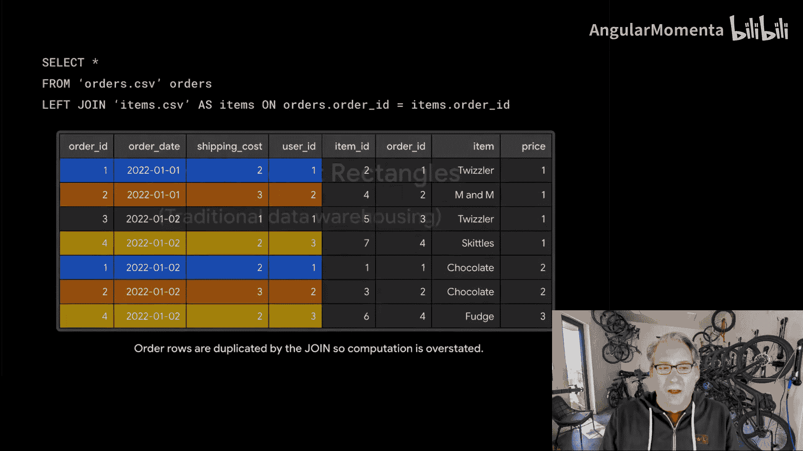
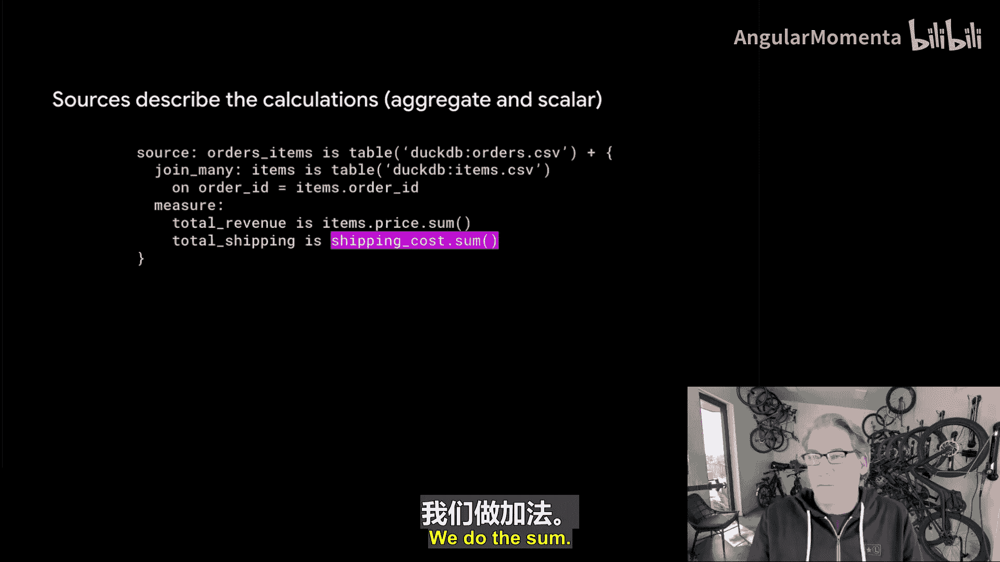
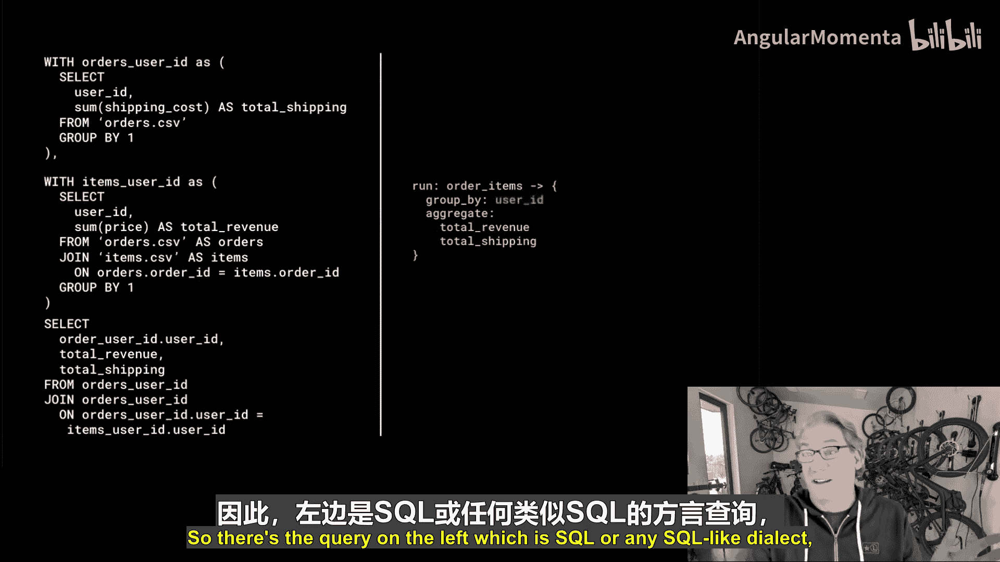
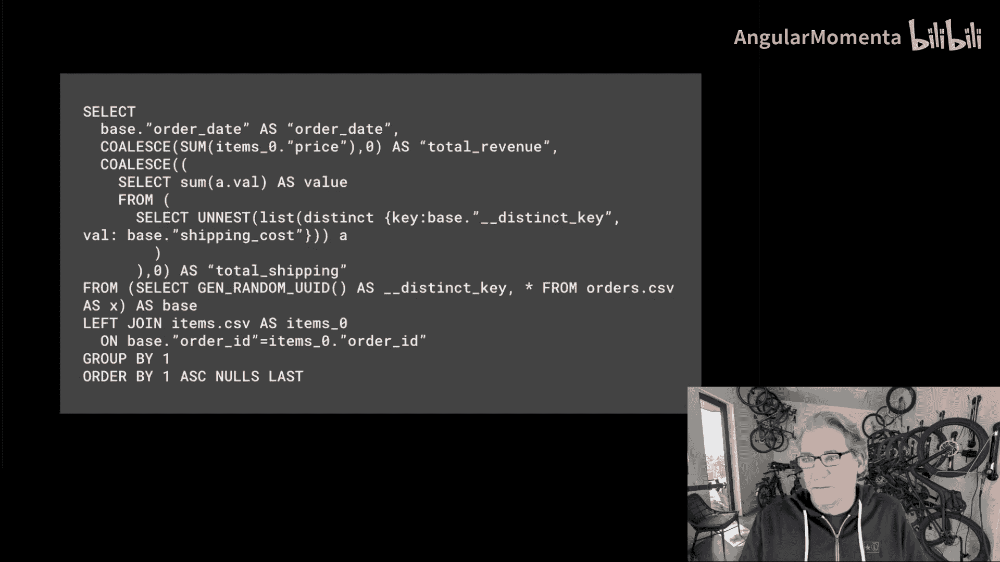
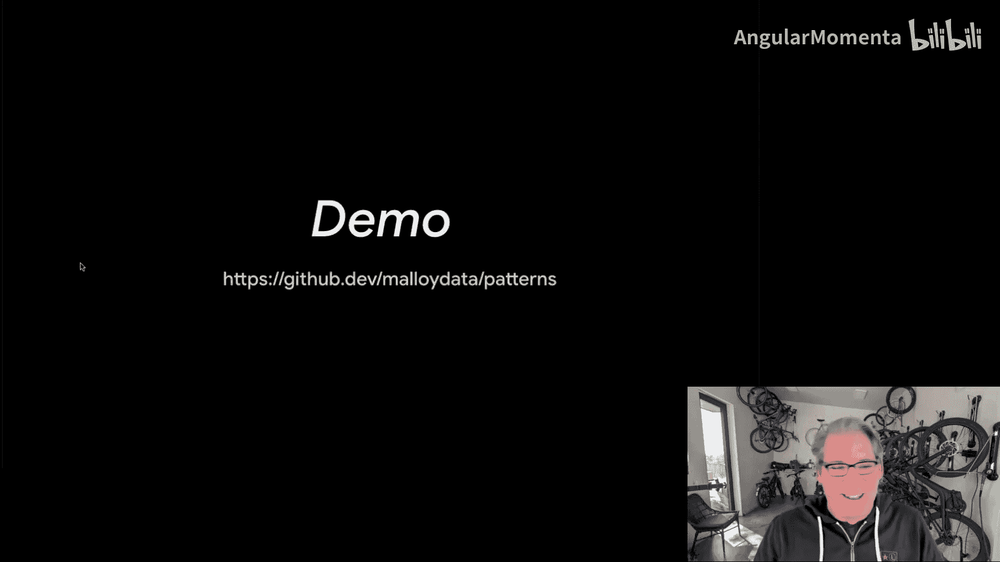

# SQL or Death？：05：Malloy：用于分析、转换和建模数据的现代开源语言


在本节课中，我们将学习 Malloy，一种由劳埃德·塔布（Lloyd Tabb）设计的现代开源数据语言。它旨在解决传统 SQL 在数据建模和分析中遇到的可重用性和复杂性挑战。

## 背景与动机

上一节我们介绍了数据工作通常围绕矩形（表格）展开。本节中，我们来看看传统方法在处理数据关系时遇到的问题。



劳埃德·塔布拥有丰富的职业生涯，从早期的 Dbase for Windows 到共同创立 Looker。他观察到，在数据工作中，人们总是需要从一堆表和关系说明开始，每次都要重新构建逻辑关系，缺乏一个可重用的数据 API。

## 传统数据仓库的问题






在 SQL 中，我们首先将多个矩形（表）连接起来，然后在最后阶段进行过滤、分组、投影和窗口操作。



让我们从一个简单的用例开始：我们有两个表，`orders`（订单）和`items`（商品项）。我们想计算总运费（来自`orders`表）和总收入（来自`items`表）。

按订单日期分组计算这两项似乎很直接。但是，如果我们想要一个同时包含`订单日期`、`收入`和`运费`的表格，直接连接两个表后求和会导致错误。原因是连接操作会使数据“扇出”：一个订单行会因关联的多个商品项而重复。

**公式**：错误结果源于连接后对重复行进行简单求和。



为了解决这个问题，传统方法需要先按维度（如订单日期）分别聚合生成两个矩形，然后再将它们连接起来。这导致了大量几乎相同的重复代码或物化表。

## Malloy 的解决方案：源（Source）与对称聚合

Malloy 承诺：连接关系不会影响聚合计算。其核心创新是“源”声明，它是一个可重用的对象，描述了数据关系网络和聚合计算。

在源中，聚合计算通过导航到关系网络中的特定位置来编写。例如，计算总收入时，我们导航到 `items.price` 然后求和。计算运费时，我们导航到顶层的 `shipping_cost` 然后求和。

**代码示例**（源声明）：
```malloy
source: orders_with_items is orders {
  join_one: items is items on order_id = items.order_id
  measure:
    total_revenue is items.price.sum()
    total_shipping is shipping_cost.sum()
}
```

这个源成为了数据的 API。我们可以从中选择任何维度或度量，并获得正确的结果。

**代码示例**（查询）：
```malloy
query: orders_with_items -> {
  group_by: order_date
  aggregate:
    total_revenue
    total_shipping
}
```

Malloy 通过“对称聚合”机制实现这一点：它识别矩形的唯一键，对值进行去重，然后再求和。这保证了在任何连接和维度组合下，聚合都能被正确计算到指定的矩形上。

## 嵌套数据与非矩形结构

数据并不总是矩形的，它通常以网络形式（如 JSON）出现。Malloy 的第二个创新是原生支持嵌套数据。


对于嵌套数据（如订单内包含商品项数组），Malloy 会自动理解如何连接和取消嵌套。用户使用源的方式与处理扁平化连接表时完全相同，无需关心底层数据是嵌套的还是已连接的。

反过来，Malloy 也允许在查询中创建嵌套结果。任何在主查询中可以进行的操作（如分组、过滤）都可以在嵌套查询中进行，甚至可以包含聚合，这使得构建用于后续管道处理的数据层次结构变得非常容易。

**代码示例**（嵌套查询）：
```malloy
query: orders_with_items -> {
  group_by: order_date
  nest: items_by_category is {
    group_by: category
    aggregate: item_count is count()
  }
}
```

## 其他特性与演示

Malloy 还包含其他特性：
*   **未分组聚合**：使用 `all()` 函数可以跳出当前分组，用于计算占总数的百分比等。
*   **注解与渲染**：可以为查询中的任何元素添加元数据标签，指导下游如何渲染（如将州代码标记为地图形状）。
*   **维度索引**：识别数据网络中的低基数维度值（如用户名、产品类别），有助于 AI 或 LLM 理解数据并正确过滤。
*   **复合源**：支持多源继承，用于访问超大规模数据集的立方体数据。

在演示中，我们看到了 Malloy 的 VS Code 开发环境，它支持预览数据、编写查询、查看生成的 SQL 以及使用可视化查询构建器进行探索。一旦建立源模型，就能快速构建和组合各种查询视图。

## 问答与总结

在问答环节中，讨论要点包括：
*   Malloy 支持多对多连接，通过声明连接类型和导航到正确的矩形进行聚合，可以正确处理重复计数问题。
*   与 SQL 视图相比，Malloy 的“源”提供了维度自由，无需为不同粒度创建大量视图或表。
*   Malloy 查询最终被编译为单一 SQL 语句，可以利用数据库引擎的强大功能。它也可以被物化。
*   目前 Malloy 支持约 8 种 SQL 方言，通过巧妙的 SQL 生成来适配不同数据库的特性。
*   未来的重点是用户采纳、构建更完善的企业级工具（包括权限模型），并在 Meta 内部和开源社区推广。


本节课中我们一起学习了 Malloy 如何通过引入“源”的概念和对称聚合，解决了 SQL 在数据建模中可重用性差和容易出错的问题。它使数据关系成为一种可重用的抽象，让查询变得更简单、更安全，并能够自然地处理嵌套数据结构，为现代数据分析提供了新的范式。