# 【卡内基梅隆大学】SQL 或死亡？系列研讨会 ｜ SQL or Death？ Seminar Series (Spring 2025) p06 06 PRQL： 流水线式关系查询语言（托比亚斯·勃兰特） -BV1FkisBtE97_p6-

有的。

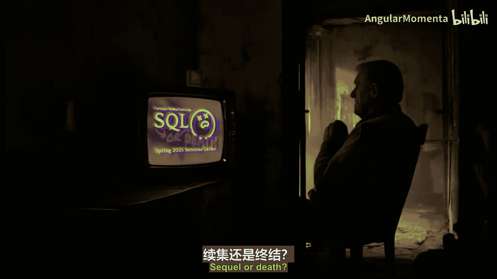

🎼why I hate it。Sequel or death Yo son， what are you going to choose？Yo check it。

 this seminar is filmed at Carnegie Mellon University thanks a lot， Google。

Welcome back everyone to our seminar series SequL or Deaf I'm obviously not Andy。

 Andy's sick this week， so I'm taking over for hosting and today we're joined by Tobias Brand who is a PRQL contributor。

So。Tobias is a recovering physicist who traded the abstract world of TQFTs for the slightly abstract world of financial data and lived to tell the tale he spent the last two decades on a global quest to tame market chaos armed with a growing arsenal of data languages。

 sQL Python a and yes even Excel along the way he's encountered enough null values from left joins to question the very fabric of reality which naturally led him to Pi well。

 he's now a passionate advocate from simple and more elegant data transformation Tobias is joining us from South Africa it's 10。

 30 pm there which is quite late so thank you tobias and yeah take it away。

Thank you Sam thanks for that intro and Annie thank you very much for the invitation and'm yeah very excited to tell you about the work we've been doing with PRqL or precool and as。

😊，Someone who also follows a database oriented lifestyle。

 I don't know if it's a requirement for that to have you know like an intro track。

 but it's certainly something that resonates with me so I kind of want to start on that note and so without further ado。

 let's begin。All right， here we go。🎼Rightright so and here the the location of。Re cool。And yeah。

 we'll get more to that later， but first of all， I want to begin with why do we feel the need for introducing it another language？

Right， so it all began with a post on hack and news by one of our core maintainers Max in January 2022。

 the proposal for BettersQL， which easily reached the front page of hack and news and we had a lot of。

Yeah， interesting contributions。 And I saw it at the time and ultimately then a few months later。

 got involved my myself and。And we've been added ever since。Right。

 so I'm come from with a sort of data scientist data engineering perspective and。

I think that will come through through the rest of the talk and so what kind of matters from that perspective which kind of like as a practitioner is precos really aimed at complex OLAP type queries where you kind of want to work interactively maybe do some exploratory data analysis so ergonomics matters rehaability and you know I believe code is read more than it written and also one of the key features is composability。

 extensibility and also testability so those are all kind of key aspects that we need for like in data work in like day to day lives。

😊，Right so SQL is 50 years old and it's endured for a long time and the question we want to pose。

 is it a shark that kind of has reached the pinnacle apex printer that has no need or further evolution or is it a bloated dinosaur thats kind of one step away from extinction？

Right so let's first look at SQL to shock SQL isling of f of data you know it's found everywhere from relational database management systems。

 data frame APIs like Pans or pulls except SQL data lakehouse engines。And we at prequel。

 we believe there's two key aspects。do that So that's the relational model and the character of nature and I'll go into each of these first So first of all on the relational model。

 you know I think data is tabular and you know this slide I took from Hanm's inaugural lecture on ancient art data management and tablet that was uncover 5000 years ago and recorded some early trade in H and Bali so nothing much has changed or you know what goes around comes around and。

So I think data has been tabd for at least the first 5000 years and there's some interesting articles like the unreasonable effectiveness of SQL and what's interesting one I found and I actually think it should be the unreasonable effectiveness of product types that is the cause of this。

 but hopefully I'll get back to that later on。😊，Right right。

Then we obviously have this great paper what goes around comes around and around which reviews the first 50 years of SQL or in just paper sort of the last 10。

 20 years， but the Res model has been around for 50 years and I think you know from the conclusion of the paper which I I think it's safe to say it's probably going to be around for the next 50 years as well。

Then the other key aspect is that SQL is declarative。

 so that obviously gives the query optimizer a lot of opportunity to optimize thequeries。😊。

And how to do its data retrieevval， a way to do certain operations。

 And like a key aspect of that is compute， bring the compute to data。

 which especially in a sort of this modern world with data lake houses and cloud data warehouses is like a key aspect and。

Like just an example for that is as for example， the prettycate pushdown so if you're doing a very。

You know a complex query that only selects a small subset of the data。

 obviously you want to do your filtering as early on as close as possible to the data before you push a lot of data across the the wire and I think that that stands in contrast to like data frame kind of。

If eyes and work where if you're working in pans or polars。

 where often you all the data have process to be pulled down into your working memory on your your node and the processing gets done there。

 So I think that is also a key aspect that we want to retain。But now coming to sequel the dinosaur。

And you know early on in the seminar series， we had this talk by Victor Lis and Thomas Noman on towards Sananitity and Que Langus which is an excellent talk if you haven't watched it already。

 I strongly urge you to watch it and I pretty much agree with everything that was。

Say it they and they sum up a yeah sort of key points that similar to myself。

 I think I'll recapitulate some of those with a more practitioner perspective。

 but just the one that I want to become on here was the on the relational calculus and。I mean。

 Thomas mentioned there that。You know， writing a SQL P is easy task and it's you know complex language and I think part of that comes from the relational calculus aspect of SQL which。

Ex this example here is， you know， you have this global scope and all these different。

Hailles that get joined and pulled into the scope and then get exposed in this select clause。Yeah。

 I think。That。Is an undesirable aspect， for at least for the human and from the readability perspective。

 because you know if it's difficult for the compiler to keep track of all of these things for like a human reading the query and when you're reading the select part。

 you're having to trace where certain things come from。

 it really makes it difficult for analysts working with the queries like this。

 if they're having to maintain and to really keep track of what's going on。😊。

So I'm going to do a little de here on into relational algebra versus relational calculus。

So if you do searches on the web where you go to Wikipedia。

 you'll find something like this that relational calculus meant is a declarative language whereas relation algebra is an imperative language or like another one I found have these two。

Colin is here and it's often brought up that relation algebra is a procedural language。

And Thomas also made that point that like， you know， it looks imperative， but it。Actually isn't。

 And I would argue that almost by definition because it's relational algebra。

 if it's an algebra in the mathematical sense， it's composer functions and。😊。

Yeah we know that those are a functional so I think it looks imperative because it's repeated function application but it's really functional rather than procedural or imperative because there's no external state that isn't passed along in the functions so I think a key distinction it's a relational algebra is functional and you know I mean functional languages having a bit of a resurgent and I'm a big fan myself and think you know that from that you can take that it's still actually a declarative so we don't not giving that up at all by just sticking to relational algebra rather than relational calculus。

😊，And just also the LGD Cos theorem saying that two are equivalent and then you know。

 some stronger things that。languageanguages needs to be relational complete to get all the benefits that we get from like SQL or relational calculus and I think you are prequeol。

 we have that so you're not giving up anything in generality。

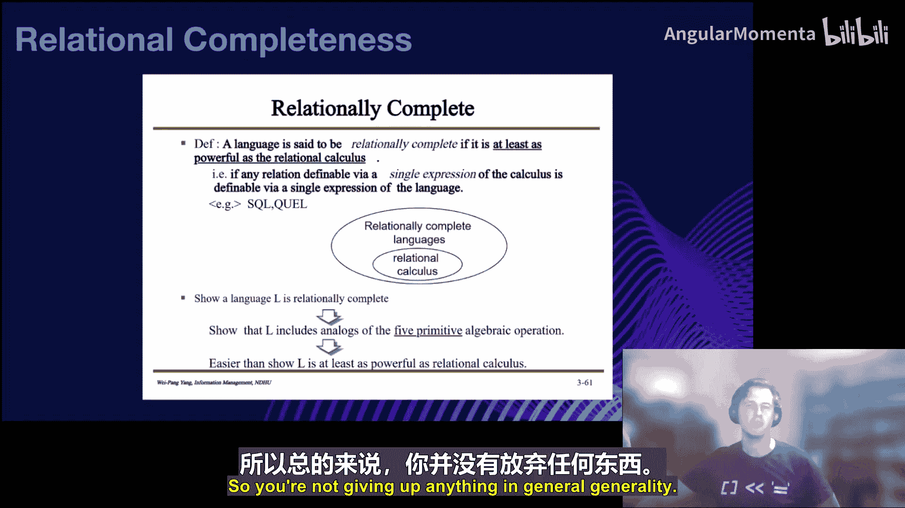

Right， then the sort of next。Thing that we dislike about SQL is that the the。

Syntax is very patched and it's overloaded particularly in the select clauses you know if you have a sum for example or some sort of aggregation and in if it's in a window function then it's you know you'd maintain the same set of rows but if it's in a if there's a group by later on then it actually causes a reduction so it's very overloaded syntax and it just also just looks like really old and antiquated like cobalt from the 1970s but I think much。

😊，More so substantial prison is that it's not composable and you know someone might myself kind say no it's not true look here for example。

 this example here you can compose SQL because have nested from statements but it's not composable in the same way as other languages are there's no kind of good abstractions and a tweet that I saw I think it really kind of captured it nicely it's in SQL queries are the single use plastics of the code world and in my practical experience people copy and paste queries and try to。

😊，嗯。Yeah modify them there are no libraries of SQL code or SQL functions that lead to like reusability with hardened test that code。

also SQL is not regular and in the sort of syntax sense and you know it's very difficult to learn so Julia Evans gave this talk at St loop in 2023 and sort of describing experience with a colleague and saying that how difficult SQL is to learn and for us who've been using it for a long time it kind of seems puzzling at first like what's difficult about SQL but actually its because it has these clauses rather than you know like a sort of regular syntax there you have to know that they have to go in a certain order and know we have here we have a aware and having for both of them actually do a filtering operation but you need to have different keywords in different places and then when a window function gets even worse and you know you add qualify and if you want to do some petitioning in the window function that you need petition by which actually is like a group bias so for a beginner it's really difficult。

Cult to learn and。And' talk about the all the intricacies。

And just a heararse of conclusion was that you know， you also kind of want to have a。

 when you're reading a program or sort of a query， you kind of want a chronological story so like a logical flow from from top to bottom。

 you know doesn't mean that it has to be executed that way。

 but at least for the human sort logically you kind of want a top to bottom flow。

Then we also have the issue of dialect so when I first started working in the financial markets。

 you know I was at a secret server shop and then I worked for a big hedge fund in。

London we use Oracle and then yeah it's finally you just had one kind of particular syntax to learn you could get good at that and become productive。

 but you know these days as data engineers or data scientists we often have to pull data from many different sources and then you really get tripped up with all the different dialects because what you're trying to do on snowflake doesn't work on your local Postgres database and so it's becoming a real hindrance for the working data scientist and data engineer。

And then last we have this issue of anti semantics， which Victor talked about in。

his talk which I think is also a big issue I mean that's not something we've actually looked at much with prequel。

 but we've had some discussions with Manu Riga from the National of Singapore and they're doing some work that you for publications seen also on differential testing of different database systems and they've also documented many of these sort of inconsistencies across different dialects and different behaviors much like。

😊，Victor Lyce documented and so I think their call for a universal intermediate representation is a really great one and I mean I already had this slide which I put together on you know where I think sort of prequel could fit in as like you know a front end query language or like sort of human front end and text representation which then like serializes to substrate which gets sent to。

嗯。To your your query execution engine and then I was very happy to see you know Victor Dellta kind of had the death proposal for saying IR and pre this I think it's。

Yeah， very similar vision and I yeah， I really like。Whidom much luck and I'll be watching closely2。

Yeah， what they produce there and just to say that that's something that we're not looking to solve with preco。

 we really just looking at the at the syntax level and making it a productive language for。

For working practitioners。Right。All right， so let's look at them some alternative query languages。So。

Yeah， Thomas presented San QL and you know， if you just look at this example code snippet。

 it's actually very similar to what you would get in precol。😊。

And so I've just taken your day that snippet and rewritten it in prequeol and you you kind of put that to our compiler。

 this would be the SQel that you produce and it's kind of quite straightforward。But you know。

 that's certainly not。Yeah but so I think just to say that while you know preco we've had some good uptake。

 but I think before that's already like you know there are a lot of alternative query builders I guess they would be called there haven't really been languages and。

So I think they all kind of follow the same fluent API or this pipeline flow where you know you start with your set of records or your tables and you。

Yeah， like you know， you build up your query from there and I think just one you know。

 drawback with these has been so far that these are query builders that are sort of trapped。😊。

In whatever language community they've been。They've been built in so well。

I think they all have a very similar flow it's yeah they in a particular language。

 so I think what we're aiming to do with preco is to create a。

A common language that can be could be used in all of those and then。You know。

 like leads to a yeah get serialized in a common way to the database I' here just some more examples of Python。

Ector like an here and C shops。 I think the this is already the way most or a lot of。

SQL code is written actually in practice and in industry through these query builder front ends so Ibis is quite is an interesting one because that takes the pandas API。

And then actually also serializes through different backends so it's very similar to SQL to prequeL and using the SQL Gt library and I think it's a great project is myies of criticism there is that again it's in Python so people in other languages are kind of suck so I think what we aiming to do with prequeol is make it more general。

As a general language that can work across different languages and another interesting one is these computational expressions in FSP and I hope to maybe come back to that later。

 which is computational expressions is actually just clever term that F sharpP has for MonAs so that people can write Monads and use them without being scaled away by the N word。

All right， so coming on to pipeline queries and why is everyone opting for these pipeline queries in different languages and I think from my perspective。

 a couple of not key properties are these one thing is the the prefix property as Thomas Neman also mentioned in that any。

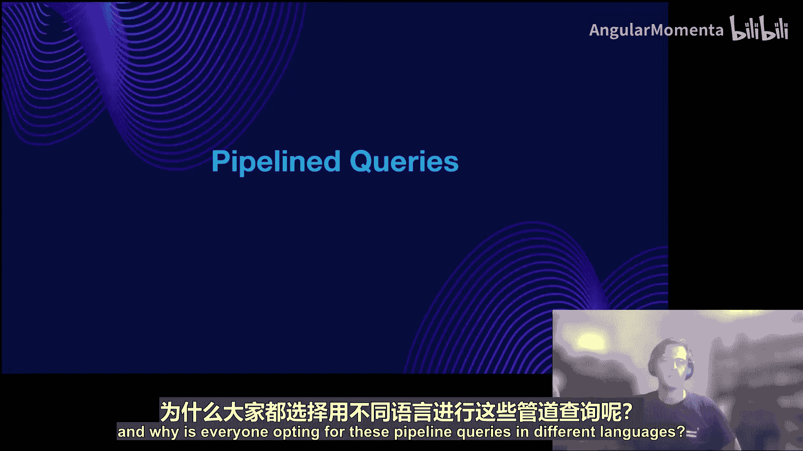

Yeah， so subquery from the beginning of the query is always a valid query in itself。

 then by starting with the tables at first you you get the schema information up front so when you're writing code and your IDE you know that also allows you to have auto completions and type information type checking and you have I think another keyio is you have local context so that each。

😊，step in the pipeline just transforms the pipeline up to that point。

 so as a human kind of reading it you only need。Keep track of the current context of where you are in the pipeline which gives you more readability and then I think for me the key part is composability and extensibility because I think that's how we built abstractions and in any other programming language which has kind of been missing in the data world。

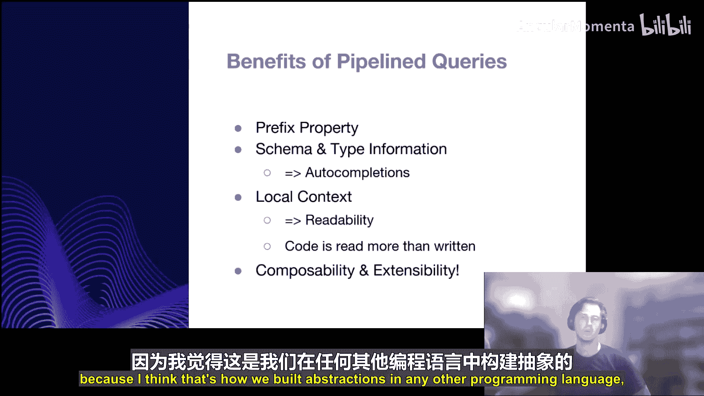

All right， so with that preamble， now let's see what have we done with。

PQL and as Omar stated in the Y， you come with the king。

 you best not miss and we're quite aware that you know sequel's been around for a long time。

 but so far we've had some really good reception and uptake from people using prequels and so I think been encouraged to keep going。

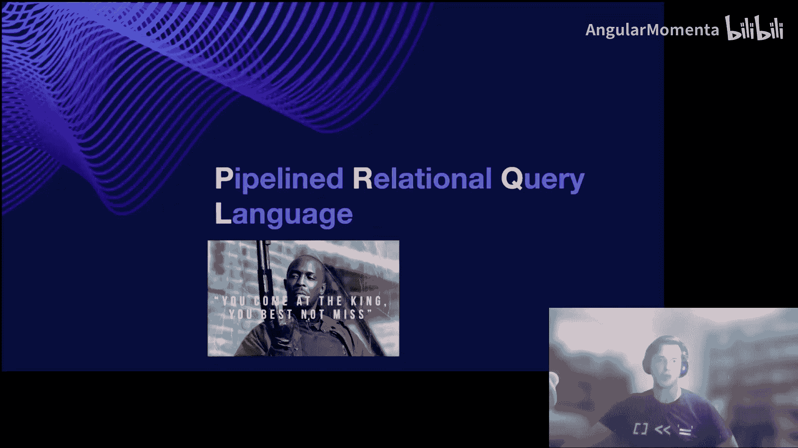

And yeah， let's let me so present you what we've got。 So the P and people stands for pipeline and。

So the main aspect is that we have a pipeline which we have two ways that you can construct your pipeline。

 one using the sort of Uni pipe symbol， so if you want to do kind of one liners you can write your pipeline like there where we start from the left you know pull records from the table A。

 do some sort of filtering operation and then some selection。

But most of the time we actually just you know， really write more complex queries。

 We also allow the new line character as。You know as a pipe symbol。

 so most queries kind of look like this and then you get this top to bottom floor like like Julia Evans kind of pointed out。

 which kind of makes it yeah just a lot easier for human to read kind of。

In the way same way English reads。I think most of this is fairly straightforward。

 so I'm just going to like kind of。Point out some key aspects。

 the first things that we have transforms or or functions。 So you know。

 so that makes the the language like regular in that。

knowIf you have a filter expression here at the top but then one foot or down after the group I in both cases。

 you know you can use filter， there's another distinction between where and having and。

Yeah you can also like as long as the the columns of are compatible you can move lines around you can comment out lines it's really just yeah much more flexible for pathway work then the next aspect we've focused on is trying to make。

Each so primitive operator orthogonal so if you look at the group by here which I highlighted is that group by operation petitions the data set into groups and then it takes as a second argument a another pipeline and then you can really you can do quite a lot of things so。

If you want to do just the traditional SQL group by you can use aggregate and aggregate is a reduction that will always kind of reduce whatever it's given in its scope to a single row。

 but as you'll see later on we can actually also do other things in the group and you can do general。

rerenal transformation as well as the sort of split about apply combined pattern that you often see in data science。

And so because of the orthogonality， we get some nice invari， so select you know。

 which is like a map operation never changes the number of rows you derive at only adds columns fill to reduce the number of rows the group part data set aggregate is a reduction and always reduces a single row and。

😊，Yeah we see there so you know I think you get some nice invariance and with that we also we get very few primitives so in fact we only have these sort 12 primitive operators from which the rest of the language is constructed and built up and you know that makes it easy to learn and also easy to retain that you don't have to go to the。

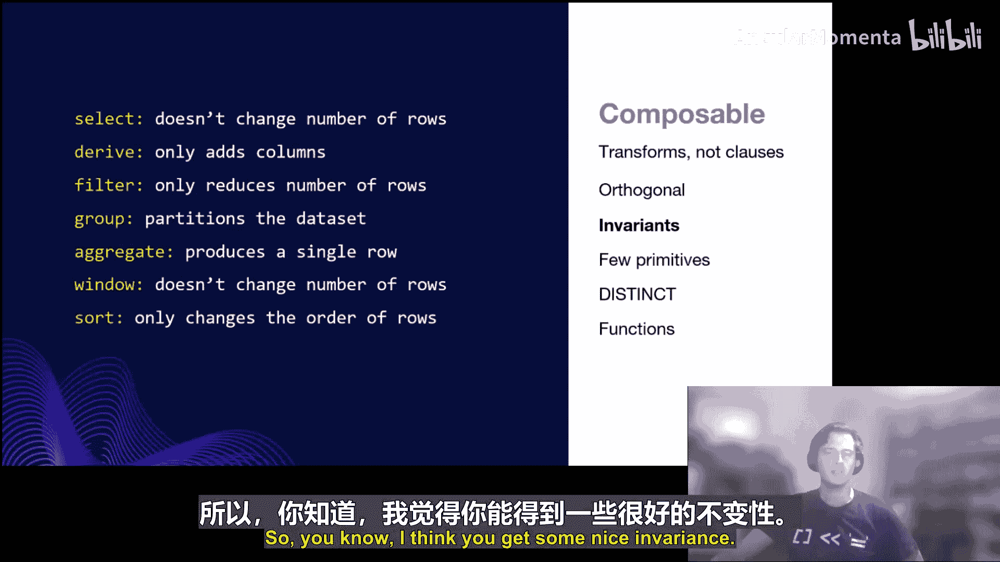

The documentation all the time to look at how this actual how is a particular being implemented or yeah I got to the parameters so its kind of really makes the productive for practitioners。

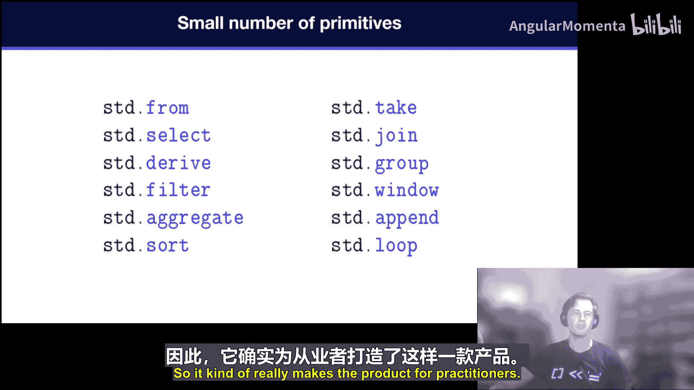

And so one small point on that， as you said like it's kind of like a data frame API and I thought it's a really interesting paper here towards scalable data frame systems by。

Was it Devon Peterson and did his PhD theses on really looking at all the data frame operations and sort documented there's over 600 functions that are in data frame algebra's。

But you can actually reduce them down to these 15 operations。And then if you look at them， you know。

 which ones relate to。It's a relational algebra in which it to deal with the columns you know you get this split here and you know I think that's also we cover of all of the and those so it's just another kind of yeah I think that you know we get a lot of generality with what recallco implements。

Right then next is really I think the main poetry that's composable so if you were paying attention during that list you would have seen that there's no distinct keyword in prequelL so how do we accomplish that well if you think about it what logically what is a distinct operations you want to group by certain fields or attributes and then take one per group so in prequeL you can write at the following and that will produce a distinct and in fact actually I got the query at the bottom by putting the query at top into compiler。

And then I think last but not least the key takeaway is really having higher order functions and so we have a sort of various of ML functional style syntax and so things up here I define a take smallest function which takes the first parameter of number of items and then a column to sort sort by and then as a last ir relation and that's something worth pointing out that。

In prequeol we've opted to have the input relation always as the last argument and that was for allowing carrying so carrying in the functional so sensor partial application so you can carry on the early arguments then still kind of get your main pipeline input as your last argument so with that you have this function here we can say on a data set of tracks take this smallest three bybytes and obviously that sort of translates to this so there's nothing much gained but then if the power comes in with the orthogonity like I mentioned before so if you're doing now if you wanted to find the smallest three tracks by like milliseconds on a different column now in and per album then you can just take that same function and put it in style a group clause and you can go and take that right now into the online。

ground and that will work and I challenge you when I give these talks in person and only challenge people to come up with the equivalent SQL query and it's obviously doable but it's not straightforward。

And yeah another key aspect which is our loop construct which is really for recursive CTEs and we obviously that you know we prequel transpiles to SQL so you can't do anything that you can't already do in SQL but I think for example recursive CTEs are in my experience dealing with other people it's quite poorly understood and they're really also not really recursive so it's actually more of an in iteration or loop construct and which is kind of why we opt for the name loop in preQL and you know here's a sort of some Python code that demonstrates the。

What illustrates the what are actually the of semantics of acursive CTEs and now just to give you a precal example。

 if you wanted to build up some sort of date spine from today until April fools。

 you know here's a simple。Yeah， preque with the loop construct and。

They will you know give you these dates here and if you want to look at the the resulting SQL period this is what it compiles to in our online compiler so again it's not。

And有。But introducing anything new， but I think by making the syntax simpler， I think you know。

 it actually makes it accessible to more people that perhaps otherwise would shy away from using this in practice。

😊，And last and then next we also have some ergonomics and I think you know these again seem like small bits but。

And maybe it's like in relationships sometimes the small things are the big things。

 so I think these are things that people really appreciate in this sort day to day work so we have dedicated syntax for date literals we have string interpolation syntax for these F strings here where because a lot of what programming do is know construct long strings from smaller strings we have the。

This null coescing operator， which is also taken from Typescript。

 because obviously be encouraging a lot of nulls in our work and you want to be able to easily substitute those。

We can easily comment outlines or。Also。Yeah in in numer numbers when you're dealing with large amounts。

 you know you can group your digits with an underscore which can prevent errors like confusing 8 billion with 8 million in kind of critical government operations or things like that and I think these are the all kind of microfeature that we've learned from other languages over the last。

40 or 50 years in programming language development。

 which would just be unfeasible to keep adding to all the SQL dialects consistently across the board。

Then another last key aspect is really testability and because you can define functions in precal for transformations。

 so when you want to test out things like taking our modest example example。

 it's easy to hear in our first line I。Kin I just introduce them like literals。

 and then I can test my my query on that and。See that it's working as expectedly， whereas in SQL。

 you actually need to spin up a test database with the correct tables and in place， et cetera。

 which actually makes testing very hard and practice if not infeasible。

Last we've been also try to solve the SQL dialects problems so prequecal compiles to different dialects。

 you know there's some that are pretty well supported others that。

Aren't so well supported and you know yeah I think in practice this it works pretty well I mean as sort of Victor pointed out in his talk and obviously we can't do anything about the difference in the underlying semantics so it still。

Yeah， that of bybyware kind of you。You would do well to inspect the resulting sequel that you are getting the behavior that you want。

 but I think it does make your life a lot easier。All right。

 so with that sort a tool let's look at some examples。

 which I think also highlights some fewbits so first if you go to our online playground there's a well documented example there。

 which you can probably just。You can teach yourself prechol from that in probably five to 1 minutes。

And it's also easy to use prequel in Python or sort of Jupyter notebooks， and you just install pi。

 PRQL and then start compiling queries to Big queries to SQL there。But yeah， next I've got some。

Examples that I've prepared here， so I think this one is interesting one that sort of highlights just two sort of aspects。

 so here defined two functions one is percent range function which uses min and max aggregations to look in know where do you rank in a。

In a range and then also a this one this add cumulative sum function。

 which takes an existing relation and adds an additional column。 So if you look at the query at the。

The bottom here， I apply the percent range。Fun to the total column and then I just do some rounding to sort of display nicer on the screen。

 but the interesting thing with people is that our aggregations kind of fill up to the surrounding scope so because this is in the global scope these。

Window aggregations will be applied globally， whereas this add cu sum function apply inside the group and then it will do the cumulative sum per customer ID I think so。

That will become clear and I'll show you the output。 So this is the sequel that that generates。

 So again， you can see here these。For the percentage rank numbers there these are in the global。

 whereas for this cumulative sum that applies to the partition。If I just look at the output set here。

 you'll see that。Yeah， if we look at this percentnta column， it's sort of applied globally。

 whereas the sum you can see that it accumulates per customer and then resets at the next customer。

Yeah， I think if you just wanted to go back here， just an example， just shows you， you know。

 how you can easily build abstracts to do some real kind of work。

Then next I have a sessionize function which I think for example。

 also like Jeff Sch in his pipeline SQL kind of showed that it's a common operation in sort of data analytics that you want to sessionize your user events and。

AndYeah I'm not going to show you that so full definition of that here。

 but just to say that you know given high order functions。

 we can apply sessionize and tell it by what custom ID kind of want to group and。

What gap you want to have the maximum gap that we allowed between events to still classify things as the same session and you have。

givingiving you access to the same sort of abstraction that you have in any other programming language where I can write this function once and you can reuse it。

In other places。RightNext I just have an example of some JON。

 so I'd like remember going to have any sort of built in JON support in preco。

 but we have this little escape patch built in， which we call S strings or for sQL strings and。

You know， you can easily。Theef fine functions which can get substituted with sort of raw SQL strings。

 so if your target SQL dialect supports you know JSON functions it's easy to wrap them in prequel function and then expose them here so here just be able to build up like a JSON literal and then just apply some examples here and run that inductT which you can see that I'll put it here at the bottom。

Al right， so it's kind of like a bit of a whirlwin tour of preco now I wanted to to speak about some ongoing and future work。

So coming back to the Peterson paper earlier and talking about the data frame API is one thing that we've also noticed in the user feedback that we've been getting is that with a data frame type API。

Users expect audit tables so yeahs something because data frames generally work on like in memory data sets they have an implicit order which use often exploit in their work and pre there's also a bit of an expectation of that but obviously that is unsupported inQL or in SQL because it talks about unaued data sets so。

😊，You have done some work on there， but that is a we do have a couple of open issues on our reer around that and I just want to point out it is a paper that I've found recently on。

You'llL integratequeries or link queue， which yet derives。

Or little lot of work on how you can implement this consistently across different sQL dialects so you know their first。

Also describe your problem。And then I think you proposed some solutions。

 so I haven't gone through this in detail yet， but that's， for example。

 a an issue that we're currently trying to address with how to deal with these order semantics in a sort of pipeline。

Flow。Yeah， so then mere just a little of teaser then some sort of missing features that were working at the moment。

 So at the moment we we started with this yeah， sort of an agile approach， you know。

 getting working code quickly and。But in order to make people responsive， we opted not to。

look at the target schema of where you're compiling to but obviously we didn as a result we are missing out on these sort of LSP completions and S awareness and the type checking so I think that is something if you want to add there is a fledgling module system but also of packaging wing system yet for distribution。

I'll come back to next and then the next few points I actually got to additional slides so I'll come to those so the one is materialization annotations。

That because of this functional flow， like if you look at things like DBT or airflow practice people have these dags of data transformations and at the moment the people compile body you can define the functions it inlines them all and produces one large query at the end and I think a third Lloyd table on the melllo folk saying it also they were looking at adding annotations for materializations and I think that's something we also kind of want that you can put in some inlining boundary so at some point they look actually materializes in the view and then go to the view rather than producing gigantic query。

😊，And I'd really like to see an option type， you know， as in my bio。

 like left joins I think have bitten me more than enough and you know if you have two tables which have non nullable field。

😊，But after you join， you know obviously the owner left join。

 then the fields on the right hand side actually now are nullable。

 so I think if you had like an option type like in rust and you can track the nullability and then the compile I could tell you like if you're doing a particular operation it should be where these fields coming from the right on the right join there could be null and the null needs to be handled appropriately。

You'd also really like to see other backends so you we compiled to SQ at the moment but I think actually the it's a lot more general so you you get compile to data frames aimLang which is in power query or power BI Microsoft is actually very nice system that deserves to be better known and then I'll come to the last point if I have time this is a universal BL yeah so that's here。

If you look at。Yeah， so general like Moad or like FSp code heres an example by Bartosh Milby and he's to doing some operations on his file system and it's on a blog post and if you look at that it really reads very much like preque code and similar in linkQ which is a great system but it's kind of trapped in this C sharpharp or dotnet ecosystem which also has all these same sort of primitives that you can apply to in memoryory objects and。

So yeah， I think a pipeline language like Precoll or SanQL could really be much more general and actually be used as a DSL for the sort of list or sequence Monad and just to maybe some sort of related work and Simon Peyton Jones on Haskell。

 I mean've done his work on list comprehensions。And yeah。

 when this is sort of but hand waving at the ends of some some ideas。

 just serious notion of productive work here there。

 but I also believe that the the universality of the relational model and。😊，The yeah the。

So this monad kind of flow really comes down to the fact that in all languages we really structure all our data in product types and perhaps this is a an obvious point。

 but you know it's whether it's in object oriented or rust or sQL we generally have these product types of records。

 couples，Yeah， whatever youstruct whatever you want to call them。

 but that's fundamentally how we structure data， so whether that's you know duably persisted in a database or we have these objects in your memory。

 you have collections of records and it would be nice to just have one DSL that we can apply to efficiently work with with those collections wherever you find them。

Right， so。With that sort of where relief can I think prequel is or something like it is would be a great addition to how we work with data。

 where can you use prequeol today and I think I'm kind of over time so I'm going to just rush through these very quickly。

😊。

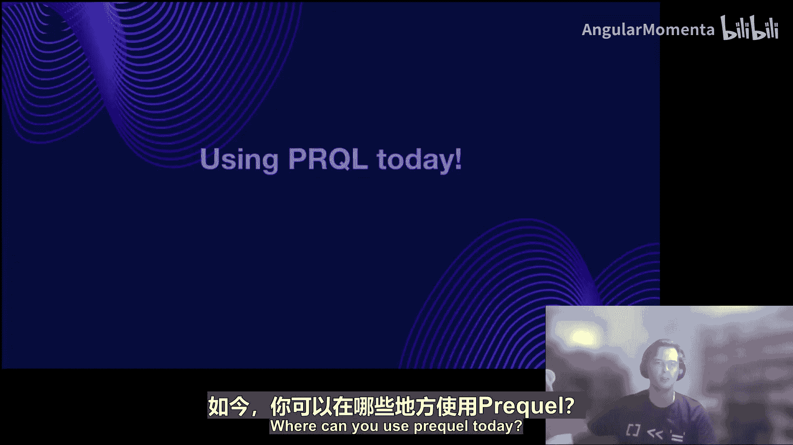

So first of all， actually we have this online playground where you can work with it right in your browser and try it out and look at what prel it compiles to。

Yeah just as a link， then database， weve already seen increasing adoption of prelL in a number of databases to CAS DDB。

 PostGre also has an extension。You know we have a a VS code extension。

 there's a number of language bindings and we also have a CLI tool that you can use on the command line and then pipe2 whatever。

Do I tool you have a hyper deduct or Postgres or yeah。

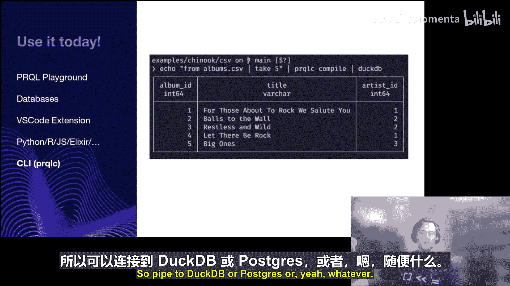

And last is a little bit about the project and this is a bit of a dated slide but know the red line is pretty cool we've seen some rapid adoption not adoption but stars are on a Giub repo in a way there is a bit of a vanity metric but because we have open source project we don't track actually other usage so this the best indication we have it's fully open source Apache two license it's completely volunteer driven no one gets paid to work on this all the work has been done but people who've got full-time jobs elsewhere and we're just working on sparetime in the evenings or on weekends and were very serious serious about not monetizing。

You know， our community we've got over 10，000 stars， you， 74 contributors。

 both of main commits or maintainers that globally distributed。And。

You a roadmap of more features and yeah we were looking for more contributors。

 particularly like compiler developers that would love to have more people come on board but not just compiler developers I think also with the packaging system and it' various features to add to the。

To the web interface， so I think your any contribution as well can we really kind of love for anyone to get involved and make this something that will benefit。

Everyone。🎼And with that， you hear some final links。 But I think that's my story。 Thank you very much。

 So yeah， and any questions。😊，I have a question。So。With prepool。

 is there always a simple one to one translation when you're transpiring to SQL or are there certain situations where maybe there's multiple ways to translate？

The prequel query into SQL and how do you choose which way to translate it？All right， well。

 certainly obviously we always translate it in one way and we make heavy use of CTEs。

But that's why I kind of really try to highlight the language like I wouldn't you know I don't think that our particular compiler know implementation I mean I think it's great but it's not the be all in end all I mean I think I dearly would like to see this IR format you know a same IR or substrate or something really but it's I think the interesting question use is is is there a back translation that's a question I get a lot so at the moment we don't have a good answer for that so you know I think with the Google Piy syntax talk you know Jeffrey pointed out that that there are a lot of existing SQL code basis。

And we really kind of need something to unram people and to allow you to import your SQL query。

 I think the best be at there at the moment I'm aware of was SQL Gts from Ibis that I mentioned you know De and I've can translate between I think over 20 dialects at the moment and I've had some talks with Toby Mao there with trying to like link in PRQL into their IR and then I think we would have a two way system from going from precol to other dialects and also actually coming back to precol from there but yeah that's。

T we haven at the moment， if anyone would love to see a contribution on that front。Thanks。

 so if there are any questions in the chat all my screens are taken up here I can't see if someone could just maybe point yeah there is a question someone says。

 why no support for NC ANSI？Oh there issy， it's actually I think a default dialect if you don't specify it actually picks Ans。

 sorry I'm slipped it out of my slide， but yeah a good question but we do support Ans SQL。😊，嗯你。

Any other questions？Feel free to unmute if you have any questions in the Zoom。Otherwise。

 in the absence of question， maybe Sam， can you watch out for the question that I can just then maybe just show you some of the interactive what you you can do in the。

And。Oh， there's one question。 Do you expect to support Spock。

I'm not sure if this is Sp Spk UL or Sp SQL。 I assume Sp UL。

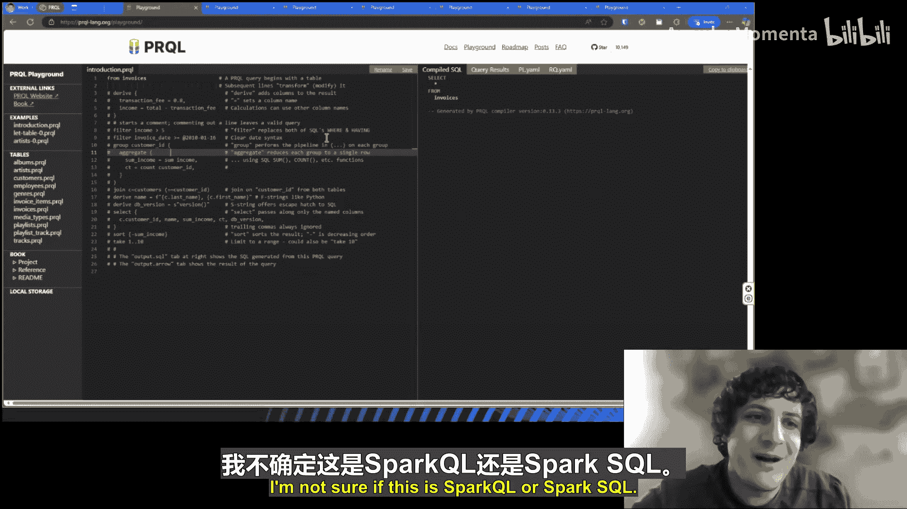

That's not something I've looked at。I don't know how different this SQL dialect is。It。Yeah， I think。

There would really be sort of up to a user contribution。

 like if a particular team or someone would want to see it。

 I mean if Data Bricks wants to contact us and something fantastic。

I think short of that at the moment。Yeah， I think most of the maintainers kind of have a big list of things you want to get done。

 so it's getting me there， but yeah， thinking you know， it's open source， please submit to PR。Yeah。

 there's another question in the zoom， have you given any photospatial databases like postGIS and the geometric predicates and functions？

No， I haven't given it for this now。😔，not something we've looked at Im with the that e stringing functionality I' showed you I think it would be probably easy enough to wrap existing functions and in whatever system you're using so if using postGIS to expose that easily but no it's not something the team has looked at。

那他肯么跟你责任。Thanks， okay。嗯。Then I们。

Maybe if I serve like more minutes， I' going to show you in the online。

It obviously didn't question this way， but I think what's quite nice and which shows the sort of pipeline flow and that's a prefixed property is that here I have this big query and I've most commented art and if use uncommon logical lines you can see on the right hand side the of SQL transforming as you go along。

We have a filter here， I filter。And。At a join。And I think in practical works its essays like before you know。

 I think in practice a lot of people copy and paste SQL code。

 but it's not easy with SQL because there's all this this global sort of scope of the statements so difficult to move things around where you know here like you can quite easily pick things up and reorder them。

E cetera， so I think it's just， yeah， it also just illustrates the。

Applic for practical interactive work where you try to work with a data set and you want to see okay。

😊，And maybe have a。Take 10 on there to make the quick and then you kind of want see go but take that off how long does it take。

Yeah， it's just in practice actually， this seems out to be very kind of useful to be able to work and disable or enable certain lines at different times。

I have prepared a few。Examples here， that was I mentioned。 But yeah。

 I think they're probably covered in the。In the presentation， so look I think if there's no more。

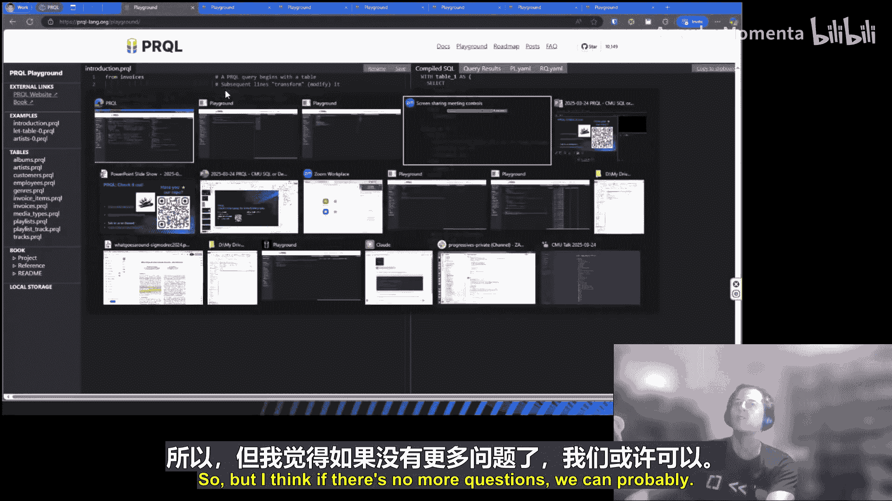

Questions， we can probably。Over here， but I think obviously anyone that's interested please reach out and particularly on the I think that at the end the sort of。

Open ended work， which you know， could we make this a like a sort of MonA DSL for working with collections of objects or data and more more generally I'd love to chat to more people about that as to what they think。

We have another question in the chat。How about pre coolol versus as Google's PiSQL？

Like how would you compare them？So。I think。😊，Yeah， I think the pipe SQL is great and I think Jeff makes this point strongly that you want to extend existing SQL。

😊，And I think you I try to argue that I think just some of the small economics that we。😊。

That we have。Like just just slightly nicer。 But I think， you know， some of the syntax， I mean。

 it really。Yeah， it's a bit of it's in the eye of the beholder look I think it's worthwhile know that it's I for us。

 but I can understand if people want to stick with that。

 I think one issue they also is that again that's things of in Google's ecosystem and how portable is that really then to other to other dialects and are they going to be supported the same way so I think ultimately I think something like having this intermediate representation like say IR or substrate is probably still kind of the way to go and then you could probably have pick different frontends you know if the Google pipes andt works for you then you can use that if you like say QL or use that or if you like prequel and you can use prequet。

😊，Yeah， that would be the the of dream。Cool I don't think we have any more questions let's wait sorry there's another question what kind of changes do you expect to add in the future this looks pretty mature。

Yeah， so I mentioned some I don't know if I should go back to these。So the module system。

 I didn't show it on purpose because I think the syntax might still change a bit。

 but know that we do have the basis of the module system the type system know that's。Yeah。

 we're looking at。Hormalizing that you know we had some chats with that also with the N US group different backends。

 I think one reason it's quite keen to see the different backends implemented because then we could really test how portable some of these ideas are so at the moment I feel like it probably would port well to those APIs but like things like loop for example。

 yeah I don't know I think sometimes it's just it might be easy to overlook something so I think implementing more more backends kind of what it just test out where in practice that's really like a realizable version and then yeah more tests obviously having more people use it we have yeah quite a number of open issues that。

😊，Yeah， that。Obviously seen need to be fixed some bugs and you know the occasional like a regression。

 etctera， so it's。Yeah I think there's still a lot of work to do so if anyone you have contribution then also if anyone wanted to sponsor like become new or like kind of any VCs to look at some offshoots of this I have a number of ideas I would love to chat to people at the moment I still applying my trade El but I'm quite passionate about this project we actually know see it get wide adoption and help things build out with it。

Please do get in touch if you all have any ideas。But there was another heard， I mean， theres another。

我 shouldn do嗯。Different streams that come that's kind of like a join I think sure exactly understand the question I think I mean it's one I think it would have great applications for kind of streaming systems like Flink or those things you know like I mean example on the Microsoft side they got cuto which is very similar or at least of you know semantically well there's is pipeline flow so I think streams it it would be quite a good application also sort of Piial。

😊。

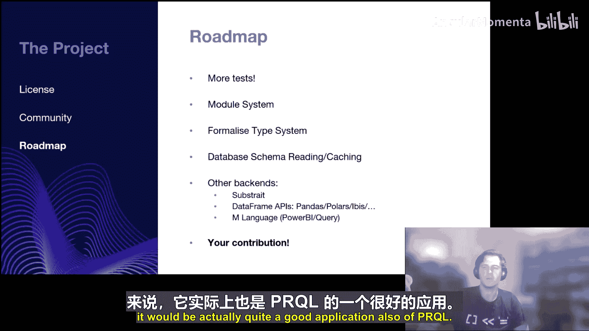