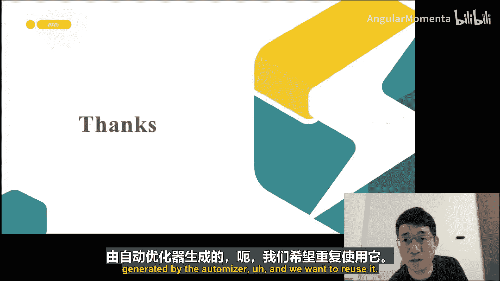

# 【卡内基梅隆大学】SQL 或死亡？系列研讨会 ｜ SQL or Death？ Seminar Series (Spring 2025) p07 07 StarRocks 查询优化器（康凯森） -BV1FkisBtE97_p7-

有的。🎼why I hate it。Sequel or death Yo son， what are you going to choose？Yo check it。

 this seminar is filmed at Carnegie Mellon University thanks a lot， Google。

🎼Hi okay， let's get started。 It's a huge pleasure to have Kaishian Kang from Star Rucks tell us about who Kaishhen is a team lead on the query engine team and he's gonna tell us about the StarRucks queryry optimizer Andy is on the phone I think he'll join in and out so apologies that he couldn't be here but Kaishhen we are super excited that you taking the time to talk to the database group and of course thank you to everyone joining us over Zoom we will post this on on the YouTube channel that Andy had set up after the call but Kaishhen。

 if you think you say something that you wanted to delete let us know so feel free to speak your mind in this call and really appreciate you I know you're in Singapore so it's really late thanks for bearing with us and the floor is yours。

😊，嗯， ok thankk you。Good afternoon and everyone。 My name is Ka Sengkang。 Thank you very much， Andy。

 for inviting me to speak here。😊，Today， I'm very pleased to share insightense into Star Rose Korea autoizer。

😊，In the past 10 years， I have been engaged in O database related work with active contributions to Aba kidding。

 Aba stories and Sa open source communities。Over the last five years。

 and Tim and Anne have built the Cys vector exclude engine and Cys preor from scratch。

Making Cyos an extremely fast creation。Today， I will share Stars pre auto from four parts。 First。

 we will begin with the overview of Star and Ss query autoer。 Second。

 I will introduce the three representative organizations of Cy pre。 Third。

 I will introduce the common challenges of CPU and Cy solutions。Finally。

 I will share some insights and lessons learned from our events in building the St query Auto。

To begin， allow me to provide a conceptual overview of saless development journey。

Over the past five years， we have launched three major versions。

Ss version one built an extremely fast or base， leveragingver an vectorized extreme engine and cost base atr。

Ss went too evolved into a helpful performance uniformifiedly allowed database。

 introduced features like the primary key model， De analytics and comprehensive query organizations。

😊，Sros version 3， builtan openly calls architecture driven by storage and computer separation materials and advanced analytics。

This diagram illustrates the overall architecture of star， which include two components。

 front end and computer node。Fron N is responsible for managing memory metada。

 query organization and query schedule。 It is implementing Java Comp how to data catch from the and query execution。

 It is implementingency plus plus。This diagram shows the overall architecture of styles or Me。

 The overall framework of styles or Me is based on the cascades and compare papers。

The manualmo data structure， search， framework， rule framework and prop in force of stars on measure are consistent with the cacades。

This diagram shows a more detailed opposition or process of stars or measure。

And also reflects several difference with the cascade framework。

 Cy Auto use smart organization strategy， including logical writer， cost space organization。

 physical rer and feedback tool。Specifically， the logical red phase forms of triary transformation transformations apply a suite of common red rules。

 such as subary right and common table expression in line。

The cost based organization phase leverages the Cas memo structure and include important cost base rules include joining。

 joint distribution strategy selection and agreg， distribution strategy selection and material rewrite。

The output of the cost based organization phase is a distributed physical tree。 subsequently。

 the physical rate phase excludes a few physical rights and do not affect the cost。

Including including global di right， which will be discussed in detail today and common is fashion reuse。

The last feedback toolning is a new feature in 2024， which will be shared later。

 feedback toolning address the exclusion plan based on the feedback information and run time。Now。

 we have a general understanding of sorrow of。 Let's take a deep look at it。 I will focus on cool。

 I will focus on key。😊，On two key areas， first， three representative Op and second。

 thoroughs approaches to addressing common cost as estimation challenges。

The three representative organization will apply are multi left join colcate。

 global data Or and partition material Uni right。The three solutions to cause estimation problem include query feedback。

 adapt execution and Ci plan management。Let's first look at the mountain left join Colloate。

In distributed database， the distributed execution strategy of join include shuffle join。

 broadcast join。Replication join and Col join Sle join involves redistriioned data of both tables to the same external node based on join key。

 which needs network data transmission and sharp join involves redisted data of both tables to the same Ex node based on the join key。

 which needs network data transmission， col join in contrast。

 leveraging the pro distribution data where both table are already on the same same node according to the join key。

 enabling the local join execution without network data transmission。In Star row。

 the distribution strategy for join operation is determined by the distribution property enforcer On the left。

 we can see an example of shuffle drone enforcer， the join operator requires a produce of h E column and h B column since T1 and T2 are normal tables that do not inherent satisfy these distribution requirements。

Shuffle exchange operators are enforced on the scanty1 and scan2 operators。On the right。

 we have an example of co join in force。 The join operator still requires the distribution property H a column and H B column。

However， in this case， T 1 and T2 are co tables per distributed according to the H E column and HB column。

Consequentlysum， the required property are already satisfied。

 eliminating the need for shutuffle exchange， operators enabling direct local joint execution。

Now best exam is a Mar injo collection question， do you have a notion of a broadcast join or is that covered by what you have here？

哦呃。Broadcast join is more easier so this case will only compare the shuffle join and the col join Got it Okay。

 but the optimizer will consider a broadcast join in that last phase where it looks like you were thinking about the impact of distributed execution。

 right？Yes， of course in we will we will boost in styles of math。

 We will we will all consider the shle join join and co join Okay great。 thank you。嗯， thank you。

AndNow let's examine the multi inner join col as illustrated in the diagram after the T1 and T2 and T3 are coed based on their respective bared columns。

 the coled process for both two table and multi table joins become identical enabled in the local and modern direct local join execution。

 this is because after inner join of the T1 and T2。

 the physical distribution of inner join join result is exactly as the same as the T1 or T2。

Before introducing a multi left join co locatecate。

 it's first confirm the co difference between the left join and inner join。

 we all know that the left join preserves all row from the left table and for any row in the left table that the corresponding match in the red table。

 the corresponding columns in the red table are popular with nu values。And shown in the diagram。

 the second row in the column C 1 of table T 2 is assign a nu value。Consequently。

 when multi when multi table left join between property enforce is applied。

 the C1 column of T2 table after the left join operators differs from the C 1 column of original T2 table。

 the required between properties unable to satisfy。Which prevents the execution of Col join。However。

 let's analyze is further to see if this left join， left join circle really cannot do correctly join。

First， we could observe the table on the left， which shows the real results of the left join circle。

 Next， examine the diagram on the right and consider whether the nu value in the C1 column and T 2 would yield different results between the col join and shuffle join。

 We understand that non value compared to any value will always evaluate none。 consequly。

 regardless of the how nu value in C1 column and T 2 and their corresponding C1 column and T 3 values are distributed。

 whether they reside on same extreme node or not The drawn result remains none。Therefore。

 we can ensure that the distribution of nu values does not expand the feasibility of color join between T 2 and T3。

Given the non values in T 2 and T 3， scientists the qualitative requirements。

T 2 and T 3 can indeed be joined。So。In order to make a district property enforce support this case。

 Sa Ras introduce the non relax and non strict mode in the district property。

For the non rejecting join on predict， Sas will generate the nonre mode and ignore non value when comparing properties。

Conversely， for non equal joins， sas generate a non strict model。

 ensuring the non value are considered when comparing properties。

With the with the implementation of non relax and non strict mode。

 we can now examine the multi left joint enforcement process。

 since the parent requires requires harsh。C 1 column T2 a of T 2 with the non relax mode and child also produce Hai C 1 column T 2 with nonre mode。

 So it sat the distribution property requirement of the pattern node during enforcement。

 thereby enabling the collective join。你没调。Kaison there's a question。

 maybe I'll ask before you jump to the other part Andre asks how do you manage the explosion in the combinations you have to cover because of a shuffle join so if you have 100 data nodes。

 you have to consider like this 100 by 100 combination for that second stage so do you have a strategy for dealing with that？

呃呃Yes yes， yes， and。嗯。AndAnd and for if， if the join， if。

 if the if the join node is is is is is very a lot。 and in in the。

In in the join process and we will only to take the the the such as top top 1 or the top 20 the the the join join combination and then combine the distributor property in So we we this way we could control the join combination number and how do you pick that top。

10 or 20 in that is is that like heuristic driven or are there some of the ways for you to pick that？

We we use some the statistics statistics and we could we would estimate the the the the clean of the drawing result and when in the drawing drawing reward rules。

Got it， Okay， thank you。嗯，than you。Next， let's turn our attention to the local Global Dictionary Organization。

To begin， let's defend the dictionary organization。

 Dictionary organization is all is operations on encoding data for dictionary including data。

 Comps are performed directly based on the encoding data without decoding first。

As illustrated in the diagram， the platform column is directly ending the storage layer。

 So the field operation on of the platform will be directly based on the encoing in data。

 The platform equal I will become the one equals 0 or one equal1。

 and inter compression will be much faster than string compression。

Dction Op in Storing layer is supported by Starros version1。

 but only support the field operations and the organization's scenarios are very limited。

 so in Starros version 2， we support the global localality dictionary Or。

A keyword here is low canity because if the caality is high。

 cost of maintaining the global dictionary in a distributed system will be very high。 Therefore。

 our current can limit is relatively low。 The default configuration is 256 for many dimension table3 columns。

 we think the。The 256 is enough。And importantly， Sarao's global dictionary implement is entirely transparent to users。

 Use do not need to care about which column and when and how to build the global dictionary。

Leveraging the global dictionary， our dictionary organizations extend to support the broader range of operations and functions。

 including the scan， built， navigation， salt， join and string functions。

This diagram illustrates an example of global dictionary organization applied to the global operation。

 Saos maintain a global dictionary for city and platform columns during the global operation Saos transform the stream based global into an integer based global In this example。

 you could see the global key from the Android Beijing or and Shanghai become the the 11012。In。

 are these global dictionaries global just to a column or they can be shared across different columns too？

Wch is for one column。 you have one one global dic。ok。

But can you also share that global dictionary across multiple columns that might just have cities。

 but may not exactly be called cities or it just sounds like it's specific only to a specific column？

in you could see from this diagram we have for the platform column。

 we have a global dictionary and for the city column， we have a global dictionary。Okay， thank you。嗯。

Thankk you。嗯，呃。Yes we could see this an exam and Cys maintain a global dictionary for the city and platform column and during the global option。

 Cys will transform the stream based groupby into an integer based groupby which could result in a significant performance screen and for the operation such as scan Hahi equal and memory copy。

 and this organization typically yield an overall query problems improved of three times。

Given the today's session focus on our measure， let's focus on how startups use the global dictionary to rewrite the plan。

This diagram provides a high level schematic representationposition of a global plan rewriting process。

 First， Firstly， the re operations take place during the physical rate phase。

会 transform local an string column into English column。For successful writing。

 two conditions must be satisfied。 First， the string column in the plan is a local analog column。

 and the I P memory has a global dictionary corresponding to the string column。

And upon successful writingwriting， the global dictionary， along with the modified plan。

 are transmitted to the query execute。😊，This diagram provides a detailed reputation of the global di planr process。

Currently， Ss support opposition for string and arrange stringed types。

The intent writingwriting process operation on physical extreme tree。

 employing a bottom up traverse approach。 If a string column could do a looktic Op。

 it is as an in column and all string and and all string and a function representing this column are modifying accordingly。

Conversely， if a look at an operation couldn't be done at particular operator。

 a deco operator is is inserted。And this deco operator。

 the integers column is transformed back into a string column。嗯ん。Now。

 let's move a union and we rerite part。And thorough support have support for synchronized material since the version 1 and evaluate MV to a coefficientfish in the version 2。

 and we have support for new synchron asynchronized MVs and expanded from single table MV capabilities to multiple MV support。

And the significant organization enhancement in the automatic query writing。

 and today's presentation will focus on the M query aspect。

Sts currently support the automatic material rer across the wide range of scenarios。

 including the navigation rate， join rerite union rate。

 a nested andVr and test based rerite for the complex circlequiz and view based rer for the circle with view。

Today， we will we will focus on the union right。First。

 let's think about why we need the autoMV union right。

 The first case is the query on delete scenario。 Ss can directly query delete table of format。

 if you expect to achieve subsequentcon performance。

 you can use MV to speed up queries on the delete， but most users only focus on query performance in recent period。

 So they only need to build MV for the date in the last week or the last month， However。

 users may occasionally occasionally credit in the last two week or the last two months and this time。

 the auto need to automatically write the query and using the recent M date with the historical delete date。

The second case is a realtime scenario we expect to use MV to achieve many sync level queries at tens of thousands QP。

 but the refresh M have has a delay and cannot guarantee that the latest date is consistent with the base table to ensure user receive the accurate and up to date per result we need to unit the MV date with the latest date in the base table。

Let's first consider the case where all partition of IV are refreshed。As illustrated in the diagram。

 the query and materials both involve simple inner joins。

 but with different predict ranges Since the M result result set is a subset of the query result set。

 we must generate the conversation predict to open the arranged query and subsequently form a union operation In this example。

 the conversation predicts are the are the caske large1 and the caskecade less than 20。

The predict class and conversation logic in struggle align with the approach describinging Microsoft research people increase use material。

 a practical scable solution。Next。Let's consider the case of partial enV part refreshed。

If both MV and query are simple group colorqueries， MV and base table both have four part。

 which of the P1 and P2 part of MV have been refreshed， but P3 and people have not been refreshed。

 The rerite of this query will become the union of MV query and the query of original table。

The left child of Y is the scandal of the MV and the right child of Y is the plan of original query。

 the only difference of the original query is that the partition of the scan becomes the partition of the MV and not being refreshed in this example which are the P3 and P4 partition。

Finally， let's consider the case of the condition I may with predict right。

Let's illustrate with with an example。 Imagine our base table is published into the February 1 and February 2。

 The material for the part February 1 is update and refreshed while M for the February 2 is still and to refresh。

 The M is different and select star from T， where the a large。A lot 20。

 and our query is the sstar from Ti a lot 10。In the first step。

 we begin by assuming all M Part are refreshed。 I the M part states for now。 In this phase。

 we apply the rewriting techniques outlet in the Microsoft people。And then in the second step。

 we consider every refreshness and partition refresh it。

 and the partition conversation predicts M scan in the first step。Finally。

 remove the result of the first two step to get the final result。

 and you can in the final final plan， which has the two union two union。Now。

 let's move the third part， the CPU challenges and Stars solution。Over the past several years。

 we have continued to encounter many challenges in the cost estimation。

 which I think wishes are also the challenges that all CPU organizers will encounter。For example。

 no statistical information and inaccurate collection of the sampling statistics information and and inaccurate estimation of the sampling statistics information。

 and even if the statistics information is accurate。

 the cost estimation will be wrong because the basic assumption of the dependency of the in are not valid or the errors of the multilevel drawing are applied layer by layer。

There are also cognitive skill problems in the production environment。

 there are also problems with production environment plantitters explained by some users in the past year。

 which will cause some smallquiies to become largequiies as leading to the production environment accidents。

Today， I will mainly introduce the query feedback， the Deft execution and Circle plan management。

Before de into these advanced features， let's briefly review the basic of st statistics First。

 St's S column statistics include basic count mass distinct and also follow histogram。

Several status support the menu and automatic collection。

 and each collection supports the bothful and sampling methods。

To minimize the query planning latency， static are cacheed in the front end memory。

 allowing the autoizer to efficiently retrieve the column static directly from memory。And by default。

 thoroughs automatic collection， employing a strategy of performing a for analyze on smaller smaller tables and sample analyze on large tables。

The difficulty of cutting six information is to make a tradeoff between the resource consumption and accuracy。

 and which also avoid the city's information collection task from affecting the normal important and qua。

Ss autos the accuracy and problems of cities collection in the following four aspects。

 The first point is meta scan。 Cys use meta scan to automate the cities of count min and max reduce the resource consumption and second point is table sampling when z it important accuracy as much as possible while only scanning a small amount of data。

Ss will reduce the cost of physics collection by reduce both of number cls and columns。

 The third point is predict column。 A table Z and predict column will be introduced soon。

The last point is to reduce the impact of this collection on normal queries and inges。

 cells currently support existing task in a separate warehouse and which ensures these collection jobs will not affect the query and inges。

let's introduce the table example， Cy T sampling will follow the actual physical distribution of table data。

 and you can see from the diagram。 Cy table will first be published by the range list or expression。

 and then followed by the h or random bucking and each time it will develop into the multi segments according to the size。

 and each column of page will develop into multi page according to the 6064 keep each。

When Star form a z status， it will read data from the some tablets and some segments。

As for which pages of data to read in each segment， Star logs will use different z algorithm。

 according to the different data distribution。C characteristics， Cys will first sort the page。

 according to the mass mean values of each stool map。 If the date is found to be highly clustered。

 the history based uniform sampling algorithm will be used。If the data is found to be less clustered。

 the ballooning sampling algorithm rhythm will be used。

The core idea of predict columns mentioned before is very simple。

 We believe that when a table has thousands or hundreds or thousands columns。

 only the static information of key columns will affect the quality of final plan in all lab analytics these column are generally dimension columns such as fields column group column design column and join on column So we only need to collect static for the predict columns。

Now， let's move the query feedback pack。嗯。😊，As mentioned earlier。

 query feedback is used to solve the problem of inaccur cost estimation caused by any reason。

 The core idea is to use the real runtime emission to correct the battery pre plan so that the auto can generate a better plan next time。

Sts Cr Peterback does not upbe the city school information。

 but record a bad plan toolning guide for each type of query。As shown in the diagram。

 Que Fi has two core models， Plaooning analyze and circuitoonning advisor。

Planooning analyze checks whether there is a clear bad plan based on the real want information and execution plan of the query。

 If a clear bad plan is a detected， it will be recorded。When the auto generates the final plan。

 if it found that corresponding toolning guide is recorded in the circle toolning advisorr。

 it will apply the better plan in the toolning guide。Currently。

 the first version of crback can mainly optimize three type of keys。

 The first is optimize the left the right order of join。

 The second is optimize the distributed extreme mode of join。

 Ex the broadcast join to shve join or sh join to broadcast join。

And third is for the case where first phase aggression work well。

 disableing aggregion and ag model in the first phase。

 and we will will we will introduce the stream streaming aggression soon。

This is a use case of crback， which correct the incorrect order of the left and red tables。

On the left query profile， there is a large table with 50 billion rows on the right and a small table with the 1100114 rows on the left。

 When the large table is used to build a h table， the pull will be very poor and install rows。

 which should use a small table to build the h table。

And after applying the feedback tool the join record becomes right。

 and the same time you can also found in the right query profile。

 there are only the 119 rules of in the left table。

 This is because the run time field is effectiveect and this in the left is filled out。

 and I will introduce the run time field soon。 and you can see that in the and you can see that the query time of the two different plan is an order of magnitude different。

This is a second case use case of query feedback， addressing the incorrect shle join to broadcast join。

As illustrateitude in the diagram， the left and right children of the left joint are both exchange。

 which this is a shuffle zone， but we found the this in the left table is only had the 11998 rules and broadcast join is obviously a better extreme strategy。

And after applying feedback to， Shale drawing is addressed to broadcast one。

 and runtime filter is also effective。 and at the same time。

 we could also see that the query time of the two different plan is also orders of magnitude different。

Next， let's learn about the adaptive execution。Yeah。

Let's first learn about the adaptive streaming and navigationation。For simple groupqui。

 select Constar from table group ID if it is a noncol table。

 Stars will generate two distributed expression plans and the first plan is a distributed two phase execution as edit in the diagram in the first phase Stars will first aggregate data using a h table according to the I column and then send the data with the same I to the same node through the h shuffle in the second phase a final h encrypt will be performed and then and then result will be returned to the client。

Why do need to perform a local agation in the first phase。

 Because we expect to reduce amount of data transmitted by the sharp network through the first aation。

 Obviously， the assumption assumption here is that the first local a will have a good aggregation effect。

 such as the input rule is 1 million rows and after h a the h table says is only 1000。So this。

 the two phase a plan is generally suitable for the media and local identity group columns。

The second distributed extreme plan of st group is one phase aggression that is shho the data directly after scanning the data and only do the final aggression。

 obviously， one phase aggression is suitable the case where local aggreggression has no aggress effect such as the input rule is1 million ruless and after the harsh agression。

 the h table size is still 1 million。So the one phase encrypt is suitable for the high can group columns。

And in theory， as long as the auto can accurately estimate canality of grow by。

 we can directly select the correct one or two phase plan。 However。

 we all known for multi column group by k estimation， this is very challenging。

Because of multi column a group are generally not independent and correlated。Therefore， in Stars。

 we did not solve this problem in in the auto itself。

 but hope to solve this problem adely end and the execution there。

The thorough auto will generate a2 phase aggression plan by default。

 then it will adaptly adjust the aggression strategy according to the actual aggression effect obtained during the execution。

As illustrated in the diagram， the principle of the sorrows adapt adapt evolution is as follow。

In local agation for each batch of data， assuming the1 million row。

 Ss will first use the h table to ag data when it is when it is found the table。

 when is when it is found there is no ag effect， In fact。

 it will no longer add the data into the h table。But directly shuffle to avoid meanless harsh an。

And this is a core idea of adapt execution。And the specific algorithm is really complex and the in the past five years。

 we hope we have organized several variants and we will not go into its depths today。

 but if you are interested we can discuss on offline。Next。

 let's look at another case of adapt equation。 Ad to run time selection， run time field selection。

 First， let's quick understand what run time field is In some papers。

 run time field is also called setway information passing。

The figure is a simple scan schematic diagram of join run1 field。 After scanning the red table data。

 Cys will build a run time field for the rela data and push it down to the left table。

Runten field can field data in the left row before drawing。

 which could reduce the I O network and CPU resource。For complex circle。

 Ra filter will have dozens of time forms improvement In the past five years。

 Sas have been continually continuing improve runten filter。 list on the side。

 list on the left are some features of Sa's long filter。嗯， however。

Rongtime filters may have negative organizations when there are many drawn tables and many drawn conditions。

 many run time filter may be pushed down to S scheduled， which will lead to the following issues。

First， some runtime filters are effectiveective， which will which will wasting CPU resource。 Second。

 filters with low selectivity are used last， and some filters with high select are applied first。

 which will also waste CPU resource。And some database may rely on the auto to estimate the select of the runtime field。

 but startup choose to use adapt execution to solve this problem。And attitude student in the diagram。

Sts compute the actual selectivity of each filter after a certain number of row of data。

And then adaptly adjust an adjust the application of run time filter。

 Here are some basic adjustment principles First， only set filter with low selectivity。Second。

 only set， the only set select three filter and most third。

 If the select of of the filter is particular low and only keep one filter。Let's move the last part。

 C plan management。Finally， lets introduce the circle plan management。

 we are currently developing this feature and we release the first version soon。

 we decide to develop this feature because over the past year or so。

 some users online smallquiies become largequi due to plant， which lead to the production accidents。

Our aim with the C plan management is to address the two challenges。 First。

 preventing the performance reation after upgrades。

 we want to guarantee the core performance remains stable and predictable。

 eliminating the significant slowdowns caused by plan changes following system upgrade。Second。

Maintain stable performance for critical online workloads。

 We seek to ensure the great plan for essential continuing running business application remain consistently efficient。

 avoiding province degradation over time。Circle plan management is divided into two parts in principle。

 First， how to generate and save the baseline plan。 And second。

 how to apply the baseline baseline plan。And how to generate a baseline plan is divided into three steps。

 First parameterizations of constant replace the circle constant with specific SPM functions。

 and the SPM is the short of the circle plan management and which is a placeholder for the constant value。

second and generate the plan。 and will generate a distributed physical plan based on the parameters plan。

 And you could see which is a shuffle join and broad and bulk shuffle join。

 The bucket shuffle join means only shuffle one table data to another table。

 Another table data remains unchanged。And the third is the generate baseline baseline circle。

 and we will convert the physical plan into the circle with hint In Stars。

 if a join circle we had a joint hint and Stars won't do a join order。

 So the shuffle and the bucket hint almost determine the two key points of this plan。

 join order and join distribution extreme strategy strategy。So why start save the circle。

 don't circle with hint， not the physical plan， which which because the first if if if we storage the the physical plan and the storage may be very large and if we save the only save the circle with hint。

 which could save the storage space。And the second is a circle with hint is is easy to validate。

And using base plan is divided to four steps， first is also the parameterization of constant constant。

 and second is against the business circle， and we we will compute the data of the primary circle and found the corresponding business circle in the plan storage according the digest。

And third is replace the SN functions in the baseline circle with the constant of the influenceflow circle。

And the fourth is we will process the circle with hint， according to the normal query process。okay。

 let's move the last part and some lessons from the Star auto and。The first is an。

I think the errors in auto and cost extension are available and executive need to be able to an autonomous decision and provide timely feedback。

 So I think the adapt execution and query feedback are necessary for cost based automa。

And the second is in engineer。 the auto test test system is important as the auto itself。

 The auto requires the correct testing， format testing and plan college testing and so on。

I believe that our open source database database ecosystem would benefit from the open source testing system for auto and the query engine。

 along with the public available test dataset data set。

 and this could specifically accelerate the transaction of database auto from the demo to the maturity。

And the third is an， I think the long and number is interesting and annoying。

 and performance performance and when need to special handle the long and number。

 we could see it from the col join case。 And especially if you are creating the vector creation。

 and you also need to do many special organizations for the number columns。

And for crackness and we need to take care the number and number in the and execute。

And to be honest in the。In the past few years because we write the excuse as the organize from scratch。

 and we met many bugs about the long and normal。嗯，哎哎，sor。嗯。That's fantastic。sorryrry sorry。

 I'm sure everyone is clapping too， so that's great。Wonderful open it up for questions。

 if anyone has a question just unmute yourself Andre， go for it。😊，Yeah。

 I have lots of questions honestly， but the main one， what is the magic of identifying bread plan。

 how do you understand that your query was planned badly？嗯。I신 what criteria。Oh。

 okay okay I get So so question is in the query feedback。

 How wei identity the query is the is a is a band band plan， right。Yes。

 because execution time may be different， maybe mean not maybe one second。

 it doesn't matter your plan may be good maybe that' how you identified。😊。

This is because in the query feedback we have the we know the query plan and we know we know the real real runtime information such as each input rules and output ruless for for each operator and we also know the real row selectities for some future for in this case left is is the circle plan and we know it and we also also need left channel and the right child output ruless So based on this information we could know it then the sharp join plan is wrong and we should use the broadcast join for this circle。

But it's not automatic， you don't do it automatically。Yes， so it's my work。

WhichWhich is automatically。Allic。Because because after the after the circle execution finished and in the in the front end the query and will will both knowing the plan and some the real run time runtime information such as each the inputs and outflows for each operator and this so could we could check and we could check whether this this plan banned or or good。

Because in this case， because in this case， if the in this case。

 if if the left child is the only has the 1000 rules of obviously the this case， the。

 the block is obvious a bad plan。So if only once we know some real runtime information。

 we could make a we could know whether this is a better plan。

The question actually I have a follow up comment here。

So this kind of thing is more like a tu recommendation， So after you execute the query once or twice。

Then you have the kids to improve it， right？The next time you run a same query again。

Then you can make it more optimal， is that right？Yes。

 we only need to improve in the next time in the first time in the first time of this query is finished and we will know this is the plan is banned and in the next time and we will try applying the applying the tool guard and to improve the query plan。

Okay，Thank you。But how we identify the sanctua query。

 constants may be different and they may need different plan。

 the different plan will be optimal for this set of constants， they understand。😊，哦应个应个。

In the first version and we the the circle must be same， but in soon。

 and we will need to we support the parameterization and we will support the different the different constant values and for the circle。

Because in the cr crified bag fish and the circle plant managed fish。

 we both need to support the different constant values and we need we will support it soon。嗯。😊，ok。

May I ask one more question？Yes， please go for。Yeah， top of my head。

 I can remember some constructions like group by K， for example， which mesh all our statistics。

 columnness that comb statistics at all， and causes big joint trees full of nested hoops。

 it's quite common in my practice， how you address this problem。

 how you deal with such stuff which you can't cover by statistics。😊，嗯。

Could you repeat your question again sorry group by， especially with haven construction。

 it broke your statistics on a column because you have。On the distinct histogram， whatever MCV。

 but again it's nothing totally different and you don't know anything about distribution of data after heading how you solve what are you doing。

In the upper query tree。How you decide which time into if I to rerase your question youre saying for aggregation you don't know what the output number of group buys is so how do you adjust or how do you figure out what's the right plan for the aggregation？

Is that the question？Yes， exactly okay yeah Kaisian。

 you explain that two level you start with a two level aggregation and then you adapt to it so maybe you can explain that in no detail。

😊，Oh， okay， I I I get， I get it。Oh because by by by the default we prefer the two phase aation and in the in the wrong time of execution and we we will for the each each batch of of data such as by million rules and and we will and we will check the whether there had the great agregation in fact such as the if we if we found。

input rules is one many rules if the。Hush table set is 1000 and we and and we think this is this has a good ag aggregation in fact and we will still use the table but if we found the h table set is still minutes which means the a is meaningless and so we don't use the table so and will directly shuffle the data and in in this phase we will change the will for the we will change the original table format to the format for the aggress such as for the for the sum for the sum if the input column is the in the in and and and the data type for the sum indicator is the big in So in if decide to shuffle it and。

In step will also change the input column from the English column to the to the big input column。

 which will be which I will change the this type So the So the final navigation。

 we could directly directly。呃呃 how do it。And Kaian seems like for this adaptiveness。

 you do it on the fly while the query is running correct as opposed to the joint stuff which happened。

The adaptation happened across queries， not while the query was running， is that correct。

 that this is happening on the fly while the query is running？😊。

Yes and this this is only for the an for the Chris and not adaptive for the join okay。Great。

 I have a question， can you talk a little bit about the types of applications that are typically running on these on Star rocks do you see them as having you know 10。

 20 joins or are they typically star schema and small number of joins。

 what's the toughest application that you see that really stresses the optimizer for you？哦，有啊。诶啊啊诶。

If if we， if we found the join node is is it has many and we we will do very simple the join join record for it and we we should and we will use the。

Gradon and join Ro for for it。 and we we don't we don do。

 We don't do a lot of organization for the many many join join ro。Okay。

 great and I know of course startups from your website seems like it's used in a large number of applications。

 can you talk a little bit about some of your most the biggest applications like how big is the database are you going against terabytes of data or you know what does that scale look like and how many nodes if you can share that information？

哦。Its as far as I I know for the largest users and the data size should be in the P B P B size and for the node as far as I know in the one class which should have the。

Hundreds of node。Okay케。That's great， wonderful。Any other questions？Yeah。

 I have one more question for， you said。😊，My诶。Saave the best query plan。What about specific nodes。

 for example， you may choose merge drawing or cache drawing and decide it is better。

 may you save this local decisionce and use it in this query plan or maybe in different query plan。

 may you identify somehow query node。Specific drawing， for example， is specific number of filters。嗯。

For the for the join， Stars currently only support the Hahi join and。我福。And， and for and， and we。

We we we don't we don't reuse the plan for the for the join。

 and we the join plan is generated by the automa and we won't reuse it。

