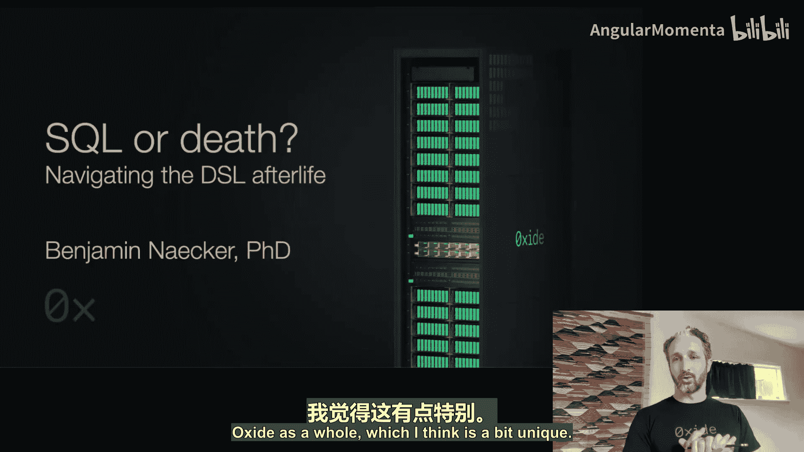
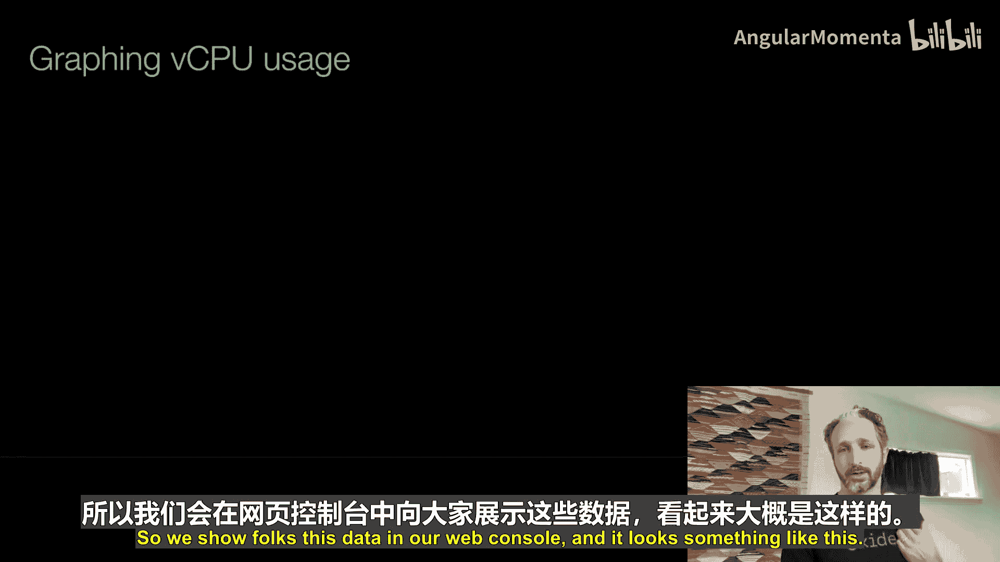
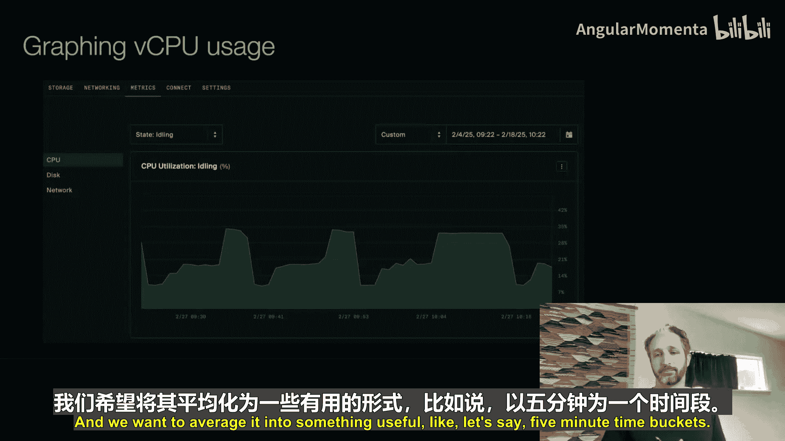
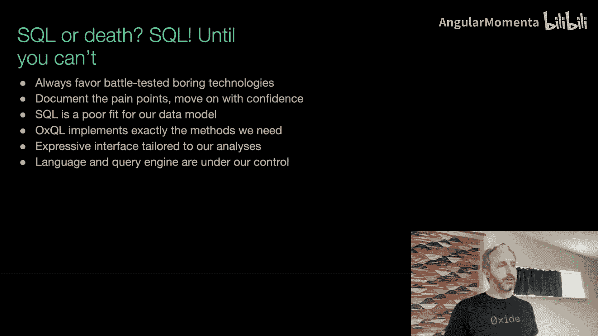
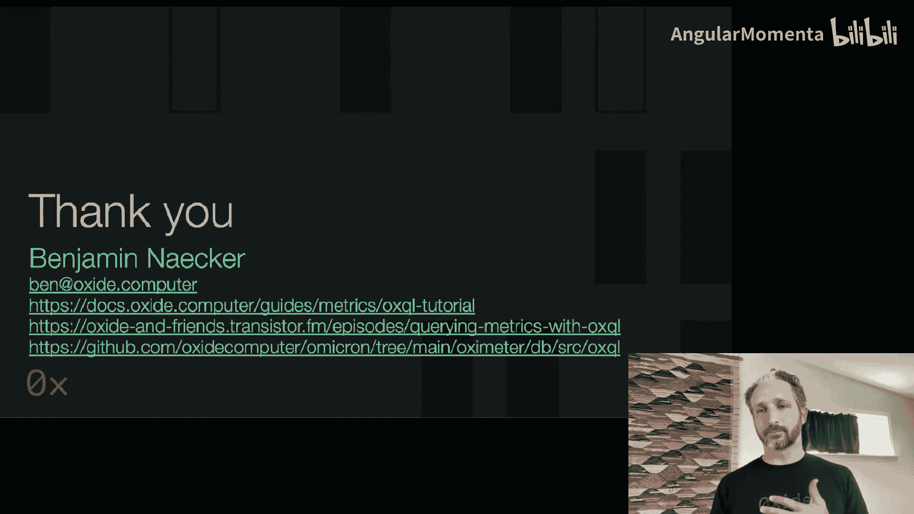

# 【卡内基梅隆大学】SQL 或死亡？系列研讨会 ｜ SQL or Death？ Seminar Series (Spring 2025) p08 08 OxQL：来自 Oxide 计算机公司的血氧仪查询语言（Benjamin Naecker） -BV1FkisBtE97_p8-

有的。🎼why I hate it。Sequel or death Yo son， what are you going to choose？Yo check it。

 this seminar is filmed at Carnegie Mellon University thanks a lot， Google。

Hi let's， let's get started。 Yes， I'm from the hospital but this talk is so important。

 this is why I'm here to hear Benjaminnacker talk about the query language that they built at oxide。

 which is not not a database his company it's ha hardware company So Benjamin has a PhD from Stanford in computational neuroscience yet he's day to day job as a software engineer at Oxide So as always。

 if you have any questions for Benjamin where he's giving a talk please interrupt and initial question any any time and feel free to do this whenever you want that way Benjamin's not talking to himself for an hour on Zoom so Benjamin。

 thank you so much for being here this is a big deal。😊，Thank you I appreciate it。

 thanks for the intro and to you obviously for making such an effort to be here and to the whole database group like Carney Me and I'm very happy to talk a little bit about this DSL that we've written at Oxide so you know what I'm going to do is spend most of the time actually on the motivation basically why we ended up doing this because I think it is a pretty unusual thing there's a lot of reasons to not do what we're doing and so I'm not going to dive in contrast to some of the talks that came before me in the seminar series I'm not going to dive too much into the technical details of the language itself I think some of it is interesting and I'm happy to take questions about it but it's really not the part that I think is the most valuable that's the most transferable from what we're doing at oxide to other folks I think the part that's really valuable to all of you guys listening is basically why did we do this right how do we go from SQL or de to some other afterlife in the form of this DSL that we've built called OXQL。

So you know just a little bit， I want to start with kind of like motivating you know Oide as a whole。

 which I think is a bit unique， so let's say you are at Bigco and you run a bunch of servers and buy a bunch I mean like 10000 right so you have internal customers different business units in your organization you're making widgets and you give them VMs and other sort of virtual resources but you need to host all of those on actual servers and so if you want to do this today you basically have two choices you can rent all of that from the cloud or you can build it yourself。

And there's a lot of tradeoffs between these two these are really extreme ends of the design space so on the cloud side you get this nice convenient API you know you can kind of interact with it through web interface and lots of different languages it's very very convenient there's a ton of managed products I mean AWS as an example has literally hundreds of different things you've got several different kinds of databases several different notification services obviously virtual machines as well but tons of other things that are really really just sort of well built and kind of just work and you can really build any application out of all of these building blocks that they have it's really convenient。

I think the biggest selling point that we're all aware of is you basically get infinite scale immediately right so you I don't think I've ever heard of anybody trying to deploy a V on something like Google Cloud and them saying sorry we don't have a machine to host that for you right it just doesn't happen they never run out of space basically the hardware is all managed for you you just get updates to things like the host operating system or you get new chips know new accelerators or whatever just sort of come online for you you don't have to worry about any of that stuff right if a disk drive dies it's not your job to replace it。

So these are all really， really valuable， I think， pros in the cloud model。

The downside is that it's quite expensive so especially for people who have fixed workloads right so if you use that infinite scale that goes up and down very bursty workloads。

 it's very it's great right because you don't pay for it when you don't use it but if you have a fixed workload it can be very very expensive anywhere from 30% upwards to 300% more expensive then just sort of owning your own infrastructure and running it yourself so as you get to that big scale of 100。

000 virtual machines or something it's pretty expensive you give up a lot of control and ownership you don't get to decide what hardware is run and you may care about that right or you may care about being at a capital expense。

 not an operating expense in your business and so you don't get to make that choice。

There may be legal or compliance issues， so we talked in the pre meetinget little huddle we talked about like if you're a fintech company right if your big co makes widgets it's fine。

 but if you store a bunch of credit card data like you may not want to be able to store the data in the cloud or may not be legally allowed to store the data in the cloud。

There are also these data movement issues， so for example， on Amazon's S3， they're object storage。

It's free to put data in， but you pay through the nose to take it out。

 and so this encourages you to put all of your computing into the cloud， use all of their services。

And if you don't do that you have either huge costs or you have huge latency issues。

 so there's lots of lots of downsides on for the cloud model as well now on the build it yourself side。

The big benefit is you get to build exactly what you want， you own the hardware。

 you get to take the depreciation， it's a capital expense like all of these beneficial reasons。

 it's also it is generally cheaper for fixed sizeized workloads it depends on exactly what you're doing。

 but it's overall very cheaper and it sort of gets cheaper faster as you go to bigger workloads too。

The downside is the biggest upside， which is that you have to own the hardware。

 right which basically means you need a place to put it， you need cooling， you need power。

 you need all of these different things， right？An administrative headache， if a disk drive dies。

 you have to figure out well which one is it， what part is it， how do I replace it。

 how do I source that， how do I keep track of my inventory it kind of sucks in that sense you have a patchwork of vendor support right if you buy a switch from some company and a server from another if they're you're trying to talk between these two and the packet sort of gets lost between them。

You're going to be really quickly in that like Sperman meme of them pointing fingers at each other where they both basically just blame the other vendor right like it's going to be like。

 oh， it's not my problem that's your problem。And then also the management software is extra。

 which is underlying you have to pay for that， you had to manage that so it's sort of another layer。

 whereas the software is all that you have on the cloud， right？

So if you look inside the machines that back all of this stuff they actually look very different so it's easier to start with the build at yourself model where we just have more experience and more data and what you see is something like this it's a sort of pizza box stack style thing where if you open up the hood and look inside it's basically the same thing that we've had since I was a kid there's a CPU some dims bunch of fans there's like an AC power supply there's a largej45 there's a VGA adapter in the back there's sort of all of this like craft that's come along for the ride in the last like 30 or 40 years that's still there。

So those are the servers， but you also need to buy a switch and then you need some kind of like VM management wear of some kind。

 which I don't know what you would use for that， but I hear it's quite expensive as companies get acquired by other companies that they kind of up the prices dramatically or so I hear so you have to kind of put all these things together yourself and it's sort of a subpar product in a lot of ways and it's complex。

We actually don't really know what the machines inside say Amazon's data centers look like because that's sort of their secret sauce。

 the closest that we actually can get is looking at something called the open Comp project。

 which is a thing that came out of，Facebook's redesigned of their data centers in around 2010 or so they made a bunch of these reference designs open to try to advance the state of computing hardware and they look something like this so this is the Toga Pass server which is one part of the open Comp project or OCP。

Reference designs， but you can see it looks totally different different form factor。

 totally different size。 The green part is this airflow shroud。

 So it's not just like a bunch of tiny little fans spinning at 8 million you RPpms。

 it's a very different cooling design the power works totally differently there's no AC power supply on this thing's you power the rack not the server there's no VG adapter。

 the only way you can talk to this thing is over the network so it's just a fundamentally different hardware model。

 So if all of the know big cloud providers build servers that look like this。

How come you can't buy them and this is basically where oxide comes in we are the cloud you own we fill this niche right you buy the whole rack at a time or ideally many racks at a time we put all 32 servers。

 two switches， two power shelves in there they're all designed to work together we built the whole thing so it's this integrated vertically integrated cloud computer。

You come to one vendor for support， if the switch is giving you problems， we're the vendor。

 if the server is giving you problems， we're also the vendor。

This really gives us the ability to do lots of things that have only been available in the past to those hyperscalers so this includes things like smarter resource management we know exactly how many resources there are how much over their head there is for our systems。

For the virtual machines so we can sort of place things a little bit better same thing for fault management when things go wrong。

 we know exactly what context that's in， whether it's something that can be repaired automatically or we need to generate an alert for an operator because we want to give the cloud experience everything is driven through an API which is all public and open so we use the API customers use the API there's no sort of hidden interfaces there's obviously the power efficiency which I mentioned a little bit about there's no power supplies on the sleds they're powered by the back plane which is really great。

And then of course， for the purposes of today's talk we have this very holistic and kind of comprehensive telemetry system as well。

 so speaking of telemetry what kinds of data do we get I think it's important to understand a little bit what the data looks like so we have。

Information from hardware sensors， temperature and voltage， current fan speeds。

 all these different things， we' get lots of networking data。

Almost like a huge fraction of the work is just computers talking to each other sending data back and forth。

 so we get all the information about packets and bites both on the physical network。

 but also the virtual network that customers use。We get information about。

 say fiber optic bit error rates or forward error correction problems。

 lots and lots of information comes from the networking subsystems。

We were talking a little bit about this earlier， but we have the host OS under our control as well。

 so we get all this information about memory and file system usage its lot contention。

 that sort of stuff。We've also built the whole control plane so we get lots of information about how that software is working it's sort of really a whole suite of software just as an example we have a distributed database for our kind of consistent data not the time series data but for our consistent data and we keep track of things like transactions how many statements are in a transaction how long do they take is there contention that sort of stuff we monitor the API for problems like you know degrading latencies that sort of thing。

you guys were using cockroach Db that's right okay yeah so cockroach is the the control plane database or the consistent you know data store for customer data for things like which Bns are deployed where what hardware is it exists in the rack that sort of stuff got it awesome thanks yeah。

嗯。So。Or was I okay so the virtual resources is another big thing we keep track of all the stuff that the customer is using things like virtual disk Is VCPUs the VCPU thing is going to become a pretty kind of key example we'll use that in a few of the motating examples coming up next so the point that I want to make by this is just how heterogeneous the data is we have things likes temperature so these are instantaneous measurements temperature voltage current that sort of thing we also have a lot of cumulative counters so there's a start time and some monotonically increasing counter over a time window。

The other thing is histograms are really really really important for us。

 so I'll get a little bit into why they're so critical， but for example。

 for like the virtual disko I don't really care about the latency of all like read operations because who cares if it's slower to read more data right what I actually care about is breaking it out by size so we do something like been by power of two sizes for all different types of operations so I'll talk a little bit about that and I think histograms are one of the main or not a are a very important motivating factor I should say。

But this VCPU data will become our primary example for a lot of the motivation。

So this is like the obvious first question that people ask， you've got all this data， that's awesome。

 how do I query it？RightAnd as any Joe on the internet will tell you like it's you know any kind of person would point out like hey you know it's not 2010 man we should use SQL and that's exactly right。

 you don't have to be Andy to come up with us like this is this is where we started right we were like we should use SQL because there's a lot of good reasons for doing that right So what are some of those for example。

 familiarity right every software engineer who's worked in this kind of environment has at least passing familiarity with SQL and most people have better than that right that just it's easy enough to read there's so many so many examples and documentation out there that people are basically at least know reasonably familiar with it。

There is a ton of documentation for SQL right I mean like books you know tutorials videos YouTube videos I mean there's just stuff all over the place there are so many examples I was actually very curious so a few weeks ago I went on to stack overflow。

And looked at tags by you know how common they are there's a few little over 670000 questions on stack overflow with the SQL tag to give you some context that's the 12th most common tag overall of any kind so it's more common than like the C programming language there's only a few programming languages that are more common and it's things like Java or ja or you know Python stuff like that so it's extremely common there are so many questions you can always go to stack overflow for questions so it's really really helpful to have all of that it's a very flexible data model right I mean part of the benefit of something like SQL is that you know in theory you have this declarative syntax for saying what you want not how to go get it I think that breaks down a little bit in some cases like that's why we have the explain output and we look at query plans and stuff like that because I think it's a idealistic way of looking at it but there's a lot of truth to it right I think it there's a lot of value to thinking about it like that。

And then you know we are implementing this query system right so we can take advantage of all the tooling around a standard like SQL so as you know we can use off the shelf parss and we can use a query planner and the data you know a query optimizer。

 even things like syntax highlighting like all of this stuff could be very useful not necessarily will be but could be very useful to us if we're starting off the shelf or starting with a like SQL like language right I mean we could use a lot of this。

So。😊，We took this very seriously we said okay， well like sQL please like let's let's try to make that work so we。

We basically took that and tried to run with it， so I want to go through a few of the examples that we actually we actually tried to do using using SQL。

So I built a a prototype sort of front end to our database that stores the actual data using SQL and we tried to make some things work so one very common one that we do is just graphing VCPU usage this is like how customer deploys a VM how busy is it right do I need more of them do I need fewer of them what does it look like so we show folks this this data in there our web console and it looks something like this so there's just a graph over time of the VCPU usage so that's time on the Y axis and usage as a percentage on the sorry time on the X axis？

Uses as a percentage。On the Y axis。And this is in one particular state the idling state what we care about others like is it running is it waiting for IO all of those sorts of things so we track all of these separately and for the most part we let customers just pick the time range that they want and we want to average it into something useful like let's say five minute five minute time buckets。

Okay so if we're going to do this with SQL， what might it actually look like the first thing we need to know is what is the data format right so we store data that looks something like this today。

 this is kind of a simplified view but basically we have a table V CPUU usage we've got in red these kind of metadata columns。

 things like the ID of the VM instance that's reporting the data the serial number of the server hosting it。

 the state the CPUI in then on the yellow columns we have the actual data points right timestamp and VCPU usage。

So if this is our data， the query might look something like this by using just standard SQL right so I'm just selecting the data that I want and the kind of interesting part is in those last two columns in the select clause and you've got basically the average VCPU usage makes sense。

This floor extract thing is doing a conversion， basically rounding down to the nearest 300 seconds。

Not crazy， but this isn't that you know， this is sort of like I'd say advanced beginner SQL right like it's pretty pretty simple but not you know not trivial。

 not the first thing you learn， but pretty pretty easy right the most annoying part here is the conversion to seconds when you have to do this this rounding some database engines might support extracting other parts of the timestamp like minute or something like that So it's a little bit annoying that you have to do that if you're talking about generating this in like the web console where it's a programmatic context。

 you could imagine just like emitting this SQL and we're just filling in that time or that division that factor right based on some input from the user So interactive usage it might not be that great but programmatic usage5 right except yeah do you have a question anymore Yeah I think it's worth mentioning you guys are using clickhouse to store all this data in the back end right that's right I haven't talked about that yet but that's。

It actually I'm not going to get a lot into that I'm happy to talk about it towards the end I have with like some you know hidden slides and stuff if we want to get into it。

 but yes that's right we are using Clickhouse under the hood to store all the data。So。Okay。

 so this seems like fairly straightforward right it's sort of tolerable I would say for most people。

 even those that are not super familiar with SQL except there's a problem which is that I have lied you about the schema that we actually have so the data for the VCPU usage for a bunch of technical reasons is actually cumulative it's one of those cumulative counters that I mentioned。

Um， so we need to， we cannot do something like average VPU usage across all of the groups because rows are not independent from one another。

If I look at later timestamps data， it includes the counters from before， right？

So if I do something like average it i'm double counting am more heavily weighting data at the beginning than I am at the end so in order to correct for that I need to make all of the rows。

 all the tus independent the way you would do that is with an adjacent difference operation a successive difference operation right so in standard SQL if we have the table from before that might look something like this and like that's hard to read I see if people like getting close to the screen and like this is this is pretty bad it's not horrible once you get into it but like I've already lost probably half my audience because there's a CTE。

I have to use this lag window function so I'm computing。

 you know I'm already doing some partitioning of the data。

 it all makes sense like I think it's you know， if you dig into the details。

 what we're basically doing is partitioning the data by those metadata columns。

Ordering by timestamp within that。The lag function gives us the previous row。

 and I subtract the current row from the previous row， and then that gives me this difference。

Right and the coalesce is there by the way because at the first row there is no previous row so you have to handle nullles there。

 so it all I think makes sense， but especially for interactive usage like doing something like this is pretty cumbersome I would say for a lot of the kinds of things we want to do where be able to have a query system that I can just walk up to and run queries like this that are sort of ad hoc。

 this is basically a nonstarter for us。Um so you know。

 I I think I think this is kind of the first example we're kind of like okay maybe maybe it's more painful than we're willing willing to bear at the moment。

 the other thing is that actually have I've still sort of lied to you a little bit about the schema or at least hidden a detail。

 which is that。The timestamps are cumulative and I mentioned there's some technical reasons for that one of them is that technically our hypervisor can panic so if the hypervisor panics it you know obviously aborts the process it takes out that the Vm with it okay our software will restart the hypervisor which will restart the Vm itll sort of come back online but now it's reporting data having a new start time and that counter has reset to zero right so rather than try to。

Handle that on the hypervisor where it's tricky。 we don't necessarily want to maintain all of that state there。

 What we do is continue to just report the data and we say we'll correct for that in our query system at the end or some system at the end。

 But in order to do that， what you have to do is you basically have two well， sort of any number of。

Moottonomically increasing regimes right where the data has reset to zero at some point。

 so to correctly deal with that what you have to do is find all of those regimes and then add up kind of offset the later ones by the well by the last value in all of the other regimes。

 right。So you have to kind of and you have to do that， by the way。

 if you won only care about data at the end， you still have to do that for any restarts that are at the beginning right so it's it's very tricky to do I'm actually not sure how you would write that as SQL。

 I didn't really bother trying but it's presumably going to need some other type of windowing function and then you also need to compute the successive differences on top of that right so it's it's very complicated I would say why are these counters cumulative right Why isn't just like at this time for this some window range this is this the value that I got versus like。

The main reason is that because the system well one of the big reasons the system is distributed so we can lose samples along the way and I want to be able to correctly assess the if you don't do that if you only report sort of an instantaneous or a short time period of the measurements you will have all of the later values missing that piece of data whereas if I drop a sample the later values will now account for that and so if there's sort of network weather on the rack I can get some of the data later as well and it'll still be correct right I still have to deal with this fact that there's this missing sample at some point in the query system but I haven't lost data I'm not incorrect right that's the main reason。

嗯。But believe me we debated this it's a I mean it makes the query system much more complicated right like it makes the rows are not independent which sucks in a lot of ways so that you know kind of breaks in the SQL model where like I have a bunch of tuples and who cares what the order is it's no longer really true right and I'll get into that actually in a little bit。

So this is one of the kinds of examples that we tried to make work and was pretty painful there's another one which is that we often especially early in the product we were just debugging stuff we'd walk up to a system and it's misbehaving and we say what is it doing right now and right now is like very recent history say it last five points of data。

So in SQL you do something like this， not surprisingly there's like a similar window function right I'm basically taking the row number in these partitions and then I'm taking everything at the end you can see there's the where RN is less than or equal to five so it's the last five points ordered by this row number。

Again， in terms of like a。Emitted query from some code like a web console not that bad。

 but if you're talking about interactive usage， this gets pretty tricky you've got to remember to sort things in the right way by the timestamp but it seems to us easy to get wrong right again especially for folks who are。

You know， want to be able to do a pretty quick debugging process。

 but aren't necessarily sQL ninjas like it it's tricky to be able to write， you know。

 a kilobyte of text or something in order to ask fairly simple questions like what is the behavior of the last five samples？

嗯。Okay， so another really common thing this comes out we were talking about this earlier too of Dtrace so Dtrace makes sort of firstclass this idea of a quantization or a histogram if you again in a debugging context walk up to a system and it's misbehaving you often want to just say what is it doing you know over some last like the last day or hour whatever it is。

 just give me a quick summary of the data and especially in a way that makes outliers very clear and histograms are a really compact and useful way of doing that。

So as an example I mentioned at the beginning that we track API request latencies and we do that in a histogram where we break out lots of things but on the bins is basically the time and then we count the number of times the API request was served within that time bin right so if everything isnt like the milliseconds two seconds we' fine but if there's any sample in like 150 secondsd or 100 secondsd like we're having a bad day something is wrong。

 I need to go look and figure out what's going on there right so it gives us this really compact way of just saying is the system behaving normally or is it you know are there extreme outliers in some form or another。

Looking at the distribution is really valuable so I actually didn't know how you would do this in SQL you guys probably might know but I did what any self-respecting engineer does these days which is asked Cha EPT to tell me how you would emit a query and this is what it told me there are some weird things in here which I'll get into in a minute but。

The big pit so there's this CTE at the beginning， which is basically the same as what we've seen before。

 the big case when statement is the relevant bit， so what we're doing here is basically taking this difference。

 we've computed the adjacent differences because again our histograms are amulative right so we've computed the adjacent differences。

And then i'm bucketing it into these different buckets with this big case win statement so you could do this with a function the chatT didn't really realize that you could do this。

 but the main reason I think is that。In the general case you need a case win thing anyway。

 because if the buckets are not a simple function of the inputs then you probably are going to have these buckets are not all the same size for example and they're not like equal powers of two for example so in general you would need something like this to do that right the weird part is that。

Chat ET thought it was best to emit a text label which is the point of the very bottom if you can read it that says there's this cast substring construction thing which is basically pulling back out the first integer of the text label and the reason for that is if you just do order by on a text string it's going to be alphabetical I don't want that I want it to be numeric based on the left edge of the bin right so it's kind of undoing this inefficiency we probably could have just emitted the left edge of the bin and the case when statement。

But anyway， this is。This is what you would do if you wanted a histogram sQL in general and SQL and and I mean this is like a nonstarter for us right I mean there's no way I'm going to write this like imagine you did this and you said oh I screwed up the buckets let me go and like find the right bucket and you know which arm of the case when statement and then correct both sides so you don't like miss something or overlap things or whatever right very very tricky I would say。

And we're definitely like starting to strain the familiarity points in the favor of something like SQL right So if we go back to our list。

 you know familiarity is like we're kind of losing a little bit of that right like we're in some fairly dark corners of SQL for people who are not you know experienced database users I mean again I think for most people here there's nothing like revolutionary about the queries that we've done but for some random oxide engineer or for some oxide customer these things telling them like oh。

 you want a histogram cool run this like4 kilobyte queries like。That's not really going to work。

Is it possible， yes， but I don't think most folks who run the queries would want to be able to write would want to write that manually very often。

Okay， so you might say， well the problem is with that previous query that we have this big case of Wednesday right。

 this huge chunk in the middle， this is the same query from the previous slide。

So that's very verbosely expressed we could probably express that much more succinctly at least for certain common cases right so let's say my problem with this is that I want to be able to express that bucketization thing as a function right and so a hypothetical totally made up function might look something like this so this is the same query except I replace the giant case when with this quantize function in the middle again a made up name。

But I'm just giving it， let's say it by default puts things into power of two buckets for whatever reason。

 right， maybe it has an overload where you can give it the binages。

 but the default one is just look at the type and know span the range with power of two buckets。

So this would be much better in my opinion right like it it's a lot easier to understand so's a lot easier to write most people would probably know what we're doing even without a lot of documentation but you know I've sort of stuffed a lot of the secret sauce into this function quants right and it's something that we made up that's not part of the standard and so I have to write it again right I have to implement it myself。

 I have to document it。I have to you know tell everybody provide examples chat GT isn't got to give generate this for you right so I you know it doesn't exist anywhere outside of oxide systems if we were to use something like this why not why not do a view。

I'm not sure。 can you say more It's like a virtual table you define that you call create view in a select statement and basically it's like a macro that gets inserted Yeah。

 so I know if you are I see what you're saying you're saying create a view which is the does all of that histogram bucketization so we write that giant query once and then we can query the view I think that would work yes。

 if you were interested in fixed buckets which you often are if you wanted to generate a histogram right because you can't the view would have the buckets in it right if I'm understanding critically yes so you'd have this giant case when statement so each you know you might have a view per like bucketization or something so I think that's an interesting thing we had not considered that I think it would definitely make if you if you knew on priori what those buckets were for the things that you cared about I think that would be a useful way to do it Yeah I hadn't thought about it。

The other way piggybacking on Andy's question is often people define stored procedures if their application is just 20 different patterns or some small number of patterns。

 it becomes unwieldy if it's a lot more， and then you parameterize whatever you need in there。

 which might be the number of buckets or the way you are doing imputation stuff like that。

 would that work or you have a lot more than 20 patterns that or templates that people end up using。

Yeah， it's another good question The short answer is I don't know I think you could get away with a lot of that I think we you know。

We tried doing some store procedures for some of the simple stuff initially。

 we basically didn't know enough about the kinds of questions that we wanted to ask to build on top of that。

 but it definitely is something。I think it can like like the story or like the excuse me like the view I think you can get away with a lot of those things right I would say that the point that I want to make about this I think still applies to both of those。

 which is that。If you do this， you it's really less sQL and it's select from where with some special sauce right like you're selecting from the special view which I have to tell people about which is fine or from a store procedure which again I have to document and implement。

 which is also fine but it becomes it's sort of lessre really only using like the select stuff and then you running some function that we've built that we've document that we've implemented ourselves under the hood so I can I think you can definitely do that there's a lot of benefit to doing things like that for our case because we couldn't define our priori say the buckets that people were interested in。

In a lot of cases。It didn't work I mean I think you know there's there are upsides and downsides is basically my point for that So okay so if we go back to our like you know list of reasons to choose SQL were kind of we've already lost a little bit of the familiarity stuff we're losing again the more we stuff things into like the quantize function or the stored procedures or other things that we need to implement and explain to people we lose some of these other things like the documentation and the examples and like we're losing a little bit of this some of the tooling stuff right because now if everything is like a stored procedure or something。

 I may not be if I'm implementing the actual query engine into the hood。

 you know the off the shelf optimizer query planner for example may not know anything about what to you know may not know what to do with that and so it may generate you know who knows how well it's going to work in terms of generating a query plan for me right they're not totally gone I can still use them probably in a lot of cases but they're kind of you know they're on tenuous。

Ground， I would say。So what happens if we say， well。

 a lot of the problem is the data model right as we were talking about a minute ago。

My tuples are not independent right there is an implicit or an explicit ordering to these right in terms of time which I think is really inherent in the type of data that we're storing and they're not independent in that later samples and a cumulative metric。

Include data from before， right？So what if we say I'm not going to store the data this way。

 I'm not going model the data this way in our language。

 but instead I'm going to model it something like this with a arrays right and I think there's a lot of benefits to this so all I've done here is collapsed the rows that have the same metadata columns in orange or sorry in red and turned them into as in the timestamp in the VCPU usage column。

So。This is actually how I intuitively think of the data， there's some array of timestamps and values。

 and I've got some metadata， some key value pairs that's associated with it。

This has the added benefit of deduplicating the red rows a lot， right。

 which you know as Andy mentioned， we're using Clickhouse to store the data under the hood。

Even in that case where it's a columnar database and you've got really good compression algorithms。

 you're still going to get a huge performance benefit。

 huge efficiency benefit by storing the data this way because when Clickhouse has to run a query on the whole table if you store it the other way you are going to or your clickhouse will have to blow all of that back up when it actually runs the queries you've got CPU time to duplicate things。

 you've got memory， you've got to send that over the wire so there's lots of problems with doing it that way you still get the efficiency benefits of this but the obvious problem that I'm sure everybody is pointing out as like arrays and kind of tricky in SQL like there's not a lot of support built in nativesQL it has like a handful of array functions how big these arrays are going to be massive because exactly that's another big problem so really store it this way we have for some of these we can have millions of data points and you quickly run into the limits of storing in one page or I mean it's obviously not going fit a page but in one piece of data one cell storing these large arrays。

This isn't this actually isn't quite what I naturally think of the data。

Ignoorring you know ergonomics， the way I would sort of represent is actually an array of tus of timest and value。

 which is even shitttier so like you know you're you're got really。

You know it's a very sort of hairy set of functions that you're going to need for dealing with that right SQL array support is you know pretty pretty minimal。

 so we again we're sort of stuffing more into the kind of the the secret sauce and like array functions like some array filter function or something like that。

 right？So again we have to implement that ourselves， we lose a lot of the documentation。

 you know we kind of get we're sort of making more strikes against some of these so it's really like SQL please like I really want you to work but it's like kind of been pretty hard for us right to make this to make this work so we've really lost some of that flexible data model stuff where you can't really model exactly how you want you maybe are constrained and then again these kind of off the shelf tooling things like the parsters or planners are really sort of not so helpful to me anymore。

So you know， we're kind of like， I guess， I guess we're stuck with depth at this point earlier in the array example。

 what those heat values cumulative values or point in time values those are cumulative cumulative'm going to talk about that in a second。

 but those are cumulative。😊，Yes，You knowAt this point we have basically spent a while using this SQL prototype trying to make something work for us and we basically said。

 okay， we've written down all of these problems， all of these situations where it didn't quite work for us where we had these questions and we found ourselves fighting the language how can we do something different。

 so this is when we turn to the idea of our own query language of just I want to start over。

 let's talk about the things that we want from first principles that will do what we want to do and make our lives a little easier。

So the kinds of things that we want， I want a concise and expressive syntax。

 so like that histogram thing I want to be able I don't want to write giant case when statements。

 I want to be able to sort of express these things pretty simply， pretty straightforwardly。

Um I want things like that adjacent difference thing。

 I need that to be sort of first class right or sort of done you know as easily as possible because we do that all the time。

Things like you know dealing with durations or intervals or whatever。

 we want that to be sort of very first class as well。

 so key analysis methods that we care about for time series we want it to be suited to our data model which again we actually represent the data intuitively as a bunch of key value pairs and an array of timestamped values and that's how we turn return the data in the query when you run a query you get back you don't get back a table you get back key value pairs and an array right and like we want to be able to operate on that pretty naturally obviously our product has specific things that we want to be able to to make easily available things like that VCPU usage graphic and then all the debugging stuff we have a heavy debugging culture so being able to do that easily walk up a system and quickly write these pretty simple queryries in text that expand to something complicated or express a complicated idea but that's very useful for debugging that is definitely something that we want to make first class to。

Also as everybody here knows writing your own query language is very tricky there are tons of you know pitfalls and problems with doing that so I want a query structure that's pretty flexible something that I can build exactly what I need now and hopefully no more and then add on to pretty easily as I need right as we decide oh hey there are things that we need that we don't have yet new language features I want to implement those pretty easily and also it has to be something that I can optimize pretty easily I am not a database engineer and so something where I can go sort of look at you know what are the first three to five optimization tricks that any database engine implements and I need to be able to do those for our query language as well right so。

Agains this is our data model here that we kind of work with and I like this idea from the Zen of Python it's sort of the tenets of the Python programming language and one of them is you know easy stuff should be easy and hard stuff should be possible right and so I really want to make that easy stuff that we do you know often I want to make that very very easy。

So obviously like you know the table stakes for this is being able to put just you know go get data from this system right so in Oql that looks like this it's this get table operation you're just going to get the data from that table so this will return you everything you obviously don't want that in almost any circumstance so we need to be able to filter the data right so we pipe that to a filter table operation So pipes are something that lots of the other talks in the seminar series have looked at as well people have been interested in these for a long time there's a lot of good reasons for liking them they're very familiar make it easy to parse the language。

 easy to optimize it so we have this filter table operation for subselecting the data and we have you know different predicates who can express things like equality and inequality these things here on the right the。

The values these are literals， but we support all of our different data types。

 obviously that we care about UUIs and IP addresses and all that stuff。

And you can do different kinds of operations like ExO and you know and and ore and all that sort of stuff。

 or it turns out to be like by far the trickiest thing to support， by the way。So。

You were mentioning a minute ago， you were asking whether this data was。umativeYeah。

 exactly was cumulative over these reporting and time values and so that's part of the benefit of having a language like this。

 this get table operation can basically do that for us automatically and the reason for that is that we maintain if I still be a catalog of the data that we store the tables that we store we can look at the query and say okay somebody wants this VCP uses data I happen to know that's cumulative so when I run this when actually execute this get table operation for them I can automatically insert that delta in here for them only for those cumulative data and data points and I can return them that thing that they want obviously that makes the query more complicated under the hood right the actual query that's being run is much more complicated。

But the other benefit that I didn't quite talk about but that's really valuable to this filtering based approach。

 this sort of pipeline approach is that we can run as much as we need to in the database itself we're using Clickhouse so when I actually select data I can try to push the predicates as far as best possible towards the database to get the littlest amount of data from the database itself but if there are things that I want to implement that are really tricky to express or very inefficient to express in Clickhouse I can run those in our own query engine written in rust right so as we develop new features we've been able to add them quickly into the rustbased engine and then as we learn how to either optimize them or express them more assistinctly orQL as clickhouse SQL evolves。

 for example we can take advantage of that and push some of that stuff into the database as well so this flexibility in terms of the language being implemented in these pipes makes it very easy for us to optimize the pieces we care about run as much as we can in the database but then still gives us this escape hatch of running things。

In rust as well as we need。I think super， I think the escape patch is a great point。

 but I'm trying to understand right now if there is something in a view computed columns that would not have been able to support this functionality。

 for example with the delta， you could use a computed column to compute that delta for you item think。

😊，I think that's probably true I think it's across it's a question of trade offs so one of the issues is that I didn't really get into this。

 but。The efficiency thing is really important for us。

 I think more so than some other circumstances because we are basically clawing all of the storage space and all the computing space back from the customer。

 we sell them the rack and we say， oh by the way you have end terabytes well actually you have n terabytes minus two because we need so much storage space for all of our all of our views or whether if they're materialized right we need all of our storage space for views or these precomp columns I think so it's still an open question for us of whether that's useful what's right whether that tradeoff is worth it。

 but so far we have definitely said look we're going to try to store the data and then spend more time computing it and giving the customer as much of the storage spaces as we can。

 but it's a good question。Okay， let's see。So。Kind of going back to the beginning。

 the first example that we used was this idea of averaging stuff over time。

 right the VCPU usage we want to graph five minute windows。

So in OxQL this becomes very easy to express， we piped that to this alignment table operator that we have here so this alignment operation is really just doing the same kind of thing that we saw in the SQL it's basically rounding down to the nearest time interval but we express it in a much more concise way this alignment table operation takes this function mean within which is one form of a reducer but you can apply basically any function to it so far we really have just mean within there's an interpolation method but we take this reducer function and apply it to all of those groups right and then the other important point in yellow here is that we have firstclass duration windows this comes out of I mean again we're not the first people to do this like promQL does this pretty well too where they have this idea of expressing compactly expressing intervals like five minutes here but you can change this to five hours or whatever you。

嗯。So you know this alignment method the last point I want to make is that it's pretty important for time series data。

 if you want to do something like grouping within a single time series or joining across different time series。

 both of which OXQL supports， it's really important to be able to align our experience to be able to align the data so that you are looking at things that occur at the same time window and you're not sort of you know dealing with this sort of misregistered data。

 so that's really valuable for us。I didn't quite mention it。

 but this get operation also sort of hides all of the complexity around。Histograms。

 so that Dlta thing that gets done for cumulative counter scalrs， it also gets done for histograms。

 and so we can express all of that in the same language without really having to change the query at all。

 which is kind of nice for us。And then the last example that I want to want to show is that idea of taking the last five data points so for us this is very easy you just pipe it to this last operation right so kind of under the hood we're doing exactly what you to expect there's some sort of SQL limit by whatever operation going on under there but it's very easy for somebody who's walking up to a system and just running this analysis to be able to sort of add that they say oh either it was too much data I actually just want the last point or whatever so it's very easy to do that as well。

🎼So that's really kind of the bulk of what I wanted to get across today I think I think the idea that you know I hope I've communicated pretty well is that if you were faced with this choice of SQL I do think you should start with SQL right I mean like yes SQL makes a ton a ton a ton a ton of sense there's a reason it's the lingua front graph for data analysis it's so useful has all of these really great points but there may come a point when you can't make it work for yourself right and I think it's important to always favor those boring technologies the battle tested technologies and then this is the point that took me a long time to get to personally was writing down the reasons that it didn't work so。

Like these examples that I've walked to， what would happen for me is we， I had the SQL prototype。

And before that， we had another query prototype where。

I would try to make it work and it would feel myself sort of fighting against language for a long time。

And then I would just sort of move on and forget about it and not write anything down right I think one of the things that I should have taken from academic training is writing a paper。

 keeping a lab notebook， something like that should have been more of my training or more of what I tried to do here。

 but I think even for that it was difficult to tell other people what the problem in my company what the problems were going to be when they started to use things they would hit the same things themselves。

And I think the real point about doing that is that you can effectively just say， okay。

 we've made this decision， let's move on to something else with confidence， let's just try something。

 you know， we don't need to relitigate like the YSQL thing over and over again right we've written it down if we want to revisit it。

 we can go back and refer to it。So for like for myself。

 I found myself obviously second guessing what I was doing。

All the time and so being able to go back and say like oh no actually this is you know this particular thing was extremely painful for us and I think having that stuff written down is really really valuable so again just for us like the fact that it didn't quite fit our data model because you know。

 for example， histograms arrays were tricky in SQL right the fact that we have these cumulative data was made things very tricky。

So it didn't really work， I think in a lot of the kinds of data that we stored that we really heavily relied on。

 especially for debugging， which early on in the product was really valuable。

OQQL because we control it it implements exactly what we need。

 it has this expressive kind of pipebased interface that other people。

 you know we're not the first people to come up with as many people have thought about this and it has a lot of attractive points and again because I implement it。

 having the query engine under our control， having the language under our control being able to implement only what we need you know I think was really a valuable a valuable thing。

So with that I just want to say thank you again for everybody。

 you know I really appreciate the opportunity to to talk to you guys about what we did and I'd love to take any questions。

I will applaud on behalf of everything。Thank you and open up to the floor for questions。Yeah。

 I think this is a great talk， you make a very compelling observation that SQL is not really good at doing imputation and naturally doing a lot of this type of time series analysis。

I was wondering if as you are developing this language you had looked at others who have reached。

 who have had this pain point， I think they've solved it in different ways。

 I think the Iutation part was interesting， like influx has this influxQl that sits about there scripting language of flux。

And I was wondering if there were if you had looked at that and if you had looked at it like what were the big things that were missing that or things over there that you could learn from as you build this language yeah it's a great question so I definitely looked at influx we actually evaluated influx when we did our first selection of clickhouse as the time series database so I had a pretty good background with their career language。

I think in my experience， so I looked at influx I looked at I think you know obviously Promq is sort of the in this domain is kind of the lingua franca。

 there's a lot of great things about that as well， you know for that one specifically I think actually the major problem was that at the time at least I think it's now experimental but at the time histograms were not really well supported and so it was very tricky to express a lot of the things we needed with histograms。

So as far as like taking inspiration from them or you know looking at things that they've done I think a good example is again with PromQL some expressive way of saying the filtering conditions that you want PromQl has this you know nice syntax where you have these braces and you kind of have these tags I think influx has a very similar model the idea of storing the data as like some metadata some tags or we call them fields key value pair is basically right and then you have some long list of data arbitrary length associated with that I think is really valuable we found that。

You know。Something like PromQl is probably the most agnostic language。

Besides the problem with the histograms。You know， we found it a little bit tricky to kind of map that onto the way we were restoring the data and I think with something with these kinds of languages。

 it's very often the case that。呃。You know the underlying storage method for the data really does kind of leak a little bit into into the language itself so for us like these you know I talked a lot about the data model being these key value pairs in the arrays but we were actually storing the data is not as but it's a separate table of fields and a separate table of the timestamps and so we're using the full column we storing know a value per column right but it really is this sort of thing that if you wanted to construct it into a table you would join them and end up with this massive massive table thing right so I think that that taking another language like the influx language or something like that I think we struggled with a way to sort of get away from their existing data model is basically the problem I mean I would love to see a way of either developing something like Prom QL or whatever it is into a more。

You know， agnostic kind of time series， specific language。Thank you， that is a great answer。

 especially with the data model assumptions yeah thank you。All right， a question from Nick。

 you want to mute yourself would you need me to read it？Well， yes。

Can you please talk can you talk more about the lineage from Google monarch and how it differs is similar besides the data autograph mentioned in one in one of the RSs so the。

We we heavily base this on monarch so monarch is Google's the paper is called monarch like a Planet scale time series database or something like this it's a really good paper we heavily based it on this I think because we had a couple of people at the time who had come from Google and they had experience with what was before that this sort of borg and Borg mon you know。

嗱。Data centerer analysis monitoring tool and they had run to a couple of pain points around things like scalability you know I think what we really took for monarch was the data model we did not take a lot from that paper in terms of the data organization they have this very complicated like query direction sort of frontend for sort of just taking the query breaking it apart。

 querying different pieces of the data because their data is so big it has to be sharded so they spend a lot of time kind of figuring out where do I go run the data run some subset of the query on the data that happens to exist in one of the shards and we're just like most people are not at that scale so we don't really have to take anything about that The thing that we did really like was they have also histograms we haven't done a ton of with this but one thing I really liked for monarch is they have this idea of an exemplar so in their paper。

They show I can't even remember what the actual time series is I think it's something like API latencies but they show this idea that you can show a graph and then you can point at particular things that look like outliers in one form or another and so being able to tag things with exemplars I still really want to implement this we haven't done it yet but I think that's a really cool idea that is probably very useful the histogram summarym is actually turn out to give you a lot of that because usually what you care about are outliers which are pretty obvious in the histogram。

嗯。Yeah， I hope that answers the question。At least a little bit。Awesome。Any other questions？

So my question would be seems like。The path you went down。

Has to do with the fact that you have these accumulators。In normally stream processing。

 every event is independent。But you're trying to backfill missing data。Because you have these。

 you're basically maintaining like， you know， a moving count。

And then if you recognize you're missing data， you then。Ibay inject。😡。

The data back by taking the difference。How much does that problem go away if there's。No。

 it could be stateless， but like a。I'mm not saying Bri Kafka that's a large beast。

 like just something that said， okay， well。I'm。I didn't get a timetamp within some range therefore the next thing I know I didn't subtract somehow something like that how how does the problem go away if you do that Yeah that's a good question so if I understand correctly you're saying let's maintain some amount of state somewhere else that tells me keeps track of that either does the difference thing for me automatically or something like that right so this came up a lot in our original design discussions where we were concerned about who's responsible for getting the data are we going to have our our program that actually collects it which is called oximeter that's where the whole name for the language comes from is it going to pull the data or is it going to get the data pushed to it？

And both of these have tradeoffs， the reason we ultimately landed with a pole model。

 oximeter goes and fetches the data from the metric producers that people actually generate the data and the reason for that。

Is I think you need to do that anyway in a distributed system。

 because if you don't get data within a certain period of time。

 you're probably going to go try to check for it， which means you have to do pull anyway。

 so let's just make it pull-based。It doesn't quite answer your question which I think is important。

 I actually thought a lot about this when the way I actually thought about it was。

One could imagine inserting the differences into the database rather than the deltas。

And I think you can definitely do that too， the problem is that if you。

If you want to look over some time range， you don't know the absolute value of all you're storing is differences unless you go all the way back to the beginning。

 I know the deltas， but I don't know the absolute scale。

Now you could store deltas and the scale I also thought about that then it's sort of the precomput column idea I think that someone had mentioned earlier。

 the one had mentioned earlier and that also is a great way to solve some of this problem you're just doubling the size of that data and we were concerned about the storage。

So it would I think it would solve a lot of the problems， not all of them。

 but it could definitely give you a lot of get rid of a lot of these pain points if you do store the deltas。

 so I think if you're okay with certain other tradeoffs being made that would probably I mean it would save a lot of the a lot of the difficulties that we've run into come up from come around this accumulation。

And then my last question is I had to step out for a second time many of this says like you're basically doing a straight trans from your OxQL to SGgel that wasnt clickhouse without any optimization passes or anything else。

No， we have no， we do some so yeah you might have missed this a little bit。

 but basically we take the whole query。 We do some basic planning and what that looks like。

 for example， we make sure that the fields you're referring to exist in the schema stuff like that that're the right types really basic stuff and then we do a little bit of optimization。

 We basically push as much as we can it's mostly predicates and limits into the database query itself so we generate a query that does things like well。

 the real details are that we basically we take the query。

 we parse it and then we split into disjunctive normal form we take every disjunction because you can run that as one consistent query in the database we push as much as you can all the predicates ideally into that database query and then we get back and if you want to do something special like if it's a more complicated query we can't prove that for example you can do the alignment in the database then you would do that in rust。

 but I think this escape catch and rust weve definitely used in some other situations So the short answer is we do。

Optimization it's fairly basic now we have predicate push down and limit push down and that that's basically it one more question and then what is your experience in with like the clickhouse optimizer because it's sort of not as sophisticated as maybe。

You know， some other systems like cship like Snowflake and others， if you hit in queries。

 you were like， hey， this should run fast and clickhouse togene crappy breed plans。Yes。

 yeah so that yeah， so I mean， I in a slightly more nuanced take， I think Clickhouse has been。

Like phenomena it's an amazing technology it's worked extremely well it compresses data extremely well I think the query planner is the query optimizer is basically the kind of main thorn in our sideLuckily the queries that we do run so far have been relatively straightforward so we haven't had a bunch of problems with that a lot of the problems have actually been around and maybe this is。

Not surprising。It will generate queries that just consume a ton of resources and so you'll do things like just hit memory limitations or you'll do things where it' all of a sudden it's just spilling so much of the query to disk that it's like oh God it's going to take forever anyway so like we have to kill it it's a very resource hungry program right they spend a bunch of time writing really really really fast C++ that takes advantage of compression and vectorization which is great for a lot of their use cases and it becomes a problem I think in some other ones。

I have more question sorry last question so clickhouse as though is just running in another VM that the host can talk to right it's not like a it's actually running in an a zone which is closer to a container it's a jail exactly okay yeah that's right Okay awesome no one more question it's always kill basically as far as like the expressiveness goes do you need any more functionality that is not quite expressible yet or do you think this is it。

Oh no I don't think this is it So well one example we don't have we have not implemented like a rate function looking at you know deltas like or anything like that which is very common if you want to look like error rates for example you can't really do that in no XQL yet PromQL has the rate function built in which is which is quite nice there's more things around like percentiles that we want to be able to do that we can't really do now you know percents are notoriously tricky for computational reasons but there's a lot of sketches that you can use that are much more efficient to give you approximate answers So that's definitely another one but so it sounds like fundamentally kind of your data model though is kind of stable because as reading the spec and you have things like subqueries so the data model itself if you think it' more or less fine。

We think so all right Im just wondering if that's out there No I think I think we're pretty happy with the data model as a whole it's worked pretty well we get to take advantage of the compression that Clickhouse has when we store the actual time series because those are all in one column and you know especially for slowly changing data it's very。

 very good at compressing all that。But then we don't duplicate things like those key value pairs because we deuplicate them in the table that stores just that metadata as well。

 so I think we're pretty happy with the way that works but there's a lot of other things in the language itself functionality that like I mentioned。

 the rate stuff and other things that we want to implement。

