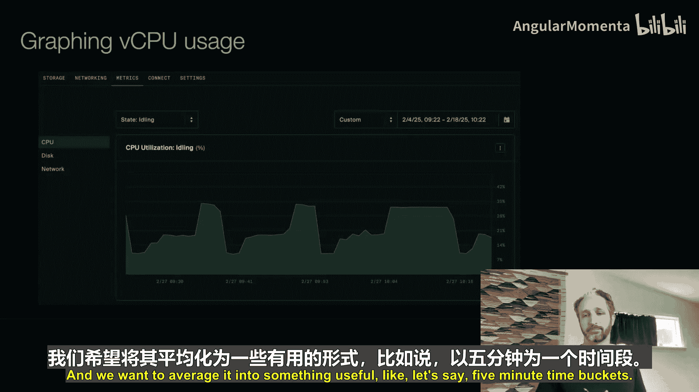
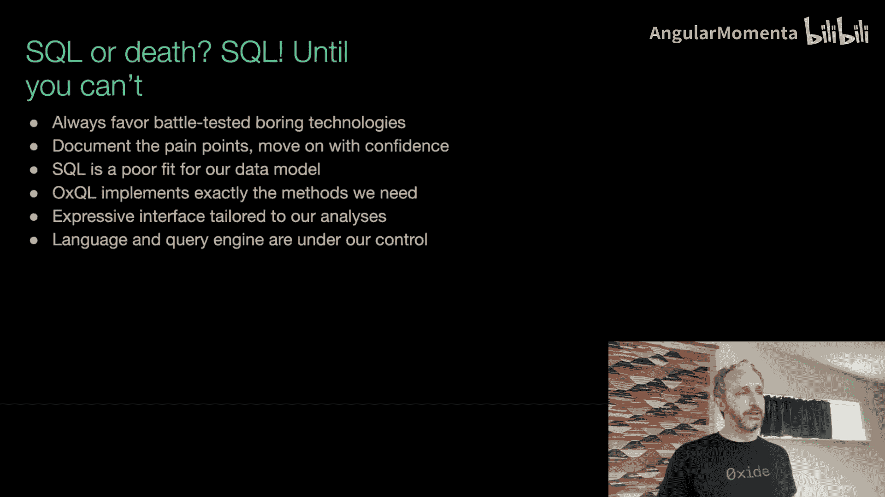

# SQL 或死亡？系列研讨会：p08：OxQL：来自 Oxide 计算机公司的血氧仪查询语言


在本节课中，我们将学习 Oxide 计算机公司为何以及如何构建他们自己的查询语言 OxQL。我们将探讨传统 SQL 在处理特定类型的时间序列数据时遇到的挑战，并了解 OxQL 如何通过一种更贴合其数据模型和用例的语法来解决这些问题。

## 概述：为什么需要新的查询语言？

Oxide 是一家硬件公司，提供集成的“自有云”解决方案。他们的系统会产生大量异构的遥测数据，包括硬件传感器读数、网络指标、虚拟机使用情况等。为了有效监控和调试这些系统，他们需要一个强大的查询系统。

最初，他们尝试使用 SQL，因为它具有熟悉、文档丰富、工具链成熟等优点。然而，在处理其特定的时间序列数据模型时，他们遇到了显著的困难。本节我们将探讨这些挑战，并看看 OxQL 如何提供一种更简洁、更直观的解决方案。

## 数据挑战：SQL 的局限性

上一节我们介绍了 Oxide 的数据背景，本节中我们来看看他们具体遇到了哪些 SQL 难以处理的问题。Oxide 的数据有几个关键特征：数据点是累积计数器，需要处理重启和采样丢失；数据天然具有时间顺序和依赖性；并且广泛使用直方图进行性能分析。

以下是几个具体的例子，展示了 SQL 在处理这些数据时的复杂性。

### 示例 1：计算时间窗口内的平均值

一个常见需求是绘制虚拟机 CPU 使用率随时间变化的图表，并按固定时间窗口（如5分钟）进行聚合。在理想化的独立数据点模型中，SQL 查询相对简单：

```sql
SELECT
    timestamp,
    vcpu_usage,
    AVG(vcpu_usage) OVER (
        PARTITION BY FLOOR(EXTRACT(epoch FROM timestamp) / 300) * 300
    ) AS avg_usage
FROM vcpu_usage_table
WHERE ...;
```

然而，Oxide 的实际数据是**累积计数器**。这意味着每一行的值都包含了之前所有计数的总和。直接对这样的数据求平均会导致重复计算和结果失真。正确的做法是首先计算连续行之间的差值（相邻差分），使每个数据点独立。

在 SQL 中实现相邻差分需要使用窗口函数，这使得查询变得复杂：




```sql
WITH diffs AS (
    SELECT
        *,
        vcpu_usage - LAG(vcpu_usage) OVER (
            PARTITION BY vm_id, server_sn, cpu_id, state
            ORDER BY timestamp
        ) AS usage_diff
    FROM vcpu_usage_table
)
SELECT
    timestamp,
    ...,
    usage_diff
FROM diffs
WHERE ...;
```

如果考虑虚拟机或监控代理重启导致计数器归零的情况，逻辑会更加复杂，需要识别不同的单调递增区间并进行偏移补偿。这在 SQL 中表达起来非常困难。

### 示例 2：获取最近的数据点

在调试时，工程师经常需要查看某个指标最近几个数据点。在 SQL 中，这通常通过 `ROW_NUMBER()` 和过滤来实现：

```sql
WITH numbered_rows AS (
    SELECT
        *,
        ROW_NUMBER() OVER (
            PARTITION BY vm_id, ...
            ORDER BY timestamp DESC
        ) AS rn
    FROM vcpu_usage_table
    WHERE ...
)
SELECT *
FROM numbered_rows
WHERE rn <= 5;
```

虽然功能上可行，但对于需要快速进行交互式调试的用户来说，编写和记忆这样的查询并不友好。

### 示例 3：生成直方图

直方图对于识别延迟等指标的异常值非常有用。Oxide 将许多指标（如 API 延迟）存储为按桶划分的累积直方图。在 SQL 中生成直方图需要将数据分桶并计数，查询会变得异常冗长和复杂。

以下是一个模拟的复杂 SQL 查询，用于从累积数据生成直方图：

```sql
WITH diffs AS (
    -- 先计算相邻差分
    SELECT
        ...,
        counter - LAG(counter) OVER (...) AS diff
    FROM histogram_table
),
bucketed AS (
    SELECT
        ...,
        CASE
            WHEN diff < 10 THEN '0-9'
            WHEN diff < 100 THEN '10-99'
            -- ... 更多条件
            ELSE '1000+'
        END AS bucket_label
    FROM diffs
)
SELECT
    CAST(SUBSTRING(bucket_label FROM ‘^(\d+)’) AS INTEGER) AS bucket_start,
    COUNT(*) AS count
FROM bucketed
GROUP BY bucket_label, bucket_start
ORDER BY bucket_start;
```

这个查询不仅冗长，而且难以维护和修改。如果桶的边界需要调整，修改 `CASE WHEN` 语句很容易出错。

## 转向 OxQL：设计动机

面对 SQL 的上述挑战，Oxide 团队决定基于第一性原理设计自己的查询语言 OxQL。他们的目标是创建一个能更好适应其数据模型和常见操作的语言。

以下是 OxQL 的核心设计目标：
*   **简洁且富有表现力的语法**：让常见操作易于表达。
*   **原生支持时间序列操作**：如相邻差分、时间对齐、直方图处理等。
*   **贴合数据模型**：数据被直观地视为“元数据键值对” + “时间戳-数值数组”。
*   **便于调试**：支持交互式、即席查询。
*   **易于实现和优化**：采用管道架构，便于将操作下推至底层数据库（Clickhouse）或在自研的 Rust 引擎中执行。

## OxQL 语法与实践

上一节我们了解了 OxQL 的设计目标，本节中我们来看看它的具体语法和如何解决之前提到的问题。OxQL 采用管道（`|`）操作符将不同的处理步骤连接起来，这与 Unix shell 管道或现代数据框架（如 Pandas）的操作方式类似，非常符合数据处理流程的直觉。

### 基础查询与过滤

最基本的操作是获取数据并进行过滤。

```
get vcpu_usage
| filter instance_id == “123e4567-e89b-12d3-a456-426614174000” and server_sn == “ABC123”
```

`get` 操作符从指定表获取数据。`filter` 操作符用于根据条件筛选数据，支持各种比较运算符和逻辑组合。OxQL 会自动处理累积计数器的差分计算，用户无需在查询中显式编写复杂逻辑。

### 时间对齐与聚合

对于按时间窗口聚合的需求，OxQL 提供了 `align` 操作符。

```
get vcpu_usage
| filter instance_id == “…”
| align mean within 5m
```

这行查询会将数据按5分钟窗口对齐，并计算每个窗口内使用率的平均值。`align` 操作符内部处理了时间戳的舍入和聚合逻辑，语法非常直观。`5m` 这种时长字面量的使用也使得表达更加清晰。

### 获取最新数据

获取最近几个数据点在 OxQL 中非常简单。

```
get vcpu_usage
| filter instance_id == “…”
| last 5
```

`last` 操作符直接返回指定数量的最新数据点，省去了在 SQL 中排序和编号的步骤。

### 直方图查询



OxQL 将直方图视为一等公民。查询直方图数据与查询普通指标一样简单，语言内部会处理累积直方图的差分和分桶逻辑。

```
get api_request_latency_histogram
| filter method == “POST”
```

查询返回的就是已经处理好的、按桶划分的计数分布，可以直接用于绘制图表或分析。

## 架构优势：灵活性与控制力

OxQL 的管道架构带来了重要的架构优势。查询引擎在解析 OxQL 查询后，会进行初步规划和优化。

**关键策略是谓词下推和限制下推**：引擎会尽可能多地将 `filter` 条件和 `last` 限制转换为高效的 SQL 语句，发送给底层的 Clickhouse 数据库执行。这样可以最大限度地减少从数据库拉取的数据量，提高查询性能。

对于无法高效映射到 Clickhouse SQL 的操作（或者在新功能开发初期），OxQL 引擎可以退回到使用自研的 Rust 代码来处理数据。这种“逃生舱”设计提供了极大的灵活性，允许团队快速迭代语言功能，而不必受限于底层数据库的能力。

## 总结

本节课中我们一起学习了 Oxide 公司创建 OxQL 查询语言的历程。我们从 Oxide 面临的独特数据挑战出发，探讨了传统 SQL 在处理累积计数器、时间序列对齐和直方图等场景时的局限性与复杂性。

通过对比 SQL 的繁琐查询和 OxQL 的简洁语法，我们看到了为特定数据模型和用例定制查询语言所带来的巨大收益。OxQL 通过管道操作符、原生支持时间序列操作、以及隐藏底层数据复杂性（如自动差分）等设计，显著提升了查询的易写性、易读性和易用性。


最后，我们还了解了 OxQL 的混合执行架构如何结合底层数据库的性能优势和自研引擎的灵活性。这个案例深刻地表明，虽然 SQL 是强大的通用工具，但当业务场景存在高度特化的需求时，设计和实现一个领域特定语言（DSL）可能是更优的选择。关键在于充分评估需求、明确现有工具的不足，并有信心基于第一性原理构建解决方案。