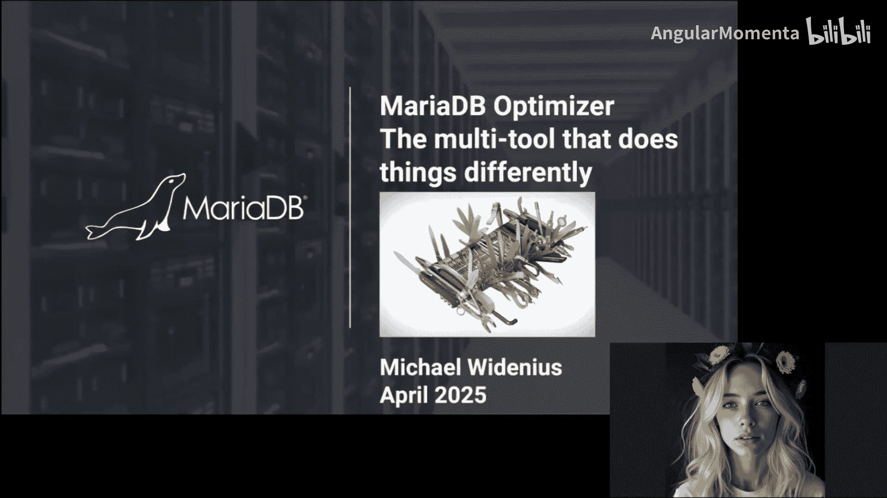
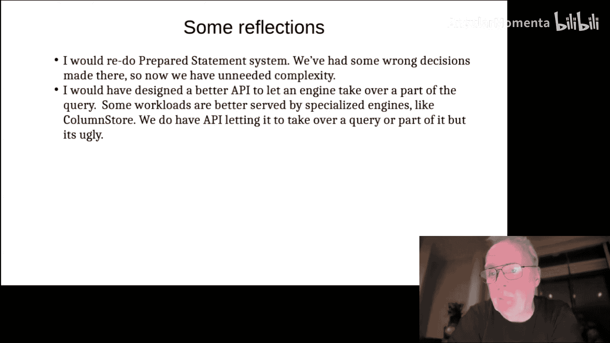
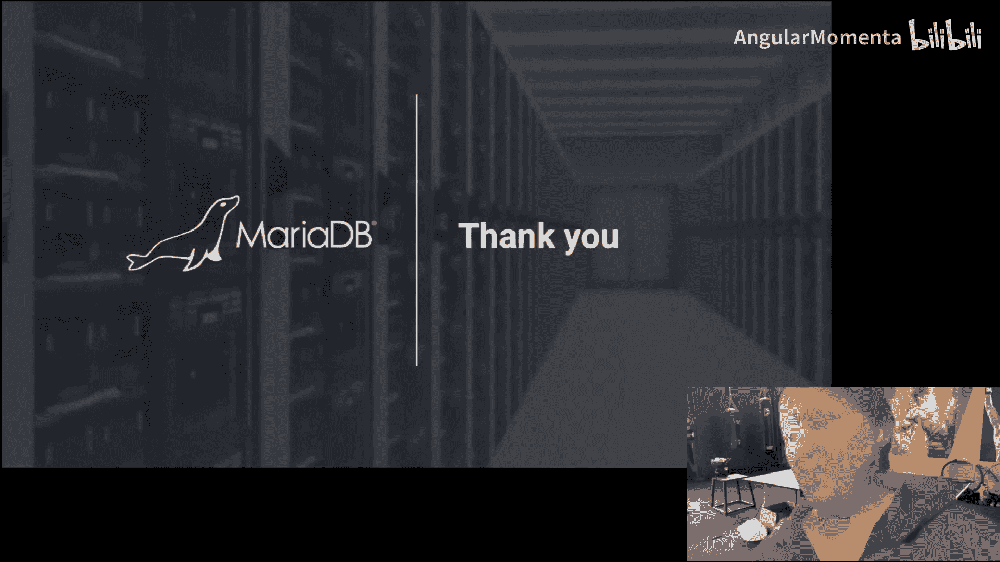
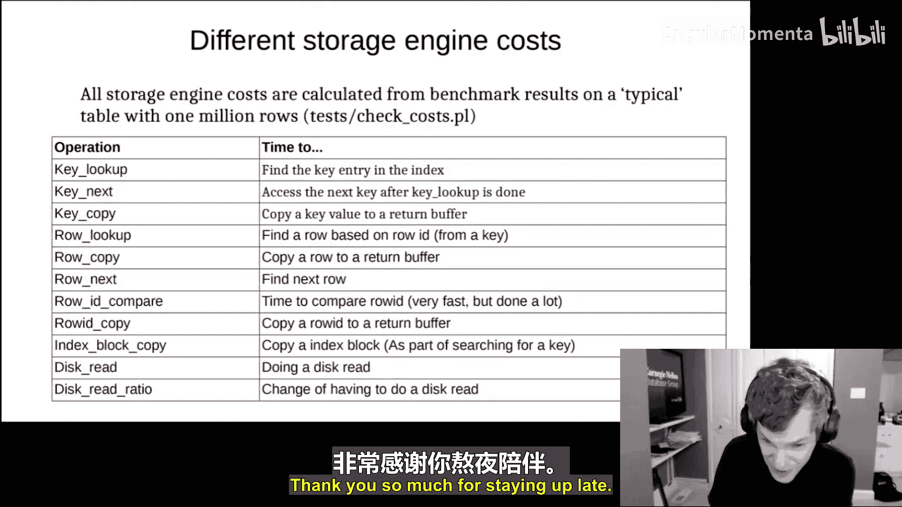

# 【卡内基梅隆大学】SQL 或死亡？系列研讨会 ｜ SQL or Death？ Seminar Series (Spring 2025) p09 09 MariaDB查询优化器：一款功能各异的多面手（蒙蒂·维德纽斯） -BV1FkisBtE97_p9-

有的。🎼why I hate it。Sequel or death Yo son， what are you going to choose？Yo check it。

 this seminar is filmed at Carnegie Mellon University thanks a lot， Google。

Hi this is it we're super excited today to have the Monty Winess， the creator of my Sel Marie B。

 and I have since learned not the creator MaxDb but the namer of it I mean Monty has been super well known in databases for the last 30 years his contributions to the open source community are massively significant so there' there's not much else he say does Groveby the week beat an article about and see how awesome he is so we appreciate Monty giving me this talk because it's currently almost midnight in Finland where he's speaking so again we appreciate him staying the update to talk about Marie B。

So as always， if you have any questions for Monty， feel free to interrupt at any time during the talk。

 say who are and where you're coming from， and that way he's not talking himself for an hour over Zoom。

Okay。Said。It's funny， Voonica， I'm a long lost daughter。

 I haven't seen you basically since I was bored。Wait， who's this？Ionica。

 apparently I'm Monty's strange daughter， that's what my mom told me， and I'm in America， dad。

 I miss you and how come you won't name a database after me？

Maybe because I didn't know that you exist。Wait， Monty， do you have a fourth daughter nope？

Not as far as I know， are you sure， and especially not as far as my wife knows。Okay， al right。Okay。

 I don't know what this is， I mean， be amazing because you could name a fourth database。

After you know after Monica， right， are you here to announce this now or no， is this a real person。

 but then I would need to do a fork again and， that would be quite painful。Okay， all right。

 well I don't know who the verses me is I' mute them sorry about that I don't want get rid of them remove done all right。

 sorry。Monty， the floor yours ignore that， thank you for being here。Okay， so。

I'm here talk about the Maria to be optimizer and a little bit about the background。

 So we will a couple of history slides。😊，About where I。Where everything came from。

So I've been working with Data since 1981， probably before some of you are born。

And I started by creating an application where you just paintings on the screen。

And then you automatically can start putting in data and you could also do a report similar ways。

 This allowed you to create something like a bookkeeping application in a couple of days compared to months back then。

And back then， there were no optimizers。Because when you did a report。

 you said that first this table and it's linked to this table and it linked to that。

 so everything was predefined， but I spent a lot of time on making scans very fast。

 making index retrieval really fast and specific rows。😊。

And there were lots of summary tables that was trivial to create with the tool so we could give customers instant update when they asked。

 So in this gas station， which are the largest customers and what are they buying。

 We could give that in subsequent。 And this was on the computer with just a few me memory。

 But so when I created then my scroll on top of the old， old。😊，But creating a optimizer was。

The first big task because the storage and everything around it was already done done。

 So the first version was created on a 30 tube with computer。And then a couple later。

 I started to move to Uniix and C and that was created on。For meg sparkar computer who was dead。

Eventually， getting 60 mega so on。But that also， when you start working on something that there's only 32 k。

 you start to be very。Cutious with your memory usage。

 So many of the algorithms in Marid D B uses very little memory。 For example， I created a。

Way to do hashing with no extra room。 So if you have a hash table with 10 entries。

You have the housing will take1 entriesries。 There's no extra need for。Duplicates values or。

Doing that。 And that still used the bit today。 So in many。U。From any point of view。

 Marie and my squl was a practical database。 I didn't know so much about a squrel back then when I started。

 I didn't know the basic， but we had。The philosophy that everything we we do is to make。

It's easier for users， we try to do full of them aQL standard。

 but if the SQL standard was too inflexible or they were a better way to do that that was not in conflict with standard。

 we just added that so this make Mor be a little bit different。And also from Unireg。

We had the concept of different storage engines and for different purposes。And。

The reason for that was that I started by creating Union rig with。

Something called CI some from a Swedish company， and in the company said some years later。

 oh we are not stopping supporting it。So I created my own version of C IM with we call them my IM and with but had more compression。

 more options， but I didn't want the customers to if they upgraded to new version in。

 I didn't want them to have to change the order tables to the new one because。😊，Customers doesn't。

 people hate upgrades。 So in this case， they could just use the old engine。

 And if they wanted the better performance and options， they could just switch engines。

 So that was kind of the beginning of the storage engines that we have in my square and E。So。

The optimizer was first created by me from scratch and。

I never written optimize I had read about databases in the university。

 but they were very basically they were more about how to use distribute the database。

 so we have one table on this server and one table on this server and how to do joins about that。

 but it was not practical for what people needed on the internet and。😊。

And most of our older customers were using OLTP and with lots of connections because Madeby Xise QL was the first program I ever created who were using threadreads。

And because I wanted to have or be able to support 10000 of users， which we can do。

So we had lots of optimization for basic queries， we always assumed in the beginning that good indexes。

Should exist。And we have a hash join， but that is kind of used only when the user has not defined indexes that should be there。

So that was kind of the beginning we do have lots of optimizations added later we had optimization team who actually had studied databases in the university and they did add functionality that we didn't have in the beginning but the beginning was just get the problem solved good enough and take shortcut if it makes sense but don't take shortcut that would stop us from doing things。

Let， let's say call it properly in this case in in the in the end。 So we did add， for example。

 subqueries onlycom in myq for0 that was around 2000。

 and the first myql version was in in the beginning of 96。Would you say the first version。

 the court was a bunch of like ifNL statements， like if you see a pattern， do this optimization？No。

 no， it has sub we didn't have sub credititates until around 2000。 so we have the。

I'm saying like the initial version you guys wrote it it was like rule based if then else or know if then apply this rule and then I understand that so unit rig was rule based so when we created I crized qua。

 we did the full optimization we did analysis it we had cost but it was still optimized for that we have indexes。

And we could work without indexes， but we didn't have hash joined in the beginning。

 So it was a really basically a full。Loopover all combinations thanks。

So what I will talk about in this talk about those something that makes Maria Dby still unique as far as we know in this case。

 me and optimizer team compared to all databases I don't know if they are unique because I haven't looked what every other database supports。

 but I think some of those should be interested to audience and I will go through those in the hope that that will be true。

First， a little bit about how Maria D is oriented。 So this is。

 this is a slide from full opts I talk with with。Regarding inner DB。

 but the important thing is here is the storage engines。

 what makes Maria Db unique that we can have or the storage is decoupled for the parer and optimize and everything else and you can have different engine engines。

😊，Both things that are totally in memory， like the memory engine or in with the cluster index and fully transactional an area and myasM who is not transactional but has a very low footprint and uses much less less disk space and then we have a3 who allows you to store data in S3。

😊，Stories， very， very high compression。But。The storages engines is important for the last part of the talk。

So first of you about the optimizer with this talk is about I don't expect that this anything。

very different from other ones， except maybe the constant constant tables and the range。

So I will go through dose in。Whyite a lot of data。And the difference between data independently rights and data wh rights is that。

WeMar D is very good at the。Using constant for finding out what's the best plan and the data independent rewrites is rerites that we do without looking at any data in the tables。

 For example， if you have a equals 5 and B equals。A， window at B or or also will be5。

 So we we do that in the first pair， but。Then come the consent tables and the range analysis where we do data where rewrites and do decisions based on that。

And also this， I will not talk about this， but just to make it clear that our optimizer is now the state art and we have a lot of things that is probably the same thing as you have can in any other competent is called database。

 this is just to show that we have a lot of different optimization for subqueries among other things。

Yeah， this is mostly because I showing this because I heard some people in the Post community saying that my square is just to you。

 we don't have proper optimizations。 It just shows that we do have。

Most of those that you would expect and probably more in some areas， less in others。

And that's through way in the database if it makes you feel better Postgre is。

 sub query rewriting is terrible too。Yeah。Yeah。Okay。Let me yeah I want to get to fix one thing on it。

Okay， so first the constant tables。So constant table comes in two forms。

One is that if there's a table who has only one row。

Then we will read it at the beginning of optimization and use that。All that。Columns and constants。

 This allows you to basically drive an application by having one constant table who has some rules that you can use with。

 And that's quite useful Instead of having to have those in all queries。 That's one part。

 And if you have a。In this case， T1 unique key is 7 Tuesday4。So if you do know that the。

This T1 will only have one row， so we read it early and then we'll use T1 and all columns like they would be constant。

随便。And this allows us to do a lot of interesting thing， especially the up optimizer。Butt。Yeah。

 they would go through。Just to be clear， so you optimizer starts planning， it sees that you have。

This kind of set of where something equals something and you have the constant。

So then you the optimizer basically stops， you make a call to the execution engine or the storage engine that corresponds wherever this data is。

 you go fetch that one row， which could be an index lookup presumably presumably it's a unique key。

 of course there index lookup yes you come back to that row and then now you're filling in that constant。

and then do you， do you have a way to pass along to the context like in this case you're doing a join if you knee the columns with the first that first row you fetched？

That is retained。 We basically replace the everything everywhere in the warehouse class and outer places the the the data from the row as a constant and treat it as a constant。

盖了。So I think we had。It'body from the Oracle team， but my SQL give a talk about how you guys do this。

Five years ago。This is bizarre like no， I don't think anybody does this。It's super fascinating yeah。

 and it actually helps because often you're searching for one customer or everything else and suddenly you can use that to do more things。

And the thing is also that it's not good for prepared statements because if you have the unique key or you have a。

 for example， T2 call can also be unique and but if there's lots of values there， the plan changes。😊。

Marie D is really good because of this and the range of optimizer to do replanning based on the data that is in there。

In the database， I will come to that。Okay。And that's the range optimism the。

 And this was something that I created already in Uni rig survey the code is basically around from 82 to 83。

 and we're still using that。So。The idea is that if you have constants。That that are， for example。

 in this case， you have a debt and you doing support sales and you have。

Higher date between something。 we will create for。This basic range。A select of a set of ranges。And。

If you can see on the right side there there we have sales and there are basically two ranges in sales。

 we need to find orders or those and also for the support so we and we search this live。😊。

At the beginning of the optimizer。 And this tells us， quite。诶 big呃。High precision。

 How many rows are they in this complex complex range and if it can be actually pretty large because you can also we have a users who have does for example。

 the depth in and then thousand thousand ranges in this case。

 we will cut that fee to make it smaller。So overlapping ranges are joined together we guarantee that no range will be do ones。

 so in this case we have to only to fix the rows， we start with the first range。

 the first value we do read next until the end and then we do four ranges and then we have all the values for that without having to do any larger scan or anything else we only touch those rows we actually are in the set。

And we can handle this for all the normal things bigger than less than between。

 like with the star and everything else。Normallyly these these and I will just go to the estimate then you can ask question So how we do sorry we have a set of ranges so how do we get the rows so basically what we do is we take the first the beginning range and we do a dive into the B3。

😊，Like we conceal see in in the on the on the right。

 and then we take the largest base value and do our dive。

 And we basically see that in which percent of the B3 are we in this And that's pretty easy to calculate。

 This gives us for any range reasonable estimate much better than any。😊，And。Statistics or。

Let's say what's the word。So awesome， yeah。But it's precise and it gives us a good for any table。

 it gives a good。😊，Been estimate of how many rows will we do that。

 We may not use this the range as the index， because there may be a better one。

 but we have a top limit of how many rows we are going， which allows optimizer to do much much。

A better job。 And this works for both single column and multi column。

So you had some question Andy just be clear。You first check the histogram I mean we don't use histogram index as a big histogram with much more。

Yes， I bespoke， so first you break up the ranges and then you probe the index。

To see what percentage is going be covered and then that gives you that's how you're getting the selectivity estimates for a given index yes or very in this case you have a index on index apt higher date so that tells us that。

Police told the number of ranges there may be 10 rows。我三てな。

And then for every potential index that would satisfy this query。

 you do the same thing for all of them， for every index for every table。

And then I guess my question is also to like presumably the the probes in the index have to be transactional。

 so like they're running in the same transaction context as the original query because technically。

 you happen to started running the query， which kind of are。

When we start the trans context for the first dive we do， for example。

 if we do a constant table we we have to ensure that that is in the same transactional context。😊。

So everything but also these are estimates it doesn't really matter if they are exact or not。

 they have to be just better than anything else because when we comparing those two other ones but for example。

 they in this range they be miose that has not yet been committed we don't care because。😊。

It's an estimate， and any statistics or histogram is also estimate。Have you guys measured to see how？

I mean， there's a computational cost of obviously probing the index。

 you take latches as you go down if you measure like sort of the performance an accuracy trade offs between a traditional histogram or a sketch or something using like traditional methods to estimate these ranges。

So usually we are within within 10% of the real value， which you can get histogram。

 the worst case you have if you have a you can when you insert the three can be balanced on the on the wrong end in that in that case if you。

Gets a dive there， then you can be 40% off， but even that iss a good estimate for choosing the right index。

And then for certain search engines like the B plus3， okay， if it's like if it's no ODb。

 the primary key， the leaf nodes or the data so that makes them kind of expensive the read I suppose this was this was both for the primary index or the and the secondary index usually。

Less used with the primary index because usually it's that you try to keep them those short。Go， okay。

 awesome， thank you。And one challenge with the multi column index is that if you have a Finland and。

And engineering those and you have index on both both and those combined so then the question what's the selectivity on those and we either have a slide for that。

Is that assuming that you have indexes on call1， call 3， Okay it's it's listed down there。

 The thing is that no you have statistics that overlap。 So if you try to do sta on。

To get the selectivity of this table， you can just combine those。 And for some， example。

 what you usually do you believe they are independent。

 and then you just take the selectivity of its expression and multi orders， it doesn't do that。

 It doesn't work。 So what we do in Mer D is that we we start with the。The index。

 which has the lease rows。 and then we skip anything else else that is using the same columns just to。

Not get the selectivity。Ab。Bg。But if there are three indexes。

 we will then normally scan the index with the least amount of rows， but we still want to know。

When you apply the warehouse clause。HowHow much less will the selectivity be？So this is just。

A couple of things that we do。And。For any optimizer， you need a way to actually see what optimizer。

 how it works， how which plan it is skip is skipping and all the costs。

 So we added optimizer trace some years ago， which is a output is JasonO to make it easy to read。

 and it's good for troubleshooting， but also that。The the old optimizer in。

Maya square was was kind of primitive in the way that one cost was one disk access and we also assume that one key like lookup is one disk access and everything is one this access and。

Except for a couple things， that was。A little bit less， but not much。

And we had a hard time changing that because we needed a tool to be able to see our our plans actually better。

 So when optimizer traces was added some five， six years in Maria Db that opened the opportunity to create a new optimizer。

 which I did in my Maria Db110。But I will come to that later。

What we notice where we we an optimizer is that。You have something that is pretty good for normal cases。

 but。Customers and users very often doesn't have normal cases。 And they just expect things to work。

 So you have。Cases where we have column in and 50 K values。 And with the range of opt， I said。

 we're trying to find all ranges。 If you add that with some and and some ors。

 you suddenly have ranges that is gigabytes and that doesn't work in practice。 So we have to cut。

 cut those。And we also see a lot of users who have lots of and or all levels with lots of constants。

 but then we tried to build the ranges。呃。で。It becomes。More expensive to create， to create the。

To create them and。And I ask for them statistics that actually just executed， but these are。Ex。

Exceptions in general， the range optimizer works really， really well。

 And we have seen that when we take practical applications so that people are converting forac to Maria D B。

 the range optimizer fixes many of the queries。😊，But then then you also have users who just users。

 who just expect that you do a year on a column and that should be used an index。 So we， we。

 we added that， but we added that， I think。A year ago。

 the same thing with upper case on a customer name。That is also something the index can do。

But because most of our index is case insensitive， but we still have to notice that upper is a special function that you have time to handle。

And there is also optimizations that this based on that you have very little。Values in the group by。

 you had to detect that。And and then you have to。Do special optimizations for that cases。

Let the optimizations also exist in。What are databases， but that was something that we didn't expect。

In in the original version of our AB。 And of course。

 even if users are doing things that they shouldn't do using tables without indexer indexes or using using indexes。

 but have a different collections or just bad schemeche of design。

 we have to be able to support that。 remember a year 2000。

 I think it was something similar to the super ball， but in England。

 but and they were running a full application with my scrolll back then and with lots of data。

 lots of tables。 And then they were asking us could we help them optimize things because they were able to。

Execut event。But they noticed a little bit of delays。

 and they didn't have a single index on a single table。So。But。

They were not complaining about the speed。 They were just wonder， it can we optimize something。

 I we did。Okay。So I did that on the new optimizer in Maria DB11。

 and that was only possible thanks to the optimizer race。

So the redesign or the big reader design was that we changed that one optimizer cost is instead of I it's 1 millisecond。

 So I have gone through all storage engines and different parts of the server done。

performanceance analysis， everything else， and calculated what where is what the timing of each small unit of work。

And then。We did that in all part to deserve。And what makes it harder for us to do this in Mar Db is because of different storage engines because。

They are different。And we also made it possible for tuning the the this access and each interval engine can be tune tuned。

 But， of course， there's some things that you can't predict if you have a something like。Column like。

Present full， percent， you can't know how many rows will actually。

Be fetched actually or will be accepted by the we close。

 so there are always something that you can't tune。Did you go back to the previous slide。

 so you're saying one more， so you're saying that。Sorry go back on more slide。Yeah。

 so you're saying that instead of。Doing your cost estimations on a diskIo。You went。

 you're basically now accounting for。All of the computational costs in addition to diso and you're sort of chunking up like if I sort a thousand0 tu bolts that's going to cost one millisecond so you sort of mainly have went through the system and said。

 if I do this amount of work， it's going to cost one millisecond and then now your cost model you're saying okay to run this cooler we land。

Here's how many times I'm going tovoke the sort， the Rove ID filter， and that's your cost estimate。

Yep。Okay， impressive。And this comes just from the fact that when we started in the beginning we did things easy。

 one optimize because actually worked pretty well， but there's always a case when you have have to decide should I use this index or should I use a table scan for doing that and usually if you have to access more than 20% or the rows。

 then index can is faster but we didn't know that before and so previously we were using index scans。

😊，Or scanning the index instead of doing table scan。In some cases， but that's always a slow query。

 So people didn't notice that， but。Still， there are cases where that caused a problem and 110 and above should fix it。

But this also means you' like the code base becomes somewhat brittle。

 right because now say you change the sorting algorithm。And what went from。

 say1 thousand00 twoples takes one millisecond， now you know 10，00 tuples and one millisecond。

 someone has to then go update the cost model to somehow reflect that change， right？

Let's say most of the sorting is still retrieving the rows from the table， putting them in a sort。

 and then the sort is basically file base， so we have calculating all that and it's reasonable exactly。

like you say calc mere mainly calculating or some of the code can update itself or the so I have a script that is included in my Db that helps you calculate all the basic primitives that we have I never will go through those in the coming slides all right thank you。

But。What makes things complex fast is that we have a inner D， which is a cluster index。

 That means that primary gear access are faster than。Anything else including out databases。

 just because you get the row data， you don't need to do extra fit for the row。

 but that also means that secondary indexes are slower because when you access the row data。

 you have to go through the key in the secondary index and do a search in the primary key primary key to get the row。

😊，And then you have B3 pointers like my IM where we point directly to a file。

 and this is not this basic file on disk this position。 So in this case。

 my ISM uses the file cache for the data， not for the index。 and then we have area。

 which is like a more than a version of my IM that you can have both run both in the。Poイント inで。

The data like MayASM would also have things in a bit that discuss the memory and we don't depend on the file system and then we have the memory engine where that supports both hesing which is the default and binary trees and all those has different costs and all of those have we have calculated。

And then we then we also have a problem or possible problems with when you go to remote storage S3。

 you have to do a A T request to get the data and we also have federated engine like that can access remote Maria D MyQ and the connect can go through JDBC So the three three last ones are not fully。

Cost base。 So they are reddimentary， but older other ones are。De in detail。So， so what we calculated。

 So I basically looked at how the engines are working and I spread things to about 10。I2 of our As。

So。You have the key lockup。 That means that we find the entry in the index。 And in this case。

 in the D has for cluster keys has a total different cost than they not cluster keys。

 And then you have key next， which means that。Then we have find。The first key。

 And then we do a key next。 Usually that is by the engine。 So it doesn't have to do a full B3 access。

 It just goes and fight the next on the page。 So that's much， much faster。So if you， for example。

 doing a。What we call a ref access。OrOn a key。 and you will know that is five rows。 So in that case。

 they will have a cost of a key lock of one plus3 sorry，4 key next。

So we also have key copy and row a row copy， key copy is copying a value of the key because we can re key。

Read key read only。Keys that we call them， and we basically get the data from the key。

 we don't have to go around and fetch the road。And we can and if。Then we need to copy the row。

 which is much more costly than a key because it has more data and then we also row next finding the next row。

And the index block block copy is that when you do go through a B3， that is page oriented。

 Getting to one index block and then going to the next。

 You should have to copy the last block and save it so that you can do index next so we also have a。

Calculated the cost of doing this one block copy that is needed。And with that， we be the optimizer。

Goes through all combinations of the tables， looks at all the the different indexes and and checks if Rki can be used key cluster key calculates the cost for all the combinations and and for each table it uses the want to be the。

Least cost。 But we also use the data from the order。

PosPossible access says to to define what's the max amount or rows that we have to cover。

 because if we have a cluster key that's really， really fast that that may have thousand entries but the range key tells us that。

There are actually only 500 entries。 Then we know that when we go to the cluster keys。

 we build only 5，500 entries。That will satisfy the warehouse clause because the rain key range tells us that。

 So we can use that to。Provide a better  estimate。Both which key to use and how many rows we will find。

 And last， I will not repeat， repeat that one。 The basically shows that how we calculate the cost of one。

Look up。In the cluster index， where where we are only searching for part of the key。

 So that means that there is more than one row that we will find。在证。

But this will give us a really good estimate， and we are test to proves that that。😊，That is。

Roughly correct， and I believe as within the estimate don' let it be roughly correct。😊。

But the test was done with， I think I wrote it somewhere that it was done with a table with kind of a normal or order row that you can find in any kind of。

In the fact table with 1 million rows and we to the data from here and here you can just see the。

Optimize cost comparing inner D B with area。 And you can see that the key look up cost it's much higher in the inner D B。

 and especially the road look up cost is really high。 the cost。 It has to go through the。

At the cluster index， while area basically have direct pointer to。

 here's the page and here on the page we will find the row。

You have results to show like that you're generating better query plans given these more accurate call estimates yes。

 we get much with the plan in in in。In the 11 areas。Okay， thanks。And and all these data， you can。

 you can。There are part in the information schema you can actually change those。

 I don't think that anybody wants to change those except maybe the cost of disk because that is that is also variable。

 We have a discrete and discrete grid Ra is at the chance of we have to go and find it。

The cost and discrete is basically milliseconds for reading a block。

So you can basically optimize your database for your storage by changing one value。

So things that Maria D doesn't handle well is that。

The move startqueriries where you have two fact tables that has lotss and lots of rows。

And then you have some connection in between。Because we， in this case。

 we can't easily go through the normal way that we work with a query。 We start with one query。

One table and then we scan that one and then find it next。

rowose in the next table and get the order one because in this case you basically should separate those and run two queries and then should join those。

So that's one optimization we don't have。But this is not frequent I have had during the last 10 years。

 one customer who needed this for one thing。SoBut every database had their own limitations I voted at least to acknowledge list that we have at least one。

Okay， and some reflections， what we could we could do better。

 I think our prepared statement system could have been。Done better。

 We had been doing some strange decisions。 So and that。

 especially re execution was really hard to get right。And we also did some changes regarding that。

 So we still have some old cold there that doesn't do any harm， but makes the cor more complex。

Can you share like what were some of the bad design decisions you made for prepared assignment？

So in the beginning， we wanted to make it easy to detect if a table had changes， for example。

 you have a prepared statement and you have done to optimization and then somebody before the next execution doesn't alter that table。

That code to。Try to reuse the old table data columns and everything else when it was changing。

That was just way too complex。 So we were removed that some years ago。

 but there's still some fragments of that left。So that we should just clean up it kind it works。

 but we shouldn't have gone through several phases to make it right。

that would you say that's part because in the early emerges on My SQLDB。

 the catalog wasn't transactional？So like you would do alter table changes and you had no way within the context of that transaction to。

 for example， to invalidate prepared statements because prepared statements were sort of sort separately no。

We could inte them， but then we basically when we we checked when we started the new execution has the table changed but it was just done in the wrong way that was too complex sometimes you you do complex solution and。

😊，When when you don't you can't solve everything and then you try to patch that and patch that until you notice that this doesn't work。

 So no no we have a much simpler method to doing that。And so the storage engine API is really good。

For handling different ways of storage。 And when you look at databases， user sooner or later。

 the performance of the database will be depending on how you store data and having these different storage engines allows you to do about well P workload with in a D B。

 you can have column store who can do。And I lose it to cover workload。But still。

 you had the one server who is。Orchesing everything。 So， for example。

 if you have two tables in in in column store and then you have have currently。Normallyで。

Apppper Le will try to fetch。Trowose from both of those and do the join instead of being able to sell teleco story that here's all the tables you need。

 do whatever you can。 And then we do everything on the Apple level。 So we have an API for doing that。

 but is。😊，It's not as smart and good as it could be， so we need to optimize that。

So that was， I don't know how I with time， I don't have a timer here， so what's the timing？

We have 12 minutes thats fantastic so let me first applaud on behalf everyone Monty that talk was super fascinating fantastic I guess what we have one question in the chat but I've open to the floor if anybody else want to mutute yourself and ask Monty a question feel free to go for it。

First come， first serve。W I had， this was great I had a quick question on when you're looking at the table values to feed into the optimizer。

 do you go and grab the readlocks on the rows right up front before you start the optimization or do you something else to not lock the tables early on？

So yeah， so so initially it's using MVCC， so we don't need to lock the rows。

 you basically as soon as you access the table you get a snapshot of the data as it is so we don't need there's no row locks。

At all。So in the DB works by a， if you do an update， we do an update in place。

 but we take the old copy and add that in the redlo so you can access that。So that basically。

 you can think of it that okay， a versioning on insert。

 So read is painless doesn't cost you anything。But except if you have to access a road that was changed。

 then you had to go go and find it。Great， thank you and areas using the same method。All right。

 other questions。A might ask a question？Go。On your slides。

 you showed that you invented subquificationation for multiple cases， but not for semijos。

 what is the reason， what's the problem with semijo， why you don't catch the results？

If you're talking about the this one about subqueries， this one， yes。

 quite only materialization here。OhYeah， but so we do have caching for on on different levels for subqueries。

 So， for example， if you have a in and a subquery， we do check that at with cache every different value of in that was used。

 So if a in something。 and a is 1，2，3， we will cache values of a 1， to，3 for the subquery。

 for example。 Yeah， of course， But why not samejourn， What's the problem。

They join have only multipleization。As I see here。semi me join in subqueries。

 if you semi me join on the upper level， then there is you don't need cash because we will get the data back from the table。

😊，嗯。😊，Okay one more question about probing indexes。

 you said you probe indexes to estimate like by histogram estimate the size。

Like it gives you the same result like a histogram， but more yeah sure。

 but you know in Postgra we have such experience too。

 we have machinery to probe index during planning and I personally tried to invent a probe index for equivalentvalence operators not only for in equivalence。

😊，And in both cases， as I see we had multiple corner cases which was painful for performance because you may touch page what which is on disk。

 not in cache and it reduces a performance lot， how you I guess I wonder maybe you have some empirs which tell optimizationr which time to use index which time not to use index for optimization。

 how you avoid problems performance problems so is range optimizer we have an upper a limit that use that can define how many ranges we actually will probe。

 but if you have a query like this one。You probably want to have only those throws and if you're going to use that index。

 fetching the data from the cache will actually be something that you have to do anyway。So so。

But the。This is useful for large tables and the other option you have would basically be to scan table。

So basically be much， much of worse。So we just see that for it's very seldom where。

 where used to have a problem with the range optimizer。 It's only if you do an in with。

Thousands of rows， and we actually have users who are doing primary in and thousands of rows and didn't want to update。

And。And they increase the。I think that we have a limit of thousand in the in and they increase that to 10。

000 because it's still faster than doing it any other way。Okay。

 another question you showed complex filters with multiple causess and that。😊。

And as I understand you have some kind of statistics on multiple columns and it's okay。

 it works in P2， but what you do we don't have that because we just use the index because in this case。

 each the dive is on multiple columns。Okay， I got it。

 but what you do with joints my customers usually like join tables on two， three， four columns。

 so it's complex expressions do have some tricks how to estimate join clothess when they。😊。

They consist of multiple expressions。And its expressions if it's and first。First we see。

 can we use the index to do that and use the index if not and if not。

 then we have histograms and and we also have general statistics So for example。

 is index in both in the DB and in most engines tell you how many values you have for each index part。

 So if you have a threepart index， we know exactly or statistics exactly how many unique values we have are the first part of the index and first and second part and third So we use that also and when things are not indexed we are using histograms but you you estimate column by column or you estimate them jointly。

😊，Jo对后。Okay， interesting and where I can read some paper on the algorithm or its gross source no everything we do is an open source you can go to the source or most of our algorithm are also described in the knowledge based at Mariadb。

com。😊，Okay， one more questions， sorry I have lot of questions you know。

 quite frequently right now I see redundant queries because they generated automatically they redundant they have lots of clothess。

 they have joints which can be removed， they have some。😊。

II don't know lot of redundancy and for example， subplans which can be flattened so which way you go to reduce such redundancy because my customers my Dbas hate idea to introduce rules which will transform query tree before optimization。

 which way you go you simplify query tree or you。Just do something and during optimization or maybe third way I mean we tried to do most during the pre optimization and before we go into the table order so many of those things that you describe with lots of extra tables come from people trying to implement the anchor model where basically you can have。

10 50 tables， you just add more tables and you'll just assume that the optimizer can。

Remove those who are not needed， so we support the anchor model and that basically allows us to remove quickly identify and remove tables who are doesn't give anything to the result。

Okay， so I do that。😊，Then we just assume that the planner can handle those as long as you have indexes。

 we are pretty good the the query optimizer get。😊，Or let's say the join optimizer who decides which order the table should be joined if you have a lot of tables that doesn't have suitable indexes。

 it tries to just continue a long time to find the best table order and that can take some time。😊，So。

Marby works good when most。tableable connections has some kind of index that you can use。

But that's the same same problem with any database。

 If you have two really big tables of billions or rows and you have no usable indexes。

 it will take time or any database。Okay， last question I promise waits let's wait let's answer one the next question。

 we can come back。You okay？Okay。All right， Puge has a question。

Thank you Michael for this insightful talk， I have a question about multi Star queries not being handled by Maria TB。

 so I'm curious to know what computational cause and design decisions prevent Maria TB from handling multi Star queries if there was a need for handling。

😊，Thank you。The problem is that we basically start with one table and then we then take the next table and join with that one and the next table and the next table and the only exception is subqueries where we then have the subqueries seen as one table but basically you have a line of tables in this case you don't have this approach doesn't work because when you go from T1 to T2。

 this join may not allow us to select。😊，Ba have a wear clause on T2 so we will get the whole of that in the result set。

 it's only when you join it with T1 that then you can reduce rows。😊，So in this case。

 the best approach would be to run in the current query optimizer on T1 and。

Liining table and then the two on the linking table。 and then you link the results together。

But we just thank you so much。 And the reason I we've done that is that we try to optimize things that our users and customers wants。

 And of course， we put customer first。 And during the the last 20 years。

 we have one who asked for that one。 And then they find a way to do it by just basically taking one of those。

 put those in the temporary table and then join me the temporary table。

 So they had a solution for that。😊，So it's not a very common thing。 We try。

 we have to optimize for those things that are common that that。

Teros or millions of people use and not concentrated as something that generally few uses。

Except if they are willing to pay us handsomely for doing that。Okay， a question in the chat。

 thank you so much。OrThank you Pucha question Cha， many of these optimizer functions feel like probing actual data during optimization for OTP where typically queries are faster。

 how often are the savings found from the extra opposition based on the information that these probes are from these probes part the extra probe cost typically in high concurrency OTp workloads I've seen。

Daatabase favor less Op and work to increase output and reduce time taken to optimize Yeah。

 but in LTP vertical you usually only have a couple of constants so the problem is not there and the constant is basically finding a constant table or finding a customer。

And when you have that， everything else will be easier because you have all those in a constant。

 I mean， the whole customer entry is a constant。 You find me instantly。

 The same thing with if you have a。OrOr system。And you're finding a product。

 you know the product and you want to find all the information based on that。

It's still faster to find this one row and use that as a constant。And in other cases。

 you don't have that many constants。So it'ss not a problem。Got itAll right。

 one question more to chat is， why is Mariaie Db moving to Oea storage does a non clustered indexing of cause more random IO versus the cluster indexes in N ODB？

Okay， I didn't catch the what the question The question is why why is we to be moving to a real storage we are not moving we have a。

InIn a， it the most used one areas for temporary tables。

But you can still create the temper table in the area。Got okay makes sense all right。

 so my last question is gonna to be so is it fair to say that the big change that you guys made in ReadDB is not so much this search algorithm of the optimizer like how you' how you're enumerating the different choices you have。

 but rather it's the cost function how you're determining whether one query plan or one choice is better than another and you're now doing this through these more accurate sort of micro benchmarknch that you developed that you they try to combine together what's the total amount of work you're going to do for a query plan is that is that a fair assessment。

Yes。😊，And if you say that what's the difference from my S。

 the biggest difference is that we have Oracle compatible layer so you can take many oracle applications and random them unchanged in MariDB and that's how we get most of our new business。

😊，But that's but that's independent of the query optimizer right that's like a rewrite letter front of that and then my last question is are you running your benchmark curl script？

Like upon installation of a new like a new ReadDB instance or are you doing this once as you build the package and then everyone shift with the same constants it's currently I did run it has some somewhere I did right here it's in test check costs there's a script you can run but we kind of notice that the costs are still to be comparable to others and even if you have a fastest computer and maybe not milliseconds is exact still the difference between the cost is still pretty accurate so' currently we believe it's good enough and。

I have a document exactly how I calculated all costs and which I never did therefore to try to have the check cost program actually calculate all parts because some of those was assumptions。

But spread is actually documented how done and it in practice， it's shown to be。

The is symbol accurate， accurate， at least。Hundre0 times better than anything we had before。Got it。

 I think。The IBMA guy has dropped off the call but I know I think DB2 runs these sort of similar micro benchmarkchmarks every time you turn the thing on it's like the bogo mythps andlys' trying to figure out baseline all right but is this is super helpful all again Monty I'm gonna clap my behalf behalf for everyone thank you so so much for staying up late this talk was fantastic。

