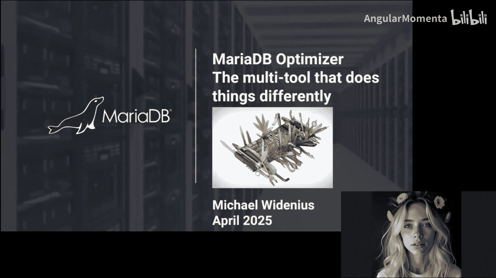
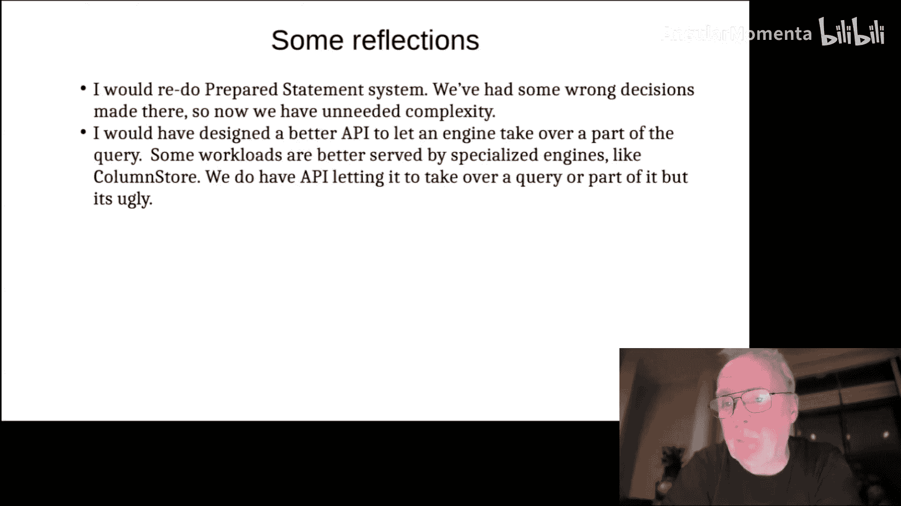
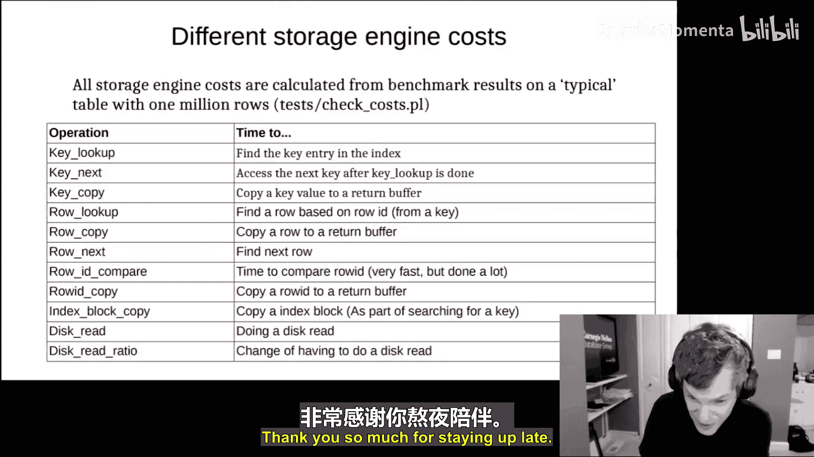

# SQL 或死亡？系列研讨会：09：MariaDB查询优化器：一款功能各异的多面手

在本节课中，我们将学习MariaDB查询优化器的核心工作原理与独特设计。我们将从历史背景开始，了解其发展脉络，然后深入探讨其关键特性，如常量表优化、范围分析以及基于精确成本估算的查询计划选择。课程旨在让初学者理解一个现代数据库优化器是如何工作的。

## 历史背景与设计哲学

MariaDB（及其前身MySQL）的优化器诞生于一个注重实用性的环境。其创建者蒙蒂·维德纽斯自1981年开始处理数据，早期工具Unireg并无优化器，查询路径需要预先定义。

当开始开发MySQL时，创建优化器成为首要任务。早期的优化器设计遵循几个核心原则：优先考虑用户易用性，在遵循SQL标准的同时不排斥更好的实践方法，并支持不同的存储引擎以适应不同场景。最初的优化器代码相对基础，但致力于解决实际问题，并确保不会因捷径而限制未来的功能扩展。

## MariaDB架构概览

理解优化器之前，需要先了解MariaDB的架构。其独特之处在于存储引擎与SQL解析器、优化器的解耦。

用户可以根据需求选择不同的存储引擎，例如：
*   **InnoDB**：支持事务的聚集索引引擎。
*   **MyISAM/Aria**：非事务性引擎，具有较低的存储开销。
*   **Memory引擎**：纯内存存储，支持哈希或树结构。
*   **S3引擎**：允许将数据存储在对象存储中。
*   **Federated/Connect引擎**：可访问远程数据源。

这种灵活性是MariaDB的一大优势，但也为优化器的成本估算带来了复杂性，因为不同引擎的数据访问成本差异巨大。

## 优化器核心机制：常量表与范围分析

MariaDB优化器包含两个独特且强大的机制：常量表优化和范围分析。

### 常量表优化

如果查询涉及一个通过唯一键定位的单行表，优化器会在规划初期读取该行，并将其所有列值作为常量替换到查询的各个部分。

例如，对于查询 `SELECT * FROM t1, t2 WHERE t1.id = 1 AND t1.col = t2.col`，如果 `t1.id` 是唯一键，优化器会先获取 `id=1` 的行，然后用其 `col` 的具体值替换 `t1.col`，从而可能极大地简化对 `t2` 表的查询。这项优化对于驱动应用程序配置或主实体查询非常有效。

### 范围分析

范围分析是MariaDB的一项古老而核心的技术，用于高效处理带有范围条件（如 `BETWEEN`、`>`、`IN`）的查询。

其工作流程如下：
1.  **构造范围序列**：优化器将 `WHERE` 子句中的条件转换为一系列不重叠的区间。
2.  **索引探测估算**：对于每个可能的索引，优化器通过“潜入”B+树来估算每个区间覆盖的行数百分比。这通过定位区间起始和结束值在B+树中的位置来实现，比传统的直方图统计更精确。
3.  **提供精确估算**：这个过程为优化器提供了关于每个索引选择性的高质量估算，无论是单列还是多列索引，都能帮助其选择最佳访问路径。

## 优化器的演进：基于时间的成本模型

传统的MySQL优化器使用基于磁盘I/O次数的简单成本模型。在MariaDB 10.x及以后版本，优化器团队进行了一次重大重设计，引入了基于时间的成本模型。

新的成本模型将一次优化单位定义为 **1微秒**。团队深入分析了服务器各个组件（特别是不同存储引擎）的微观操作耗时，例如：
*   **键查找**：在索引中定位一个条目。
*   **键下一个**：在索引中获取下一个条目。
*   **行复制**：将整行数据复制到内存。
*   **块复制**：在扫描时复制索引页。

通过为这些基本操作分配精确的时间成本，优化器能够更真实地比较不同查询计划（如使用索引扫描还是全表扫描）的执行开销。用户甚至可以通过调整 `information_schema` 中的相关成本常数来适配特定的硬件配置。

## 优化器跟踪与调试

为了帮助开发者理解和调试优化器的决策过程，MariaDB提供了 **`OPTIMIZER_TRACE`** 功能。

执行 `SET optimizer_trace=‘enabled=on’;` 后运行查询，再查询 `INFORMATION_SCHEMA.OPTIMIZER_TRACE` 表，即可获得一份详细的JSON格式报告。这份报告展示了优化器考虑过的各种计划、其估算成本以及最终做出选择的原因，是性能调优的利器。

## 当前局限与未来展望

尽管功能强大，MariaDB优化器仍有其局限。一个典型的例子是处理“多星型查询”，即连接两个大型事实表并通过一个关联表链接。当前的嵌套循环连接策略在此类场景下可能效率不高。

此外，预处理语句的早期设计为了检测表结构变更并重用执行计划，引入了不必要的复杂性，虽然后续已简化，但代码中仍有残留。存储引擎API虽然强大，但在协调像列存引擎这样能够下推大量计算的智能引擎方面，仍有优化空间。

## 总结

本节课我们一起深入探讨了MariaDB查询优化器。我们从其注重实用的历史起源讲起，了解了其独特的存储引擎抽象架构。我们重点学习了两个核心优化技术：**常量表优化** 能提前固定单行数据以简化查询；**范围分析** 则通过精确的索引探测来获得最佳的选择性估算。随后，我们探讨了优化器从简单的I/O成本模型演进到基于微秒的精确时间成本模型的过程，这使得查询计划选择更加准确。最后，我们也了解了通过 `OPTIMIZER_TRACE` 进行调试的方法，并认识了当前优化器存在的一些局限性。MariaDB优化器是一个持续演进、在工程实践与理论结合中不断发展的复杂系统。