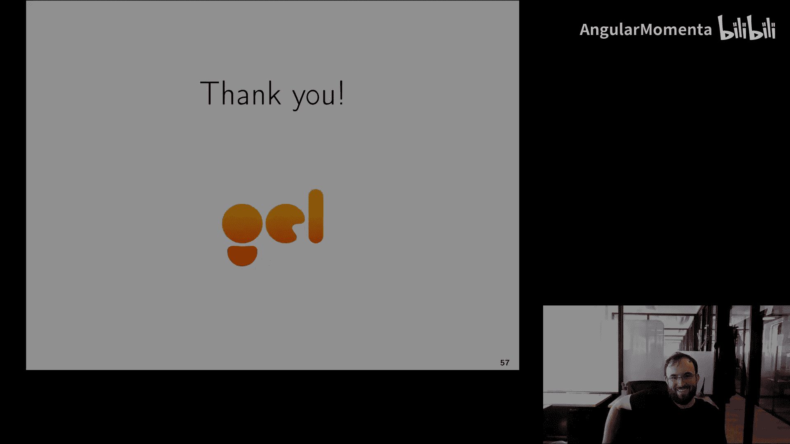

# 【卡内基梅隆大学】SQL 或死亡？系列研讨会 ｜ SQL or Death？ Seminar Series (Spring 2025) p10 10 Gel：取代SQL并改进关系型数据库模型（Michael Sullivan） -BV1FkisBtE97_p10-

有的。

🎼why I hate it。Sequel or death， Yo son， what are you going to choose？Yo check it。

 this seminar is filmed at Carnegie Mellon University thanks a lot， Google。

Hi all right guys it's the last talk of this semester we are super excited day today to have Michael J。

 Sullivan or Dr。 Sulllly as he is knownon gave a talk today about the query languages that they've been building to replace SQL at J formerly HDB with HQL so Dr。

 Sully got his PhD here at Carnegie Mellon's Comp science department in 2017 and he is considered distinguished alumni so we appreciate him taking the time out of his day to come talk to us about what they're doing at J Sully the floor is yours thanks for being here again All right thank you All right so I'm going be talking about the talk title Re SQL and Imp on the relational database model we've got replacing with asterisk right so the title of the seminar is SQL or De but we've wound up ending up a little bit at you know SQL and death right？

All right， so I'm going to talk about what we're doing and why I'm going to give a brief tour of EQL because even though we've renamed the company from gel to from EDB to gel。

 we've kept the query language， the same name， I'll talk a bit about how EQL is implemented and then I'll talk a little bit about what we've been doing to still support SQL and why。

All right， so you've probably seen a bunch of slides like this where people talk about why they're trying to do something other than SQL。

In the seminar， but I'll give mine， which is sequs half a century old it showing its age the original sort of design target was writing ad hoc analytic queries for businessmen。

But some of his problems are it's not particularly orthogonal。

 it's hard to build up queries from subqueries， you often need to restructure things substantially because of things like the distinction between scalar and table expressions。

 it's broadly speaking a pretty large language that's evolved over a long time and tends to be fairly inconsistent in the ways things are expressed。

It has this null notion of null that can go in any type and behaves in weird ways and of course。

 like I said it was originally designed for sort of ad hoc business analytic queries which is something of a mismatch for a lot of application code right you have this object relational impedance match where in SQL you have rows of data。

 but in。In an application， you probably have objects linked together with pointers。

But despite that sort of like。I think Tony Hore famously said about Algal 60。

 it still manages to be an improvement over most of its successors。

 which we feel tend to throw the baby out with bathwater。

The baby here is the relational model and being a little unfair here。

 obviously their engineering is the study of trade offs and so it's not like they're throwing this at for nothing but。

So what are some of the things we think are common problems with you know these databases that have moved on from the relational model these no SQL databases。

 well often they have sort of no declared schemas or weak schemas or this was a bunch of this talk was originally written for the PL group so Bob Harper would call these untyped databases。

As they's sort of only one type， they typically have no or much more limited than SQL query languages。

 often you need multiple queries to fetch the data you want this is the n plus one problem where if you want to say fetch a user and all of their posts。

 you issue that one query for the user and then you need to issue end queries to fetch their posts。

This is also a huge and very common problem with object relational mappers for SQL itself。

So often if you're using SQL， you're not actually avoid that problem。

And then also it typically comes with weaker consistency guarantees than sQL databases usually a relational databases and of course some of these come with corresponding advantages。

These are engineering trade offs we just sort of。Don't usually like the side they're on。U。

I got a Drake meme， but I think we're sort of past Drake memes as a society。

 but I couldn't come up with a good like Kenendrick Lamarme to replace it， so we've still got those。

All right， so what is gel？gel formerly EGB is a new database。

 it is what we call graph relational which I'll dive into in a minute。

 but importantly it is powered by Postgruss， it is built on sort of the solid relational core。

And uses that as its back end and data store。All right， so what do I mean by graphal？

So we think of graph relational as an evolution of the relational database model。

It is built around having strongly typed objects that have unique identity。

These objects can be connected with links and they contain set valued attributes with specified cardinalities and I'm going to go talk about this all in detail。

 but I should also say our marketing has moved away from this we used to talk a lot about how object relational and I've got a I've got a jacket back there that says object relational FTW on the back but mostly we've sort of stopped talking about it we found as a marketing thing it wasn't really resonating with potential users but this isn't a marketing talk and I still like this framing and I think it sort of explains well what we're doing and how we're doing it。

I mean， is a side comment like is because people are thinking oh it's your graph database Yeah also it's a bad name yeah okay it's a bad name honestly I think that a better name for the model would have been object relational。

In terms of precision， but in terms of naming that would have been a full disaster。

We thought of type relational but we wound up settling with graph relational。

 which I wasn't totally sold on， but I think the sort of ideas that we package in graph relational really are the core of what we're doing。

But the name is probably misleading。Which has been obviously。

 and I'll talk about this more later naming or maybe for there's time。

 naming has been a struggle with EGB Nagel。Um。All right。

 so a quick terminology mapping sort of about broadly speaking how relational concepts map into our model。

 the relational notion of table or relation gets turned into graph relational object type columns or attributes get turned into either properties or links depending on what they're pointing to and we'll talk about that more and rows or tuples usually get turned into objects。

Right right。So diving into those sort of three points of graph relational。

All objects have a unique identity which is implemented with a globally unique identifier so this is sort of a primary key for every object and it's global and automatic there's nothing super interesting about this but it's sort of the foundation of a bunch of other things particularly our notion of links so objects can be connected by links so here you can see。

Snippet of gel's SDL or schema description language where we've declared a type person that so far just has a name and movies which has a name。

 a release here and then a multilink of actors。So that means each movie can contain or reference zero or more person objects。

嗯。These links can have properties of their own， which we call link properties。

 so for this actor schema every actor link could have a character name。As a matter of syntax。

 we also allow oting Lincoln property， which is a little bit an example of us moving away from。

This graph relational marketing where we think or we talk about links as being they're very special。

 but they sort of still are right they're the things that reference other objects and they can have properties。

U。I also talked about attribute cardinality and how objects contain number of attributes that have。

Different cardinalities and so the。Sort of two axes here is every property or link can be either optional or it can be required and it can be single or it can be multi so here we have an example movie type that has an optional description required but still single title a multi but optional alternate titles and then a required so there must be at least one multi list of actors which is actually bad schema modeling there are movies that have no actors in them。

But this is this is a departure from the sort of exact terminology mapping I was talking about because in the relational model right you have tables and they have attributes and they can be nullable or not nullable。

 but they always are one thing whereas here we've got these multi propertiesties。

That might have multiple entries in them， and we'll touch back on some of what that allows us to do later。

All right， so now having talked a bit about our schema model。

 it's time to dive in and see how we query it and what we do with it。

So I'm going to be running through some queries here we've got query text up in the Sian。

Block and then in the gray block we've got the result of the query approximately as formatted by our command line interface。

Brent loop。All right， so here we're selecting a string literal and we get back a set containing that string literal and the set sort of important here because in EdgeQL sort of everything is set valued。

That's not too interesting another is this but。Because everything is set valued。

 any expression can return multiple values， and so the question is how do you operate on something using multiple values？

And the answer is we typically the core semantics for most operations is to lift them over the Cartesian product of the。

Input so here if we're trying to add together a set containing 10 and 20 and a set containing  one and2。

 we get 11， 12， 21 and 22。We've got with bindings， expressions can be bound to variables。

 so here it's the same thing but one of them is named。And then additionally。

 we don't have any notion of no what we have is。Just a continuation of our set valued semantics。

 so if you want to treat something that has that isn't there， it's an empty set。And so here we have。

The empty set being added to some non empty set， and we get an empty set back because。

These operations like mentioned before， will take the Cartesian product and the Cartesian product of an empty set with anything is another empty set。

嗯。This has like a really strong mathematical background in our formalism。

 but is also sort of borderline， like especially when you get into filter things with ors because true or the empty set is the empty set and。

There's like good reasons we do it that way， but also not all of our users like it。

So you say a borderline， like what do you mean like like it's kind of。Like sketchy。

you I'm saying that。There's potential for user confusion and we see it on occasion I think semantically like there's a good reason why we do what we do and。

And it's easy to explain what the rule is， but it's still not that hard to get tripped up by it。

All right， thanks。U。And we've been thinking about what we can do to mitigate it。

 but don't have clear answer we've decided on yet。So function parameters then can some functions have optional parameters that allow them to to cope with and have you know behavior other than producing an empty set when one of their parameters is optional。

 the core one being the coalescing operator which。If given an empty set as its left hand side produces its right hand side as output。

 we also have coalescing quality。U， so you can compare something that's potentially empty to something else and get back true or false。

 even if something's empty。We also have aggregating functions such as you know count and sum and Ar Ag。

 and so here you can count that set edition from before and you get back that you have four things。

But you might be asking， okay。The whole point of a database is to query data so what are we doing just like messing around with empty sets of integers and you're right so let's do some queries with actual data we're going be querying that sort of movie database that we mentioned earlier with movies and actors so the basic query here is select movie and we get back our movies and what actually gets returned as the movies just with their unique ideass。

If you just ask for that， but we probably want to see some actual data。

 so we allow adding a shape to object where you specify shape to objects where you specify which properties and links out of the objects you want so here we're asking for titles and release years and we're getting those back in our data。

嗯。You can also filter。In select to try to you know obviously reduce to get the data you care about and not all of it so here we've added a filter and we're only looking for movies called Dunne and we write that with filter Mo dot title equals Dunne or the shortened filter dot title equals dune since we're in a select and we know what we're referring to。

Now。I said that this is an extension of the relational model and of course the heart of the relational model is a join。

 so you might be asking okay give me something with a join let's see what that looks like。

And I'll give you something that's sort of like a join。啊。

Here we want to get all of the movies named Dunne， what year they came out and they all the actors in them and their actors names so we write that with a shape and in that shape we put our link actors and then we can put a subsha on that saying what we want to get out of that is name。

And so here you can see we're getting our 1984 and 2021 Dunne movies。

 the latest one doesn't come out because that's Dunne part two so it doesn't match this filter。嗯。

Now from like a SQL perspective， this joins three tables together， if you were writing。

 if you wanted to write something like this in SQL。

 you'd be selecting from the movie table from a person table and then also from a link table that's like movie actors that says what actors are in each movies。

 but unlike the sort of naive way of doing that join we actually return the nested results。

Nested instead of flattened so the values we return you can see we returning movie objects and then inside those movie objects we have a list of actors。

 whereas the sort of traditional way of doing this in sQL you would get back like movie names paired with。

Each of the actors in the same rows。Now， if you remember， we also had a character name。

Linkked property on these actors and so if we want to filter if we want to grab that as part of our link we canoon so now we're getting all the actors along with their character names。

I'm sure you can explain in a second or not so this is a one edgeQL query goes over hit share server you guys compile that into SQL yeah is it is it going be using the previous example without the link like are you going to convert it into that join or do three separate queries we're going to generate one query and we're going return those results basically directly to the user and then are you going to let the database server construct the JSOm response or does your middleware do that so we have there are you know for the actual response i'll touch on that i'll touch on that in the later slide Okay i've got a slide about what our performance are thanks yeah。

All right。So we're granting these character names and then just to show you a bit more advanced of an EQL query here's the sort of actual query against that test database I ran to produce those results I grabbed actors I filtered for things that matched any of。

Where the character name was like using the SQL like operator， any of Chanee， Paul， Duke Kgurney。

 and then I ordered that by character names。All right。About。

It's nice to be able to fetch data from databases， but you also want to be able to do some processing or collect derived data。

 so we support adding computed fields to an object。So here we're selecting。

And we're computing the size of their cast by counting the actor's link。

This is probably not good data quality， I think none of those numbers are like right and in sort of real sense。

嗯。And。You can then once you've declared a computed field， you can use it in further computation。

 so here we're computing casci and we can filter for movies that have a cas size greater than 50。

The sort of mental model you should have of what these computed properties do is that the shape we evaluate for each object and then any computed fields are attached to the object and can be grabbed later。

All right， so what are some other queries we might want to do。

 let's say we want to for and after find all the movies they're in。

So you can write that like this where we select a person。

 we filter on their name down at the bottom for the actor we care about and then we're defining a film's computed link and the way that's defined here is we're selecting all movies and then we're filtering the movies for if person which is bounds this outer person we're selecting is in movie do actors and that here you can see does exactly what we want。

Um。But this is a really common case and so we actually have built in facilities for doing this called backlinks to allow traversing a link backwards。

 and so if you want to find all of the persons that are linked to by actors。

 you can say give me anything that has an actor's link to it that is a movie。

And so we can grab those easily to support efficient backlinks， since that's a core feature。

 we basically always put indexes on links so this should hit indexes。Um。

ComputedCompd properties and links are a really core part of HQL and so we've also extended them to the schema so when you declare a type you can declare built in computeds for that type and that sort of thing I just showed you is a really common use case for this。

嗯。You can have， so for example， if we have a person。

 we might want to declare that sort of film's length that is all the movies that they are actor in。

Do you materialize that no we don't materialize that we compute that on the fly， yeah okay thanks。So。

We've got a couple more sort of schema language features I want to touch on before we dive into the implementation because some of them will get mentioned there one of the big ones is we support inheritance。

And the place where that shines the best we find is when you're trying to do mix in style things where you've got some pieces of data that are going to show up in a lot of different objects and so here an example that you could do for that is let's say you want a digital object identifier on a bunch of objects and you also want names so you can declare an abstract type for digital object with a required exclusive DOI and abstract type for named and then different things can。

Can extend them and pull those into those objects。And so here we've got a movie that's both those named digital object TV series which is the same and episode and so they're all separate things but they're all sort of pull in some of these behaviors and just as a schema modeling example here you can see we've got a TV series object。

That doesn't have a built in link to its episodes， instead we put a required link for each episode that says what series that belongs to and then the episodes in series we compute with the backlink。

Our users like love inheritance， but it is a pain in my butt。

A lot of our trickiest implementation problems come down to this and well we might touch on some of them depending on time。

To just run through a couple other of our schema features before we dive into implementation。

 we've got access policies， which is you can define pretty sophisticated access rules on objects for when you can select them when you can insert them when you can update them that can reference global variables that you define setting up your clients。

 we have triggers and we have default values and rewrites which allow you to rewrite fields and objects whenever a update is done't。

All of these are defined with arbitrary EQL queries and all of them are implemented in the compiler。

 we don't build them on top of the most similar postg features because the most similar Postgss features typically aren't powerful enough to express。

Arbitrary EQL queries because they're usually sort of looking at a row at a time or a table at a time。

 and we need to be able to look at multiple stuff。嗯。

So we actually have a formal model of a core calculus of HQL that covers a lot of the behavior we've discussed and a somewhat more fleshedt executable model implementing it implemented designed by Jimmo Chen。

 who is， I think， on this call and whos a first year PhD student at CMU now back when he was intern with us。

Com。All right， but so now it's time to dive into the fund bits， which are the implementation。

Whats the sort of fun bits？So the sort of core idea of the implementation is we are built on top of Postgs SQL everyone our schemas get turned into Postgres smas and every one of our queries gets compiled into a Postgres query and as Andy was getting at every one of our queries gets compiled into a single Postgres query so when you have one edgeGl query that gets compiled into one。

SQL query that gets sent to Postgres and executed directly。

And maybe you can touched in a second like its it's like stock Postgres so you're not installing any extensions or UDFs to make make gel work yeah that's right。

I think the version we run on our cloud has like。Has one patch we ship。

To make creating constraints faster in one edge case and I think that's as far as we havent hacked up right now Okay awesome thanks。

Because one of our users was dying from something stupid。Okay。

 so to loop back to our terminology mapping saying that broadly speaking SQL table is a object type a column is a property or link and a row is an object so we're going to flip that around and then see what's changed when we go to actually implemented so our actual schema mapping is an EQL object type becomes a SQL table。

A single property or link becomes a SQL column。But a multi property or link also becomes a table。

Because it has to link the sort of source and destination。

So first single links and properties we've got here we've got an optional property name。

 and so that's just a text column if we've got a required link to some object fo。

That's a UUI column referencing that objects ID will put a notin all constraint on it。

 and then we also for all links create an index for allowing reverse lookups efficiently。

The column names in the actual database are not these real names they're actually the UUIs of the objects in our。

😊，In our system and actually the UUIs are the like unique identifiers。In the graphational model。

 because our schema is stored as a you know in EG。Right， let's all boots strapped。

Note also that we have an index， but we don't have a foreign key constraint because that is sort of。

It doesn't work with our multi table implementation of。Object of and inheritance。

And would not help like and would cause， I'm sorry。

and would have some performance downsides instead of having explicitly specified foreign keys。

 we ensure in the compiler by construction and our query language that you only try to put in links to objects that actually exist。

For multilinks like I firsthad before it's we create a table。

 so if you have some multilink fo from an object bar we'll create a table that could be named bar_F and it has source and target UUIDs and then a unique constraint on those and then a index for looking up it backwards。

If we have linked properties， then those go into these link tables。

If we have multi properties it looks pretty similar except we only actually this is right there shouldn't be a unique source there's no constraint on this so ignore the last line of this it's just a table with source E ID and target text。

I was editing and missed something。嗯。Maybe we can fix that in post。啊。That's probably more of a pain。

All right so now that we've seen how the schemas are mapping what does the compilation look like so we compile EQL into Postgres SQL and we do it in sort of two phases we have our query language which gets compiled to an intermediate representation and then an intermediate representation which we compile out to SQL so it's a pretty like standard compiler architecture the question is always just like how many intermediate representations do you have。

And so to sort of run through some of the things we we do in the compiler front end。

 we've got name resolution in the front end， which for all the names referenced in。In the query。

 figure out which schema objects they reference so you know user is user deck is deck name is name you know。

This is interdependent with a type inference pass， which will determine that you know user is user deck is actually a card。

 names are both strings， and this dot name equals Alice is a Boolean。U。

Type inference also needs to construct new types in a number of cases。

So if you are putting computed properties on your types that actually extends the type。

 so here if you have nu gets count of deck， the type of this returned object is user but extended with a single property named nu with type in 64。

And then the question is how do we know that's a single property and but we also have a notion of cardinality inference？

Um。Which is。One of sort of our。Poor ideas。And so here， as we analyze this query。

 we discover that user is many， which means it can be at zero or more any number。

And that's the cardinality of any table in the database because you can't know how many rows it's going to have。

DeEC is also many because it is。It is。Multi but not required。

We compute that name is one because it's a required property and also that this count is one because count aggregates that and produces one thing。

And then we also can compute that this entire expression has cardinality at most one and we can do that because name is an exclusive property and so at most one object can have that name。

And so。This is also right how that type inference on the previous slide was driven。

 since we can compute that numbum has Carinality one， then we know that it's a single numb。

There's also another cardinality mentioned here， not mentioned in this slide。

 at least one which corresponds to something being required and multi。

Then there's also this notion of shape inference， which drives into the information we return to our clients where we figure out which fields are actually being returned from the object and we produce something that gets in。

In the front end， there are also a bunch of other。D sugarugings。

 if you have are casting an inarray to an array of strings。

 we turn that in the front end part of the compiler into an unpack of the array。

 a cast and an aggregate。The number of things like that。

Along with resolving overloaded functions inlining definitions of compute properties and links because like we mentioned before they're not。

They're not materialized， sometimes inserting implicit limits and type name computations in because the CLI likes to say。

 don't give me a set bigger than 100 and make sure every object tells me what its name what the type name is。

Where we do most error checking and do some fidly things like Eda expanding array and tuple expressions for annoying technical reasons。

All right， so that's all the front end。What would be an example of an error that you can't check at that IR conversion？

嗯。The previous slide says well you see most what are you missing any any of the error checking done later I think is usually for annoying implementation reasons and probably should be done earlier like I know I know there are errors we generate out of the sQL side and I can't remember off the top of my head what what the static ones are okay we've been trying to get rid of them。

嗯。They're like safety nets just in case， yeah that we're supposed to generate all the errors in that first phase。

 all the static ones， but I'm pretty sure we don't。Okay， thanks。

And then we also have dynamic errors that get generated。You know。

 buy Postgres because there's some Postgres error and then we have a phase in our server and compiler infrastructure that will try to interpret those and remap them into something that explains what's going on from an EQL perspective。

And that's both sort of built in errors and then also ones that we explicitly trigger in some cases。

The back end architecture of the compiler from the IR to SQL generate SQL based on the IR and then also based on something called。

The scope tree， which is a way of implementing a bunch of language features that were in the process of ripping out because。

They were complicated and didn't make sense so the last time I gave this talk I talked about those a bunch。

 but since then we've decided to remove them and are sort of halfway through a migration process and Jebo did a lot of the work in sort of helping me make the case that。

These don't make sense and we should pull them out。But so we build the query。

 I would say semilazily during this part of the compiler， so as you traverse the IR tree， you'll see。

 oh， we're selecting from this object， this type， and so we'll generate a SQL query that selects from that object。

 but we won't fill in any anything into the select clause， any like column axises。And then later。

 once we try to apply a shape to that object， we will dive back into that original sQL。

Relation and go insert the column axises and patch up the query to be actually fetching the data we want。

And this architecture was probably a mistake， it's pretty complex and we should probably have another step of intermediate representation where we figure out what we're trying to get before we try to start building SQL with it。

In the IR to SQL compiler， we also generate SQL that serializes the result into the appropriate format and I'll talk a bit about that on the next slide and then handles various specialized handling。

 especially for mutations where our mutation language is。

Pretty complicated and or is pretty powerful。And sometimes requires special enforcement for things that SQL doesn't understand。

 for example， we allow properties and links to be required multi which means there needs to be at least one and there's sort of nothing that corresponds to that in SQL and so we need to sort of do all the checking and implementation ourselves in code。

So I mentioned output format and so our main output format is we actually have a binary format that is encoded that's based on Postgres's binary format and gets decoded by our clients so objects just get returned as native Postgres types the object shapes are returned as records and you know was rows。

Is the record type in Postgres and then things that have properties and links that have possibly multiple elements because they're multi get turned into a arrays with a ray egg。

And the client is sent a type descriptor that we can compute in advance that describes the format。

That they use to drive the decoding we also have a direct JSON output mode where the SQL query produces JSON directly。

All right， and so what does this end up looking like？嗯。All right。

 so here we've got that basic title release your actors query。

We're filtering done and you can see that we are down at the bottom selecting from a title named movie and for some reason cross joining with the computation for whether the movie matches a parameter and you know it's just because we're not writing code that humans need to read and it's easier to generate that way but if you're actually writing the code you do it differently。

And then up at the top， we are selecting the ID the title of the release here and then in a big nested query。

 we are doing an array ag of a subquery where we select from the movie actors link table and a person table and collect all of the persons。

Who are used by them who are acting in the movie。And here just briefly。

 I want to talk about my number one complaint with SQL。

 which is that the clauses are written in the wrong order。

So this should be from whatever and then select and I think like honestly that would already get you like a 50% better SQL just putting the from before select though obviously we've gone further than that you know why it's from the select comes before the from right no I don't so when IBM first created SQL they did a user study at Arizona State University right and they had from before select and then they did a user study and this is like the 70s and students students complained at Arizona State that it was too confusing and they wanted to select before the from that's why it's that best thing。

Yeah wellow， have was some Pat salinger sorry keep going Yeah all right。

 but soum so we actually in our。So I spend a lot of my life looking at SQL query debug output because like we send a query in and then we're trying to debug why it's not working or I'm trying to implement some new features so I spend a lot of time reading this ugly SQL output and so I actually have a mode in our pretty printer that puts the from before the select and so I use that whenever I'm reading our output we call it SuQL。

Or SQL for short。Yeah， so the code we generate is kind of ugly， there's， you know。

 these at least one extra query in here but postscripts doesn't care too much。

All right so what does performance for this look like I had meant to put in graphs but wasn't sure we're up to date graphs or and then I forgot to remove the to do graphs from the slide but we do all right we are better than the ors we compared with I think we've got some benchmarks on our website。

We tend to be a little worse than the best handwritten SequL。

 but that's like the best handwritten SQel that's doing the same sort of array Ag。

Tricks that we are that returns all the nested data and the way we care about。

If you're writing more idiomatic stuff， then it's not clear than like usually we can do better if you're doing orm style n plus one or even if you're you know trying to fetch all the first rung and then the second rung。

 like if you're doing the two or three queries style。

particularically we say you're better than orMs like like hibernate is going to do or active record they're going to do the n plus one yeah yeah a lot of them do n plus one and we obviously cream them and then there are some better ones that'll do like three queries and we still do better than that I don't think there are many yet that。

That do what we're doing， though obviously they could so。

I also care I mean we you told this at the end like Postgres is their cr marks is terrible for nest queries like you have that cross joinin lateral I'm assuming you can't derelate that or clean that up No no it turns this it if we do this it does the right thing it'll do it'll do a with that outside cross join lateral where that's where the actual like index lookup is no it'll generate an index scan for that。

Okay。Yeah， or else we would have stopped generating code like that because obviously being able to hit the indexes is。

We should maybe still stop generating code like that because I bet that in more complicated cases。

 we're leaving money on the floor。But。All right。But so we still support SQL， right？So you know。

 it's sort of sequL and death and originally we didn't want to because we sort of felt that like。

If we support SQL， we're just going to treat that as an escape hatch and so like。

We wanted to not support SQL partially to force us to。Make EQL be able to solve all people's needs。

 but that turned out to not be realistic the big thing is like people wanted to be able to attach existing business intelligence tools to it。

And that wound up being a really important use case that a lot of users and potential users wanted。

 so we had to build that。This was a couple years ago mostly。

 and this was a surprisingly to me big pain in the butt。And the reason for that is。

A couple things so one in our implementation right everything all of our tables and columns have UU ideas for names and changing that。

Like that was for a bunch of technical reasons that would be difficult to。Backtrack on。

And we didn't want to compromise too much of the core thing for the SQL support。

But we also wanted our inheritance to work naturally in SQL so that selecting from the base type would select from the children type as well like it does in GQL。

 but we also wanted to expose a clean database to users that only had like nice names。

 you know user and movie and not our UU ideas， which meant we couldn't just create views with nice names。

Um。And also we need to okay， right， so to do that。We had another compiler because we're compiler people sort solve it with the compiler that translates names and does some tweaks。

 it takes into SQL and produces SQL that references our actual internals。

But then what turned up being the really hard part was that all these tools want to introspect the schema using information schema and PG catalog and that was just like totally miserable honestly I think it I think one of my reports almost quit building this。

But。But we basically got it working。Reers like it but only supporting reads is not fully satisfying there are lots of people who want to be able to do rights and people who sometimes want to be able to use their existing or。

To work with Edb or gel， sorry， which is very frustrating because part of our whole goal is like a。

Orms。And then there's also this theory that supporting rights would allow easing migration paths。

 right because you can。Still come in or come out for a sequL。

This one was less surprisingly a huge pain like I mentioned before gel schemas have all sorts of stuff they've got access policies triggers and rewrites and all of those are implemented in the compiler and not。

ussing SQL featuress directly， like I said also before we don't have foreign key constraints that's enforced by the compiler and so neither a way to do SQL rights that were respecting all of the invariance of EQL。

And so the solution to that was to use the EQL compiler to generate the proper EQL safe data modification language queries。

 but arrange to feed them with results from user written SQL。

 so we've got a query that's like half produced by our SQL to SQL compiler and half produced by our EQL to SQL compiler and then knitted together。

And I'm really happy with how this turns out， but this is one of those things where it really does seem like we made things hard for ourselves right like。

😊，We've got Postgres right there and writing to it from SQL seems like it shouldn't be so hard but。

When you're trying to sort of。Build a model on top of it that's its own model and not sQL。

You make a lot of hard stuff for yourself。All right。So that's gel。

 I ran you through what we're doing， how we're doing it both with our language design and our implementation。

 and then how even despite you know this being sQL or death， we still wound up with both。

All right thank you， we have any questions awesome so I will clap on behalf on everyone that's a great talk that's open in the floor of questions。

😊，Maybe I can start Michael that was a really nice talk and as we've discussed as you guys have been discussing through this presentation SQL has all these ugly limitations in terms of what what you can express and there's obviously a rich history your work reminded me a lot of the object oriented database work that people did trying to get inheritance and trying to get this type of nested structures in a very easy and a natural way from the application perspective and lead the complications out。

The main challenge with all of that work is often related to like what kind of applications are you supporting and a lot of the objects database systems who are very good at supporting complex business logic types of applications that needed that rich relationship so could you talk a little bit about what kind of end applications and application programmers really like to use gel？

Yeah we're mostly targeting sort of traditional like web app development we've targeted a lot of like the TypeScr community。

And Python community people doing。You know， that sort of development。嗯。We've had。

Working with our users， we found a lot of people who do have pretty complex object hierarchies and schemas and。

Lots of intricate data models。The ones who seem well， both most excited and also。

Talk to us the most for support。Because the further you push up the more likely you to run into problems with you know。

 new technology。Got it。 Thank you。加了等个会儿。He's only good to see you again。

question on language design so links make a lot of sense where this is a in your model。

 but then I got surprised that you had attributes on the links I thought well you know you could you could just have more objects for those things so I'm curious probe that design a little bit and see you know why you chose to do that and does it cause you know complications as it mostly kind of a usability thing or their technical reasons for it。

Yeah， and so it's mostly a usability thing。It's the the idea is that you sort of want them to be there on the object for。

嗯。Like you want to be able to。Add the links and then set the link properties at the same time and you want to be able to drop the link by like updating the object and dropping all the links and then all those intermediate rows get deleted whereas if you put it into a separate object now you've got the separate relation and if you want to remove it you've got to go be deleting this other object。

Um。That said like。Link properties。Are a tricky part of the model and cause us more implementation woe than like almost anything else and。

Yeah， know I have probably more bugs in them than any other part of the query language so。

There are sort of。User benefits like expressiveness benefits to having them be built in。

 but you can mostly replicate them without using them。And it'll be sort of。Less elegant， but。

Easier in other ways。Got it， thanks。I I want to say attributes are pretty that's their standard in like the graph graph databases yeah so it makes sense it like okay yeah I don't have the graph database background so you're not missing anything no way。

All right， so Nick in the chat asks， can you talk more about inheritance versus composition in the schema。

 I think you said inheritance was best used for Nxon'ons which object oriented which in object don't use inheritance。

 the purpose is to avoid it， I think you also mentioned some pain associated do you mind sharing the issues。

Um。Yeah， so one of the。So one thing is， I don't just mean mixs from like language perspective when languages have。

Specific mix and support there there are lots of objectiented languages where you do use inheritance for mix and style stuff it's like common in Python。

嗯。And that's where some of the DNA for our language comes from we tend to support。呃。I mean。

 we support inheritance and then we support composition via links。

 but not via anything that sort of internalizes it into the object itself。

EdgeqL is built on top of postg should I just move to the next question or do you want to yeah so the question is since we're built on postgre can we be used for post just spatial queries and the answer is so。

EQL is built on Postgres， but it can't just automatically use any Postgres library right we need to make sure to。

Like it needs to have a wrappper that works with HQL。

In order for it to fit because not everything fits our model。

And we don't want to let users call arbitrary SQL functions。

Because it can sort of break out of the model， especially in our cloud new stuff。But that said。

 with 60， we released that post just plugin。So we now some blood post。right， Jonathan again。

So I was not surprised that you needed to support rights。

 but I was a little surprised that it came in the part of your talk that I thought was， oh。

 here's the kind of optional things that we found we had to need that we needed to add to you know to support users but like。

How do you get anything in the database if you can't write no no sorry that's only that's only from SQL only supporting rights from the SQL side EQL already has its own stuff for rights inserts and updates and deletes that I mostly skipped over because。

so this is you have you have a coherent model for doing this in EQL yeah we we have a good model equal compatibility HQ yeah。

 it was just the SQL rates that。Well， actually， Edge Google rights are also hard in a bunch of ways。

 but。第二。Oh there's also the question of。What are some of the pain associated with object oriented and a lot of it is in our schema modification like if you add a property to a parent tag you need to propagate it to all the children and things like that ones up being a big pain and then also inquiry generation。

Doing things like enforcing exclusive constraints between。

Root related objects get kind of painful and I don't probably don't have time to talk about this but get painful in a way that's actually weirdly related to my PhD thesis on weak memory。

U。No another question from Prakash so I had a question on the implementation site so。

So looks like you probably don't need to put any constraints in the tables that you defined。

 for example， the links table had unique constraints on both the source and the destination you could have gotten away without putting in that constraint。

 right？And enforcing it in the compiler， yeah， probably。

So those constraints because you're looking for something that postg should do with those constraints or。

Well， even if we didn't have a unique constraint， we would want an index。

And since we're putting an index and it is unique， we put a unique constraint in the hopes that。Okay。

 that will guide first Chris's。Optimization in the right way。Another question。So in the gel language。

 if I if I， if I were to， if I wanted to do an arbitrary join like a movie name called same as actor name。

 that's that's not possible right is or is that。A giants only drivers there we go can everyone see the bonus slide？

Yes， yeah here we're doing a join to get any actors and movies that have the same first letter。

Apparently Anthony Mackey is an ant man， I don't remember that I didn't remember that Fcon showed up。

And one last question so how？Like if you were to compare this with property graphs like Neo4j or one of the other ones right is this very different from those or the implementation is very different the query language is very different it's strongly typed in a way that those tend not to be。

The operations and the targets are pretty different。O。 but you could also definitely， I think。

 map our model to a graph model， right？But I feel like you'd probably lose a little bit of fidelity doing it。

Next question is from Eric。All right， so my first question is， I saw you support account。

 do you support anything like a group by statement Yeah， we've got a group by statement。

Were there any complications for how the schema understands it？

I don't think there were any complications for how the schema understood our group by。

 there were lot of there are a lot of implementation complications in it。Partially because。We。

Try to provide a much higher level group by operation than SQL does where you can do like arbitrary operations on the groups and then if they can be compiled directly into SQL aggregates we do and otherwise we sort of aggregate them。

Manualally and then process that。Right， makes sense。Okay， let's question that a bit of a strange one。

For me to say this does remind me a little bit of the O data data model。

 I don't know if it was one if you' at all familiar with that。

I'm personally not which data model oh data？Its spell it。O， D， A T A。而第一天。

It's more of an enterprise type thing， yeah。I don't know what I would call that a data model it's one to look at specification。

 right？Yeah， but especially I'm thinking about the fact that O data doesn't do joins。

 they have an kind of idea of the that are linked to other parties that are either like those for single value so that seems a little familiar to this model here Actually this goes I think I think this is most similar to the semantic data model。

😊，Wed have sort of linking between the entities that goes back to like '81， 8283。

 was some earlier work done on that。But I don't think anybody the real system。All right， cool。

 so I'll finish up with a few more questions。😊，So since you have this approximate cardinality。

 the sort of the many， at least one like I wonder if you guys could use that to pass Postgres the query plan hints about。

I don't know， Eric don't know post to support this， but I can say。

You know this is going to be you know reading one record， you know。

 if it's unique then it if it's a unique filter then it don'll know that but for other things you may know like if if you guys pass any hints you just just throw SQL Postgres and let it do whatever it wants right now we just throw SQL at Postgress and hope it figures it out okay a bunch of times you'll wind up with。

Yeah， sometimes you wind up with things in subqueries like subquery expressions and then it should know that if it's not one。

 then it's going to be an error， but。I mean in Arab research we found like the Postgre optimizer is one of the worst ones compared to like Oracle。

 SQL server and others to do like un nestesting of subquiries。

 have you guys tried just as a on a lark pointing gel at likeductDB which speaks the Postgre SQL dialect？

But it has a better query optimizer just to see like are there examples where DDB can generate better query plans that what Postgres can do to give you an idea of like which I'm leaving on the table we haven't tried pointing at at on anything else does DDB speak postre at what degree of fidelity？

The Posts， it's not not clear the wire protocol， but it'll do SQL like they use the Postg parser SQL parser。

And they support all the same function， yeah maybe we are pretty deep on postgrus of course yes。

And so haven't。Thoughought in a while about pointing out other things its just like when I start seeing the cell queries i'm like oh man postcus is going to choke on something of course as you mentioned some of the customers have very sort of deep hierarchies or inheritance。

Which would cause a lot of subqueries， and I just wondering how often does postgs choke？

Sometimes we've had pretty good results， but also sometimes bad results that we need to track down。

 not's true。And then the last one is， I mean， you should have mentioned this about migration path。

 but like。If I have an existing application and I'm like， gel's amazing， I want to switch this。Oh。

 okay， u do you guys like automated tools to help with this or like someone literally has to go with like。

You know rewrite the schema and then there's like you have to manually import everything on we have we've built some tools and I think can't remember if we shipped them I think we were like medium satisfied with what weve built。

And might push forward with it， but you know it's like。

We'll say one of the things is like prioritizing in a small company。

 it's like what's the top priority thing too？Get us traction on when' like。Yeah。

 this is clearly for green vote applications， I was just at like。You know， a big company says。

 oh we're going to build this new in gel， it's so great。

 but we have all this other legacy crap we want to get on gel too and you're like。Yeah。

 our targets have mostly been people building new stuff。Because that's just the。

Easiest customer for any new database， right because。Yes。

 regulationss are going to be painful even if we have really good tools and we have medium tools so。

