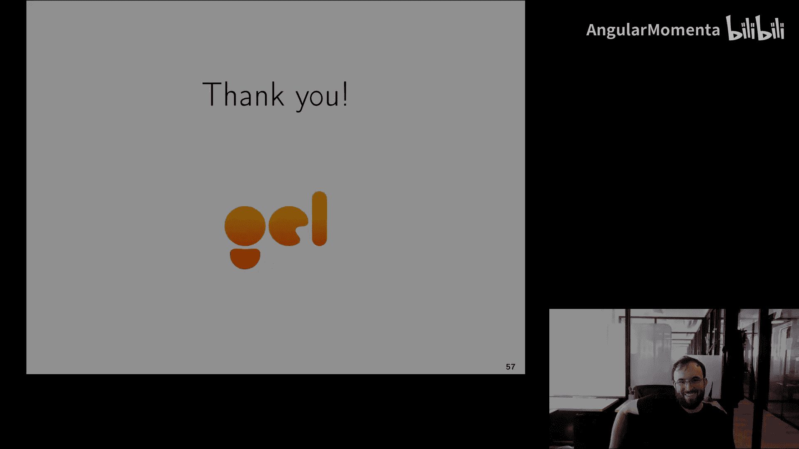

# 卡内基梅隆大学 SQL 或死亡？系列研讨会：P10：Gel - 取代SQL并改进关系型数据库模型


## 概述
在本节课中，我们将学习 Gel（前身为 EdgeDB）数据库系统。Gel 旨在通过其查询语言 EdgeQL 来取代 SQL，并改进传统的关系型数据库模型。我们将探讨其设计动机、核心的“图关系”数据模型、EdgeQL 查询语言的基本语法与特性，以及它如何在 PostgreSQL 之上实现。最后，我们也会了解 Gel 为何以及如何仍然支持 SQL。

---

## 为什么需要取代 SQL？🤔

上一节我们介绍了本次研讨会的背景。本节中，我们来看看 Gel 团队认为 SQL 存在哪些问题，从而需要新的解决方案。

SQL 已有半个世纪的历史，其最初的设计目标是让商业分析师编写即席分析查询。如今，它显露出一些时代局限性：
*   **缺乏正交性**：难以从子查询构建复杂查询，经常因为标量表达式和表表达式之间的区别而需要大幅重构。
*   **语言庞大且不一致**：经过长期演化，语言表达方式往往不一致。
*   **NULL 值的怪异行为**：NULL 可以属于任何类型，其行为方式古怪。
*   **对象-关系阻抗失配**：在 SQL 中是数据行，而在应用程序中通常是带有指针的对象，两者不匹配。

尽管如此，SQL 仍然比许多后续的数据库查询语言更优秀。然而，许多 NoSQL 数据库在尝试改进时，往往“把婴儿和洗澡水一起倒掉了”——这里的“婴儿”就是**关系模型**。

以下是 NoSQL 数据库常见的一些问题：
*   **弱模式或无模式**：通常只有单一类型，可视为“无类型”数据库。
*   **查询能力有限**：查询语言功能较弱或缺失。
*   **N+1 查询问题**：获取关联数据（如用户及其所有帖子）需要多次查询，效率低下。这个问题在使用 SQL 的对象关系映射器（ORM）中也很常见。
*   **较弱的一致性保证**：通常比 SQL/关系型数据库提供更弱的一致性保证。

当然，这些是工程上的权衡，但 Gel 团队认为他们可以站在更好的权衡点上。

---

## 什么是 Gel？🚀

上一节我们讨论了 SQL 的不足和 NoSQL 的权衡。本节中，我们来认识一下 Gel 数据库本身。

Gel 是一个新型数据库，它建立在坚实的**关系型核心**之上，并由 **PostgreSQL** 提供支持。其核心创新在于 **“图关系”** 数据模型。

“图关系”模型是关系数据库模型的演进。它围绕以下核心概念构建：
1.  **具有唯一身份的强类型对象**。
2.  **对象之间通过“链接”连接**。
3.  **对象包含具有指定基数的集合值属性**。

虽然 Gel 的市场宣传已逐渐淡化“对象关系”这个说法（因为发现它不易引起潜在用户的共鸣），但从技术角度看，这仍然是理解其设计理念的精确框架。

以下是关系模型概念到 Gel 模型的映射：
*   **表/关系** -> **对象类型**
*   **列/属性** -> **属性** 或 **链接**
*   **行/元组** -> **对象**

---

## 图关系模型详解 🧩

上一节我们介绍了 Gel 的“图关系”模型。本节中，我们来深入探讨该模型的三个核心要点。

### 1. 唯一身份
所有对象都有一个通过**全局唯一标识符**实现的唯一身份。这相当于每个对象的全局、自动生成的主键。

### 2. 链接
对象可以通过“链接”相互连接。链接可以指向其他对象，并且链接本身也可以拥有属性（称为“链接属性”）。

以下是一个 Gel 模式定义语言（SDL）的示例片段：
```edgeql
type Person {
  required name: str;
}

type Movie {
  required name: str;
  required release_year: int64;
  multi actors: Person;
}
```
在这个例子中，`Movie` 类型有一个指向 `Person` 类型的多链接 `actors`，表示每部电影可以关联零个或多个人物对象。

### 3. 属性基数
对象的每个属性或链接都有指定的**基数**，这由两个维度决定：
*   **可选性**：可以是 `optional`（可选）或 `required`（必需）。
*   **多重性**：可以是 `single`（单值）或 `multi`（多值）。

例如：
```edgeql
type Movie {
  optional description: str;      # 可选，单值
  required title: str;            # 必需，单值
  multi alternate_titles: str;    # 可选，多值
  required multi actors: Person;  # 必需，多值（至少一个）
}
```
这与关系模型不同，关系模型中的属性总是单值的（可为空或非空），而 Gel 允许属性是多值的集合。

---

## EdgeQL 查询语言初探 🔍

上一节我们了解了 Gel 的数据模型。本节中，我们来看看如何使用 EdgeQL 查询语言与数据交互。

在 EdgeQL 中，**几乎所有东西都是集合值**。这意味着任何表达式都可以返回多个值。操作符的默认语义是将其提升到输入集合的笛卡尔积上执行。

以下是一些基础查询示例：

**选择字面量：**
```edgeql
select 'Hello';
# 返回包含该字符串的集合
```

**集合运算：**
```edgeql
select {10, 20} + {1, 2};
# 笛卡尔积运算，返回 {11, 12, 21, 22}
```

**变量绑定：**
```edgeql
with x := {10, 20}
select x + {1, 2};
```

**空集处理：**
EdgeQL 没有 `NULL` 的概念。缺失的值表示为**空集**。空集参与运算会产生空集。
```edgeql
select {1, 2} + {};
# 返回空集 {}
```

为了处理可能为空集的情况，EdgeQL 提供了诸如 `??`（合并操作符）等函数，以及 `count()`、`sum()` 等聚合函数。
```edgeql
select <int64>{} ?? 0;       # 返回 0
select count({10, 20} + {1, 2}); # 返回 4
```

---

## 查询实际数据 🎬

上一节我们学习了 EdgeQL 的基本运算。本节中，我们将其应用于实际的电影数据库查询。

假设我们有 `Movie` 和 `Person` 类型，并且电影通过 `actors` 链接关联演员。

**基本选择与形状：**
仅选择对象会返回其唯一ID。我们需要使用“形状”来指定要获取的属性。
```edgeql
select Movie {
  title,
  release_year
};
```

**过滤：**
使用 `filter` 子句来缩小结果范围。
```edgeql
select Movie {
  title,
  release_year
} filter .title = 'Dune';
```

**执行连接（嵌套结果）：**
在关系模型中，连接是核心。EdgeQL 通过嵌套形状来实现类似功能，返回的是结构化结果，而非扁平化的行。
```edgeql
select Movie {
  title,
  release_year,
  actors: {
    name
  }
} filter .title = 'Dune';
```
这个查询会返回电影对象，每个电影对象内部包含一个演员列表。相比之下，传统的 SQL 连接会返回电影标题与每个演员名字配对的重复行。

**包含链接属性：**
如果 `actors` 链接上有 `character_name` 属性，可以一并获取：
```edgeql
select Movie {
  title,
  release_year,
  actors: {
    name,
    @character_name
  }
} filter .title = 'Dune';
```

**更复杂的查询示例：**
```edgeql
select Person {
  name,
  films := (select Movie filter Person in .actors)
} filter .name = 'Timothée Chalamet';
```

---

## 高级查询功能 ⚙️

上一节我们看到了如何获取和连接数据。本节中，我们探索 EdgeQL 更强大的功能：计算字段和反向链接。

### 计算字段
可以在查询中动态添加计算字段。
```edgeql
select Movie {
  title,
  cast_size := count(.actors)
};
```
计算出的字段可以用于后续操作，例如过滤：
```edgeql
select Movie {
  title,
  cast_size := count(.actors)
} filter .cast_size > 50;
```

### 反向链接
遍历链接的反方向是一个常见需求。EdgeQL 提供了内置的**反向链接**支持。
```edgeql
select Person {
  name,
  starred_in := .<actors[is Movie]
};
```
`.<actors[is Movie]` 表示“所有通过 `actors` 链接指向我的 `Movie` 对象”。为了高效支持反向链接，Gel 会为所有链接自动创建索引。

### 模式中的计算定义
计算属性和链接是 EdgeQL 的核心，因此也可以直接在模式定义中声明它们，作为类型的固有部分。
```edgeql
type Person {
  required name: str;
  multi films := .<actors[is Movie]; # 在模式中定义反向链接
}
```
这些定义是即时计算的，并未物化。

---

## 模式继承与其他功能 🏗️

上一节我们探讨了查询语言的特性。本节中，我们回到模式定义，看看 Gel 提供的其他重要功能，如继承。

### 继承
Gel 支持类型继承，这在实现“混入”风格时特别有用，即多个类型共享一些公共属性。
```edgeql
abstract type HasDOI {
  required exclusive doi: str;
}

abstract type Named {
  required name: str;
}

type Movie extending HasDOI, Named {
  release_year: int64;
}

type TVSeries extending HasDOI, Named {
  season_count: int64;
}
```
虽然用户非常喜欢继承功能，但它给实现带来了相当大的复杂性。

### 其他模式功能
*   **访问策略**：可以定义复杂的规则，控制对象的选择、插入、更新权限，这些规则可以引用全局变量。
*   **触发器与重写**：可以在更新时触发操作或重写字段值。
*   **默认值**：为属性设置默认值。

所有这些功能都是通过任意的 EdgeQL 查询定义的，并在编译器中实现，而不是依赖于 PostgreSQL 的类似功能，因为 PostgreSQL 的功能通常不足以表达 EdgeQL 查询所需的复杂性。

---

## 实现原理：编译到 PostgreSQL 🛠️

上一节我们了解了 Gel 丰富的模式功能。本节中，我们深入其实现核心：如何将 EdgeQL 编译到 PostgreSQL。

Gel 的核心实现理念是：**所有模式都转换为 PostgreSQL 模式，所有 EdgeQL 查询都编译为单个 PostgreSQL 查询**。它运行在标准的 PostgreSQL 之上，无需安装特殊扩展。

### 模式映射
让我们回顾并细化之前的概念映射，看看它们是如何具体实现的：

*   **EdgeQL 对象类型** -> **SQL 表**
*   **单值属性或链接** -> **SQL 列**
    *   可选属性 `name: str` -> `TEXT` 列（可为空）
    *   必需链接 `fo: ObjectType` -> `UUID` 列（非空），并创建索引以支持反向查找。
*   **多值属性或链接** -> **SQL 表**
    *   多链接会创建一个连接表，包含 `source` 和 `target` 的 UUID，并有唯一约束和索引。
    *   链接属性存储在这些链接表中。
    *   多值属性也会创建一个类似的表，但通常没有唯一约束。

值得注意的是，Gel 没有使用外键约束，而是通过编译器在语言层面保证引用完整性。表中的列名和表名实际使用的是内部 UUID，而非用户定义的名称。

### 编译器架构
EdgeQL 编译器采用经典的两阶段架构：
1.  **前端**：将 EdgeQL 源代码编译为中间表示（IR）。这个过程包括：
    *   **名称解析**与**类型推断**
    *   **基数推断**：判断表达式结果是“零或一”、“恰好一”、“至少一”还是“多”。
    *   **形状推断**：确定返回给客户端的字段结构。
    *   语法糖展开、重载函数解析、计算属性/链接的内联等。
2.  **后端**：将 IR 编译为 SQL。这个过程包括：
    *   基于 IR 和“作用域树”生成 SQL。
    *   生成将结果序列化为特定格式（如自定义二进制格式或直接 JSON）的 SQL。
    *   处理特殊的变更操作，并强制执行 SQL 不支持的约束（如“必需的多值”属性）。

生成的 SQL 可能看起来复杂且不直观，但 PostgreSQL 能够有效地执行它。

---

## 性能与 SQL 支持 📊

上一节我们剖析了 Gel 的编译器。本节中，我们讨论两个实际问题：性能表现，以及为何最终仍需支持 SQL。

### 性能
Gel 的性能表现良好。与使用 ORM（如 Hibernate 或 ActiveRecord）生成的、常导致 N+1 查询问题的代码相比，Gel 有显著优势。即使与那些执行 2-3 次查询来获取嵌套数据的更优 ORM 方案相比，Gel 通常也表现更好。

与手工编写的最佳 SQL 相比（这些 SQL 也使用了类似的数组聚合技巧来返回嵌套数据），Gel 可能稍逊一筹，但差距不大。对于更常见的查询模式，Gel 通常能做得更好。

### 支持 SQL 的原因
尽管 Gel 的初衷是取代 SQL，但现实需求迫使其增加了 SQL 支持。主要原因包括：
1.  **集成现有商业智能工具**：许多用户希望将现有的 BI 工具连接到 Gel。
2.  **提供迁移路径**：允许用户逐步迁移或与现有 SQL 系统交互。

### 实现 SQL 支持的挑战
实现 SQL 支持（特别是读写操作）出乎意料地困难：
*   **命名问题**：Gel 内部使用 UUID 作为标识符，但需要向 SQL 用户暴露友好的名称。
*   **模式自省**：工具需要通过 `information_schema` 和 `pg_catalog` 来探查模式，这实现起来非常繁琐。
*   **继承映射**：需要让 SQL 查询也能自然地处理继承层次结构。
*   **保证一致性**：Gel 的许多约束（如访问策略、触发器、必需的多值属性）是在编译器中实现的，而不是通过 SQL 约束。允许通过 SQL 写入时，必须确保不违反这些约束。

解决方案是使用一个混合编译器：将用户编写的 SQL 部分编译，并与 Gel 编译器生成的、用于安全数据修改的 EdgeQL 部分结合起来，共同生成一个保证一致性的 SQL 查询。

---

## 总结

在本节课中，我们一起学习了 Gel 数据库系统。我们从 SQL 的局限性出发，探讨了 Gel 提出的“图关系”数据模型，该模型强调具有唯一身份的对象、对象间的链接以及丰富的属性基数。我们深入了解了 EdgeQL 查询语言，它采用集合语义，支持嵌套结果、计算字段和反向链接，使得查询表达更加直观和强大。

我们还揭示了 Gel 的实现原理：它是一个将 EdgeQL 编译为单个 PostgreSQL 查询的编译器，建立在坚实的关系型基础之上。尽管目标是“取代 SQL”，但为了满足实际集成和迁移需求，Gel 也巧妙地实现了对 SQL 的读写支持，虽然这个过程充满挑战。



Gel 代表了一种在保留关系模型核心优势的同时，试图提供更符合现代应用开发思维的数据库查询体验的探索。