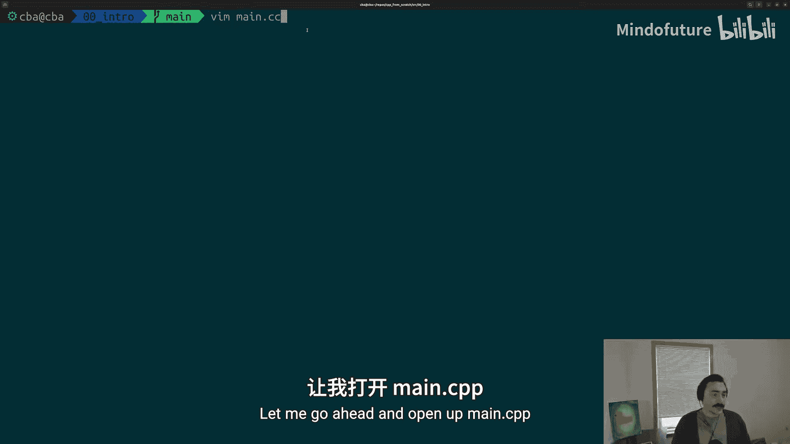
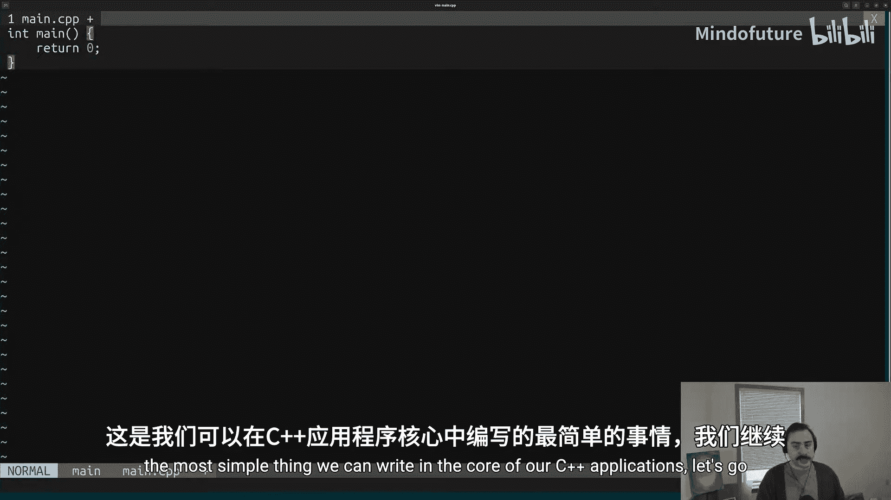
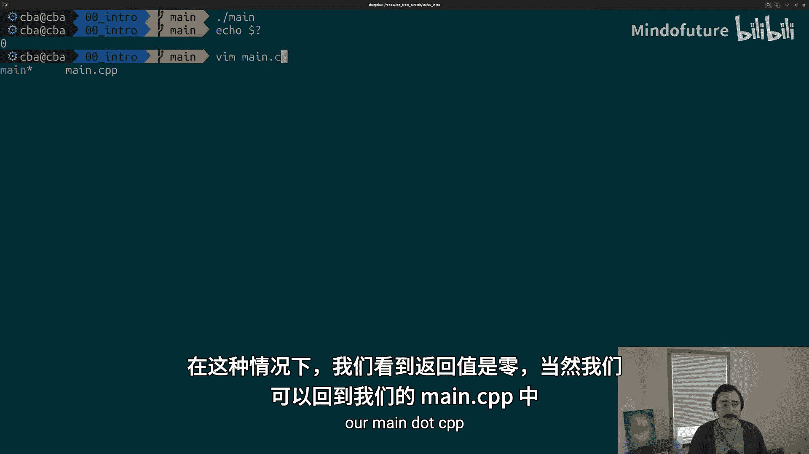
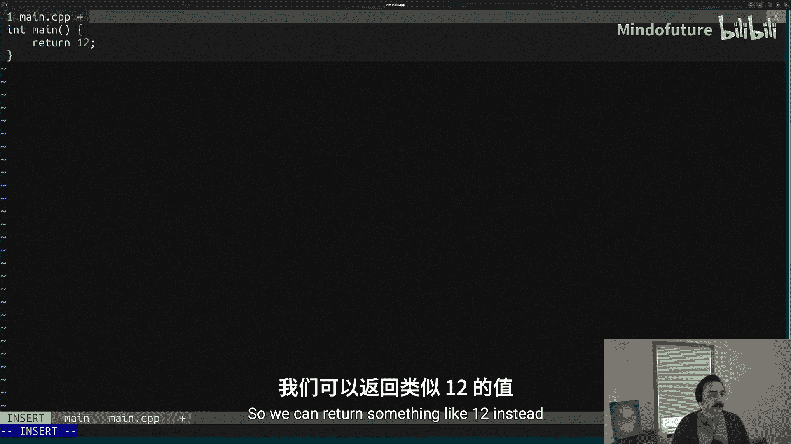
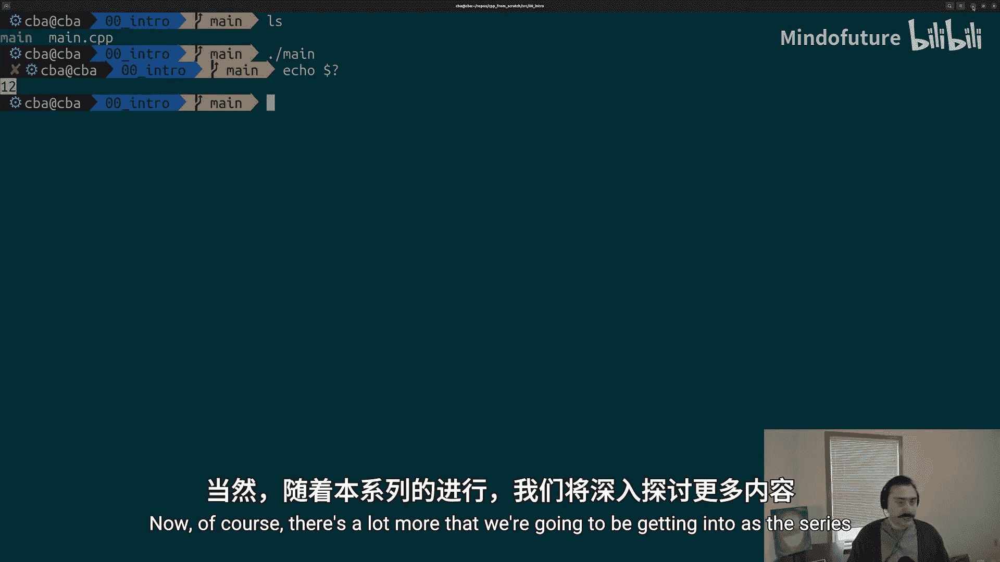
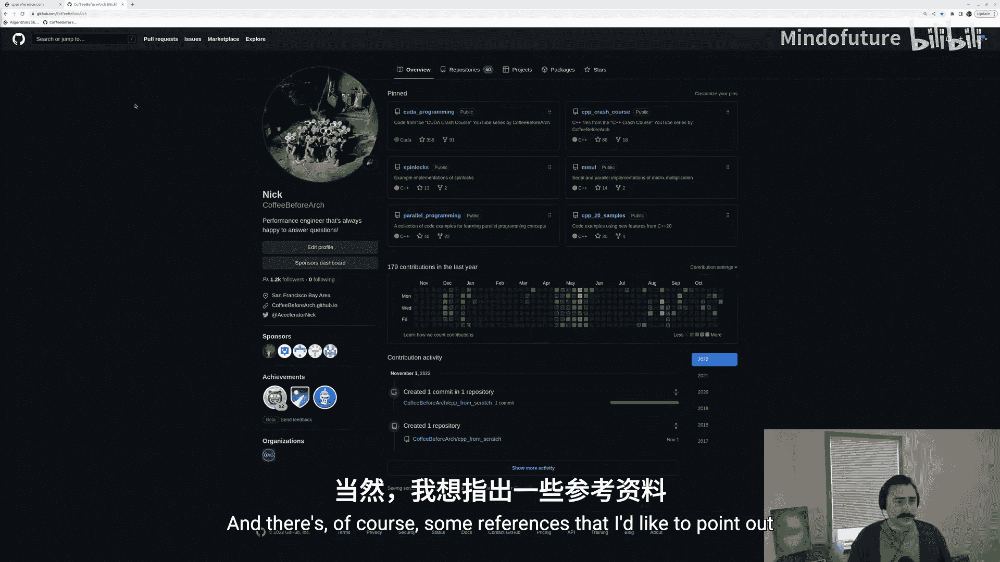
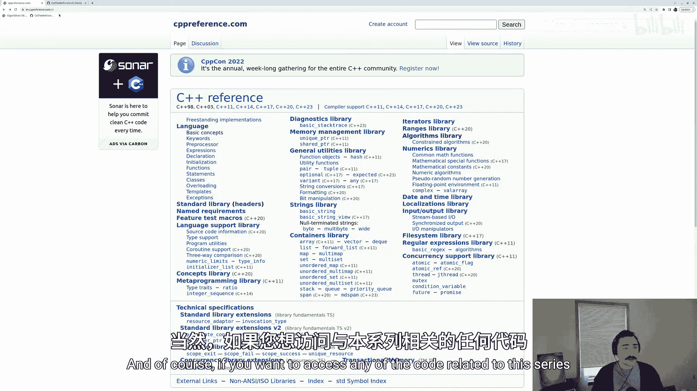
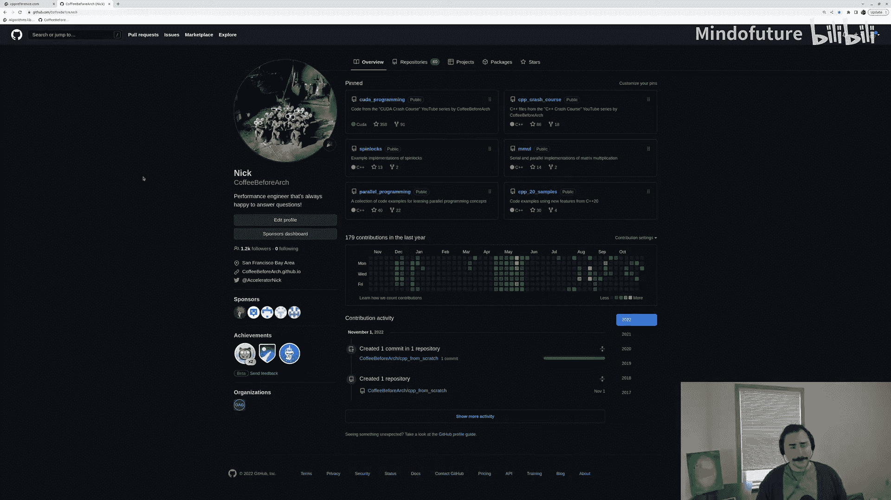

# C++入门教程｜CoffeeBeforeArch-p01-P01-What-is-C++--BV1nbRUYSEUu_p1-

Hey， everyone， I'm Nick， and this is C plus Plus from scratch。 So in this new series。

 we're going to be learning about C plus plus， starting from the very basics and getting to know the language and some of the more modern and advanced features and along the way we'll also be looking at some cool projects and ways in which we can use C plus plus。

😊，Now， before we get into some of the more advanced topics。

 we really have to start off with a good foundation。

 which means we really have to understand what C++ is and how we can write basic programs using the language。

So I think a great place to start off is just trying to answer the question of what is C++ right。

 at least in some simple form， how can we describe the language？

And I typically do this in just a single sentence， and that's that C++ is a compiled language that is statically typed。

 but even in that one sentence， there's quite a lot to unpack right。

 what does it mean to be a compiled language， what does it mean for a language to be statically typed and what even really is a type。

 right？So let's try to break that down right so first of all。

 what does it mean for a language to be a compiled language Well all this really means is that we can't execute our source code directly right so we write some code and C+ plus we can't directly run that code we have to pass it off to another tool a piece of system software called a compiler and it's a job of that compiler to translate our source code into something that we can execute something that we typically call an executable that we can run on our processor and it's in the language that our processor understands。

Now， for example， on this machine， this Linux machine， I would give。

 say my high levelve C++ source code to a compiler driver like G++。

 which is part of the good new compiler collection， GCC。

 and G++ would perform all the actions necessary so things like preprocessing compilation assembly linking to translate my C++ into an executable that we can then run on the machine。

Okay， so that's what we mean by compiled language。 Now， what about the second part of that sentence。

 right， that C++ is statically typed and what really even is a type。 So inside of our programs。

 we have a lot of values， right？ And for every single value we have in our program。

 all those values have an associated type And those types really just say what that value is， right。

 I it a floating point number， is it a positive or negative whole number。

 So an integral type or is it some kind of complex data structure。

 and what are the rules around using that particular value， right。

 what operators can we use and what do those operators do， That's what we kind of mean by types。Now。

 when we say that something is statically typed or language is statically typed。

 what we just really mean is that once we assign a type to something， that type can't change。

 It's static。 And it's something that the compiler needs to know about right at compilation time。

 It's not something that can change at run time。 So if I say that something is a vector or something is an integral type。

 the type of that thing。 maybe it's a return value。 Maybe it's a variable。

 that's not going to change at runtime， right， and the compiler needs to know what that type is when it's doing compilation。

 So it can generate the right code。 So that's what we kind of mean by a statically typed language。

So now that we have a little bit of background on what C++ is。

 let's get into the basics of writing C++ programs。

 and I think another great place to start here is with the most simple program we can write in C++。

 which also just so happens to be the core of pretty much every C++ program。

 and that's just going to be a main function。So let's go ahead and get started over here and we'll create a new file called main。

cpp。So CPP is just a C++ extension。 You might also see dot CC used either of these extensions works perfectly fine for C++ code。

Now for my particular setup over here， I'm going to be opening and creating and editing these files using the text editor Vm。

 but feel free to use whatever editor or IDE works for you so something like Vi Studio code is a great option。

Let me go ahead and open up main do cP， So our new C++ file。 And inside of here。

 we'll just write a very simple main function， So it'll be int main with an empty parameter list and then some curly brackets here right and that'll be our function body。

And then inside of our curly brackets， we'll do return zero。

So this is the most simple program we can write right， it's just a main function。

 So let's try to understand a bit about what's going on here。 So first of all。

 when we say a main function， what do we really mean by function。

Now a function is just a named body of code， right， So whenever we say call this function。

 by whatever name we've given it， we'll execute all the code inside of the function body。

 And that's just everything within these curly brackets。 right。

 we'll start executing the statements in that function body。 And in this case。

 the only thing we have in the function body is a single return0 statement。😊。

So return here is just a keyword in C plus plus。 A keyword is just a word that's reserved by the language that has a special meaning。

 So in this case， it means that this function is going to return a value and that value in this case is just0 in our statements in C plus plus end with a semicolon。

 right So that's our function body。 Now up here， we have the name of our function。

 So we've given it the name main here。We've given it a return type right so it's a typed language。

 a statically typed language。 So here we're saying that our function， right after we call it。

 it's going to return some type and that type is an int。

 right an integer integer is just a positive or negative whole number。

And then over here we have some open and close ps here。

 Now inside of these prints is something that we call a parameter list。

 and that's all the things that we want to pass into this function。

 So if we want to use some extra values in the function right when we call it。

 we can pass some extra values through this parameter list here， but in this case。

 we're not passing anything。 So we just have an empty parameter list our function does not take anything。

 it just returns this zero right here， right this integer。

So that's a little bit of background on functions。Now we're going to be talking about functions a lot later。

 but there's something very special about this function， right， this main function。

 and like I said earlier， this is really the core of every C++ program So why exactly did I say that what makes this main function so special。

😊，Well， main is a special function in C and C++ because it's logically where execution begins for every C++ application。

 So after I compile my code and I run that executionecutable Where does my program start executing Well。

 it starts executing at the main function right wherever that function might be inside of all of our source files So logically our program starts execution at main right so that's what makes main so special。

Right so that's why it's the core of every single C++ program Now there are some caveats around that regarding say initialization of things like globals。

 but we'll get into that in later videos， but we can just think about Maine as where our program begins executing。

Okay， so now that we have our basic program here， the most simple thing we can write in the core of our C++ applications。

 let's go ahead and compile this and run this， so we'll go ahead and quit out of here。

And then we can go ahead and compile this using a compiler driver like G++， which like I said。

 is part of the Gnu compiler collection， GCC。So we'll do G++ pass in main。cP。

 which is our input source file， and then we'll give our output executable name so we'll do O and we'll just call our executable name。

So after that， if we go ahead and list the files in our directory。

 we see we have an executable and our source file right here。

 so we translated our source file into an executable right through using our compiler driver and if we go ahead and do LS LA。

 we can see that unlike our source file， we have executecut permissions right on this executable so we can run this file。

So let's go ahead and run this file， right this executable。

 so we'll do just dot slash main or we'll just call main this executable。

And we see that nothing really happens， right， which is somewhat expected。

 all we had is a main function that returns0。Now， a very obvious question people will have is what happens when I'm returning0。

 where is that value going， Well the return value of main is typically used to signify you know whether or not a program completed successfully。

0 generally meeting that a program completed without errors and we can actually see that return value from the command line using something like echo dollar sign question mark so we can get the return value for the last execute will be ran。

 So in this case， we see a return value 0， but we can of course go just back into our main do cP。

Open this up， and we can return a different value， Right， we can return something like 12 instead。

Now， remember C++ is a compiled language。 So now that I've made this change into my source code。

 I have to recompile and generate a new executable。 So we'll go ahead and do that again。

 We'll call G plus plus on main do CPP and just overri our executable main here。

 We'll just create a new executable with this new source。Allright。

 so we have our new executable here， and we can go ahead and run main again。

 and we can go ahead and run Echo again to get that return code and we see exactly what we specified inside of our main function。

 right， we return 12 this time and we got 12 when we did this echo right here so we can see the return value from our program。

 And like I said， this is typically just used as an exit code right to say whether or not a program completed successfully。

0 meaning we completed successfully。😊，All right， so that's a brief introduction to C++ as a language right That's kind of what C++ is at its core。

 right Why is the main function you know kind of special and how do we compile and run basic programs Now。

 of course， there's a lot more that we're going to be getting into as the series goes along and there's of course。

 some references that I'd like to point out， So probably the best reference site that I could point you to is this cP reference co right this is basically the ground truth if you want to learn more about C+ plus and the c++ standards。

 So there are many different versions of the language as well that we'll be talking about as things go along going from C+ plus 98 all the way up to the much more modern c+ plus 23 in different compiler support slightly different things in terms of these standards which is something we'll talk about in later videos。

And of course， if you want to access any of the code related to this series or the other projects that I have going on。

 you can find that at github。com/coffeebe arch， but that's going to go ahead and do it for today。

 as always I'm Nick and I hope you have a nice day。

