# C++入门教程｜CoffeeBeforeArch-p02-P02-Printing--BV1nbRUYSEUu_p2-

Hey， everyone， I'm Nick， and this is C plus Plus from scratch。 So in this episode of the series。

 we're going to talk a bit about printing。Now printing is a very foundational operation that we want to perform inside of our programs。

 so for example we may be wanting to implement something like a logger or we may just want to print out some information from our application to better understand what it's doing right and as we're learning how to program。

Now， fortunately for us， we don't have to reinvent the wheel with printing。

 we can use some things that are built into our C++ standard library。

So you know our C++ standard of library includes you know a great many things that are very useful。

 so it includes things like data structures， algorithms that work with those data structures。

 but it also provides a means for doing things like input and output right and that's both input and output to the screen as well as to things like files right。

So that's what we're going to go ahead and be looking at today and perhaps more specifically。

 how we can go ahead and print things out to the screen using this thing Col stood sea out or C out just stands for character output。

 we want to print some characters out to the screen。Okay。

 so where do we go ahead and get started with something like this？ Well， we're of course。

 going to need a C++ file。 So let's go ahead and create a new file and we'll call it something like print cP。

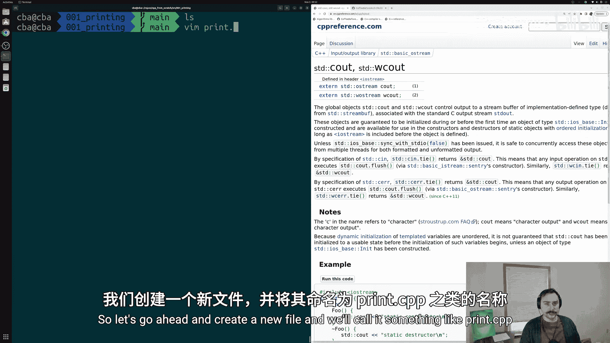

So if we go ahead and open this up you know the first thing we can put in here is just a main function so you know recall from our last video we know that our main function is really the heart of all of our C++ applications that's where our programs begin execution right so after we generate an executable you know our program you know begins at Maine when we run our executable。

Okay， so now that we have a main function， how do we use something like stood C out Well。

 before we could use something like stood C out， we're going to need to include its definition and this should make some you know intuitive sense here。

 you know before we can use something， we're going to need to know what that thing is。

 So in order to do that we need to include its definition inside of this file。

And you can see here from CPP reference that it says that stood C out is defined in this header IO stream。

 so we'll need to include that header inside of our source file right here。

So we'll go ahead and do that using this include directive。And then we'll include IO stream， right。

 IO just standing for input output， right and we're including these stream objects。Okay。

 so what exactly is this include directive doing right， what is its function？Now。

As I said in the last video， compilation actually has a couple of steps to it right so we have things like preprocessing。

 compilation， assembly and linking and the part that we care about。

 specifically when it comes to headers is this thing called preprocessing and this executable called preprocessor Now this piece of software it's a job of this piece of software to do things like find these header files that we want and paste them inside of our program So here we're saying we're telling our preprocessor。

 hey， I want you to find you know this file Iostream and I want you to you know copy and paste its contents into this file right and replace this include statement right here that way I have this definition of something like stood see out inside of this file so I can use it inside of like my main function。

And we can even see how this kind of works here so we can go ahead and we'll go ahead and save this and minimize it and we can invoke our compiler driver G++ in this case to stop after preproces so we can just perform one of these steps of compilation。

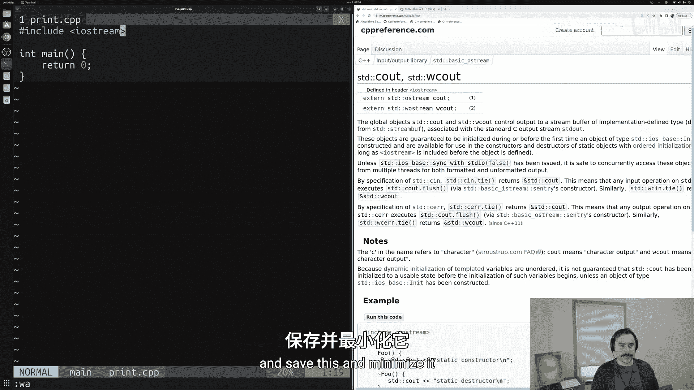

So here we'll run G+ plus with dash E to say stop after pre processing。

 and then we'll pass our source file printcP， and we'll call our output file something like print。

 ii， this intermediate file type。So we'll go ahead and run that and you can see we've generated this print。

ii file。

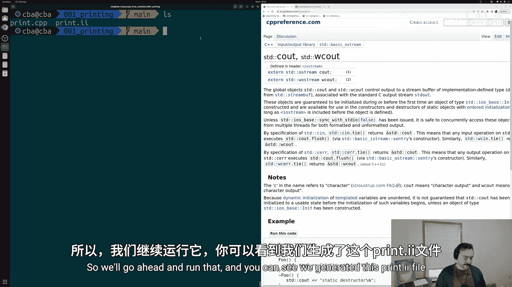

And we can go ahead and open it up our print do iI。

And inside of here you can see that we're at the very bottom of this file and we see our three line main function here。

 right in main turn0 closing curly bracket， but we can see that our file is actually know over 32000 lines of code。

 So what exactly is going on here， What is everything else in here。😊。

Well everything else in this file， know going all the way up to the top here。

 this is just the contents of this IO stream file that we included right using that include you know less than IOSt greater than or angle brackets know IO stream This is just the contents of that file that we told our preprocessor that we want to include inside of our source file。

 so our preprocessor just found it and pasted it into our file and you can see that above our main function right here。

You can even see the thing that we were after right so you can see that we have this definition of this output stream object called C out right this is that stood sea out that we wanted to include the definition of inside of you know our print do cP file right because that definition is inside of our file we can use C out because our compiler is going to have the right context it's going to know what C out is so we're going to be able to use it inside of our main function。

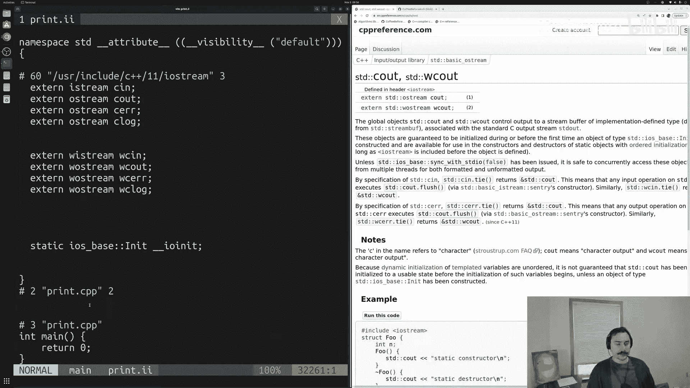

Okay， so let's go ahead and quit out of here， just to Q and we'll get rid of this print。

ii and we'll open up our CPP file again， right？

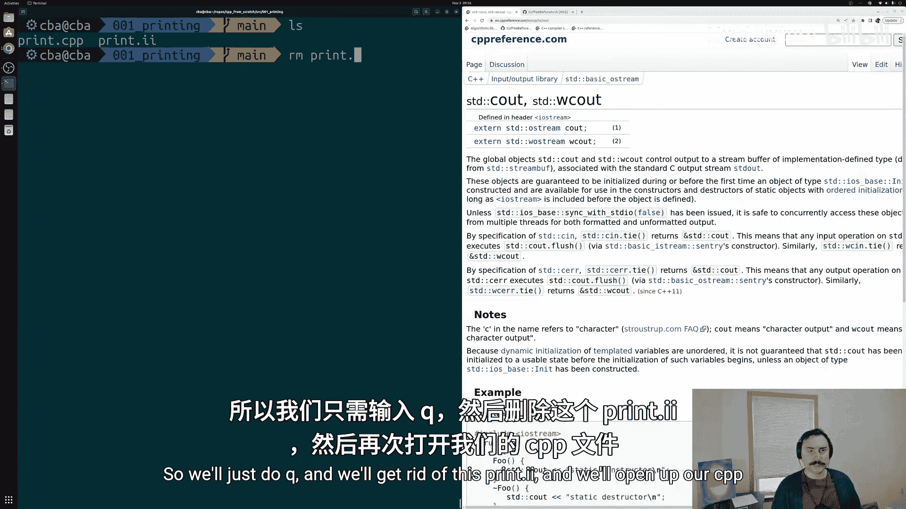

Okay， so now that we've included this definition of Istream， how exactly do we use IoSt？

So to use IoStam， all we need to do is use that stream object stood see out。And then to print things。

 we'll use this double less than sign right here。 And after that， we can say。

 put a string that we want to print。 So something like the classic hello。

World and we'll do a new line character so it prints a new line after this string。

And that's all we really need to do to print out a string in C++， now。

 one of the very confusing parts or potentially confusing parts about this。

Is you know what exactly this less than less than sign is right here that's going along with stood CL。

 how does this mean printing？So remember in the last video， when we talked a little bit about types。

 we said that with our types， we could implement operators and those operators。

 we could give a specific meaning， and we could say what those operators do。

 And it just so happens that for our output stream object like stood C out。

 we use this double less than to do our printing right， So we're printing out hello world here。

 just using this double less than operator。 But we'll see how this double less operator can mean different things when we work with different types right。

 So you know when we're not working with something like a stream object when we're just working with。

 say， an integer and we're doing something like shifting。 But in the context。

 you know right here when we're using stood C out。 we use this double less than to print things out。

Okay， so let's go ahead and save this and we can go ahead and compile this program and run it。

 so we'll do G plus plus on our print do CBP， and we'll call our output executable something like print。

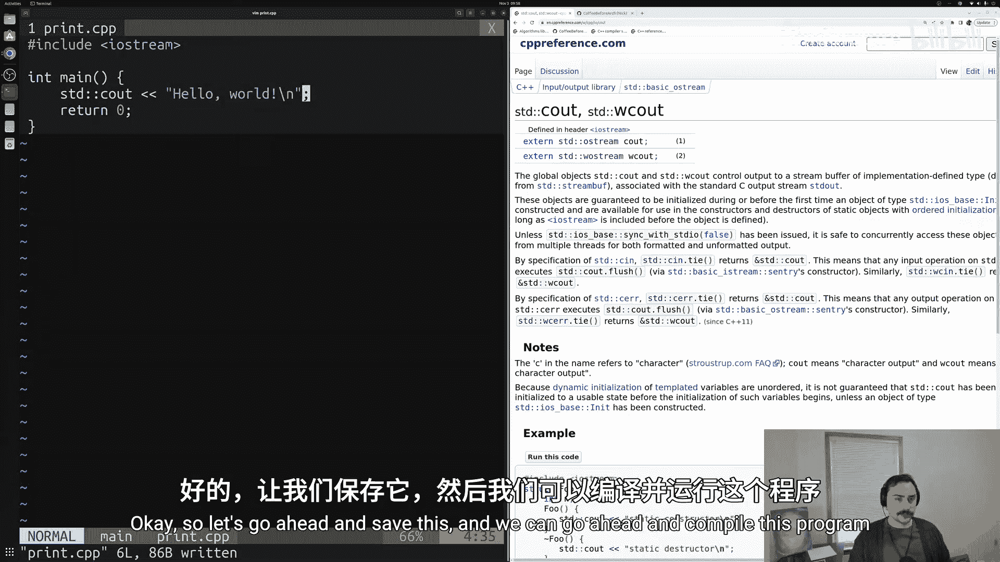

And we can see we have our executable here， and we can go ahead and just run this principle just dot s print。

 and you can see it prints up to the screen hellello world。

 So a little more exciting than our last program that just returned 0 or return 12。

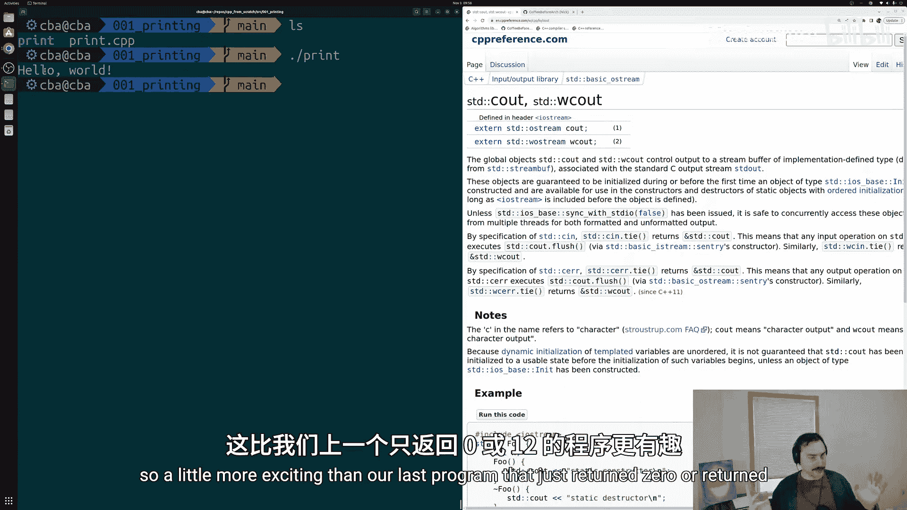

Okay， so let's go ahead and open up our program again。

 So one of the other things that we can do with C out is we can chain these double less than operators to print multiple things。

 So for example， we could split up this hello world。Into multiple strings。

 so we'll go ahead and have you know， hello comma， and then we'll print out world kind of as a separate string here。

So we can chain these operators together to print multiple things if we wanted to。

 so here we'll go ahead and quit out of here and remember C++ is a compiled language so we have to recompile our source code if we make a change to it and we want to see those effects so we'll recompile print on CBP and we can run it you can see we get the same meal upstream output but we've split it up into two of those lesson lesson operators。

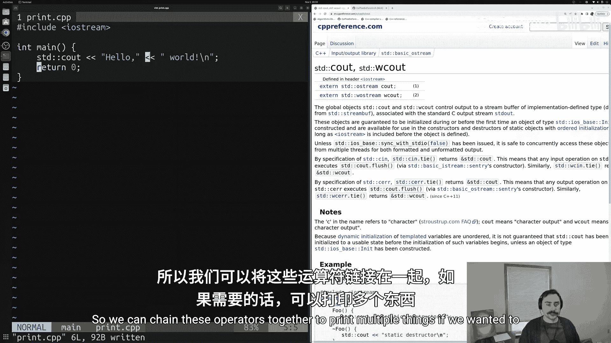

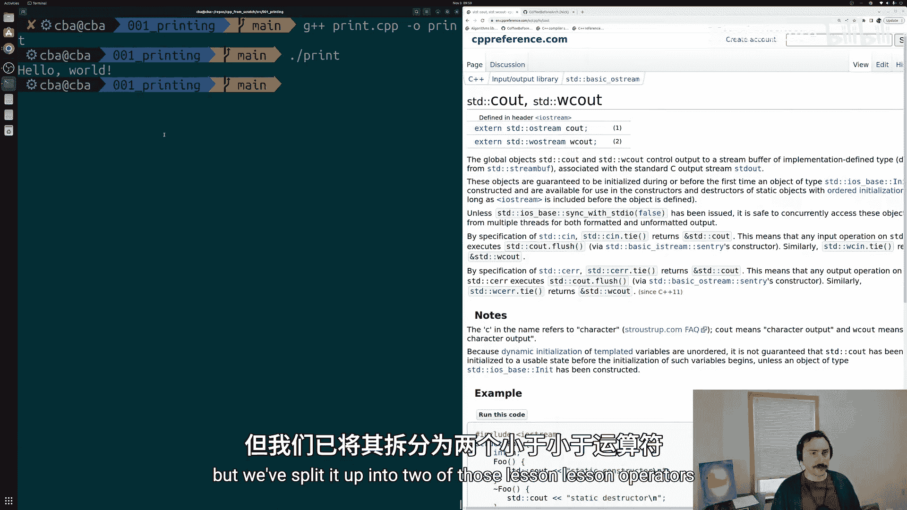

Another thing we can do is we can of course print other types as well。

 so you know I can just put something like you know I want to print the value one right here followed by a space and then worlded with a new line character afterwards。

So here we'll go ahead and save this and we'll compile our program yet again and we'll go ahead and run it right and we see one space world and then a new line character so that everything goes to a new line after this prints out。

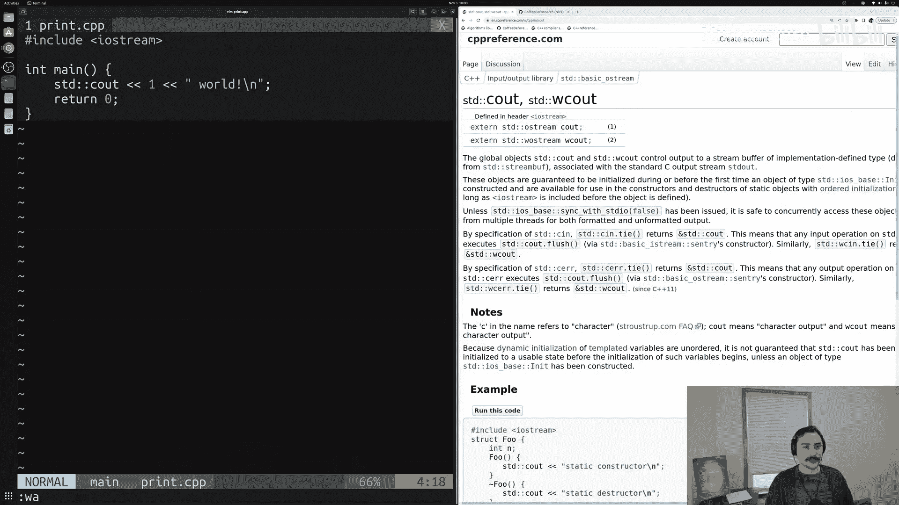

RightSo that's just some of the ways in which we can use this see out。

 this character output stream object。 Now there's a lot more that we can talk about related to these stream objects and how we do things like input or output to say files。

 And we'll also have to talk about exactly what this stood colon colonlon really means This gets into the thing called namespaces and this thing called a scope resolution operator But we'll talk about that some more and some later videos。

 But that's going to go ahead do it for today below the video。

 you can find you know a link to this CPP reference page on stood C out。 know。

 which you can include some examples of how to use it and some more information about these other stream objects And of course。

 you can find this or any of the other code examples at my Github page at Github co s coffee before arch。

 But that's going to go and do it for today。 As always， I'm Nick。 And I hope you have a nice day。😊。

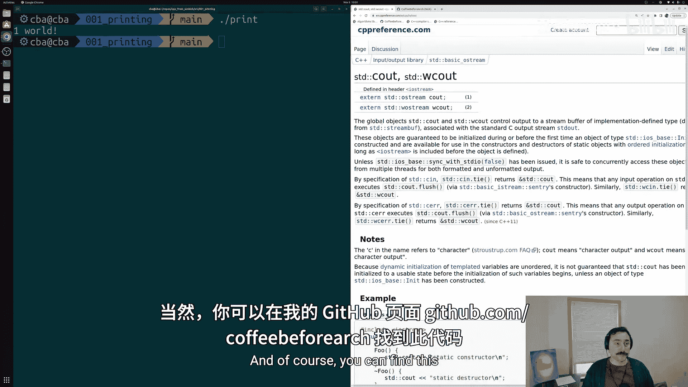

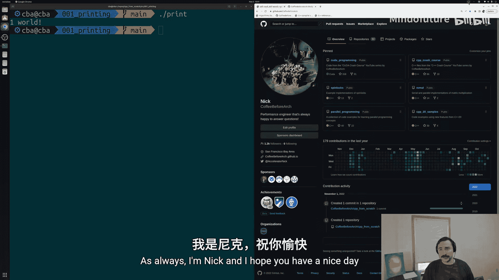