# C++入门教程｜CoffeeBeforeArch-p03-P03-Variables--BV1nbRUYSEUu_p3-

Hey， everyone， I'm Nick， and this is C plus plus from scratch。 So in this episode of the series。

 we're going to be talking about variables。Now， we know from our previous videos that our programs are filled with values。

 and it would be really convenient if we had a way to assign names to those values that would help us write more expressive code。

 Now， the way that we do this in C plus plus is， of course， through variables。

 variables just allow us to give a value a particular name。😊。

So what we're going to be looking at at this video is the basics of how we define variables and we initialize them in a bit with how we can play around with them。

So let's go ahead and get started。 And where we can， of course。

 start is with a new C plus plus source file。 So we'll create a new file called something like variables do CPP。

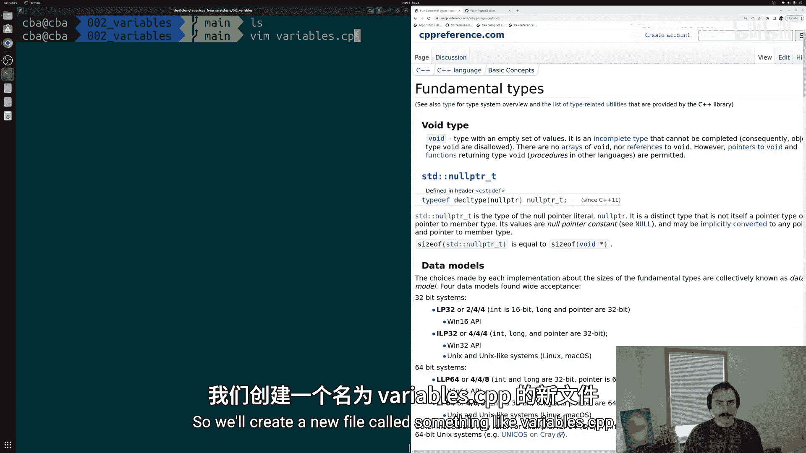

And inside of that file， we're of course， going to need a main function， right。

 the core of all of our CQL++ programs where our program begins execution when we run that executable。

Now before we can use a variable right the first thing we're going to need to do is define it so remember all of our values in the C++ have an associated type right and all our variable is our variables are they're just names for values right so our variables are going to need a type as well。

 so that's going to be part of our definition here。Now on the right hand side of the screen here。

 I have the CBP reference for fundamental types。 These are just some of the built in types in C+ plus that we can use many of which without having to include anything inside of our program。

 So for example， we have our signed in our unsigned integer types。

 so things like integers and unsigns and logs and。You know， short signed integers， et cetera， et cea。

We also have things like Boolean types， so true false are character types and things like floating point types for things like fractional numbers。

 32 bit and 64 bit fractional numbers with float and double precision numbers that followed this IropE 754 format。

Okay。So let's go and start off with just creating some integer variables here。

 So the way that we define a variable。Is by first starting out with the type that we want。

 So integer in this case。 and then we can just give that type a particular name， right。

 or name for a variable rather。 So here we have the definition of a variable name v 1。

 So what we're doing is we're telling our compiler， hey， I want an integer。

 and I'm going to refer to that integer as var 1 right So now later inside of my program。

 I can use var 1 right because now our compiler has the context about what var 1 is， It's an integer。

Okay， so another thing we can of course do is assignment or initialization of this value so we can do something like far  one is equal to 10 right so we've given our integer a value here。

 we've done this assignment。Now what we've shown here is a little bit of bad practice right。

 we've defined our variable in one place and we've initialized it someplace else。In many cases。

 we want to do definition and initialization of a variable on the same line。

 right or at the same place。 So something like this， right。

 we'll go ahead and get rid of that and we'll say int far one is equal to 10。

 so we can do both of those statements。In just a single step right here。Now。

 why is it considered bad practice to have uninitialized variables Well。

 you can imagine that you know when you're writing you know somewhat complex applications with many different variables in here。

 say not you know， initializing them right away。It can be kind of easy to accidentally use an uninitialized variable。

 and this could lead to very subtle issues， right that pop up。

So in order to prevent these subtle issues from ever having the chance to happen。

 it's generally considered a good practice to initialize any of the variables that you create right that's just a good practice to follow。

Okay， so now that we've defined this variable here。

 so we've asked our compiler for an integer that we're going to call var 1。

 we can create some some more variables so we can do something like int Var 2 is equal to 20 and we can do even something like int var 3 is equal to var 1 plus var 2 right so we can even set you know。

You know， the result of you know41 plus far 2， we can initialize some other variable using that result。

So what we're also doing here is you know we're not having to you use these immediate values 10 and 20 directly。

 we can instead use their names right here， Var1 and var2。

 so all of the different operations that we can form with an integer。

 the different operators we have available to us， we can use those same operators with these variable names and everything works exactly the same。

Essentially， far one and var 2， they're just integers， we've just given our instegers names。Okay。

 so now that we've kind of played around with these integers。 Another thing we can do is， of course。

 we can print them out。 the last video， we looked at how we could print things using Io stream and stood see out our character output so we can do that again with our variables here。

For these fundamental types。 so we can go ahead and include Io stream inside of our program right here。

 and then。Right down here， we can say stood， see out。With the lesson lesson operator for printing。

 and I can say I want to print whatever Var3 is， and I'll also print a new line character afterwards。

So that everything， so we get a new line afterwards。So just like we could print out， you know。

 an immediate string or single character， or we could print out an immediate value like 0 or 10 here。

 we could also print out， say our variables， right， using the name of that variable。

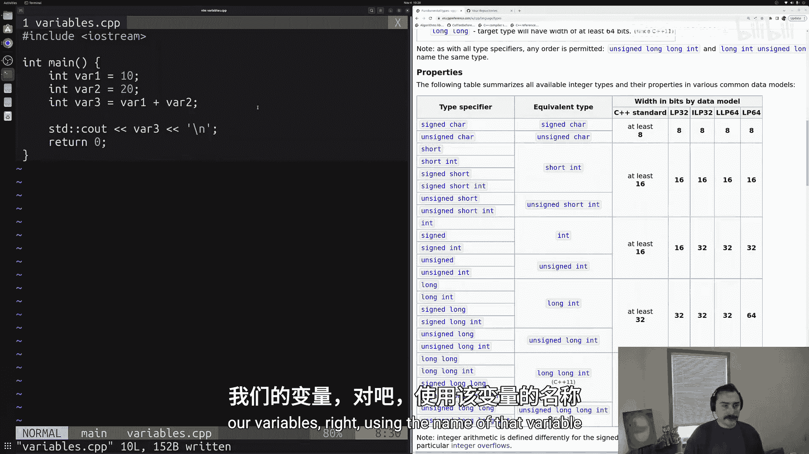

Okay， so let's go ahead and save this and let's compile this program and run it。

So we'll do G++ on variables。cbp。And we'll just create an output executable that we'll call something like variables。

So you can see we've generated our executable here， and we can go ahead and run it。

 and we get the rather unsurprising result that 10 plus 20 is equal to 30， right。

 The result of adding our two variables together， not a terribly surprising result。

 but it shows that everything works as we expect inside of our program。

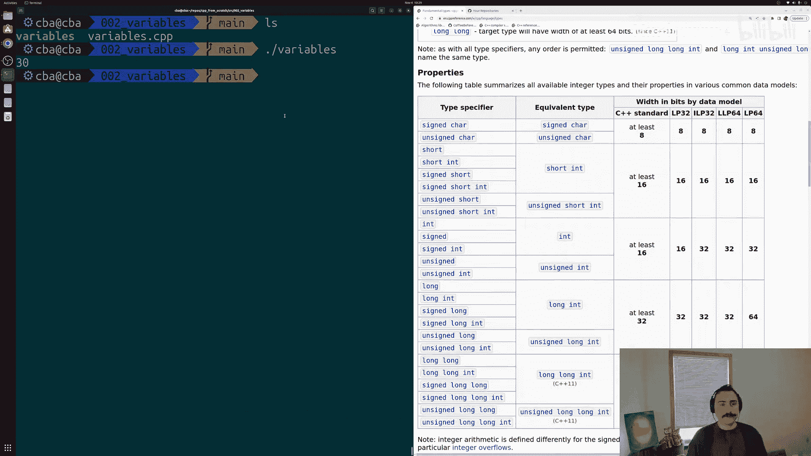

Okay， so let's go ahead and go back into our program and we can play around with maybe some other types。

So instead of using our integral data types right so positive or negative hold numbers。

 we can maybe use our fractional types as well here right so you know。

 something like our floating point types， so maybe something like a double so we can make var1 a double var2 a double。

And for three， a double。And instead of using something like 10， we can say use 10。5 instead of 20。

 we can use 20。7。So we're adding some fractional numbers together， right。

 numbers with a decimal point in them。And then you know var3 as well。

 we don't have to update anything here except for the type here so var3 is equal to the sum of these two other doubles here and then a very nice thing here is we don't have to update our print at all the stood C out right even though our type is changed for var3。

 we don't have to change anything about this print right which is pretty nice。

So let's go ahead and save this and we'll go ahead and compile variable cP again。

 So remember C++ is a compiled language。 we make a change to the source。

 we won't see those effects and are executable unless we recompile。

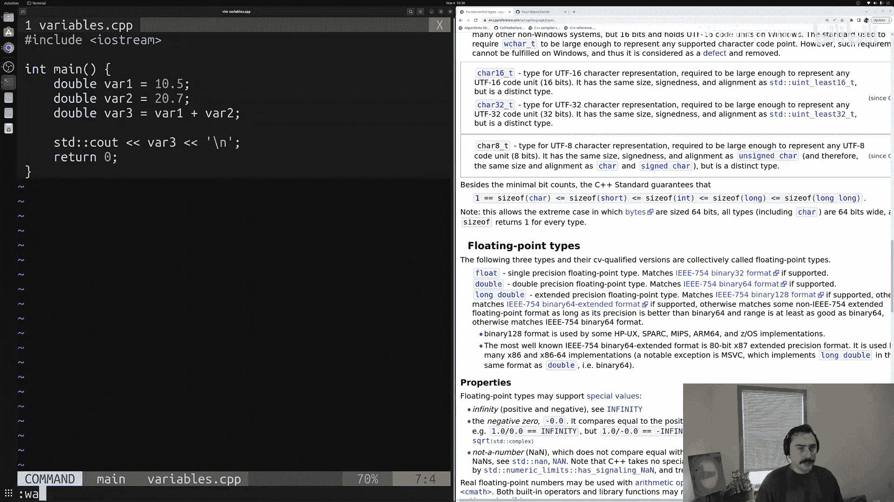

So we'll go ahead and recompile variables at CPP， and we'll run it。

 and we can see the expected result for now doing this edition of these fractional numbers， right，10。

5 plus 20。7 is 31。2 right Make sense。

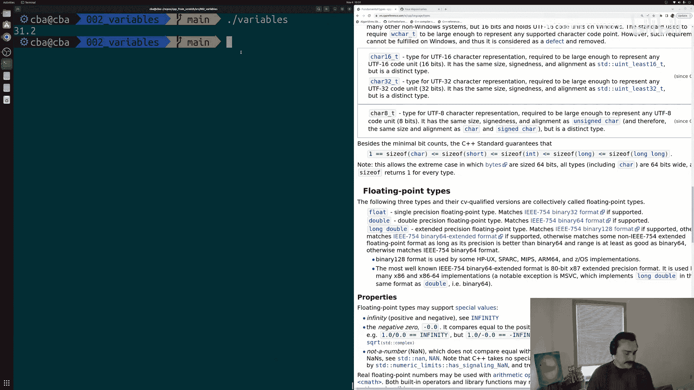

Okay， so。One of the final things we're going to look at is this thing called automatic type deduction。

 and this really just falls along the line that， you know we shouldn be telling our compiler things that it already knows it's just kind of a waste of time。

So what does our compiler already know about our types right here？Well。

 it knows that we're saying that var 1 is a double because we explicitly wrote double right here。

 but we're also assigning var 1， a double precision floating point type， right。

 So we're kind of telling our compiler in two places that var 1 is a double。

 The same thing goes for varr 2， and even the same thing for var 3。 Var 3。

 we're giving the type double right here。 And we know that if we add two doubles together var 1 and var 2。

 The result of that is just a double precision floating point number。

So we're actually wasting a bit of time here by manually specifying that all of these things are double precision types。

 our compiler already knows this information。So instead of manually saying these are doubles。

 we can say we want to defer that to the compiler， and we do that by using the auto type。

And this is how we use a thing called automatic type deduction。

And all that really means is we're saying， hey， our compilers pretty smart。 It knows what I。

 what type I meant to use right here。 So because I'm assigning var 1 equal to some double precision number。

 our compiler is going to figure out that var 1 should be a double the same thing for var 2 and varr 3 in this case。

 So we can go ahead and save this And we can go ahead and compile this as well。

 Right So we'll recompile this。

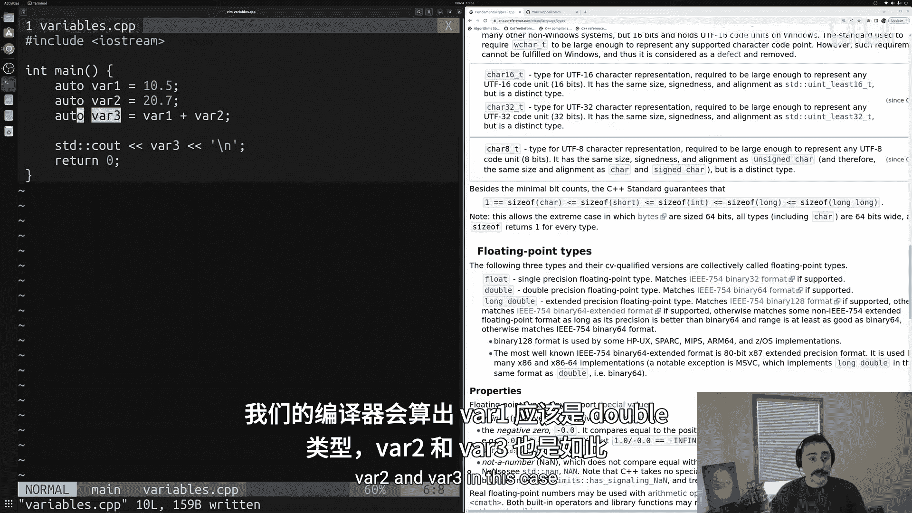

And you can see that we get the exact same result as if you were to have specified all those things as doubles。

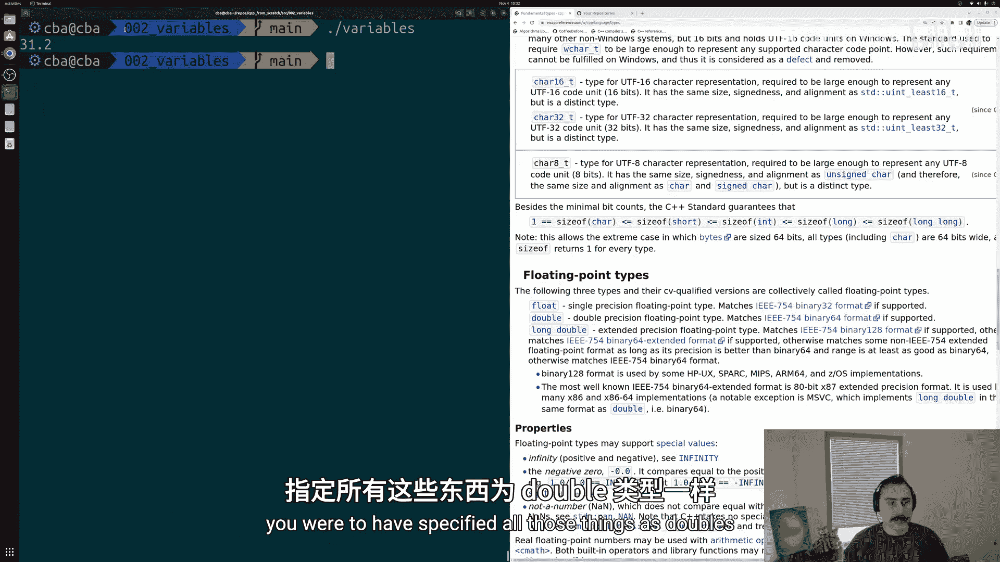

And the same thing goes if we were to use integers here。 So if suddenly these look like integers。

 right so 10 and 20 right， no decimal points or anything， suddenly our compiler is going to go， okay。

 var 1， var 2 and var 3， those are all integers now， right。

 because you're assigning these an integer immediate value。

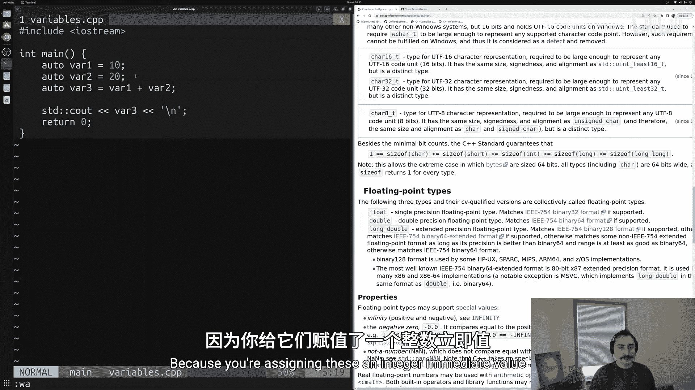

So we'll go ahead and save this and we'll recompile。

And we'll get the exact same result that we got the first time， right， 10 plus 20 is 30， right？

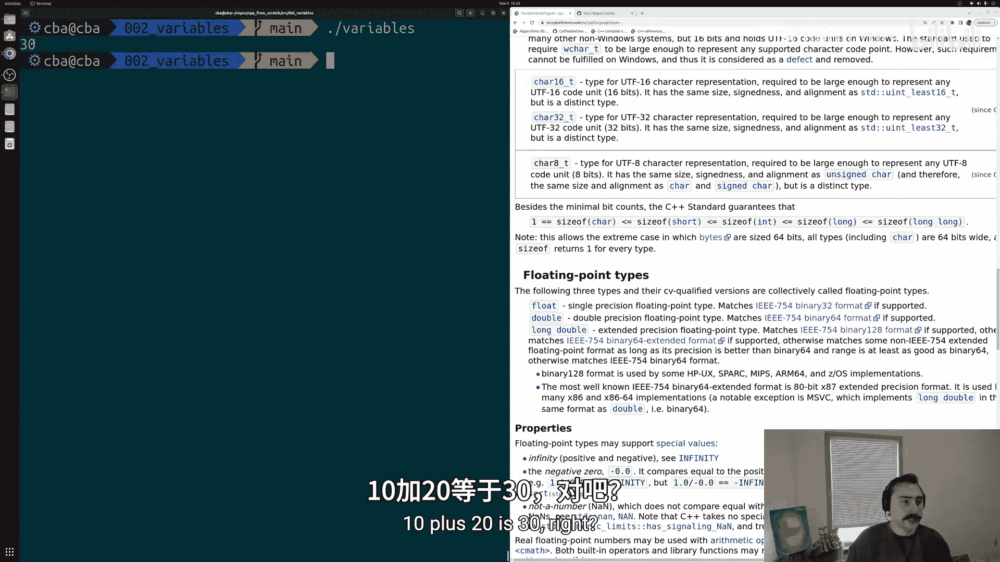

So that's a little bit on automatic type deduction Now in cases like this。

 it can seem a bit trivial right we're not really saving all that much time here by using something like auto。

But auto is actually a very nice thing in this。It can be very nice as the thing called a syntactic sugar。

 a way that makes writing your code a whole lot nicer right without changing the actual behavior。

 So for example， once we start working with things like more complex types。So for example。

 like iterators right instead of having to write out that entire iterator name every single time we can instead just use auto and let our compiler figure out that this thing is supposed to be some complex iterator type so that's where things like auto can really shine right and make our lives a lot easier。

Now one little catch here with auto is that it forces us to do initialization and definition at the same time。

So， for example， we can't do something like auto var right right we have to do initialization as well。

 and this should make a little bit of intuitive sense here So why is that Well。

 we're relying on our compilr to figure out what type this variable should be。

 And there's just not enough context in the single statement。Autto is just saying， hey。

 I'm deferring the type to the compiler， and then var is just a name， right。

 we need initialization as well here， right， so our compiler can figure out what type var 1 should be because we're assigning it an int。

 Sam thing with var 2。 we're assigning it an int。 Sam thing with var 3。

 We're assigning it the sum of two integers， but our compiler does not have the context for this statement right here。

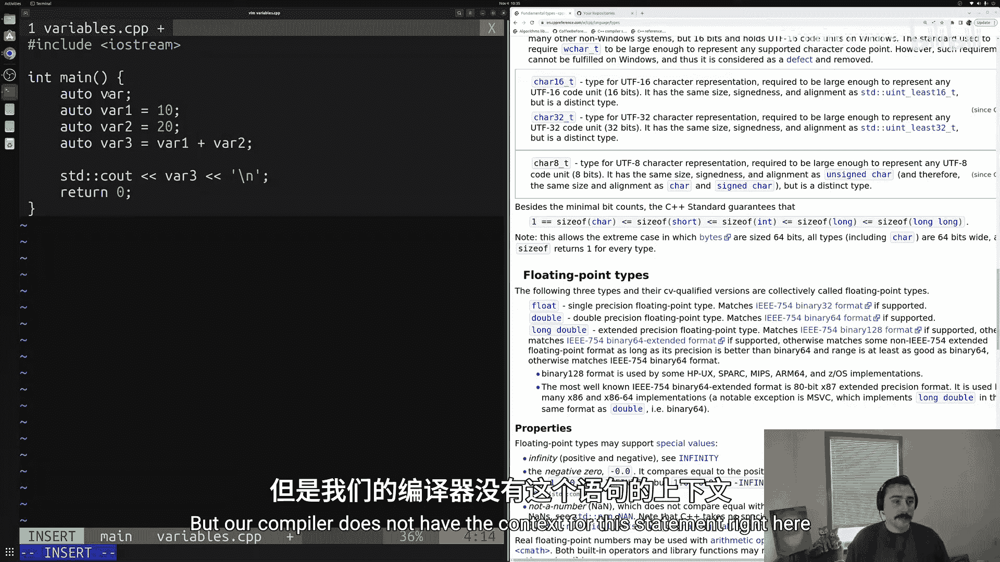

So if we go ahead and quit out of there and try to compile this。

 we see that our compiler gives us an error， it says you know we have some error in our function main。

 and our error is that we've got a declaration， auto varr with no initializer。

 so our compiler requires us to initialize this variable when we're defining it because it needs the context to figure out what type var should be。

Okay， so that's just a little bit about automatic type deduction。

So this was a brief overview of variables and how we can play around with them inside of C+ plus so we can just use them like we would those original types with all of their associated operators。

 But that's going to go and do it for today。 Of course， down below the video。

 I'll put a link to this CPP reference file for these fundamental types。 And of course。

 you can find this and any of my other code at Github com scooffbe arch。

 But that's going to go ahead and do it for today。 As always I'm Nick。 And hope you have a nice day。

😊。

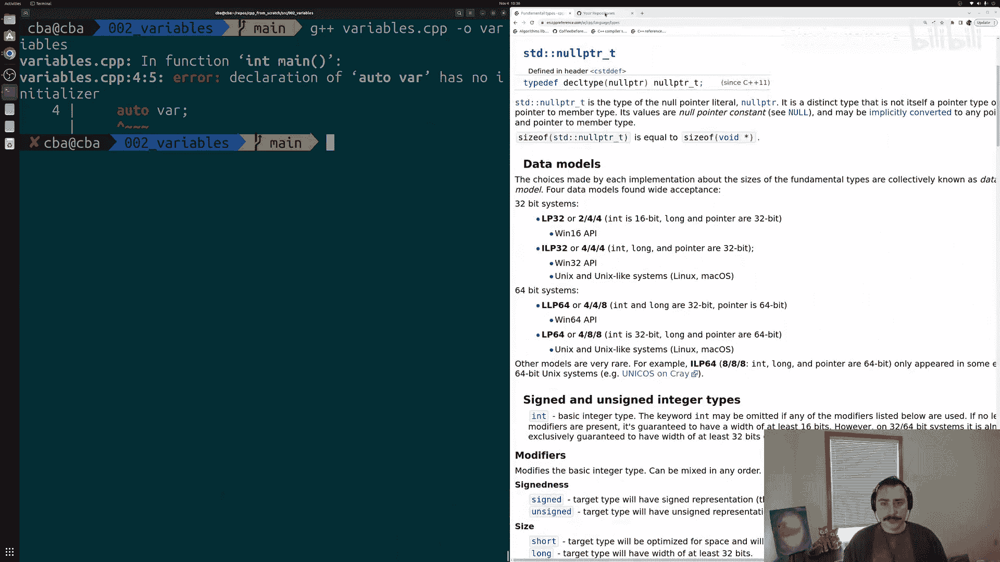

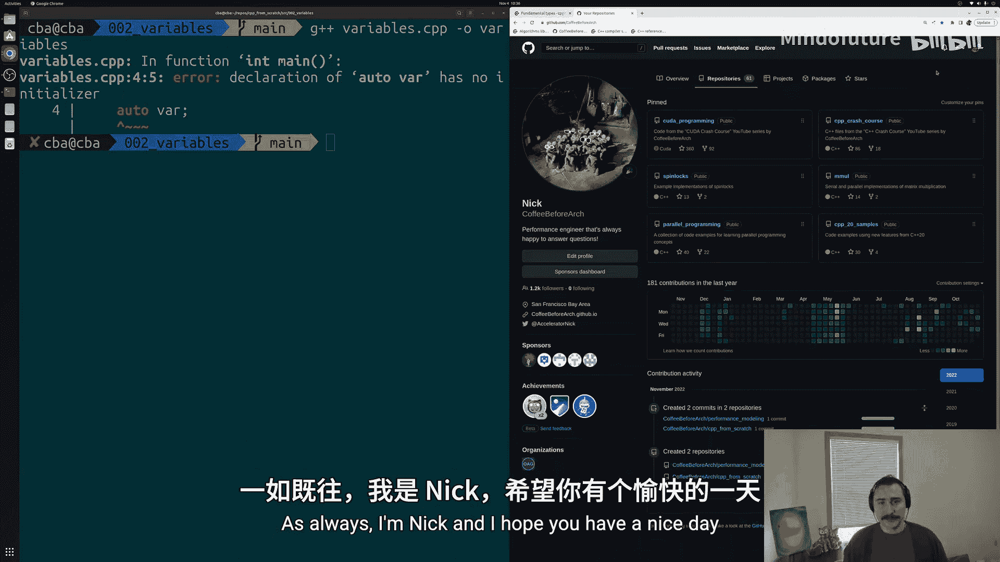