# C++入门教程｜CoffeeBeforeArch-p04-P04-Conditional-Statements--BV1nbRUYSEUu_p4-

Hey， everyone， I'm Nick， and this is C+ Plus from scratch。 So in this episode of series。

 we're going to be talking about conditional statements。Now。

 we don't always want to execute every single line of code inside of our programs。

 We often want our programs to be able to make decisions。

 And the way that we do that in C plus plus is through these conditional statements。

 So things like the keywords if and else， right， these keywords give us the ability to say， you know。

 if some condition is true。 execute one block of code。 Otherwise。

 maybe execute a different block of code or maybe don't execute anything else at all。

 just skip this code entirely。😊，So what we're going to be looking at today is the basics of how we use things like these if and else keywords and write simple programs that use conditional statements。

So let's go ahead and get started and of course， the first thing that we're going to need is a new C+ plus source file。

 So we'll go ahead and create a new file that we'll call you maybe condition do CPP。

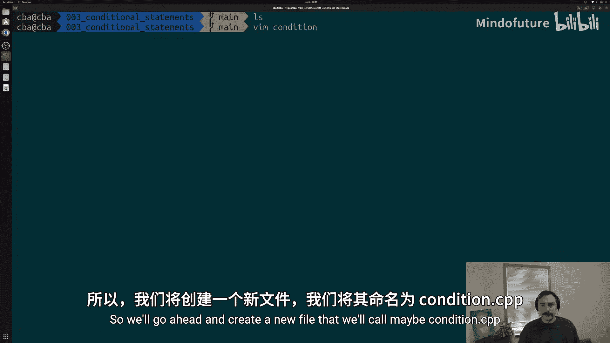

And inside of here， we can of course， start with a main function。

 right the core of all of our C++ programs。Where a program begins execution。

Now let's say that what we want to do here is create a couple variables， compare their values。

 and maybe print out if one variable is bigger than another。So you know， for example。

 we can create a couple of integers here so we can create an integer A instead set it equal to 5。

And create some integer B instead it equal to 10。Now let's say we want to print out if a is less than B。

 so let's go ahead and include Io stream at the top of our file here。

 so we'll do include IO streamam so we can use stood C out to do our printing。

 C out standing for character output again。And let's go ahead and get into our conditional statement here。

 right， so what is the condition that we want to check， We want to check to see if a is less than B。

 So the way that we would do that is we would say if right using that if keyword。

And then we would use pars right inside of these parentheses。

 we're going to put the condition that we want to check。So if a is less than B。

 just using the less than operator here to compare A and B， so this will either return true or false。

And then we'll put some curly brackets and those curly brackets will be for the block of code that we're going to execute if this condition is true。

So all our if statement is really saying is saying if some condition is true。

 execute this block of code here。If the condition is false， we just skip this block of code entirely。

 so in this case， we would just go to this return0 down here。Okay。

 so let's go ahead and fill in this block of code， so we'll just put a print in here。

 so we'll put something like stood C out and we'll print A is less than B。

That'll be our string that we print if this condition is true。

 which should print in this case because we have A is5 and B is 10。

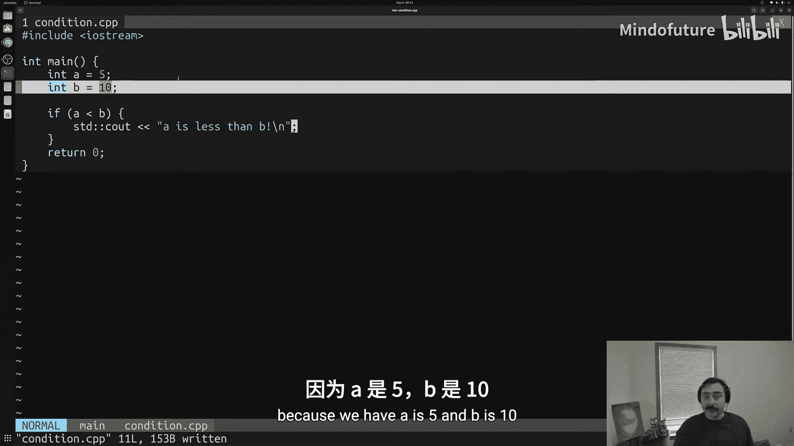

So let's go ahead and save this and we'll go ahead and compile our program so we can run it。

 so we'll go ahead and use G++ on our condition。cP file and we'll create an output executable。

 you know maybe just called condition。So we'll go ahead and save this。

And you can see we generated this executable here and we can go ahead and run this and of course we see our print。

 we see A is less than B。

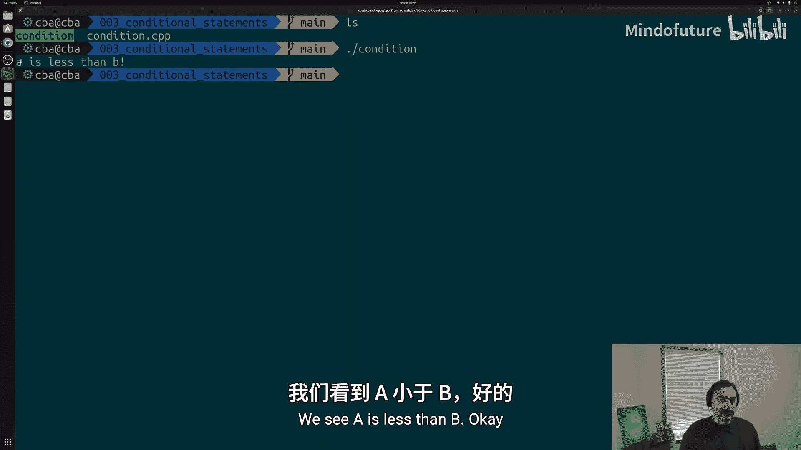

So let's go ahead and go back in here and maybe let's change our values here。

 So maybe we'll change a to something like 10。 So I know a is equal to B。 Now。

 because a is equal to B， this condition should fail， right， It should be false。 Now。

 it should return false because a is no longer less than B。

 It's equal to be So what should happen is we'll just skip this print entirely。

 right because this condition is false， We won't execute the code inside of this block right here。

 We'll just skip it entirely。So we'll go ahead and save this and we can go ahead and recompile our program this condition。

 cppP generate a new executable right remember this is a compiled language we have to recompile our source when we make changes to it if we want to see those changes take effect in are executable。

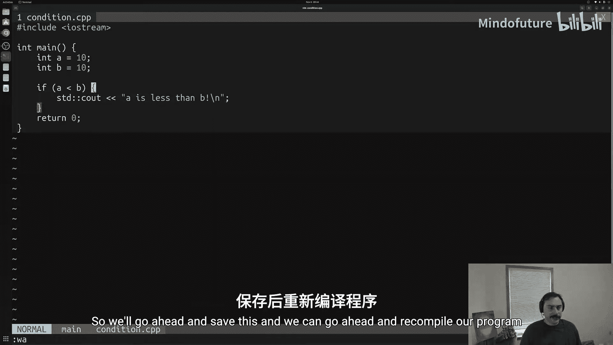

And when we run condition now， you can see that we don't get any print， right。

 And that should make up some intuitive sense here， right， because this condition is now false。

 we're skipping this block of code。 So we never hit this stood sea out anymore more。

 We're just skipping it entirely。

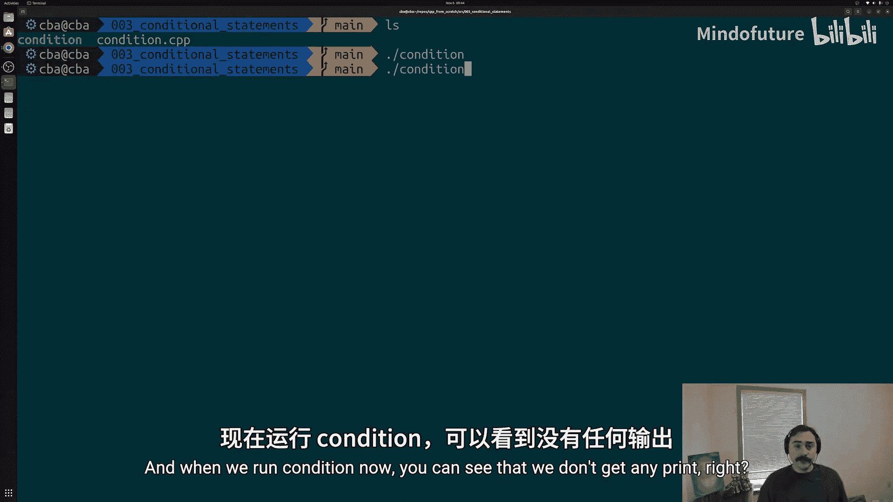

Okay， so that's kind of the basics of how we use just say an if statement Now there's oftentimes where we want to handle the other case here。

 we want to handle the case where you know this condition is false and the way that we can do that C++ is through the keyword else so we can use the else keyword to capture when some if condition is false so here we're just saying you know if A' is lesson B will execute this block of code otherwise or else will execute a different block of code。

So it gives us a nice way of capturing the false side of this condition without having to do another comparison。

 we can just say， you know， if the if you know condition failed or was false， do something different。

Okay， so inside of here， we can maybe just add another print， right， so we'll do stood C out。

 you know， and print out A is not less than B。Okay。

So let's think about what's happening in our code again， so A and B are both 10。

 so the first thing will happen is we'll check to see if a is less than B。

 we'll find out that that's false， so we'll skip this block of code right inside of our if statement right here。

And then we'll go to this else block， right， And this will， this will capture that false side。

 right of this condition。 And so we'll print out a is not less than B。

 So we don't need to provide any condition for else right here。

 All its doing is taking the false side of this， if condition。

 So this is always taking when that condition above is false。Okay。

 so let's go ahead and save this and we can go ahead and recompile our application here to generate a new executable and we can run it and you can see that we get a print from the false side。

 so we see that A is not less than B。

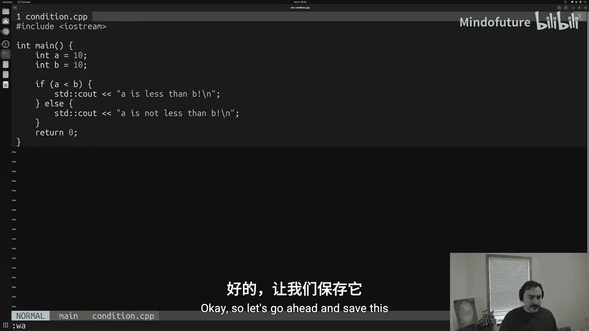

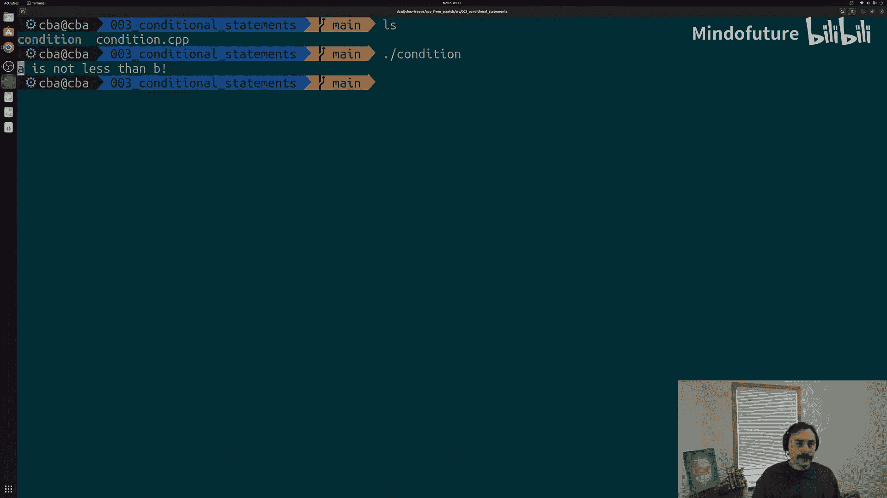

If we were to go back in here and maybe change a back to five。

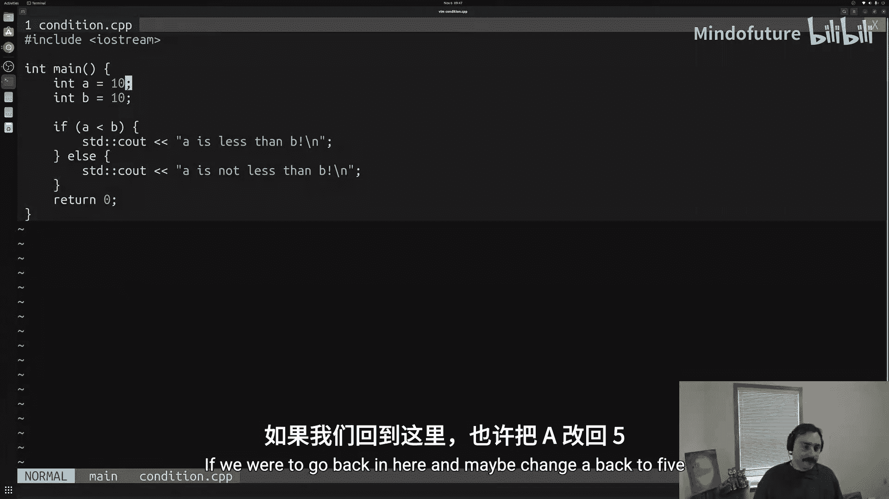

And recompile this。We can go ahead and see that we get the if print again， right。

 the one that was in that if block， we see that A is less than B。

So an important thing to keep in mind here is we're only going to execute at most one of these prints。

 So when we have these if and L statements， we only execute at most one of these prints。

 we either execute the true side or the false side， we're never going to execute both right here。

 So if you know， A is less than B， we'll print out A is less than B。 If it's false， right。

 If A is not less than B， we'll print out A is not less than B， we'll hit this L side。

 but there's never a case， where we'll print out both right， using these if and L statements。

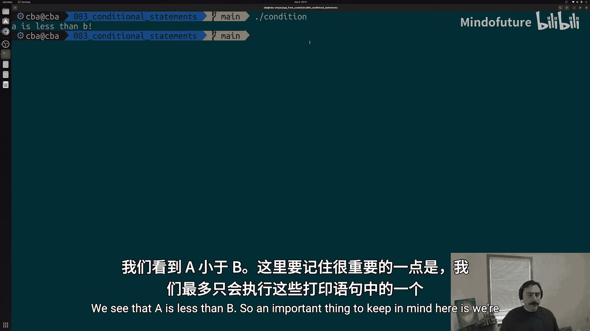

Okay， so that's a little bit on if and else， Another thing we can do is test multiple conditions so we can chain if and L statements together so we don't have to just check。

 you know， you know if one condition is true， otherwise go to the false side。After else right here。

 we can add another if statement so we can go on to check another condition。

 so maybe we want to check to see if a is less than B if a is equal to B in the case where a is greater than B。

 maybe we want to catch all three of those cases here。So here we can just add another if statement。

After else to test another condition so here we might check you know is a equal to B right and we'll capture that right here。

 so our double equal sign is how we test equality right to make sure that two values are equal single a single equal sign like up here。

 that's how we do assignment right so that's the difference between equality and assignment equality being this2 equal sign。

Okay， so now we're testing if a is less than B， if that's false。

 we'll test to see if a is equal to B so we can update this print as well so we can say A is equal to B。

And then we can add， say another else block down here。

 right and this will capture the case where a is greater than B， so we don't need to test。

 say another condition down here， we can just add an L side because if a is not less than B。

 and it's not equal to B， then it will be， of course， B greater than B。Okay。

 so let's think about what's going on inside of our code now。 So now we have A is 5 and B is 10。

 So what we'll do is we'll first hit this if statement of a is lesson B。

 and that result will be true because A is lesson B。

 So we'll print out A is lesson B and then go to this return0 down here。

 So just like if we had a single if L statement， we're only going to execute one of these blocks inside of this chain。

So we'll go ahead and save this， we'll recompile。

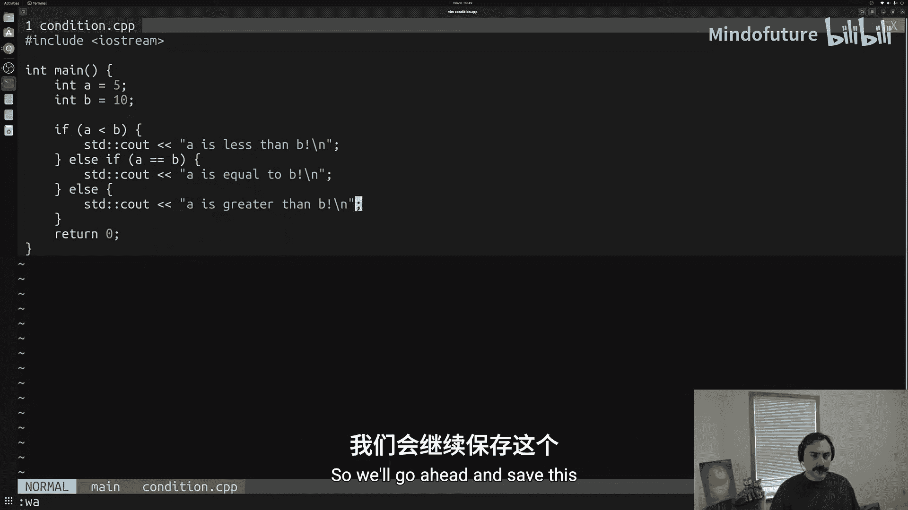

And you can see that we get that first print when we run our executable， A is less than B。

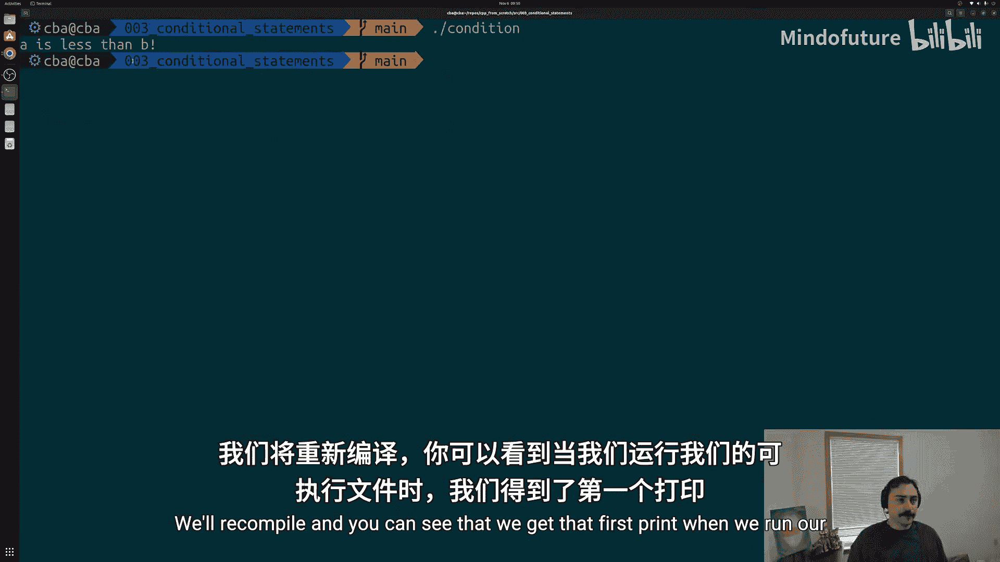

If we go ahead and make A and B equal to each other， so we'll go ahead and make this A and B both 10。

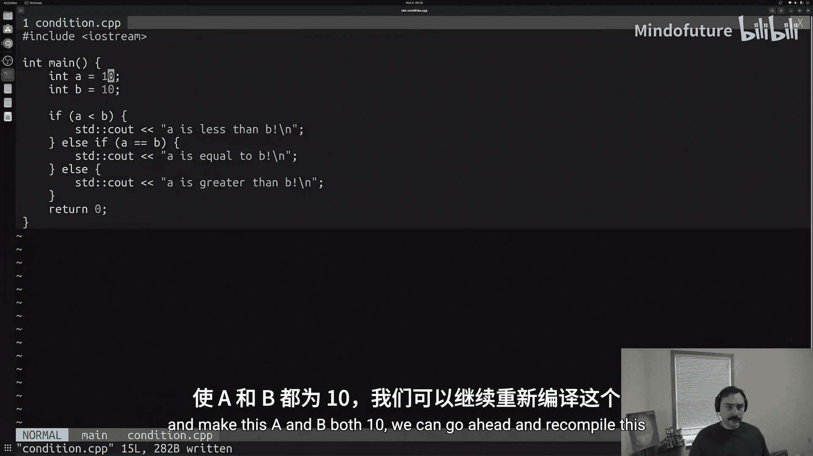

We can go ahead and recompile this。And run it and we see we get A' is equal to B。

 so now we get that middle condition here。

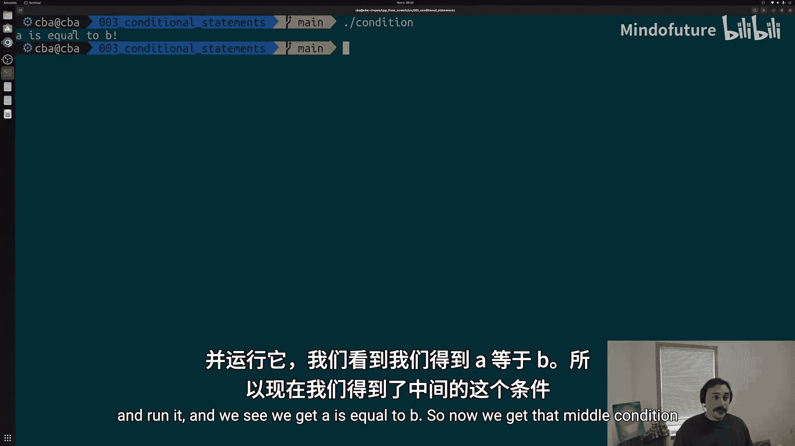

So， you know， we first checked if a is less than B， that was false。

 So we went down to check our next condition， which was a is equal to B。 And that was true。

 So we did this middle print and then went to return 0 here。Okay。

So the last thing we can test is when a is greater than B。 So now a less B should be false。

 so we should skip that block。 A is not equal to B， right A is 15。

 B is 10 so we should skip this block。 This will be false So we'll go into this else block here right and just print out A is greater than B。

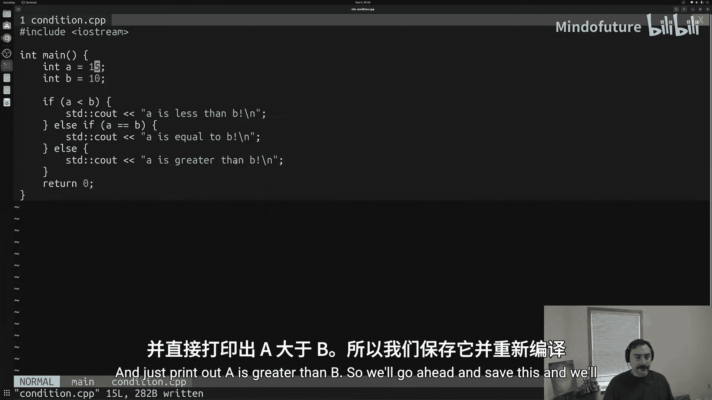

So we'll go ahead and save this。We'll recompile。And we'll run this code。 and of course。

 we get A is greater than B。

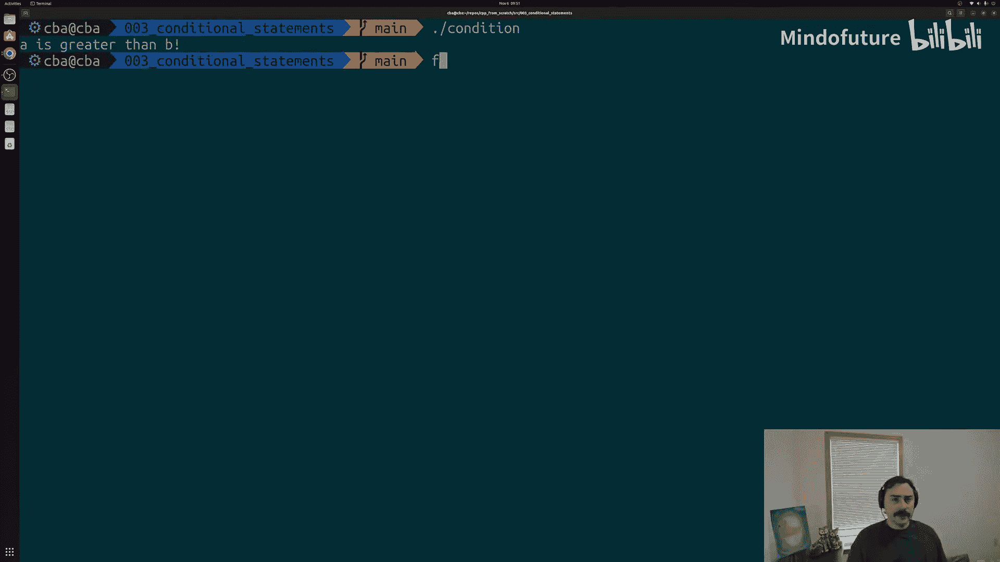

Now， the final thing that we should talk about is how we can nest say if and L statements。

 So right now we've chained a bunch of if and elses if statements together。

 Another thing we can do is we can add say if and else statements within other if and else statements。

So let's say that if we get this case where a is greater than B。

 maybe we want to print out the value of a， right， if it's say equal to 15。

 so we can add another if statement within this else block right here。

 so we can check another condition。 We can say if a is equal to 15。 Maybe well do another print。

 So we'll say stood C out。And we'll print out， say a is equal to 15 with an exclamation mark。

And a new line character so it gets printed on a new line。Right。

 so just like we can have this big long chain of if and else and else if kind of statements going on inside of our。

 you know， if or else statements， we can also have know other if statements so we can check conditions within other conditions。

 right， that's perfectly legal in C+ plus。So let's think about what should be going on in this case。

 A is 15。 B is 10。 So what should happen。 Well， first， we'll check this condition， A less than B。

 That'll be false。 So then we go on to checking the next condition。 A is equal to B。

 That will be false。 So we'll fall into this L side， because a is greater than B。

 We'll do this print of a is greater than B。 And then inside of the L block。

 we'll have another condition to check。 So we'll check to see if a is equal to 15。

 which in this case is true。Because it's true， we'll go ahead and print out the code within that block。

 right， We'll print out。 stood see out A is equal to 15 with a new line character。

 So we should see two prints here。 A is greater than B and a is equal to 15。

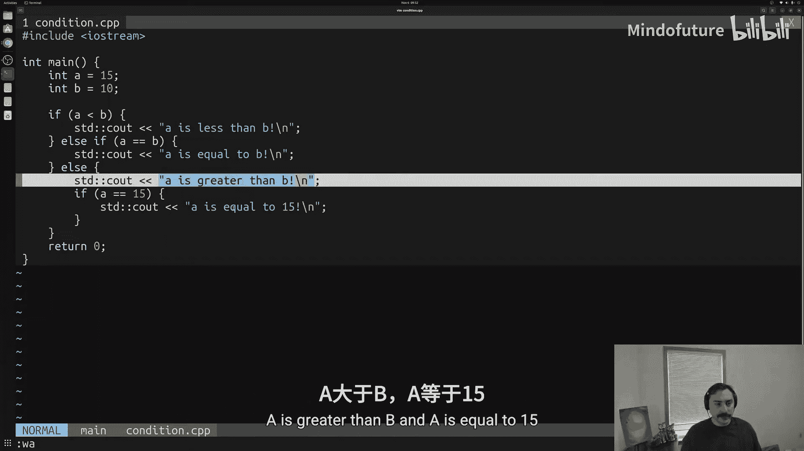

So let's go ahead and save this and we'll go ahead and compile our code again。

And we'll go ahead and run it。 and you can see that we get both of our prints here。

 We see a is greater than B and a is equal to 15。So that's a bit of the basics about using these conditional statements inside of our code。

 these conditional statements like if and else， this really is what enables us to make decisions within our programs and selectively execute code。

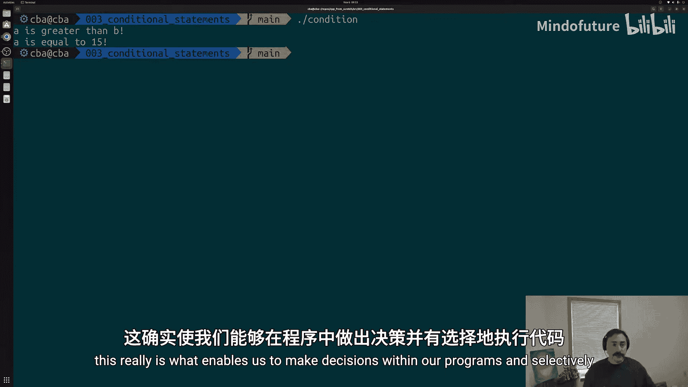

Now all this code of course， is available at Github。com scoffeebearch。

 so you can go and find all of these examples and in many more for different series that I have on this page。

 but that's going to go ahead and do it for today， as always I'm Nick and I hope you have a nice day。

