# C++入门教程｜CoffeeBeforeArch-p05-P05-std----array--BV1nbRUYSEUu_p5-

Hey everyone， I'm Nick， and this is C++ from Sc。 So in this episode of the series。

 we're going to be talking about one of the containers from our standard library。

 and that's going to be stood arrayray。So there are oftentimes inside of our programs where we want to group our values。

 maybe into the same variable。 So， for example， we may be collecting data over time。

 maybe it's something like temperatures。 and we really don't want to have to create， say。

 a unique variable for every single measurement。 So， for example， you know， if we're collecting。

 you know， temperatures of the course of the year。 we really don't want to have 365 different。

 say floating point numbers or double precision numbers for those temperatures。

 We'd ideally like to collect them together into， you know。

 say a single variable that we could access individual components of。

And that's exactly what we can do with some of our containers from the standard library。

So specifically today we're going to be looking at this container called stoo array and this array is just a container that encapsulates fixed size arrays。

 so we want to say in elements stored in you know this one container here it's fixed size so we have to specify the number of elements and it can store elements of some particular type T right so we can store say 100 integers right or you know 75 floats or 22 doubles we just have to specify what type that we want to store and how many of that type we want to store in this array and then we can access the contents of just that single array instead of say having 75 unique variables for all those individual pieces of data。

Okay， so let's go ahead and see how we can use this student array。

 and of course we can start off with creating a new source file。

 so we'll create something like array。cP。

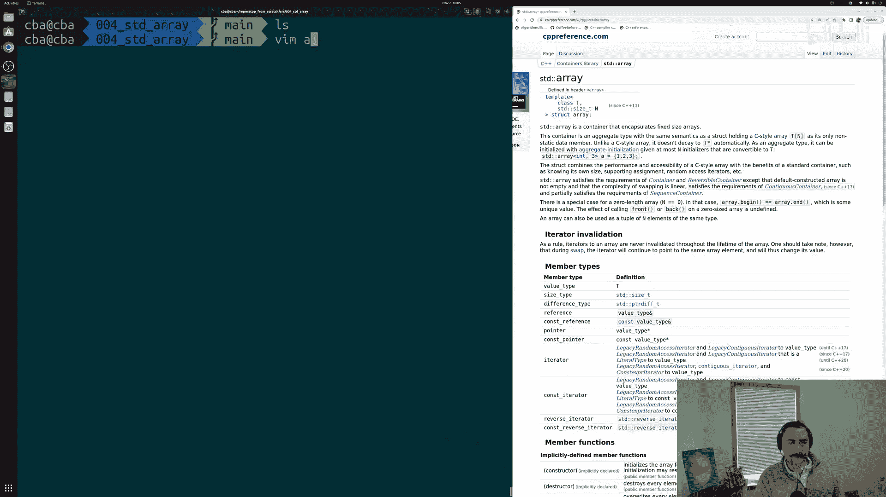

And inside of here， we can， of course， start with creating a main function， right。

 the core of all of our C plus plus programs。So before we can go ahead and use stood array。

 we're going to need to include its definition for the same reason why we needed to include Iostream。

 Before we can use stood array， we have to include its definition from this header array。

So let's go ahead and do that。 So we'll go ahead and go back to the top of our file and we'll include this header array。

 and we'll go ahead and include Io streamam while we're at it so we can print out the contents of our array later on。

Okay， so let's go ahead and see how we can create a student array inside of our program。 Now。

 fundamentally， this array is really just another type。

 so we can create we can create a variable that's a stood array。 Now there's one little catch here。

 right It makes it different than some of the fundamental types that we've looked at at the past。😊。

And that's that stoo array is really a template， which really means it's not a concrete thing。

 right St array is really just a template for whatever kind of array we want。

 So our stood array takes some， you know template parameter T that says what type we want to store in this array and how many elements of that type right in right。

 It's a fixed size arrays we also need to specify you know what the number of elements we're storing in this array。

So really there's an infinite number of you know stood arrays that we could have right。

 we could have you know stood array of you know， 22 floating point numbers or 93 instegerors or you know 67 you know floating point double precision floating point numbers right or with some other kind of object here because stood array is fundamentally just a template it's a template for this array container。

So in this case we have to provide some template parameters here to say what type we mean to store and how many elements of that type。

 so we'll go ahead and create a new variable that's a stood array。

 and we can provide these template parameters inside of these open and closed angle brackets or less than greater than signs。

So in this case， we'll provide both a type and a number of elements。

And we'll call our array something like my array。 So what are we saying in this line。

 when we're just saying， hey， I want to create a stood array of three integers and I'm going to call that array my array right here。

But again， right， we could change this to something else， right？

 It's a template so we could change the type， or we could change the number of elements as well。

 Both of these things are valid because fundamentally， stood array just a template。Okay。

 so let's go ahead and change this back。 We'll have our array of three integers here。Now， right now。

 we've just defined this variable here。 but like we said in our video1 variables。

 we also often like to perform some initialization We want to prevent the use of uninitialized variables。

 we can do initialization on the same line as we define our variable and we can do it through this thing called aggregate initialization so allll go ahead and provide the link to this stood array reference at the below the video so you can find this documentation for yourself。

 but at its core， you can see that we can initialize our array using the thing called aggregate initialization。

 so we can say set our array equal to inside of curly brackets。

 some values that we want to have is a contents of our array。😊。

So here we'll say set the cons equal to 45， know maybe 23 and then you know maybe three right So now our three elements inside of our my array are going to be set to 45。

 23 and 3 respectively。 So we've initialized our array now。And in fact， you know。

 if you look up the rules of this aggregate initialization。

 we can even get rid of this equal sign if we wanted to。But both of these things were perfectly fine。

Okay， so now we've created our stood array。 We've set it equal to some values。

 Let's go ahead and try to print it out。So the first thing we can try to do is just stood see out。

With our my array right and then print a new line character right and we can try to see if this works。

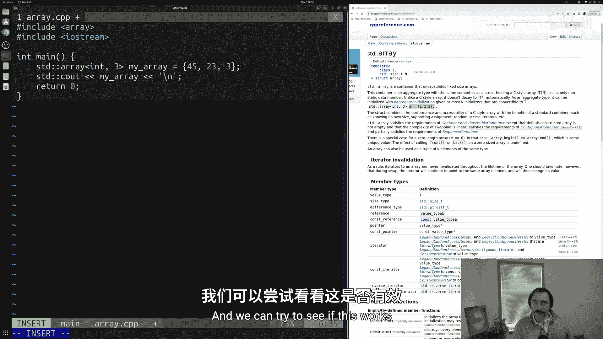

So we'll go ahead and quit out of here。 and then we'll try to compile array do CP and create an executable called array。

 And let's see what happens。 Well， we get a whole bunch of errors。

 So we can try to scroll up to the top to find where these errors start at the very beginning and trying to understand it。

 at least at its very basics。 So one of the unfortunate things when we start working with things like templates is that the errors can get quite messy。

 So it can be a little little difficult to see what's going on。 So fundamentally。

 let's see what's going on here。 So fundamentally， our compilers complain that there's no match for this operator。

 less and less than when we're using this basic O stream of characters， which is our Sty out。

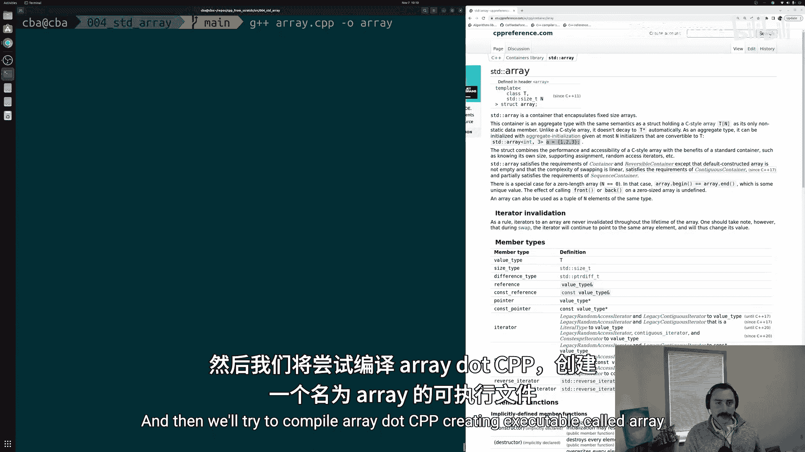

And then this stood array of integers of three integers， which is our my array。

 So what is this what is this really saying right here。

 All it's really saying is that our my array doesn't implement this operator。Okay。

 so that kind of makes sense。 like as as we've talked about in the past， are types， right， you know。

 these user defineding types or these standard library types。

 they can implement different operators right， so stoody out implements this less and less an operator and it uses it for printing。

 but our stood array doesn't implement this operator so we can't print the contents directly like this。

 However， we can still print the underlying values inside of our programs。

 or rather inside of our array， So let's go ahead and see how we can do that and how we can access the contents of this array so we can actually print something and use something。

So we'll go ahead and open up this file like an array cP and we'll try something different。

 so if we go ahead and scroll down unto arrayray， you can see that our stood array supports a number of difference a methods and operators including a number for element access so it uses things like or provides things like at。

 So this is how we can access specified elements and it even does some bounds checking So this is useful if we want to be careful inside of our program and make sure we're not reaching out of bounds。

 So for example our array only has three elements here。

 but what if we try to access you know element number four So we use at。

To be extra careful about those situations， we can also just have you know a less safe access。

 right so we can use this this bracket operator to just index into array at a particular point without doing any kind of bounds checking。

 we also have methods for say doing accessing the first element。 So that's front right here。

 the last element using back and even the underlying memory using this data method。

So let's go ahead and try some of these out So for example。

 you know we can try at so we can use dot at to access a member of our stood array。

 so this dot is just a member access operator so we're accessing the member at of our stood array my array so you want to access the value at。

 say position0， so our arrays and many of our containers are0 indexed。

 meaning that our first element is sorted index 0， our second element is sorted index1 and so on and so forth。

So here we can go ahead and save this。

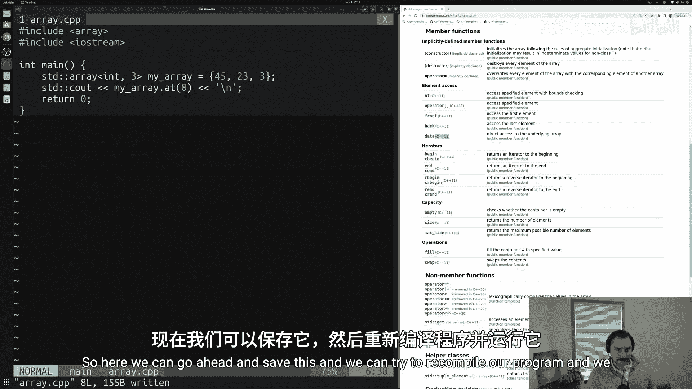

And we can try to recompile our program。And we can run it。

 and you can see that we get the first element inside of our stood array。W the element 45 here。

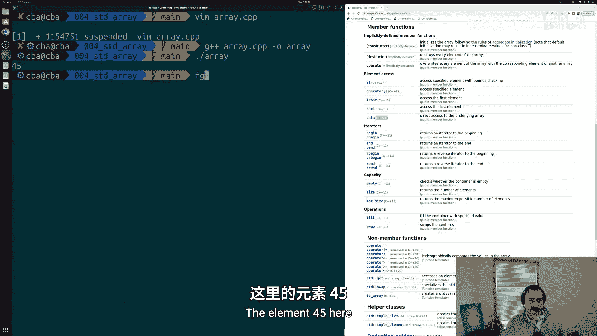

Likewise， we can use that bracket operator。That our documentation says is supported。

So we can try to access save the zero or maybe element one inside of our array so we can go ahead and recompile。

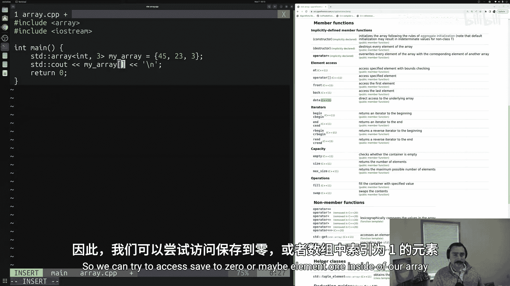

And try to run this。And you can see that we get， of course， the second element， right， 23。

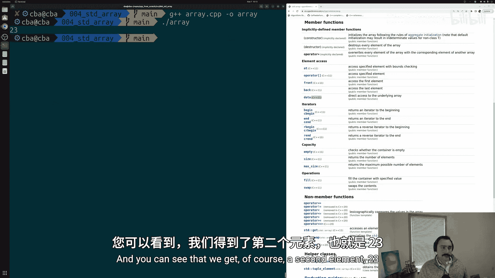

Now we can also use say those methods front and back so we can use a dash front to get the first element inside of our array。

 and we'll go ahead and copy this again and we'll say try to print the last element as well。

 using that method back right so front and back just accesses the first element and last element respectively。

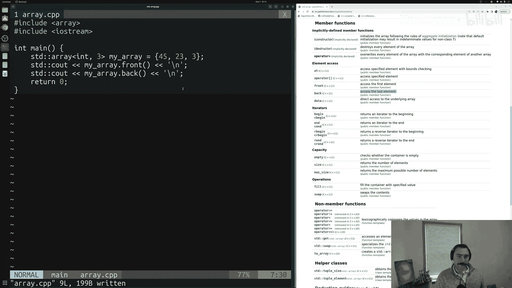

So we'll go ahead and save this and we'll go ahead and compile array do cP again。

 We've got our executable。 let's go ahead and run it。

 And you can see we get the first and last element，45 and3 respectively。Okay。

 now another thing we can do here is you can see there's some operations and one of them is fill so we can fill an array with a specified piece of data。

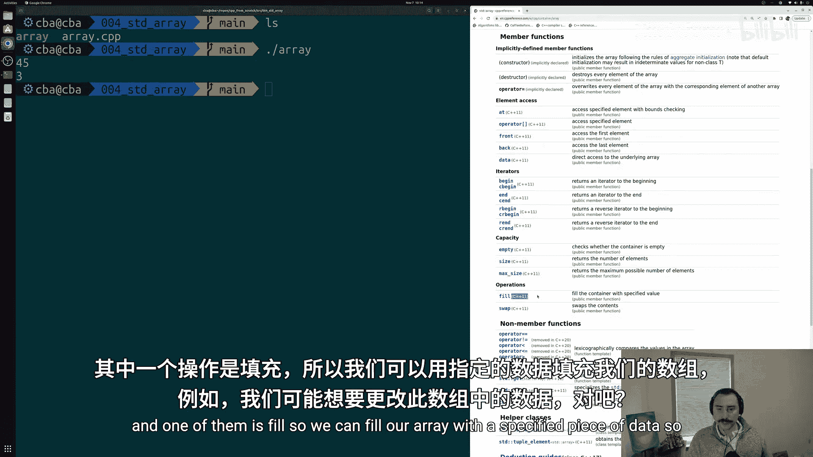

So， for example， maybe we want to change the data inside of this array。 right。

 So we can do it one by one by just say doing， you know， my array of 0 is now equal to 10， right。

 We're just accessing element at position 0 and setting it equal to some other value。

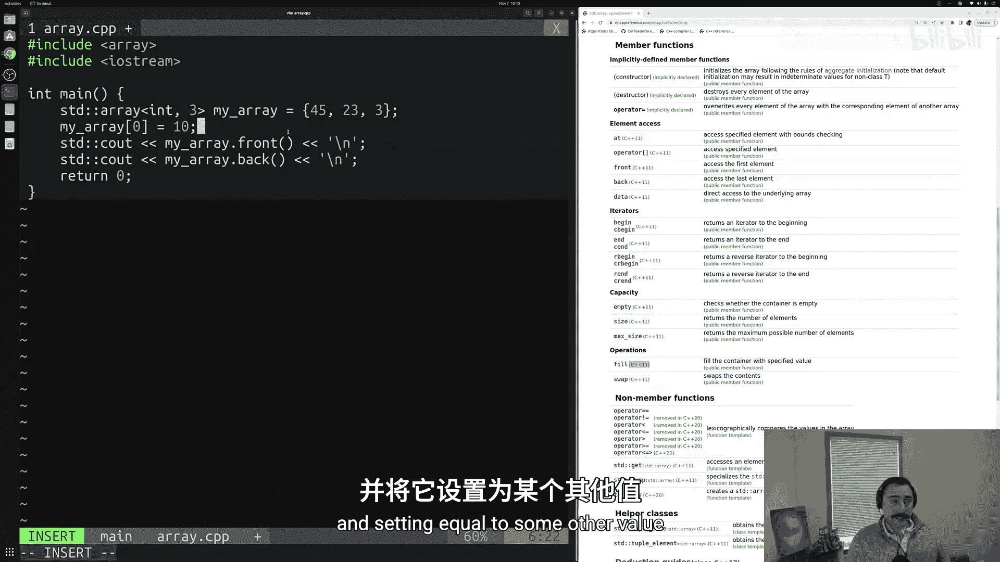

So， we can go ahead and save this。And compile it and run it。

 And you can see that we've changed the front， the first element to 1 now。

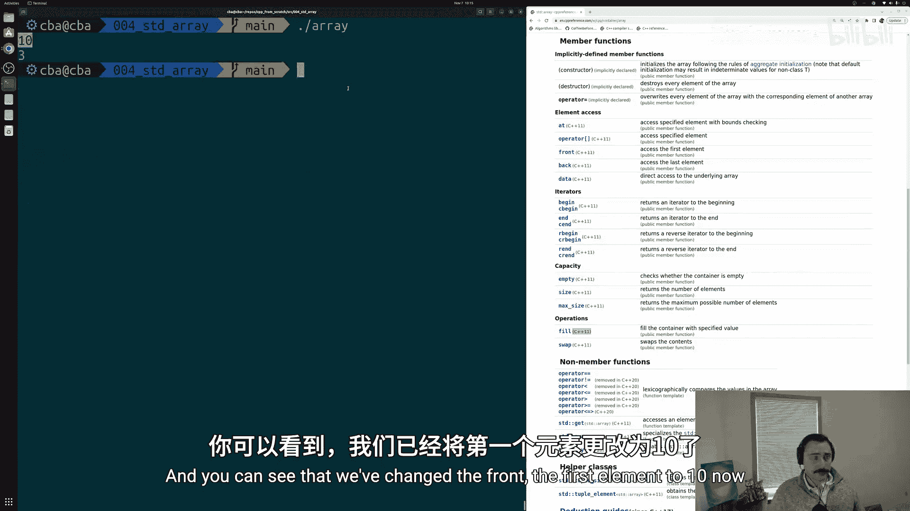

But if we want to change， say all of the elements， maybe we want to fill our array with a specified piece of data。

 So maybe we want to fill our array with the value 54。

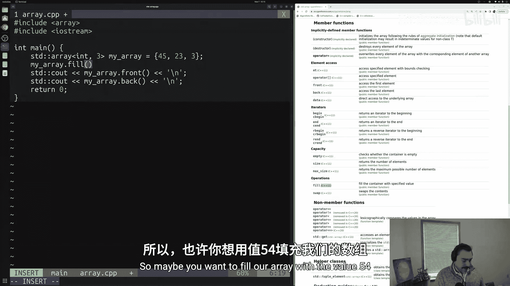

So we'll go ahead and save this。 And now when we compile and run our program。

 we see both front and back are 54 and even our middle element is going to be 54 right。

 fill allows us to fill our container with the specified value。

 our stood array that is right fill our stood array with that specified value。

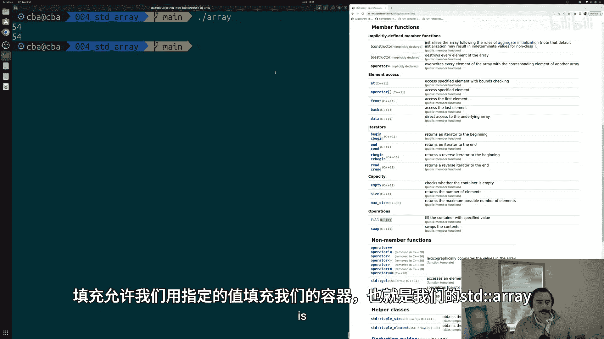

Okay， so the last thing we can go ahead and look at is going to be this。This capacity。

 right query that we can do。 So let's go ahead and get rid of some of these prints。

And we can go ahead and call this method from our capacity called size。 right。

 So let's go ahead and print out my array dot size。Now we know array is three elements here。

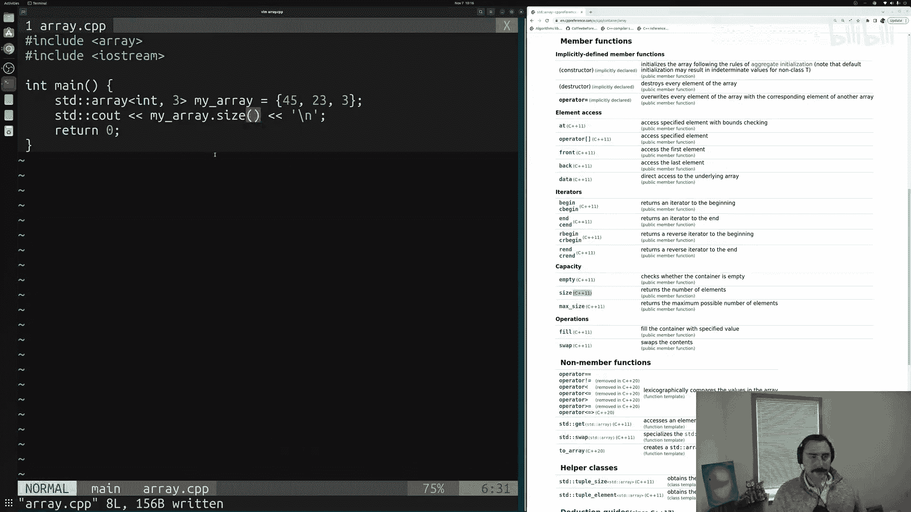

And if we go ahead and print out my arrayray dot size， right using that method。And run it。

 you can see that it knows that we have three elements here。

 Now while this may seem pretty trivial you know， in the context of this program。

 this is actually a very useful thing as compared with the old kind of C style arrays that you know some people are familiar with working with。

 which are still valid in C++， but somewhat discouraged compared to using a standard container like to array。

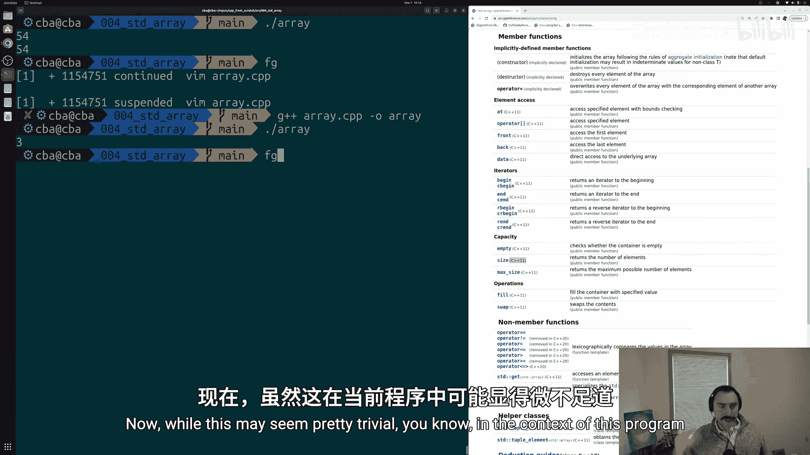

Now， the reason why this is so nice is because we it means that we don't have to keep track of this number 3 elsewhere inside of our program。

 And， in fact， we can be a bit more expressive here in how were writing our code instead of say having this number three sort is a separate variable that we have to keep around。

 So we know how many elements we have in my array。 My array just knows how many elements it contains。

 My array knows its size， right， So if we update， you know， say this template someplace。 and。

 you know， we make it say five elements instead of three。 So， you know。

 we'll just maybe fill in some more dummy values here。

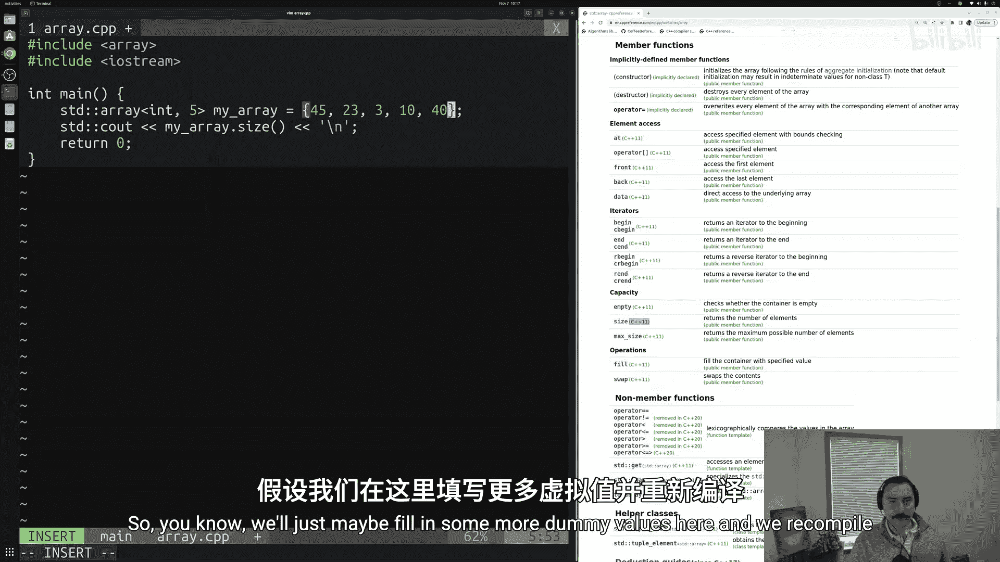

And we recompile this。My array still knows its size， right It knows it contains five elements。

 So this is a very nice thing about our containers， right。

 Our containers suddenly they know a lot more about themselves in terms of you know how many elements they contain。

 So it can help simplify our code and make our code a bit more expressive。

 right instead of know writing these values like 5 or 10， right。

 we can just query the size of this container， right。😊，Okay。

 so that's going to go ahead and do it for this video。

 We looked at some of the basics of using this container stood array。

 Now one of the things that you may have noticed here was that there's a lot more。

 say methods here that we didn't really touch on including this entire category of things called iterators。

 Now these iterators are mainly use when we're working with loops and our data structures。

 and also when we're using say our STL algorithms。 So we'll be touching more about iterators when we get into the topics of loops and algorithms in later videos。

 So that's going to go ahead and do it for this time， as always。

 you can find any of this code at github co such coffee before arch。

 but that's going to go and do it for today。 As always I'm Nick and I hope you have a nice day。😊。

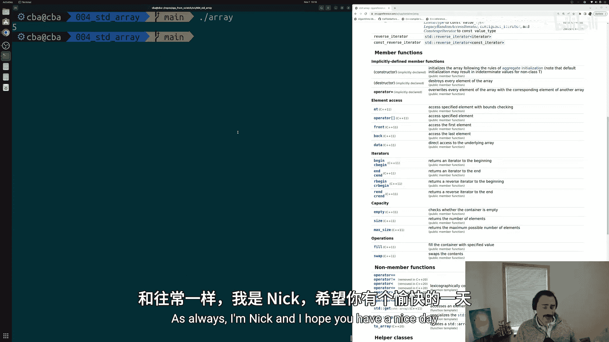