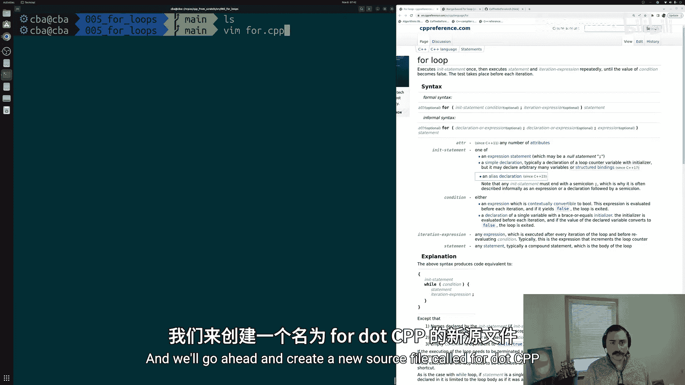
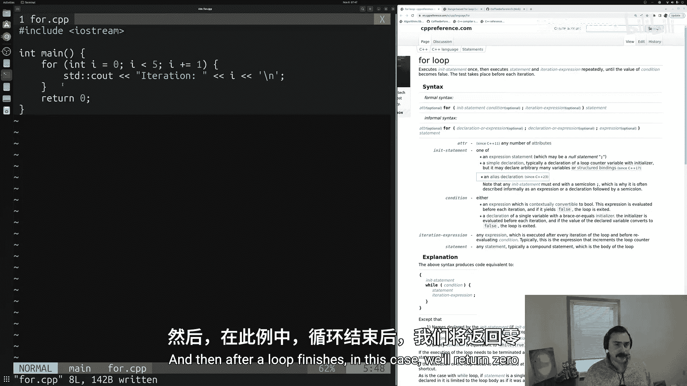
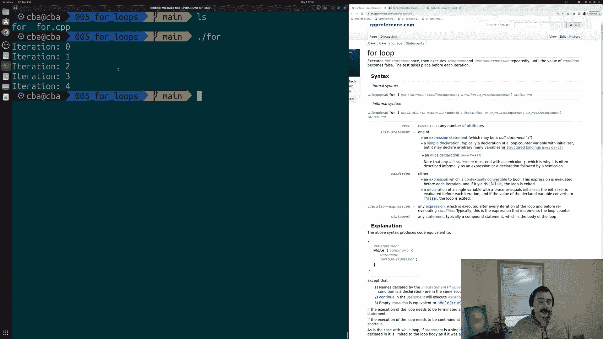
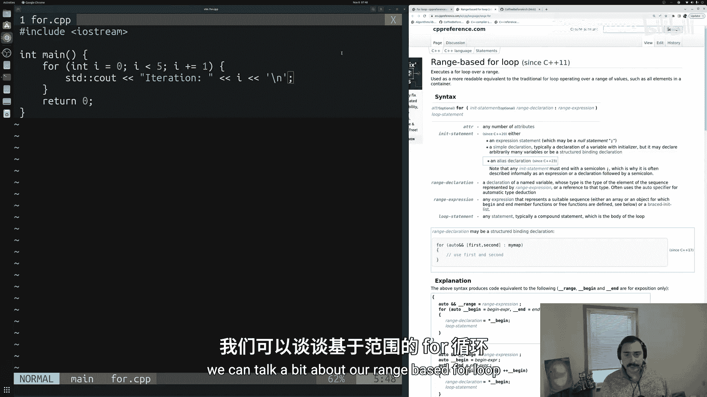
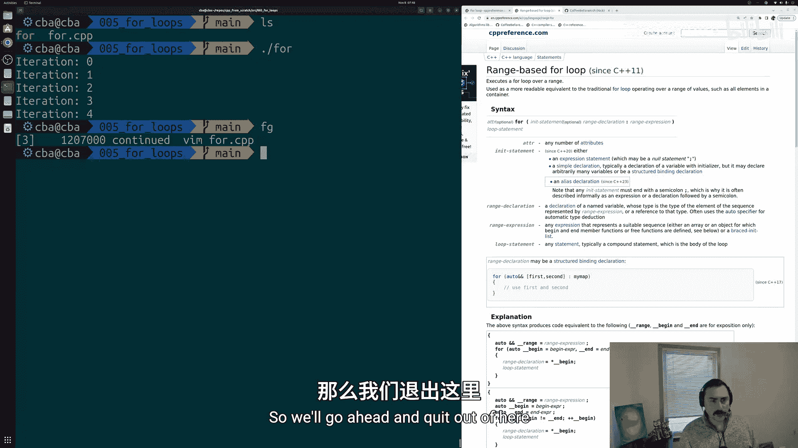
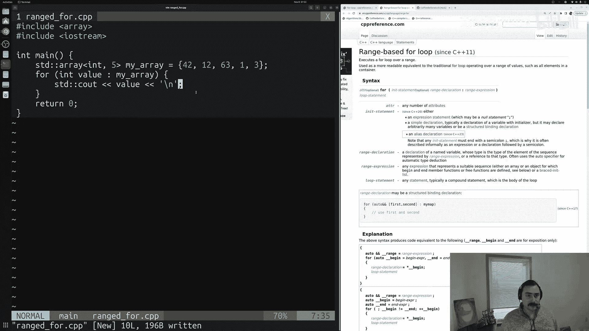
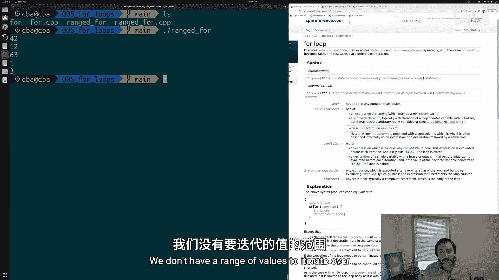
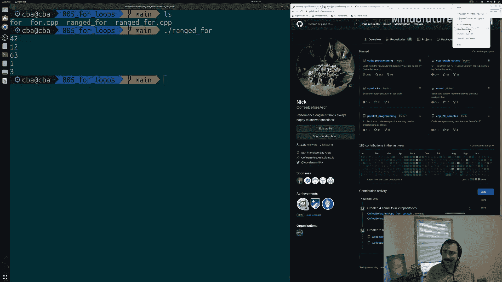

# C++入门教程｜CoffeeBeforeArch-p06-P06-For-Loops--BV1nbRUYSEUu_p6-

Hey， everyone， I'm Nick， and this is C plus Plus from scratch。 So in this episode of the series。

 we're going to be talking about for loops。So it's often the case inside of our programs that we want to perform some action multiple times。

 so for example we may want to add some numbers over and over。

 or we may want to say print something out to the screen multiple times。Now。

 the way that we do this inside of programming is through loops right and we solve many of our problems with loops。

 So for example， something like matrix multiplication。

 the way that we typically solve this when we're programming you know a program that does this is by creating some loops that will iterate over the rows in the columns of our matrices。

 multiply the elements together and add up those partial sums right to get a result。

So we solved many of our problems with loops and breaking them down into these smaller components that we solve in each iteration。

Now one of the common types of loops that we're going to be looking at today is the for loop and we're going to be looking at a couple different flavors here。

 kind of our C style for loops and then our C plus plus range based for loops。

 so let's go ahead and get started and we'll go ahead and create a new source file called4。cP。

And inside of here， we can of course， start with a main function， right。

 the core of our C++ programs。Now let's say that we want to print some string out multiple times。

 right， and we don't want to have to write stoodC out over and over and over again。

So we'll go ahead and include Io string because we want to use St C out。

And then we can go ahead and get into our for loop， which we'll be using to， you know。

 runs this line of code that stood sea out multiple times。

So on the right hand side of the screen here， I have the CPP reference page for our four loops up。

 but as you can see it's fairly dense and it can be a little bit tricky to get through if it's your first time reading the style of documentation。

So we'll go ahead and try to distill this down to kind of you know what the core of these four loops are or is and you see how we can use kind of the common case of these four loops。

 but I'll link this documentation down below if you want to learn more。Now， our four loops。

 of course， start with the key word4。Followed by some parentheses。

 And it's inside these parentheses where we really do a lot of our work。

 right inside of these parentheses， we're going to set the bounds for our loop。

 Basically how many iterations we want to perform。So the first statement that goes into these prints is typically the initialization of some sort of variable。

 So we'll do something like int I is equal to 0， where I will be some sort of loop counter or some variable that will dictate。

 say what iteration of the loop that we're on。So oftentimes you'll see variable name like I or J or K。

 and oftentimes it'll be it。 it'll be initialized to0 rather， right。

 we're starting from 0 and incrementing it and going up to some value before stopping。

 but doesn't have to start at 0， It could really start at whatever value。

 It could start at some high value， and we could be subtracting。

 going down to0 right It just depends on what we need from our loop。So again。

 we start off with some initialization of， say， a loop variable。Now， after that。

 we put some sort of condition to say， know， when should we execute our loop？So for example。

 in this case， we might write something likeI less than five。

Now all the statement is saying is that we're going to keep executing our loop while this condition is true while I is less than five。

So every single iteration of loop before we execute any of our。Our loop code。

 we're going to make sure that this condition is true。 If it's true。

 we'll execute the code in our loop。 Otherwise， we'll go ahead and break out over our loop and return 0 in this case。

Now the last thing that we have inside of these prints is typically some sort of update for our loop variable right so right now I is equal to0 and each iteration of the loop we may want to incremented by some value so we may want to do something like I is equal to I plus1 so we're just going to add one to I on every single iteration of the loop at the end of the loop that is we can also prewrite this in a couple different ways so we can do something like I plus equals1 that's equivalent and then there's also these things called post increment and pre increment。

 which are slightly different in their meaning but in this case we're really just adding one to I so we'll just leave it as this I plus equals1 for simplicity。

So that's how we kind of dictate how many iterations our loop will run。 So， you know。

 before a loop starts， we'll initialize I to 0。 Then on every iteration of our loop at the very beginning。

 we'll make sure this condition is true。 I is less than 5。

 And at the end of every iteration of our loop will'll run this update code。

 So we'll say increment I by one in this case。Now， just like our if statements。

 right in L statements， we can create a block of code here with these curly brackets。

 So this is what we're going to be executing every single iteration of our loop。So in this case。

 maybe we just want to do a simple print out using stood sea out。

 and we'll just print out the iteration number or whatever our loop counter says。

 So we'll print iteration。 and then our loop counter I。And then a new line character。

 So that everything gets printed to a new line。 And that's kind of the basics of how we write these for loops。

 We lay out some conditions for when we want to execute our loop。

 Then the code that we want to execute every iteration could be one statement could be multiple statement。

 really， whatever we need。And then after a loop finishes， and this case will return 0。

Okay， so let's go ahead and save this and we'll go ahead and compile our program。

 so we'll run G++ on 4。 CPP and call our Al executable4 in this case。

And we can go ahead and run our loop。And you can see we get our five printouts here。

 So initially I is 0。 we print out iteration 0 at the end of that loop。 I know gets one added to it。

 I gets incremented。 So in the next iteration， I is 1， then2， then 3， then 4。

Then at the end of this last iteration right here， I gets incremented again to five。

And because it's equal to 5， we end up failing this condition， right， This condition returns false。

 I is no longer less than 5。 So we stop executing our loop， and we just return 0。Okay。

 so that's kind of the basics of how we write these C styles for loops here。 So as you can see。

 you know， a bit from the。You know， this reference page here。

 there's lots of optional things that we can choose。

 so we don't need to include every single one of these statements inside of our for loop。

 but this is kind of the most common case you'll end up seeing， right？

The case where we're say creating some sort of loop counter， checking some condition。

 and then incrementing or decrementing our loop counter。Okay。

 so now that we've gone over kind of our base for loop and the C style for loop。

 we can talk a bit about our range based for loop， which is just another style for loop that we have。

So we'll go ahead and quit out of here and we'll create a new file called say range4。cppP。

And inside of here， you know， we'll just quickly write a main function， right？Okay。

 so let's talk about our range based for loop here。 So as it says。

 kind of in the documentation from CPP reference again。

 I'll put all this documentation below the video。It says our Raspace for loop is built to be a more readable equivalent of a traditional for loop and what it's used for is operating over a range of values such as all elements in a container。

So the place where we often use our range based for loop is with our SL or standard template library containers。

 So it's something like our stood array， right， and it's really nice for iterating over these containers。

 right and it makes it a bit more simple and expressive。So instead of having to worry about。

 say some sort of loop counter， a condition and some increment or maybe decrement of a variable。

 we can just say I want to iterate over the values in a container makes things pretty simple。

So let's see how we can print out to say the values of a stood array using this range based four loops syntax。

So because we're using an array and we want to do some printing。

 we'll put some included statements up here for our array and for Io stream so we can do some printing。

And then inside of our main function， we can create a stood array。

So here we'll create a st array of integers and maybe we'll put， say five integers in this array。

And we'll just call it my array。 and we'll set it equal to some values here。

 doesn't really matter what they are。 So maybe 42，12，63，1， and maybe 3。

So there's our five values that we want to print out。Now， from here， we'll write our for loop。

 so we want to iterate over this array。 Now we could， of course， just use a normal C style array。

 createate some loop counter I， set it equal to0。 make sure that on every single iteration that I is less than the size of our array。

 So we're indexing into a valid index。 and then increment I every iteration of the loop and inside of our loop body。

 just index into my array to extract a value。 So either using those。😊。

Those bracket operators are using the app method， so we could do that or we could use a range base for loop。

So for example here we write four with our prints， but instead of having say those loop counters and stuff。

 we can say what value we want to extract， so we want to extract some integer from our array that we'll just call value and then we'll do a colon and then the range we want to extract that value from。

 so my array in this case。And then we can create this little code block here with these curly brackets。

And we can say print out whatever that value is with a new line character afterwards。

So this would be equivalent to that other kind of loop that I talked about where we would maintain some sort of loop counter index into our array to extract some value and then print it out。

But in this case， we can be a bit more expressive with a range based for loop。 We can just say。

 I want to extract my integer values from my array。

 So every iteration of the loop will extract one value from our array。 So， you know。

 we'll extract 42 then 12 then 63 then  one and 3。 And on each iteration we'll just print out that value here。

😊，So it's a lot more simple than our other loop， right， It's a bit more expressive， too。

 And it even helps us prevent one of the most common types of errors that we have in programming。

 which is this thing called an off by one error。 an off by one error it's just this general class of error where it can be easy to make a mistake when we're writing things like loops。

 So maybe we run one iteration too many or one iteration。Too few。

 because we messed something up with say our loop range right inside of those statements。

 So maybe we， you know， iterated over six elements when we meant to iterate over 5 or four elements when we meant to iterate over 5。

But that can't happen with a range based for loop right because we're never even given the option to control how many elements we're iterating over。

 we're just iterating over the contents of my array， My array knows how big it is。

 so we don't need to do any kind of checks there。 The compiler takes care of all of this for us。

Okay， so let's go ahead and save this and we'll go ahead and compile this range for that CPP。

And call or output something like ranged 4。Oh， we've go ahead change that range four。

And we'll remove this arrangedd hour。So now we have our executable， we can go ahead and run it。

And you can see when we run this code， we get all of our elements from our array without having to do any kind of indexing or maintaining any kind of loop counters。

So， you know， this range based for loop is， you know， again， this idea of syntactic sugar。

 It's a way to do something， you know equivalent to our C styled for loops without hat without incurring any of that extra。

 you know manual labor of writing out those different conditions and potentially making a mistake and we can be more expressive about our code。

 right， we can say we just want to iterate over the values in this range。Okay。

 so that's going to go ahead and do it for today， the basics on some of the four loops that we have in C plus plus our C style four loops and our range based four loops。

Important thing to note is that both are often using C plus plus programs。 For example。

 we're not always iterating over you know a container。

 So we might So there's often cases where we need this C style for loop as well。

 right We don't have a range of values to iterate over。

Okay， but like I said， that's going to go and do it for today as always。

 you can find this and any of my other examples on github。com/coffee before arch as always。

 I'm Nick and hope you have a nice day。

