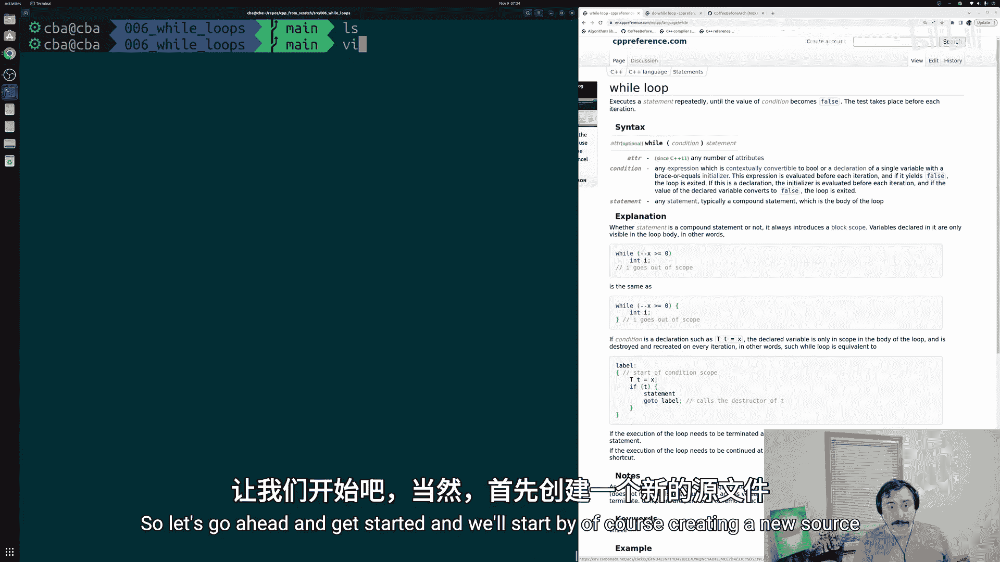
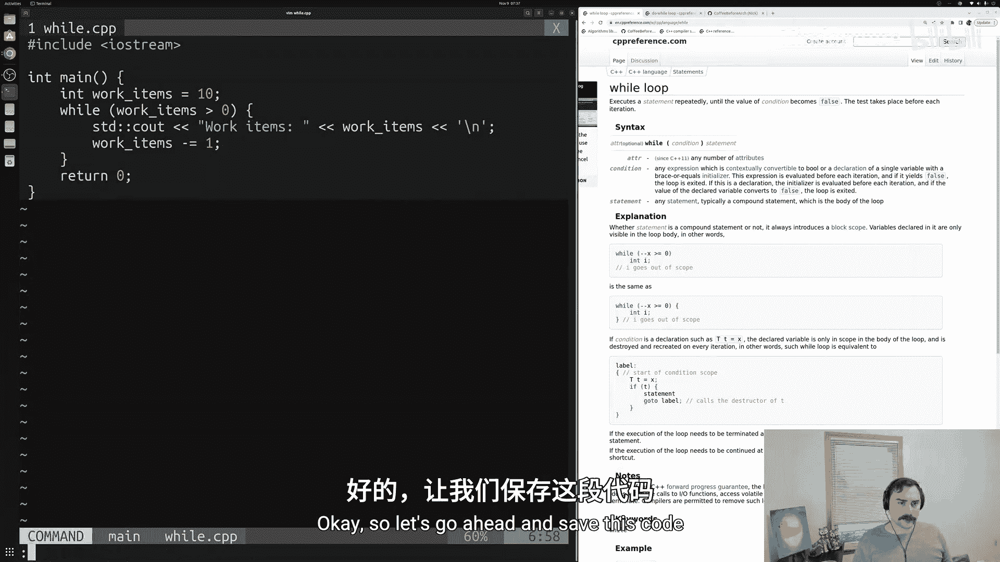
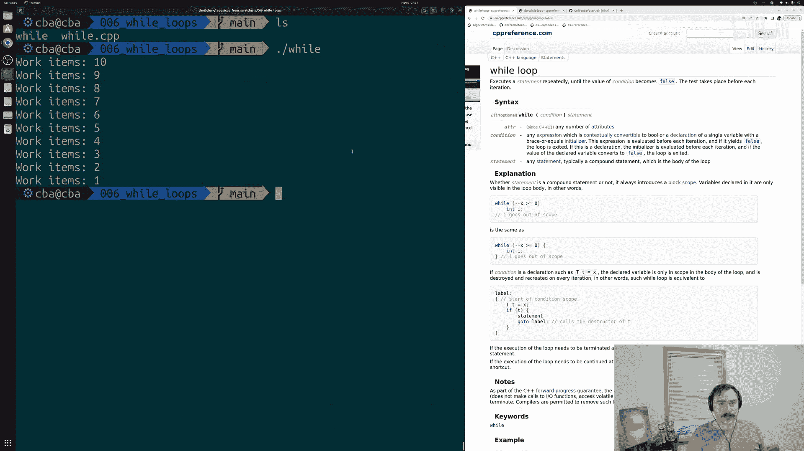
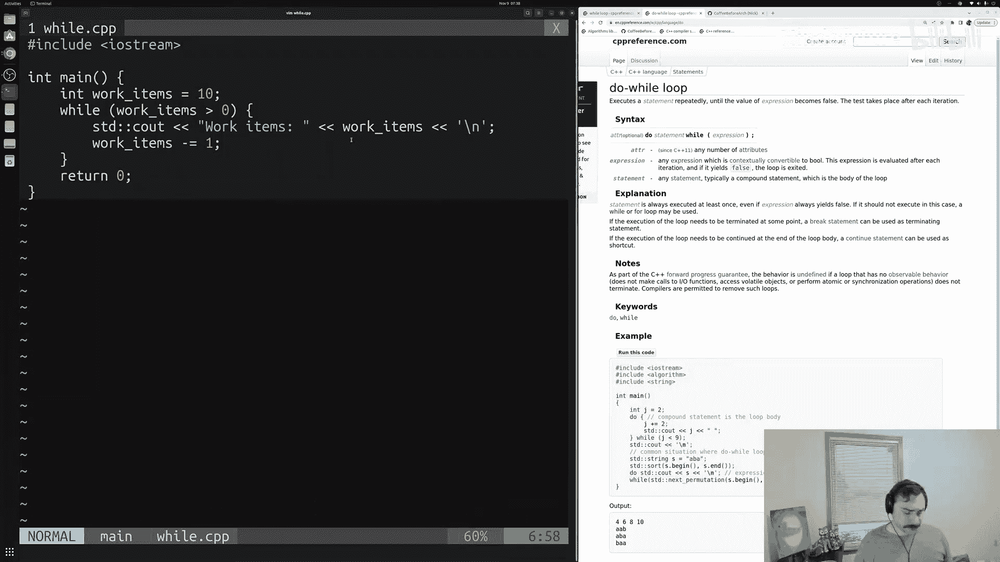
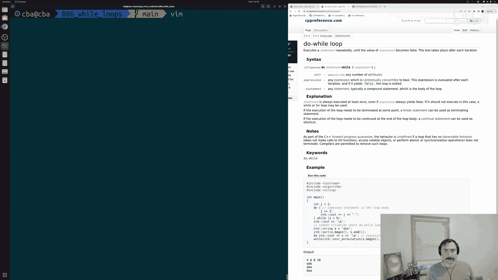
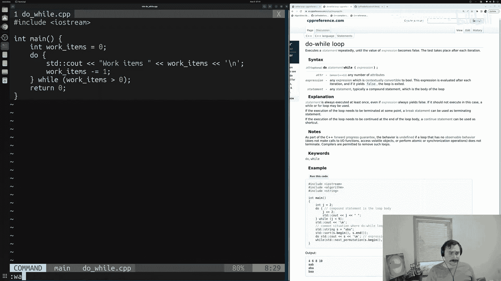
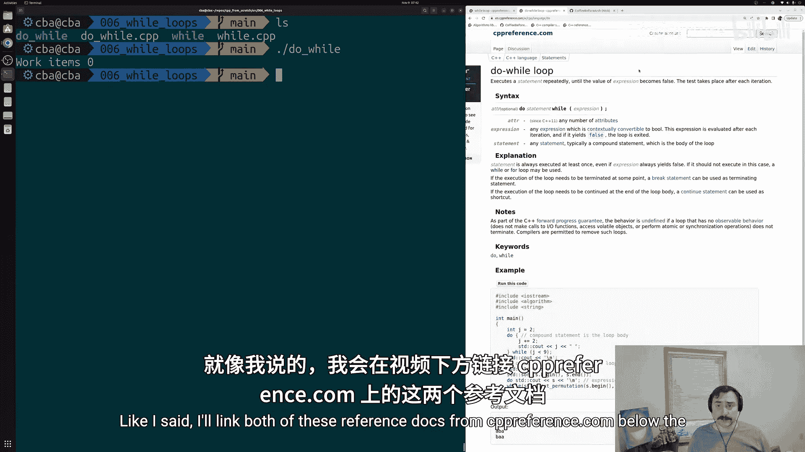
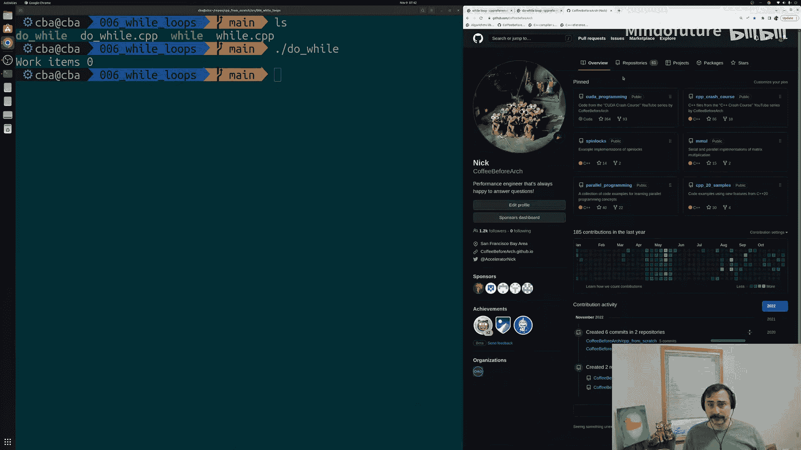

# C++入门教程｜CoffeeBeforeArch-p07-P07-While-Loops--BV1nbRUYSEUu_p7-

Hey， everyone， I'm Nick， and this is C plus Plus from scratch。 So in this episode of the series。

 we're going to be talking about wild loops。So in the last video。

 we looked at the basics of how we use loops in programming and specifically we looked at for loops。

 so these were loops that allowed us to express that we wanted to iterate over some range of values now we may have specified you know the number of iterations or that range using our loop conditions like with our C style for loop。

 or we may have relied upon you know some sort of container。

 like when we were using a range based for loop with our stood array。

Now the problem is is that we don't always know how many iterations we want to run a loop the number of iterations may be based on some sort of external input。

 so we may want to just continue running some piece of code until some condition happens。

And the way that we can express that in C and C++ is with these while loops。

 and there's another flavor of while loop called a do while loop。

 and these are the two things that we're going to be looking at today。

So let's go ahead and get started and we'll start by of course， creating a new source file。

 so we'll create something like wild。cppP。

And inside of here， we'll create a main function， the core of all of our C++ programs。

So let's take a little bit of a look at this reference from cPreference。

com and I'll go ahead and link via these pages below the video so like I said。

 a while loop executes a statement repeatedly until some condition becomes false and the test takes place before each iteration so basically every single iteration or before each iteration we'll make sure that our condition is still true if it's true will execute our code otherwise will continue past or in loop。

So let's go ahead and create a simple while loop here。 So it of course， starts with our wild keyword。

 followed by some parentheses where we'll put the condition that we want to check。

So maybe we want to， you know， keep running a loop。

 you know while we still have some work items to process， so we'll just create some variable called。

 say work items and we'll set it equal to some integer like 10。Then inside of our while loop。

 we may say， you know， I want to run this loop while work items。Is greater than 0， right。

 And then I can put these curly brackets， and then I can put whatever code I want to inside of these curly brackets。

 right， and we'll run this code while this condition is true。

 So we'll keep running this code as long as work items is greater than 0。So inside of here。

 maybe we'll just do kind of a， you know， a dummy decrement of our work items to pretend like we're processing some element。

 So we'll just do something like work items。Minus equal one， right。

 so we'll just get rid of one work item every single iteration。Now。

 just so we have something to look at on the screen， we can go ahead and include。

 say Io screen and print out the number of work items every iteration。

So we'll go ahead and you stood see out our character output， and we'll print out work items。

Then the value。And then say a new line character， right， so everything's on a new line。

So this is kind of the basics of how we set up a while loop。These are wild keyword。

 we set some condition that we want to be true， every iteration will check this condition。

 if it's true， we'll execute the code inside of our body otherwise we'll just skip past our loop and in this case we'll just return zero。

Okay， so let's go ahead and save this code and then we'll compile it with G plus plus。

While that's CP， and we'll create an executable called whileL。So if theirs are executable。

 we can go ahead and run it。And we can see we get kind of what we expect。

 right So we start with 10 work items in every iteration。

 we subtract one right until we only have one item left。After we process that last item。

 we do work items minus equals 1 again。 work items becomes0， and this condition becomes false。

 So we stop executing our while loop。

Now， like I said， in many cases， when we're using something like a while loop。

 you know this you condition right here is going to be based on some external input right so for example。

 we may be querying you know you some external source for the number of work items that we have or we may be pulling from some queue to keep grabbing work items so you know while that queue you still has work items will continue this look or this loop right。

 but we may not know how many work items we have in advance， likewise。

 we may just be solving a problem that we can't precompute how many iterations that we need to perform right。

So we may just need to keep running it until we get to some acceptable solution。

 so that's where we kind of use while loops。Okay， now， like I said。

 there's another kind of while loop that we have in C and C+ plus。

 and that's this thing called a do while loop。 Now， a do while loop is very similar to a while loop。

 except that instead of checking our condition before each iteration。

 the test takes place after each iteration。 So we use this do while loop when we want to say always run at least one iteration of our loop。

So let's go ahead and quit out of here and let's create a new source file。

 so we'll create a do while not CPP。

We'll go ahead and start by including Iostreamam， because we'll probably want to print some stuff out。

 and we'll write our main function here。Okay， so let's do a very similar situation here。

 so let's create， say， you know， some amount of work items that we want to process and we'll set that equal to say。

 you know， maybe we'll just initialize it to zero， maybe we have nothing to process。

And then we can write our do while loop。 Now， as the name kind of implies。

 the two key words that we're going to be using are do and while。

 So we start out with writing do followed by our code block。 right。

 So we're going to execute some code。First， and then we're going to check our loop condition after。

So maybe in this case， we'll just print out， save the number of work items we have。

 so we'll do stood sea out。The number of work items。And then we'll print out the value of work items。

And then， a new line character。And then let's get rid of one work item， every single iteration。

Minus equal1 okay。And then after write this code block here， that's when we write our while right。

 So like it says here， our test takes place after each iteration。

 So we'll perform one iteration where we'll run this code and then we'll check her condition here。

 So after this code block we'll write the condition we want to check and we'll maybe say while work items is a greater than0 right Maybe we want to check that condition。

And that's kind of the basics of our do while loop here。 But unlike our while loop。

 we'll always execute at least one iteration。 So in this case， we don't have any work items。

 but we're still going to print out work items here and subtract one from work items。

 So we're always going to get at least one print here， even if this condition down here is false。

 right， because we're always executing a single iteration。 So we can go ahead and see that。

So if we go ahead and save this and then we compile， say， do while。

 cP and create an exccutable called do while。Okay， so we generator executable。

 we can go ahead and run it。And you can see we get a print of work items 0 here So we wouldn't have seen that in the while loop case。

 right， because we check the condition at the beginning of each iteration。

 So we would have seen that we don't have any work items and we would have just returned。

 but with their due while， we always execute at least one iteration of the loop。So you know。

 where might you see something like a do while loop， Well， you know， for example。

 if you're writing some sort of menu right or command line interface。

You're always going to want to say execute one iteration of a loop that's checking the input from a user right So your program starts up。

 You always want to start out by checking to see if there's a user input right before checking to see what that input is。

 right？ So that's where you might want to do while loop。

 you might want to get some user input and then check it right So that's where you might use something like a do while loop。

Okay， so that's going to go ahead and do it for today basics of using these while loops and do while loops。

 Like I said， I'll link both of these reference docs from cPreference do com below the video。

 and of course you can find this in any of my other code at Github。 com scooff before arch。

 but that's going to go ahead and do it for today as always I'm Nick and I hope you have a nice day。

