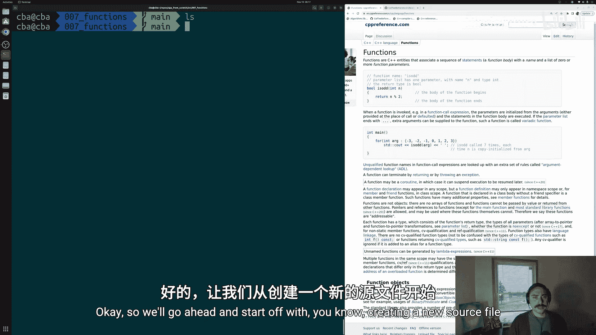
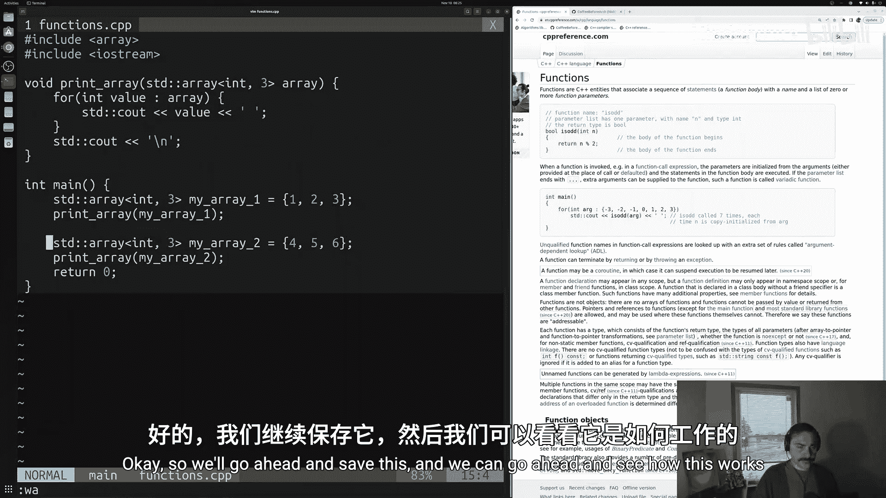
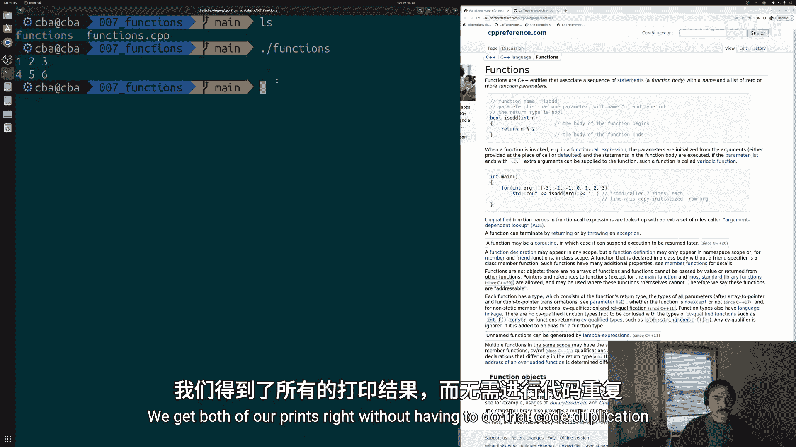
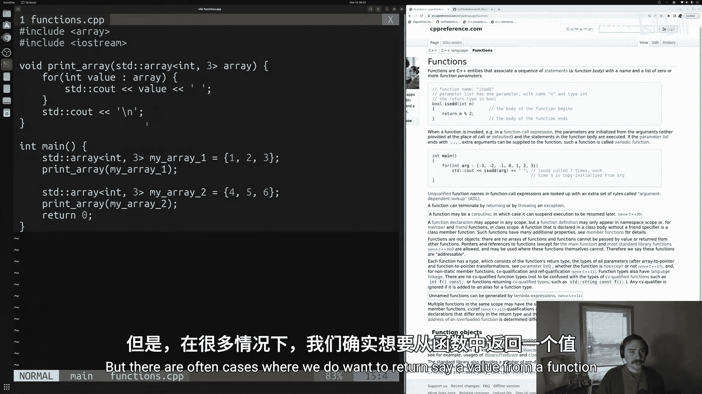
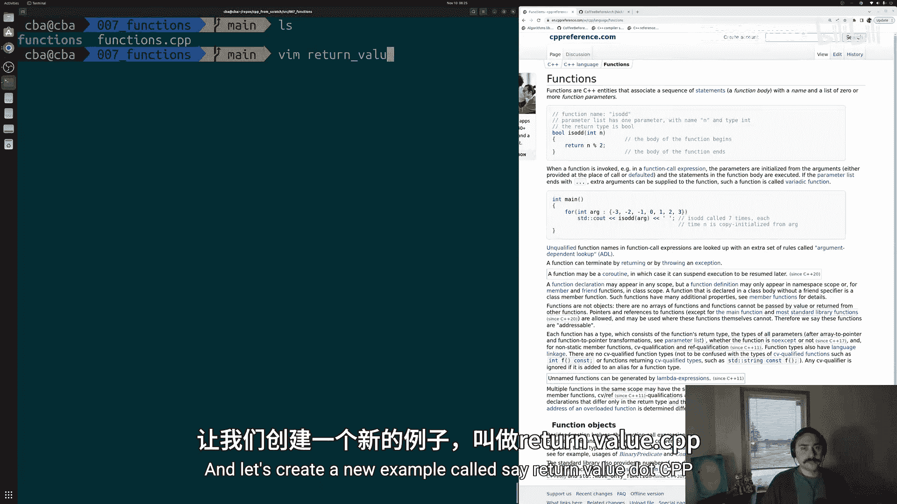
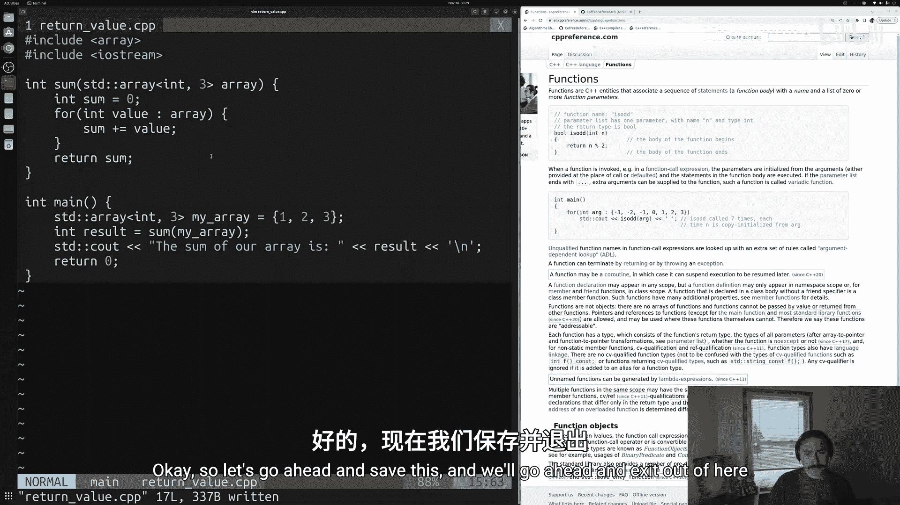
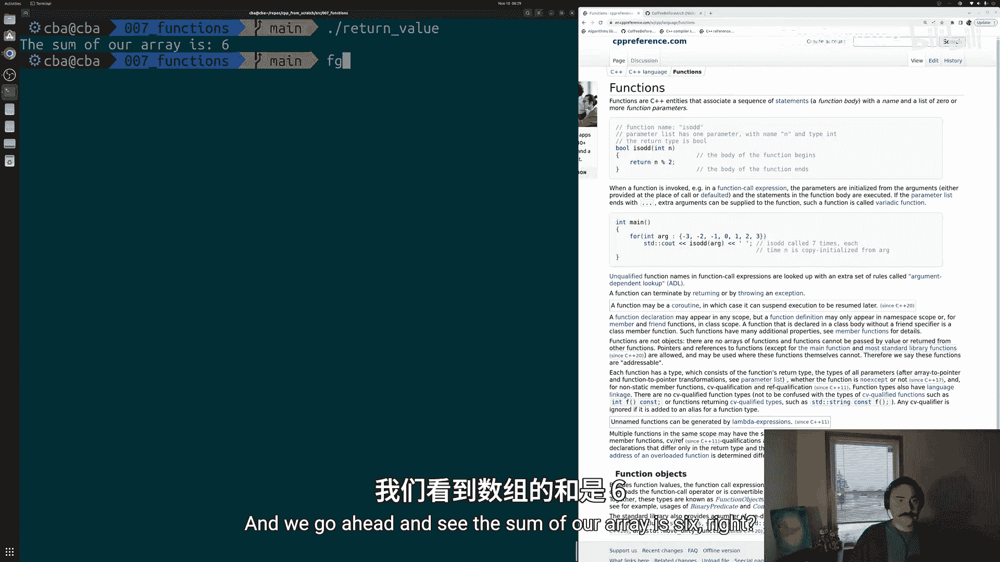
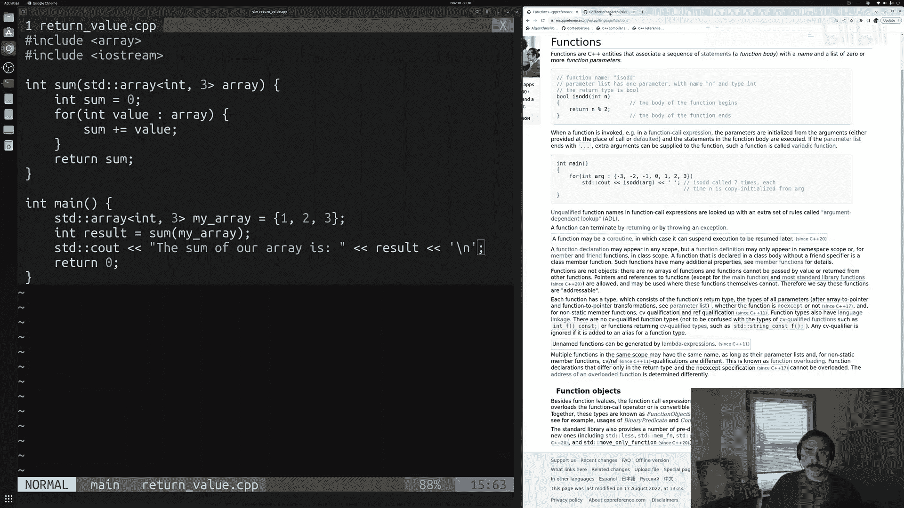
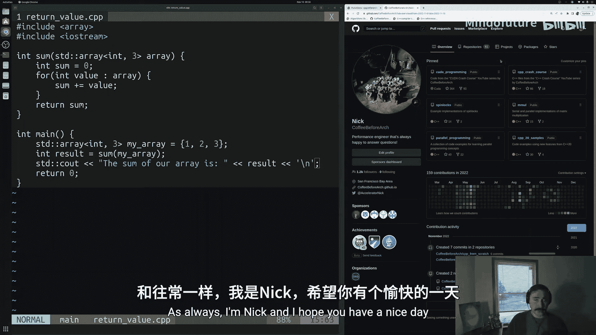

# C++入门教程｜CoffeeBeforeArch-p08-P08-Functions--BV1nbRUYSEUu_p8-

Hey， everyone， I'm Nick， and this is C plus Plus from scratch。 So in this episode of series。

 we're going to be talking about functions。So in the past few videos we've looked a lot at control flow。

 so we've looked at things like conditional statements that allow us to selectively execute lines of code in our applications。

 and we've also looked at things like loops that allow us to repeat the execution of lines of code inside of our programs based on some conditions that we set。

Now another kind of control flow that we often work with are these things called functions right。

 so functions just allow us to give a name to a sequence of statements that we want to execute。😊。

So why exactly do we need something like a function or want something like a function？Well。

 there's often cases where we want to repeatedly perform some action inside of our program。

 but we might not want to perform that action inside of a loop。

 right we may just want to you know do some operation at the beginning of our program。

 maybe some point in the middle of our program and another point at the end of our program right。

 so not say back to back。Now we also want to avoid say code duplication。

 so we don't want to just write the same5， 10， 15 lines of code over and over and over if that's doing the exact same thing。

 so the way that we get around this is by writing a function so we can instead factor out all this common code inside of a function and just associate it with a name so every time we want to run。

 say so those 15 lines of code all we need to do is invoke that function using that function name instead of having say you know that code duplicated all over the place。

Okay， so let's go ahead and see how we can write functions in C++ and the basics of how we use them。

Okay， so we'll go ahead and start off with you know creating a new source files so something like functions do cP Now were already somewhat familiar with functions with the fact that at the core of all of our C++ applications is a function right our main function now our main function is a little bit special because it's where our program logically begins execution。

 but it's really just another function at the end of the day and has the exact same structure as the functions that we're going to be looking at so let's try to recall what the core pieces of that structure。

Are going to be。So of course， we're associating some name with a sequence of statements。

So in the case for main function， that name is just main。

Now after main we have some parentheses and inside of these parentheses is what's called a parameter list so it's a list of inputs that we want to our function。

 so we may want to pass some values into our function that we're going to use but in the case of say our main function in many cases we can just leave this empty right so maybe our function does not take any inputs so we might be able to just leave this blank。

Okay， so of course we're associating a name with a sequence of statements or operations。

 so we'll add this code block here with these curly brackets。

And of course our functions can also return things so just like they can take these input parameters so inputs to our function。

 they can also return things right to wherever they were called from so know in this case in the case of our main function that's just going to be an integer right so we return say some exit code or status so we can say do return zero there and our return type is just an integer here so positive or negative whole number。

Okay， so in this case right right we have our name a list of parameters might be an empty list or it might have you know some inputs we have our function body right so where all of our statements live that we want to associate with this name and then of course we have a return type Okay so that's kind of the core parts of a function so how do we write our own。

So let's say we have some common operation that we want to perform。

 so maybe something like printing an array。So let's go ahead and include a couple things first。

 so we'll include， say， our array header。And our Io streamre header。

 so we can use stood array and our stoodud sea。And let's create， say an array that we want to print。

So we'll just say create a stood array of three integers。

We'll call we'll call this just something like you know， my array one。

 and maybe we'll just set it equal to one，2， and three。

 right those will be three values inside of our array。Now we could， of course。

 just you know write the code to do this printing inside of our main function so we could just write something like。

 you know， for all the values inside of， you know R， so for int value inside of my。My array one。

 so we're using range based for loop here。I can use stood sea out。Print out the value followed， say。

 by a space， and then after I print out all the values followed by spaces， I can just print out， say。

 a new line character。So this works perfectly well for printing out our array。

 But what if I want to say print out this array twice， right， or maybe I want to print out， you know。

 a different array， you know， of course， I could just say， you know， copy and paste this code right。

 And this would print my array twice。 But as you can see， this is fairly wasteful。

 right and a bit annoying to do right suddenly I I have eight lines of code， right。

 that are all doing， you know， the same thing， right。

 these four lines of code are printing out all the values inside of my array。

 followed by a new line character and these four lines of code are doing the exact same thing。

 right And if we say had a different array here。Right。

 so let's say we'll call this myre array 2 in this case， and maybe we'll change the values to 4。

5 and 6。 and we'll print out mya array 2 here。 So now we have a second array。

 maybe that we want to print。And we're just duplicating code over and over here right so if we had three arrays。

 our code would get even bigger， four arrays， five arrays， six arrays。

So how do we solve this problem， Well， we can solve this problem with a function。

So we can write a function that will print out the contents of array that instead of having to duplicate these statements over and over。

 we could just invoke that function。Okay， so let's go ahead and build up the parts of this function。

 So we're going to need a name， of course， right functions we're associating a name with statements that we want to execute。

 So maybe we'll just call our function something like print array。

Now what is our printer array function going to take as an input。

 Well wanted to take our stood array of three integers。Right。

 that's the type here that we're printing。So we'll just take as an input， say。

 stood array of three integers here。And we'll just call this input parameter array， right。

 we can you'll give it whatever name we want here。Now it's just a print function。

 this print function isn't going to return anything all it is is going to take our input array。

 print it up to the screen， it doesn't need to return any values so we can give it the void return type right void is just how we say。

 hey， this function doesn't return anything。Okay。And then we can start with our function body here。

 So our function body， we can just extract right this for loop that we've been using here。

And we can just change。My array 1，2 array， right the name of our parameter。

Then we can go ahead and get rid of our other for loop as well。

 and we can replace both of those for loops。With just a call to our function。

So the way that we call our function here is by using the name and then passing in whatever arguments we want to take the place of our parameters。

So in this case， right， we'll call print。Aray。With are my array one as an input？

And then for our second array， we'll just do the exact thing， but with my array2 as an input。

So you can see here we cut down on our code duplication and we actually made our code a bit more expressive。

 so it's very easy for me to scan my main function and understand what's going on。

 I'm creating a stood array and then I'm calling a function to print that array It's just called print array I'm very easy for me to understand what's going on here and I don't have you multiple for loops anymore Anytime I want to print my array。

 I invoke this function， so my code starts executing it creates my array and then it invokes my function so my control jumps up to my function I run my for loop and these prints and then I return and I continue with the next statement right we're basically reusing this code over and over every time we invoke this function。

😊，Okay， so we'll go ahead and save this and we can go ahead and see how this works so we can compile functions。

cP and give it an output name， say， functions。

That's the name of our executable and we can go ahead and run functions and you can see it works exactly as if we had just written multiple four loops inside of our main function here。

 we get both of our prints right without having to do that code duplication。

Okay， so that's kind of the basics of how we write these functions here and especially functions that don't return anything。

But there are often cases where we do want to return， say a value from a function。

 so what does that kind of look like？

So let's go ahead and quit out of here and let's create a new example called say returnvalue。cppP。

And inside of here， let's say we want to create another function that say sums the contents of an array。

 so we just want to add up all the numbers inside of our array and return that result。

So in this case， let's go ahead and include a couple things like our and Io stream。

We'll write our main function here。 So something like int main before return 0。And inside of here。

 we'll create， say， an array that we want to print out。

 so maybe we'll just keep it simple and we'll use the same array of three integers again called my array。

And we'll just set it equal to the values of one， two， and  three for simplicity。Okay。

 so let's go ahead and write our function that's going to return the sum of this array。

So we can just call say this function sum。And it's going to take our stood array。

Of three integers as an input， right， we could just call it， say array。

Now we know that this function， unlike our other function。

 is going to have a nonvoid return type right we're actually wanting to return something from this function now specifically the type that we want to return is an integer right we're adding up all of these integers in this function so we should get an integer result so we'll go ahead and use an integer sum here。

Okay， we'll go ahead and use our curly brackets to start our function body and inside of here we can you know sum up the contents of this array using another range based for loop。

So we can say create a result called sum。So we'll set this equal to 0 initially。

 Then we'll iterate over the contents of our array。 So we'll say for every value in my array。

 I want to just add the value to sum， right， So we'll do sum plus equals value， right。

Then at the very end， right after I've added all the contents to our variable sum。

 we can just return whatever that sum is， right simple is that。So to go ahead and use this function。

 we can invoke it down here so we can call some with my array as an input right。

 and it will sum the contents of that array。Now in this case right sum is returning something specifically it's returning an integer so that integer has to go someplace。

 so for example we could just store that result inside of a variable so we can say you know int result is equal to sum or we could just leave this to automatic type deduction and we could say auto result is equal to sum and our compiler would be able to figure out what type result should be because sum returns an integer so we could just leave this to automatic type deduction as well。

But in this case， we'll just specify it right， it's pretty simple。So okay。

 we've got our integer result， let's go ahead and just print it out to complete our program。

So we'll print out， you know， say the sum of our array is。

And then we'll print out whatever the result is。Follow by， say a new line character。Okay。

 so that's kind of the basics of how we write functions with return values right just like our main function。

 if we have return value， so a nonvo return type will just return you know something from our program。

 it might be an immediate value or it might be some variable， could be either。Okay。

 so let's go ahead and save this and we'll go ahead and exit out of here and we'll compile our returnvalue。

cbP。

And we'll go ahead and create an output executable name called something like returnturn value。

Alright， so now we have our output executable， let's go ahead and run return value and we go ahead and see the sum of our array is6 right so that makes sense。

 we added one plus2 plus3， we got the value6 here。 so now if I wanted to use this function sum multiple times since my program I could and I wouldn't have to duplicate。

 say these five lines of code whenever I wanted to just say sum the contents of an array。

Okay， so that's a bit on the basics of how we write and use functions with void return types and nonvoid return types as always below the video。

 I'll link this cP reference page on functions if you want to find out more about kind of the basics of functions and some of the more advanced parts of C++ related to functions so things like function objects so that'll be below the video and as always if you want to look at any of the this code or other code that I've written。

 feel free to check out github。com/coffeebe arch but that's going to go ahead and do it for today as always I'm Nick and I hope you have a nice day。

