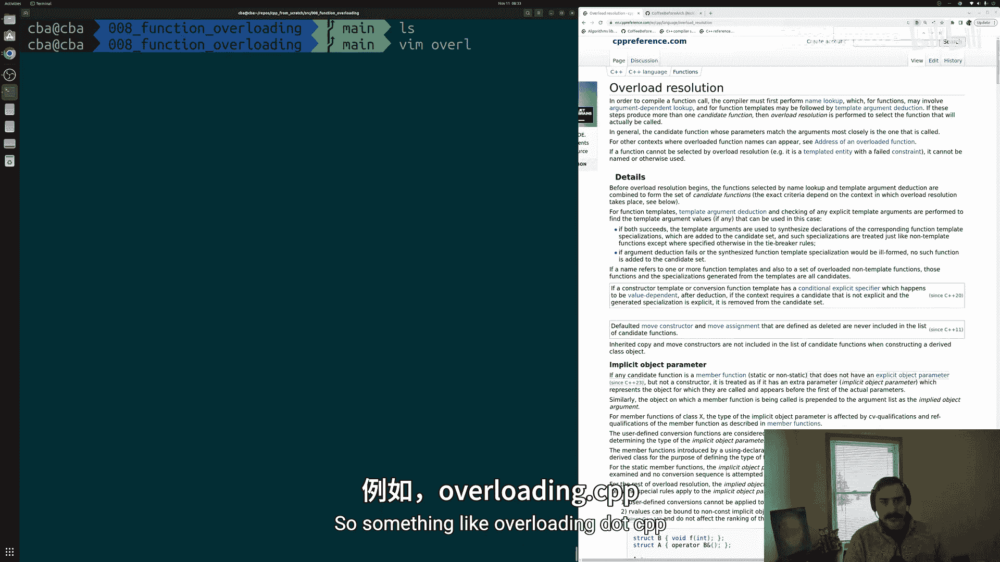
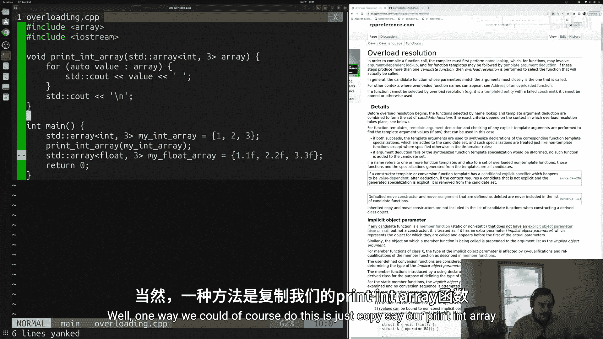
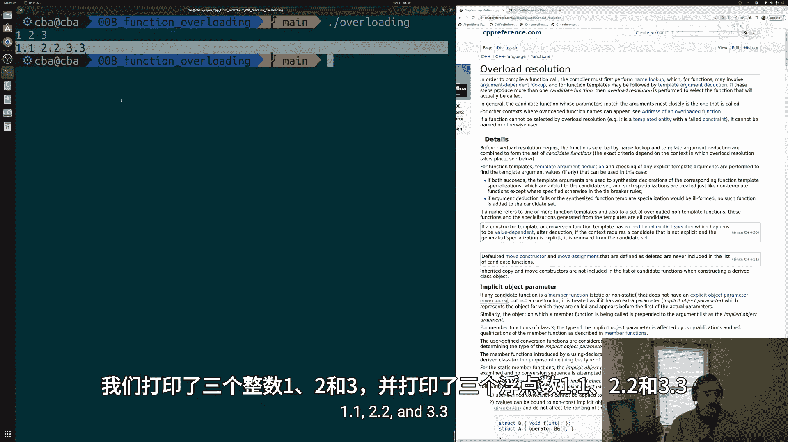
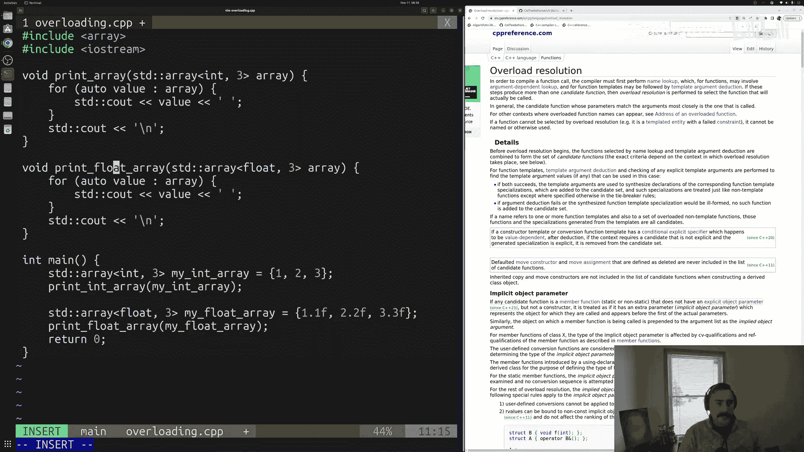
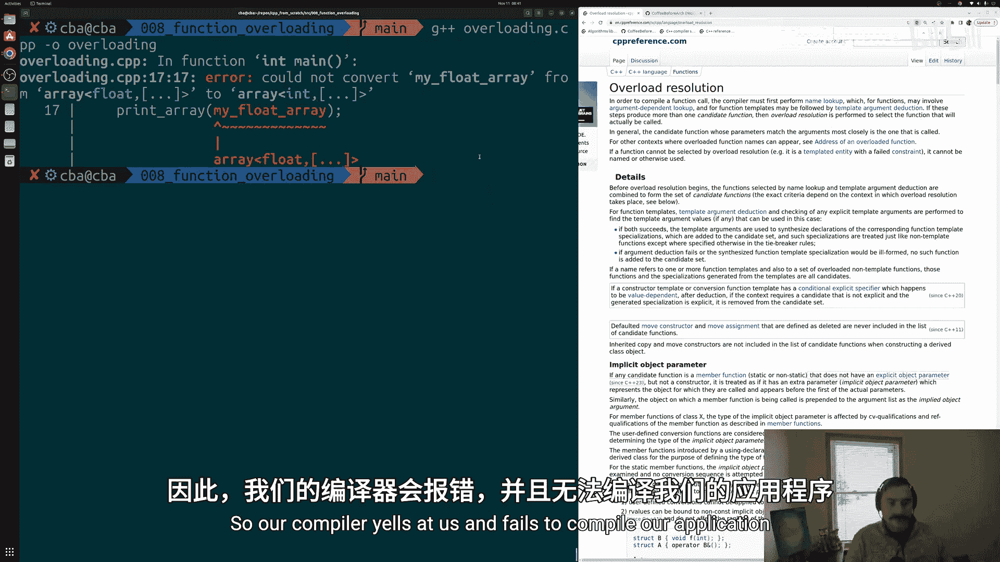
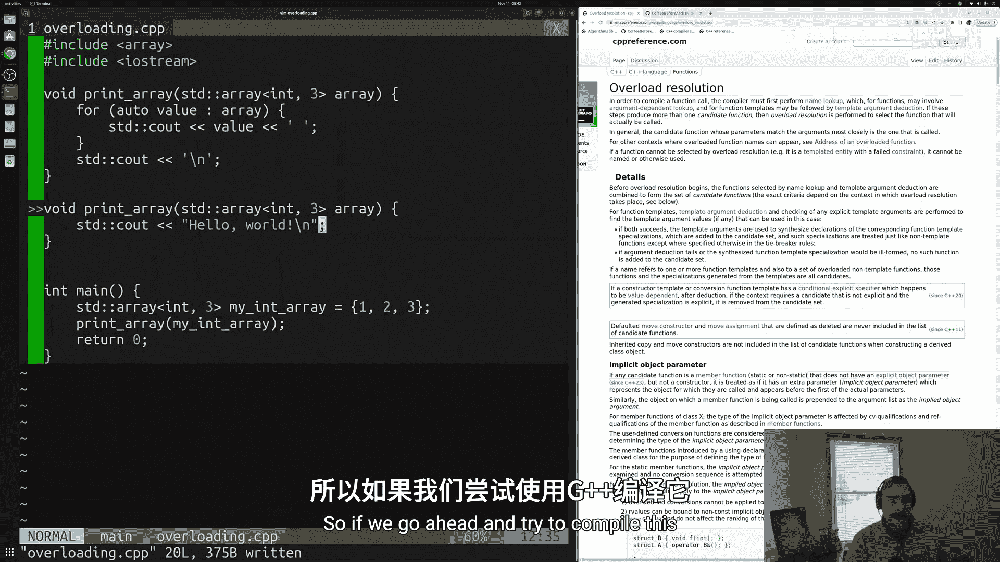
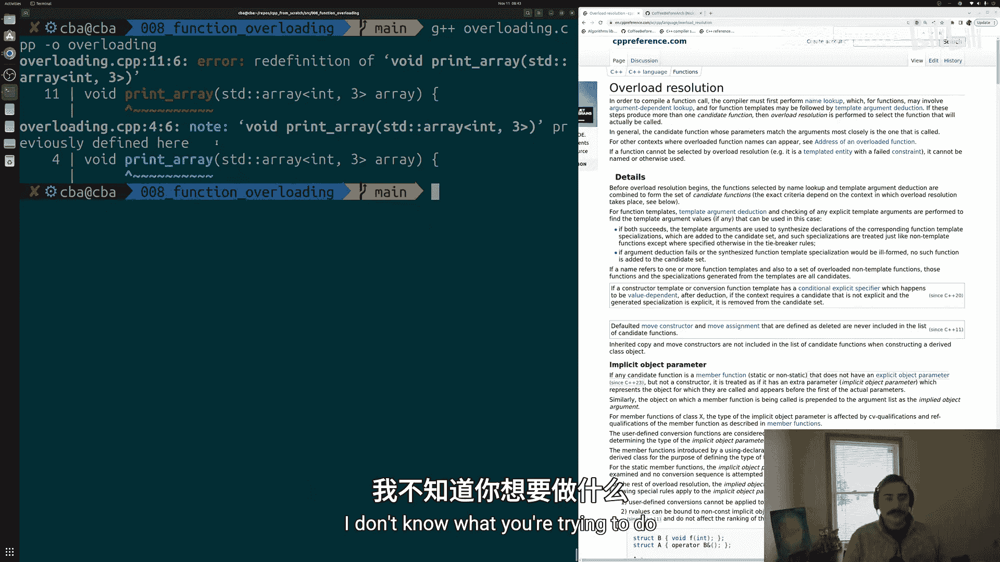
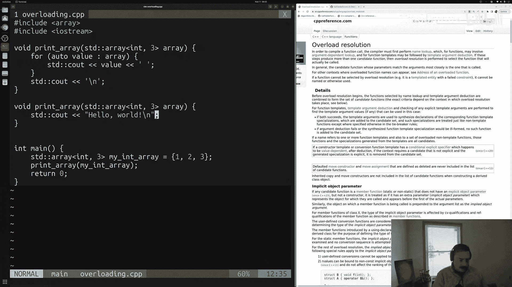
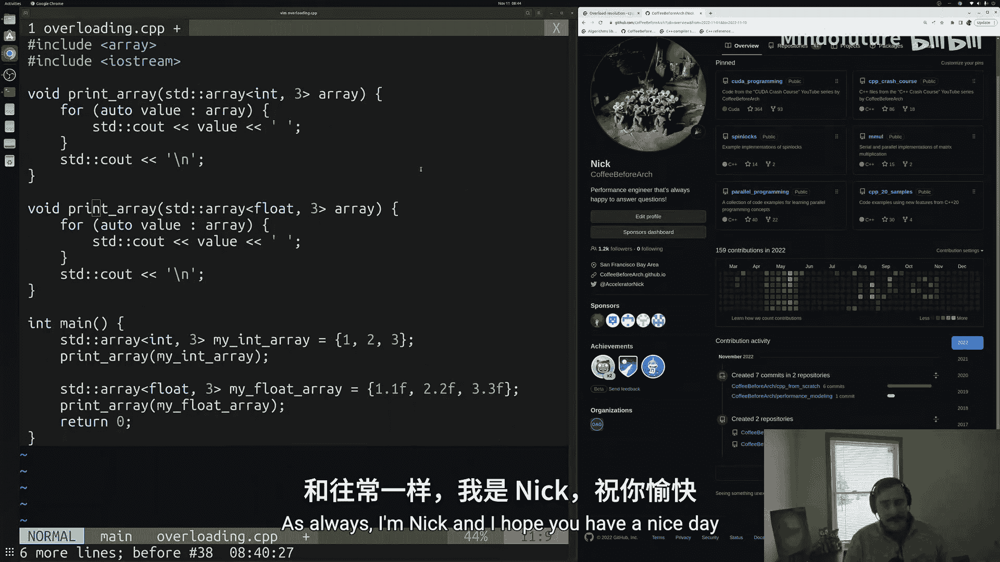

# C++入门教程｜CoffeeBeforeArch-p09-P09-Function-Overloading--BV1nbRUYSEUu_p9-

Hey， everyone， I'm Nick， and this is C++ from scratch。 So in this episode of series。

 we're going to be talking about function overloading and overload resolution。So in last video。

 we were looking at functions， so we were looking at kind of their basic form， how we write them。

 and how we use them。Now one of the questions that sometimes comes up is how do we handle cases where we have functions that are doing the similar thing。

 but maybe working on different types or have a different number of parameters。

 do we have to create a new name say for each of these functions and then keep track of you know2，3。

5， 1 different names for functions that are essentially performing the same kind of logical operation。

Now the answer to this is no， right in C++ we have this same called function overloading in overload resolution。

 where we rely on our compiler to choose the right version of a function for us。

 so that's what we're going to be looking at today。

So let's go ahead and get started and we can of course， start with creating a new source file。

 so something like overloading。cP and inside of here， we can of course start with our main function。

Now。Let's say that we want to do something like print out some arrays。

 so maybe we want to print out an array of integers and an array of floating point numbers。

 So let's go ahead and set all that up。 So first we have to include some headers here。

 So we'll include say array and we'll include Io stream。

And then we'll go ahead and start creating some arrays down here， so we'll create。

 say a stood array of say three instegers。And we'll just call this save my int array。

And we'll set this equal to maybe just one， two， and three for simplicity。And likewise。

 we can do something similar。And create an array of floating point numbers。

 So three floating point numbers we'll call it my float array。

 and we'll go ahead and set this equal to 1。1 f，2。2 f and 3。3 F does for simplicity。Okay。

 now let's say we want to print out these two arrays here Now， as we looked at last time。

 it can sometimes be useful to factor that code out into a function that way we can reuse it if we want to print out。

 say multiple intars or multiple float arrays So let's go ahead and write those functions here。

 So let's go ahead and create a new function to print out our intars So maybe we'll call this something like print int array right and it will take some stood array of three integers。

That's the type that we're going to be passing in。 We'll just call that array。 And inside of here。

 we can just use a range based for loop to print out each of the elements in our array。

 So we'll use something like for you know auto value in my array。

 So we're using automatic type deduction here to extract the values from our array。

 and we'll just stood see out whatever the value is followed by a space。 And then at the very end。

 we'll print out say a new line character so this all goes on a new line。

Then back inside of our main function here， we can go ahead and use that function right to print out array。

 we'll just call print int array down here with the my int array。Okay。

 so we've taken care of you know one of our prints here， right。

 we're now printing out our integer array。 So how would we handle。

 say printing out our floating point array Well， one way we could of course， do this is just copy。

 say our print inte array function， change it to say print float array。

And then make it take。Floats instead of an integer array with three elements。

And then we're all set here， right。 So we have a new function called print float array that takes an array of floats。

 prints out all the contents， and then prints out a new line character so we can use that down here in our function as well。

So let's go ahead and use our print。Float array with our my float。Aray， okay。

So everything looks okay here， right， we've created two functions。

 we're using those two functions down here， right one for inray and one for a floater array。

So we can go ahead and save this and we can compile our overloading。cP。

And go ahead and create an executeable maybe named overloading， that'll work。

And we can go ahead and run overloading and we get the expected result。

 we print our three angers 12 and3， and we print our three floats， 1。1， 2。2 and 3。3。

Now， if we go back into our code here， we've got something a bit clunky going on。

 So you right now we have this print inar and this print float array and these functions have different names right here。

 which is a bit annoying if we think about it from an interface perspective and designing an interface。

 So now you know the end user of say all of these functions right。

 if we're developing software is going to have to remember。

 you know all the types you know that are part of our name here that we're going to be using to print with right。

 So if I'm printing integers， I have to remember to use the print in function。

 if I'm printing a float array， I have to remember to use the print float array function。

 It would be much more convenient if we just had， say a unified name or some constant name that we could use and allow our compiler to pick the right function for us。

 and that's exactly what we get with this thing called function overloading an overload resolution。😊。

So on the right hand side of the page here， I have the CPP reference page for overload resolution up here and it's quite complex and there's quite a few things involved and it even includes some things about templates。

 which we're going to be getting into in the next video， but kind of the core idea here。

Is that we're relying on a compiler to look up the right function for us。

 And that's going to be based on this thing called our function signature。

 So our compiler is going to figure out which function to call based on a combination of， say。

 our function name and the number and order of our parameters inside of our parameter list。 Now。

 because it relies on those two things， we can do something like this。

 we can actually have two functions of the exact same name。

So we can have two functions called print array。And this is perfectly okay because these two functions still have different function signatures。

 The name of both of these is print array， but this one takes a to array of three integers。

 and this other function takes a stood array of three floats， right， two different types here。

 So our compiler can tell these two functions apart。

 we don't have to create some unique name for both of these functions as long as our compiler can tell the difference between them。

So down here inside of our main function， we can go ahead and get rid of this print int or the int part in the float part of these functions。

 and everything is still going to work exactly the same way。

 But now we have this constant print array name that we can use over our code and just rely on our compiler to choose the right function for us。

 So this is a lot like automatic type deduction。 we're relying on our compiler to say。

 look at names and look at types and choose the right function， right， the one that we meant to use。

So we'll go ahead and save this and we can go ahead and recompile overloading into sex cutable。

And we can go ahead and run it， and you can see we get the exact same result， one，2。

 and three for our integer print， and then 1。1，2。2 and 3。3 for our floating point print。Okay。

 so how can we tell， say if our compiler was really choosing the right version of this function to use how how can we tell that。

 you know， we weren't just both both of these calls here。

 How do we tell that they both weren't going to say the same function Well。

 we can of course just delete one of them right so we can say fully delete maybe our float。

Print array function， and try to compile again， and we'll see that we get an error here。

So you can see here at line 17， it sees it's complaining about our function called this print array when we're passing my float array。

 and it tells us error could not convert my float array from an array of floats to an array of integers here。

 so you can see that when our compiler tries to use that print array that takes an array of integers。

 We get an error because we're using the wrong type here。

 That function doesn't take an array of floats。 It takes an array of ints。

 so our compiler yells at us fails to compile our application。

Okay， so let's go ahead and look at another way that something like this could fail。

So another way we can fail in overlook resolution is if we have， say。

 two different functions that look identical to the compiler here。

So let's say we'll go ahead and just completely copy this print array that takes our stood array of three integers。

 and we'll paste it down here。 and we can even change， say。

 the function body to be something completely different。 Maybe this will instead just try to do。

 stood sea out。Hello world right with the new line character。

So we have two functions that are doing completely different things， however。

 the fact is is that the function signatures are still identical。

Both are called print array and both take the same number of parameters and in the exact same order。

 right with the same types in the same order。So if we go ahead and try to compile this。

With D plus plus， we see a new kind of error here related to this overloading， right。

 so here we get a redefinition error of our void print array of stood array of three integers。

So you can see here that we have you know on line 11， some print array of three integers。

 and we can see that it was previously defined On line 4。

 right It's another function called print array with the exact same function signature So this is where we have to be kind of careful So we can't have。

 even if they have different function bodies， we can't have functions that have identical function function signatures。

 because at the end of the day， our compiler has to know which function are you trying to use And if the functions look identical from kind of an interface perspective。

 So from their function signature。 your compiler won't know what you meant。

 right what your intentions were， which function you were trying to call right。

 It's not able to do this overload resolution and figure out which you know which function you were intending to use So one of the things that compilers really hate is this kind of ambiguity When our compiler finds something that's ambiguous。

 It usually just throws its hands up and says， hey。

 I'm not compiling this because I don't know what you mean。

Here I don't know what you're trying to do。

Okay， so that's a little bit on function overloading， another issue that we're going to talk about。

You know in the next video is this idea of templates and addressing one of the problems we we still have here with these two print array functions。

 So notice here usually when writing。Things like functions。

 We're trying to get rid of code duplication。 So you can see we have a form of code duplication right here between our two different functions。

 So we have functions that are essentially they have exactly identical function bodies。

 The only difference is their input types right here。

 So what types they're using inside the functions。 So we'll look at how we can address this problem in the next video using something called templates。

 But that's going to go ahead and do it for today。 I'll go ahead and provide a link to this overload resolution page right below the video。

 And as always， you can find any of this code at github dot com slash coffee before arch。 But again。

 that's going to go ahead and do it for today。 As always， I'm Nick。 And I hope you have a nice day。😊。

