# C++入门教程｜CoffeeBeforeArch-p10-P10-Function-Templates--BV1nbRUYSEUu_p10-

Hey， everyone。 I'm Nick， and this is C plus Plus from scratch。 In this episode of the series。

 we're going to be talking about function templates。So in the last video。

 we were looking at overloading an overload resolution。

 so let's go ahead and open up that example real quick。

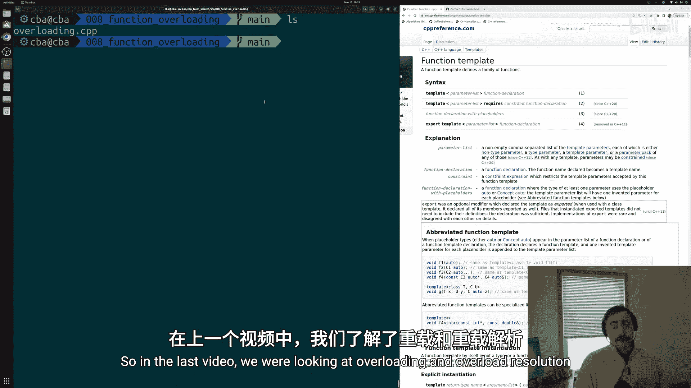

And one of the problems that we noticed here was that we were starting to get some code duplication coming from our functions themselves。

So here we had two versions of this print array function。

 one that took a stood array of three integers， and one that took a stood array of three floats and the problem that we noticed here was that both of these functions had the exact same function body。

 So we just had this kind of wasted effort here of writing multiple functions that are essentially doing the same thing。

 They have the exact same code in the function bodies。

 the only difference is in their parameter list， right which the type of array that they're taking。

Now， the way that we often address this kind of code duplication related to functions like this is through function templates。

 So function templates allow us to write a template of a function rather than these these concrete implementations for a specific type so instead we can defer that work to the compiler we can write a template and tell our compiler hey。

 I want the version of this function where the type is an array of ants or array of floats or an array of doubles instead of having to manually write out these different forms of the function So we're going to be looking at how we can use that today with this same example here of print array。

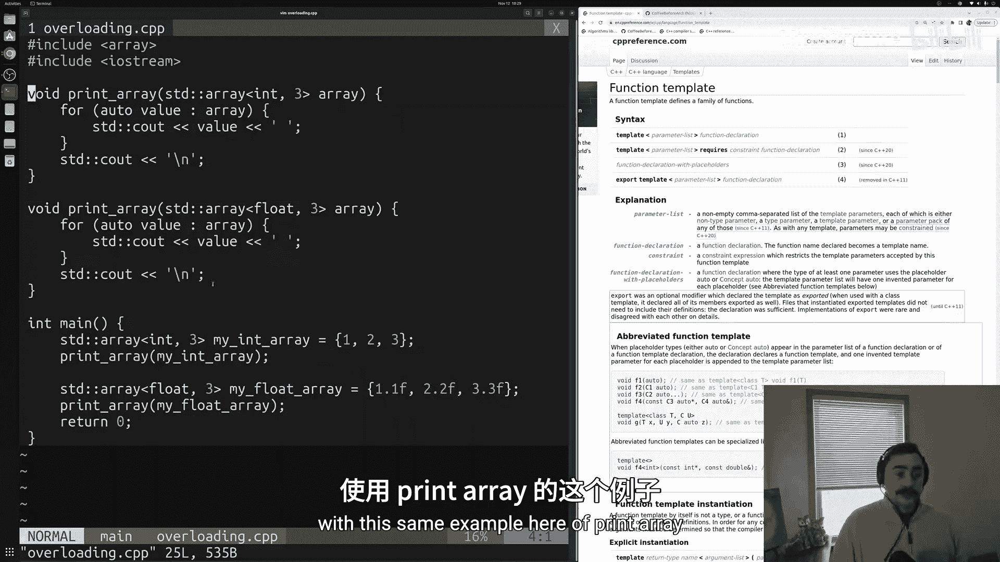

So let's go ahead quit out of here and we'll go to our directory for function templates。

 and we'll go ahead and create a new example called function templatelates do cP。

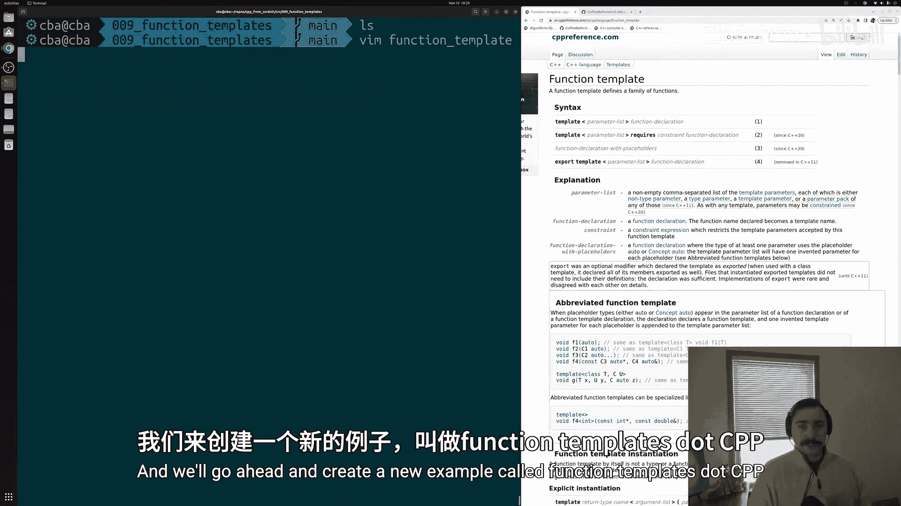

Now， because we're printing out some arrays， we're going to need to include some headers first。

 like array and IO stream。And we can go ahead and get to work with writing our main function as well right the core of our C++ programs。

Now， we， of course， need to create a couple of arrays here。

 so we'll just create the same array of integers and array of floats that we had last time。

 So we'll create a stood array of three integers。We'll call it my int array。

 and we'll set it equal to 1，2， and 3。And then we'll just copy and paste this。

And we'll create an array of three floats now， we'll call it my float array。

 and we'll set the values to 1。1 f，2。2 f and 3。3 F， just keeping things super simple here。

Now we want the ability to print these arrays and we don't want to have to write a different version for every single type of array we have。

 so let's go and see how we can write a template for that function。

So on the right hand side of the screen here I have the CPP reference page for function templates and as you can see there's it's quite dense。

 there's quite a few examples here in different ways that we can write these templates and use them so we'll be covering some of the common ways in which we use templates as well as some of the new ways in which we can write templates like using these abbreviated function。

 this abbreviated function template form。But let's go ahead and start with the basics here。

 So how do we write a template for our print array function。

 So let's just kind of write a function that kind of makes sense for what we're trying to do here。

 So we know that our function is going to have a void return type。 It's not going to return anything。

 It's just a print function。 So we can start there。 And then we can give our function a name。

 So we'll just call it say print array。Now， inside of our parameter list。

 what are we going to put here， Well we know we want some an array of some type here。

 So instead of saying exactly what that type is， we'll just put a placeholder name in here。

 So maybe we can put T or we can put something like my array type here。

 It really doesn't matter what we call this name。 it's just a placeholder。

 So we'll just leave it as T for simplicity。 And oftentimes you'll see this variable T or this。

This name T when you're working with templates and looking at these examples。

So we want some array of type T as an input。So then we can go ahead and get around to writing kind of what we want out of this function。

So we know we want to iterate over this array。 So we'll say for auto value in this array。

I want to print out those values So you stood see out value followed by a space。

 And then at the very end， I'll print out a new line character。 right。

 So we get a new line afterwards。Okay， so now we actually have to handle the case of， you know。

 where do we， where does this type T come from？Well。

 that's where we get into how we declare this that this you know function here is a template right and of course we do that through the template key so to say this function is a template。

 we'll just write the word template above the function。

And then we have to say what we want as input parameters to this template。

 and this allows us to say what kind of types do we want to specify you know for this particular template here right。

 so here we can say I want a type so you can type name T that's an input to this template。

So when we're using this template， a user can specify what type they want T。

And then that will get filled in inside of our function here。

 So when a user specifies that this type T is a stood array of3 ins。

 our compiler will fill that in inside of our function。 So inside of our parameter list here。

 suddenly t will become a stood array of 3 ins。 If the user specifies t to be a stood array of three floats。

 This T will be replaced inside of our function as a stood array of three floats。

 So we're relying on our compiler to generate this code for us instead of having to do it manually。😊。

Okay， so let's go ahead and see how we can use this print array template down here inside of our code。

Okay。So one of the ways that we can do that is by directly saying which version of the template we want so we can just invoke our function。

So print array and then using these angle brackets or less and greater than we can specify which version of the template we want so we can say I want the print array for a stood array of three integers and then we can just call it like a normal function。

So， you know， I'm going to pass in my ant array。And that's all we need to do here right all we're saying is I want to use is print array function。

 I want the version of a template that takes a stood array of three integers。

 and then here's my input argument to the function that I'm calling。

And we can do the exact same thing with our My floatat array。

 and all we need to do is replace the type of our for our template with a stood array of three floats now。

So we're just telling， and then of course we have to change our input argument to our float array。

So all worth' saying here now is that， hey， I want to use print array。

 but the version  for an array of three floats， right instead of an array of three ints。

 and then I'm just going to pass my input argument， my float array。Okay。

 so we'll go ahead and save this and we'll compile function templatelates CBP。

 and we'll set the output executable name to be just say function templates。

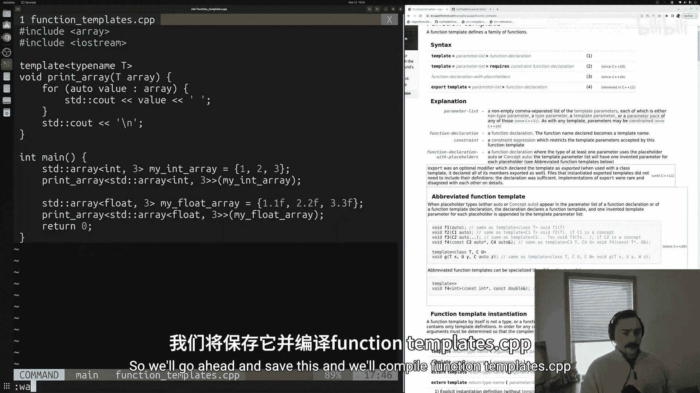

And then we can go ahead and run function templates。

 And you can see we get the prints that we expect。 We print out 1，2 and 34 integers and 1。1，2。

2 and 3。34 are floating point numbers。 So underneath the hood or compiler instantiated two different versions of our function。

 one function that takes a stood array of three ins and another function that takes a stood array of three floats。

 right， pretty cool， helps us get rid of this code duplication when we have say identical functions that take。

 say different types。😊。

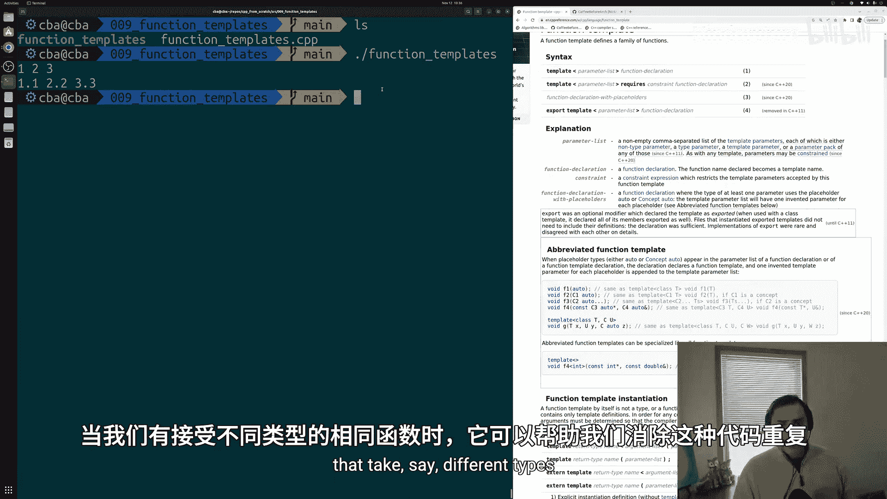

Okay， so let's go ahead and go back into here and look at another way in which we can use our templates。

So in many cases， we don't have to specify which version of the template we want to use。

 we can just let our compiler figure this out so we can completely get rid of this template parameter here and let our compiler deuce it so we can just call it like a normal function here。

So this is very similar to automatic type deduction。

 So here we're just calling print array with an input of my inputar。

 So our compiler is smart enough to say， hey， you're using a template here。

 but I see that you're using a stood array of three integers as an input。

 So I'll just instantiate the version of this template of print array。

 We type T is a stood array of three instegers and the same thing for our stood array of three floats down here。

 we can just call print array pass in as an argument my float array and our compiler will figure out you know I know which type of the version which version of this template you're trying to use。

 So we'll go ahead and instant instantiate that。 So again， very similar to automatic type deduction。

So we'll go ahead and。

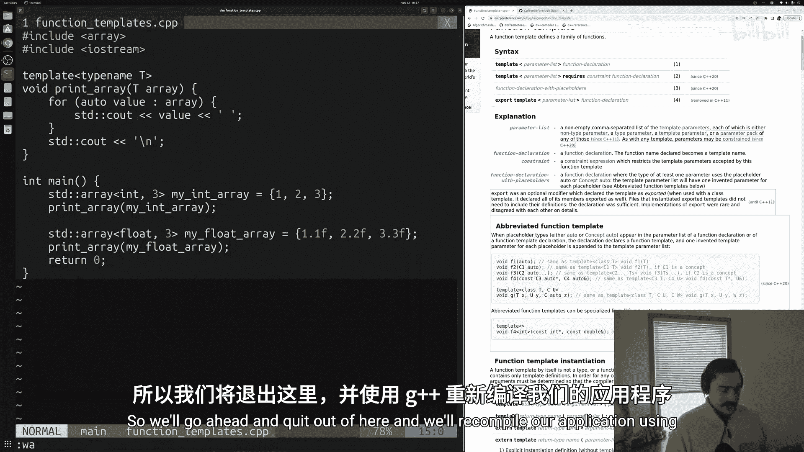

Quit out of here and we'll recompile our application using G++。

 and we can see that with this other syntax， we get the same result here。

 but we no longer had to specify the version of the template we were trying to use。

 We just let our compiler deduce that。

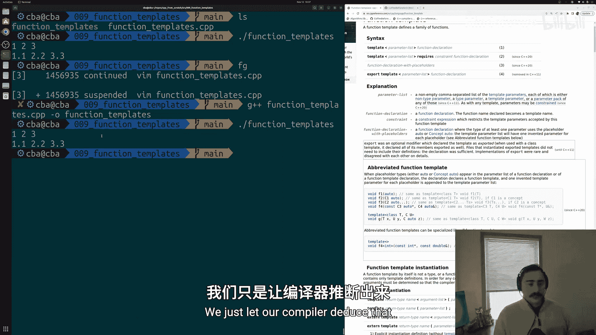

Okay。Now， the last thing that we're going to look at here is this abbreviated function template syntax。

So this is something that's part of C++ 20， so a relatively new feature here。

 so it may not work on every compiler out there， I have a very new compiler here。

 it's GCC I think 113， but we'll go ahead and look at this anyway。Okay。So。

What we can do with this abbreviated function template and what's nice about it is that we can get rid of this template type name3 completely。

And instead， what we can do is just use our auto keyboard。

So we can put auto in the parameter list for our function here and our compile will pick up on this and say。

 oh， I see you're using auto in the parameter list of a function。

 that must mean you want this function to be a templated function。

 and it even says as much down here， it says when the placeholder types either auto or concept auto appear in the parameter list of a function declaration or a function template declaration。

 the declaration declares a function template。Right so here by using auto in this parameter list here。

 our compiler knows that what we really want here is a template for this function。

 even though we didn't specify that template type name T thing。Okay。

 so let's go ahead and save this and let's recompile this code using the same G++ command。

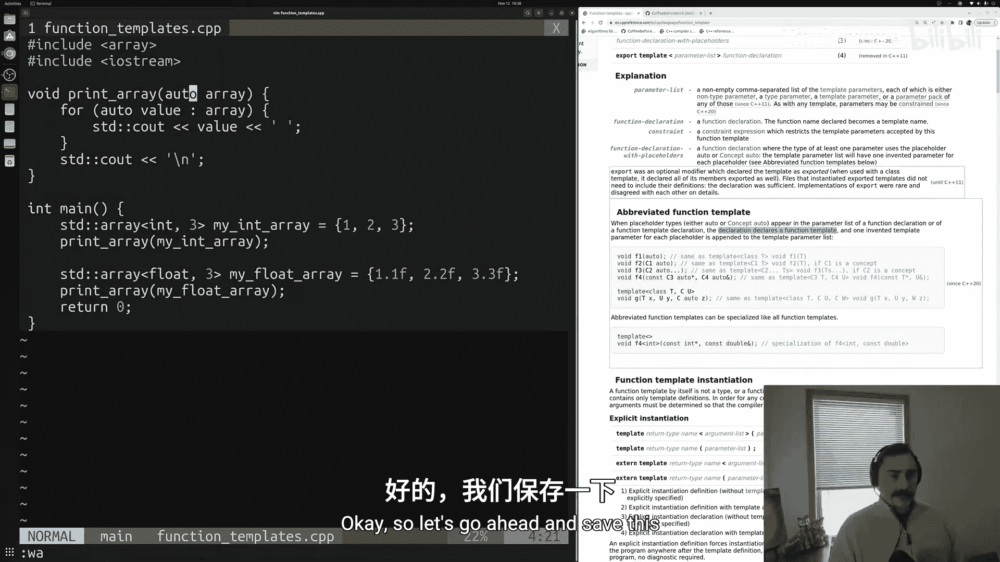

And it compiles just fine， so we have our executable function templates here。

But we get a warning here and the warning just says， hey。

 you're using auto in the parameter declaration， this is only available in C++ 20。

 or if we turn on or enable a concepts， so this is just a warning your compiler is giving us saying you're using something that's pretty new so you know it's only going to work on a compiler that says that say supports the C++ 20 standard。

So to get rid of that warning we can just add that stood equals c+ plus 20 right to our command line options for our compiler Now again。

 this will only work if your compiler actually supports this feature in C++ 20 if you have a much older compiler like Gcc 4。

8。5 this is not going to work but in this case right we have a very new compiler。

So we can go ahead and use the syntax and run it and you can see that we get the expected output right。

 but with a very simple declaration here， we get our prints for our array of integers and for our array of floats。

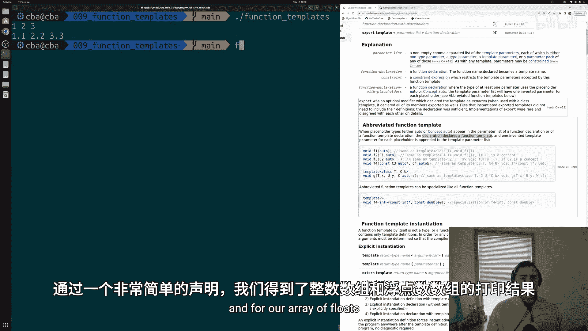

Okay， so that's a bit of the basics on how we can use these function templates and how they help us。

 you know， reduce our code duplication we're relying on our compiler to generate versions of a function for us instead of writing them manually inside of our code。

Okay， so like I said earlier， I'll go ahead and put a link to this function template overview from CPV reference below the video and as always。

 you can find this or any of my code at github。com/coffeebe arch。

 but that's going to go ahead and do it for today as always I'm Nick and hope you have a nice day。

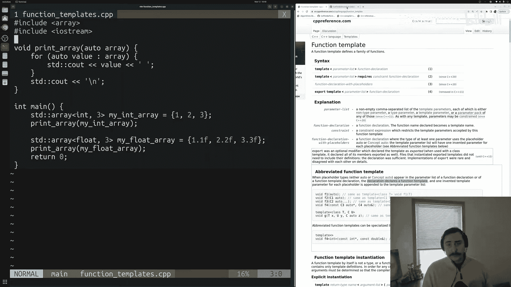

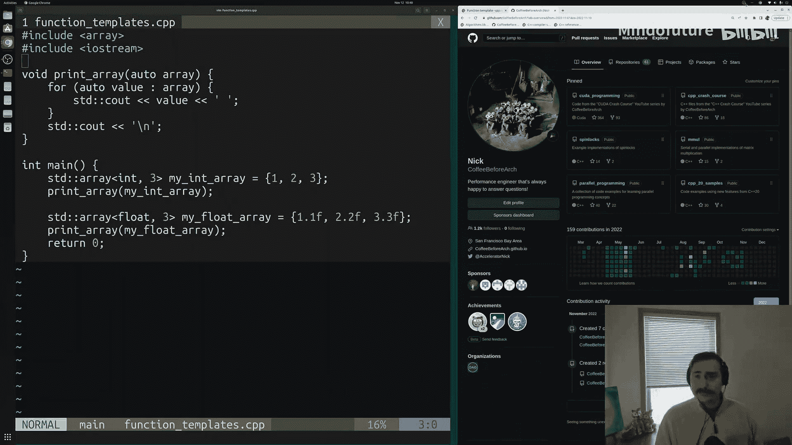