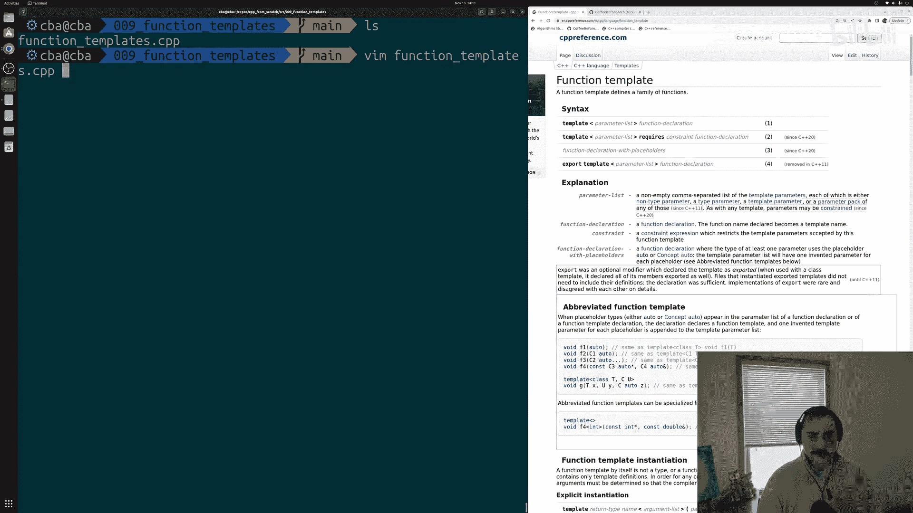
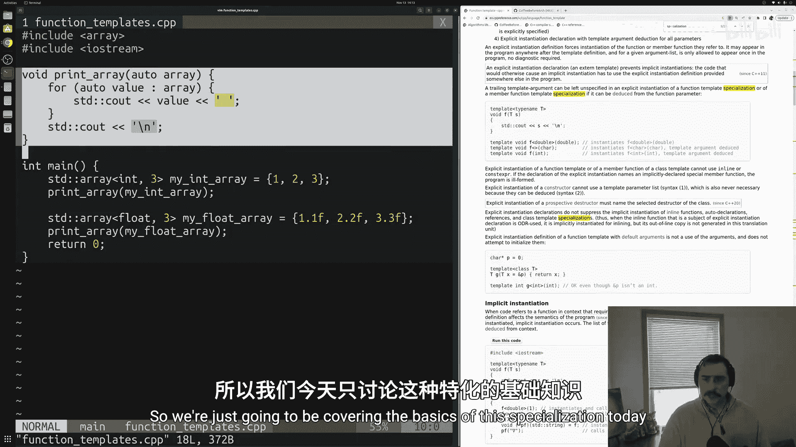
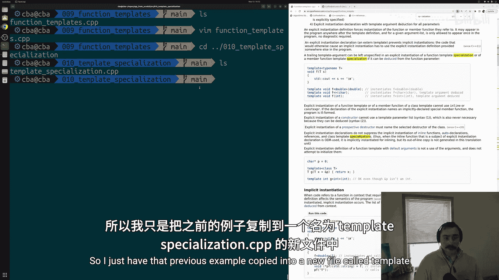
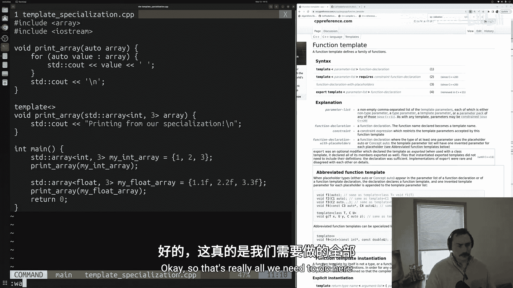
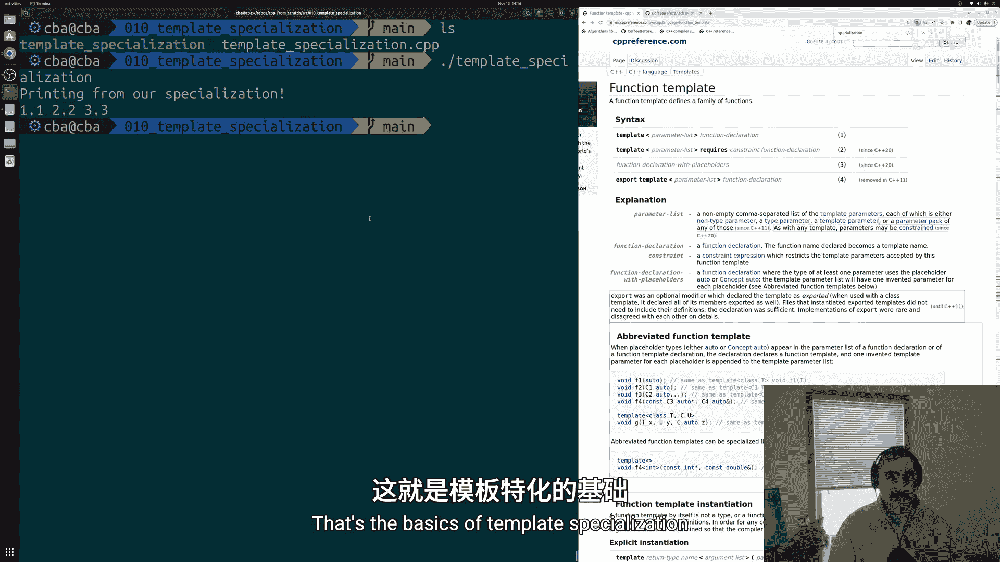
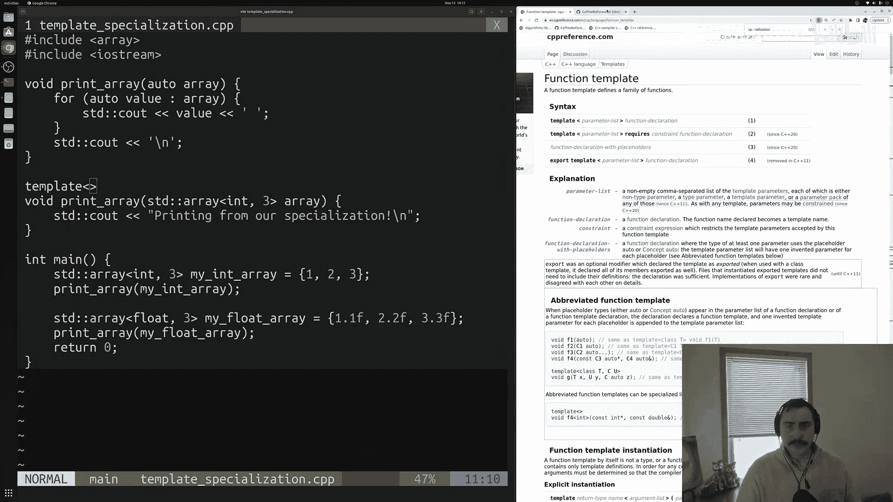
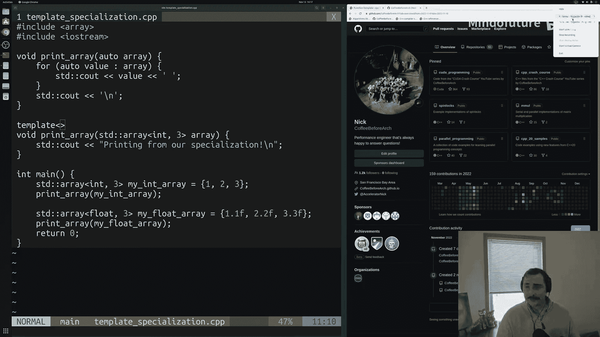

# C++入门教程｜CoffeeBeforeArch-p11-P11-Template-Specialization--BV1nbRUYSEUu_p11-

Hey， everyone， I'm Nick， and this is C Plus Plus from scratch。 So in this episode of the series。

 we're going to be talking about template specialization。So in the previous video。

 we looked at function templates， so let's go ahead and open up that example again。

 so this function templatelate。cppP。

Now， the problem that we were trying to solve with function templates is this code duplication with respect to our functions。

 So if we say wanted to print out multiple of these stood arrays， say with different types。

 So say a stood array of three integers and a stood array of three floats。

 we were left with the situation where we had to write multiple versions of the same function here。

Now， the way that we solved that was using function templates。

 So instead of generating all these versions of this function ourselves。

 we provided our compiler with a template to use to generate these functions for us。

 So all we had to do was provide our compiler with this template and then ask our compiler to generate the version for say a stood array of three integers or st array of three floats or any of these other array types we might be using。

Now we sometimes run into problems when we're using function templates here。

 Sometimes we don't want to have the exact same function body for every single type， right。

 Sometimes there's a case where we need a specialization of this function。

 So maybe we want to handle， say one of these array types slightly differently and not do say this same function body that's inside of our template and the way that we handle that is through this template specialization。

So on the right hand side of the screen here， I have up again this function template reference page from CPPreference。

com and if you control F on that page for something like specialization。

 you can find a bunch of references to this specialization that we can do both with the normal syntax and this abbreviated function syntax。

Or abbreviated template syntax。 So we're just going to be covering the basics of this specialization today。

So let's go ahead and quit out of here and let's look at a new example， right。

 it's going to be based on this print array concept。

So I just have the that previous example copied into a new file called templatelatespecialization。

cppP。

So let's go ahead and open up template specialization not CPP And here we have this case where we have our print array template using that abbreviated function template syntax and we're using two different versions of that function right So we're using the instance of that template forested array of three ins and a stood array of three floats Now let's say we want something slightly different to happen when we use our array of three integers right so we want a specialization for that type。

So how would we do that， Well， it really just comes down to writing a function for that specific type。

 So， for example， here， we would， you know， just create another print array function。

 So void return type， print array。 except this time， instead of writing a template。

 we're going to explicitly say the type that we want to pass to this function。

So we want to pass a stood array of three integers here， and we'll just call that input array。

 and let's say that instead of say printing out these values here。

 we just want to print out something like we're printing from our template specialization。

So we'll just use stood see H and say printing from our。Specialization。With a new line character。

So now when we go ahead and use this specialized version of the template。

 we're not going to print out our array at all。 We're just going to print out this string。 Now。

 there's one more thing that we need to do with the specialization。

 We need to tell our compiler that， you know this is actually part of our template up here。

 We're just handling one of the cases for our compiler。

 And the way that we do that is with the template key again。

 So we just write template and with this empty template parameter list here。

 And this is just telling the compiler， hey， this function is part of this template print array right here。

 I'm just taking care of the case stood array of three ins for you So we have to include this template open enclosed angle brackets or less in greater than signs。

😊，Okay， so that's really the only we need to do here so let's go ahead and save this， minimize it。

 and we can go ahead and compile this application， so we'll compile templatespecialization。 cppP。

 We'll call our output executable something like template specialization and again because we're using this abbreviated function templates syntax that's part of C++ 20 we'll go ahead and use stood equals c++ 20 to avoid any compiler warnings。

So we'll go ahead and compile this and you can see here that we've got our executable now。

And let's go ahead and run it， so we'll just run template specialization。😊。

And you can see here we get our two prints right so for our know the case where we have a specialization of our template where we explicitly said what we want our print array function with a st array of three instegers what we wanted it to do we get a print of printing from our specialization while with our other case for our st array of three floats where we didn't have a specialization we just use the code from the baseline templates or compiler in stain shades that code for us so we have a cases where we're using both a specialization and kind of our baseline template generated code from our compiler。

Okay， so that's going to go into it for today。 That's the basics of you know template specialization。

 This isn't something specific to C++ 20。 We can of course do this template。

You know this template specialization with our normal template syntax right where we have that template type name T thing going on。

 this is just an example using the C+ plus 20 syntax。

 but like I said that's gonna go and do it for today I'll go ahead and link down this CPP reference up page below the video and as always you can find any of this code at github do co slash copy before arch Now that's gonna go do it for today As always I'm Nick and I hope you have a nice day。

😊。

