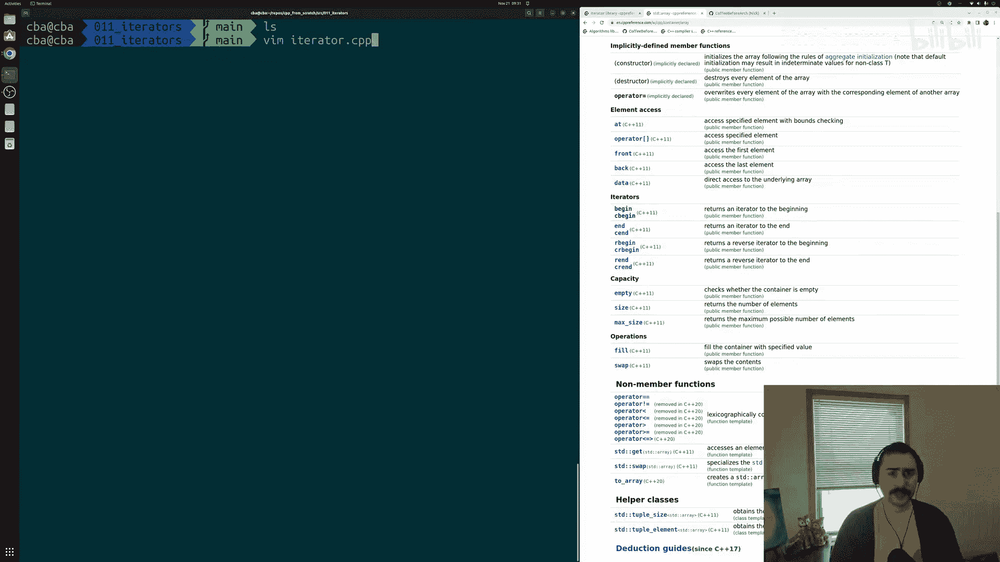
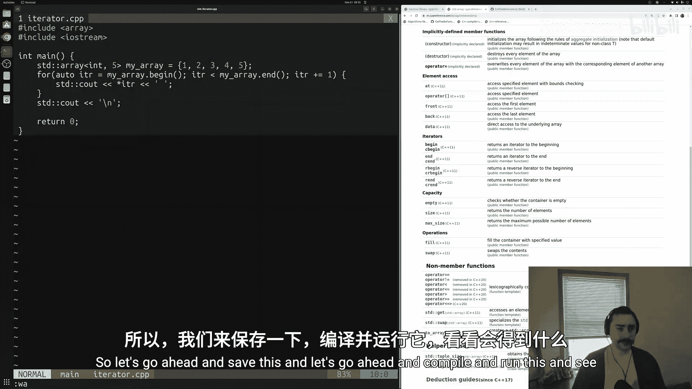
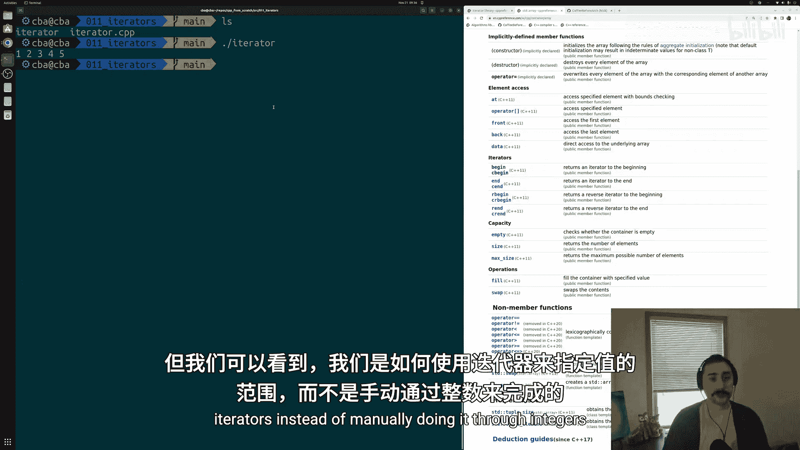
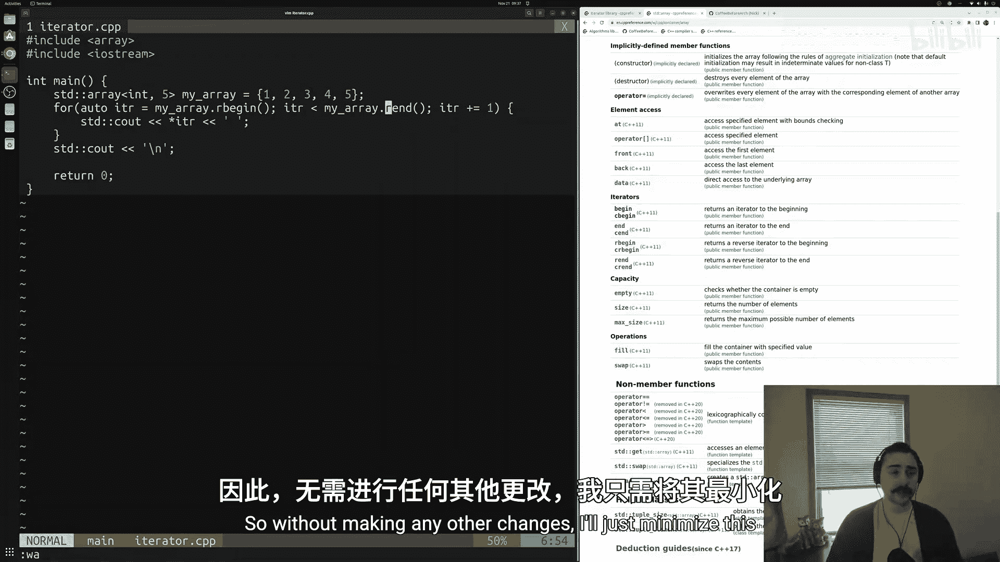
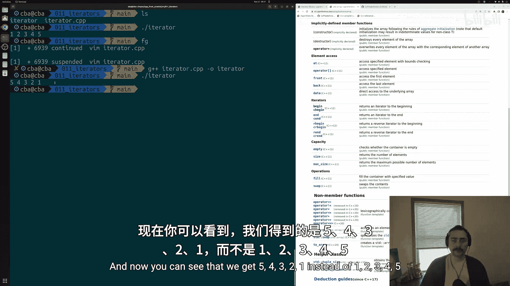
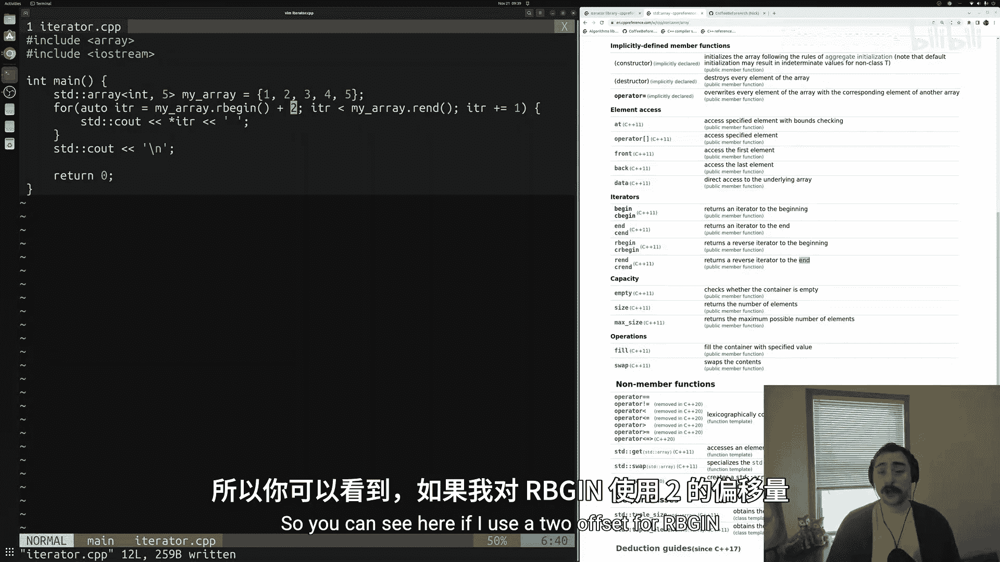
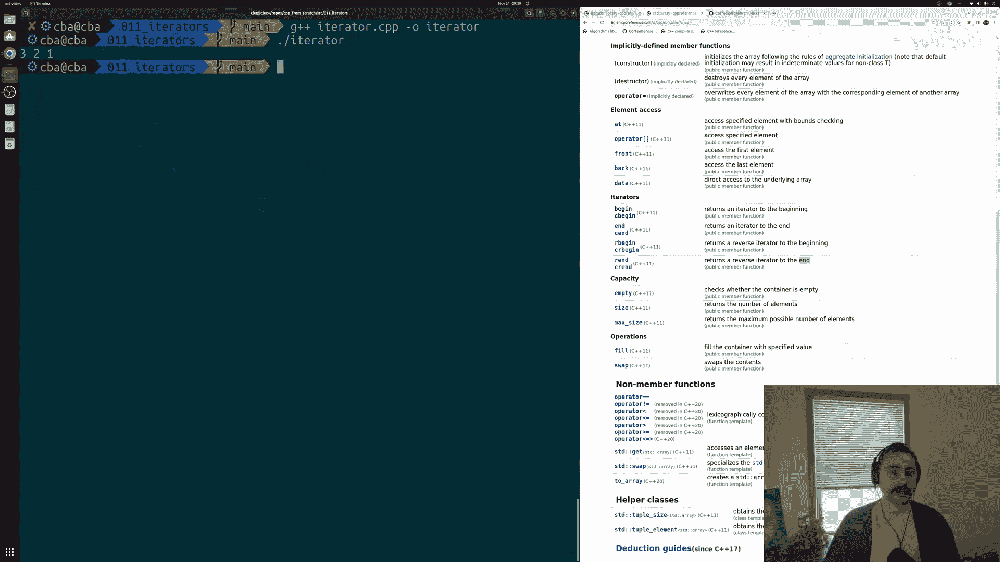
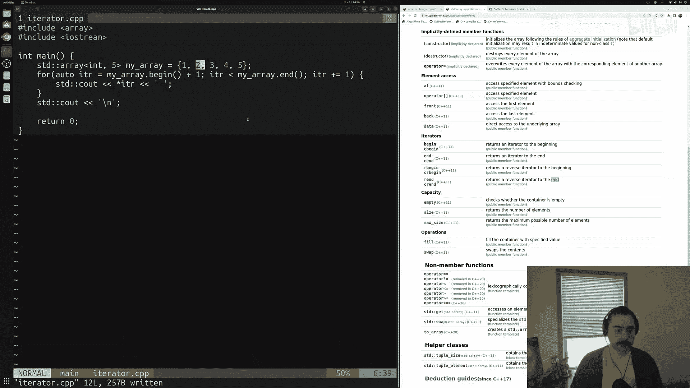
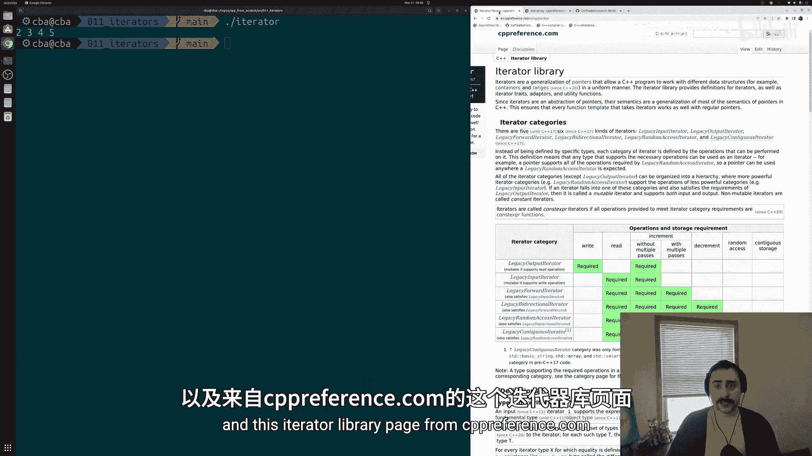
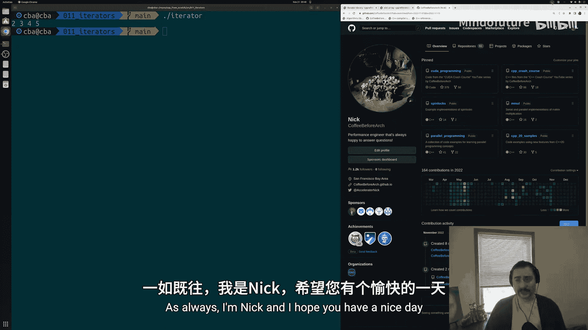

# C++入门教程｜CoffeeBeforeArch-p12-P12-Iterators--BV1nbRUYSEUu_p12-

Hey， everyone， I'm Nick， and this is C+ plus from scratch。 So in this episode of the series。

 we're going to be talking about iterators。 So iterators provide this general way of iterating over or traversing our standard template library containers。

 And one of the primary places where we use these iterators is when interacting with our standard template library algorithms。

 So with our iterators， we can define， say a range of values So we can say from the beginning of a container to the end of the container。

 we can pass that range using iterators to a standard template library algorithm。

 which will perform some algorithm on that range of values。😊。

Now another thing that our iterators do is they lay out， say a set of requirements。

 so we can't use say every single kind of iterator， so we have multiple kinds of iterators。

 we can't use every single kind with every single standard template library algorithm。

 So for example， right we have you know our container like a stood array our old friend there。

 we can of course call stood sort or standard sort our sorting algorithm on a stood array。

 but we can't say sort an unordered containers， So something like a stood unordered map So another thing that these iterators do is they set kind of the foundation of you know where we can use certain kinds of iterators and where we can use certain kinds of containers with respect to our standard template library algorithms。

Okay， so what we're going to be looking at today as an example is kind of the basics of how we can iterate over one of these containers using these iterators and we're going to be using our old friends stood away for this。

 So when we first looked at this container， we kind of skipped over this iterator section where we had these methods。

 say begin and R begin and Rn。 so we're going to be looking at those today more detail。

So let's go ahead and get started and we'll create a new source file so something like iterator。cppP。

And because we're using our stood array， we'll include our array header。

 and I'll go ahead and include IO streamream so we can print out some values as well。Okay。And then。

 of course， we can have our main function， right， the core of all of our C++ applications。

So what we'll do starting out is， of course， just create creating some array that we want to iterate over。

 So we'll create a stood array of five integers。We'll call it something like my array。 and， you know。

 we'll just set the contents to， you know， some numbers， right， Maybe we'll just do ascending 1，2，3。

4 and 5， right， something simple。To save that。Now one of the ways in which we can use iterators is of course just manually iterating over the values inside of say a container。

 and we can do that with a for loop， so instead of using something like a range based for loopop we're going to use that more C style syntax。

 except instead of manually specifying with the bounds using say integers。

 we're going to specify the bounds using these iterators。

So the first part right of our four loop syntax is we have some sort of initialization。

 usually of some kind of loop counter， so instead of doing something like int I is equal to zero here to specify the start of you know our array。

We'll go ahead and use auto。Ittter， so we'll just use I T R to abbreviate Iter is equal to my array do again。

 right， So we're already being a bit more expressive here instead of， you know， saying， you know。

 some integer I is equal to 0。 We're saying， okay， we have some it variable。

 And we're setting that to be the beginning of my array。

 So very expressive compared to just having say 0。Then we have some sort of condition that we're going to check inside of our loop。

 So we want to keep running this loop until we run out of elements。

 So we want to make sure that our iterator is less than my array dot n right， So again。

 instead of checking something like the capacity of our array and making sure that we're not indexing past the end of our array。

 we're saying I want to keep running this loop while my iterator is less than the iterator at the end of this array right。

 So you can see here our begin method returns an iterator to the beginning of our stood array。

 and our end method returns an iterator to the end of our array So very expressive。And then finally。

 right we have some sort of like increment or decrement that we typically have with our loop counter。

 So in this case we'll do exactly the same thing。 we'll do it plus equals one here。

 So we're just saying I want to progress my iterator by one position inside of my container right so I'm just going to add one and you know that just symbolically meaning that I want to go to the next element so I want to progress say from one to two then on the next loop iteration from two to3。

3 to4 and so on and so forth。Okay， so let's go ahead and get into the body of this for loop now。

 And let's say we just want to print out the contents of this array。 So， of course。

 we're going use something like stood C out。 But what are we going to print out here， right。

 This type of iter， right， This is you know， this is a stood array iterator， right。

 This is't a value that we can just directly print。

 So how do we access the value underneath an iterator， right。

 An iterator is this higher level of abstraction， right。

 We're iterating over the contents of something， So how do we access the underlying value。

 What we use the star operator for that。So we'll use something like star Iter to access the value underneath an iterator。

 so here we're accessing the integer underneath my iterator for my array of integers。Okay。

And then of course， we'll print， say， something like a space afterwards will print out all of the elements in array separated by a space。

And then at the very end， we'll do something like stood sea out。With a new line character。

 so that we get a new line afterwards。 Okay， so let's kind of just run through the basics of what we did here again。

 So first， we just created an array。 Then we created a for loop and the bounds for or for loop we set using iterators。

So he said， you know， we want to start with， you know， iter is equal to the beginning of our array。

 and we use that my array up begin method to get that iterator to the beginning of our array。

Our condition that we check each iteration of the loop is we just want to make sure that our current iterator is less than the iterator that we get when we call my array dot end right so we want to make sure we're not at the end of our array。

And then every iteration of our loop， we want to just progressor iterator by one。

 So we want to move to the next value。Okay。So let's go ahead and save this and let's go ahead and compile and run this and see what we get。

So we'll go ahead and run G++ on iterator。cppP， it will just call the output executable。

 something like iterator。Then you can see we have our executable now and we can go ahead and run this so we can run iterator。

And we get what we expect， right We print out our element by element starting from one。

 going all the way up to5 not so surprising， but we can see how we were able to specify that value that range of values using our iterators instead of manually doing it through integers。

Now another thing we can do here is we can use our other kind of iterators that our St array supports。

 which are these reverse iterators， so sometimes we want to iterate over an array in reverse so we don't want to go from the beginning to the end。

 we want to go from the end to the beginning。Now， if you were just manually specifying this range with integers。

 it would be a little bit annoying because we'd have to change， you know。

 know more or less everything inside of this for loop。 We would have to， you know change。

 you know the start of our array to be you know the capacity minus1 of our or rather the size minus1 of our we would have to make sure that our condition。

 you know we're checking to make sure that our position is greater than or equal to0。

 and then we would have to know subtract rather than increment right here。

 every iteration of the loop， but we can do it very simply with our iterators。

 especially because our container supports these reverse iterators。

 All I need to do is change begin an end to R begin and R n。

And everything will work as expected will now you know， print up this array in reverse。

 So without making any other changes， I'll just minimize this。 I'll recompile iterator。 CP。

 and we'll run it。 And now you can see that weet 5，4，3，2，1 instead of 1，2，3，4，5。

So let's go ahead and see kind of how this works and how we can be a lot more expressive using iterators。

So here our array definition exactly the same。 But now we're saying inside of the bounds of our for loop。

 I want my starting iterator to to be the beginning。

 or rather this reverse iterator beginning of this array。

 So we can see that our begin over here returns a reverse iterator to the beginning。

 So it's the beginning of our array。 If we're iterating over this container in reverse。

 So we're starting at something like 5， right instead of one。

And then R end is roughly the same thing， but it's a reverse iterator， and it's the end right。

 but it's the end if we're iterating over this container in reverse。

 So we're going from five down to one now instead of one up to5 and all we really need to change was using R begin an R end instead of begin and end so we can be very expressive and know it saves us a lot of hassle of changing things like loops and worrying about bounds and making sure we got all that logic correctly implemented。

Now one final thing to note here is that we don't always have to iterate over our entire range of values here。

 if you were just going to iterate over our entire range of values。

 it's oftentimes better to just use a range based for loop。

But we can set offsets here into what elements we want to access。 So instead of starting from， say。

 R begin， right， we can start from R begin plus one。

 So one offset from our reverse iterator at the beginning of that。That sequence。

 So instead of starting at5 here， now we're starting at 4。 If I do plus 2， instead of starting at4。

 we're starting at 3 and so on and so forth。 So you can see here if I use a two offset for R begin。

 and I go ahead and recompile iterator and run it。 It just prints out 3，2，1， right。

 because I started with。

A2 offset here from R begin。 So12， likewise， you can do the exact same thing with， say。

 begin and end， right， So we can just get rid of R begin and R end and iterate it， iterate over。

 you know， front to back of this array。 and let's just do an offset of one here。

 So instead of starting it begin， which is one， we're going to start at2 here， right。

 which is begin plus one。

O。So we'll go ahead and compile and run this again。 and you can see we print out 2，3，4，5。

 instead of that entire range。 So this is how we can kind of play around and get a subset of， say。

 a container that we might want to pass to something like an S T L algorithm。

Okay so that's going to go ahead and do it for today That's roughly the basics of you know how we use iterators and how we can think about iterators in C++ I'll of course provide links to this stood array and this iterator library up page from cPreference。

 co and you can of course find any of this in the other example I've gone through at Github。

com s coffeebe arch but that's going to go ahead and do it for today as always I'm Nick and I hope you have a nice day。

