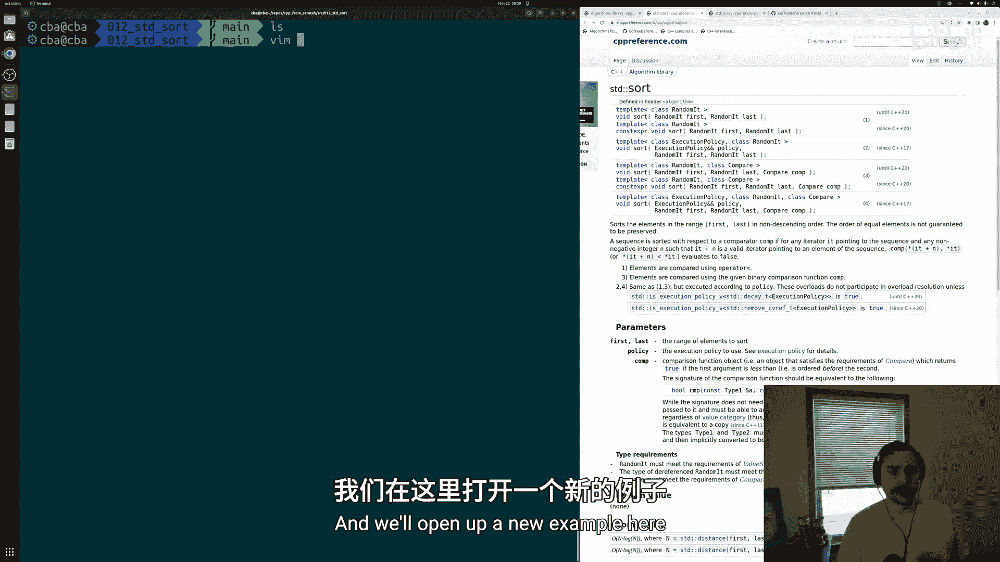
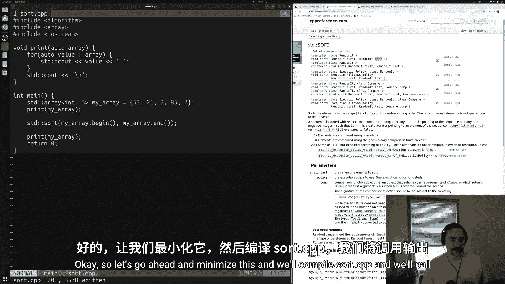
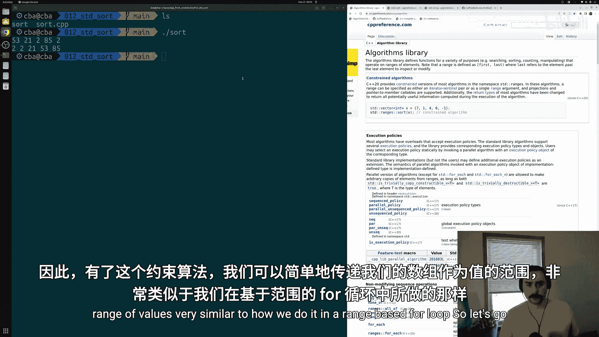
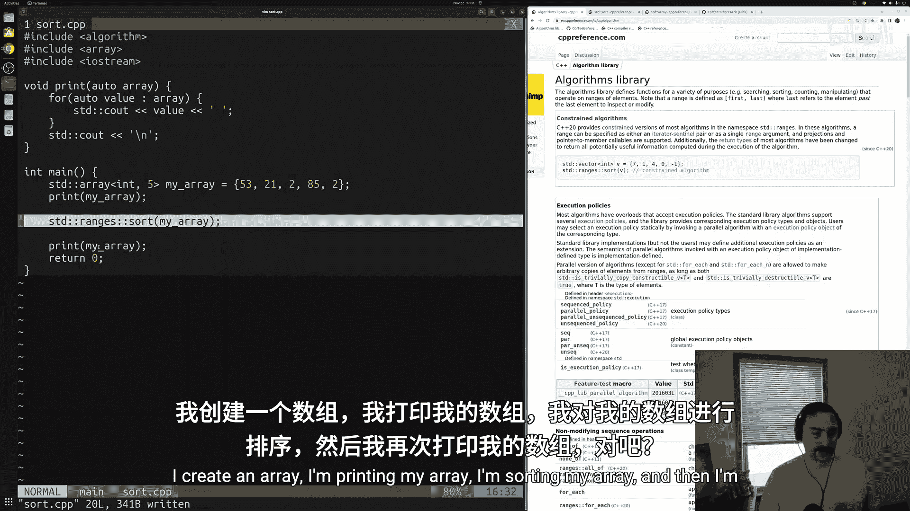
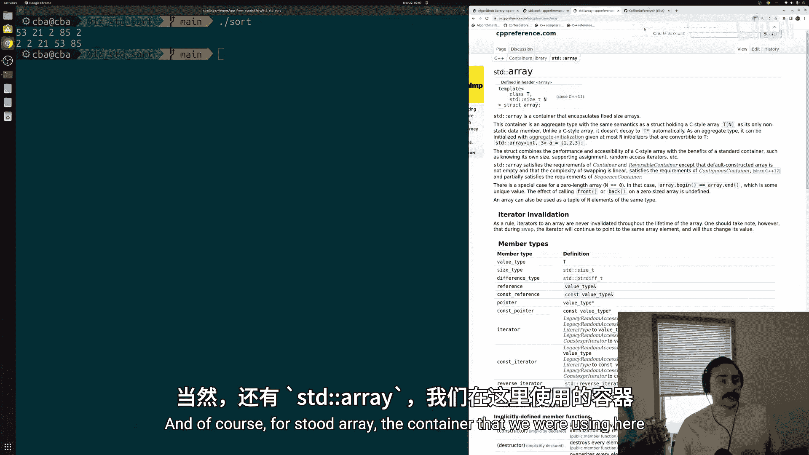
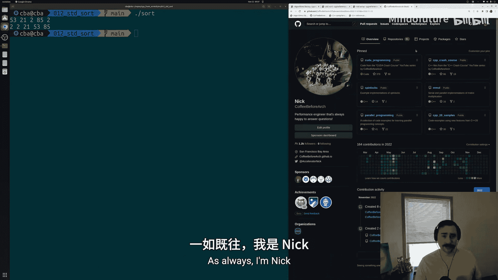

# C++入门教程｜CoffeeBeforeArch-p13-P13-std----sort--BV1nbRUYSEUu_p13-

Hey， everyone， I'm Nick， and this is C+ Plus from scratch。 So in this episode of the series。

 we're going to be talking about the first of our standard template library algorithms。

 and that's going to be standard sort or stood sort。

So our STL algorithms go hand in hand with our standard library containers。

 so just like we have these containers that gives us a way to represent our data in some form that's convenient for us。

 so things like stood array， we also have our algorithms that allow us to form operations on these containers right some very common operations that we want to use when solving problems。

So as you can see from the right hand side of the screen here I've got the CPV reference page for the algorithms library up and we have quite a few of these algorithms to choose from right so you know one of the main reasons for using these algorithms other than the fact that they work very nicely with our containers is just the fact that we don't want to be reinventing the wheel when programming we could of course write our own sorting implementation。

 but oftentimes it will be no better than the one implemented by your compiler vendor。

 though there are of course always exceptions to the rule。Okay。

 so you know moving on from that what we're going to be looking at today is you know the basics of how we can use this specific algorithm and that's going to be standard sort or stood sort you know we just want to sort one of our containers and specifically we'll use the one we've been using for the past few examples and that's going to be stood array so we want to say sort the elements inside of our array。

So let's go ahead and get started and we'll open up a new example here and we'll call this something like sort。

cpp。

Now inside of here you can see that Stword is defined inside our header algorithm。

 so we can go ahead and include that as we get all the headers that we're going to need in this file。

 so we'll start with something like algorithm。That we need for S sort。

 I'll also go ahead and include array right that's the container that we want to sort and then I'll go ahead and include Io streamam so we can say print out the contents of our array before and after sorting。

So we'll go ahead and save that as well。So let's go ahead and start with the main function。

 of course。The core of our C++ programs and we'll create an array that we want to sort。

 so we'll create a stood array and let's say of five integers。

We'll call it something like my array and we'll set it equal to you just some random numbers。

 maybe not in you know sorted order right， Sos something like this。

 and we even have a duplicate in there， So 53，212， 85 and2。

 Now let's quickly implement a method to print out our array so we can print it before and after and here we'll use the abbreviated template syntax that we looked at when we looked at function templates so we'll create a void function。

Called print， that'll take something an array。We'll just use this auto right for this abbreviated template syntax。

Then inside of here， we'll go ahead and we'll create a simple range based for loop for our array。

 so we'll say for auto value in this array， you know， I want to stood see out that value。

Followed by a space， right， and then。Print a new line character at the very end， right。

 so we get a new line。Then down here， we can go ahead and print out our original array just by just calling print。

My array， template is that。Okay， so now we have our array set up and you know we're printing it up to the screen before we sort it。

 so let's go ahead and see how we can use something like stood sort right so if we go ahead and look on the right hand side of the screen here on this reference page for standard sort。

 you can see there's a number of different versions of it that we can use that correspond to different versions of C++。

But the core behind all of these is that they're going to sort elements from the range first to last。

 So we're just going to provide a range of elements to our algorithm that we want to sort from our container and you know one of our key constraints here is that it has to have this random iterator。

 So if we look at the type requirements down here so in the last video we talked a bit about iterators and how different algorithms of different requirements in terms of the kinds of iterators they use we can see the type requirements for our。

Our standard sort， it says you know random it， you know as you can see it's the template class name up here。

 it says that random it must meet the requirements of value swappable and legacy random access iterator and if we go ahead and go to Si arrayray here we can see under iterator these member types you can see that it has this legacy random access iterator thing so we should be good to go there we can use our iterators for our array to specify that range of values that we want to sort。

So let's go ahead in and use that right so it says here that we can pass you know two iterators。

 the first and last and we're going to sort the elements within that range so let's call stood sort and let's go ahead and start we want to start sorting from say the beginning of our array so we'll call my array begin to get the iterator to the beginning of our array and then the end of array right that will be the last element say in that range we want to sort we'll go ahead and do my array do end right？

And that's that's all we really need to do right so that's all we really need to sort our array here。

 We just call stood sort with the range of valuess we want to sort right So basically from the beginning sort from the beginning to the end of my array and of course you could put offsets in here if you want to sort a subset of this array。

Okay， and right after our sort， let's just do another print so we can see my array again to make sure that we sorted it correctly。

Okay， so let's go ahead and minimize this and we'll compile sort。cP and we'll call the output。

 you know， something just like sort。

And you can see we get this warning here for you know using this abbreviated template syntax。

 so using auto to specify a template， so we'll go ahead and you stood equals C++ 20 to also just get rid of that warning。

O。So there we have our executable here and we can go ahead and run and you can see that stood sort sorted our array。

 so we went from 5321 to 852 and then our sorted version of our array so after that called a stood sort。

 we got 2221，53 and 85 right so all of the elements in ascending order。

Now another thing I wanted to bring up is kind of a more modern way we can use some of these algorithms and it's with one of these thingss called ranges so you can see we have this idea of constrained algorithms here that is available since C+ plus 20 And the idea here is we want to make our code even easier to write so many times when we're using these algorithms so something like sort it's a little bit annoying if we have to specify。

 say a like beginning and end I just want to sort my array so with this constrained algorithms we can just pass our array as a range of values it' very similar to how we do it in a range based for loop。

So let's go ahead and see how we can use that C++ 20 constrained algorithms version of sort。

So in this case， we get a bit of syntactic sugar， we'll have the exact same operation。

 but it'll be easier to write。So here I can just pass my array to instead of stood sort。

 it's going to be stood ranges sort， so it's part of this Rs library。

And I can go ahead and save that。And you can see I've got some very expressive code here now。

 I create an array， I'm printing my array， I'm sorting my array。

 and then I'm printing my array again， right？

Okay。So let's go ahead and recompile this and again we're compiling this with C++ 20。

 so if you're going to try out this example， you'll need a compiler that supports specifically these constrained algorithms in C++ 20。

So we'll compile this and we'll run it and you can see we get the same result as last time right。

 our sorted array。So 53， 21，285 and 2 and then sorted2 up to 85 now， right。

 so everything in sorted order。Okay， so that's going to go ahead and do it for today。

 it's kind of the basics of using you know the first of these standard template library algorithms that we're going to be looking at。

 of course I'll put links down below to this main page for the algorithms library。

 the specific one for stood sort and of course forto array， the container that we were using here。

Of course， you can find this in any of the other examples like Github。com/coffee before arch。

 but that's going to go ahead and do it for today， as always。

 I'm Nick and I hope you have a nice day。

