# C++入门教程｜CoffeeBeforeArch-p14-P14-std----vector--BV1nbRUYSEUu_p14-

Hey everyone， I'm Nick， and this is E++ from scratch。 So in this episode of the series。

 we're going to be talking about another one of our standard library containers and that's going to be our stood vector or standard vector。

So there are oftentimes when we're programming where we don't know how many elements we want to put into a container ahead of time。

 right so the know this data may be coming from some external source that we don't exactly know the total size of right from the very start。

Now this presents a bit of a challenge for the container that we've looked at so far。

 which is our stood array， one of the templatet parameters for a stood array is the number of elements we want that array to store right and that had to be known at compile time。

So a bit of a problem here。 So we need a container that can dynamically grow。

 you know kind of as we need it to， and that's kind of where stood vector comes in。

 So stood vector is very much like Earth stood array in many respects except it can dynamically grow right so it's a dynamically sized array。

So let's go ahead and talk about the student vector for a bit and see kind of the basics of how we can use this container。

So let's go ahead and get started and we'll create a new example here called something like vector。

cP and of course we'll start out with including a few things so we'll include ioStam because we'll probably want to print the contents of our vector and you can see here from our CPP reference for stood vector that stood vector is defined in the header vector so we'll need to include that as well so we'll go ahead and include vector in here。

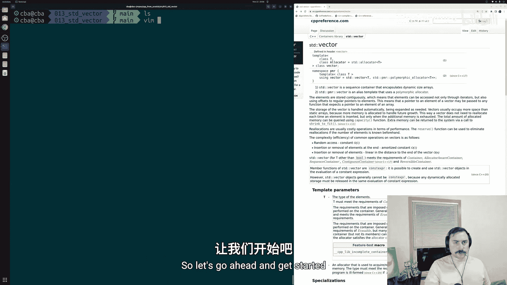

Now we can go ahead and create our main function。Core of our C plus plus programs。

 and we can go ahead and get started with just creating our vector。

 So we'll just create a stood vector。 So you can see here there's a few different kinds。

 we're going to ignore this version with these polymorphic memory resources this polymorphic allocator for now。

 we're mainly going to be talking about this first one here that takes as one of the template parameters some class T right。

 you know， whatever type we want to store inside of this dynamically sized array， this vector。😊。

And we'll just use the default allocator so we don't need to specify anything for that。

So as our templated peri here for a vector right when we're creating say a variable that is going to have the type vector all we need to say is what type you want to store in there。

 So in this case we'll just create a vector of integers so stood vector of int right here。

And we'll just call this say， you know my vector。And that's all we need to do to create this variable here。

 So as a reminder， unlike our array， we don't need to specify the number of elements we want to store in our vector at run time。

 right， underneath the hooder runtime will take care of finding the amount of memory we need for the number of elements we want to put inside of our vector。

 It's not something that we need to worry about at compile time。

 or rather not something that we need to know specifically at compile time。Okay。

 now just like our array， we can also initialize our vector right。

 where we define it so we can use that same kind of initializer list syntax so we can say， you know。

 inside as vector， we'll just put some sequential numbers， So say 1，2，3，4 and 5， right。

So we'll go ahead and store these values inside of my vector。

 So I've got five values of my vector so far。 So let's go ahead and print out this just like the wood are vector or rather or stood array。

 So here we'll just create a simple print function。 So we'll do avoid function。Call print。

 rather with void return type， as an input will have a st vector of integers that we'll just call vector。

And then inside of here we'll have a range based for loop。

 so we'll say for you know auto value inside of my vector。

I want to go ahead and print out that value。Followed by a space。 And then at the very end。

 we'll just print out a new line character。 So a simple print function here。

 and we can go ahead and use that with our vector。 So we'll print out my vector down here。Okay。

 so very much like we used as to array， the only difference here is we don't need to specify the number of elements inside this vector。

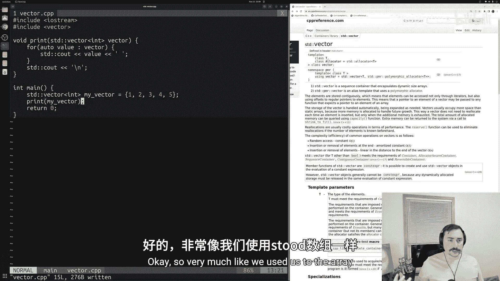

So let's go ahead and compile this。This vector。cdp， and we'll just call the output executable。

 something like vector。So there we've got our output executable， let's go ahead and run it。

 unsurprisingly we get a printout of the contents of that vector， 1，2，3，4， and5。Okay。

 so now let's move on to something a little more specific to vectors is something that you starts to differentiate us from our stood array。

 So let's go ahead and move down inside of this reference page here and we'll start looking at some of these member functions here right so a lot of these are the same as we saw inside of our array So we have say an app method。

 we have this operator with the square brackets so we can you know index into our vector just like we did our array we have methods for front and back to get the first and last element and even access to the underlying array using this data method we have our iterators that we looked at you know in the last video where we talked about iterators。

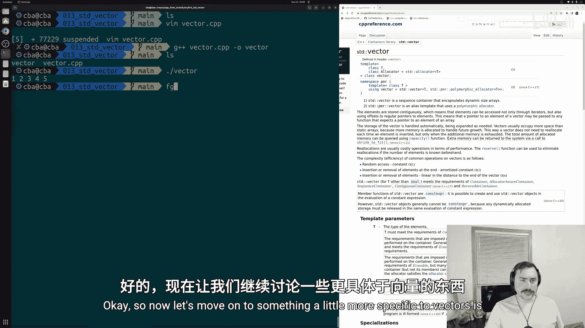

So things like or or rather a couple videos ago， where we talked about things like begin end and R begin and our end。

 But where things start to differ really is with our capacity methods and our modifier methods So unlike our array。

 because we can change the size of our vector， we have some new methods。

 So things like push back and in place back and also this say insert and in place right So we can start adding elements into our array。

 right， and just rely on it run time having kind of the under under the hood stuff of our vector。

 take care of finding that memory for us right instead of relying on our compiler to take care of that。

😊，Okay， so let's go ahead and play around some of these。

 specifically we'll start by looking at pushback。So if we go ahead and take a look at pushback。

 it says it adds an element to the end， right， So to the end of our vector。

 So that seems like a neat thing to try。 So let's go ahead and use it。

So we'll go ahead and go back over here。And we'll go ahead and call my vector dot pushback。

And we'll just add， say the element or the number6 to the end of our vector。

 and I'll go ahead and add another print after we do this pushback。

 and we'll go ahead and recompile and run this。 So we'll expect to see our original vector printed out and then our vector with the number 6 added to it。

Print it out next。

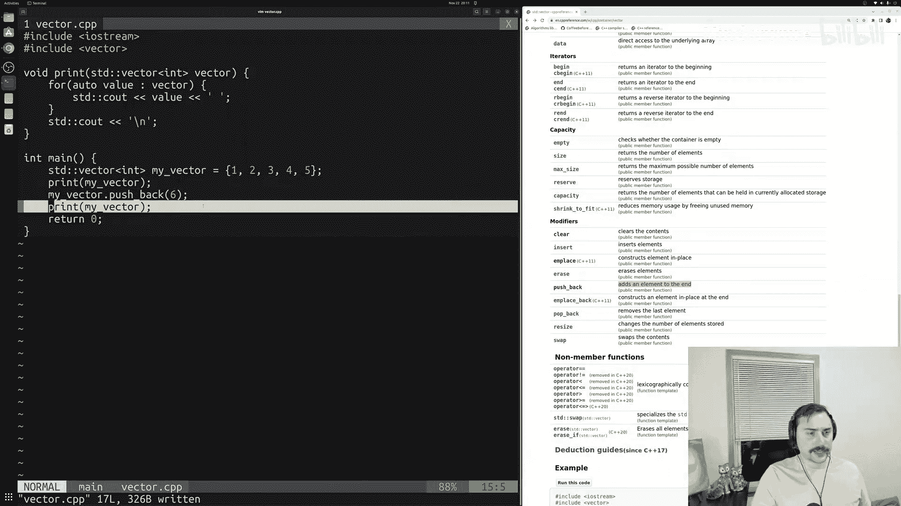

So we'll go ahead and save this， go ahead and exit out of here。

 we'll recompile our program and we'll run it， and you can see we were able to successfully add an element to our vector at runtime right so we added the number six to our vector。

Now another meal method you see here in this modifiers is we also have this popback method。

 so we can also remove elements from our our vector right。

 so specifically popback removes the last element of our vector。

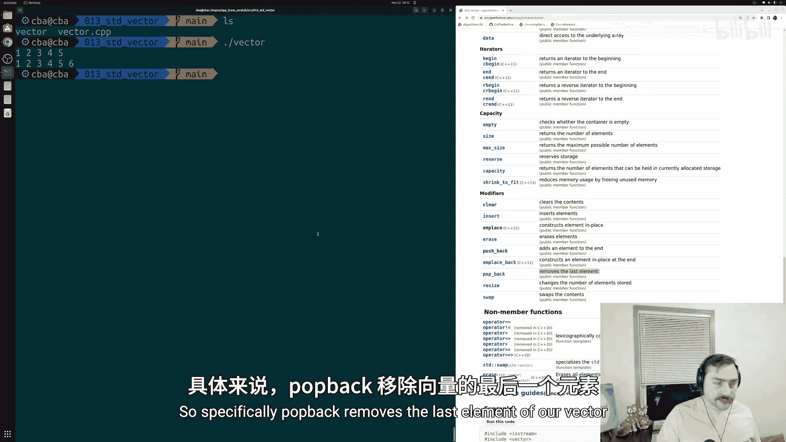

So let's go ahead and use that as well。 right， So here I'll go ahead and。Go on here。

 we'll create new line and we'll do my vector dot pop back。

well so we put a call there and then I'll add another print afterwards。

 so we should see our original vector， then our vector with6 added to it。

 then we get rid of6 with popback， and then we should see basically our original vector again。

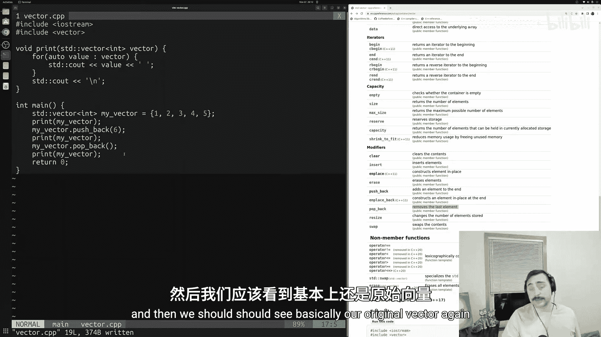

Okay， so let's go ahead and save this recompile again。And let's run our executable my vector。

 and we get kind of exactly what we expect。 We see 1，2，3。

4 5 followed by the same thing with 6 added to the end。 And then we go back to 1，2，3。

45 after we run that pop pack method。Okay， so that's a little bit on these kind of modifiers， right？

So here we're changing kind of the size of our vector。

 adding elements to it with things like pushback， and then removing elements with things like a popback。

Now， one of the important questions that many people have here is kind of what's going on underneath the hood here。

 you know what's kind of going on with memory and one of the things that we're often。

 you know we want to be conscious about is kind of the size and the capacity of our vector right So you know here when we're talking about size right So we have a size method here。

Our size is the number of elements that we have in s vector， right， So for example。

 we have five elements here，6 elements here， and then back to five elements after we do that popback。

But then we have this other method right here。 This capacity。

 and that returns the number of elements that the container has allocated space for。 right。

 So there may be a difference between our size and our capacity， right？

 Our size just says how many elements have we added into our vector。

 our capacity says how many elements do we have space for underneath the hood， right。

 And if we don't have space for that number of elements， right， if we say our adding a new element。

 underneath the hood， our vector will have to do a reallocation or a dynamic allocationation to find more space to fit all those elements。

 So let's kind of start by playing around with that。

 And looking at size and capacity of our vector as we keep adding elements。😊。

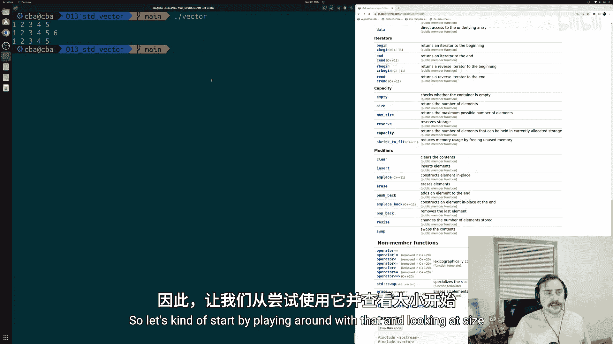

So we'll go ahead and go back into here， you know， we'll do some deleting of you know these different print printouts that we have。

 and we'll just go ahead and start with， say， an empty vector here。So we'll go ahead and save this。

 and then we'll go ahead and just create a simple loop here。So we'll say for end I is equal to 0。

 I is less than 10 I plus plus right， or I plus equals 1。

So here we're just going to have a loop that runs for 10 iterations。And inside of this loop。

 we're going to keep adding elements to our vector。So we'll do my vector dot pushback。

And here we'll just add I to a vector， right， so we should have 10 pushbacks to our vector for the 10 iterations of this loop。

And one thing we might want to keep track of is you know what is the size and the capacity of our vector at the start of each iteration。

 So let's go ahead and add a couple prints for that。So we'll go ahead and do stood sea out。

And we we'll print out size first。So'll print out my vector dot size。

 followed by a new line character。And then we'll go ahead and do kind of the same thing。

 but we'll swap out size for capacity。Right。And then， walk up ahead。And change this method here。

 to capacity。So remember size is the number of elements inside of our vector and capacity is the amount of space we have underneath the hood inside of our vector to store those elements。

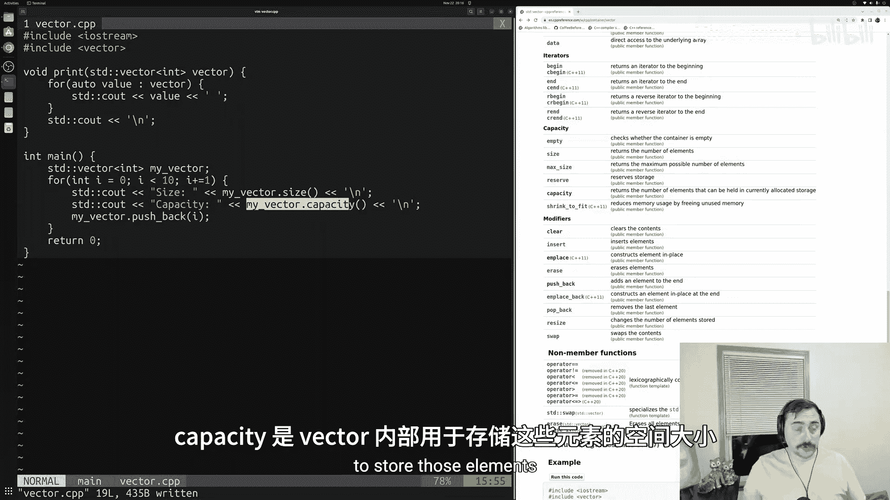

Al right， so let's go ahead and save this and let's go ahead and recompile vector now。

So let's go ahead and see how size and capacity changes as we keep adding elements with pushback to our vector。

And we see something that's pretty interesting here。

 So everything seems pretty normal from the start， right in our first iteration of the loop。

 the size of our vector is 0 and the capacity is 0。

 All we have is our variable that we created my vector， we haven't done anything to it。

 we haven't added it to anything to it。 So there's no elements in it。

 and there's no underlying storage。 Then after we add a single element。 Well。

 we've added a single element to our vectors or size is one。 and our capacity is also one。 right。

 So our vector found space for that single element we needed to store。😊。

Then as we go through the loop again， you see our size grows to two right so our size is just going to increase by one every single iteration of that loop because we're just adding a new element to that vector。

 every iteration of that loop， so we get to size2 here and our capacity also grows to2。

We added another element to our vector。 we only had capacity one here。 so our vector had to go， know。

 okay， I need to find some new space。 So it reserved enough space for two elements。Now。

 where things start to get interesting is with the next iteration of her loop。

So we add another element to our vector。 So we go from size 2 to size 3。

 So our capacity goes all the way up to four here。 right So once we add the third element to our vector。

 our capacity doubles， right， it increases from 2 to4， right？

 So now when we do another push pack right and add to we get to size 4 here。

 our capacity is still at four， right， we basically reserved two spaces inside of our vector back here。

 So we had enough space for two push packs。And then we see as we continue on。

 right after we run out of space here， our size is four and our capacity is for。

 we've completely filled our allocated space。 If we try to push back a fifth element。

 our capacity grows again， and it again doubles right， And so for our particular implementation。

 right so for Gcc that I'm using here。 there's a bit of an exponential dynamic allocation going on。

So when we run out of space， our vector grows by a power of  two。

 So you can see here we start at capacity 0， then one， then two， then 4， then 8。

 and then all the way down to 16 here。 and this will keeping grazing to 32，64。

128 and so on and so forth as we keep pushing back elements and running out of space inside of our vector by running out of space。

 I mean we hit the max capacity here。 So our size is equal to capacity and we say do another pushback our vector has to find you know a larger space to store all of those elements。

 So it has to do another allocation here。So that's a little bit about how things are working underneath the hood here。

 our vector is having to increase the capacity as we keep increasing the size of our vector。

 so when size becomes greater than capacity， we have to reallocate and find some new memory。

Now this is something that's primarily important to think about for performance reasons right kind of intuitively if we have to keep doing this reallocation。

 that's probably not going to be great for performance that's a lot of work so one of the things we can do to get around this and to help out with this。

😊，Is to use another one of our methods down here。 And that's going to be our reserve method。

 So we can use our reserve method to reserve storage， right。

 so we can go ahead and increase the capacity of our vector ahead of time。

 And this is especially useful if we know， say how many elements we're going to store in our vector or maybe some maximum number of elements that could be in our vector。

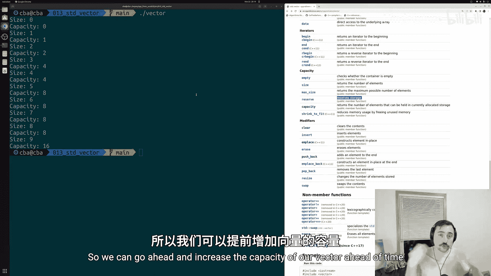

So here we'll go ahead and do just that， so we'll do my vector reserve 10 right We know we have 10 iterations of this loop。

 we're going to push back an element every iteration of this loop。

 so we'll go ahead and just reserve 10 spaces ahead of time right enough space for 10 integers here。

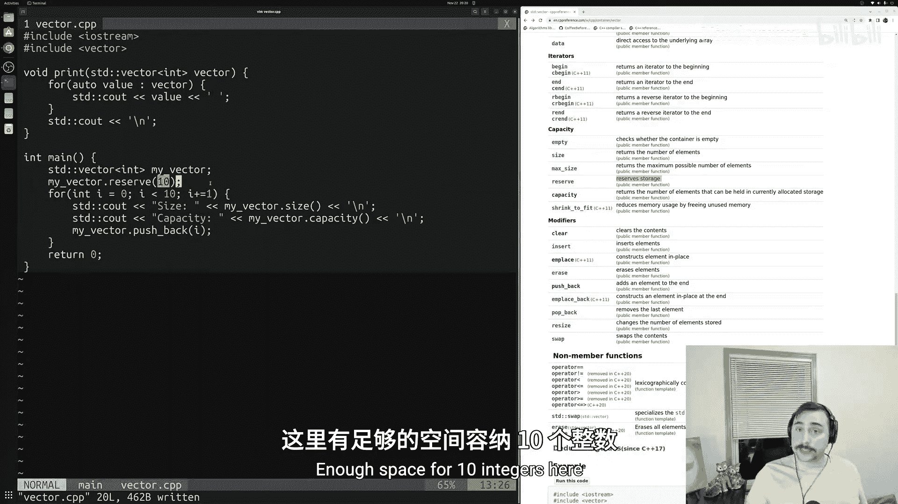

Okay， so we'll go ahead and save this and we'll recompile。And we'll go ahead and run this。

And we see quite a different result here。 So starting out right in that first iteration of our loop。

 our size is0。 we don't have any elements in our vector。 but underneath the hood。

 we have space for 10 elements。 Our capacity is 10。 And you can see as we keep any elements。

 our size keeps increasing， but we don't actually need to do any more allocations here。

 our capacity is already 10 here。 So as our， the number of elements in our vector keeps growing and growing growing。

 we're still okay， right， our capacity is greater than or equal to our size here。

 So we don't need to do any more of those allocations， right， that could be expensive。😊，Okay。

 so that's a bit of the basics right on stood vector。

 This is kind of our first container that we've looked at that is doing something。

A bit more tricky underneath the hood。 It's having to dynamically grow as we keep adding elements。

 And in fact， our vector can shrink as well。 we have a shrink to fit method over here so we can reduce the amount of memory used by our vector。

 right， So if we have， you know， for size is less than our capacity。

 we can call shrink to fit to shrink our capacity to be equal to our size。

 So that's another thing we can do。😊，Now， like I said。

 there's plenty more information here relating to St vector。

 so we'll go ahead and link this down below， and we're going to be talking a lot more about some of these other methods in here。

 especially things like in place back and the difference between pushback and in place back in later videos。

 especially when we start talking about things like classes and things like constructors but that's going to go ahead and do it for this time。

 basics of stoodve as always you can find this or any of my other examples at Github。

 co s coffeeeebe arch， but that's going to go and do it for today。

 as always I'm Nick and hope you have a nice day。

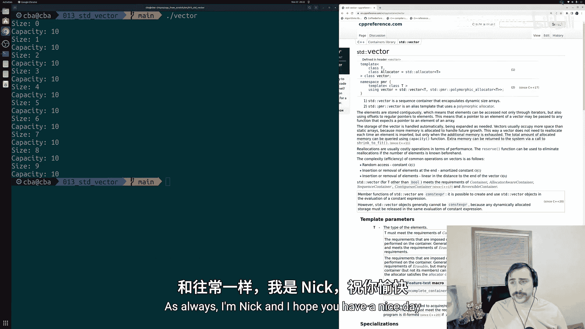